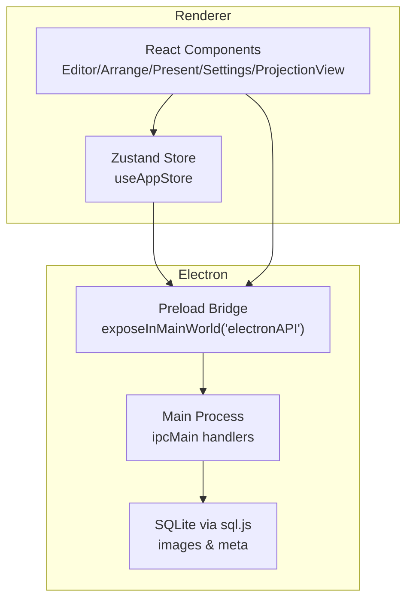
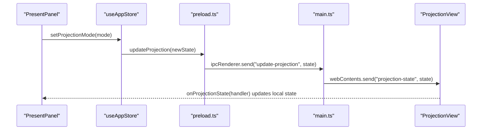
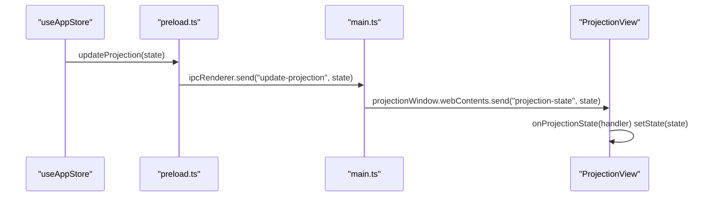
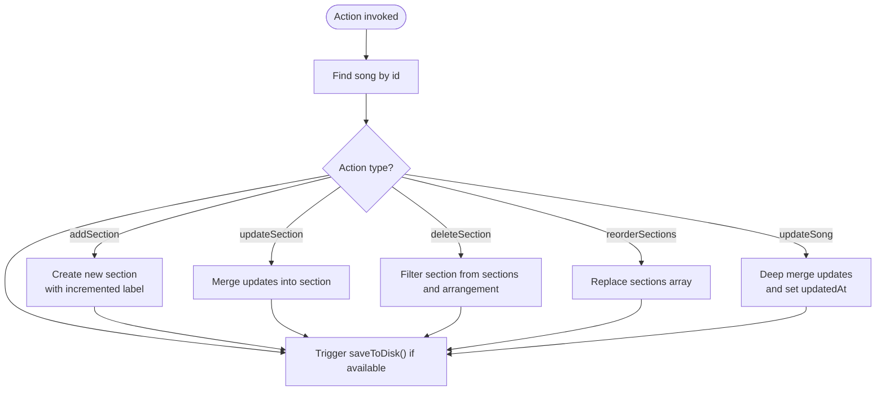
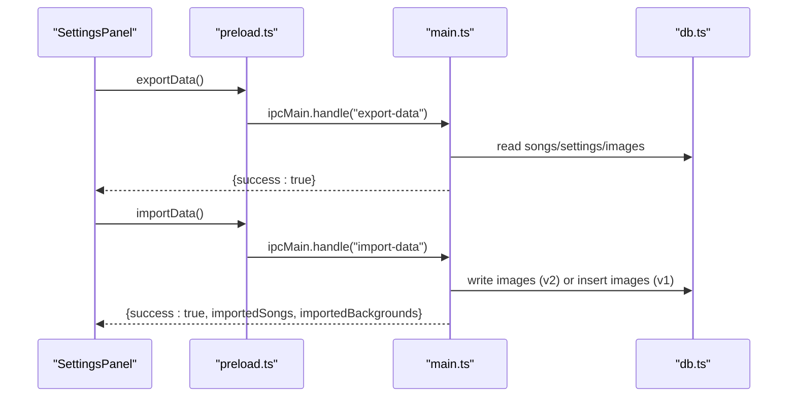
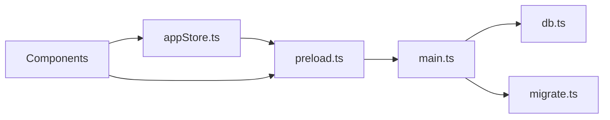

# API Reference

<cite>
**Referenced Files in This Document**
- [preload.ts](file://electron/preload.ts)
- [main.ts](file://electron/main.ts)
- [db.ts](file://electron/db.ts)
- [migrate.ts](file://electron/migrate.ts)
- [appStore.ts](file://src/store/appStore.ts)
- [index.ts](file://src/types/index.ts)
- [electron.d.ts](file://src/types/electron.d.ts)
- [ProjectionView.tsx](file://src/components/ProjectionView.tsx)
- [EditorPanel.tsx](file://src/components/EditorPanel.tsx)
- [ArrangePanel.tsx](file://src/components/ArrangePanel.tsx)
- [PresentPanel.tsx](file://src/components/PresentPanel.tsx)
- [SettingsPanel.tsx](file://src/components/SettingsPanel.tsx)
- [BackgroundGallery.tsx](file://src/components/BackgroundGallery.tsx)
- [PreparationList.tsx](file://src/components/PreparationList.tsx)
- [en.ts](file://src/i18n/en.ts)
- [package.json](file://package.json)
</cite>

## Table of Contents
1. [Introduction](#introduction)
2. [Project Structure](#project-structure)
3. [Core Components](#core-components)
4. [Architecture Overview](#architecture-overview)
5. [Detailed Component Analysis](#detailed-component-analysis)
6. [Dependency Analysis](#dependency-analysis)
7. [Performance Considerations](#performance-considerations)
8. [Troubleshooting Guide](#troubleshooting-guide)
9. [Conclusion](#conclusion)
10. [Appendices](#appendices)

## Introduction
This document provides a comprehensive API reference for LyricDeck’s public interfaces. It covers:
- Electron IPC API exposed to the renderer process
- Zustand store state management API
- Data model types for songs, lyric sections, arrangements, and projection settings
- React component prop interfaces and event handlers
- Authentication, rate limiting, versioning, migration, and backwards compatibility notes
- Common use cases, client implementation guidelines, and performance optimization tips

## Project Structure
The public API surface spans three layers:
- Electron main process IPC handlers and preload bridge
- Zustand store with actions and state accessors
- React components consuming the store and IPC

**Diagram sources**
- [preload.ts:1-43](file://electron/preload.ts#L1-L43)
- [main.ts:154-354](file://electron/main.ts#L154-L354)
- [db.ts:26-48](file://electron/db.ts#L26-L48)
- [appStore.ts:98-384](file://src/store/appStore.ts#L98-L384)

**Section sources**
- [preload.ts:1-43](file://electron/preload.ts#L1-L43)
- [main.ts:154-354](file://electron/main.ts#L154-L354)
- [appStore.ts:98-384](file://src/store/appStore.ts#L98-L384)

## Core Components

### Electron IPC API (Renderer Exposed)
The preload script exposes a typed API surface under window.electronAPI. Methods are grouped by domain.

- Display management
  - getDisplays(): Promise<Array<{ id: string; label: string; bounds: { x, y, width, height }; isPrimary: boolean }>>
  - openProjection(displayId?: string): Promise<boolean>
  - closeProjection(): Promise<boolean>
  - isProjectionOpen(): Promise<boolean>

- Projection updates
  - updateProjection(state: any): void
  - onProjectionState(callback: (state: any) => void): () => void (returns unsubscribe)
  - onProjectionWindowClosed(callback: () => void): () => void (returns unsubscribe)

- Data persistence
  - loadSongs(): Promise<any[]>
  - saveSongs(songs: any[]): Promise<boolean>
  - loadSettings(): Promise<any>
  - saveSettings(settings: any): Promise<boolean>
  - loadPreparationList(): Promise<string[]>
  - savePreparationList(list: string[]): Promise<boolean>

- File dialogs
  - selectImage(): Promise<string | null>

- Background image repository
  - addBackgroundImage(): Promise<string[]>
  - listBackgroundImages(): Promise<string[]>
  - deleteBackgroundImage(imagePath: string): Promise<boolean>

- Import / Export
  - exportData(): Promise<boolean>
  - importData(): Promise<{ success: boolean; importedSongs?: number; importedBackgrounds?: number; error?: string }>

Notes:
- All IPC methods are typed in the global declaration file for TypeScript safety.
- Projection state updates are sent via ipcRenderer.send and received via ipcRenderer.on in the projection window.

**Section sources**
- [preload.ts:3-42](file://electron/preload.ts#L3-L42)
- [electron.d.ts:5-30](file://src/types/electron.d.ts#L5-L30)
- [main.ts:155-354](file://electron/main.ts#L155-L354)

### Zustand Store API (useAppStore)
The store defines state and actions for songs, sections, arrangements, projection, UI, settings, and preparation list. It persists to disk via the Electron API when available.

Key state fields:
- songs: Song[]
- selectedSongId: string | null
- searchQuery: string
- activeTab: 'editor' | 'arrange' | 'present' | 'settings'
- isProjectionOpen: boolean
- projectionState: ProjectionState
- currentArrangementIndex: number
- settings: AppSettings
- preparationList: string[]

Actions:
- Song Library
  - setSongs(songs: Song[]): void
  - addSong(): void
  - deleteSong(id: string): void
  - duplicateSong(id: string): void
  - updateSong(id: string, updates: Partial<Song>): void
  - selectSong(id: string | null): void
  - setSearchQuery(query: string): void

- Sections
  - addSection(songId: string, type?: SectionType): void
  - updateSection(songId: string, sectionId: string, updates: Partial<LyricSection>): void
  - deleteSection(songId: string, sectionId: string): void
  - reorderSections(songId: string, sections: LyricSection[]): void

- Arrangement
  - setArrangement(songId: string, arrangement: string[]): void
  - addToArrangement(songId: string, sectionId: string): void
  - removeFromArrangement(songId: string, index: number): void

- Projection
  - setProjectionState(state: Partial<ProjectionState>): void
  - goToSlide(index: number): void
  - nextSlide(): void
  - prevSlide(): void
  - setProjectionMode(mode: ProjectionState['mode']): void
  - setIsProjectionOpen(open: boolean): void
  - shiftLines(offset: number): void

- UI
  - setActiveTab(tab: AppStore['activeTab']): void

- Settings
  - setSettings(settings: Partial<AppSettings>): void

- Preparation List
  - addToPreparationList(songId: string): void
  - removeFromPreparationList(songId: string): void
  - reorderPreparationList(list: string[]): void
  - clearPreparationList(): void
  - selectFromPreparationList(songId: string): void

- Persistence
  - loadFromDisk(): Promise<void>
  - saveToDisk(): Promise<void>

Behavior highlights:
- setProjectionState automatically sends updates to the projection window via updateProjection.
- setSettings and preparation list actions persist changes via Electron API when available.
- loadFromDisk reads songs, settings, and preparation list from disk and updates state accordingly.

**Section sources**
- [appStore.ts:31-96](file://src/store/appStore.ts#L31-L96)
- [appStore.ts:98-384](file://src/store/appStore.ts#L98-L384)

### Data Model APIs
Core types define the shape of data used across the app.

- SectionType: union of predefined section categories
- LyricSection: id, type, label, lyrics, optional backgroundOverride
- BackgroundSettings: type union and value; supports overlay, blur
- TextStyle: typography, alignment, vertical position, shadows, outlines, margins
- PresentationSettings: background, textStyle, showCopyright
- Song: id, identifiers, metadata, sections[], arrangement[], presentation, timestamps
- ProjectionMode: 'live' | 'blank' | 'black' | 'logo' | 'clear'
- ProjectionState: mode, current ids, lyrics, lineOffset, background, textStyle, optional copyright
- AppSettings: projection monitor, defaults for background/textStyle, optional logoImage

These types are used by components and store actions to maintain consistent data shapes.

**Section sources**
- [index.ts:3-89](file://src/types/index.ts#L3-L89)

### Component Prop Interfaces and Event Handlers
Components consume the store and Electron API via props and hooks.

- ProjectionView
  - Props: none
  - Subscribes to projection state via onProjectionState and renders according to mode and styles
  - Renders black/logo/live/blank modes with optional copyright text

- EditorPanel
  - Props: none
  - Uses useAppStore to manage song metadata and sections
  - Provides section editor UI with add/update/delete controls and preview

- ArrangePanel
  - Props: none
  - Manages arrangement via drag-and-drop; adds/removes sections to/from arrangement
  - Integrates with PreparationList

- PresentPanel
  - Props: none
  - Controls projection windows, keyboard shortcuts, and slide navigation
  - Uses projection state to render previews and controls

- SettingsPanel
  - Props: none
  - Manages background and text style settings per song
  - Handles import/export and image selection via Electron API

- BackgroundGallery
  - Props: { currentValue?: string; onSelect: (imagePath: string) => void }
  - Lists, adds, deletes, and selects background images via Electron API

- PreparationList
  - Props: { mode: 'arrange' | 'present' }
  - Drag-and-drop reordering and selection behavior differs by mode

**Section sources**
- [ProjectionView.tsx:4-134](file://src/components/ProjectionView.tsx#L4-L134)
- [EditorPanel.tsx:17-264](file://src/components/EditorPanel.tsx#L17-L264)
- [ArrangePanel.tsx:22-187](file://src/components/ArrangePanel.tsx#L22-L187)
- [PresentPanel.tsx:6-365](file://src/components/PresentPanel.tsx#L6-L365)
- [SettingsPanel.tsx:7-523](file://src/components/SettingsPanel.tsx#L7-L523)
- [BackgroundGallery.tsx:4-98](file://src/components/BackgroundGallery.tsx#L4-L98)
- [PreparationList.tsx:21-188](file://src/components/PreparationList.tsx#L21-L188)

## Architecture Overview
The renderer interacts with the main process through a typed preload bridge. The store orchestrates state transitions and persists data via IPC. The projection window receives real-time updates and renders the current slide.

**Diagram sources**
- [appStore.ts:242-249](file://src/store/appStore.ts#L242-L249)
- [preload.ts:11-16](file://electron/preload.ts#L11-L16)
- [main.ts:186-190](file://electron/main.ts#L186-L190)
- [ProjectionView.tsx:22-29](file://src/components/ProjectionView.tsx#L22-L29)

## Detailed Component Analysis

### Electron IPC Flow: Projection Updates

**Diagram sources**
- [appStore.ts:242-249](file://src/store/appStore.ts#L242-L249)
- [preload.ts:11-16](file://electron/preload.ts#L11-L16)
- [main.ts:186-190](file://electron/main.ts#L186-L190)
- [ProjectionView.tsx:22-29](file://src/components/ProjectionView.tsx#L22-L29)

### Zustand Store Actions: Song Management

**Diagram sources**
- [appStore.ts:185-220](file://src/store/appStore.ts#L185-L220)
- [appStore.ts:174-180](file://src/store/appStore.ts#L174-L180)

### Import/Export Flow

**Diagram sources**
- [SettingsPanel.tsx:453-486](file://src/components/SettingsPanel.tsx#L453-L486)
- [main.ts:267-354](file://electron/main.ts#L267-L354)
- [db.ts:133-176](file://electron/db.ts#L133-L176)

## Dependency Analysis
- Renderer depends on:
  - preload.ts for window.electronAPI
  - appStore.ts for state/actions
  - components for UI and subscriptions
- Main process depends on:
  - db.ts for SQLite-backed image storage and metadata
  - migrate.ts for migrating legacy image paths
- Versioning:
  - Export format includes a version field; import handles v1 and v2 formats

**Diagram sources**
- [preload.ts:1-43](file://electron/preload.ts#L1-L43)
- [main.ts:1-16](file://electron/main.ts#L1-L16)
- [db.ts:1-214](file://electron/db.ts#L1-L214)
- [migrate.ts:1-127](file://electron/migrate.ts#L1-L127)
- [appStore.ts:98-384](file://src/store/appStore.ts#L98-L384)

**Section sources**
- [main.ts:267-354](file://electron/main.ts#L267-L354)
- [db.ts:133-176](file://electron/db.ts#L133-L176)
- [migrate.ts:8-126](file://electron/migrate.ts#L8-L126)

## Performance Considerations
- Minimize frequent IPC calls by batching updates (e.g., setProjectionState merges partial state and sends once).
- Avoid unnecessary re-renders by using shallow comparisons in components and leveraging Zustand selectors if needed.
- Persist data after bulk operations to reduce I/O overhead.
- Use debounced or throttled handlers for rapid UI interactions (e.g., text style adjustments).
- Cache image URLs and avoid redundant image uploads; leverage the background gallery for reuse.

## Troubleshooting Guide
Common issues and resolutions:
- Projection window does not receive updates
  - Ensure setProjectionState is called and window.electronAPI is available.
  - Verify onProjectionState subscription is active in ProjectionView.
- Import fails with invalid format
  - Confirm the file includes a version field and required keys; importData returns an error field on failure.
- Images not loading
  - Ensure the custom protocol lyricdeck-img is registered and images are stored in the SQLite database.
- Migration warnings
  - Legacy image paths are migrated automatically; check migration completion metadata.

**Section sources**
- [appStore.ts:242-249](file://src/store/appStore.ts#L242-L249)
- [ProjectionView.tsx:22-29](file://src/components/ProjectionView.tsx#L22-L29)
- [main.ts:292-354](file://electron/main.ts#L292-L354)
- [db.ts:362-374](file://electron/main.ts#L362-L374)
- [migrate.ts:8-126](file://electron/migrate.ts#L8-L126)

## Conclusion
LyricDeck exposes a clean, typed API surface spanning Electron IPC, a centralized Zustand store, and React components. The design emphasizes separation of concerns, real-time projection updates, and robust data persistence with import/export and migration support. Consumers should adhere to the documented interfaces, handle errors gracefully, and follow performance and security best practices.

## Appendices

### Authentication, Rate Limiting, and Security Notes
- Authentication: No authentication is implemented in the current codebase.
- Rate limiting: No explicit rate limiting is enforced for IPC calls; callers should avoid excessive updates (e.g., rapid keystrokes) and batch changes when possible.
- Security: The preload bridge uses contextBridge and contextIsolation. IPC handlers validate inputs minimally; consumers should sanitize data before sending to prevent unexpected payloads.

**Section sources**
- [preload.ts:1-43](file://electron/preload.ts#L1-L43)
- [main.ts:155-354](file://electron/main.ts#L155-L354)

### Versioning and Migration
- Export format includes a version field; importData checks version and merges songs, settings, and preparation lists accordingly.
- Migration converts legacy image paths to new URL format and updates songs.json and settings.json references.

**Section sources**
- [main.ts:279-286](file://electron/main.ts#L279-L286)
- [main.ts:304-350](file://electron/main.ts#L304-L350)
- [migrate.ts:8-126](file://electron/migrate.ts#L8-L126)

### Example Usage References
- Open projection on a specific display and subscribe to state:
  - [PresentPanel.tsx:109-130](file://src/components/PresentPanel.tsx#L109-L130)
  - [ProjectionView.tsx:22-29](file://src/components/ProjectionView.tsx#L22-L29)
- Update projection state from the store:
  - [appStore.ts:242-274](file://src/store/appStore.ts#L242-L274)
- Manage background images:
  - [SettingsPanel.tsx:47-54](file://src/components/SettingsPanel.tsx#L47-L54)
  - [BackgroundGallery.tsx:17-40](file://src/components/BackgroundGallery.tsx#L17-L40)
- Import/export data:
  - [SettingsPanel.tsx:453-486](file://src/components/SettingsPanel.tsx#L453-L486)
  - [main.ts:267-354](file://electron/main.ts#L267-L354)

### Client Implementation Guidelines
- Always check for window.electronAPI availability before invoking IPC methods.
- Subscribe to onProjectionState in projection views to keep UI synchronized.
- Use store actions for state mutations; rely on automatic persistence where applicable.
- For bulk updates, prefer store-level actions that trigger saveToDisk once.

### API Reference Summary

- Electron IPC (window.electronAPI)
  - Display management: getDisplays, openProjection, closeProjection, isProjectionOpen
  - Projection updates: updateProjection, onProjectionState, onProjectionWindowClosed
  - Persistence: loadSongs/saveSongs, loadSettings/saveSettings, loadPreparationList/savePreparationList
  - Images: selectImage, addBackgroundImage, listBackgroundImages, deleteBackgroundImage
  - Import/Export: exportData, importData

- Zustand Store (useAppStore)
  - Song actions: add/update/delete/duplicate/reorder sections, manage arrangement
  - Projection actions: setProjectionState, goToSlide, nextSlide, prevSlide, setProjectionMode, setIsProjectionOpen, shiftLines
  - UI and settings: setActiveTab, setSettings
  - Preparation list: add/remove/reorder/clear/select
  - Persistence: loadFromDisk, saveToDisk

- Data Models
  - SectionType, LyricSection, BackgroundSettings, TextStyle, PresentationSettings, Song, ProjectionMode, ProjectionState, AppSettings

- Components
  - ProjectionView, EditorPanel, ArrangePanel, PresentPanel, SettingsPanel, BackgroundGallery, PreparationList

**Section sources**
- [preload.ts:3-42](file://electron/preload.ts#L3-L42)
- [electron.d.ts:5-30](file://src/types/electron.d.ts#L5-L30)
- [appStore.ts:31-96](file://src/store/appStore.ts#L31-L96)
- [index.ts:3-89](file://src/types/index.ts#L3-L89)
- [ProjectionView.tsx:4-134](file://src/components/ProjectionView.tsx#L4-L134)
- [EditorPanel.tsx:17-264](file://src/components/EditorPanel.tsx#L17-L264)
- [ArrangePanel.tsx:22-187](file://src/components/ArrangePanel.tsx#L22-L187)
- [PresentPanel.tsx:6-365](file://src/components/PresentPanel.tsx#L6-L365)
- [SettingsPanel.tsx:7-523](file://src/components/SettingsPanel.tsx#L7-L523)
- [BackgroundGallery.tsx:4-98](file://src/components/BackgroundGallery.tsx#L4-L98)
- [PreparationList.tsx:21-188](file://src/components/PreparationList.tsx#L21-L188)