# Component Interface API

<cite>
**Referenced Files in This Document**
- [SongLibrary.tsx](file://src/components/SongLibrary.tsx)
- [EditorPanel.tsx](file://src/components/EditorPanel.tsx)
- [ArrangePanel.tsx](file://src/components/ArrangePanel.tsx)
- [PresentPanel.tsx](file://src/components/PresentPanel.tsx)
- [SettingsPanel.tsx](file://src/components/SettingsPanel.tsx)
- [ProjectionView.tsx](file://src/components/ProjectionView.tsx)
- [BackgroundGallery.tsx](file://src/components/BackgroundGallery.tsx)
- [PreparationList.tsx](file://src/components/PreparationList.tsx)
- [index.ts](file://src/types/index.ts)
- [appStore.ts](file://src/store/appStore.ts)
- [index.ts](file://src/i18n/index.ts)
- [App.tsx](file://src/App.tsx)
- [preload.ts](file://electron/preload.ts)
- [electron.d.ts](file://src/types/electron.d.ts)
</cite>

## Update Summary
**Changes Made**
- Updated ProjectionView component documentation to reflect enhanced null check for Electron API
- Added robustness information for non-Electron environments
- Updated component lifecycle documentation to include conditional subscription behavior
- Enhanced troubleshooting guidance for Electron API availability

## Table of Contents
1. [Introduction](#introduction)
2. [Project Structure](#project-structure)
3. [Core Components](#core-components)
4. [Architecture Overview](#architecture-overview)
5. [Detailed Component Analysis](#detailed-component-analysis)
6. [Dependency Analysis](#dependency-analysis)
7. [Performance Considerations](#performance-considerations)
8. [Troubleshooting Guide](#troubleshooting-guide)
9. [Conclusion](#conclusion)

## Introduction
This document provides detailed component interface documentation for LyricDeck's React component API. It covers the props interfaces, event handlers, default values, validation requirements, composition patterns, state prop relationships, lifecycle methods, ref forwarding, accessibility attributes, and integration examples for the following components:
- SongLibrary
- EditorPanel
- ArrangePanel
- PresentPanel
- SettingsPanel
- ProjectionView
- BackgroundGallery
- PreparationList

The goal is to enable developers to integrate these components correctly, pass props safely, and leverage their composition patterns effectively.

## Project Structure
LyricDeck organizes components under src/components, with shared types under src/types, global state under src/store, and internationalization under src/i18n. Components are primarily functional with hooks and rely on a Zustand store for state management and Electron APIs for desktop features.

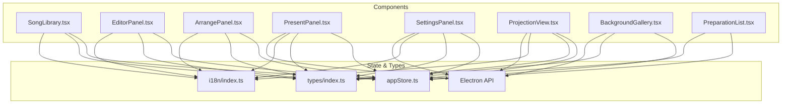

**Diagram sources**
- [SongLibrary.tsx:1-193](file://src/components/SongLibrary.tsx#L1-L193)
- [EditorPanel.tsx:1-264](file://src/components/EditorPanel.tsx#L1-L264)
- [ArrangePanel.tsx:1-187](file://src/components/ArrangePanel.tsx#L1-L187)
- [PresentPanel.tsx:1-365](file://src/components/PresentPanel.tsx#L1-L365)
- [SettingsPanel.tsx:1-523](file://src/components/SettingsPanel.tsx#L1-L523)
- [ProjectionView.tsx:1-134](file://src/components/ProjectionView.tsx#L1-L134)
- [BackgroundGallery.tsx:1-98](file://src/components/BackgroundGallery.tsx#L1-L98)
- [PreparationList.tsx:1-188](file://src/components/PreparationList.tsx#L1-L188)
- [appStore.ts:1-385](file://src/store/appStore.ts#L1-L385)
- [index.ts:1-89](file://src/types/index.ts#L1-L89)
- [index.ts:1-43](file://src/i18n/index.ts#L1-L43)

**Section sources**
- [SongLibrary.tsx:1-193](file://src/components/SongLibrary.tsx#L1-L193)
- [EditorPanel.tsx:1-264](file://src/components/EditorPanel.tsx#L1-L264)
- [ArrangePanel.tsx:1-187](file://src/components/ArrangePanel.tsx#L1-L187)
- [PresentPanel.tsx:1-365](file://src/components/PresentPanel.tsx#L1-L365)
- [SettingsPanel.tsx:1-523](file://src/components/SettingsPanel.tsx#L1-L523)
- [ProjectionView.tsx:1-134](file://src/components/ProjectionView.tsx#L1-L134)
- [BackgroundGallery.tsx:1-98](file://src/components/BackgroundGallery.tsx#L1-L98)
- [PreparationList.tsx:1-188](file://src/components/PreparationList.tsx#L1-L188)
- [index.ts:1-89](file://src/types/index.ts#L1-L89)
- [appStore.ts:1-385](file://src/store/appStore.ts#L1-L385)
- [index.ts:1-43](file://src/i18n/index.ts#L1-L43)

## Core Components
This section documents each component's props, event handlers, defaults, and integration patterns. Where applicable, we note state prop relationships and composition patterns.

### SongLibrary
- Purpose: Displays a searchable and sortable list of songs, supports selection, duplication, deletion, and adding to preparation list.
- Props: None (consumes state from the store and i18n).
- Event handlers: None (interacts with store actions internally).
- Composition pattern: Renders SongItem children with callbacks for selection, duplication, deletion, and adding to preparation list.
- State prop relationships:
  - Uses songs, selectedSongId, searchQuery, preparationList from the store.
  - Provides callbacks to store actions: selectSong, setSearchQuery, addSong, deleteSong, duplicateSong, addToPreparationList.
- Accessibility: Uses hover-triggered controls with clear icons; relies on keyboard navigation via double-click and button focus.
- Integration example: Place inside a layout container; it manages its own internal sort state and search query via the store.

**Section sources**
- [SongLibrary.tsx:8-95](file://src/components/SongLibrary.tsx#L8-L95)
- [SongLibrary.tsx:97-192](file://src/components/SongLibrary.tsx#L97-L192)
- [appStore.ts:31-96](file://src/store/appStore.ts#L31-L96)

### EditorPanel
- Purpose: Edits song metadata and sections; provides a live preview of slides.
- Props: None (consumes selectedSong from the store).
- Event handlers: None (updates store via actions).
- Composition pattern: Renders metadata inputs and a list of SectionEditor items; includes AddSectionButton and SlidePreview.
- State prop relationships:
  - Reads selectedSongId and songs from the store.
  - Updates via updateSong, addSection, updateSection, deleteSection.
- Accessibility: Inputs and buttons are keyboard accessible; preview reflects current presentation settings.
- Integration example: Wrap with a layout that allocates space for editor and preview panes.

**Section sources**
- [EditorPanel.tsx:17-118](file://src/components/EditorPanel.tsx#L17-L118)
- [EditorPanel.tsx:120-176](file://src/components/EditorPanel.tsx#L120-L176)
- [EditorPanel.tsx:178-208](file://src/components/EditorPanel.tsx#L178-L208)
- [EditorPanel.tsx:210-246](file://src/components/EditorPanel.tsx#L210-L246)
- [appStore.ts:31-96](file://src/store/appStore.ts#L31-L96)

### ArrangePanel
- Purpose: Manages the arrangement of sections for the selected song using drag-and-drop.
- Props: None (uses store for songs, selectedSongId, and arrangement).
- Event handlers: None (uses store actions).
- Composition pattern: Lists available sections, renders draggable arrangement items, and embeds PreparationList.
- State prop relationships:
  - Reads selectedSongId and songs from the store.
  - Updates via addToArrangement, removeFromArrangement, setArrangement.
- Accessibility: Uses @dnd-kit for keyboard and pointer accessibility; drag handles expose grab affordances.
- Integration example: Place alongside PreparationList for a two-panel arrangement workflow.

**Section sources**
- [ArrangePanel.tsx:22-134](file://src/components/ArrangePanel.tsx#L22-L134)
- [ArrangePanel.tsx:136-187](file://src/components/ArrangePanel.tsx#L136-L187)
- [appStore.ts:31-96](file://src/store/appStore.ts#L31-L96)

### PresentPanel
- Purpose: Controls projection display, slide navigation, and preview of current and next slides.
- Props: None (uses store for projection state, arrangement, and display info).
- Event handlers: None (uses store actions).
- Composition pattern: Displays current and next previews, controls bar, and PreparationList; integrates with Electron for multi-display support.
- State prop relationships:
  - Reads songs, selectedSongId, projectionState, currentArrangementIndex, isProjectionOpen from the store.
  - Updates via goToSlide, nextSlide, prevSlide, setProjectionMode, setIsProjectionOpen, shiftLines.
- Accessibility: Keyboard shortcuts for navigation and modes; focus management for interactive elements.
- Integration example: Use within a layout that includes the ProjectionView for external display.

**Section sources**
- [PresentPanel.tsx:6-347](file://src/components/PresentPanel.tsx#L6-L347)
- [PresentPanel.tsx:349-365](file://src/components/PresentPanel.tsx#L349-L365)
- [appStore.ts:31-96](file://src/store/appStore.ts#L31-L96)

### SettingsPanel
- Purpose: Configures background styles, text styles, language, and import/export functionality.
- Props: None (uses store for selectedSong and settings).
- Event handlers: None (updates via store actions).
- Composition pattern: Renders background settings, text style settings, language selector, and import/export sections; embeds BackgroundGallery.
- State prop relationships:
  - Reads selectedSongId and songs from the store.
  - Updates via updateSong for presentation settings; uses loadFromDisk callback.
- Accessibility: Form controls are labeled; color pickers and sliders are keyboard accessible.
- Integration example: Place within a settings page; ensure BackgroundGallery receives current background value.

**Section sources**
- [SettingsPanel.tsx:7-417](file://src/components/SettingsPanel.tsx#L7-L417)
- [SettingsPanel.tsx:419-522](file://src/components/SettingsPanel.tsx#L419-L522)
- [appStore.ts:31-96](file://src/store/appStore.ts#L31-L96)

### ProjectionView
- Purpose: Renders the projection window content based on ProjectionState.
- Props: None (subscribes to ProjectionState via Electron IPC).
- Event handlers: None (reads state from Electron).
- Composition pattern: Renders black, logo, or live content depending on mode; applies background and text styles.
- State prop relationships:
  - Subscribes to ProjectionState updates from Electron; maintains local fallback state.
  - **Enhanced**: Now includes null check for Electron API before subscribing to projection state updates.
- Accessibility: No interactive elements; content is static per mode.
- Integration example: Host in a separate Electron window; ensure IPC channel is configured.
- **Robustness Enhancement**: The component now gracefully handles non-Electron environments by checking for window.electronAPI existence before attempting to subscribe to projection state updates.

**Updated** Enhanced with null check for Electron API to improve robustness in non-Electron environments

**Section sources**
- [ProjectionView.tsx:4-134](file://src/components/ProjectionView.tsx#L4-L134)
- [index.ts:69-81](file://src/types/index.ts#L69-L81)

### BackgroundGallery
- Purpose: Manages a gallery of background images, allowing selection and deletion.
- Props:
  - currentValue?: string (current background image path/value)
  - onSelect: (imagePath: string) => void
- Event handlers: None (manages internal state and calls onSelect).
- Composition pattern: Loads images from Electron, displays thumbnails, supports add/delete.
- State prop relationships:
  - Loads images from Electron; updates local state on add/delete.
- Accessibility: Grid of thumbnails with hover actions; keyboard navigable.
- Integration example: Pass current background value and an onSelect handler to update song presentation.

**Section sources**
- [BackgroundGallery.tsx:4-98](file://src/components/BackgroundGallery.tsx#L4-L98)
- [appStore.ts:31-96](file://src/store/appStore.ts#L31-L96)

### PreparationList
- Purpose: Maintains and reorders a preparation list of songs; integrates with ArrangePanel and PresentPanel.
- Props:
  - mode: 'arrange' | 'present'
- Event handlers: None (uses store actions).
- Composition pattern: Renders draggable list of songs; supports clearing and item click behavior based on mode.
- State prop relationships:
  - Reads preparationList, selectedSongId from the store.
  - Updates via reorderPreparationList, removeFromPreparationList, clearPreparationList, selectSong/selectFromPreparationList.
- Accessibility: Drag handles and remove buttons are keyboard accessible; list items are focusable.
- Integration example: Include as a sidebar in ArrangePanel and PresentPanel layouts.

**Section sources**
- [PreparationList.tsx:21-188](file://src/components/PreparationList.tsx#L21-L188)
- [appStore.ts:31-96](file://src/store/appStore.ts#L31-L96)

## Architecture Overview
The components communicate primarily through a central Zustand store and Electron APIs. Components subscribe to store slices and call actions to mutate state. Some components (PresentPanel, ProjectionView) integrate with Electron for multi-display projection.

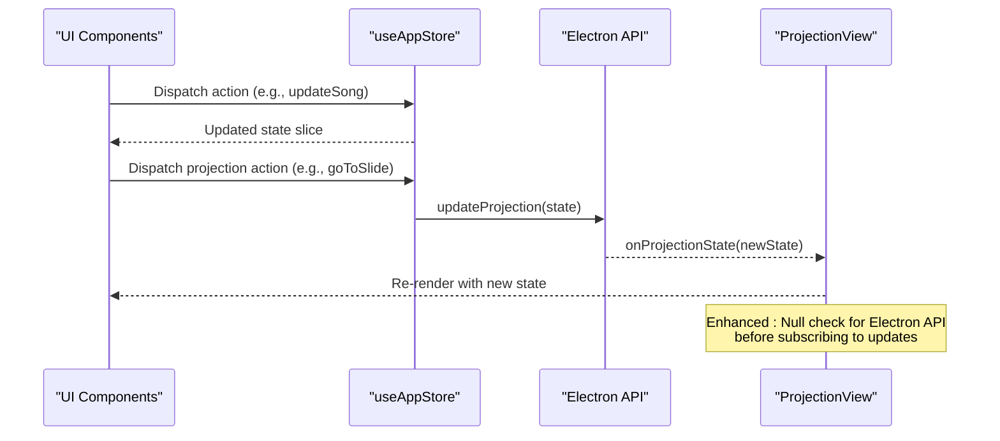

**Diagram sources**
- [appStore.ts:241-249](file://src/store/appStore.ts#L241-L249)
- [PresentPanel.tsx:109-129](file://src/components/PresentPanel.tsx#L109-L129)
- [ProjectionView.tsx:22-29](file://src/components/ProjectionView.tsx#L22-L29)

**Section sources**
- [appStore.ts:1-385](file://src/store/appStore.ts#L1-L385)
- [PresentPanel.tsx:1-365](file://src/components/PresentPanel.tsx#L1-L365)
- [ProjectionView.tsx:1-134](file://src/components/ProjectionView.tsx#L1-L134)

## Detailed Component Analysis

### SongLibrary
- Props: None
- Internal state: sortBy (local)
- Event handlers: None (uses store actions)
- Composition: Renders SongItem children with selection/duplication/deletion/add-to-prep callbacks
- Validation: None (props are derived from store)
- Lifecycle: Uses i18n hook; manages local sort state
- Accessibility: Hover-triggered controls; keyboard navigation via double-click

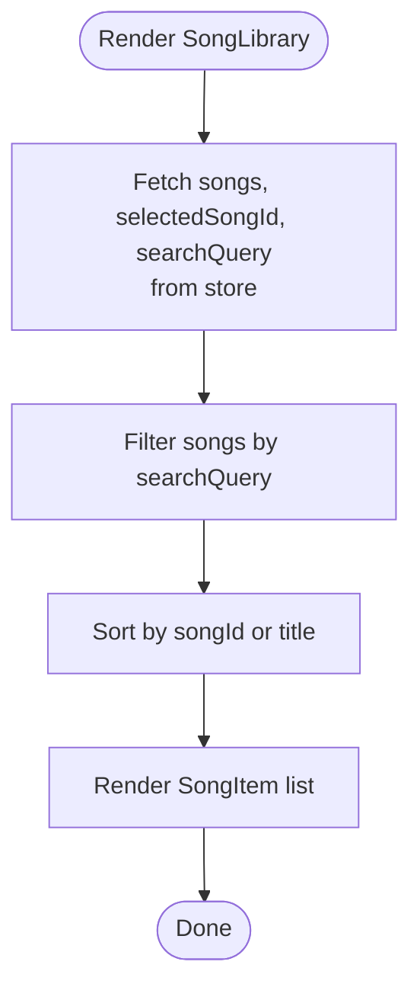

**Diagram sources**
- [SongLibrary.tsx:8-95](file://src/components/SongLibrary.tsx#L8-L95)

**Section sources**
- [SongLibrary.tsx:8-95](file://src/components/SongLibrary.tsx#L8-L95)

### EditorPanel
- Props: None
- Internal state: None (managed via store)
- Event handlers: None (uses store actions)
- Composition: Metadata inputs + SectionEditor list + AddSectionButton + SlidePreview
- Validation: None (props are derived from store)
- Lifecycle: Uses i18n; renders preview based on presentation settings
- Accessibility: Inputs and buttons are keyboard accessible

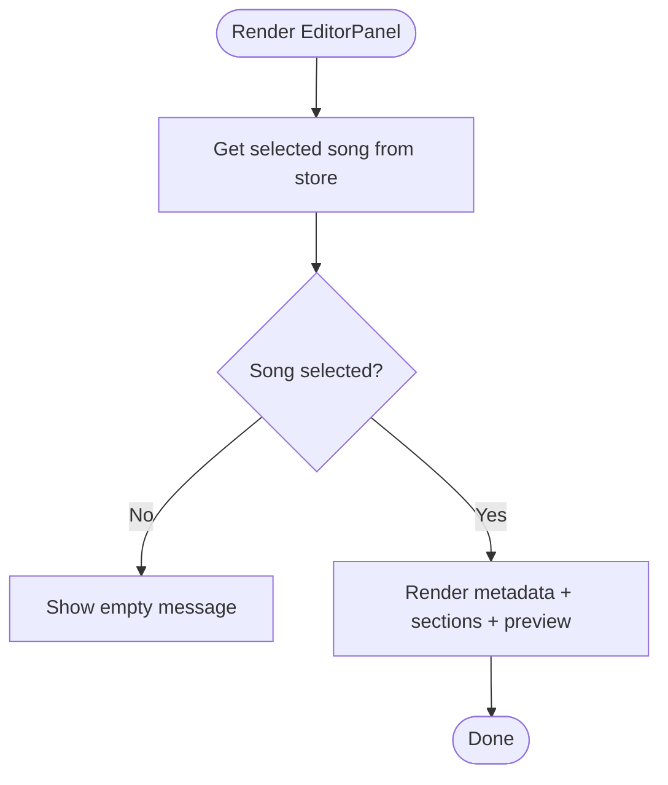

**Diagram sources**
- [EditorPanel.tsx:17-118](file://src/components/EditorPanel.tsx#L17-L118)

**Section sources**
- [EditorPanel.tsx:17-118](file://src/components/EditorPanel.tsx#L17-L118)

### ArrangePanel
- Props: None
- Internal state: None (managed via store)
- Event handlers: None (uses store actions)
- Composition: Available sections + draggable arrangement + PreparationList
- Validation: None (props are derived from store)
- Lifecycle: Uses @dnd-kit sensors; drag-and-drop reordering
- Accessibility: Drag handles and remove buttons are keyboard accessible

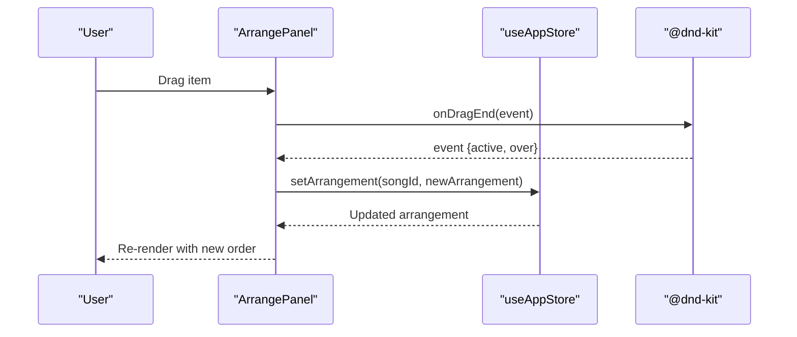

**Diagram sources**
- [ArrangePanel.tsx:54-63](file://src/components/ArrangePanel.tsx#L54-L63)
- [appStore.ts:222-239](file://src/store/appStore.ts#L222-L239)

**Section sources**
- [ArrangePanel.tsx:22-134](file://src/components/ArrangePanel.tsx#L22-L134)
- [appStore.ts:66-70](file://src/store/appStore.ts#L66-L70)

### PresentPanel
- Props: None
- Internal state: displays, selectedDisplay (local)
- Event handlers: handleKeyDown (keyboard shortcuts)
- Composition: Controls bar + section list + current/next previews + PreparationList
- Validation: None (props are derived from store)
- Lifecycle: Adds and removes keydown listener; opens/closes projection via Electron
- Accessibility: Keyboard shortcuts; focus management for interactive elements

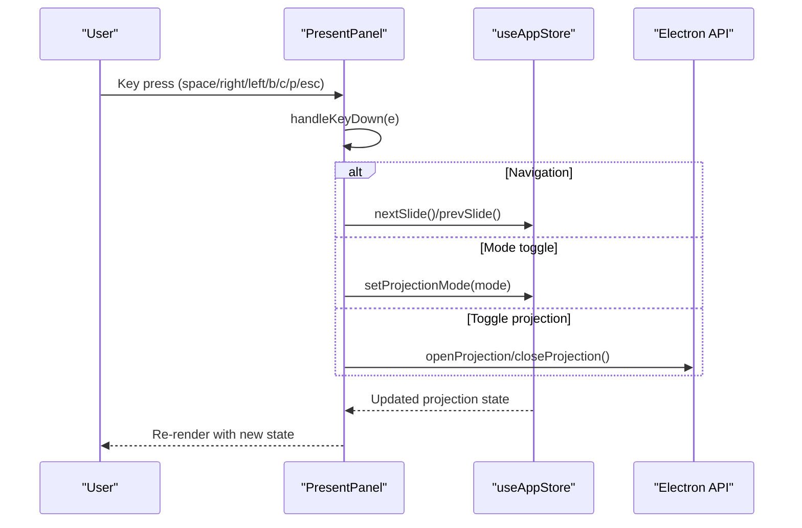

**Diagram sources**
- [PresentPanel.tsx:39-84](file://src/components/PresentPanel.tsx#L39-L84)
- [PresentPanel.tsx:109-129](file://src/components/PresentPanel.tsx#L109-L129)
- [appStore.ts:71-78](file://src/store/appStore.ts#L71-L78)

**Section sources**
- [PresentPanel.tsx:6-347](file://src/components/PresentPanel.tsx#L6-L347)
- [appStore.ts:71-78](file://src/store/appStore.ts#L71-L78)

### SettingsPanel
- Props: None
- Internal state: None (managed via store)
- Event handlers: None (uses store actions)
- Composition: Language section, import/export section, background settings, text style settings, copyright toggle, BackgroundGallery
- Validation: None (props are derived from store)
- Lifecycle: Uses i18n; integrates with Electron for image selection and library
- Accessibility: Form controls are labeled; color pickers and sliders are keyboard accessible

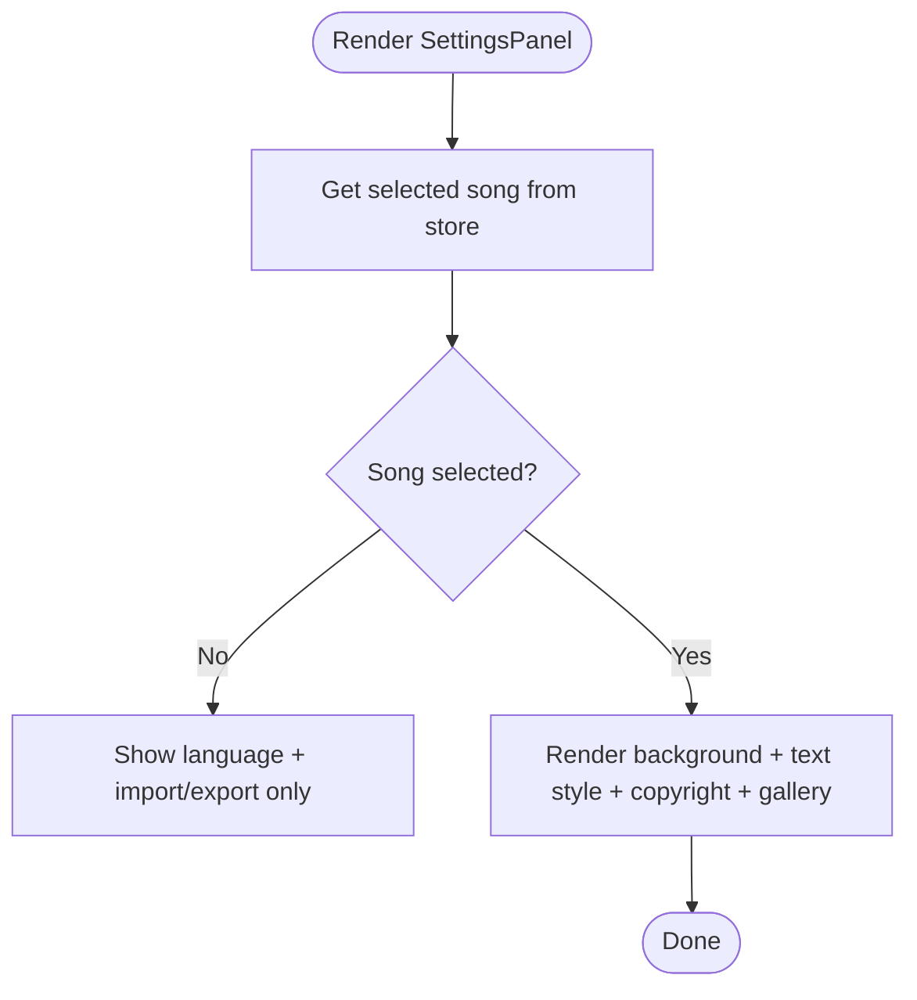

**Diagram sources**
- [SettingsPanel.tsx:7-417](file://src/components/SettingsPanel.tsx#L7-L417)

**Section sources**
- [SettingsPanel.tsx:7-417](file://src/components/SettingsPanel.tsx#L7-L417)

### ProjectionView
- Props: None
- Internal state: state (local fallback; subscribes to Electron updates)
- Event handlers: None (reads from Electron)
- Composition: Renders black/logo/live content based on mode; applies background and text styles
- Validation: None (props are derived from store)
- Lifecycle: Subscribes to ProjectionState updates via Electron IPC with null check
- Accessibility: No interactive elements
- **Enhanced Robustness**: The component now includes a null check (`if (window.electronAPI)`) before attempting to subscribe to projection state updates, making it compatible with non-Electron environments such as web browsers or development servers.

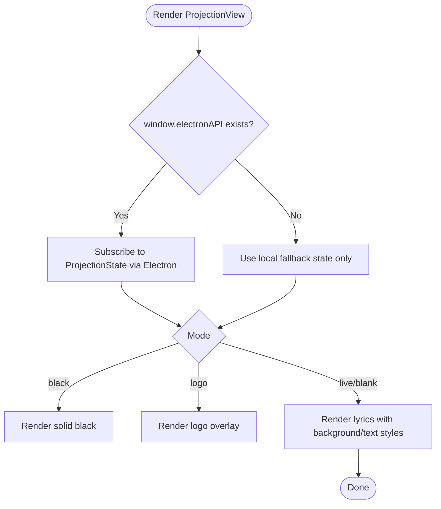

**Diagram sources**
- [ProjectionView.tsx:4-134](file://src/components/ProjectionView.tsx#L4-L134)
- [index.ts:69-81](file://src/types/index.ts#L69-L81)

**Section sources**
- [ProjectionView.tsx:4-134](file://src/components/ProjectionView.tsx#L4-L134)

### BackgroundGallery
- Props:
  - currentValue?: string
  - onSelect: (imagePath: string) => void
- Internal state: images (local)
- Event handlers: None (manages internal state and calls onSelect)
- Composition: Loads images from Electron, displays thumbnails, supports add/delete
- Validation: None (props are typed)
- Lifecycle: Loads images on mount; supports add/delete operations
- Accessibility: Grid of thumbnails with hover actions; keyboard navigable

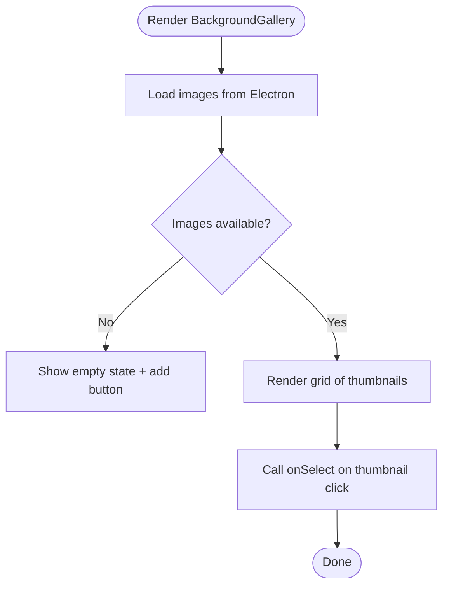

**Diagram sources**
- [BackgroundGallery.tsx:9-98](file://src/components/BackgroundGallery.tsx#L9-L98)

**Section sources**
- [BackgroundGallery.tsx:4-98](file://src/components/BackgroundGallery.tsx#L4-L98)

### PreparationList
- Props:
  - mode: 'arrange' | 'present'
- Internal state: None (managed via store)
- Event handlers: None (uses store actions)
- Composition: Draggable list of songs; supports clearing and item click behavior based on mode
- Validation: None (props are typed)
- Lifecycle: Uses @dnd-kit sensors; drag-and-drop reordering
- Accessibility: Drag handles and remove buttons are keyboard accessible

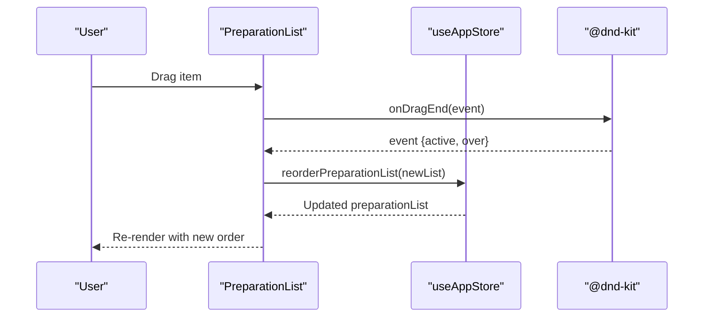

**Diagram sources**
- [PreparationList.tsx:47-55](file://src/components/PreparationList.tsx#L47-L55)
- [appStore.ts:335-339](file://src/store/appStore.ts#L335-L339)

**Section sources**
- [PreparationList.tsx:21-188](file://src/components/PreparationList.tsx#L21-L188)
- [appStore.ts:86-91](file://src/store/appStore.ts#L86-L91)

## Dependency Analysis
- Components depend on:
  - Zustand store for state and actions
  - Electron APIs for persistence and projection
  - @dnd-kit for drag-and-drop in ArrangePanel and PreparationList
  - i18n store for translations
- Coupling:
  - Components are loosely coupled via store actions and props
  - ProjectionView is decoupled from UI via Electron IPC with enhanced null safety
- Cohesion:
  - Each component encapsulates its own rendering and interactions
- External dependencies:
  - @dnd-kit/core, @dnd-kit/sortable, @dnd-kit/utilities
  - Electron IPC channels for projection and file operations
  - **Enhanced**: Null checks for Electron API across multiple components for improved robustness

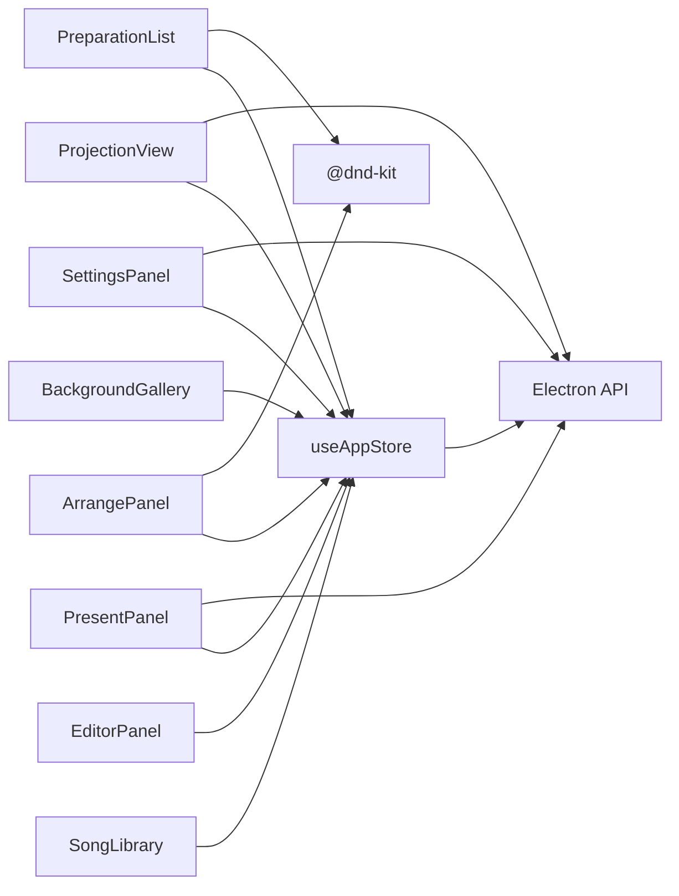

**Diagram sources**
- [appStore.ts:1-385](file://src/store/appStore.ts#L1-L385)
- [ArrangePanel.tsx:1-19](file://src/components/ArrangePanel.tsx#L1-L19)
- [PreparationList.tsx:1-19](file://src/components/PreparationList.tsx#L1-L19)
- [PresentPanel.tsx:1-4](file://src/components/PresentPanel.tsx#L1-L4)
- [SettingsPanel.tsx:1-5](file://src/components/SettingsPanel.tsx#L1-L5)

**Section sources**
- [appStore.ts:1-385](file://src/store/appStore.ts#L1-L385)
- [ArrangePanel.tsx:1-19](file://src/components/ArrangePanel.tsx#L1-L19)
- [PreparationList.tsx:1-19](file://src/components/PreparationList.tsx#L1-L19)
- [PresentPanel.tsx:1-4](file://src/components/PresentPanel.tsx#L1-L4)
- [SettingsPanel.tsx:1-5](file://src/components/SettingsPanel.tsx#L1-L5)

## Performance Considerations
- Rendering lists: Use virtualization for large song/section lists if needed.
- Debounce search: Consider debouncing search input to reduce re-renders.
- Memoization: Use memoization for computed lists (filtered/sorted) to avoid unnecessary renders.
- Drag-and-drop: Ensure efficient reordering and minimal DOM updates during drag operations.
- Projection updates: Throttle or batch projection state updates to prevent excessive re-renders.
- **Enhanced**: Electron API null checks prevent unnecessary subscription attempts in non-Electron environments, improving performance and reducing errors.

## Troubleshooting Guide
- Missing Electron API:
  - Symptom: Projection controls disabled or image gallery not loading.
  - Resolution: Ensure Electron API is available in the runtime environment. The ProjectionView component now includes null checks to handle non-Electron environments gracefully.
- Keyboard shortcuts not working:
  - Symptom: Navigation keys do nothing.
  - Resolution: Verify that focus is not on input/textarea elements; confirm keydown listener is attached.
- Drag-and-drop not working:
  - Symptom: Items cannot be dragged.
  - Resolution: Confirm @dnd-kit sensors are initialized and events are handled.
- Background image not updating:
  - Symptom: Selected image does not apply.
  - Resolution: Ensure onSelect callback is passed and updateSong is invoked with correct background settings.
- **New**: ProjectionView not updating in web browser:
  - Symptom: ProjectionView appears blank or doesn't receive updates.
  - Resolution: This is expected behavior in non-Electron environments. The component now includes null checks and uses local fallback state. Projection updates will only work when running in an Electron environment with the proper IPC setup.

**Section sources**
- [PresentPanel.tsx:39-84](file://src/components/PresentPanel.tsx#L39-L84)
- [ArrangePanel.tsx:28-31](file://src/components/ArrangePanel.tsx#L28-L31)
- [PreparationList.tsx:38-41](file://src/components/PreparationList.tsx#L38-L41)
- [BackgroundGallery.tsx:17-40](file://src/components/BackgroundGallery.tsx#L17-L40)
- [ProjectionView.tsx:22-29](file://src/components/ProjectionView.tsx#L22-L29)

## Conclusion
LyricDeck's component API is designed around a centralized store and Electron integration, enabling modular and composable UI components. Each component exposes a clear interface with minimal props, relying on store actions for state mutations and Electron APIs for advanced features. The recent enhancement to ProjectionView with null checks for Electron API significantly improves robustness, making the application more resilient in various deployment environments. By following the composition patterns and integration examples outlined here, developers can reliably integrate and extend the component suite while maintaining consistent behavior and accessibility across different runtime environments.