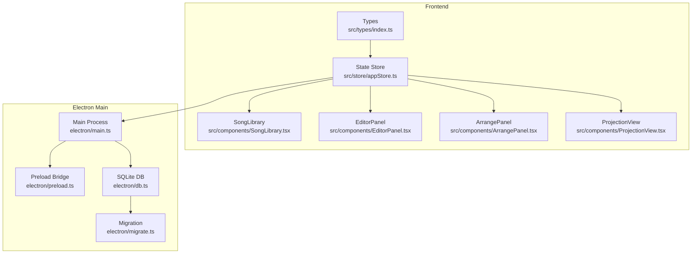
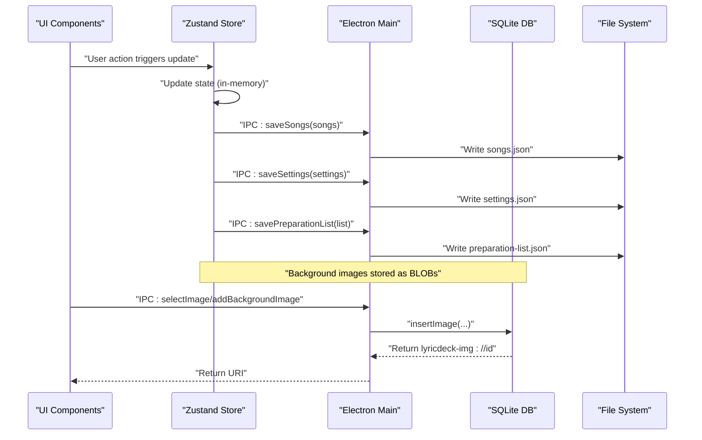
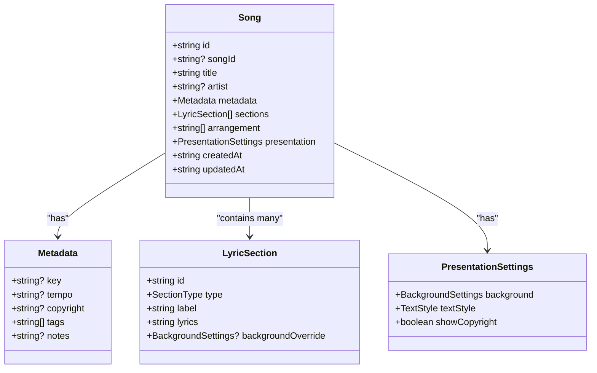
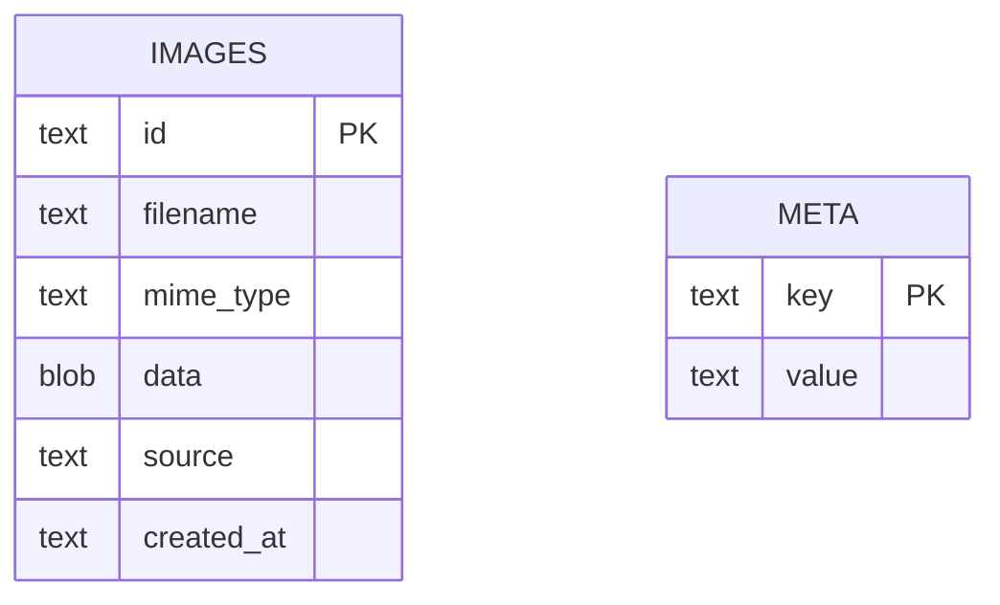
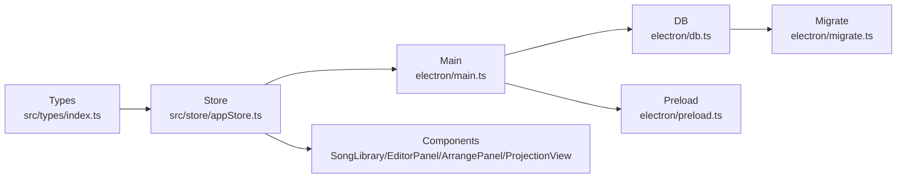

# Data Model APIs

<cite>
**Referenced Files in This Document**
- [README.md](file://README.md)
- [src/types/index.ts](file://src/types/index.ts)
- [src/store/appStore.ts](file://src/store/appStore.ts)
- [src/utils/seedData.ts](file://src/utils/seedData.ts)
- [electron/db.ts](file://electron/db.ts)
- [electron/migrate.ts](file://electron/migrate.ts)
- [electron/main.ts](file://electron/main.ts)
- [electron/preload.ts](file://electron/preload.ts)
- [src/components/SongLibrary.tsx](file://src/components/SongLibrary.tsx)
- [src/components/EditorPanel.tsx](file://src/components/EditorPanel.tsx)
- [src/components/ArrangePanel.tsx](file://src/components/ArrangePanel.tsx)
- [src/components/ProjectionView.tsx](file://src/components/ProjectionView.tsx)
</cite>

## Table of Contents
1. [Introduction](#introduction)
2. [Project Structure](#project-structure)
3. [Core Components](#core-components)
4. [Architecture Overview](#architecture-overview)
5. [Detailed Component Analysis](#detailed-component-analysis)
6. [Dependency Analysis](#dependency-analysis)
7. [Performance Considerations](#performance-considerations)
8. [Troubleshooting Guide](#troubleshooting-guide)
9. [Conclusion](#conclusion)
10. [Appendices](#appendices)

## Introduction
This document provides comprehensive data model documentation for LyricDeck’s core entities and their API interfaces. It covers the Song data model, LyricSection structure, Arrangement configuration, ProjectionState settings, and BackgroundSettings specifications. For each model, it specifies field types, validation rules, defaults, and relationships with other entities. It also documents CRUD operations APIs, serialization/deserialization patterns, data transformation utilities, database schema representations, indexing strategies, query optimization techniques, examples of instantiation, validation, and persistence operations, and data migration patterns with version compatibility and backward compatibility considerations.

## Project Structure
LyricDeck is a cross-platform desktop application built with Electron, React, and TypeScript. Data models are defined in shared TypeScript interfaces and consumed by the frontend store and components. Persistence is handled via local JSON files for songs, settings, and preparation lists, and an embedded SQL database for binary image assets. Migration utilities convert legacy filesystem-based image references to database-backed URIs.

**Diagram sources**
- [src/types/index.ts:1-89](file://src/types/index.ts#L1-L89)
- [src/store/appStore.ts:1-385](file://src/store/appStore.ts#L1-L385)
- [src/components/SongLibrary.tsx:1-193](file://src/components/SongLibrary.tsx#L1-L193)
- [src/components/EditorPanel.tsx:1-264](file://src/components/EditorPanel.tsx#L1-L264)
- [src/components/ArrangePanel.tsx:1-187](file://src/components/ArrangePanel.tsx#L1-L187)
- [src/components/ProjectionView.tsx:1-134](file://src/components/ProjectionView.tsx#L1-L134)
- [electron/main.ts:1-390](file://electron/main.ts#L1-L390)
- [electron/preload.ts:1-43](file://electron/preload.ts#L1-L43)
- [electron/db.ts:1-214](file://electron/db.ts#L1-L214)
- [electron/migrate.ts:1-127](file://electron/migrate.ts#L1-L127)

**Section sources**
- [README.md:116-157](file://README.md#L116-L157)
- [src/types/index.ts:1-89](file://src/types/index.ts#L1-L89)
- [electron/main.ts:18-79](file://electron/main.ts#L18-L79)

## Core Components
This section defines LyricDeck’s core data models and their relationships.

- Song
  - Purpose: Root entity representing a song with metadata, sections, arrangement, presentation settings, and timestamps.
  - Fields:
    - id: string (primary identifier)
    - songId?: string (optional user-defined ID)
    - title: string
    - artist?: string
    - metadata: {
        key?: string
        tempo?: string
        copyright?: string
        tags?: string[]
        notes?: string
      }
    - sections: LyricSection[]
    - arrangement: string[] (ordered section IDs)
    - presentation: {
        background: BackgroundSettings
        textStyle: TextStyle
        showCopyright: boolean
      }
    - createdAt: string (ISO 8601)
    - updatedAt: string (ISO 8601)
  - Defaults:
    - metadata.tags defaults to empty array
    - presentation.showCopyright defaults to false
    - timestamps default to current ISO date-time upon creation
  - Relationships:
    - sections: one-to-many
    - arrangement: ordered list of section IDs
    - presentation.background and textStyle: embedded settings

- LyricSection
  - Purpose: A labeled block of lyrics grouped by type.
  - Fields:
    - id: string
    - type: SectionType ('Intro' | 'Verse' | 'Pre-Chorus' | 'Chorus' | 'Bridge' | 'Instrumental' | 'Outro' | 'Custom')
    - label: string
    - lyrics: string
    - backgroundOverride?: BackgroundSettings (optional per-section override)
  - Defaults:
    - No explicit defaults; consumers should initialize as needed.

- BackgroundSettings
  - Purpose: Defines background rendering for slides and projections.
  - Fields:
    - type: 'color' | 'gradient' | 'image' | 'video'
    - value: string (hex color, CSS gradient, or lyricdeck-img:// URI)
    - overlayColor?: string (optional overlay tint)
    - overlayOpacity?: number (0–1)
    - blur?: number (pixels)
  - Defaults:
    - None; consumers should provide sensible defaults for UI.

- TextStyle
  - Purpose: Typography and layout settings for lyrics.
  - Fields:
    - fontFamily: string
    - fontSize: number
    - fontWeight: string
    - italic: boolean
    - color: string
    - alignment: 'left' | 'center' | 'right'
    - verticalPosition: 'top' | 'middle' | 'bottom'
    - shadow: boolean
    - outline: boolean
    - lineHeight: number
    - topMargin?: number
    - bottomMargin?: number
  - Defaults:
    - Provided by defaultTextStyle in the store.

- ProjectionState
  - Purpose: Runtime state for the projection window.
  - Fields:
    - mode: 'live' | 'blank' | 'black' | 'logo' | 'clear'
    - currentSongId?: string
    - currentSectionId?: string
    - currentArrangementIndex?: number
    - lyrics?: string
    - lineOffset?: number
    - background: BackgroundSettings
    - textStyle: TextStyle
    - copyright?: string
  - Defaults:
    - mode defaults to 'black'; background and textStyle default to defaults.

- AppSettings
  - Purpose: Application-wide preferences.
  - Fields:
    - projectionMonitor?: string
    - defaultBackground: BackgroundSettings
    - defaultTextStyle: TextStyle
    - logoImage?: string (URI)
  - Defaults:
    - Provided by defaultProjectionState and defaultTextStyle.

Relationships:
- Song contains multiple LyricSection entries.
- Song.arrangement is an ordered list of LyricSection ids.
- ProjectionState references current Song and Section via ids and embeds BackgroundSettings and TextStyle.
- BackgroundSettings.value may reference lyricdeck-img:// URIs stored in the SQLite database.

Validation rules:
- Required fields: Song.id, Song.title, Song.sections, Song.arrangement, Song.presentation.background, Song.presentation.textStyle.
- Optional fields: songId, artist, metadata.* fields, tags, notes, copyright, backgroundOverride, overlayColor, overlayOpacity, blur, topMargin, bottomMargin.
- Type constraints: enums for SectionType, alignment, verticalPosition, and mode; numeric types for fontSize, lineHeight, topMargin, bottomMargin, overlayOpacity, blur.

**Section sources**
- [src/types/index.ts:3-89](file://src/types/index.ts#L3-L89)
- [src/store/appStore.ts:5-30](file://src/store/appStore.ts#L5-L30)

## Architecture Overview
The data lifecycle spans the frontend store, IPC to the main process, and persistence to JSON files and an embedded SQLite database. Projections receive runtime state updates via IPC.

**Diagram sources**
- [src/store/appStore.ts:361-384](file://src/store/appStore.ts#L361-L384)
- [electron/main.ts:192-218](file://electron/main.ts#L192-L218)
- [electron/db.ts:70-87](file://electron/db.ts#L70-L87)

**Section sources**
- [electron/main.ts:192-218](file://electron/main.ts#L192-L218)
- [electron/db.ts:70-87](file://electron/db.ts#L70-L87)

## Detailed Component Analysis

### Song Data Model
- Properties and defaults:
  - id: generated UUID
  - songId: optional
  - title: required
  - artist: optional
  - metadata: { key, tempo, copyright, tags[], notes }
    - tags defaults to []
  - sections: LyricSection[]
  - arrangement: string[] (ordered section IDs)
  - presentation: { background, textStyle, showCopyright }
    - showCopyright defaults to false
  - createdAt/updatedAt: ISO timestamps
- Relationships:
  - sections: one-to-many; each LyricSection belongs to one Song
  - arrangement: ordered list of LyricSection ids
  - presentation.background/textStyle: embedded settings
- Validation:
  - Required: id, title, sections, arrangement, presentation.background, presentation.textStyle
  - Optional: songId, artist, metadata fields, tags, notes, copyright
- Serialization:
  - Frontend persists to songs.json via IPC
  - Import/Export supports merging songs by id and importing images
- Instantiation examples:
  - New song creation initializes default background, text style, and a single Verse section
  - Duplication clones a song, remaps section IDs, and updates arrangement references

**Diagram sources**
- [src/types/index.ts:50-67](file://src/types/index.ts#L50-L67)
- [src/types/index.ts:13-19](file://src/types/index.ts#L13-L19)
- [src/types/index.ts:44-48](file://src/types/index.ts#L44-L48)

**Section sources**
- [src/types/index.ts:50-67](file://src/types/index.ts#L50-L67)
- [src/store/appStore.ts:116-142](file://src/store/appStore.ts#L116-L142)
- [src/store/appStore.ts:151-172](file://src/store/appStore.ts#L151-L172)
- [src/utils/seedData.ts:17-49](file://src/utils/seedData.ts#L17-L49)

### LyricSection Structure
- Fields:
  - id: string
  - type: SectionType
  - label: string
  - lyrics: string
  - backgroundOverride?: BackgroundSettings
- Defaults:
  - None; consumers should initialize as needed
- Relationships:
  - Belongs to one Song; referenced by arrangement and projection state
- Validation:
  - Required: id, type, label, lyrics
  - Optional: backgroundOverride

**Section sources**
- [src/types/index.ts:13-19](file://src/types/index.ts#L13-L19)
- [src/store/appStore.ts:186-220](file://src/store/appStore.ts#L186-L220)

### Arrangement Configuration
- Purpose: Define the presentation order of sections for a specific Song.
- Fields:
  - arrangement: string[] (ordered LyricSection ids)
- Behavior:
  - If empty, projection falls back to sections order
  - Supports drag-and-drop reordering in ArrangePanel
- Validation:
  - Must reference existing section ids

**Section sources**
- [src/types/index.ts:62-63](file://src/types/index.ts#L62-L63)
- [src/store/appStore.ts:222-239](file://src/store/appStore.ts#L222-L239)
- [src/components/ArrangePanel.tsx:44-63](file://src/components/ArrangePanel.tsx#L44-L63)

### ProjectionState Settings
- Fields:
  - mode: 'live' | 'blank' | 'black' | 'logo' | 'clear'
  - currentSongId?, currentSectionId?, currentArrangementIndex?
  - lyrics?, lineOffset?
  - background: BackgroundSettings
  - textStyle: TextStyle
  - copyright?: string
- Defaults:
  - mode: 'black'
  - background and textStyle: defaults
- Behavior:
  - Updated by store actions and sent to projection window via IPC

**Section sources**
- [src/types/index.ts:71-81](file://src/types/index.ts#L71-L81)
- [src/store/appStore.ts:242-302](file://src/store/appStore.ts#L242-L302)
- [src/components/ProjectionView.tsx:4-20](file://src/components/ProjectionView.tsx#L4-L20)

### BackgroundSettings Specifications
- Fields:
  - type: 'color' | 'gradient' | 'image' | 'video'
  - value: string (color hex, CSS gradient, or lyricdeck-img:// URI)
  - overlayColor?, overlayOpacity?, blur?
- Defaults:
  - None; consumers should provide defaults
- Behavior:
  - Used in Song.presentation.background and LyricSection.backgroundOverride
  - UI renders based on type and value

**Section sources**
- [src/types/index.ts:21-27](file://src/types/index.ts#L21-L27)
- [src/components/EditorPanel.tsx:248-264](file://src/components/EditorPanel.tsx#L248-L264)
- [src/components/ProjectionView.tsx:31-48](file://src/components/ProjectionView.tsx#L31-L48)

### CRUD Operations APIs

- Songs
  - Create: addSong generates a new Song with default background, text style, and initial Verse section; persists immediately
  - Read: loadFromDisk retrieves songs.json via IPC; UI filters/searches in-memory
  - Update: updateSong patches metadata, sections, arrangement, presentation, and timestamps
  - Delete: deleteSong removes by id and clears selection; persists immediately
  - Duplicate: duplicateSong clones a song, remaps section ids, updates arrangement references, and persists
  - Persistence: saveToDisk writes songs.json via IPC

- Sections
  - Create: addSection appends a new LyricSection to the selected song
  - Update: updateSection modifies section fields
  - Delete: deleteSection removes by id and prunes from arrangement
  - Reorder: reorderSections replaces the entire sections array

- Arrangements
  - Set: setArrangement replaces the arrangement list
  - Add/Remove: addToArrangement and removeFromArrangement manage order

- ProjectionState
  - Update: setProjectionState merges partial state and sends to projection window
  - Navigation: goToSlide, nextSlide, prevSlide compute current section and update state

- Settings
  - Save: setSettings merges and persists settings via IPC

- Preparation List
  - Add/Remove/Reorder/Clear: managed in store and persisted via IPC

**Section sources**
- [src/store/appStore.ts:116-180](file://src/store/appStore.ts#L116-L180)
- [src/store/appStore.ts:186-239](file://src/store/appStore.ts#L186-L239)
- [src/store/appStore.ts:242-302](file://src/store/appStore.ts#L242-L302)
- [src/store/appStore.ts:317-359](file://src/store/appStore.ts#L317-L359)
- [electron/main.ts:192-218](file://electron/main.ts#L192-L218)

### Serialization and Transformation Utilities
- JSON serialization:
  - Songs, settings, and preparation list are serialized to JSON and persisted to files
  - Export includes version, exportedAt, songs, settings, preparationList, and images (v2)
- Image handling:
  - Images are stored as BLOBs in SQLite with lyricdeck-img:// URIs
  - Migration converts filesystem paths to URIs and updates references in songs.json and settings.json
- Transformation:
  - UI previews and projection rendering derive styles from BackgroundSettings and TextStyle

**Section sources**
- [electron/main.ts:267-290](file://electron/main.ts#L267-L290)
- [electron/migrate.ts:64-122](file://electron/migrate.ts#L64-L122)
- [src/components/EditorPanel.tsx:248-264](file://src/components/EditorPanel.tsx#L248-L264)
- [src/components/ProjectionView.tsx:31-63](file://src/components/ProjectionView.tsx#L31-L63)

### Database Schema Representation
- images table
  - Columns: id (TEXT, PK), filename (TEXT), mime_type (TEXT), data (BLOB), source (TEXT), created_at (TEXT)
  - Purpose: Store background and per-song images as BLOBs with metadata
- meta table
  - Columns: key (TEXT, PK), value (TEXT)
  - Purpose: Store key-value metadata (e.g., migration completion timestamp)

**Diagram sources**
- [electron/db.ts:50-68](file://electron/db.ts#L50-L68)

**Section sources**
- [electron/db.ts:50-68](file://electron/db.ts#L50-L68)

### Indexing Strategies and Query Optimization
- Current schema:
  - images.id: primary key
  - images.source: used in queries to list gallery images
  - meta.key: primary key
- Recommendations:
  - Add an index on images(source) to optimize listGalleryImages queries
  - Consider adding indexes on frequently filtered columns if additional queries are introduced
- Query patterns:
  - Insert: INSERT OR REPLACE for meta keys
  - Select by id: direct primary key lookup
  - List gallery images: SELECT with ORDER BY created_at

**Section sources**
- [electron/db.ts:106-118](file://electron/db.ts#L106-L118)
- [electron/db.ts:178-199](file://electron/db.ts#L178-L199)

## Dependency Analysis
The frontend store orchestrates data operations and communicates with the main process via IPC. The main process manages file I/O and the SQLite database. Migration utilities convert legacy data to the new schema.

**Diagram sources**
- [src/types/index.ts:1-89](file://src/types/index.ts#L1-L89)
- [src/store/appStore.ts:1-385](file://src/store/appStore.ts#L1-L385)
- [electron/main.ts:1-390](file://electron/main.ts#L1-L390)
- [electron/db.ts:1-214](file://electron/db.ts#L1-L214)
- [electron/preload.ts:1-43](file://electron/preload.ts#L1-L43)
- [electron/migrate.ts:1-127](file://electron/migrate.ts#L1-L127)

**Section sources**
- [src/store/appStore.ts:361-384](file://src/store/appStore.ts#L361-L384)
- [electron/main.ts:356-383](file://electron/main.ts#L356-L383)

## Performance Considerations
- In-memory state management: Zustand minimizes re-renders and avoids unnecessary deep copies.
- Batch updates: Store actions consolidate updates and persist once per operation.
- Image storage: BLOB storage reduces filesystem overhead but increases DB size; consider compression or external storage for very large images.
- Query optimization: Index images(source) to speed up gallery listings.
- Rendering: ProjectionView computes styles dynamically; memoization could reduce recomputation if needed.

## Troubleshooting Guide
- Songs not loading:
  - Verify songs.json exists and is valid JSON; check loadSongs IPC handler.
- Settings not applying:
  - Confirm saveSettings and loadSettings IPC handlers are invoked and persisted.
- Background images missing:
  - Ensure lyricdeck-img:// URIs are valid and images exist in DB; check insertImage and getImage.
- Migration issues:
  - Confirm migration completed flag in meta; verify filesystem paths were converted and references updated.

**Section sources**
- [electron/main.ts:39-51](file://electron/main.ts#L39-L51)
- [electron/main.ts:53-65](file://electron/main.ts#L53-L65)
- [electron/db.ts:178-199](file://electron/db.ts#L178-L199)
- [electron/migrate.ts:8-12](file://electron/migrate.ts#L8-L12)

## Conclusion
LyricDeck’s data model centers on a robust Song entity with associated sections, arrangements, and presentation settings. The frontend store coordinates CRUD operations, while the main process handles persistence to JSON and SQLite. Migration utilities ensure backward compatibility by converting legacy image references. The documented APIs, serialization patterns, and schema provide a clear foundation for extending functionality and maintaining data integrity.

## Appendices

### Example Workflows

- Create a new Song
  - Trigger addSong in the store; it initializes default background, text style, and a Verse section, then persists immediately.

- Duplicate a Song
  - Invoke duplicateSong; it clones the song, remaps section IDs, updates arrangement references, and persists.

- Update a Section
  - Use updateSection to modify label, type, or lyrics; the store updates state and persists.

- Build an Arrangement
  - Use addToArrangement and removeFromArrangement to manage order; setArrangement replaces the entire list.

- Project Live Lyrics
  - goToSlide computes the current section, merges ProjectionState, and sends updates to the projection window.

- Export/Import Data
  - Export includes version, songs, settings, preparation list, and images; import merges songs by id and imports images.

**Section sources**
- [src/store/appStore.ts:116-142](file://src/store/appStore.ts#L116-L142)
- [src/store/appStore.ts:151-172](file://src/store/appStore.ts#L151-L172)
- [src/store/appStore.ts:201-220](file://src/store/appStore.ts#L201-L220)
- [src/store/appStore.ts:227-239](file://src/store/appStore.ts#L227-L239)
- [src/store/appStore.ts:251-274](file://src/store/appStore.ts#L251-L274)
- [electron/main.ts:267-354](file://electron/main.ts#L267-L354)