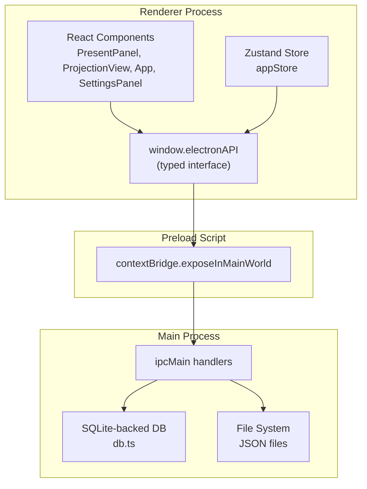
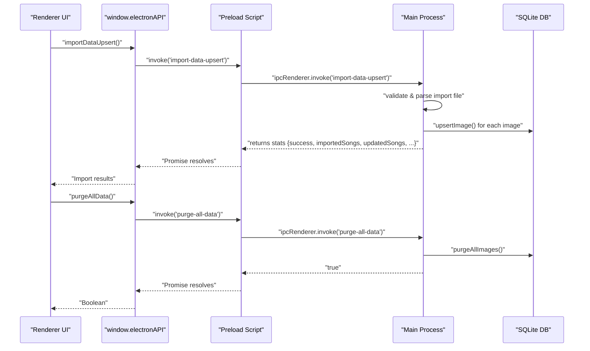
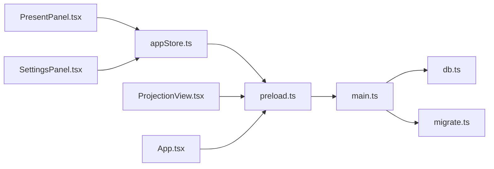

# Electron IPC API

<cite>
**Referenced Files in This Document**
- [preload.ts](file://electron/preload.ts)
- [main.ts](file://electron/main.ts)
- [electron.d.ts](file://src/types/electron.d.ts)
- [db.ts](file://electron/db.ts)
- [migrate.ts](file://electron/migrate.ts)
- [appStore.ts](file://src/store/appStore.ts)
- [PresentPanel.tsx](file://src/components/PresentPanel.tsx)
- [ProjectionView.tsx](file://src/components/ProjectionView.tsx)
- [App.tsx](file://src/App.tsx)
- [SettingsPanel.tsx](file://src/components/SettingsPanel.tsx)
</cite>

## Update Summary
**Changes Made**
- Enhanced documentation for `importDataUpsert` method with detailed return type specifications and comprehensive error handling patterns
- Added detailed documentation for new data purge API endpoints (`purgeAllData`, `purgeSongsOnly`) including their destructive nature and use cases
- Updated Import/Export section with comprehensive coverage of both merge and upsert operations, highlighting the differences in behavior and return statistics
- Enhanced type definitions and preload script exposure for new methods with proper TypeScript interfaces
- Added practical usage examples showing proper error handling patterns for all new endpoints

## Table of Contents
1. [Introduction](#introduction)
2. [Project Structure](#project-structure)
3. [Core Components](#core-components)
4. [Architecture Overview](#architecture-overview)
5. [Detailed Component Analysis](#detailed-component-analysis)
6. [Dependency Analysis](#dependency-analysis)
7. [Performance Considerations](#performance-considerations)
8. [Troubleshooting Guide](#troubleshooting-guide)
9. [Conclusion](#conclusion)

## Introduction
This document provides comprehensive API documentation for LyricDeck's Electron IPC communication layer. It covers all methods exposed via the contextBridge under the electronAPI namespace, including display management, projection state synchronization, data persistence, file dialog integrations, background image repository operations, import/export functionality, and data purge operations. For each method, we specify parameter types, return value types, error handling patterns, and usage examples. We also document the main process side implementations and IPC channel mappings, event listener registration and cleanup patterns, and security considerations for contextBridge exposure.

## Project Structure
The IPC layer is implemented using Electron's contextBridge in the preload script and ipcMain handlers in the main process. Renderer components integrate with the API through a typed interface definition.

**Diagram sources**
- [preload.ts:1-48](file://electron/preload.ts#L1-L48)
- [main.ts:154-449](file://electron/main.ts#L154-L449)
- [db.ts:26-48](file://electron/db.ts#L26-L48)

**Section sources**
- [preload.ts:1-48](file://electron/preload.ts#L1-L48)
- [main.ts:154-449](file://electron/main.ts#L154-L449)
- [electron.d.ts:3-36](file://src/types/electron.d.ts#L3-L36)

## Core Components
This section documents the complete electronAPI surface area, including method signatures, IPC channels, and behavior.

### Display Management
- **getDisplays()**: Promise<Array<{ id: string; label: string; bounds: { x: number; y: number; width: number; height: number }; isPrimary: boolean }>>
  - IPC Channel: get-displays
  - Behavior: Returns available displays with IDs, labels, bounds, and primary flag.
  - Error Handling: None documented; returns empty array if no displays found.
  - Example Usage: [PresentPanel.tsx:27-36](file://src/components/PresentPanel.tsx#L27-L36)
- **openProjection(displayId?: string)**: Promise<boolean>
  - IPC Channel: open-projection
  - Behavior: Opens a projection window on the specified display or fallback display. Closes existing projection window if present.
  - Error Handling: Returns true after successful creation; no explicit error throws.
  - Example Usage: [PresentPanel.tsx:109-114](file://src/components/PresentPanel.tsx#L109-L114)
- **closeProjection()**: Promise<boolean>
  - IPC Channel: close-projection
  - Behavior: Closes the projection window if open.
  - Error Handling: Returns true after closing; no explicit error throws.
  - Example Usage: [PresentPanel.tsx:116-121](file://src/components/PresentPanel.tsx#L116-L121)
- **isProjectionOpen()**: Promise<boolean>
  - IPC Channel: is-projection-open
  - Behavior: Checks if the projection window exists and is not destroyed.
  - Error Handling: Returns boolean; no exceptions thrown.
  - Example Usage: [PresentPanel.tsx:123-129](file://src/components/PresentPanel.tsx#L123-L129)

### Projection State Management
- **updateProjection(state: any)**: void
  - IPC Channel: update-projection (send)
  - Behavior: Sends projection state to the projection window via BrowserWindow.webContents.send.
  - Error Handling: No return value; errors are not handled in the renderer.
  - Example Usage: [appStore.ts:246-248](file://src/store/appStore.ts#L246-L248)
- **onProjectionState(callback: (state: any) => void)**: () => void
  - IPC Channel: projection-state (on)
  - Behavior: Registers a one-shot event listener for projection state updates and returns a cleanup function to remove the listener.
  - Error Handling: Listener cleanup via removeListener; no exceptions thrown.
  - Example Usage: [ProjectionView.tsx:22-29](file://src/components/ProjectionView.tsx#L22-L29)
- **onProjectionWindowClosed(callback: () => void)**: () => void
  - IPC Channel: projection-window-closed (on)
  - Behavior: Registers a one-shot event listener for projection window closed events and returns a cleanup function.
  - Error Handling: Listener cleanup via removeListener; no exceptions thrown.
  - Example Usage: [App.tsx:34-42](file://src/App.tsx#L34-L42)

### Data Persistence Operations
- **loadSongs()**: Promise<any[]>
  - IPC Channel: load-songs
  - Behavior: Reads and parses songs.json from userData/data.
  - Error Handling: Returns empty array if file does not exist.
  - Example Usage: [appStore.ts:362-377](file://src/store/appStore.ts#L362-L377)
- **saveSongs(songs: any[])**: Promise<boolean>
  - IPC Channel: save-songs
  - Behavior: Writes songs to songs.json.
  - Error Handling: Returns true after successful write.
  - Example Usage: [appStore.ts:379-383](file://src/store/appStore.ts#L379-L383)
- **loadSettings()**: Promise<any>
  - IPC Channel: load-settings
  - Behavior: Reads and parses settings.json from userData/data.
  - Error Handling: Returns null if file does not exist.
  - Example Usage: [appStore.ts:362-377](file://src/store/appStore.ts#L362-L377)
- **saveSettings(settings: any)**: Promise<boolean>
  - IPC Channel: save-settings
  - Behavior: Writes settings to settings.json.
  - Error Handling: Returns true after successful write.
  - Example Usage: [appStore.ts:307-314](file://src/store/appStore.ts#L307-L314)
- **loadPreparationList()**: Promise<string[]>
  - IPC Channel: load-preparation-list
  - Behavior: Reads and parses preparation-list.json from userData/data.
  - Error Handling: Returns empty array if file does not exist.
  - Example Usage: [appStore.ts:362-377](file://src/store/appStore.ts#L362-L377)
- **savePreparationList(list: string[])**: Promise<boolean>
  - IPC Channel: save-preparation-list
  - Behavior: Writes preparation list to preparation-list.json.
  - Error Handling: Returns true after successful write.
  - Example Usage: [appStore.ts:317-340](file://src/store/appStore.ts#L317-L340)

### File Dialog Integrations
- **selectImage()**: Promise<string | null>
  - IPC Channel: select-image
  - Behavior: Opens a native file dialog to select an image file, reads it, determines MIME type, and stores it in the database, returning a lyricdeck-img:// URL.
  - Error Handling: Returns null if dialog is canceled.
  - Example Usage: [db.ts:221-235](file://electron/db.ts#L221-L235)

### Background Image Repository Operations
- **addBackgroundImage()**: Promise<string[]>
  - IPC Channel: add-background-image
  - Behavior: Opens a native file dialog to select one or more image files, reads them, determines MIME type, and stores each in the database, returning an array of lyricdeck-img:// URLs.
  - Error Handling: Returns empty array if dialog is canceled.
  - Example Usage: [db.ts:237-255](file://electron/db.ts#L237-L255)
- **listBackgroundImages()**: Promise<string[]>
  - IPC Channel: list-background-images
  - Behavior: Lists all gallery images by returning their lyricdeck-img:// URLs.
  - Error Handling: Returns empty array if none found.
  - Example Usage: [db.ts:257-259](file://electron/db.ts#L257-L259)
- **deleteBackgroundImage(imagePath: string)**: Promise<boolean>
  - IPC Channel: delete-background-image
  - Behavior: Parses the image ID from lyricdeck-img:// URL and deletes the image from the database.
  - Error Handling: Returns true if deletion occurred, false otherwise.
  - Example Usage: [db.ts:261-264](file://electron/db.ts#L261-L264)

### Import/Export Functionality
- **exportData()**: Promise<boolean>
  - IPC Channel: export-data
  - Behavior: Prompts for a save location, collects songs, settings, preparation list, and background images, writes a .lyricdeck archive file.
  - Error Handling: Returns false if canceled; true on success.
  - Example Usage: [main.ts:267-290](file://electron/main.ts#L267-L290)
- **importData()**: Promise<{ success: boolean; importedSongs?: number; importedBackgrounds?: number; error?: string }>
  - IPC Channel: import-data
  - Behavior: Prompts for an import file, validates format, merges songs (by ID), optionally overwrites settings and preparation list, imports background images, and returns statistics.
  - Error Handling: Returns { success: false, error: 'invalid_format' | 'parse_error' } on failure; { success: true, importedSongs, importedBackgrounds } on success.
  - Example Usage: [main.ts:292-354](file://electron/main.ts#L292-L354)
- **importDataUpsert()**: Promise<{ success: boolean; importedSongs?: number; updatedSongs?: number; importedBackgrounds?: number; updatedBackgrounds?: number; error?: string }>
  - IPC Channel: import-data-upsert
  - Behavior: Prompts for an import file, validates format, upserts songs (replaces existing by ID, adds new ones), optionally overwrites settings and preparation list, upserts background images (replaces existing by ID, adds new ones), and returns detailed statistics.
  - Error Handling: Returns { success: false, error: 'invalid_format' | 'parse_error' } on failure; { success: true, importedSongs, updatedSongs, importedBackgrounds, updatedBackgrounds } on success.
  - Return Type Details: 
    - `importedSongs`: Number of new songs added during upsert operation
    - `updatedSongs`: Number of existing songs replaced during upsert operation  
    - `importedBackgrounds`: Number of new background images added during upsert operation
    - `updatedBackgrounds`: Number of existing background images replaced during upsert operation
  - Example Usage: [SettingsPanel.tsx:514-535](file://src/components/SettingsPanel.tsx#L514-L535)

### Data Purge Operations
- **purgeAllData()**: Promise<boolean>
  - IPC Channel: purge-all-data
  - Behavior: Permanently deletes all application data including songs.json, settings.json, preparation-list.json, and purges all images and metadata from SQLite database.
  - Error Handling: Returns true after successful purge; no explicit error throws.
  - Destructive Nature: This operation cannot be undone and should only be used when user confirmation has been obtained.
  - Example Usage: [SettingsPanel.tsx:597-611](file://src/components/SettingsPanel.tsx#L597-L611)
- **purgeSongsOnly()**: Promise<boolean>
  - IPC Channel: purge-songs-only
  - Behavior: Deletes only the songs.json file while preserving settings, preparation list, and background images.
  - Error Handling: Returns true after successful deletion; no explicit error throws.
  - Use Case: Useful for resetting song library while maintaining user preferences and media assets.
  - Example Usage: [SettingsPanel.tsx:613-627](file://src/components/SettingsPanel.tsx#L613-L627)

**Section sources**
- [preload.ts:3-47](file://electron/preload.ts#L3-L47)
- [main.ts:155-449](file://electron/main.ts#L155-L449)
- [electron.d.ts:5-36](file://src/types/electron.d.ts#L5-L36)
- [db.ts:221-264](file://electron/db.ts#L221-L264)

## Architecture Overview
The IPC architecture separates concerns between renderer-side API exposure and main-process handlers. The preload script exposes a typed API surface, while the main process implements handlers for each channel. Data is persisted to both JSON files and an embedded SQLite database.

**Diagram sources**
- [preload.ts:42-46](file://electron/preload.ts#L42-L46)
- [main.ts:356-449](file://electron/main.ts#L356-L449)
- [db.ts:242-247](file://electron/db.ts#L242-L247)

## Detailed Component Analysis

### Display Management API
- Methods
  - getDisplays(): Promise<Array<{ id: string; label: string; bounds: { x, y, width, height }; isPrimary: boolean }>>
  - openProjection(displayId?: string): Promise<boolean>
  - closeProjection(): Promise<boolean>
  - isProjectionOpen(): Promise<boolean>
- Implementation Notes
  - openProjection closes any existing projection window before opening a new one.
  - Display selection logic chooses the requested display or falls back to a secondary display or primary display.
- Error Handling Patterns
  - No explicit error throws; returns sensible defaults (e.g., empty display list, false booleans).
- Usage Examples
  - [PresentPanel.tsx:27-36](file://src/components/PresentPanel.tsx#L27-L36)
  - [PresentPanel.tsx:109-129](file://src/components/PresentPanel.tsx#L109-L129)

**Section sources**
- [main.ts:111-152](file://electron/main.ts#L111-L152)
- [main.ts:155-184](file://electron/main.ts#L155-L184)
- [PresentPanel.tsx:27-36](file://src/components/PresentPanel.tsx#L27-L36)
- [PresentPanel.tsx:109-129](file://src/components/PresentPanel.tsx#L109-L129)

### Projection State Management API
- Methods
  - updateProjection(state: any): void
  - onProjectionState(callback: (state: any) => void): () => void
  - onProjectionWindowClosed(callback: () => void): () => void
- Implementation Notes
  - updateProjection sends state via BrowserWindow.webContents.send.
  - Event listeners are registered with ipcRenderer.on and cleaned up via removeListener.
- Error Handling Patterns
  - No explicit error handling in renderer; cleanup functions prevent memory leaks.
- Usage Examples
  - [appStore.ts:246-248](file://src/store/appStore.ts#L246-L248)
  - [ProjectionView.tsx:22-29](file://src/components/ProjectionView.tsx#L22-L29)
  - [App.tsx:34-42](file://src/App.tsx#L34-L42)

**Section sources**
- [preload.ts:11-21](file://electron/preload.ts#L11-L21)
- [main.ts:186-190](file://electron/main.ts#L186-L190)
- [ProjectionView.tsx:22-29](file://src/components/ProjectionView.tsx#L22-L29)
- [App.tsx:34-42](file://src/App.tsx#L34-L42)

### Data Persistence API
- Methods
  - loadSongs(): Promise<any[]>
  - saveSongs(songs: any[]): Promise<boolean>
  - loadSettings(): Promise<any>
  - saveSettings(settings: any): Promise<boolean>
  - loadPreparationList(): Promise<string[]>
  - savePreparationList(list: string[]): Promise<boolean>
- Implementation Notes
  - Uses JSON files under userData/data.
  - load* methods return defaults if files do not exist.
- Error Handling Patterns
  - No try/catch around file IO in handlers; relies on fs.existsSync checks.
- Usage Examples
  - [appStore.ts:362-383](file://src/store/appStore.ts#L362-L383)

**Section sources**
- [main.ts:39-79](file://electron/main.ts#L39-L79)
- [main.ts:193-218](file://electron/main.ts#L193-L218)
- [appStore.ts:362-383](file://src/store/appStore.ts#L362-L383)

### File Dialog Integration API
- Method
  - selectImage(): Promise<string | null>
- Implementation Notes
  - Uses dialog.showOpenDialog with image filters.
  - Stores image data as BLOB in SQLite and returns lyricdeck-img:// URL.
- Error Handling Patterns
  - Returns null if dialog is canceled.
- Usage Examples
  - [db.ts:221-235](file://electron/db.ts#L221-L235)

**Section sources**
- [main.ts:221-235](file://electron/main.ts#L221-L235)
- [db.ts:221-235](file://electron/db.ts#L221-L235)

### Background Image Repository API
- Methods
  - addBackgroundImage(): Promise<string[]>
  - listBackgroundImages(): Promise<string[]>
  - deleteBackgroundImage(imagePath: string): Promise<boolean>
- Implementation Notes
  - Uses lyricdeck-img:// protocol URLs backed by SQLite BLOB storage.
  - Migration supports legacy file-based images.
- Error Handling Patterns
  - Returns empty arrays or false on no-op; returns true on successful deletion.
- Usage Examples
  - [db.ts:237-264](file://electron/db.ts#L237-L264)
  - [migrate.ts:8-126](file://electron/migrate.ts#L8-L126)

**Section sources**
- [main.ts:237-264](file://electron/main.ts#L237-L264)
- [db.ts:70-131](file://electron/db.ts#L70-L131)
- [migrate.ts:8-126](file://electron/migrate.ts#L8-L126)

### Import/Export API
- Methods
  - exportData(): Promise<boolean>
  - importData(): Promise<{ success: boolean; importedSongs?: number; importedBackgrounds?: number; error?: string }>
  - importDataUpsert(): Promise<{ success: boolean; importedSongs?: number; updatedSongs?: number; importedBackgrounds?: number; updatedBackgrounds?: number; error?: string }>
- Implementation Notes
  - Export includes songs, settings, preparation list, and background images.
  - Import merges songs by ID (add only new ones), optionally overwrites settings and preparation list, and imports images.
  - Upsert replaces existing songs/images by ID while adding new ones, providing detailed statistics for both added and updated items.
- Error Handling Patterns
  - Validates format and returns structured errors; returns success stats on completion.
  - Both import methods handle invalid_format and parse_error conditions consistently.
- Usage Examples
  - [main.ts:267-425](file://electron/main.ts#L267-L425)
  - [SettingsPanel.tsx:493-535](file://src/components/SettingsPanel.tsx#L493-L535)

**Updated** Enhanced documentation for the importDataUpsert method with detailed return type specifications including separate counters for imported vs updated items for both songs and background images, along with comprehensive error handling patterns.

**Section sources**
- [main.ts:267-425](file://electron/main.ts#L267-L425)
- [SettingsPanel.tsx:493-535](file://src/components/SettingsPanel.tsx#L493-L535)

### Data Purge API
- Methods
  - purgeAllData(): Promise<boolean>
  - purgeSongsOnly(): Promise<boolean>
- Implementation Notes
  - purgeAllData permanently deletes all JSON data files and purges all images and metadata from SQLite database.
  - purgeSongsOnly deletes only the songs.json file while preserving settings, preparation list, and background images.
- Error Handling Patterns
  - Both methods return true on successful operation; no explicit error throws.
  - These are destructive operations that should always be preceded by user confirmation dialogs.
- Usage Examples
  - [SettingsPanel.tsx:597-627](file://src/components/SettingsPanel.tsx#L597-L627)

**New Section** Added comprehensive documentation for the new data purge operations that provide granular control over data deletion, including full application reset and selective song deletion. Both methods include proper user confirmation patterns and status feedback.

**Section sources**
- [main.ts:427-449](file://electron/main.ts#L427-L449)
- [db.ts:242-247](file://electron/db.ts#L242-L247)
- [SettingsPanel.tsx:597-627](file://src/components/SettingsPanel.tsx#L597-L627)

## Dependency Analysis
The renderer depends on the preload bridge for IPC, which routes to main-process handlers. The main process interacts with both the file system and SQLite database.

**Diagram sources**
- [preload.ts:3-47](file://electron/preload.ts#L3-L47)
- [main.ts:154-449](file://electron/main.ts#L154-L449)
- [db.ts:26-48](file://electron/db.ts#L26-L48)
- [migrate.ts:8-126](file://electron/migrate.ts#L8-L126)
- [PresentPanel.tsx:109-129](file://src/components/PresentPanel.tsx#L109-L129)
- [ProjectionView.tsx:22-29](file://src/components/ProjectionView.tsx#L22-L29)
- [App.tsx:34-42](file://src/App.tsx#L34-L42)
- [SettingsPanel.tsx:493-627](file://src/components/SettingsPanel.tsx#L493-L627)

**Section sources**
- [preload.ts:3-47](file://electron/preload.ts#L3-L47)
- [main.ts:154-449](file://electron/main.ts#L154-L449)
- [db.ts:26-48](file://electron/db.ts#L26-L48)
- [migrate.ts:8-126](file://electron/migrate.ts#L8-L126)

## Performance Considerations
- SQLite BLOB Storage
  - Storing large images as BLOBs can increase database size. Consider optimizing image sizes and formats.
  - Persisting the database after each write ensures durability but may impact performance under frequent writes.
  - The new upsert operations perform additional database queries to check for existing records, which may impact performance on large datasets.
- File System I/O
  - JSON reads/writes are synchronous and occur on the main thread; consider batching or debouncing writes in the renderer store.
  - Purge operations perform multiple file deletions and database purges; these are blocking operations that should be used judiciously.
- Projection Updates
  - Frequent updateProjection calls can flood the renderer; throttle state updates in the store if needed.
- Protocol Handler
  - Serving images via lyricdeck-img protocol avoids filesystem exposure but requires careful MIME type handling.
- Import/Export Operations
  - Upsert operations involve reading entire datasets into memory and performing comparisons; consider streaming for very large datasets.
  - Database purges during full data reset can be expensive on large image collections.
  - The enhanced importDataUpsert method performs additional database operations to track updated vs new items, which may have performance implications for large datasets.

**Updated** Added performance considerations for new upsert and purge operations, noting potential impacts on large datasets and blocking operations, including the additional overhead of tracking updated vs new items in upsert operations.

## Troubleshooting Guide
- No Displays Returned
  - Verify screen.getAllDisplays() availability and permissions on the host OS.
  - Check that get-displays handler returns mapped display objects.
  - Reference: [main.ts:155-164](file://electron/main.ts#L155-L164)
- Projection Window Does Not Open
  - Ensure open-projection handler creates a new BrowserWindow and that displayId resolution succeeds.
  - Reference: [main.ts:166-172](file://electron/main.ts#L166-L172), [main.ts:111-152](file://electron/main.ts#L111-L152)
- State Not Updating in Projection Window
  - Confirm updateProjection sends state and that onProjectionState listener is registered before state changes.
  - Reference: [main.ts:186-190](file://electron/main.ts#L186-L190), [preload.ts:12-16](file://electron/preload.ts#L12-L16)
- Images Not Loading
  - Verify lyricdeck-img protocol handler and that image IDs are correctly stored and retrieved.
  - Reference: [main.ts:362-374](file://electron/main.ts#L362-L374), [db.ts:89-104](file://electron/db.ts#L89-L104)
- Import/Export Failures
  - Validate .lyricdeck file format and handle invalid_format or parse_error responses.
  - Reference: [main.ts:292-354](file://electron/main.ts#L292-354)
- Import Upsert Issues
  - Check that source files contain valid version and songs fields for upsert operations.
  - Verify that image IDs are properly formatted for deduplication in upsert mode.
  - Review detailed return statistics to understand what was added vs updated.
  - Reference: [main.ts:356-425](file://electron/main.ts#L356-L425)
- Data Purge Problems
  - Ensure user confirmation dialogs are properly handled before executing destructive operations.
  - Verify that purgeAllData successfully removes both JSON files and SQLite database contents.
  - Remember that purge operations are irreversible and should only be used with explicit user consent.
  - Reference: [main.ts:427-449](file://electron/main.ts#L427-L449), [db.ts:242-247](file://electron/db.ts#L242-L247)

**Updated** Added troubleshooting guidance for new import upsert and data purge operations, including verification of detailed return statistics and emphasis on the irreversible nature of purge operations.

**Section sources**
- [main.ts:155-190](file://electron/main.ts#L155-L190)
- [db.ts:89-104](file://electron/db.ts#L89-L104)
- [main.ts:292-354](file://electron/main.ts#L292-L354)
- [main.ts:356-449](file://electron/main.ts#L356-L449)
- [db.ts:242-247](file://electron/db.ts#L242-L247)

## Conclusion
LyricDeck's Electron IPC layer provides a clean, typed API surface for renderer components to manage displays, synchronize projection state, persist data, handle file dialogs, manage background images, and perform import/export operations. The design leverages contextBridge for secure exposure, ipcMain handlers for robust main-process logic, and SQLite for efficient media storage. Recent enhancements include sophisticated import upsert functionality for incremental data updates with detailed statistics tracking, and comprehensive data purge operations for application maintenance. The new purge operations provide granular control over data deletion, ranging from full application resets to selective song library clearing. Following the usage patterns and cleanup guidelines outlined here will help maintain reliability and performance in production environments.

**Updated** Enhanced conclusion to reflect the new import upsert and data purge capabilities that provide more granular control over data management operations, including detailed statistics tracking and comprehensive data deletion options.