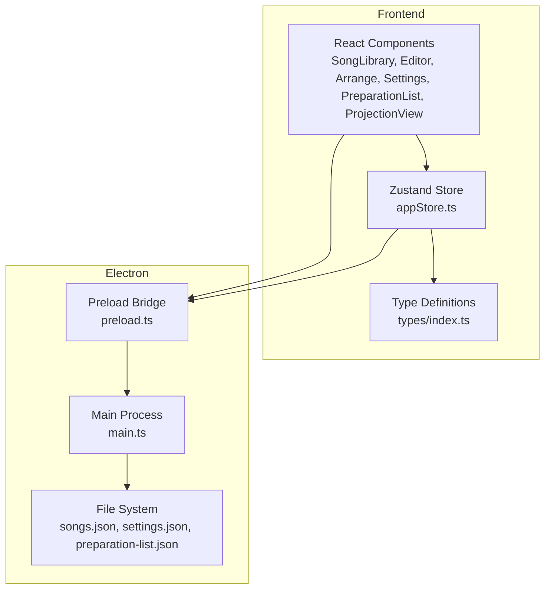
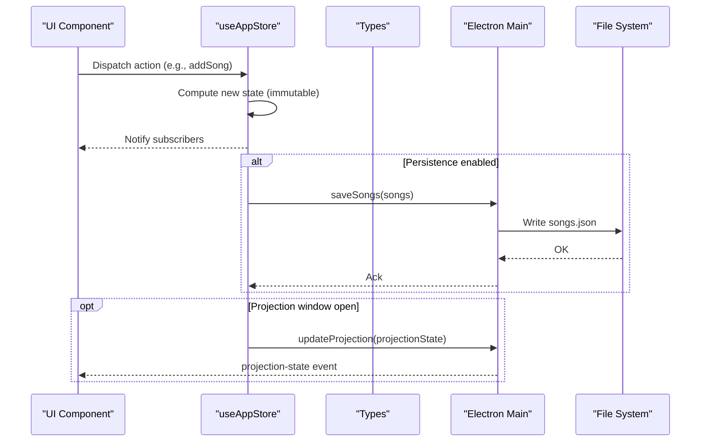
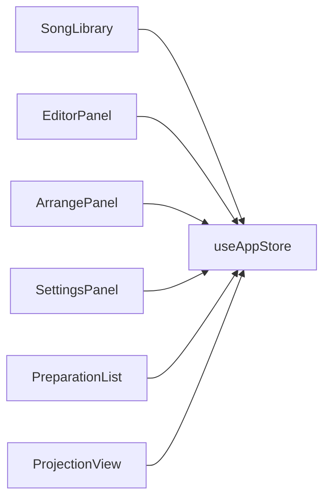

# State Management API

<cite>
**Referenced Files in This Document**
- [appStore.ts](file://src/store/appStore.ts)
- [index.ts](file://src/types/index.ts)
- [main.ts](file://electron/main.ts)
- [preload.ts](file://electron/preload.ts)
- [App.tsx](file://src/App.tsx)
- [SongLibrary.tsx](file://src/components/SongLibrary.tsx)
- [EditorPanel.tsx](file://src/components/EditorPanel.tsx)
- [ArrangePanel.tsx](file://src/components/ArrangePanel.tsx)
- [PreparationList.tsx](file://src/components/PreparationList.tsx)
- [SettingsPanel.tsx](file://src/components/SettingsPanel.tsx)
- [ProjectionView.tsx](file://src/components/ProjectionView.tsx)
</cite>

## Table of Contents
1. [Introduction](#introduction)
2. [Project Structure](#project-structure)
3. [Core Components](#core-components)
4. [Architecture Overview](#architecture-overview)
5. [Detailed Component Analysis](#detailed-component-analysis)
6. [Dependency Analysis](#dependency-analysis)
7. [Performance Considerations](#performance-considerations)
8. [Troubleshooting Guide](#troubleshooting-guide)
9. [Conclusion](#conclusion)

## Introduction
This document provides comprehensive API documentation for LyricDeck’s Zustand-based state management system. It covers all store actions, state shapes, selectors, subscriptions, persistence, and performance considerations. The focus areas include:
- Song management operations
- Arrangement manipulation
- Projection state updates
- Settings management
- Preparation list operations

## Project Structure
The state management is centralized in a single Zustand store with typed interfaces and integrates with Electron for persistence and projection rendering.

**Diagram sources**
- [appStore.ts:1-385](file://src/store/appStore.ts#L1-L385)
- [index.ts:1-89](file://src/types/index.ts#L1-L89)
- [preload.ts:1-43](file://electron/preload.ts#L1-L43)
- [main.ts:1-390](file://electron/main.ts#L1-L390)

**Section sources**
- [appStore.ts:1-385](file://src/store/appStore.ts#L1-L385)
- [index.ts:1-89](file://src/types/index.ts#L1-L89)
- [preload.ts:1-43](file://electron/preload.ts#L1-L43)
- [main.ts:1-390](file://electron/main.ts#L1-L390)

## Core Components
- Zustand Store: Centralized state and actions for songs, arrangements, projection, settings, and preparation list.
- Types: Strongly typed interfaces for Songs, Sections, ProjectionState, BackgroundSettings, TextStyle, and AppSettings.
- Electron Integration: IPC bridge exposing persistence and projection APIs to the renderer.

Key store slices and actions:
- Song Library: setSongs, addSong, deleteSong, duplicateSong, updateSong, selectSong, setSearchQuery, addSection, updateSection, deleteSection, reorderSections
- Arrangement: setArrangement, addToArrangement, removeFromArrangement
- Projection: setProjectionState, goToSlide, nextSlide, prevSlide, setProjectionMode, setIsProjectionOpen, shiftLines
- UI: setActiveTab
- Settings: setSettings
- Preparation List: addToPreparationList, removeFromPreparationList, reorderPreparationList, clearPreparationList, selectFromPreparationList
- Persistence: loadFromDisk, saveToDisk

**Section sources**
- [appStore.ts:31-96](file://src/store/appStore.ts#L31-L96)
- [index.ts:13-89](file://src/types/index.ts#L13-L89)

## Architecture Overview
The store orchestrates state transitions and side effects:
- UI components subscribe to store slices via hooks.
- Actions mutate state immutably and trigger re-renders.
- Electron IPC handles persistence and projection updates.

**Diagram sources**
- [appStore.ts:361-384](file://src/store/appStore.ts#L361-L384)
- [preload.ts:23-29](file://electron/preload.ts#L23-L29)
- [main.ts:192-218](file://electron/main.ts#L192-L218)

## Detailed Component Analysis

### Song Management Operations
Actions:
- setSongs(songs: Song[]): Sets the entire song collection.
- addSong(): Creates a new song with default sections and selects it.
- deleteSong(id: string): Removes a song and clears selection if it was the selected one.
- duplicateSong(id: string): Duplicates a song, remapping section IDs and updating arrangement references.
- updateSong(id: string, updates: Partial<Song>): Updates a song’s metadata and sections.
- selectSong(id: string | null): Selects a song by ID.
- setSearchQuery(query: string): Filters songs by title, artist, ID, or lyrics content.
- addSection(songId: string, type?: SectionType): Adds a new section to a song.
- updateSection(songId: string, sectionId: string, updates: Partial<LyricSection>): Updates a section’s label, type, or lyrics.
- deleteSection(songId: string, sectionId: string): Removes a section and any references in arrangement.
- reorderSections(songId: string, sections: LyricSection[]): Replaces a song’s sections array.

State mutations:
- Mutates songs array immutably.
- Updates selectedSongId when necessary.
- Persists changes to disk after add/update/duplicate/delete.

Effects on dependent state:
- Deleting a section removes it from arrangement.
- Duplicate remaps section IDs in arrangement to match new section IDs.
- Updating a song triggers saveToDisk.

Selectors and subscriptions:
- Components consume songs, selectedSongId, and searchQuery via hooks.
- Example consumers: SongLibrary, EditorPanel, ArrangePanel.

Common usage patterns:
- Add a new song and immediately select it.
- Duplicate an existing song to create a variant.
- Update section lyrics and see immediate UI updates.

**Section sources**
- [appStore.ts:113-220](file://src/store/appStore.ts#L113-L220)
- [SongLibrary.tsx:8-95](file://src/components/SongLibrary.tsx#L8-L95)
- [EditorPanel.tsx:17-118](file://src/components/EditorPanel.tsx#L17-L118)

### Arrangement Manipulation
Actions:
- setArrangement(songId: string, arrangement: string[]): Sets the arrangement order by section IDs.
- addToArrangement(songId: string, sectionId: string): Appends a section to the arrangement.
- removeFromArrangement(songId: string, index: number): Removes a section at a given index.

State mutations:
- Updates the arrangement array for the selected song.

Effects on dependent state:
- goToSlide reads arrangement and resolves current section.
- nextSlide/prevSlide navigate through arrangement indices.

Selectors and subscriptions:
- ArrangePanel subscribes to songs and arrangement-related actions.

Common usage patterns:
- Build arrangement by dragging sections from the available list.
- Clear arrangement to reset to default order.

**Section sources**
- [appStore.ts:222-239](file://src/store/appStore.ts#L222-L239)
- [ArrangePanel.tsx:22-134](file://src/components/ArrangePanel.tsx#L22-L134)

### Projection State Updates
Actions:
- setProjectionState(state: Partial<ProjectionState>): Merges partial projection state and sends updates to projection window.
- goToSlide(index: number): Resolves current section from arrangement, sets current index, and updates projection content.
- nextSlide(): Advances to the next slide.
- prevSlide(): Moves to the previous slide.
- setProjectionMode(mode: ProjectionMode): Changes projection mode (live, blank, black, logo, clear).
- setIsProjectionOpen(open: boolean): Tracks whether projection window is open.
- shiftLines(offset: number): Adjusts vertical line offset for fine-tuning text position.

State mutations:
- Updates projectionState and currentArrangementIndex.
- Sends state via IPC to projection window.

Effects on dependent state:
- ProjectionView receives updates via onProjectionState and renders accordingly.
- Mode changes affect rendering and overlays.

Selectors and subscriptions:
- ProjectionView subscribes to projection state via IPC.

Common usage patterns:
- Navigate slides during presentation.
- Toggle modes for transitions.
- Fine-tune text positioning.

**Section sources**
- [appStore.ts:241-302](file://src/store/appStore.ts#L241-L302)
- [ProjectionView.tsx:4-134](file://src/components/ProjectionView.tsx#L4-L134)

### Settings Management
Actions:
- setSettings(settings: Partial<AppSettings>): Updates global settings and persists to disk.

Effects on dependent state:
- Default backgrounds/text styles propagate to new songs.
- Settings persist to settings.json.

Selectors and subscriptions:
- SettingsPanel consumes presentation settings for a selected song.

Common usage patterns:
- Configure default background and text style.
- Enable/disable copyright display per song.

**Section sources**
- [appStore.ts:307-314](file://src/store/appStore.ts#L307-L314)
- [SettingsPanel.tsx:7-417](file://src/components/SettingsPanel.tsx#L7-L417)

### Preparation List Operations
Actions:
- addToPreparationList(songId: string): Adds a song to the preparation list if not already present.
- removeFromPreparationList(songId: string): Removes a song from the list.
- reorderPreparationList(list: string[]): Reorders the preparation list.
- clearPreparationList(): Empties the list.
- selectFromPreparationList(songId: string): Selects a song and navigates to its first slide.

State mutations:
- Updates preparationList array.

Effects on dependent state:
- PreparationList component renders the list and allows drag-and-drop reordering.
- Selecting from preparation list triggers goToSlide for the first arrangement item.

Selectors and subscriptions:
- PreparationList subscribes to preparationList and related actions.

Common usage patterns:
- Queue songs for upcoming presentations.
- Reorder queue priorities.

**Section sources**
- [appStore.ts:316-359](file://src/store/appStore.ts#L316-L359)
- [PreparationList.tsx:25-123](file://src/components/PreparationList.tsx#L25-L123)

### Persistence and IPC Integration
Actions:
- loadFromDisk(): Loads songs, settings, and preparation list from disk.
- saveToDisk(): Saves songs to disk.

IPC exposure:
- preload.ts exposes loadSongs/saveSongs/loadSettings/saveSettings/loadPreparationList/savePreparationList, plus projection updates and window lifecycle events.

File locations:
- songs.json, settings.json, preparation-list.json under Electron userData path.

Effects on dependent state:
- On initial load, seeds data if empty.
- After each write operation, state remains consistent.

**Section sources**
- [appStore.ts:361-384](file://src/store/appStore.ts#L361-L384)
- [preload.ts:23-29](file://electron/preload.ts#L23-L29)
- [main.ts:27-79](file://electron/main.ts#L27-L79)
- [App.tsx:19-32](file://src/App.tsx#L19-L32)

## Dependency Analysis
Store-to-component dependencies:
- SongLibrary depends on song list, selection, search, and preparation list.
- EditorPanel depends on song sections and metadata.
- ArrangePanel depends on arrangement and drag-and-drop reordering.
- SettingsPanel depends on presentation settings and background gallery.
- PreparationList depends on preparation list and drag-and-drop reordering.
- ProjectionView depends on projection state received via IPC.

**Diagram sources**
- [SongLibrary.tsx:8-95](file://src/components/SongLibrary.tsx#L8-L95)
- [EditorPanel.tsx:17-118](file://src/components/EditorPanel.tsx#L17-L118)
- [ArrangePanel.tsx:22-134](file://src/components/ArrangePanel.tsx#L22-L134)
- [SettingsPanel.tsx:7-417](file://src/components/SettingsPanel.tsx#L7-L417)
- [PreparationList.tsx:25-123](file://src/components/PreparationList.tsx#L25-L123)
- [ProjectionView.tsx:4-134](file://src/components/ProjectionView.tsx#L4-L134)

**Section sources**
- [SongLibrary.tsx:8-95](file://src/components/SongLibrary.tsx#L8-L95)
- [EditorPanel.tsx:17-118](file://src/components/EditorPanel.tsx#L17-L118)
- [ArrangePanel.tsx:22-134](file://src/components/ArrangePanel.tsx#L22-L134)
- [SettingsPanel.tsx:7-417](file://src/components/SettingsPanel.tsx#L7-L417)
- [PreparationList.tsx:25-123](file://src/components/PreparationList.tsx#L25-L123)
- [ProjectionView.tsx:4-134](file://src/components/ProjectionView.tsx#L4-L134)

## Performance Considerations
- Immutable updates: All actions update arrays and objects immutably, minimizing unnecessary re-renders.
- Selective subscriptions: Components subscribe only to the slices they need (e.g., songs, selectedSongId, preparationList).
- Debounced writes: Each mutation triggers a saveToDisk; consider batching for bulk operations if needed.
- Large datasets: For large song collections, prefer filtering/searching by computed indices and avoid deep cloning of entire state unless necessary.
- Projection updates: setProjectionState merges partial state and sends updates to the projection window; keep updates minimal to reduce IPC overhead.

[No sources needed since this section provides general guidance]

## Troubleshooting Guide
- No songs appear after launch:
  - Verify loadFromDisk executed and seed data written.
  - Check file permissions for userData directory.
- Projection window does not receive updates:
  - Ensure setProjectionState is called and window.electronAPI is available.
  - Confirm projection window is open and listening for projection-state events.
- Persistence failures:
  - Confirm preload exposes saveSongs/loadSongs and main process writes to correct paths.
  - Validate JSON serialization of complex objects (e.g., background settings).

**Section sources**
- [App.tsx:19-32](file://src/App.tsx#L19-L32)
- [appStore.ts:241-249](file://src/store/appStore.ts#L241-L249)
- [preload.ts:23-29](file://electron/preload.ts#L23-L29)
- [main.ts:192-218](file://electron/main.ts#L192-L218)

## Conclusion
LyricDeck’s Zustand store provides a clear, type-safe, and modular state management solution. Actions are focused, immutable, and integrated with Electron for persistence and projection. Components subscribe to only the state they need, enabling efficient rendering and predictable behavior. For large datasets, consider optimizing bulk operations and minimizing IPC chatter while maintaining the current robust architecture.