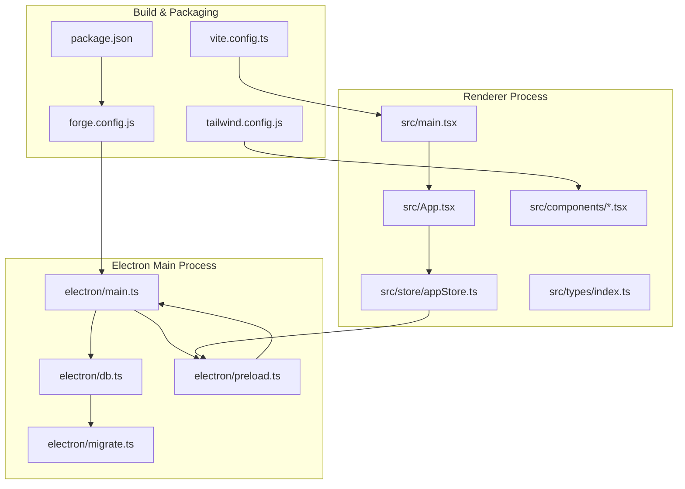
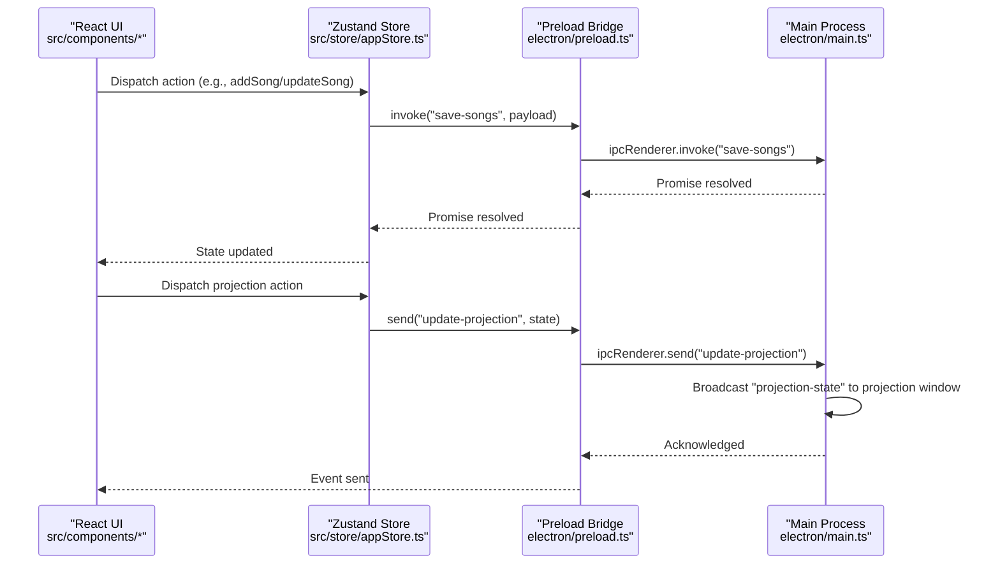
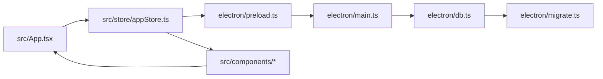
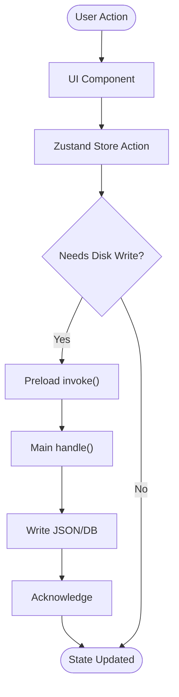

# Architecture Overview

<cite>
**Referenced Files in This Document**
- [electron/main.ts](file://electron/main.ts)
- [electron/preload.ts](file://electron/preload.ts)
- [electron/db.ts](file://electron/db.ts)
- [electron/migrate.ts](file://electron/migrate.ts)
- [src/main.tsx](file://src/main.tsx)
- [src/App.tsx](file://src/App.tsx)
- [src/store/appStore.ts](file://src/store/appStore.ts)
- [src/components/SongLibrary.tsx](file://src/components/SongLibrary.tsx)
- [src/components/ProjectionView.tsx](file://src/components/ProjectionView.tsx)
- [src/types/index.ts](file://src/types/index.ts)
- [package.json](file://package.json)
- [forge.config.js](file://forge.config.js)
- [vite.config.ts](file://vite.config.ts)
- [tailwind.config.js](file://tailwind.config.js)
- [README.md](file://README.md)
</cite>

## Table of Contents
1. [Introduction](#introduction)
2. [Project Structure](#project structure)
3. [Core Components](#core components)
4. [Architecture Overview](#architecture overview)
5. [Detailed Component Analysis](#detailed component analysis)
6. [Dependency Analysis](#dependency analysis)
7. [Performance Considerations](#performance considerations)
8. [Troubleshooting Guide](#troubleshooting-guide)
9. [Conclusion](#conclusion)
10. [Appendices](#appendices)

## Introduction
This document describes the architecture of LyricDeck, a hybrid Electron-React desktop application. It explains how the main process (Electron) and renderer process (React + Zustand) collaborate via IPC, how UI components interact with the state store, and how data flows from user actions to persistence and projection windows. It also documents system boundaries, process isolation, security hardening, and technology stack integration including Vite, Tailwind CSS, and Electron Forge.

## Project Structure
LyricDeck follows a clear separation:
- Electron main process manages windows, IPC, file system, and database.
- Renderer process hosts the React application, Zustand store, and UI components.
- Shared types define data contracts between main and renderer.
- Build tooling integrates Vite, Tailwind, and Electron Forge.

**Diagram sources**
- [electron/main.ts:1-390](file://electron/main.ts#L1-L390)
- [electron/preload.ts:1-43](file://electron/preload.ts#L1-L43)
- [electron/db.ts:1-214](file://electron/db.ts#L1-L214)
- [electron/migrate.ts:1-127](file://electron/migrate.ts#L1-L127)
- [src/main.tsx:1-11](file://src/main.tsx#L1-L11)
- [src/App.tsx:1-102](file://src/App.tsx#L1-L102)
- [src/store/appStore.ts:1-385](file://src/store/appStore.ts#L1-L385)
- [src/types/index.ts:1-89](file://src/types/index.ts#L1-L89)
- [vite.config.ts:1-51](file://vite.config.ts#L1-L51)
- [forge.config.js:1-45](file://forge.config.js#L1-L45)
- [package.json:1-97](file://package.json#L1-L97)
- [tailwind.config.js:1-37](file://tailwind.config.js#L1-L37)

**Section sources**
- [README.md:70-100](file://README.md#L70-L100)
- [package.json:1-97](file://package.json#L1-L97)
- [vite.config.ts:1-51](file://vite.config.ts#L1-L51)
- [forge.config.js:1-45](file://forge.config.js#L1-L45)
- [tailwind.config.js:1-37](file://tailwind.config.js#L1-L37)

## Core Components
- Electron main process: Creates windows, registers IPC handlers, manages file system and database, exposes a custom protocol for embedded images, and handles import/export.
- Preload bridge: Exposes a typed API to renderer via contextBridge, translating Electron IPC calls into renderer-friendly methods.
- Renderer React app: Renders UI, routes to panels, and coordinates with Zustand store.
- Zustand store: Centralized state for songs, UI, projection, settings, and preparation list; persists to disk via IPC.
- UI components: Song library, editor, arrange, present, settings, and projection view.
- Types: Strongly typed models for songs, sections, projection state, and settings.
- Build and packaging: Vite for dev/build, Tailwind for styling, Electron Forge for distribution.

**Section sources**
- [electron/main.ts:1-390](file://electron/main.ts#L1-L390)
- [electron/preload.ts:1-43](file://electron/preload.ts#L1-L43)
- [src/App.tsx:1-102](file://src/App.tsx#L1-L102)
- [src/store/appStore.ts:1-385](file://src/store/appStore.ts#L1-L385)
- [src/types/index.ts:1-89](file://src/types/index.ts#L1-L89)
- [src/components/SongLibrary.tsx:1-193](file://src/components/SongLibrary.tsx#L1-L193)
- [src/components/ProjectionView.tsx:1-134](file://src/components/ProjectionView.tsx#L1-L134)

## Architecture Overview
The system separates concerns across processes and layers:
- Process isolation: Main process runs with Node integration disabled in BrowserWindows; preload exposes a minimal, typed API surface.
- IPC pattern: Renderer invokes preload methods; preload uses ipcRenderer.invoke/send; main registers ipcMain.handle/on handlers.
- State management: Zustand holds UI and domain state; actions persist via IPC to main.
- Data persistence: Main reads/writes JSON files and SQLite for images; supports import/export.
- Multi-window: Main creates a primary window and a projection window on a chosen display; state syncs via IPC events.

**Diagram sources**
- [src/store/appStore.ts:361-384](file://src/store/appStore.ts#L361-L384)
- [electron/preload.ts:23-42](file://electron/preload.ts#L23-L42)
- [electron/main.ts:186-190](file://electron/main.ts#L186-L190)

**Section sources**
- [electron/main.ts:81-109](file://electron/main.ts#L81-L109)
- [electron/main.ts:111-152](file://electron/main.ts#L111-L152)
- [electron/main.ts:154-354](file://electron/main.ts#L154-L354)
- [electron/preload.ts:1-43](file://electron/preload.ts#L1-L43)
- [src/store/appStore.ts:241-295](file://src/store/appStore.ts#L241-L295)

## Detailed Component Analysis

### Main Process (electron/main.ts)
Responsibilities:
- Creates primary and projection BrowserWindows with context isolation and no Node integration.
- Registers custom protocol to serve images from SQLite via a secure scheme.
- Provides IPC handlers for:
  - Display enumeration and projection window control.
  - Data persistence (load/save songs/settings/preparation list).
  - Image repository operations (select/add/list/delete).
  - Import/export of application data.
- Manages lifecycle events (window-all-closed, activate) and app readiness.

Security and isolation:
- contextIsolation enabled; nodeIntegration disabled.
- Custom protocol lyricdeck-img is privileged and secure.
- Uses protocol.handle to serve BLOB images from DB.

Persistence and migration:
- Initializes SQLite database and runs migrations.
- Migrates legacy image paths to new DB-backed URLs.

**Section sources**
- [electron/main.ts:10-25](file://electron/main.ts#L10-L25)
- [electron/main.ts:81-109](file://electron/main.ts#L81-L109)
- [electron/main.ts:111-152](file://electron/main.ts#L111-L152)
- [electron/main.ts:154-354](file://electron/main.ts#L154-L354)
- [electron/main.ts:356-390](file://electron/main.ts#L356-L390)

### Preload Bridge (electron/preload.ts)
Responsibilities:
- Exposes a typed API to renderer via contextBridge.
- Wraps ipcRenderer.invoke/send for:
  - Display management and projection window control.
  - Data persistence and import/export.
  - Image repository operations.
- Provides event listeners for projection state updates and window closure.

Patterns:
- invoke for request-response IPC.
- send/on for fire-and-forget events and streaming updates.

**Section sources**
- [electron/preload.ts:1-43](file://electron/preload.ts#L1-L43)

### Zustand Store (src/store/appStore.ts)
Responsibilities:
- Centralized state for songs, UI, projection, settings, and preparation list.
- Actions encapsulate:
  - CRUD on songs and sections.
  - Arrangement management.
  - Projection state transitions and synchronization to projection window.
  - Persistence actions delegating to preload.
- Maintains derived state (e.g., current arrangement index, computed projection state).

Data flow:
- UI triggers actions; store updates state and persists via preload.
- Projection actions broadcast to projection window via IPC.

**Section sources**
- [src/store/appStore.ts:31-96](file://src/store/appStore.ts#L31-L96)
- [src/store/appStore.ts:113-384](file://src/store/appStore.ts#L113-L384)

### UI Components and Routing (src/App.tsx, SongLibrary.tsx, ProjectionView.tsx)
- App.tsx orchestrates:
  - Tabbed navigation among editor, arrange, present, and settings.
  - Projection window detection and routing to ProjectionView.
  - Initial load and seeding logic.
- SongLibrary.tsx:
  - Filters and sorts songs, supports add/duplicate/delete, and preparation list operations.
- ProjectionView.tsx:
  - Receives projection state via preload listener and renders background/text according to mode.

**Section sources**
- [src/App.tsx:12-98](file://src/App.tsx#L12-L98)
- [src/components/SongLibrary.tsx:8-95](file://src/components/SongLibrary.tsx#L8-L95)
- [src/components/ProjectionView.tsx:4-29](file://src/components/ProjectionView.tsx#L4-L29)

### Data Models (src/types/index.ts)
Defines:
- Section types, lyric sections, background settings, text styles, presentation settings, song model, projection state, and app settings.

**Section sources**
- [src/types/index.ts:1-89](file://src/types/index.ts#L1-L89)

### Database and Migration (electron/db.ts, electron/migrate.ts)
- DB layer:
  - Initializes sql.js database in user data directory.
  - Stores images as BLOBs with metadata and serves them via custom protocol.
  - Persists DB to disk after writes.
- Migration:
  - Converts legacy file-based images to DB-backed URLs.
  - Updates references in songs.json and settings.json.

**Section sources**
- [electron/db.ts:26-48](file://electron/db.ts#L26-L48)
- [electron/db.ts:50-68](file://electron/db.ts#L50-L68)
- [electron/db.ts:70-104](file://electron/db.ts#L70-L104)
- [electron/migrate.ts:8-126](file://electron/migrate.ts#L8-L126)

### Technology Stack Integration
- Vite: Dev server and build pipeline; integrated with Electron via vite-plugin-electron and vite-plugin-electron-renderer.
- Tailwind CSS: Utility-first styling with custom color tokens.
- Electron Forge: Packaging and distribution with fuses hardening and platform targets.
- Zustand: Lightweight state management without boilerplate.
- DnD Kit: Drag-and-drop for arranging sections and lists.

**Section sources**
- [vite.config.ts:1-51](file://vite.config.ts#L1-L51)
- [tailwind.config.js:1-37](file://tailwind.config.js#L1-L37)
- [forge.config.js:1-45](file://forge.config.js#L1-L45)
- [package.json:58-96](file://package.json#L58-L96)

## Dependency Analysis
High-level dependencies:
- Renderer depends on:
  - Preload bridge for IPC.
  - Zustand store for state.
  - UI components for rendering.
- Main depends on:
  - DB module for persistence.
  - File system for JSON data.
  - Electron APIs for windows and protocols.

**Diagram sources**
- [src/App.tsx:1-102](file://src/App.tsx#L1-L102)
- [src/store/appStore.ts:1-385](file://src/store/appStore.ts#L1-L385)
- [electron/preload.ts:1-43](file://electron/preload.ts#L1-L43)
- [electron/main.ts:1-390](file://electron/main.ts#L1-L390)
- [electron/db.ts:1-214](file://electron/db.ts#L1-L214)
- [electron/migrate.ts:1-127](file://electron/migrate.ts#L1-L127)

**Section sources**
- [src/store/appStore.ts:361-384](file://src/store/appStore.ts#L361-L384)
- [electron/preload.ts:23-42](file://electron/preload.ts#L23-L42)
- [electron/main.ts:192-354](file://electron/main.ts#L192-L354)

## Performance Considerations
- Renderer state updates are local; persistence occurs asynchronously via IPC to avoid blocking UI.
- Projection window receives state updates via IPC events; minimize payload size and throttle updates if needed.
- SQLite BLOB storage avoids filesystem fragmentation but consider compression or deduplication for large images.
- Tailwind CSS purging and Vite bundling help reduce bundle size; keep unused styles removed.
- Multi-window rendering: Projection window uses efficient CSS transforms for line offset animations.

[No sources needed since this section provides general guidance]

## Troubleshooting Guide
Common issues and remedies:
- Projection window does not open:
  - Verify display enumeration and selection; ensure main process can enumerate displays and create a fullscreen window.
- Images not loading in projection:
  - Confirm custom protocol registration and that lyricdeck-img URLs are generated by DB layer.
- Import/Export failures:
  - Validate file format and handle parse errors; check migration completeness and DB initialization.
- IPC not responding:
  - Ensure preload exposes the method and main registers the handler; confirm contextIsolation and no Node integration.

**Section sources**
- [electron/main.ts:154-184](file://electron/main.ts#L154-L184)
- [electron/main.ts:220-354](file://electron/main.ts#L220-L354)
- [electron/db.ts:356-374](file://electron/db.ts#L356-L374)
- [electron/migrate.ts:8-126](file://electron/migrate.ts#L8-L126)

## Conclusion
LyricDeck’s architecture cleanly separates the Electron main process from the React renderer, using a typed preload bridge and IPC to maintain security and reliability. Zustand centralizes state and simplifies UI logic, while SQLite and JSON persistence provide robust data handling. The system supports multi-window projection, import/export, and strong typing across layers, delivering a seamless user experience with clear system boundaries.

[No sources needed since this section summarizes without analyzing specific files]

## Appendices

### IPC Communication Patterns
- Request-Response (invoke):
  - load/save songs/settings/preparation list
  - display enumeration and projection window control
  - image selection and repository queries
  - import/export operations
- Fire-and-Forget (send/on):
  - projection state updates
  - projection window closed notifications

**Section sources**
- [electron/preload.ts:4-42](file://electron/preload.ts#L4-L42)
- [electron/main.ts:154-354](file://electron/main.ts#L154-L354)

### Data Flow: From User Action to Persistence

**Diagram sources**
- [src/store/appStore.ts:113-384](file://src/store/appStore.ts#L113-L384)
- [electron/preload.ts:23-42](file://electron/preload.ts#L23-L42)
- [electron/main.ts:192-354](file://electron/main.ts#L192-L354)