# App Container Component

<cite>
**Referenced Files in This Document**
- [App.tsx](file://src/App.tsx)
- [appStore.ts](file://src/store/appStore.ts)
- [index.ts](file://src/i18n/index.ts)
- [en.ts](file://src/i18n/en.ts)
- [zhTW.ts](file://src/i18n/zhTW.ts)
- [ProjectionView.tsx](file://src/components/ProjectionView.tsx)
- [EditorPanel.tsx](file://src/components/EditorPanel.tsx)
- [ArrangePanel.tsx](file://src/components/ArrangePanel.tsx)
- [PresentPanel.tsx](file://src/components/PresentPanel.tsx)
- [SettingsPanel.tsx](file://src/components/SettingsPanel.tsx)
- [SongLibrary.tsx](file://src/components/SongLibrary.tsx)
- [index.ts](file://src/types/index.ts)
- [main.tsx](file://src/main.tsx)
- [main.ts](file://electron/main.ts)
</cite>

## Table of Contents
1. [Introduction](#introduction)
2. [Project Structure](#project-structure)
3. [Core Components](#core-components)
4. [Architecture Overview](#architecture-overview)
5. [Detailed Component Analysis](#detailed-component-analysis)
6. [Dependency Analysis](#dependency-analysis)
7. [Performance Considerations](#performance-considerations)
8. [Troubleshooting Guide](#troubleshooting-guide)
9. [Conclusion](#conclusion)

## Introduction
The App container component serves as the main application shell for LyricDeck, a desktop application for managing song lyrics and live lyric projection. It coordinates the tab-based navigation system with four main tabs (Editor, Arrange, Present, Settings), manages the overall application layout, integrates with the Zustand store for state management, and handles internationalization. The component also supports dual-window operation via Electron, featuring a main application window and a separate projection window for live lyric display.

## Project Structure
The App component orchestrates a modular UI architecture with dedicated panels for each functional area. The structure emphasizes separation of concerns, with each panel encapsulating specific functionality while sharing state through a centralized store.

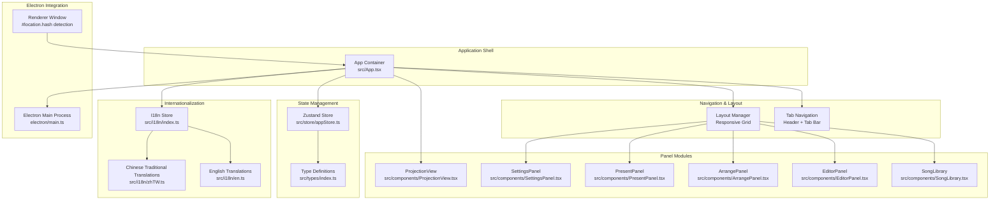

**Diagram sources**
- [App.tsx:12-102](file://src/App.tsx#L12-L102)
- [appStore.ts:1-385](file://src/store/appStore.ts#L1-L385)
- [index.ts:1-43](file://src/i18n/index.ts#L1-L43)
- [en.ts:1-180](file://src/i18n/en.ts#L1-L180)
- [zhTW.ts:1-180](file://src/i18n/zhTW.ts#L1-L180)
- [ProjectionView.tsx:1-134](file://src/components/ProjectionView.tsx#L1-L134)
- [main.ts:1-390](file://electron/main.ts#L1-L390)

**Section sources**
- [App.tsx:12-102](file://src/App.tsx#L12-L102)
- [main.tsx:1-11](file://src/main.tsx#L1-L11)

## Core Components
The App container component integrates several core systems:

### Tab-Based Navigation System
The application provides four distinct tabs managed through a centralized Zustand store:
- **Editor**: Song creation and lyric editing interface
- **Arrange**: Presentation arrangement builder with drag-and-drop functionality
- **Present**: Live projection control with keyboard shortcuts and multi-display support
- **Settings**: Comprehensive presentation customization and data management

### State Management Architecture
The Zustand store maintains application state with clear separation of concerns:
- **Song Library**: CRUD operations for song management
- **UI State**: Active tab selection and projection window status
- **Projection State**: Live display configuration and content
- **Settings**: Application preferences and defaults

### Internationalization Implementation
The i18n system supports multiple languages with dynamic locale switching:
- English (default) and Chinese Traditional translations
- Persistent locale storage using localStorage
- Dynamic translation loading based on user preferences

**Section sources**
- [App.tsx:48-53](file://src/App.tsx#L48-L53)
- [appStore.ts:31-96](file://src/store/appStore.ts#L31-L96)
- [index.ts:1-43](file://src/i18n/index.ts#L1-L43)

## Architecture Overview
The App component implements a sophisticated dual-window architecture that separates content creation from live projection:

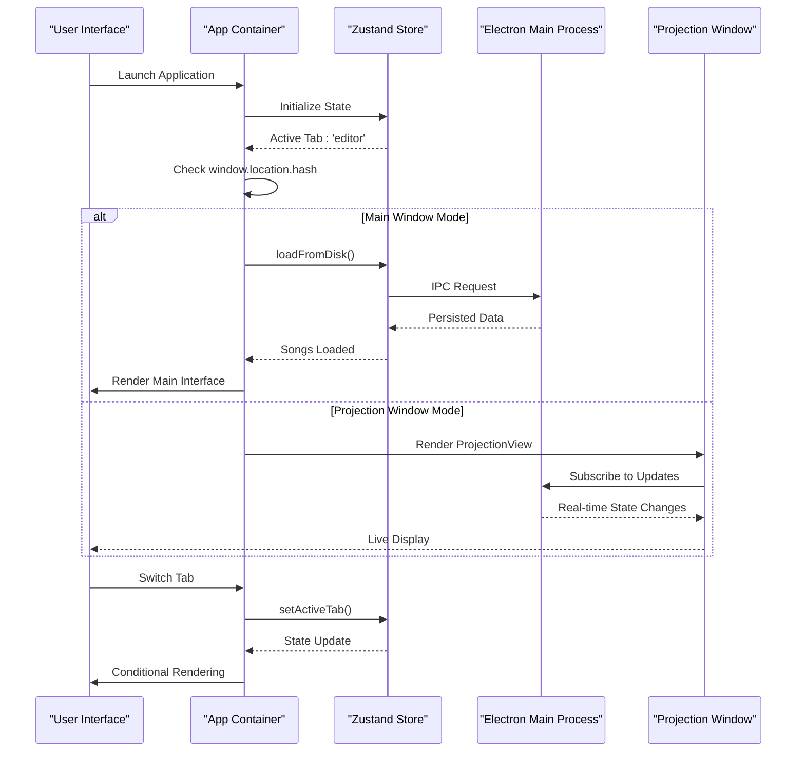

**Diagram sources**
- [App.tsx:16-46](file://src/App.tsx#L16-L46)
- [appStore.ts:361-384](file://src/store/appStore.ts#L361-L384)
- [main.ts:111-152](file://electron/main.ts#L111-L152)

The architecture leverages React's conditional rendering to seamlessly switch between main application mode and projection mode based on URL hash detection. This approach enables efficient resource utilization and prevents conflicts between the two operational contexts.

**Section sources**
- [App.tsx:16-46](file://src/App.tsx#L16-L46)
- [main.ts:140-146](file://electron/main.ts#L140-L146)

## Detailed Component Analysis

### App Container Component
The App component serves as the central orchestrator, implementing sophisticated lifecycle management and conditional rendering logic.

#### Lifecycle Management
The component employs two strategic useEffect hooks for optimal initialization and cleanup:

**Initialization Hook (Mount)**: Handles data loading and seed data population for new installations
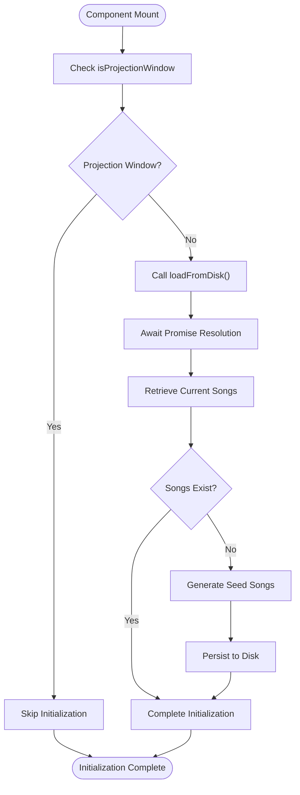

**Diagram sources**
- [App.tsx:19-32](file://src/App.tsx#L19-L32)
- [appStore.ts:361-384](file://src/store/appStore.ts#L361-L384)

**Cleanup Hook (Unmount)**: Manages Electron IPC cleanup for projection window monitoring
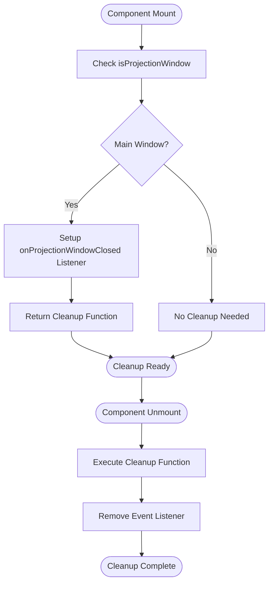

**Diagram sources**
- [App.tsx:34-42](file://src/App.tsx#L34-L42)

#### Conditional Rendering Logic
The component implements sophisticated mode detection using URL hash fragments to determine rendering context:

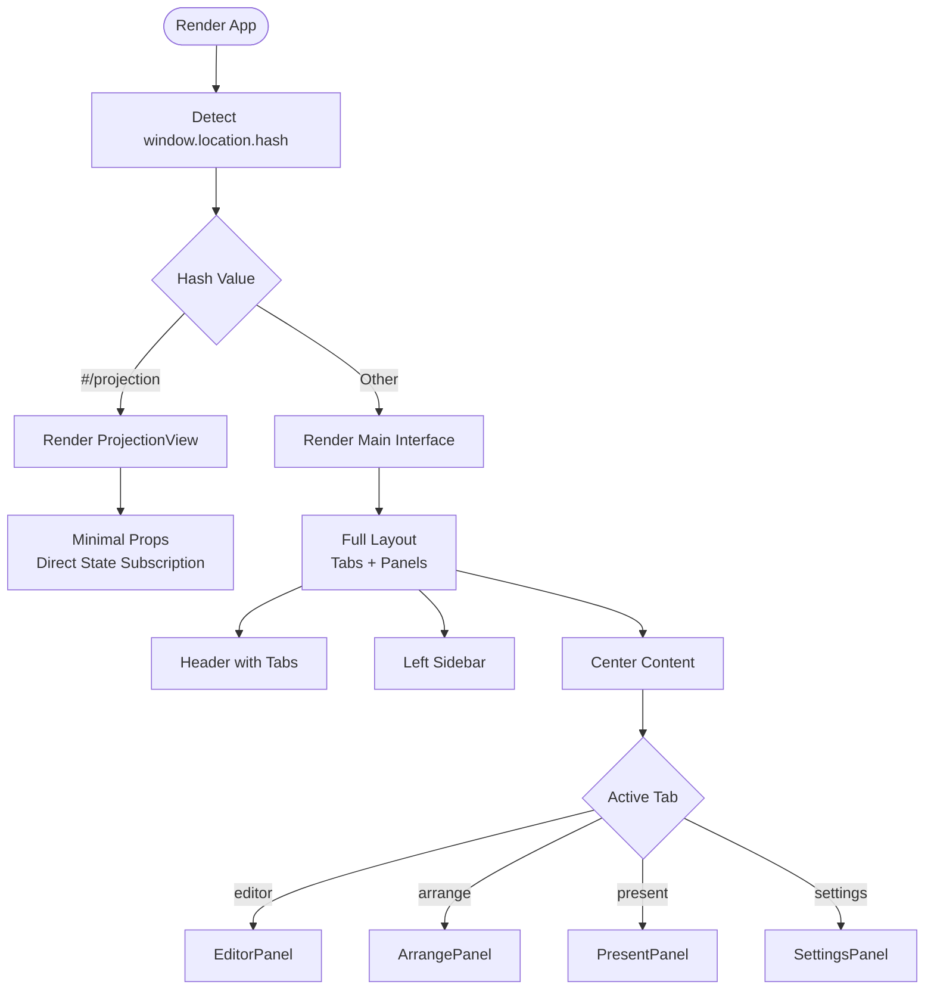

**Diagram sources**
- [App.tsx:44-98](file://src/App.tsx#L44-L98)

#### Tab Management System
The tab system provides intuitive navigation with visual feedback and persistent state:

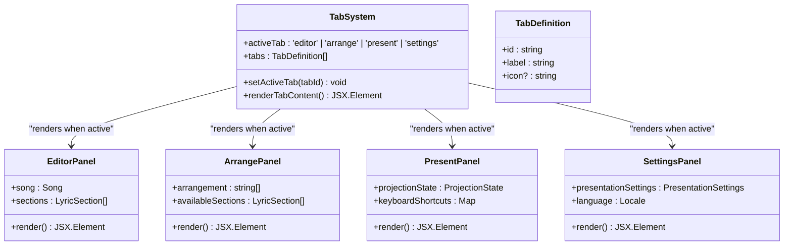

**Diagram sources**
- [App.tsx:48-95](file://src/App.tsx#L48-L95)
- [appStore.ts:38-82](file://src/store/appStore.ts#L38-L82)

**Section sources**
- [App.tsx:12-102](file://src/App.tsx#L12-L102)

### Zustand Store Integration
The App component integrates deeply with the Zustand store for comprehensive state management:

#### State Structure and Responsibilities
The store implements a clear separation of concerns with specialized slices for different domains:

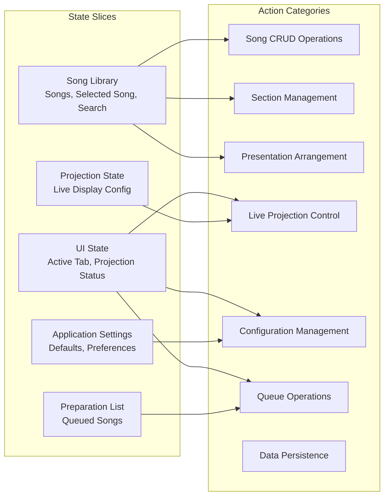

**Diagram sources**
- [appStore.ts:31-96](file://src/store/appStore.ts#L31-L96)

#### Data Flow Patterns
The store implements unidirectional data flow with clear action boundaries:

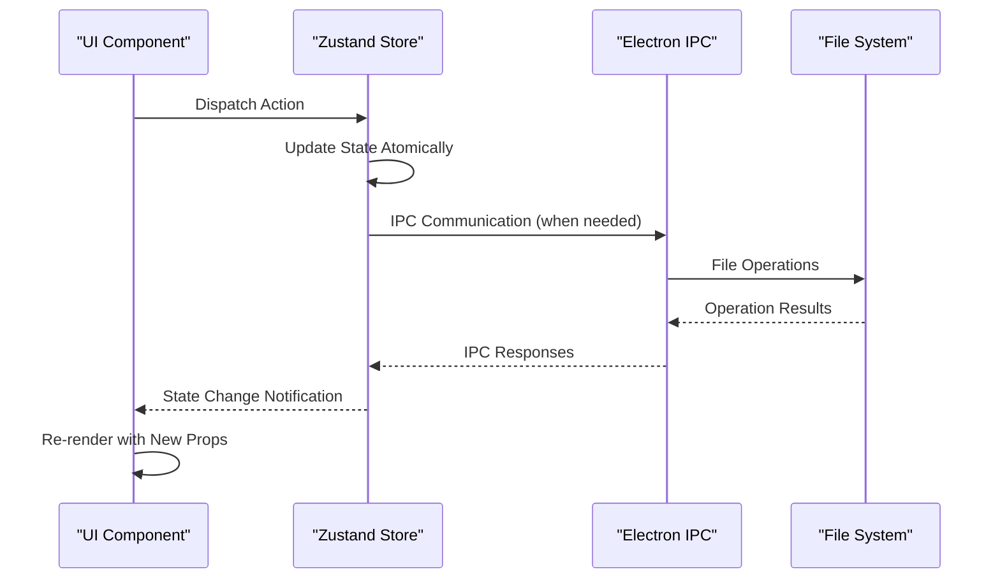

**Diagram sources**
- [appStore.ts:361-384](file://src/store/appStore.ts#L361-L384)

**Section sources**
- [appStore.ts:1-385](file://src/store/appStore.ts#L1-L385)

### Internationalization Implementation
The i18n system provides comprehensive multilingual support with dynamic locale switching:

#### Translation Architecture
The internationalization system implements a layered approach to manage translations efficiently:

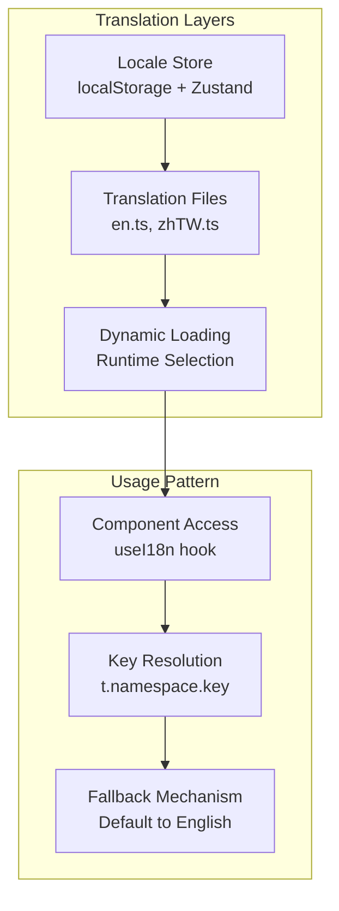

**Diagram sources**
- [index.ts:1-43](file://src/i18n/index.ts#L1-L43)
- [en.ts:1-180](file://src/i18n/en.ts#L1-L180)
- [zhTW.ts:1-180](file://src/i18n/zhTW.ts#L1-L180)

#### Responsive Design Patterns
The application implements responsive design principles through Tailwind CSS utilities and adaptive layouts:

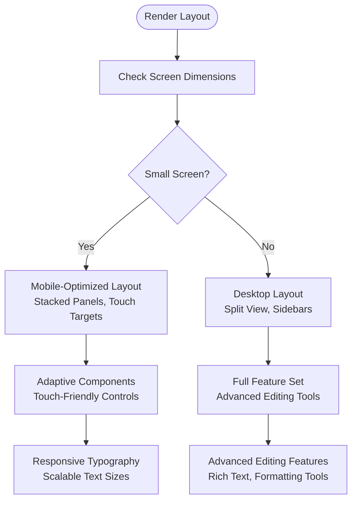

**Section sources**
- [index.ts:1-43](file://src/i18n/index.ts#L1-L43)
- [App.tsx:56-98](file://src/App.tsx#L56-L98)

## Dependency Analysis
The App component exhibits strong cohesion within the application shell while maintaining loose coupling with specialized modules:

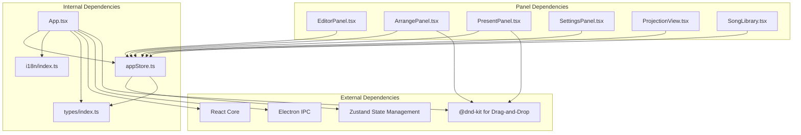

**Diagram sources**
- [App.tsx:1-11](file://src/App.tsx#L1-L11)
- [appStore.ts:1-4](file://src/store/appStore.ts#L1-L4)
- [index.ts:1-43](file://src/i18n/index.ts#L1-L43)

The dependency graph reveals a well-structured architecture where the App component acts as a coordinator, delegating specialized functionality to dedicated panels while maintaining centralized state management through the Zustand store.

**Section sources**
- [App.tsx:1-11](file://src/App.tsx#L1-L11)
- [appStore.ts:1-4](file://src/store/appStore.ts#L1-L4)

## Performance Considerations
The App component implements several performance optimization strategies:

### Efficient State Updates
- **Selective Rendering**: Only re-renders affected components when state changes
- **Memoization**: Uses React.memo for expensive components
- **State Partitioning**: Keeps UI state separate from data state

### Memory Management
- **Cleanup Functions**: Properly removes event listeners and subscriptions
- **Conditional Loading**: Defers heavy computations until needed
- **Resource Pooling**: Reuses components rather than recreating them

### Bundle Optimization
- **Code Splitting**: Panels are loaded on-demand
- **Tree Shaking**: Unused imports are eliminated
- **Lazy Loading**: Heavy dependencies are loaded asynchronously

## Troubleshooting Guide

### Common Issues and Solutions

#### Tab Switching Problems
**Symptoms**: Tabs don't change or state doesn't persist
**Causes**: 
- Incorrect activeTab state management
- Missing setActiveTab dispatch
- Store subscription issues

**Solutions**:
- Verify setActiveTab is called with valid tab identifiers
- Check store.getState() for proper state updates
- Ensure useAppStore subscription is active

#### Projection Window Issues
**Symptoms**: Projection window fails to open or display incorrectly
**Causes**:
- Electron IPC communication failures
- Display detection problems
- State synchronization issues

**Solutions**:
- Verify electronAPI availability in renderer process
- Check display enumeration and selection logic
- Monitor projection state updates in real-time

#### Data Loading Failures
**Symptoms**: Songs not loading or disappearing after restart
**Causes**:
- File system permission issues
- JSON parsing errors
- Migration failures

**Solutions**:
- Verify file paths and permissions
- Validate JSON structure and encoding
- Check migration scripts for compatibility

#### Internationalization Problems
**Symptoms**: Mixed language content or missing translations
**Causes**:
- Locale storage corruption
- Translation key mismatches
- Dynamic import failures

**Solutions**:
- Reset locale to default ('en')
- Verify translation keys exist
- Check network connectivity for external resources

**Section sources**
- [App.tsx:19-42](file://src/App.tsx#L19-L42)
- [appStore.ts:361-384](file://src/store/appStore.ts#L361-L384)
- [main.ts:154-190](file://electron/main.ts#L154-L190)

## Conclusion
The App container component represents a sophisticated application shell that effectively coordinates multiple functional areas while maintaining clean architectural boundaries. Its dual-window architecture, comprehensive state management through Zustand, and robust internationalization system demonstrate enterprise-grade design patterns. The component successfully balances flexibility with performance, providing a solid foundation for the LyricDeck application's complex requirements in both desktop and projection environments.

The implementation showcases modern React patterns including hooks-based lifecycle management, context-free state management, and component composition strategies. The integration with Electron enables seamless desktop application functionality while maintaining web-based development practices. This architecture provides an excellent template for similar desktop applications requiring live projection capabilities and comprehensive content management.