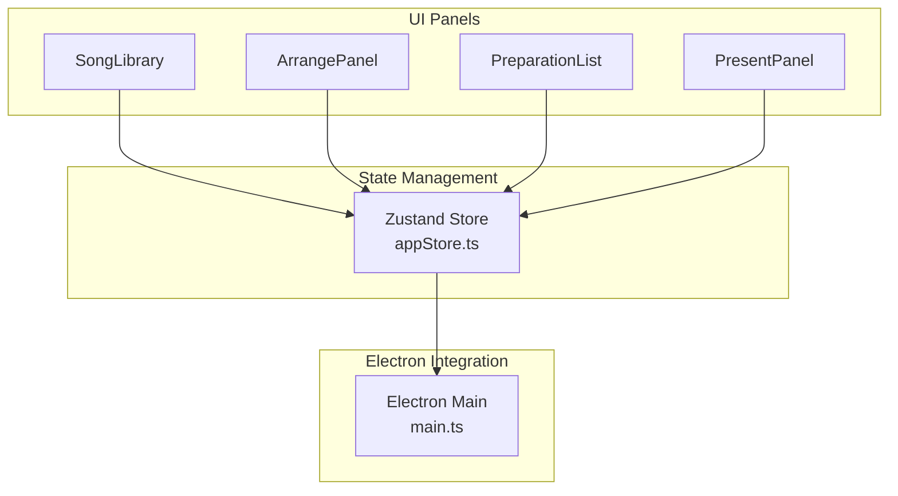
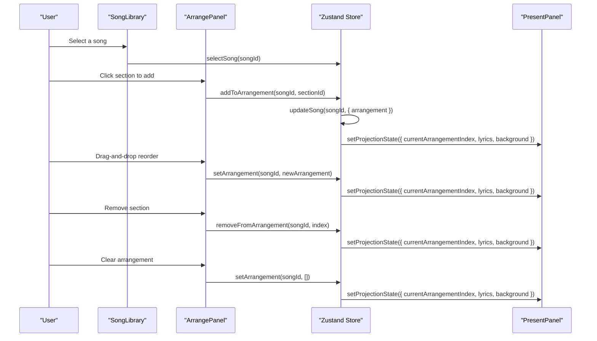
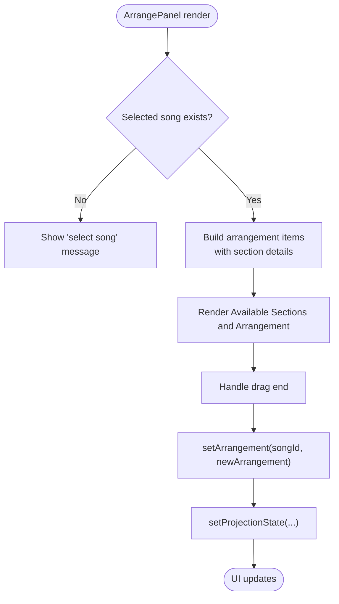
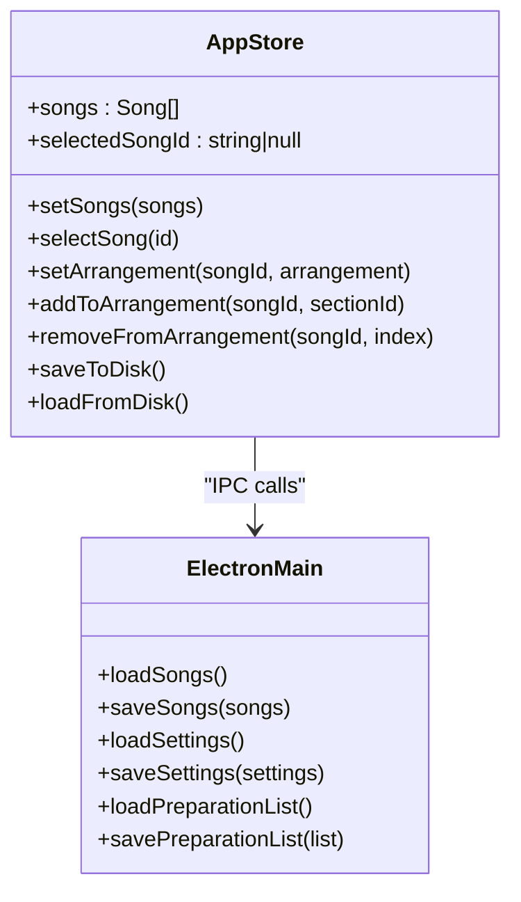
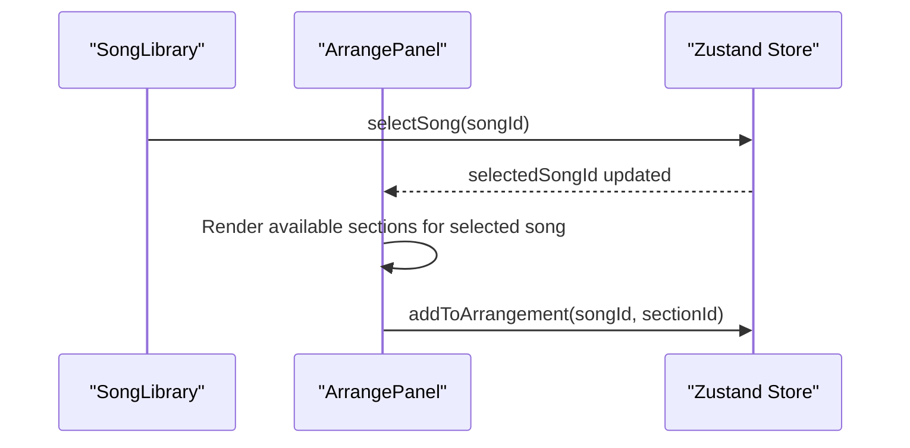
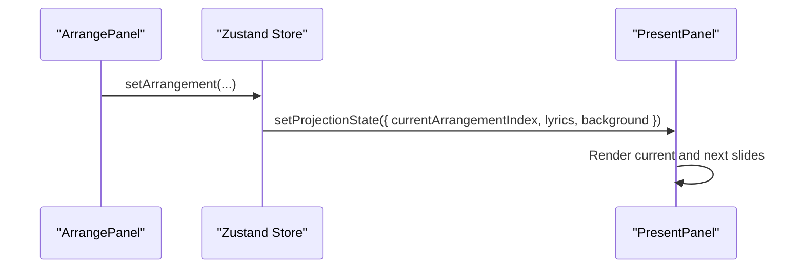
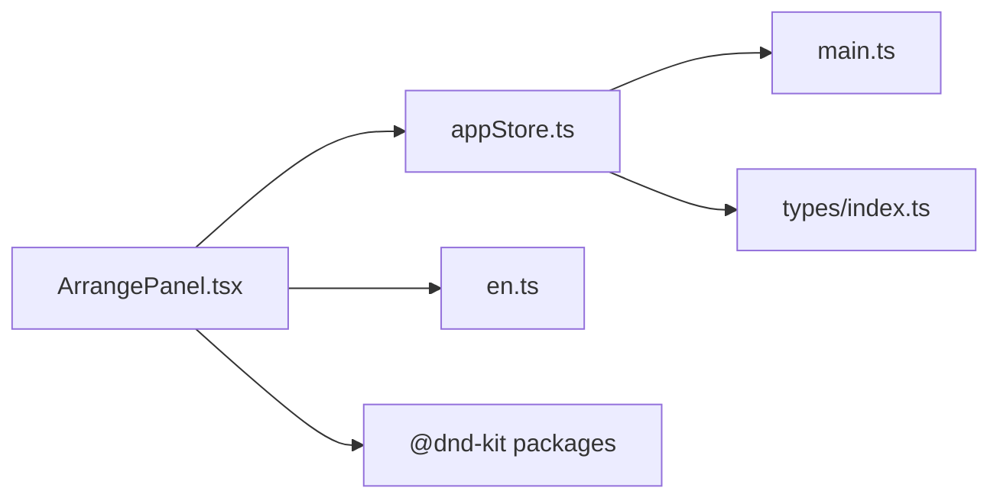

# Arrange Panel

<cite>
**Referenced Files in This Document**
- [ArrangePanel.tsx](file://src/components/ArrangePanel.tsx)
- [appStore.ts](file://src/store/appStore.ts)
- [SongLibrary.tsx](file://src/components/SongLibrary.tsx)
- [PreparationList.tsx](file://src/components/PreparationList.tsx)
- [PresentPanel.tsx](file://src/components/PresentPanel.tsx)
- [index.ts](file://src/types/index.ts)
- [en.ts](file://src/i18n/en.ts)
- [App.tsx](file://src/App.tsx)
- [main.ts](file://electron/main.ts)
- [seedData.ts](file://src/utils/seedData.ts)
</cite>

## Table of Contents
1. [Introduction](#introduction)
2. [Project Structure](#project-structure)
3. [Core Components](#core-components)
4. [Architecture Overview](#architecture-overview)
5. [Detailed Component Analysis](#detailed-component-analysis)
6. [Dependency Analysis](#dependency-analysis)
7. [Performance Considerations](#performance-considerations)
8. [Troubleshooting Guide](#troubleshooting-guide)
9. [Conclusion](#conclusion)
10. [Appendices](#appendices)

## Introduction
The Arrange Panel enables users to build custom presentation sequences by combining song sections into an arrangement. It provides a drag-and-drop interface for ordering sections, integrates with the Song Library for adding sections, and offers real-time preview updates through the projection system. The panel manages arrangement state via a Zustand store, persists changes to disk, and supports clearing arrangements. While undo/redo and explicit validation logic are not implemented in the current codebase, the panel’s design supports straightforward extension for these features.

## Project Structure
The Arrange Panel is part of a React application integrated with Electron for desktop functionality. The panel is composed of:
- ArrangePanel: The main arrangement builder with drag-and-drop and section management
- SongLibrary: Provides song selection and section availability
- PreparationList: Shared list for arranging and presenting
- PresentPanel: Real-time preview of arrangement changes
- appStore: Centralized state management with persistence
- Types and i18n: Strong typing and internationalization support
- Electron main process: File system persistence and projection window management

**Diagram sources**
- [ArrangePanel.tsx:22-134](file://src/components/ArrangePanel.tsx#L22-L134)
- [SongLibrary.tsx:8-95](file://src/components/SongLibrary.tsx#L8-L95)
- [PreparationList.tsx:25-123](file://src/components/PreparationList.tsx#L25-L123)
- [PresentPanel.tsx:6-347](file://src/components/PresentPanel.tsx#L6-L347)
- [appStore.ts:98-385](file://src/store/appStore.ts#L98-L385)
- [main.ts:39-218](file://electron/main.ts#L39-L218)

**Section sources**
- [App.tsx:48-99](file://src/App.tsx#L48-L99)
- [ArrangePanel.tsx:22-134](file://src/components/ArrangePanel.tsx#L22-L134)
- [SongLibrary.tsx:8-95](file://src/components/SongLibrary.tsx#L8-L95)
- [PreparationList.tsx:25-123](file://src/components/PreparationList.tsx#L25-L123)
- [PresentPanel.tsx:6-347](file://src/components/PresentPanel.tsx#L6-L347)
- [appStore.ts:98-385](file://src/store/appStore.ts#L98-L385)
- [main.ts:39-218](file://electron/main.ts#L39-L218)

## Core Components
- ArrangePanel: Renders available sections, the arrangement list, and handles drag-and-drop reordering and removal. It also clears the entire arrangement.
- appStore: Manages songs, selected song, arrangement actions (set, add, remove), and persistence to disk.
- SongLibrary: Provides song selection and section availability for adding to arrangements.
- PreparationList: Shared list used in both Arrange and Present modes for organizing songs.
- PresentPanel: Real-time preview of arrangement changes and projection controls.
- Types: Defines Song, LyricSection, ProjectionState, and related interfaces.
- i18n: Internationalization keys for Arrange panel labels and messages.

**Section sources**
- [ArrangePanel.tsx:22-134](file://src/components/ArrangePanel.tsx#L22-L134)
- [appStore.ts:31-96](file://src/store/appStore.ts#L31-L96)
- [SongLibrary.tsx:8-95](file://src/components/SongLibrary.tsx#L8-L95)
- [PreparationList.tsx:25-123](file://src/components/PreparationList.tsx#L25-L123)
- [PresentPanel.tsx:6-347](file://src/components/PresentPanel.tsx#L6-L347)
- [index.ts:50-81](file://src/types/index.ts#L50-L81)
- [en.ts:64-75](file://src/i18n/en.ts#L64-L75)

## Architecture Overview
The Arrange Panel orchestrates arrangement building through:
- Selection of a song from the Song Library
- Adding sections to the arrangement from the available sections list
- Drag-and-drop reordering within the arrangement
- Removal of individual sections
- Clearing the entire arrangement
- Persistence of changes to disk via the Zustand store
- Real-time preview updates in the Present Panel

**Diagram sources**
- [ArrangePanel.tsx:54-63](file://src/components/ArrangePanel.tsx#L54-L63)
- [appStore.ts:223-239](file://src/store/appStore.ts#L223-L239)
- [PresentPanel.tsx:251-291](file://src/components/PresentPanel.tsx#L251-L291)

## Detailed Component Analysis

### ArrangePanel Component
The ArrangePanel renders:
- Available sections column: Lists all sections of the selected song with a button to add each section to the arrangement
- Arrangement column: Displays the current arrangement with draggable items and remove buttons
- PreparationList: Right-side list for arranging and presenting
- Clear All button: Removes all sections from the arrangement

Drag-and-drop behavior:
- Uses @dnd-kit for pointer and keyboard sensors
- On drag end, calculates new order and updates the arrangement via the store
- Visual feedback includes dragging opacity and grab cursor

Event handling:
- Click-to-add sections to the arrangement
- Remove individual sections
- Clear the entire arrangement

Real-time preview:
- Changes immediately propagate to the Present Panel through the store’s projection state updates

**Diagram sources**
- [ArrangePanel.tsx:22-134](file://src/components/ArrangePanel.tsx#L22-L134)
- [appStore.ts:223-239](file://src/store/appStore.ts#L223-L239)
- [PresentPanel.tsx:251-291](file://src/components/PresentPanel.tsx#L251-L291)

**Section sources**
- [ArrangePanel.tsx:22-134](file://src/components/ArrangePanel.tsx#L22-L134)
- [ArrangePanel.tsx:136-187](file://src/components/ArrangePanel.tsx#L136-L187)

### Zustand Store and Arrangement State Management
The Zustand store manages:
- Songs and selected song
- Arrangement actions: set, add, remove
- Persistence to disk via Electron IPC
- Projection state updates for real-time preview

Key actions:
- setArrangement(songId, arrangement): Updates the arrangement for a song
- addToArrangement(songId, sectionId): Appends a section to the arrangement
- removeFromArrangement(songId, index): Removes a section by index
- saveToDisk/loadFromDisk: Persists and loads data via Electron main process

Persistence:
- Electron main process writes to JSON files under the user data directory
- Data includes songs, settings, and preparation list

**Diagram sources**
- [appStore.ts:98-385](file://src/store/appStore.ts#L98-L385)
- [main.ts:39-218](file://electron/main.ts#L39-L218)

**Section sources**
- [appStore.ts:31-96](file://src/store/appStore.ts#L31-L96)
- [appStore.ts:222-239](file://src/store/appStore.ts#L222-L239)
- [appStore.ts:361-385](file://src/store/appStore.ts#L361-L385)
- [main.ts:39-218](file://electron/main.ts#L39-L218)

### Integration with SongLibrary
The Arrange Panel relies on the Song Library for:
- Selecting a song to arrange
- Providing available sections to add to the arrangement
- Maintaining the global song list and search/filtering

**Diagram sources**
- [SongLibrary.tsx:8-95](file://src/components/SongLibrary.tsx#L8-L95)
- [ArrangePanel.tsx:23-44](file://src/components/ArrangePanel.tsx#L23-L44)
- [appStore.ts:57-58](file://src/store/appStore.ts#L57-L58)

**Section sources**
- [SongLibrary.tsx:8-95](file://src/components/SongLibrary.tsx#L8-L95)
- [ArrangePanel.tsx:23-44](file://src/components/ArrangePanel.tsx#L23-L44)

### Real-time Preview and Projection
Changes made in the Arrange Panel are reflected in the Present Panel:
- The store updates projection state with current arrangement index, lyrics, and background
- Present Panel listens to store changes and renders previews accordingly
- Keyboard shortcuts and controls in Present Panel navigate slides and adjust modes

**Diagram sources**
- [ArrangePanel.tsx:54-63](file://src/components/ArrangePanel.tsx#L54-L63)
- [appStore.ts:242-274](file://src/store/appStore.ts#L242-L274)
- [PresentPanel.tsx:251-291](file://src/components/PresentPanel.tsx#L251-L291)

**Section sources**
- [PresentPanel.tsx:6-347](file://src/components/PresentPanel.tsx#L6-L347)
- [appStore.ts:242-274](file://src/store/appStore.ts#L242-L274)

### Undo/Redo and Validation
- Undo/Redo: Not implemented in the current codebase. The store does not track action history or provide undo/redo actions.
- Validation: No explicit validation logic for arrangement composition is present. The store allows arbitrary additions/removals and reordering.

Recommendations for future enhancement:
- Introduce a history stack in the store to support undo/redo
- Add validation rules (e.g., preventing duplicate sections, enforcing required sections)
- Provide user feedback for invalid operations

**Section sources**
- [appStore.ts:98-385](file://src/store/appStore.ts#L98-L385)

## Dependency Analysis
The Arrange Panel depends on:
- Zustand store for state and persistence
- @dnd-kit for drag-and-drop interactions
- i18n for localized labels
- Electron main process for persistence and projection window management

**Diagram sources**
- [ArrangePanel.tsx:1-21](file://src/components/ArrangePanel.tsx#L1-L21)
- [appStore.ts:1-4](file://src/store/appStore.ts#L1-L4)
- [en.ts:1-180](file://src/i18n/en.ts#L1-L180)
- [main.ts:1-6](file://electron/main.ts#L1-L6)
- [index.ts:1-89](file://src/types/index.ts#L1-L89)

**Section sources**
- [ArrangePanel.tsx:1-21](file://src/components/ArrangePanel.tsx#L1-L21)
- [appStore.ts:1-4](file://src/store/appStore.ts#L1-L4)
- [en.ts:1-180](file://src/i18n/en.ts#L1-L180)
- [main.ts:1-6](file://electron/main.ts#L1-L6)
- [index.ts:1-89](file://src/types/index.ts#L1-L89)

## Performance Considerations
- Drag-and-drop reordering uses arrayMove for efficient list updates
- Rendering uses memoized items and minimal re-renders through Zustand subscriptions
- Persistence is batched via saveToDisk after store updates
- Large arrangements may benefit from virtualized lists in future iterations

[No sources needed since this section provides general guidance]

## Troubleshooting Guide
Common issues and resolutions:
- No song selected: The Arrange Panel shows a message prompting to select a song from the Song Library
- Empty arrangement: The panel displays a placeholder with instructions to add sections
- Drag-and-drop not working: Ensure @dnd-kit dependencies are installed and sensors are configured
- Changes not persisting: Verify Electron IPC handlers are available and saveToDisk is triggered after updates
- Preview not updating: Confirm setProjectionState is invoked after arrangement changes

**Section sources**
- [ArrangePanel.tsx:33-42](file://src/components/ArrangePanel.tsx#L33-L42)
- [ArrangePanel.tsx:105-110](file://src/components/ArrangePanel.tsx#L105-L110)
- [appStore.ts:379-383](file://src/store/appStore.ts#L379-L383)
- [PresentPanel.tsx:251-291](file://src/components/PresentPanel.tsx#L251-L291)

## Conclusion
The Arrange Panel provides a streamlined interface for constructing presentation arrangements from song sections. It integrates tightly with the Zustand store for state management and persistence, and delivers real-time preview updates to the Present Panel. While undo/redo and validation are not currently implemented, the component’s design supports easy extension for these features. The panel’s reliance on @dnd-kit ensures smooth drag-and-drop interactions, and Electron integration guarantees reliable data persistence.

[No sources needed since this section summarizes without analyzing specific files]

## Appendices

### Example Workflows

- Building an arrangement
  - Select a song from the Song Library
  - Click sections in the Available Sections column to add them to the arrangement
  - Drag-and-drop to reorder sections
  - Use Remove buttons to delete individual sections
  - Use Clear All to reset the arrangement

- Dynamic updates
  - Adding a section updates the arrangement immediately
  - Reordering triggers a new arrangement and updates the preview
  - Removing a section adjusts indices and refreshes the preview

- Persistence
  - Changes are saved to disk automatically after store updates
  - Data is restored on application startup

**Section sources**
- [ArrangePanel.tsx:70-87](file://src/components/ArrangePanel.tsx#L70-L87)
- [ArrangePanel.tsx:111-127](file://src/components/ArrangePanel.tsx#L111-L127)
- [appStore.ts:223-239](file://src/store/appStore.ts#L223-L239)
- [appStore.ts:361-385](file://src/store/appStore.ts#L361-L385)