# Component Architecture

<cite>
**Referenced Files in This Document**
- [App.tsx](file://src/App.tsx)
- [main.tsx](file://src/main.tsx)
- [appStore.ts](file://src/store/appStore.ts)
- [SongLibrary.tsx](file://src/components/SongLibrary.tsx)
- [EditorPanel.tsx](file://src/components/EditorPanel.tsx)
- [ArrangePanel.tsx](file://src/components/ArrangePanel.tsx)
- [PresentPanel.tsx](file://src/components/PresentPanel.tsx)
- [SettingsPanel.tsx](file://src/components/SettingsPanel.tsx)
- [ProjectionView.tsx](file://src/components/ProjectionView.tsx)
- [PreparationList.tsx](file://src/components/PreparationList.tsx)
- [BackgroundGallery.tsx](file://src/components/BackgroundGallery.tsx)
- [index.ts (i18n)](file://src/i18n/index.ts)
- [en.ts](file://src/i18n/en.ts)
- [zhTW.ts](file://src/i18n/zhTW.ts)
- [index.ts (types)](file://src/types/index.ts)
</cite>

## Table of Contents
1. [Introduction](#introduction)
2. [Project Structure](#project-structure)
3. [Core Components](#core-components)
4. [Architecture Overview](#architecture-overview)
5. [Detailed Component Analysis](#detailed-component-analysis)
6. [Dependency Analysis](#dependency-analysis)
7. [Performance Considerations](#performance-considerations)
8. [Troubleshooting Guide](#troubleshooting-guide)
9. [Conclusion](#conclusion)

## Introduction
This document describes the React-based UI architecture of LyricDeck, focusing on the hierarchical component structure, tab-based navigation, panel integration, state management via Zustand, internationalization, and user interaction patterns. It explains how the main container App orchestrates panels, how components communicate through a centralized store, and how features like drag-and-drop, projection windows, and preparation lists are integrated.

## Project Structure
LyricDeck follows a feature-based component organization under src/components, with a single Zustand store under src/store and an i18n module under src/i18n. The root App component renders the main layout and conditionally switches panels based on the active tab. Electron APIs are accessed through window.electronAPI for persistence, projection control, and media management.

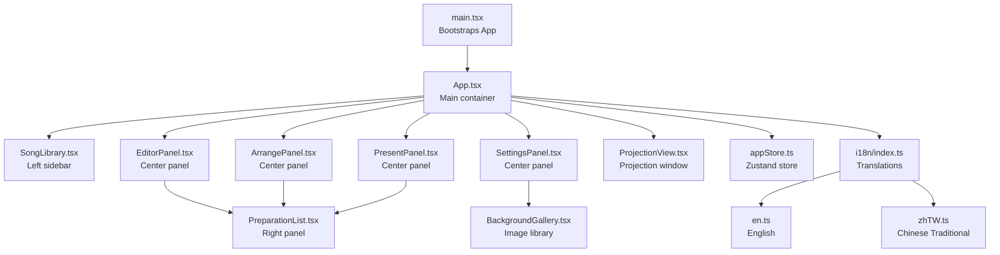

**Diagram sources**
- [main.tsx:1-11](file://src/main.tsx#L1-L11)
- [App.tsx:12-102](file://src/App.tsx#L12-L102)
- [appStore.ts:1-385](file://src/store/appStore.ts#L1-L385)
- [SongLibrary.tsx:1-193](file://src/components/SongLibrary.tsx#L1-L193)
- [EditorPanel.tsx:1-264](file://src/components/EditorPanel.tsx#L1-L264)
- [ArrangePanel.tsx:1-187](file://src/components/ArrangePanel.tsx#L1-L187)
- [PresentPanel.tsx:1-365](file://src/components/PresentPanel.tsx#L1-L365)
- [SettingsPanel.tsx:1-523](file://src/components/SettingsPanel.tsx#L1-L523)
- [ProjectionView.tsx:1-134](file://src/components/ProjectionView.tsx#L1-L134)
- [PreparationList.tsx:1-188](file://src/components/PreparationList.tsx#L1-L188)
- [BackgroundGallery.tsx:1-98](file://src/components/BackgroundGallery.tsx#L1-L98)
- [index.ts (i18n):1-43](file://src/i18n/index.ts#L1-L43)
- [en.ts:1-180](file://src/i18n/en.ts#L1-L180)
- [zhTW.ts:1-180](file://src/i18n/zhTW.ts#L1-L180)

**Section sources**
- [main.tsx:1-11](file://src/main.tsx#L1-L11)
- [App.tsx:12-102](file://src/App.tsx#L12-L102)

## Core Components
- App: Orchestrates layout, tab navigation, and conditional rendering of panels. Manages projection window detection and persistence initialization.
- Panels: EditorPanel, ArrangePanel, PresentPanel, SettingsPanel render the center content area and integrate with shared components like PreparationList and BackgroundGallery.
- Shared Utilities: PreparationList provides draggable preparation lists; BackgroundGallery manages local background images; ProjectionView renders the projection window content.
- Store: appStore encapsulates all state and actions for songs, sections, arrangements, projection, settings, and persistence.
- Internationalization: i18n module provides translations and locale switching with persisted preferences.

**Section sources**
- [App.tsx:12-102](file://src/App.tsx#L12-L102)
- [appStore.ts:31-96](file://src/store/appStore.ts#L31-L96)
- [PreparationList.tsx:25-123](file://src/components/PreparationList.tsx#L25-L123)
- [BackgroundGallery.tsx:9-98](file://src/components/BackgroundGallery.tsx#L9-L98)
- [ProjectionView.tsx:4-134](file://src/components/ProjectionView.tsx#L4-L134)
- [index.ts (i18n):17-43](file://src/i18n/index.ts#L17-L43)

## Architecture Overview
The UI uses a central store pattern with Zustand for state normalization and action dispatch. Components subscribe to slices of state and call actions to mutate state. Electron APIs are accessed through window.electronAPI for persistence, projection control, and media operations. Internationalization is handled via a small Zustand store that selects translation sets and persists locale preferences.

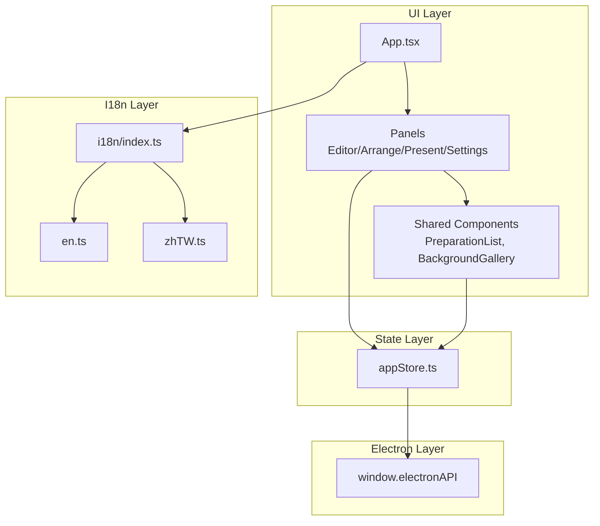

**Diagram sources**
- [App.tsx:12-102](file://src/App.tsx#L12-L102)
- [appStore.ts:361-384](file://src/store/appStore.ts#L361-L384)
- [index.ts (i18n):1-43](file://src/i18n/index.ts#L1-L43)
- [en.ts:1-180](file://src/i18n/en.ts#L1-L180)
- [zhTW.ts:1-180](file://src/i18n/zhTW.ts#L1-L180)

## Detailed Component Analysis

### App Container and Navigation
- Responsibilities:
  - Renders header with tab buttons bound to setActiveTab.
  - Conditionally renders ProjectionView when in projection mode.
  - Initializes persistence and seeds data when empty.
  - Subscribes to projection window close events.
- Props and State:
  - Uses activeTab, setActiveTab, loadFromDisk, songs, setSongs from the store.
  - Uses t from i18n for labels.
- Lifecycle and Events:
  - useEffect initializes persistence and seeding on mount.
  - useEffect listens for projection window close and updates isProjectionOpen.
- Conditional Rendering:
  - activeTab drives which panel is shown in the center area.

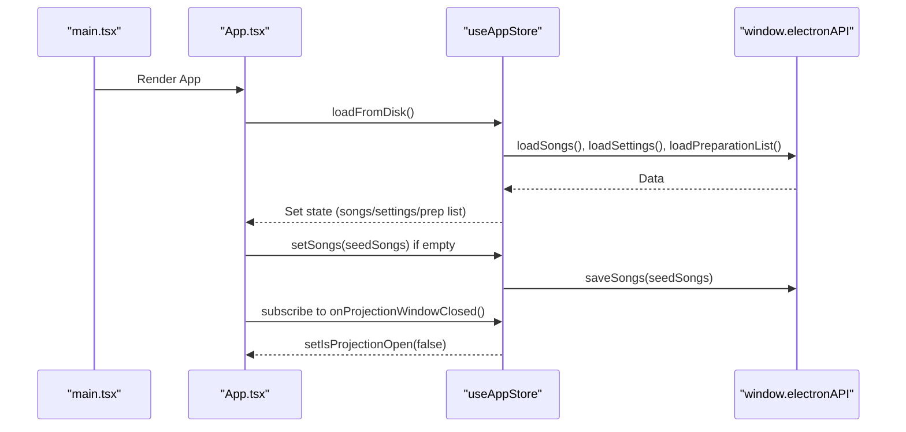

**Diagram sources**
- [main.tsx:6-10](file://src/main.tsx#L6-L10)
- [App.tsx:19-42](file://src/App.tsx#L19-L42)
- [appStore.ts:361-384](file://src/store/appStore.ts#L361-L384)

**Section sources**
- [App.tsx:12-102](file://src/App.tsx#L12-L102)
- [appStore.ts:304-305](file://src/store/appStore.ts#L304-L305)
- [index.ts (i18n):17-43](file://src/i18n/index.ts#L17-L43)

### Song Library
- Responsibilities:
  - Filters and sorts songs based on search query and sort criteria.
  - Provides actions to select, add, duplicate, delete, and manage preparation list entries.
- Props and State:
  - Uses songs, selectedSongId, searchQuery, setSearchQuery, selectSong, addSong, deleteSong, duplicateSong, addToPreparationList, preparationList from the store.
  - Local state for sortBy.
- Composition:
  - Renders SongItem for each song with contextual actions.

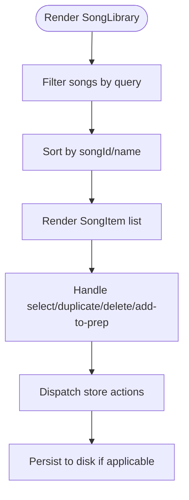

**Diagram sources**
- [SongLibrary.tsx:14-95](file://src/components/SongLibrary.tsx#L14-L95)
- [appStore.ts:113-183](file://src/store/appStore.ts#L113-L183)

**Section sources**
- [SongLibrary.tsx:8-95](file://src/components/SongLibrary.tsx#L8-L95)
- [appStore.ts:51-91](file://src/store/appStore.ts#L51-L91)

### Editor Panel
- Responsibilities:
  - Edits song metadata and sections.
  - Provides a live preview of slides based on presentation settings.
- Props and State:
  - Uses songs, selectedSongId, updateSong, addSection, updateSection, deleteSection from the store.
  - Local state for section collapse toggles in SectionEditor.
- Composition:
  - SectionEditor handles per-section editing.
  - AddSectionButton opens a menu of section types.
  - SlidePreview renders a representative preview.

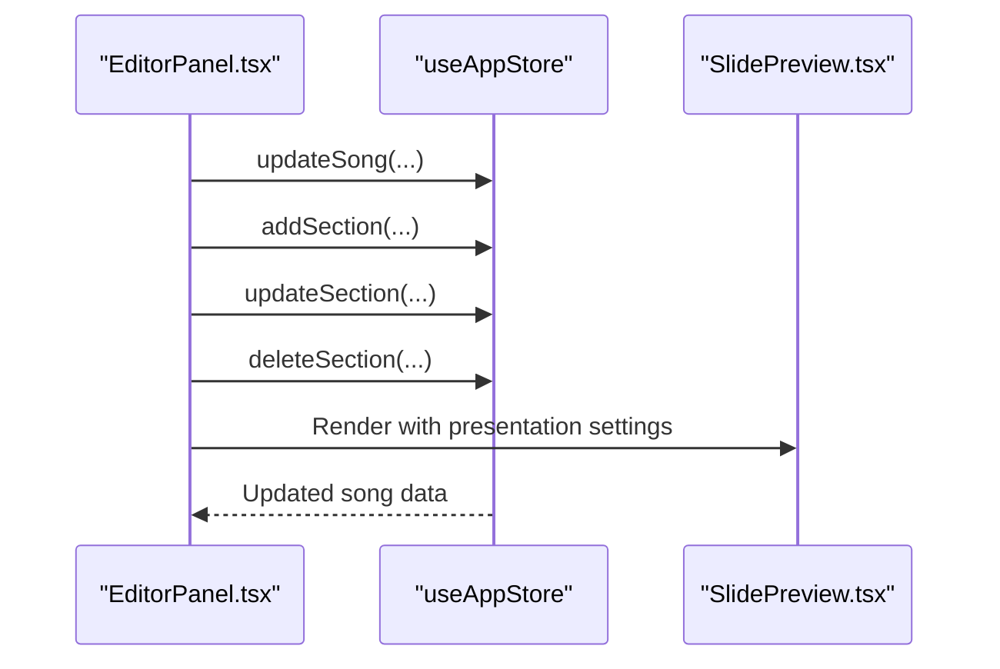

**Diagram sources**
- [EditorPanel.tsx:17-118](file://src/components/EditorPanel.tsx#L17-L118)
- [appStore.ts:174-220](file://src/store/appStore.ts#L174-L220)

**Section sources**
- [EditorPanel.tsx:17-264](file://src/components/EditorPanel.tsx#L17-L264)
- [appStore.ts:60-70](file://src/store/appStore.ts#L60-L70)

### Arrange Panel
- Responsibilities:
  - Builds and reorders a presentation arrangement from available sections.
  - Integrates with PreparationList for quick selection.
- Props and State:
  - Uses songs, selectedSongId, addToArrangement, removeFromArrangement, setArrangement from the store.
  - Uses @dnd-kit for drag-and-drop reordering.
- Composition:
  - SortableArrangementItem renders draggable arrangement items.
  - PreparationList is embedded for convenience.

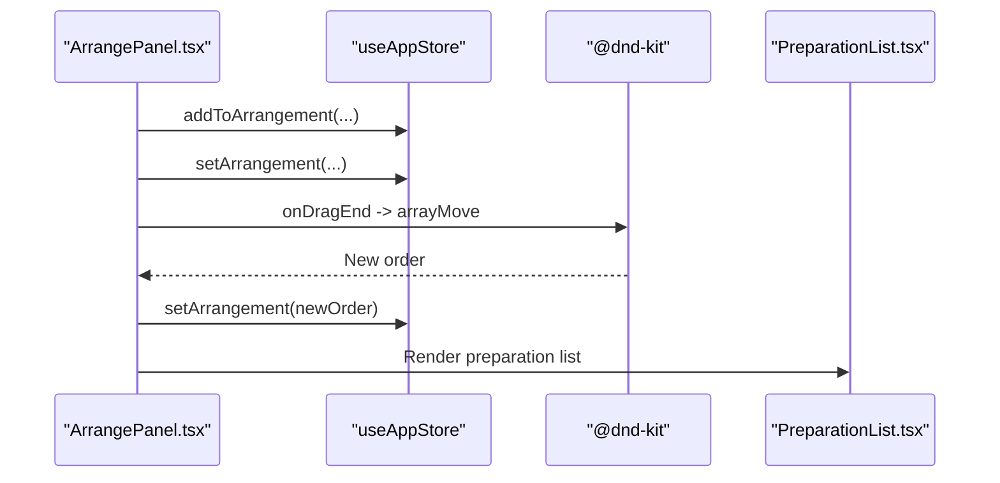

**Diagram sources**
- [ArrangePanel.tsx:22-134](file://src/components/ArrangePanel.tsx#L22-L134)
- [PreparationList.tsx:25-123](file://src/components/PreparationList.tsx#L25-L123)
- [appStore.ts:222-240](file://src/store/appStore.ts#L222-L240)

**Section sources**
- [ArrangePanel.tsx:22-187](file://src/components/ArrangePanel.tsx#L22-L187)
- [appStore.ts:66-70](file://src/store/appStore.ts#L66-L70)

### Present Panel
- Responsibilities:
  - Controls projection modes and navigation through arranged slides.
  - Manages keyboard shortcuts and projection window lifecycle.
- Props and State:
  - Uses songs, selectedSongId, projectionState, currentArrangementIndex, isProjectionOpen, goToSlide, nextSlide, prevSlide, setProjectionMode, setIsProjectionOpen, shiftLines from the store.
  - Local state for display devices and selected display.
- Composition:
  - Uses ProjectionView-like rendering logic internally for previews.
  - PreparationList is embedded for quick selection during presentation.

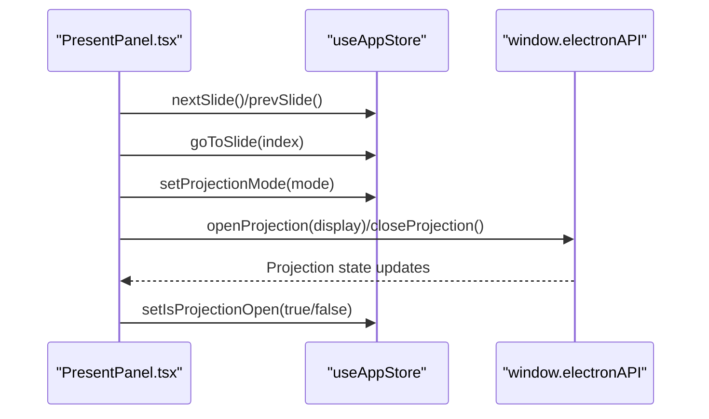

**Diagram sources**
- [PresentPanel.tsx:6-347](file://src/components/PresentPanel.tsx#L6-L347)
- [appStore.ts:241-302](file://src/store/appStore.ts#L241-L302)

**Section sources**
- [PresentPanel.tsx:6-365](file://src/components/PresentPanel.tsx#L6-L365)
- [appStore.ts:71-79](file://src/store/appStore.ts#L71-L79)

### Settings Panel
- Responsibilities:
  - Configures background and text styles per song.
  - Manages language and import/export operations.
- Props and State:
  - Uses songs, selectedSongId, updateSong, loadFromDisk from the store.
  - Uses i18n locale and setLocale.
- Composition:
  - BackgroundGallery integrates with Electron-managed image library.
  - ImportExportSection triggers import/export via Electron.

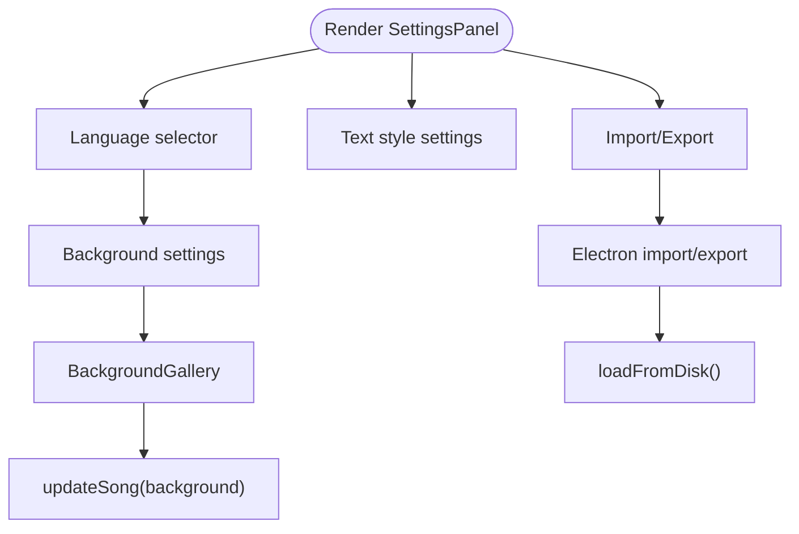

**Diagram sources**
- [SettingsPanel.tsx:7-417](file://src/components/SettingsPanel.tsx#L7-L417)
- [BackgroundGallery.tsx:9-98](file://src/components/BackgroundGallery.tsx#L9-L98)
- [appStore.ts:361-384](file://src/store/appStore.ts#L361-L384)

**Section sources**
- [SettingsPanel.tsx:7-523](file://src/components/SettingsPanel.tsx#L7-L523)
- [BackgroundGallery.tsx:9-98](file://src/components/BackgroundGallery.tsx#L9-L98)
- [index.ts (i18n):17-43](file://src/i18n/index.ts#L17-L43)

### Projection View
- Responsibilities:
  - Renders the projection window content based on ProjectionState.
  - Listens for projection state updates from Electron.
- Props and State:
  - Local state initialized with default ProjectionState.
  - Subscribes to onProjectionState updates.
- Rendering Modes:
  - Supports black, logo, live, blank, and clear modes with appropriate overlays and text styling.

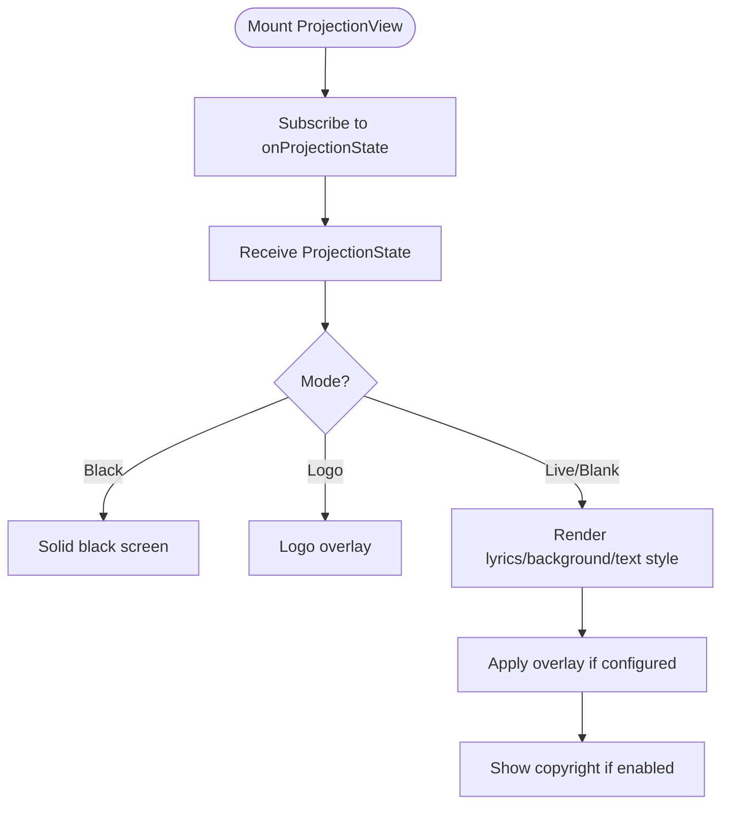

**Diagram sources**
- [ProjectionView.tsx:4-134](file://src/components/ProjectionView.tsx#L4-L134)
- [appStore.ts:241-274](file://src/store/appStore.ts#L241-L274)

**Section sources**
- [ProjectionView.tsx:4-134](file://src/components/ProjectionView.tsx#L4-L134)
- [appStore.ts:241-274](file://src/store/appStore.ts#L241-L274)

### Preparation List
- Responsibilities:
  - Maintains a draggable list of songs for quick selection in Arrange or Present modes.
  - Supports reordering, removal, and clearing.
- Props and State:
  - Accepts mode prop to control click behavior (select vs selectFromPreparationList).
  - Uses store actions for list management and selection.
- Composition:
  - SortablePrepItem provides draggable list items with remove controls.

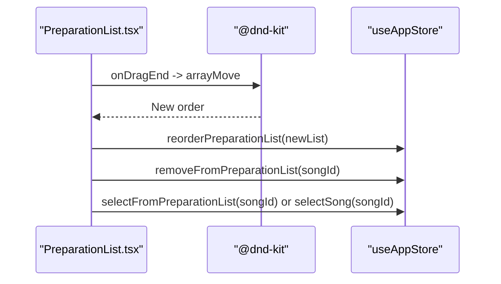

**Diagram sources**
- [PreparationList.tsx:25-123](file://src/components/PreparationList.tsx#L25-L123)
- [appStore.ts:316-359](file://src/store/appStore.ts#L316-L359)

**Section sources**
- [PreparationList.tsx:25-188](file://src/components/PreparationList.tsx#L25-L188)
- [appStore.ts:86-91](file://src/store/appStore.ts#L86-L91)

### Background Gallery
- Responsibilities:
  - Lists and manages local background images via Electron.
  - Supports adding, deleting, and selecting images.
- Props and State:
  - Accepts currentValue and onSelect callback.
  - Loads images on mount and refreshes after additions.

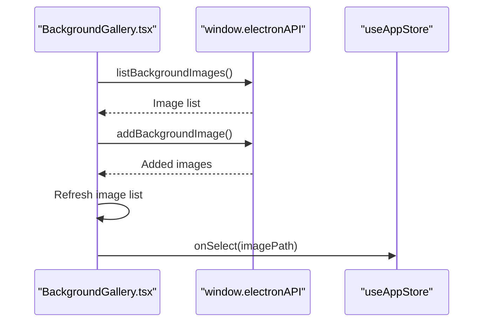

**Diagram sources**
- [BackgroundGallery.tsx:9-98](file://src/components/BackgroundGallery.tsx#L9-L98)

**Section sources**
- [BackgroundGallery.tsx:9-98](file://src/components/BackgroundGallery.tsx#L9-L98)

### Internationalization
- Responsibilities:
  - Provides translations for all UI strings.
  - Persists and applies locale preference.
- Implementation:
  - i18n store holds current locale and translation object.
  - Translations are loaded from en.ts and zhTW.ts.
  - Locale is saved to localStorage and applied on init.

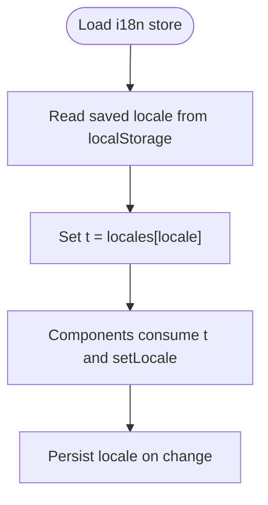

**Diagram sources**
- [index.ts (i18n):17-43](file://src/i18n/index.ts#L17-L43)
- [en.ts:1-180](file://src/i18n/en.ts#L1-L180)
- [zhTW.ts:1-180](file://src/i18n/zhTW.ts#L1-L180)

**Section sources**
- [index.ts (i18n):1-43](file://src/i18n/index.ts#L1-L43)
- [en.ts:1-180](file://src/i18n/en.ts#L1-L180)
- [zhTW.ts:1-180](file://src/i18n/zhTW.ts#L1-L180)

## Dependency Analysis
- Component Coupling:
  - Panels depend on appStore for state and actions.
  - Shared components (PreparationList, BackgroundGallery) are reused across panels.
  - App depends on i18n for labels and on Electron APIs for persistence/projection.
- External Dependencies:
  - Zustand for state management.
  - @dnd-kit for drag-and-drop in Arrange and Preparation lists.
  - Electron APIs for file operations, projection, and media.
- Potential Circular Dependencies:
  - None observed; components import from store and i18n but do not import each other.

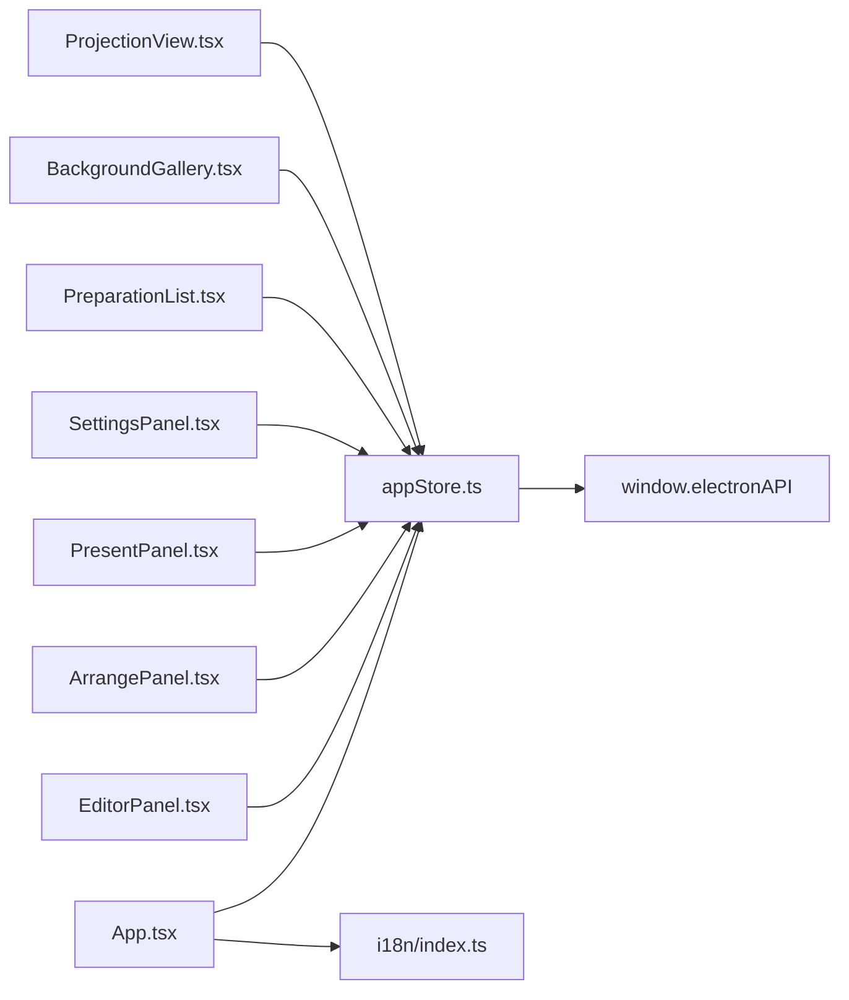

**Diagram sources**
- [App.tsx:12-102](file://src/App.tsx#L12-L102)
- [appStore.ts:1-385](file://src/store/appStore.ts#L1-385)
- [index.ts (i18n):1-43](file://src/i18n/index.ts#L1-L43)

**Section sources**
- [appStore.ts:1-385](file://src/store/appStore.ts#L1-L385)

## Performance Considerations
- State Normalization:
  - Centralized store avoids prop drilling and reduces unnecessary re-renders by subscribing to specific slices.
- Memoization:
  - Consider memoizing derived computations (e.g., filtered songs) to avoid repeated filtering/sorting on each render.
- Rendering:
  - Large lists (song library, arrangement) use virtualization patterns implicitly via scroll containers; consider explicit virtualization for very large datasets.
- Event Handling:
  - Keyboard shortcuts in PresentPanel use useCallback to prevent handler recreation on each render.
- Persistence:
  - Debounce or batch save operations to disk to avoid excessive writes.

## Troubleshooting Guide
- Projection Window Not Updating:
  - Verify Electron APIs are available and onProjectionState handlers are registered.
  - Confirm setIsProjectionOpen is called appropriately on open/close.
- Drag-and-Drop Issues:
  - Ensure @dnd-kit sensors and contexts are correctly configured and that item IDs are stable.
- Empty Song Library:
  - On first run, App seeds data if none exists; check Electron persistence APIs and seedSongs availability.
- Internationalization Not Switching:
  - Confirm locale is persisted and i18n store locale is updated; verify translation keys exist.

**Section sources**
- [App.tsx:19-42](file://src/App.tsx#L19-L42)
- [PresentPanel.tsx:38-84](file://src/components/PresentPanel.tsx#L38-L84)
- [ArrangePanel.tsx:28-63](file://src/components/ArrangePanel.tsx#L28-L63)
- [SettingsPanel.tsx:449-486](file://src/components/SettingsPanel.tsx#L449-L486)
- [index.ts (i18n):35-42](file://src/i18n/index.ts#L35-L42)

## Conclusion
LyricDeck’s UI is structured around a central App container that orchestrates tabbed panels and a shared Zustand store for normalized state. Components communicate primarily through the store, minimizing prop drilling and enabling reusable patterns like PreparationList and BackgroundGallery. Internationalization is cleanly separated and persisted. Electron APIs integrate seamlessly for persistence, projection, and media management, supporting a robust desktop-first experience.