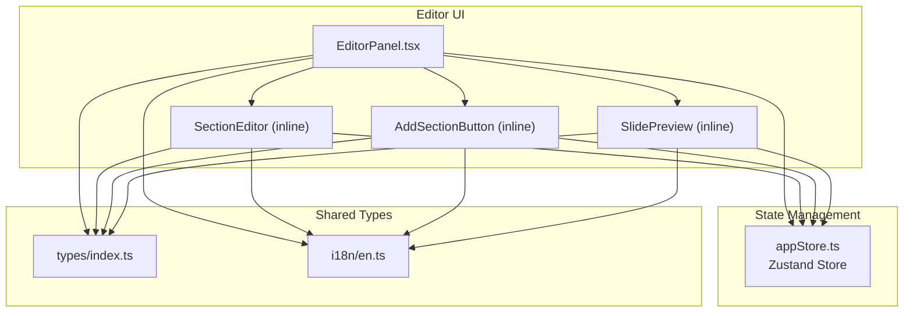
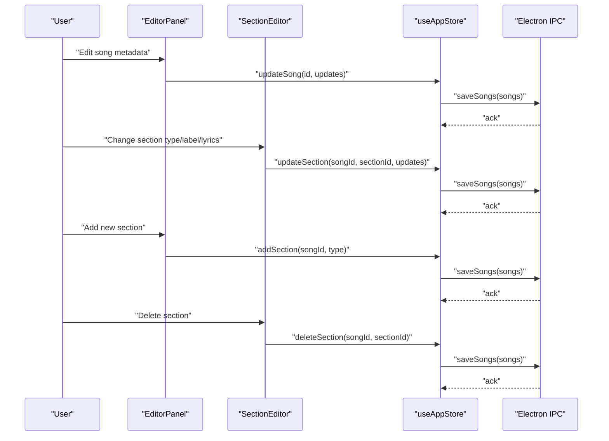
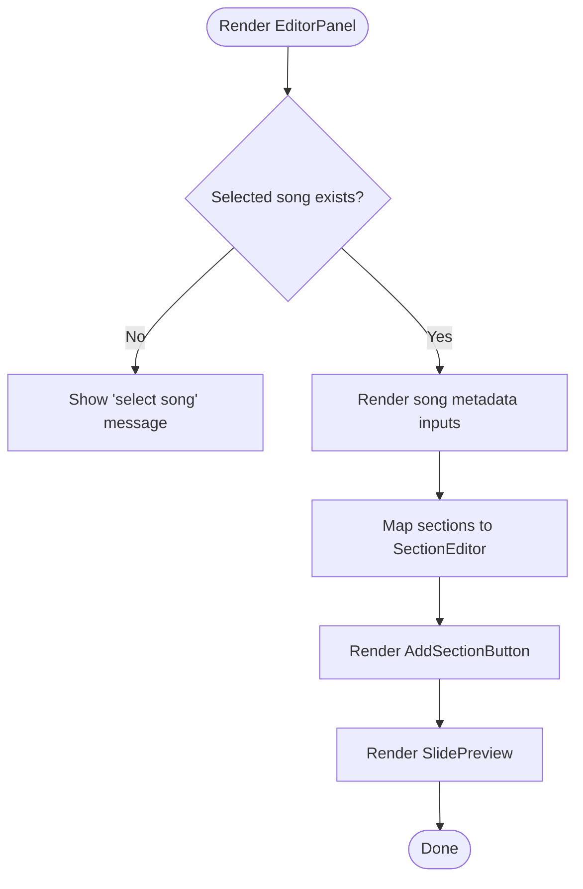
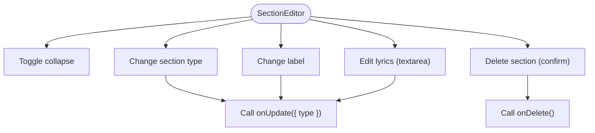
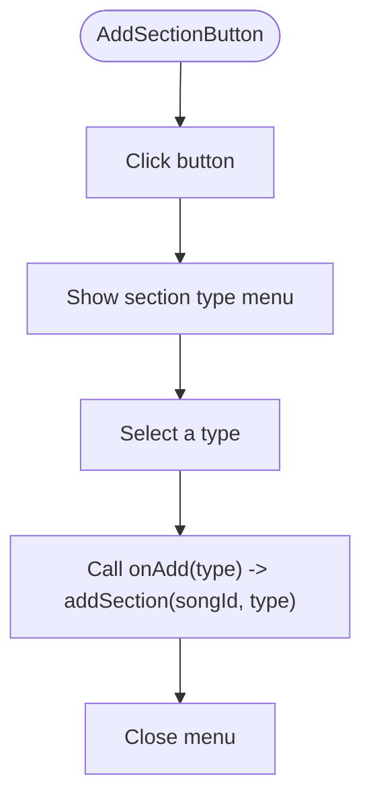
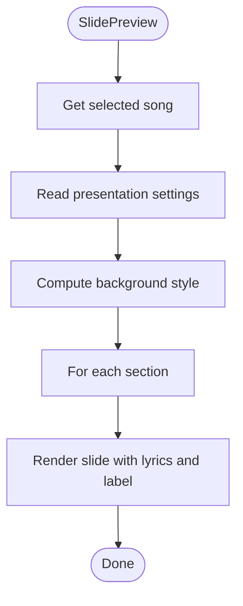
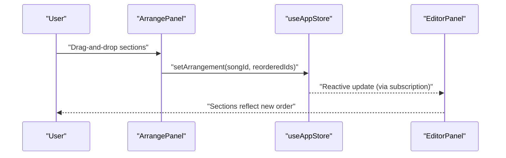
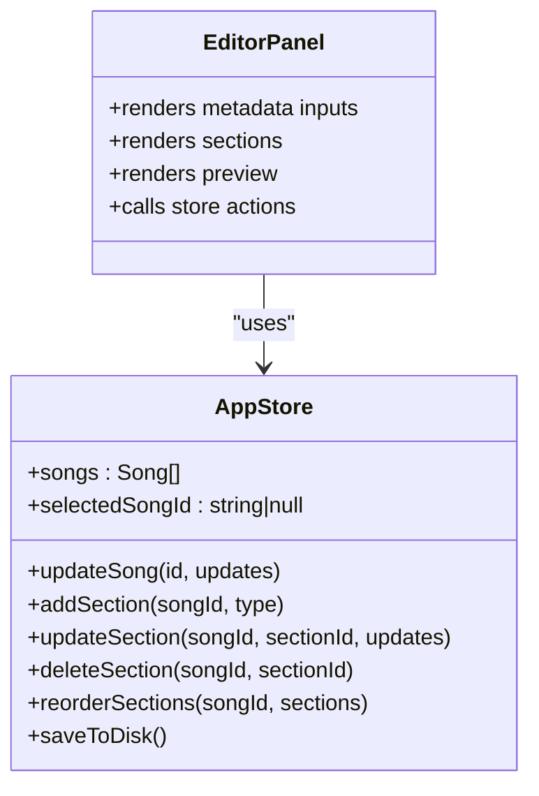
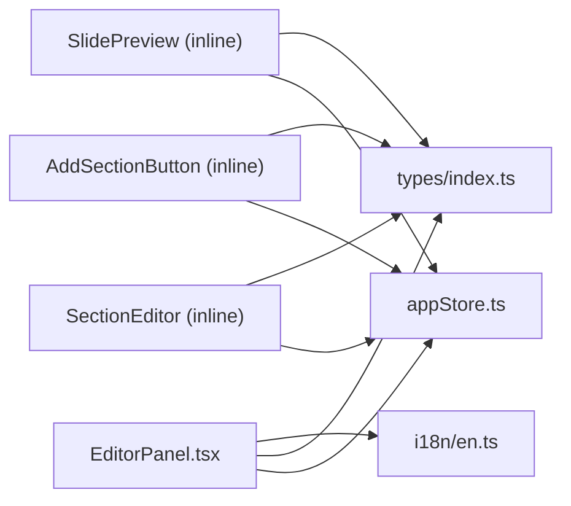

# Editor Panel

<cite>
**Referenced Files in This Document**
- [EditorPanel.tsx](file://src/components/EditorPanel.tsx)
- [appStore.ts](file://src/store/appStore.ts)
- [index.ts](file://src/types/index.ts)
- [en.ts](file://src/i18n/en.ts)
- [ArrangePanel.tsx](file://src/components/ArrangePanel.tsx)
- [App.tsx](file://src/App.tsx)
- [README.md](file://README.md)
</cite>

## Table of Contents
1. [Introduction](#introduction)
2. [Project Structure](#project-structure)
3. [Core Components](#core-components)
4. [Architecture Overview](#architecture-overview)
5. [Detailed Component Analysis](#detailed-component-analysis)
6. [Dependency Analysis](#dependency-analysis)
7. [Performance Considerations](#performance-considerations)
8. [Troubleshooting Guide](#troubleshooting-guide)
9. [Conclusion](#conclusion)

## Introduction
The Editor Panel is the primary interface for creating and editing lyric sections within a song. It provides:
- Rich text editing for lyrics
- Section type management (Intro, Verse, Pre-Chorus, Chorus, Bridge, Instrumental, Outro, Custom)
- Section creation, duplication, deletion, and modification workflows
- Real-time preview of projected slides
- Integration with the Zustand store for persistent, reactive state updates
- Internationalized user interface strings

It also coordinates with other panels (notably Arrange) to support drag-and-drop reordering of sections within a song’s internal order, and integrates with the global projection system for live presentations.

## Project Structure
The Editor Panel is organized as a single functional component that composes smaller subcomponents and relies on shared store and type definitions.

**Diagram sources**
- [EditorPanel.tsx:17-118](file://src/components/EditorPanel.tsx#L17-L118)
- [appStore.ts:31-96](file://src/store/appStore.ts#L31-L96)
- [index.ts:3-67](file://src/types/index.ts#L3-L67)
- [en.ts:35-62](file://src/i18n/en.ts#L35-L62)

**Section sources**
- [EditorPanel.tsx:17-118](file://src/components/EditorPanel.tsx#L17-L118)
- [appStore.ts:31-96](file://src/store/appStore.ts#L31-L96)
- [index.ts:3-67](file://src/types/index.ts#L3-L67)
- [en.ts:35-62](file://src/i18n/en.ts#L35-L62)

## Core Components
- EditorPanel: Hosts song metadata editing, section list rendering, and the right-side preview.
- SectionEditor: Per-section editor with collapsible lyrics area, section type dropdown, label input, and delete button.
- AddSectionButton: Dropdown menu to add new sections of predefined types.
- SlidePreview: Live preview of projected slides based on current sections and presentation settings.

These components are driven by Zustand actions for creating, updating, and deleting sections, and for updating song metadata.

**Section sources**
- [EditorPanel.tsx:17-118](file://src/components/EditorPanel.tsx#L17-L118)
- [EditorPanel.tsx:120-176](file://src/components/EditorPanel.tsx#L120-L176)
- [EditorPanel.tsx:178-208](file://src/components/EditorPanel.tsx#L178-L208)
- [EditorPanel.tsx:210-246](file://src/components/EditorPanel.tsx#L210-L246)

## Architecture Overview
The Editor Panel follows a unidirectional data flow:
- UI emits user actions (change metadata, change section type/label/lyrics, add/delete sections).
- These actions call Zustand store methods.
- Store updates the in-memory state and persists to disk via Electron IPC.
- Other views (Arrange, Present, Projection) subscribe to the same store and react to changes.

**Diagram sources**
- [EditorPanel.tsx:18-107](file://src/components/EditorPanel.tsx#L18-L107)
- [appStore.ts:174-216](file://src/store/appStore.ts#L174-L216)
- [README.md:24](file://README.md#L24)

## Detailed Component Analysis

### EditorPanel
Responsibilities:
- Renders song metadata inputs (title, songId, artist) bound to store updates.
- Renders metadata for key, tempo, and copyright.
- Iterates over song.sections and renders a SectionEditor for each.
- Provides an AddSectionButton to create new sections.
- Displays a SlidePreview panel showing projected slides.

Key behaviors:
- Uses the selected song from the store; if none is selected, displays a prompt.
- Delegates section updates/deletes to child components.
- Uses localized strings for placeholders and prompts.

**Diagram sources**
- [EditorPanel.tsx:17-118](file://src/components/EditorPanel.tsx#L17-L118)

**Section sources**
- [EditorPanel.tsx:17-118](file://src/components/EditorPanel.tsx#L17-L118)

### SectionEditor
Responsibilities:
- Collapsible editor for a single section’s lyrics.
- Dropdown to change section type from a fixed set.
- Text input for the section label.
- Delete button with confirmation.

Processing logic:
- Maintains local collapse state for the lyrics textarea.
- Calls onUpdate with partial updates for type, label, or lyrics.
- Calls onDelete callback for removal.

**Diagram sources**
- [EditorPanel.tsx:120-176](file://src/components/EditorPanel.tsx#L120-L176)

**Section sources**
- [EditorPanel.tsx:120-176](file://src/components/EditorPanel.tsx#L120-L176)

### AddSectionButton
Responsibilities:
- Presents a dropdown of predefined section types.
- Adds a new section to the current song when a type is selected.

Behavior:
- Uses SECTION_TYPES constant and localized labels.
- Calls addSection with the chosen type.

**Diagram sources**
- [EditorPanel.tsx:178-208](file://src/components/EditorPanel.tsx#L178-L208)

**Section sources**
- [EditorPanel.tsx:178-208](file://src/components/EditorPanel.tsx#L178-L208)

### SlidePreview
Responsibilities:
- Visualizes how each section appears in projection.
- Applies presentation background and text style overrides.
- Truncates lyrics to a preview length.

Behavior:
- Reads presentation settings from the selected song.
- Computes background styles based on background type.
- Uses localized fallback text for empty lyrics.

**Diagram sources**
- [EditorPanel.tsx:210-246](file://src/components/EditorPanel.tsx#L210-L246)

**Section sources**
- [EditorPanel.tsx:210-246](file://src/components/EditorPanel.tsx#L210-L246)

### Section Type Management
Section types are defined centrally and rendered in both the SectionEditor dropdown and the AddSectionButton menu.

- Types: Intro, Verse, Pre-Chorus, Chorus, Bridge, Instrumental, Outro, Custom.
- Labels are localized via i18n keys under sectionTypes.

Validation:
- The type field is constrained by the type definition and the dropdown options.
- No explicit runtime validation is performed beyond type selection.

**Section sources**
- [EditorPanel.tsx:6-15](file://src/components/EditorPanel.tsx#L6-L15)
- [index.ts:3-11](file://src/types/index.ts#L3-L11)
- [en.ts:52-62](file://src/i18n/en.ts#L52-L62)

### Drag-and-Drop Reordering
- Internal section ordering within a song is managed in the Editor Panel by the store’s reorderSections action.
- The Arrange Panel provides a separate drag-and-drop interface for building the presentation arrangement (order of slides during projection).
- The Editor Panel does not implement drag-and-drop for reordering sections; that responsibility lies in ArrangePanel.

**Diagram sources**
- [ArrangePanel.tsx:54-63](file://src/components/ArrangePanel.tsx#L54-L63)
- [appStore.ts:222-225](file://src/store/appStore.ts#L222-L225)

**Section sources**
- [ArrangePanel.tsx:54-63](file://src/components/ArrangePanel.tsx#L54-L63)
- [appStore.ts:218-220](file://src/store/appStore.ts#L218-L220)

### Integration with Zustand Store
Actions used by EditorPanel:
- updateSong: Updates song metadata and sections.
- addSection: Creates a new section with a derived label.
- updateSection: Updates a specific section’s fields.
- deleteSection: Removes a section and any references in arrangement.
- reorderSections: Updates the internal order of sections.

Persistence:
- Each mutation triggers saveToDisk via the store, ensuring data is persisted to disk.

**Diagram sources**
- [appStore.ts:31-96](file://src/store/appStore.ts#L31-L96)
- [EditorPanel.tsx:18-107](file://src/components/EditorPanel.tsx#L18-L107)

**Section sources**
- [appStore.ts:174-220](file://src/store/appStore.ts#L174-L220)
- [EditorPanel.tsx:18-107](file://src/components/EditorPanel.tsx#L18-L107)

### Validation Logic
Observed validations:
- Section deletion requires user confirmation.
- Song metadata inputs update immediately on change.
- Section type dropdown restricts values to known types.
- No explicit validation is performed for empty lyrics or malformed content.

Recommendations:
- Consider adding client-side validation for required fields (e.g., non-empty labels for sections).
- Provide feedback for invalid combinations (e.g., duplicate labels within a song).

**Section sources**
- [EditorPanel.tsx:98-102](file://src/components/EditorPanel.tsx#L98-L102)

### State Management for Active Song Editing and Unsaved Changes
- The store maintains selectedSongId to track the active song.
- Every update triggers saveToDisk, persisting changes immediately.
- There is no explicit “unsaved changes” indicator in the Editor Panel; persistence occurs after each edit.

Implications:
- Immediate persistence reduces risk of data loss.
- No manual “Save” button is present; changes are reactive and persistent.

**Section sources**
- [appStore.ts:174-180](file://src/store/appStore.ts#L174-L180)
- [App.tsx:19-32](file://src/App.tsx#L19-L32)

### Examples

- Creating a new section:
  - Click Add Section and choose a type from the dropdown.
  - The store derives a label (e.g., Verse 1, Verse 2) and appends the section to the song.

- Modifying section content:
  - Edit the section label or lyrics directly in the SectionEditor.
  - Changes propagate to the store and are persisted.

- Deleting a section:
  - Click the delete button; confirm the prompt; the section is removed and any arrangement references are cleaned up.

- Collaborative editing patterns:
  - The repository does not implement real-time collaboration. All edits are local and persisted immediately. No synchronization or conflict resolution mechanisms are present.

**Section sources**
- [EditorPanel.tsx:178-208](file://src/components/EditorPanel.tsx#L178-L208)
- [appStore.ts:185-216](file://src/store/appStore.ts#L185-L216)
- [README.md:24](file://README.md#L24)

## Dependency Analysis
- EditorPanel depends on:
  - useAppStore for state and actions
  - i18n for localized strings
  - types for SectionType and LyricSection shape
- SectionEditor and AddSectionButton are inline components within EditorPanel.
- SlidePreview reads presentation settings and background configuration from the selected song.

**Diagram sources**
- [EditorPanel.tsx:17-118](file://src/components/EditorPanel.tsx#L17-L118)
- [appStore.ts:31-96](file://src/store/appStore.ts#L31-L96)
- [index.ts:3-67](file://src/types/index.ts#L3-L67)
- [en.ts:35-62](file://src/i18n/en.ts#L35-L62)

**Section sources**
- [EditorPanel.tsx:17-118](file://src/components/EditorPanel.tsx#L17-L118)
- [appStore.ts:31-96](file://src/store/appStore.ts#L31-L96)
- [index.ts:3-67](file://src/types/index.ts#L3-L67)
- [en.ts:35-62](file://src/i18n/en.ts#L35-L62)

## Performance Considerations
- Immediate persistence on every change ensures data safety but may trigger frequent disk writes. Consider debouncing saves if performance becomes a concern.
- SlidePreview computes styles per section; for very long section lists, consider virtualization or lazy rendering.
- The component uses controlled inputs; ensure large lyric blocks are edited efficiently by avoiding unnecessary re-renders.

## Troubleshooting Guide
- No song selected:
  - The panel displays a message prompting to select a song from the library.
- Section deletion confirmation:
  - A browser confirmation dialog is shown before deletion; canceling prevents removal.
- Persisted data not updating:
  - Ensure the store’s saveToDisk mechanism is reachable (Electron IPC); otherwise, changes will not be persisted.

**Section sources**
- [EditorPanel.tsx:22-28](file://src/components/EditorPanel.tsx#L22-L28)
- [EditorPanel.tsx:98-102](file://src/components/EditorPanel.tsx#L98-L102)
- [appStore.ts:379-383](file://src/store/appStore.ts#L379-L383)

## Conclusion
The Editor Panel provides a focused, reactive interface for editing lyric sections with immediate persistence. It integrates tightly with the Zustand store to manage song metadata, sections, and previews. While it does not implement drag-and-drop reordering of sections internally, the Arrange Panel offers a complementary drag-and-drop mechanism for constructing presentation arrangements. The component is localized, validated minimally, and designed for straightforward, reliable lyric editing workflows.