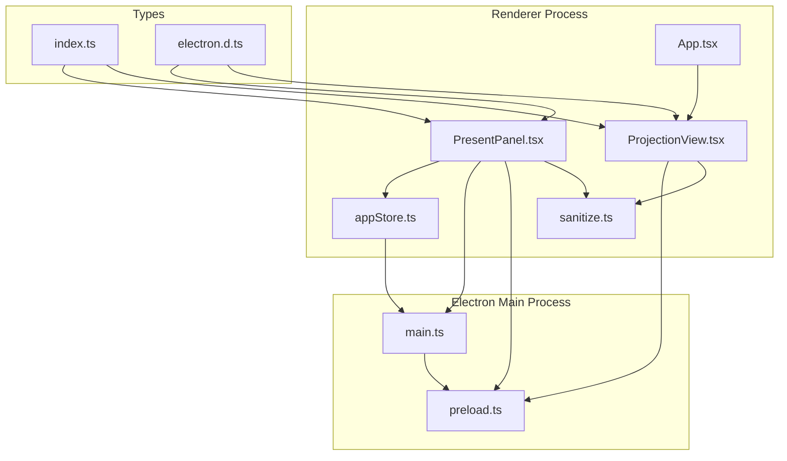
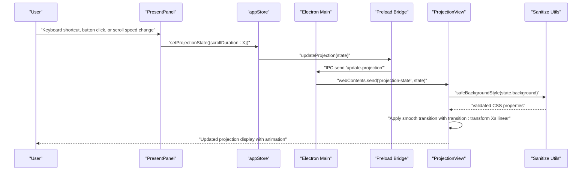
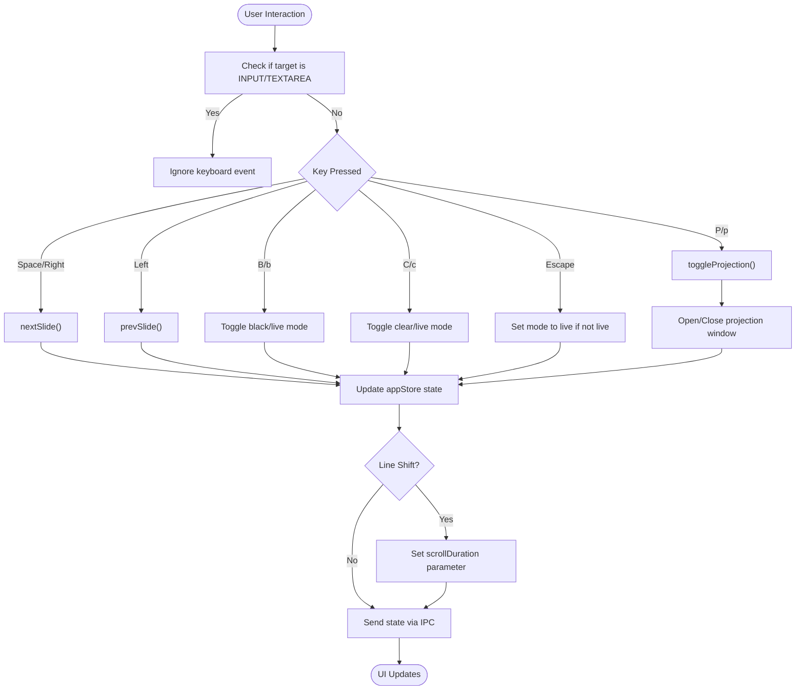
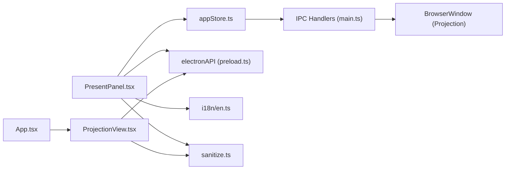

# Presentation Panel

<cite>
**Referenced Files in This Document**
- [PresentPanel.tsx](file://src/components/PresentPanel.tsx)
- [ProjectionView.tsx](file://src/components/ProjectionView.tsx)
- [appStore.ts](file://src/store/appStore.ts)
- [main.ts](file://electron/main.ts)
- [preload.ts](file://electron/preload.ts)
- [index.ts](file://src/types/index.ts)
- [electron.d.ts](file://src/types/electron.d.ts)
- [App.tsx](file://src/App.tsx)
- [en.ts](file://src/i18n/en.ts)
- [sanitize.ts](file://src/utils/sanitize.ts)
</cite>

## Update Summary
**Changes Made**
- Updated security section to document CSS injection prevention using safeBackgroundStyle() utility
- Enhanced security considerations with details about input validation and sanitization
- Added information about the sanitize utility functions and their role in preventing malicious CSS
- Updated component analysis to reflect secure background style handling

## Table of Contents
1. [Introduction](#introduction)
2. [Project Structure](#project-structure)
3. [Core Components](#core-components)
4. [Architecture Overview](#architecture-overview)
5. [Detailed Component Analysis](#detailed-component-analysis)
6. [Security Considerations](#security-considerations)
7. [Dependency Analysis](#dependency-analysis)
8. [Performance Considerations](#performance-considerations)
9. [Troubleshooting Guide](#troubleshooting-guide)
10. [Conclusion](#conclusion)

## Introduction
This document provides comprehensive documentation for the PresentPanel component, which manages live presentation controls for lyric-based presentations. It covers projection window management, keyboard shortcut handling, presentation mode switching (live, blank, black, logo, clear), integration with Electron's window management APIs, IPC communication for projection control, real-time state synchronization between the main window and projection window, display detection and multi-monitor support, event listeners for keyboard input and projection window lifecycle, scroll speed control for smooth line transitions, and robust security measures against CSS injection attacks.

## Project Structure
The presentation system spans both the renderer process (React components) and the Electron main process (window management and IPC). The key files involved are:
- PresentPanel.tsx: Main presentation UI and controller with secure background styling and scroll speed control
- ProjectionView.tsx: Projection window content renderer with smooth transition animations and secure background handling
- appStore.ts: Global state management with projection actions including scrollDuration
- main.ts: Electron main process with window creation and IPC handlers
- preload.ts: Exposes Electron APIs to renderer via context bridge
- index.ts: Type definitions for projection state including scrollDuration
- electron.d.ts: TypeScript declarations for window.electronAPI
- App.tsx: Application shell that routes to ProjectionView in projection mode
- en.ts: UI text resources for Present panel including scroll speed controls
- sanitize.ts: Security utilities for CSS injection prevention and input validation



**Diagram sources**
- [PresentPanel.tsx:1-459](file://src/components/PresentPanel.tsx#L1-L459)
- [ProjectionView.tsx:1-127](file://src/components/ProjectionView.tsx#L1-L127)
- [appStore.ts:1-396](file://src/store/appStore.ts#L1-L396)
- [main.ts:1-390](file://electron/main.ts#L1-L390)
- [preload.ts:1-43](file://electron/preload.ts#L1-L43)
- [index.ts:1-90](file://src/types/index.ts#L1-L90)
- [electron.d.ts:1-33](file://src/types/electron.d.ts#L1-L33)
- [App.tsx:1-102](file://src/App.tsx#L1-L102)
- [sanitize.ts:1-132](file://src/utils/sanitize.ts#L1-L132)

**Section sources**
- [PresentPanel.tsx:1-459](file://src/components/PresentPanel.tsx#L1-L459)
- [ProjectionView.tsx:1-127](file://src/components/ProjectionView.tsx#L1-L127)
- [appStore.ts:1-396](file://src/store/appStore.ts#L1-L396)
- [main.ts:1-390](file://electron/main.ts#L1-L390)
- [preload.ts:1-43](file://electron/preload.ts#L1-L43)
- [index.ts:1-90](file://src/types/index.ts#L1-L90)
- [electron.d.ts:1-33](file://src/types/electron.d.ts#L1-L33)
- [App.tsx:1-102](file://src/App.tsx#L1-L102)
- [sanitize.ts:1-132](file://src/utils/sanitize.ts#L1-L132)

## Core Components
- PresentPanel: Orchestrates presentation controls, keyboard shortcuts, display selection, projection window lifecycle, and scroll speed control. It reads the current song arrangement and renders a preview area with current/next slides, section navigation, mode buttons, configurable line shift controls with smooth transitions, and secure background styling.
- ProjectionView: Renders the projection window content based on the latest projection state received via IPC, including smooth transition animations for line offsets and secure background rendering.
- appStore: Centralized state for songs, projection state, arrangement index, and projection actions. It synchronizes projection state including scrollDuration to the projection window via IPC.
- Electron main process: Creates and manages projection windows, exposes IPC handlers for display detection and projection control, and broadcasts state updates to the projection window.
- Preload bridge: Exposes a typed electronAPI to renderer code with methods for display management, projection control, and state synchronization.
- Sanitize utilities: Provides secure CSS injection prevention through validated color, gradient, image URL, and numeric value sanitization.

Key responsibilities:
- Real-time projection state synchronization via IPC
- Multi-monitor display detection and selection
- Keyboard shortcuts for navigation and mode switching
- Projection window lifecycle management (open/close)
- Mode rendering (live, blank, black, logo, clear)
- Scroll speed control with configurable duration parameters
- Smooth transition animations for line offset changes
- Secure background styling with CSS injection prevention

**Section sources**
- [PresentPanel.tsx:40-459](file://src/components/PresentPanel.tsx#L40-L459)
- [ProjectionView.tsx:4-127](file://src/components/ProjectionView.tsx#L4-L127)
- [appStore.ts:71-302](file://src/store/appStore.ts#L71-L302)
- [main.ts:111-152](file://electron/main.ts#L111-L152)
- [preload.ts:3-42](file://electron/preload.ts#L3-L42)
- [sanitize.ts:1-132](file://src/utils/sanitize.ts#L1-L132)

## Architecture Overview
The presentation architecture follows a unidirectional data flow with enhanced scroll speed control and security:
- PresentPanel updates appStore with projection actions including scrollDuration parameter (mode changes, slide navigation, line shifts with configurable timing).
- appStore.setProjectionState persists the state and sends it to the projection window via IPC.
- Electron main process receives state updates and forwards them to the projection window.
- ProjectionView listens for state updates and applies smooth transition animations based on scrollDuration.
- All background styling goes through secure sanitization utilities to prevent CSS injection attacks.



**Diagram sources**
- [PresentPanel.tsx:107-147](file://src/components/PresentPanel.tsx#L107-L147)
- [appStore.ts:300-306](file://src/store/appStore.ts#L300-L306)
- [preload.ts:11-16](file://electron/preload.ts#L11-L16)
- [main.ts:186-190](file://electron/main.ts#L186-L190)
- [ProjectionView.tsx:32-34](file://src/components/ProjectionView.tsx#L32-L34)
- [sanitize.ts:106-131](file://src/utils/sanitize.ts#L106-L131)

## Detailed Component Analysis

### PresentPanel Component
Responsibilities:
- Display detection and selection: Loads available displays and selects a default secondary display if available.
- Keyboard shortcuts: Handles navigation and mode toggles without interfering with input fields.
- Projection lifecycle: Opens/closes the projection window and updates UI state.
- Preview rendering: Shows current and next slides with secure background styling and text styles.
- Mode controls: Buttons to switch between live, blank, black, logo, and clear modes.
- Scroll speed control: Configurable duration parameter for line shift animations with input field and validation.

Key behaviors:
- Keyboard handling prevents default actions for navigation and mode keys and avoids triggering during text input.
- Projection window opens on a selected display and closes gracefully, updating the isProjectionOpen flag.
- Preview area renders based on current projection mode and song data with secure background styling.
- Scroll speed input validates numeric values and prevents negative durations.
- Line shift buttons pass scrollDuration parameter to shiftLines function for smooth transitions.
- Background styling uses safeBackgroundStyle() utility to prevent CSS injection attacks.



**Diagram sources**
- [PresentPanel.tsx:107-147](file://src/components/PresentPanel.tsx#L107-L147)
- [PresentPanel.tsx:177-197](file://src/components/PresentPanel.tsx#L177-L197)
- [PresentPanel.tsx:395-440](file://src/components/PresentPanel.tsx#L395-L440)
- [appStore.ts:242-295](file://src/store/appStore.ts#L242-L295)

**Section sources**
- [PresentPanel.tsx:94-104](file://src/components/PresentPanel.tsx#L94-L104)
- [PresentPanel.tsx:107-147](file://src/components/PresentPanel.tsx#L107-L147)
- [PresentPanel.tsx:177-197](file://src/components/PresentPanel.tsx#L177-L197)
- [PresentPanel.tsx:283-346](file://src/components/PresentPanel.tsx#L283-L346)
- [PresentPanel.tsx:395-440](file://src/components/PresentPanel.tsx#L395-L440)
- [PresentPanel.tsx:456-458](file://src/components/PresentPanel.tsx#L456-L458)

### ProjectionView Component
Responsibilities:
- Receives projection state updates via IPC listener.
- Renders different modes:
  - Black: Solid black background.
  - Logo: Watermarked "LyricDeck" text centered.
  - Live/Blank: Lyrics with customizable background, text style, optional copyright, and smooth line transitions.
- Applies background overlays and text styling based on state.
- Supports line offset for fine-tuning text position with configurable animation duration.
- Implements smooth transition animations using CSS transform properties.
- Uses secure background styling to prevent CSS injection attacks.

Rendering logic:
- Uses state.mode to decide which render branch to take.
- Applies background styles (color, gradient, image) and optional blur through safeBackgroundStyle() utility.
- Computes vertical alignment based on text style vertical position.
- Adds overlay color/opacity when configured.
- Applies smooth transitions using transform property with scrollDuration parameter.

**Updated** Added secure background styling using safeBackgroundStyle() utility to prevent CSS injection attacks.

**Section sources**
- [ProjectionView.tsx:25-34](file://src/components/ProjectionView.tsx#L25-L34)
- [ProjectionView.tsx:83-87](file://src/components/ProjectionView.tsx#L83-L87)
- [ProjectionView.tsx:90-127](file://src/components/ProjectionView.tsx#L90-L127)
- [ProjectionView.tsx:103-110](file://src/components/ProjectionView.tsx#L103-L110)

### Electron Main Process and IPC
Electron main process responsibilities:
- Creates projection windows on a specified display or fallback to secondary/primary.
- Exposes IPC handlers for display detection, projection control, and state broadcasting.
- Manages projection window lifecycle and notifies the main window when the projection window closes.

Key IPC handlers:
- get-displays: Returns display list with IDs and labels.
- open-projection: Creates a fullscreen, always-on-top window on the selected display.
- close-projection: Closes the projection window.
- is-projection-open: Checks if the projection window exists.
- update-projection: Broadcasts state updates to the projection window.
- projection-window-closed: Notifies main window when projection window closes.

Window creation:
- Uses screen.getAllDisplays() and screen.getPrimaryDisplay() to locate target display.
- Sets fullscreen, frameless, alwaysOnTop, and skipTaskbar for projection window.
- Loads either development server URL or production bundle with hash route for projection.

**Section sources**
- [main.ts:111-152](file://electron/main.ts#L111-L152)
- [main.ts:155-190](file://electron/main.ts#L155-L190)
- [main.ts:102-108](file://electron/main.ts#L102-L108)

### Preload Bridge and Type Safety
The preload bridge exposes a strongly-typed electronAPI to renderer code:
- Methods for display management, projection control, and state synchronization.
- Event listeners for projection state and window closed notifications.
- Typed signatures for all exposed methods to ensure type safety.

**Section sources**
- [preload.ts:3-42](file://electron/preload.ts#L3-L42)
- [electron.d.ts:3-32](file://src/types/electron.d.ts#L3-L32)

### State Synchronization and Modes
State model:
- ProjectionState includes mode, current song/section identifiers, lyrics, line offset, scrollDuration, background, text style, and optional copyright.
- Modes: live, blank, black, logo, clear.

Synchronization flow:
- PresentPanel triggers actions in appStore with scrollDuration parameter for line shifts.
- appStore.setProjectionState merges partial state and sends via IPC.
- Electron main process forwards state to projection window.
- ProjectionView updates its internal state, applies smooth transitions, and re-renders.

**Updated** Added scrollDuration property to ProjectionState for controlling animation duration.

**Section sources**
- [index.ts:71-82](file://src/types/index.ts#L71-L82)
- [appStore.ts:242-249](file://src/store/appStore.ts#L242-L249)
- [main.ts:186-190](file://electron/main.ts#L186-L190)
- [ProjectionView.tsx:25-34](file://src/components/ProjectionView.tsx#L25-L34)

### Multi-Monitor Support and Display Detection
Display detection:
- PresentPanel loads displays via window.electronAPI.getDisplays() and selects a secondary display by default if available.
- Electron main process returns display IDs as strings and labels indicating primary/secondary.

Projection window placement:
- Projection window is created on the selected display bounds.
- Falls back to secondary display if the requested display is unavailable, otherwise uses primary.

**Section sources**
- [PresentPanel.tsx:94-104](file://src/components/PresentPanel.tsx#L94-L104)
- [main.ts:111-119](file://electron/main.ts#L111-L119)
- [main.ts:155-164](file://electron/main.ts#L155-L164)

### Keyboard Shortcuts and UI Text
Shortcuts:
- Space/Right Arrow: Next slide
- Left Arrow: Previous slide
- B: Toggle black/live mode
- C: Toggle clear/live mode
- P: Toggle projection window open/close
- Escape: Reset to live mode if not live

UI text resources:
- Present panel labels and hint text are localized via i18n, including scroll speed control labels.

**Updated** Added scroll speed control UI elements with localized text resources.

**Section sources**
- [PresentPanel.tsx:107-147](file://src/components/PresentPanel.tsx#L107-L147)
- [en.ts:77-99](file://src/i18n/en.ts#L77-L99)

## Security Considerations

### CSS Injection Prevention
The presentation system implements comprehensive security measures to prevent CSS injection attacks through multiple layers of validation and sanitization:

#### Safe Background Styling
All background styling in the presentation system goes through the `safeBackgroundStyle()` utility function, which provides:
- **Color Validation**: Only allows safe CSS color formats (hex, rgb/rgba, hsl/hsla, named colors)
- **Gradient Sanitization**: Validates gradient syntax and blocks dangerous patterns like `expression(`, `javascript:`, `vbscript:`
- **Image URL Security**: Restricts image sources to safe protocols (`lyricdeck-img://`) and specific data URL formats
- **Numeric Value Validation**: Ensures numeric values (like blur effects) are within safe ranges

#### Implementation Details
The `getPreviewBgStyle()` function in PresentPanel.tsx delegates all background styling to the secure utility:
```typescript
function getPreviewBgStyle(bg: any): React.CSSProperties {
  return safeBackgroundStyle(bg);
}
```

This approach ensures that user-provided background configurations cannot inject malicious CSS code into the application.

#### Security Utilities
The sanitize module provides specialized validation functions:
- `sanitizeColor()`: Validates CSS color values against safe patterns
- `sanitizeGradient()`: Sanitizes gradient expressions and blocks dangerous patterns
- `sanitizeImageUrl()`: Validates image URLs against allowed protocols
- `sanitizeNumber()`: Ensures numeric values are finite and within specified ranges

**Updated** Added comprehensive security section documenting CSS injection prevention measures and the safeBackgroundStyle() utility implementation.

**Section sources**
- [PresentPanel.tsx:456-458](file://src/components/PresentPanel.tsx#L456-L458)
- [sanitize.ts:1-132](file://src/utils/sanitize.ts#L1-L132)
- [ProjectionView.tsx:32-34](file://src/components/ProjectionView.tsx#L32-L34)

## Dependency Analysis
The PresentPanel depends on:
- appStore for state and actions including scrollDuration parameter
- window.electronAPI for display and projection control
- i18n for UI text including scroll speed control labels
- sanitize utilities for secure background styling
- ProjectionView for rendering in projection mode with smooth transitions

The Electron main process depends on:
- screen API for display detection
- BrowserWindow for projection window creation
- ipcMain for IPC handlers
- preload bridge for exposing APIs



**Diagram sources**
- [PresentPanel.tsx:1-5](file://src/components/PresentPanel.tsx#L1-L5)
- [appStore.ts:1-10](file://src/store/appStore.ts#L1-L10)
- [preload.ts:1-43](file://electron/preload.ts#L1-L43)
- [main.ts:1-10](file://electron/main.ts#L1-L10)
- [ProjectionView.tsx:1-3](file://src/components/ProjectionView.tsx#L1-L3)
- [App.tsx:1-10](file://src/App.tsx#L1-L10)
- [sanitize.ts:1-5](file://src/utils/sanitize.ts#L1-L5)

**Section sources**
- [PresentPanel.tsx:1-5](file://src/components/PresentPanel.tsx#L1-L5)
- [appStore.ts:1-10](file://src/store/appStore.ts#L1-L10)
- [main.ts:1-10](file://electron/main.ts#L1-L10)

## Performance Considerations
- Minimize re-renders: PresentPanel uses memoized callbacks for keyboard handling and separates preview rendering logic to reduce unnecessary updates.
- Efficient state updates: appStore.setProjectionState merges partial state and batches IPC updates to the projection window.
- Projection window optimizations: Uses alwaysOnTop and skipTaskbar to keep projection window lightweight and focused.
- Background rendering: ProjectionView computes styles dynamically; consider caching computed styles if performance becomes a concern.
- Animation performance: Smooth transitions use CSS transforms which are hardware-accelerated; avoid excessive animation frequency to maintain performance.
- Security overhead: Sanitization utilities add minimal performance impact while providing critical security benefits.

**Updated** Added performance considerations for security utilities and their minimal overhead.

## Troubleshooting Guide
Common issues and resolutions:
- Projection window does not open:
  - Verify display ID selection and existence. The system falls back to secondary or primary display if the requested display is unavailable.
  - Check that the projection window is not already open; closing it first may resolve conflicts.
  - Confirm IPC handlers are registered and electronAPI is available in the renderer.

- No updates in projection window:
  - Ensure appStore.setProjectionState is invoked and electronAPI.updateProjection is called.
  - Verify that the projection window is listening for 'projection-state' events and that the main process is sending updates.

- Keyboard shortcuts not working:
  - Ensure the focus is not inside an input field; shortcuts are ignored when typing in INPUT or TEXTAREA elements.
  - Confirm that the PresentPanel keyboard event listener is attached and not removed prematurely.

- Multi-monitor layout issues:
  - Select the correct display ID in the dropdown. The system defaults to a secondary display if available.
  - If the selected display is disconnected, the system falls back to the primary display.

- Projection window closes unexpectedly:
  - The main window listens for 'projection-window-closed' and sets isProjectionOpen to false. This is expected behavior when the projection window is closed externally.

- Scroll speed control not working:
  - Verify that the scroll speed input accepts numeric values with decimal precision (step 0.1).
  - Ensure scrollDuration parameter is passed correctly to shiftLines function.
  - Check that ProjectionView applies transition property only when scrollDuration > 0.

- Smooth transition animations not appearing:
  - Confirm that scrollDuration is greater than 0 in the projection state.
  - Verify that CSS transition property is applied to the text element in ProjectionView.
  - Ensure transform property is calculated correctly based on lineOffset and text styling.

- Background styling issues:
  - Verify that background configurations use supported types (color, gradient, image).
  - Check that color values match safe CSS format patterns.
  - Ensure gradient values start with valid gradient functions and don't contain dangerous patterns.
  - Confirm image URLs use allowed protocols (lyricdeck-img:// or safe data URLs).

**Updated** Added troubleshooting guidance for background styling issues and security-related problems.

**Section sources**
- [PresentPanel.tsx:94-104](file://src/components/PresentPanel.tsx#L94-L104)
- [PresentPanel.tsx:107-147](file://src/components/PresentPanel.tsx#L107-L147)
- [PresentPanel.tsx:395-440](file://src/components/PresentPanel.tsx#L395-L440)
- [main.ts:111-152](file://electron/main.ts#L111-L152)
- [main.ts:186-190](file://electron/main.ts#L186-L190)
- [ProjectionView.tsx:103-110](file://src/components/ProjectionView.tsx#L103-L110)
- [App.tsx:34-42](file://src/App.tsx#L34-L42)
- [sanitize.ts:21-27](file://src/utils/sanitize.ts#L21-L27)

## Conclusion
The PresentPanel component provides a robust foundation for managing live presentations with real-time state synchronization, multi-monitor support, comprehensive keyboard controls, scroll speed control for smooth line transitions, and comprehensive security measures against CSS injection attacks. Its integration with Electron's window management APIs and IPC ensures reliable projection control, while the ProjectionView component delivers flexible rendering across various presentation modes with smooth transition animations. The addition of configurable scroll speed allows presenters to fine-tune the timing of line offset changes for professional presentations. The implementation of secure background styling through the safeBackgroundStyle() utility ensures that user-provided configurations cannot compromise application security. Proper handling of lifecycle events, display detection, scroll duration validation, and input sanitization enables smooth operation in diverse environments while maintaining security integrity.

**Updated** Enhanced conclusion to include the new scroll speed control feature, security improvements, and their combined benefits for presentation quality and application security.