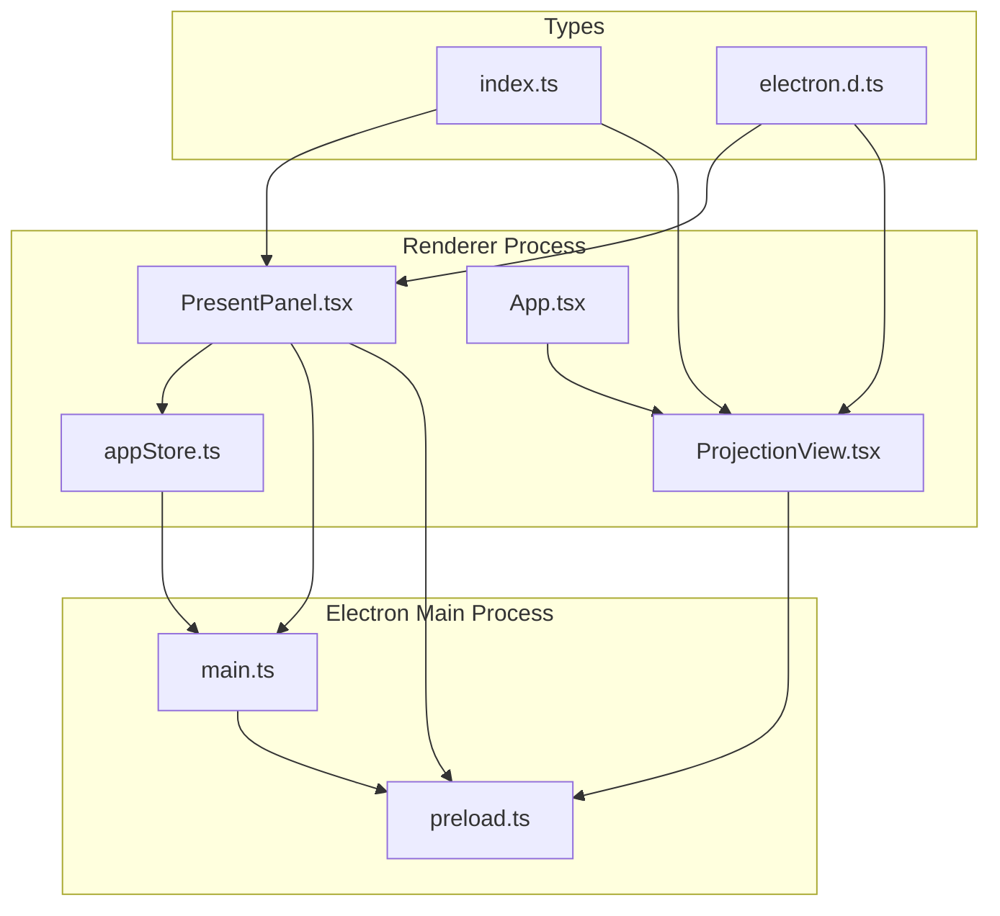
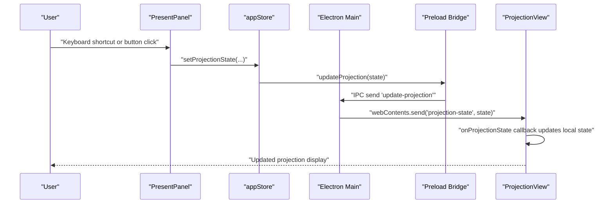
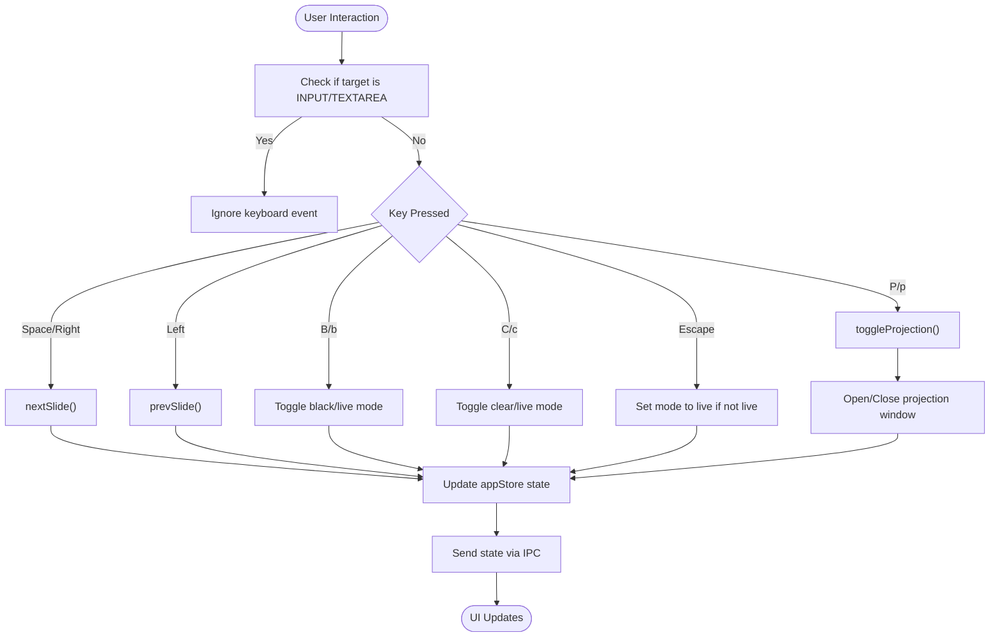
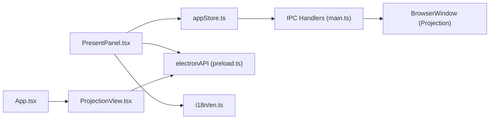

# Presentation Panel

<cite>
**Referenced Files in This Document**
- [PresentPanel.tsx](file://src/components/PresentPanel.tsx)
- [ProjectionView.tsx](file://src/components/ProjectionView.tsx)
- [appStore.ts](file://src/store/appStore.ts)
- [main.ts](file://electron/main.ts)
- [preload.ts](file://electron/preload.ts)
- [index.ts](file://src/types/index.ts)
- [electron.d.ts](file://src/types/electron.d.ts)
- [App.tsx](file://src/App.tsx)
- [en.ts](file://src/i18n/en.ts)
</cite>

## Table of Contents
1. [Introduction](#introduction)
2. [Project Structure](#project-structure)
3. [Core Components](#core-components)
4. [Architecture Overview](#architecture-overview)
5. [Detailed Component Analysis](#detailed-component-analysis)
6. [Dependency Analysis](#dependency-analysis)
7. [Performance Considerations](#performance-considerations)
8. [Troubleshooting Guide](#troubleshooting-guide)
9. [Conclusion](#conclusion)

## Introduction
This document provides comprehensive documentation for the PresentPanel component, which manages live presentation controls for lyric-based presentations. It covers projection window management, keyboard shortcut handling, presentation mode switching (live, blank, black, logo, clear), integration with Electron's window management APIs, IPC communication for projection control, real-time state synchronization between the main window and projection window, display detection and multi-monitor support, and event listeners for keyboard input and projection window lifecycle.

## Project Structure
The presentation system spans both the renderer process (React components) and the Electron main process (window management and IPC). The key files involved are:
- PresentPanel.tsx: Main presentation UI and controller
- ProjectionView.tsx: Projection window content renderer
- appStore.ts: Global state management with projection actions
- main.ts: Electron main process with window creation and IPC handlers
- preload.ts: Exposes Electron APIs to renderer via context bridge
- index.ts: Type definitions for projection state and modes
- electron.d.ts: TypeScript declarations for window.electronAPI
- App.tsx: Application shell that routes to ProjectionView in projection mode
- en.ts: UI text resources for Present panel

**Diagram sources**
- [PresentPanel.tsx:1-365](file://src/components/PresentPanel.tsx#L1-L365)
- [ProjectionView.tsx:1-134](file://src/components/ProjectionView.tsx#L1-L134)
- [appStore.ts:1-385](file://src/store/appStore.ts#L1-L385)
- [main.ts:1-390](file://electron/main.ts#L1-L390)
- [preload.ts:1-43](file://electron/preload.ts#L1-L43)
- [index.ts:1-89](file://src/types/index.ts#L1-L89)
- [electron.d.ts:1-33](file://src/types/electron.d.ts#L1-L33)
- [App.tsx:1-102](file://src/App.tsx#L1-L102)

**Section sources**
- [PresentPanel.tsx:1-365](file://src/components/PresentPanel.tsx#L1-L365)
- [ProjectionView.tsx:1-134](file://src/components/ProjectionView.tsx#L1-L134)
- [appStore.ts:1-385](file://src/store/appStore.ts#L1-L385)
- [main.ts:1-390](file://electron/main.ts#L1-L390)
- [preload.ts:1-43](file://electron/preload.ts#L1-L43)
- [index.ts:1-89](file://src/types/index.ts#L1-L89)
- [electron.d.ts:1-33](file://src/types/electron.d.ts#L1-L33)
- [App.tsx:1-102](file://src/App.tsx#L1-L102)

## Core Components
- PresentPanel: Orchestrates presentation controls, keyboard shortcuts, display selection, and projection window lifecycle. It reads the current song arrangement and renders a preview area with current/next slides, section navigation, and mode buttons.
- ProjectionView: Renders the projection window content based on the latest projection state received via IPC.
- appStore: Centralized state for songs, projection state, arrangement index, and projection actions. It synchronizes projection state to the projection window via IPC.
- Electron main process: Creates and manages projection windows, exposes IPC handlers for display detection and projection control, and broadcasts state updates to the projection window.
- Preload bridge: Exposes a typed electronAPI to renderer code with methods for display management, projection control, and state synchronization.

Key responsibilities:
- Real-time projection state synchronization via IPC
- Multi-monitor display detection and selection
- Keyboard shortcuts for navigation and mode switching
- Projection window lifecycle management (open/close)
- Mode rendering (live, blank, black, logo, clear)

**Section sources**
- [PresentPanel.tsx:6-129](file://src/components/PresentPanel.tsx#L6-L129)
- [ProjectionView.tsx:4-133](file://src/components/ProjectionView.tsx#L4-L133)
- [appStore.ts:71-302](file://src/store/appStore.ts#L71-L302)
- [main.ts:111-152](file://electron/main.ts#L111-L152)
- [preload.ts:3-42](file://electron/preload.ts#L3-L42)

## Architecture Overview
The presentation architecture follows a unidirectional data flow:
- PresentPanel updates appStore with projection actions (mode changes, slide navigation, line shifts).
- appStore.setProjectionState persists the state and sends it to the projection window via IPC.
- Electron main process receives state updates and forwards them to the projection window.
- ProjectionView listens for state updates and re-renders accordingly.

**Diagram sources**
- [PresentPanel.tsx:39-79](file://src/components/PresentPanel.tsx#L39-L79)
- [appStore.ts:242-249](file://src/store/appStore.ts#L242-L249)
- [preload.ts:11-16](file://electron/preload.ts#L11-L16)
- [main.ts:186-190](file://electron/main.ts#L186-L190)
- [ProjectionView.tsx:22-29](file://src/components/ProjectionView.tsx#L22-L29)

## Detailed Component Analysis

### PresentPanel Component
Responsibilities:
- Display detection and selection: Loads available displays and selects a default secondary display if available.
- Keyboard shortcuts: Handles navigation and mode toggles without interfering with input fields.
- Projection lifecycle: Opens/closes the projection window and updates UI state.
- Preview rendering: Shows current and next slides with background styling and text styles.
- Mode controls: Buttons to switch between live, blank, black, logo, and clear modes.

Key behaviors:
- Keyboard handling prevents default actions for navigation and mode keys and avoids triggering during text input.
- Projection window opens on a selected display and closes gracefully, updating the isProjectionOpen flag.
- Preview area renders based on current projection mode and song data.

**Diagram sources**
- [PresentPanel.tsx:39-79](file://src/components/PresentPanel.tsx#L39-L79)
- [PresentPanel.tsx:109-129](file://src/components/PresentPanel.tsx#L109-L129)
- [appStore.ts:242-295](file://src/store/appStore.ts#L242-L295)

**Section sources**
- [PresentPanel.tsx:26-36](file://src/components/PresentPanel.tsx#L26-L36)
- [PresentPanel.tsx:39-79](file://src/components/PresentPanel.tsx#L39-L79)
- [PresentPanel.tsx:109-129](file://src/components/PresentPanel.tsx#L109-L129)
- [PresentPanel.tsx:196-232](file://src/components/PresentPanel.tsx#L196-L232)
- [PresentPanel.tsx:265-297](file://src/components/PresentPanel.tsx#L265-L297)

### ProjectionView Component
Responsibilities:
- Receives projection state updates via IPC listener.
- Renders different modes:
  - Black: Solid black background.
  - Logo: Watermarked "LyricDeck" text centered.
  - Live/Blank: Lyrics with customizable background, text style, and optional copyright.
- Applies background overlays and text styling based on state.
- Supports line offset for fine-tuning text position.

Rendering logic:
- Uses state.mode to decide which render branch to take.
- Applies background styles (color, gradient, image) and optional blur.
- Computes vertical alignment based on text style vertical position.
- Adds overlay color/opacity when configured.

**Section sources**
- [ProjectionView.tsx:4-29](file://src/components/ProjectionView.tsx#L4-L29)
- [ProjectionView.tsx:77-87](file://src/components/ProjectionView.tsx#L77-L87)
- [ProjectionView.tsx:93-131](file://src/components/ProjectionView.tsx#L93-L131)

### Electron Main Process and IPC
Electron main process responsibilities:
- Creates projection windows on a specified display or fallback to secondary/primary.
- Exposes IPC handlers for display detection, projection control, and state broadcasting.
- Manages projection window lifecycle and notifies the main window when the projection window closes.

Key IPC handlers:
- get-displays: Returns display list with IDs and labels.
- open-projection: Creates a fullscreen, always-on-top window on the selected display.
- close-projection: Closes the projection window.
- is-projection-open: Checks if the projection window exists.
- update-projection: Broadcasts state updates to the projection window.
- projection-window-closed: Notifies main window when projection window closes.

Window creation:
- Uses screen.getAllDisplays() and screen.getPrimaryDisplay() to locate target display.
- Sets fullscreen, frameless, alwaysOnTop, and skipTaskbar for projection window.
- Loads either development server URL or production bundle with hash route for projection.

**Section sources**
- [main.ts:111-152](file://electron/main.ts#L111-L152)
- [main.ts:155-190](file://electron/main.ts#L155-L190)
- [main.ts:102-108](file://electron/main.ts#L102-L108)

### Preload Bridge and Type Safety
The preload bridge exposes a strongly-typed electronAPI to renderer code:
- Methods for display management, projection control, and state synchronization.
- Event listeners for projection state and window closed notifications.
- Typed signatures for all exposed methods to ensure type safety.

**Section sources**
- [preload.ts:3-42](file://electron/preload.ts#L3-L42)
- [electron.d.ts:3-32](file://src/types/electron.d.ts#L3-L32)

### State Synchronization and Modes
State model:
- ProjectionState includes mode, current song/section identifiers, lyrics, line offset, background, text style, and optional copyright.
- Modes: live, blank, black, logo, clear.

Synchronization flow:
- PresentPanel triggers actions in appStore.
- appStore.setProjectionState merges partial state and sends via IPC.
- Electron main process forwards state to projection window.
- ProjectionView updates its internal state and re-renders.

**Section sources**
- [index.ts:69-81](file://src/types/index.ts#L69-L81)
- [appStore.ts:242-249](file://src/store/appStore.ts#L242-L249)
- [main.ts:186-190](file://electron/main.ts#L186-L190)
- [ProjectionView.tsx:22-29](file://src/components/ProjectionView.tsx#L22-L29)

### Multi-Monitor Support and Display Detection
Display detection:
- PresentPanel loads displays via window.electronAPI.getDisplays() and selects a secondary display by default if available.
- Electron main process returns display IDs as strings and labels indicating primary/secondary.

Projection window placement:
- Projection window is created on the selected display bounds.
- Falls back to secondary display if the requested display is unavailable, otherwise uses primary.

**Section sources**
- [PresentPanel.tsx:26-36](file://src/components/PresentPanel.tsx#L26-L36)
- [main.ts:111-119](file://electron/main.ts#L111-L119)
- [main.ts:155-164](file://electron/main.ts#L155-L164)

### Keyboard Shortcuts and UI Text
Shortcuts:
- Space/Right Arrow: Next slide
- Left Arrow: Previous slide
- B: Toggle black/live mode
- C: Toggle clear/live mode
- P: Toggle projection window open/close
- Escape: Reset to live mode if not live

UI text resources:
- Present panel labels and hint text are localized via i18n.

**Section sources**
- [PresentPanel.tsx:39-79](file://src/components/PresentPanel.tsx#L39-L79)
- [en.ts:77-98](file://src/i18n/en.ts#L77-L98)

## Dependency Analysis
The PresentPanel depends on:
- appStore for state and actions
- window.electronAPI for display and projection control
- i18n for UI text
- ProjectionView for rendering in projection mode

The Electron main process depends on:
- screen API for display detection
- BrowserWindow for projection window creation
- ipcMain for IPC handlers
- preload bridge for exposing APIs

**Diagram sources**
- [PresentPanel.tsx:1-20](file://src/components/PresentPanel.tsx#L1-L20)
- [appStore.ts:1-10](file://src/store/appStore.ts#L1-L10)
- [preload.ts:1-43](file://electron/preload.ts#L1-L43)
- [main.ts:1-10](file://electron/main.ts#L1-L10)
- [ProjectionView.tsx:1-3](file://src/components/ProjectionView.tsx#L1-L3)
- [App.tsx:1-10](file://src/App.tsx#L1-L10)

**Section sources**
- [PresentPanel.tsx:1-20](file://src/components/PresentPanel.tsx#L1-L20)
- [appStore.ts:1-10](file://src/store/appStore.ts#L1-L10)
- [main.ts:1-10](file://electron/main.ts#L1-L10)

## Performance Considerations
- Minimize re-renders: PresentPanel uses memoized callbacks for keyboard handling and separates preview rendering logic to reduce unnecessary updates.
- Efficient state updates: appStore.setProjectionState merges partial state and batches IPC updates to the projection window.
- Projection window optimizations: Uses alwaysOnTop and skipTaskbar to keep projection window lightweight and focused.
- Background rendering: ProjectionView computes styles dynamically; consider caching computed styles if performance becomes a concern.

## Troubleshooting Guide
Common issues and resolutions:
- Projection window does not open:
  - Verify display ID selection and existence. The system falls back to secondary or primary display if the requested display is unavailable.
  - Check that the projection window is not already open; closing it first may resolve conflicts.
  - Confirm IPC handlers are registered and electronAPI is available in the renderer.

- No updates in projection window:
  - Ensure appStore.setProjectionState is invoked and electronAPI.updateProjection is called.
  - Verify that the projection window is listening for 'projection-state' events and that the main process is sending updates.

- Keyboard shortcuts not working:
  - Ensure the focus is not inside an input field; shortcuts are ignored when typing in INPUT or TEXTAREA elements.
  - Confirm that the PresentPanel keyboard event listener is attached and not removed prematurely.

- Multi-monitor layout issues:
  - Select the correct display ID in the dropdown. The system defaults to a secondary display if available.
  - If the selected display is disconnected, the system falls back to the primary display.

- Projection window closes unexpectedly:
  - The main window listens for 'projection-window-closed' and sets isProjectionOpen to false. This is expected behavior when the projection window is closed externally.

**Section sources**
- [PresentPanel.tsx:26-36](file://src/components/PresentPanel.tsx#L26-L36)
- [PresentPanel.tsx:39-79](file://src/components/PresentPanel.tsx#L39-L79)
- [main.ts:111-152](file://electron/main.ts#L111-L152)
- [main.ts:186-190](file://electron/main.ts#L186-L190)
- [App.tsx:34-42](file://src/App.tsx#L34-L42)

## Conclusion
The PresentPanel component provides a robust foundation for managing live presentations with real-time state synchronization, multi-monitor support, and comprehensive keyboard controls. Its integration with Electron's window management APIs and IPC ensures reliable projection control, while the ProjectionView component delivers flexible rendering across various presentation modes. Proper handling of lifecycle events and display detection enables smooth operation in diverse environments.