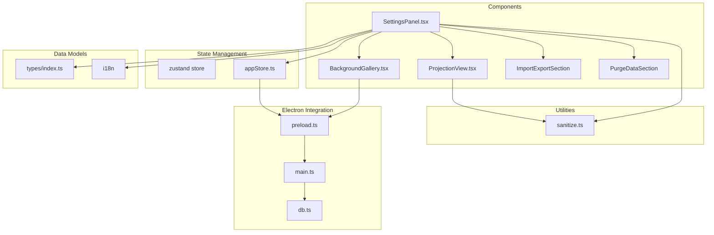
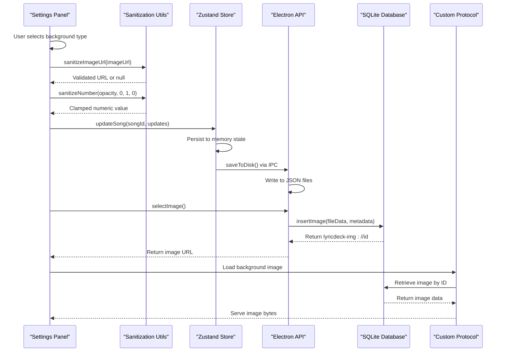
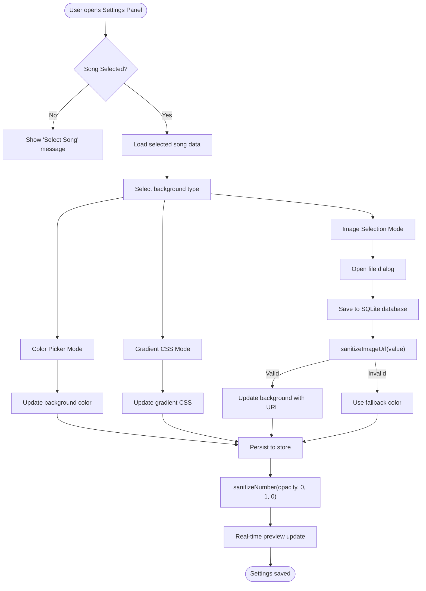
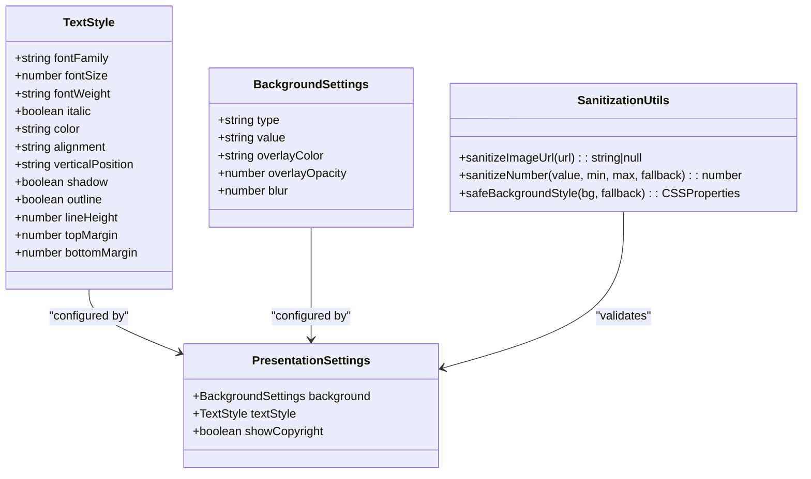
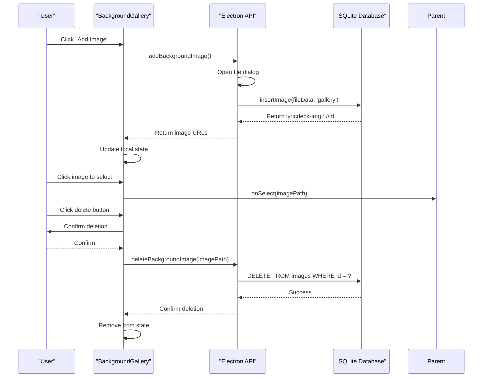
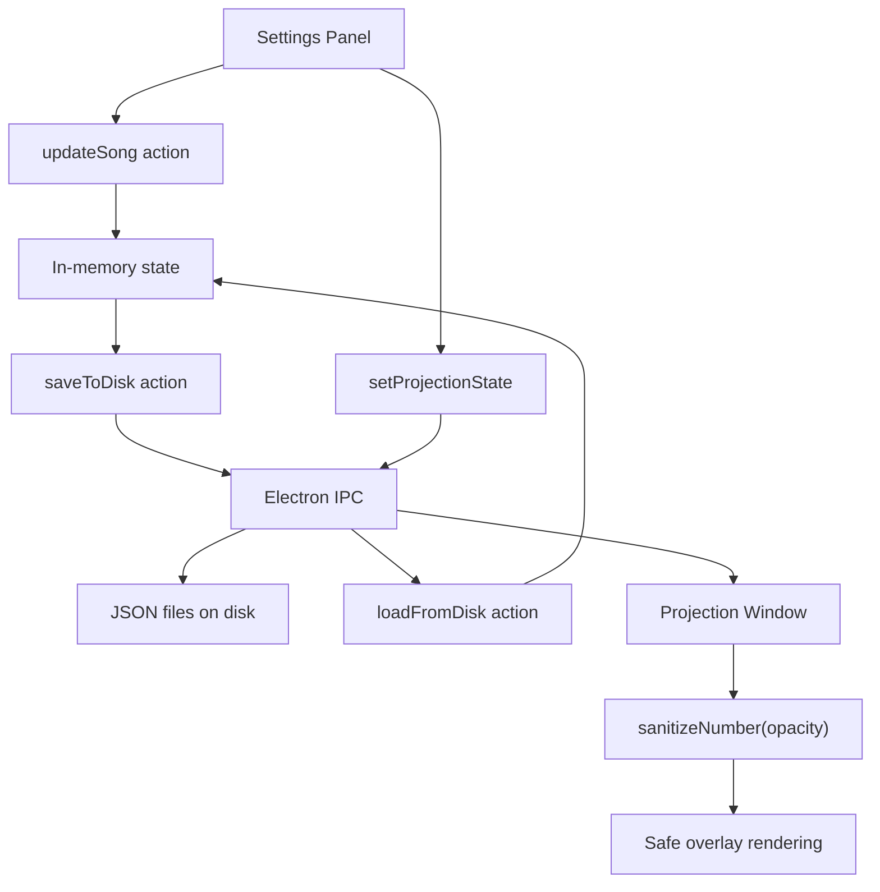
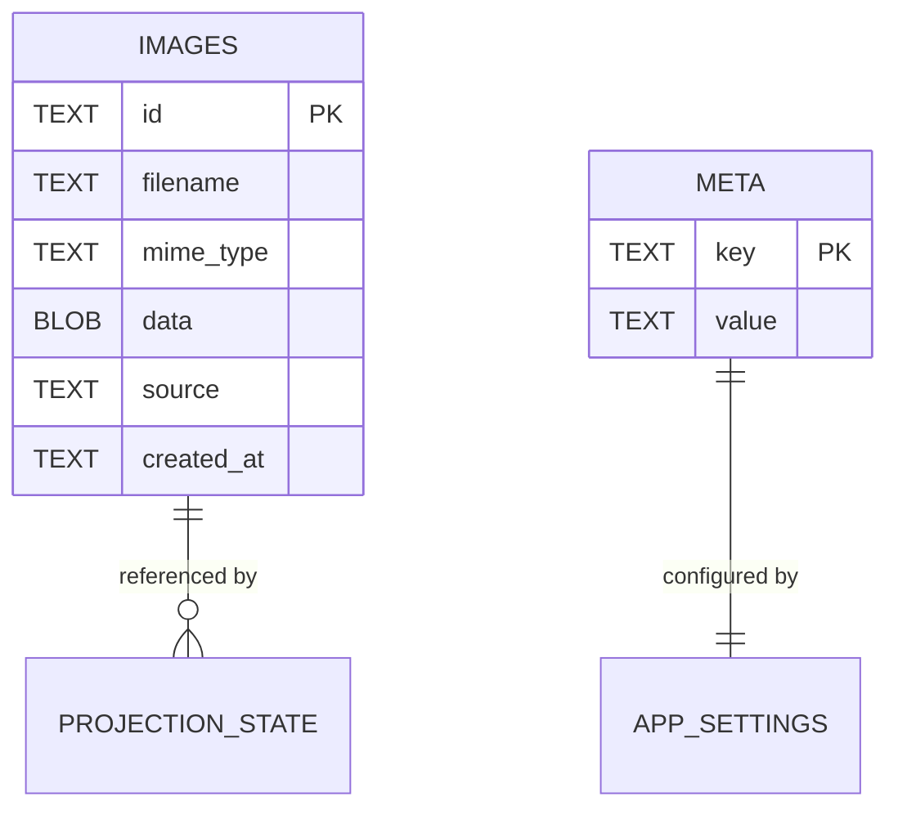
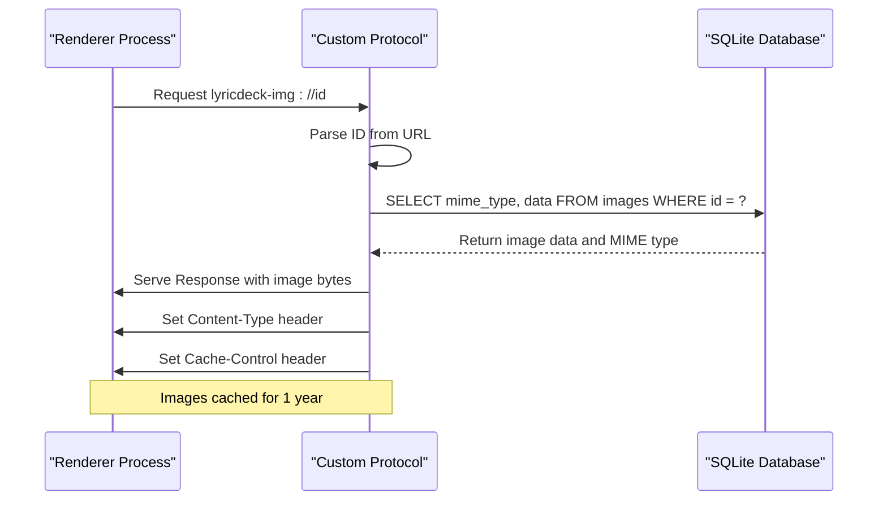
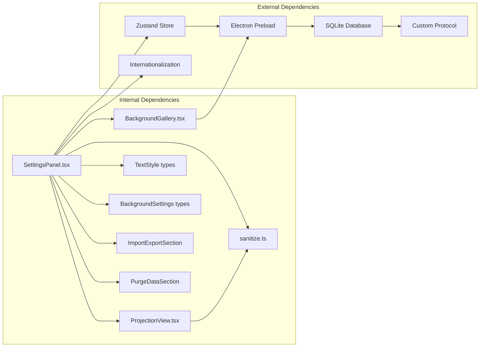

# Settings Panel

<cite>
**Referenced Files in This Document**
- [SettingsPanel.tsx](file://src/components/SettingsPanel.tsx)
- [BackgroundGallery.tsx](file://src/components/BackgroundGallery.tsx)
- [ProjectionView.tsx](file://src/components/ProjectionView.tsx)
- [sanitize.ts](file://src/utils/sanitize.ts)
- [appStore.ts](file://src/store/appStore.ts)
- [db.ts](file://electron/db.ts)
- [main.ts](file://electron/main.ts)
- [preload.ts](file://electron/preload.ts)
- [index.ts](file://src/types/index.ts)
- [en.ts](file://src/i18n/en.ts)
- [index.ts](file://src/i18n/index.ts)
</cite>

## Update Summary
**Changes Made**
- Enhanced background preview functionality with comprehensive input validation using sanitizeImageUrl() and sanitizeNumber() functions
- Added robust error handling for invalid image URLs and overlay opacity values
- Improved security by preventing CSS injection attacks through sanitized user inputs
- Updated both SettingsPanel and ProjectionView components to use centralized sanitization utilities

## Table of Contents
1. [Introduction](#introduction)
2. [Project Structure](#project-structure)
3. [Core Components](#core-components)
4. [Architecture Overview](#architecture-overview)
5. [Detailed Component Analysis](#detailed-component-analysis)
6. [Data Management Features](#data-management-features)
7. [Security and Input Validation](#security-and-input-validation)
8. [Dependency Analysis](#dependency-analysis)
9. [Performance Considerations](#performance-considerations)
10. [Troubleshooting Guide](#troubleshooting-guide)
11. [Conclusion](#conclusion)

## Introduction
The Settings Panel component provides comprehensive customization capabilities for presentation backgrounds and text styling. It enables users to configure solid colors, gradient backgrounds, or image backgrounds per song, along with advanced text styling options including fonts, colors, alignment, shadows, and outlines. The component integrates seamlessly with the Zustand store for persistent state management and utilizes a SQLite database for storing background images with a custom protocol for serving them efficiently. **Updated**: Significantly enhanced with advanced data management features including upsert import with smart deduplication, comprehensive purge options, improved gallery refresh mechanisms, detailed user feedback systems, and robust input validation with security-focused sanitization.

## Project Structure
The Settings Panel is organized within the components directory alongside other presentation-related components. It leverages shared types, internationalization, and state management patterns established across the application.

**Diagram sources**
- [SettingsPanel.tsx:1-665](file://src/components/SettingsPanel.tsx#L1-L665)
- [BackgroundGallery.tsx:1-99](file://src/components/BackgroundGallery.tsx#L1-L99)
- [ProjectionView.tsx:1-127](file://src/components/ProjectionView.tsx#L1-L127)
- [sanitize.ts:1-132](file://src/utils/sanitize.ts#L1-L132)
- [appStore.ts:1-425](file://src/store/appStore.ts#L1-L425)
- [preload.ts:1-48](file://electron/preload.ts#L1-L48)
- [main.ts:1-484](file://electron/main.ts#L1-L484)
- [db.ts:1-250](file://electron/db.ts#L1-L250)
- [index.ts:1-90](file://src/types/index.ts#L1-L90)

**Section sources**
- [SettingsPanel.tsx:1-665](file://src/components/SettingsPanel.tsx#L1-L665)
- [BackgroundGallery.tsx:1-99](file://src/components/BackgroundGallery.tsx#L1-L99)
- [appStore.ts:1-425](file://src/store/appStore.ts#L1-L425)

## Core Components
The Settings Panel consists of several key subsystems that work together to provide comprehensive customization:

### Background Configuration System
The background system supports three distinct modes:
- **Solid Color**: Direct color picker with hex value input
- **Gradient**: CSS gradient input with preset templates
- **Image**: File selection and gallery integration with secure URL validation

### Text Styling Engine
Advanced typography controls including:
- Font family selection from a curated list
- Dynamic font sizing with validation
- Weight variations (normal, bold, lighter)
- Color pickers with hex fallback
- Alignment options (left, center, right)
- Vertical positioning (top, middle, bottom)
- Line height and margin controls
- Visual effects (shadow, outline, italic)

### Internationalization Integration
Full localization support through the i18n system with dynamic language switching.

**Section sources**
- [SettingsPanel.tsx:29-45](file://src/components/SettingsPanel.tsx#L29-L45)
- [SettingsPanel.tsx:70-242](file://src/components/SettingsPanel.tsx#L70-L242)
- [SettingsPanel.tsx:244-396](file://src/components/SettingsPanel.tsx#L244-L396)
- [en.ts:100-139](file://src/i18n/en.ts#L100-L139)

## Architecture Overview
The Settings Panel implements a reactive architecture that combines local state management with persistent storage through multiple layers, enhanced with comprehensive input validation and security measures.

**Diagram sources**
- [SettingsPanel.tsx:47-54](file://src/components/SettingsPanel.tsx#L47-L54)
- [sanitize.ts:71-100](file://src/utils/sanitize.ts#L71-L100)
- [appStore.ts:379-384](file://src/store/appStore.ts#L379-L384)
- [main.ts:221-235](file://electron/main.ts#L221-235)
- [db.ts:70-87](file://electron/db.ts#L70-87)
- [main.ts:362-374](file://electron/main.ts#L362-374)

## Detailed Component Analysis

### SettingsPanel Component
The main Settings Panel component orchestrates all customization features through a unified interface with enhanced security validation.

#### Background Configuration Flow with Security Validation

**Diagram sources**
- [SettingsPanel.tsx:7-24](file://src/components/SettingsPanel.tsx#L7-L24)
- [SettingsPanel.tsx:29-45](file://src/components/SettingsPanel.tsx#L29-L45)
- [SettingsPanel.tsx:47-54](file://src/components/SettingsPanel.tsx#L47-L54)
- [sanitize.ts:71-100](file://src/utils/sanitize.ts#L71-L100)

#### Text Styling Configuration
The text styling system provides granular control over typography and layout:

**Diagram sources**
- [index.ts:29-48](file://src/types/index.ts#L29-L48)
- [sanitize.ts:106-131](file://src/utils/sanitize.ts#L106-L131)

#### Form Validation and Real-time Preview with Security
The component implements comprehensive validation and immediate feedback mechanisms with enhanced security:

**Section sources**
- [SettingsPanel.tsx:29-45](file://src/components/SettingsPanel.tsx#L29-L45)
- [SettingsPanel.tsx:87-103](file://src/components/SettingsPanel.tsx#L87-L103)
- [SettingsPanel.tsx:105-131](file://src/components/SettingsPanel.tsx#L105-L131)
- [SettingsPanel.tsx:133-187](file://src/components/SettingsPanel.tsx#L133-L187)
- [SettingsPanel.tsx:244-396](file://src/components/SettingsPanel.tsx#L244-L396)
- [sanitize.ts:71-100](file://src/utils/sanitize.ts#L71-L100)

### BackgroundGallery Integration
The Background Gallery component provides centralized image management with CRUD operations.

#### Gallery Operations Flow

**Diagram sources**
- [BackgroundGallery.tsx:24-40](file://src/components/BackgroundGallery.tsx#L24-L40)
- [BackgroundGallery.tsx:62-92](file://src/components/BackgroundGallery.tsx#L62-L92)
- [main.ts:237-264](file://electron/main.ts#L237-264)
- [db.ts:106-131](file://electron/db.ts#L106-131)

**Section sources**
- [BackgroundGallery.tsx:1-99](file://src/components/BackgroundGallery.tsx#L1-L99)
- [main.ts:237-264](file://electron/main.ts#L237-264)
- [db.ts:106-131](file://electron/db.ts#L106-L131)

### Zustand Store Integration
The Settings Panel integrates deeply with the Zustand store for state persistence and synchronization.

#### State Management Flow

**Diagram sources**
- [appStore.ts:174-180](file://src/store/appStore.ts#L174-L180)
- [appStore.ts:379-384](file://src/store/appStore.ts#L379-L384)
- [appStore.ts:242-249](file://src/store/appStore.ts#L242-L249)
- [ProjectionView.tsx:75-77](file://src/components/ProjectionView.tsx#L75-L77)
- [sanitize.ts:96-100](file://src/utils/sanitize.ts#L96-L100)

**Section sources**
- [appStore.ts:1-425](file://src/store/appStore.ts#L1-L425)

### SQLite Database Integration
The application uses SQLite for efficient background image storage with BLOB data handling.

#### Database Schema and Operations

**Diagram sources**
- [db.ts:50-68](file://electron/db.ts#L50-L68)

**Section sources**
- [db.ts:1-250](file://electron/db.ts#L1-L250)
- [main.ts:221-235](file://electron/main.ts#L221-L235)

### Custom Protocol Implementation
The application implements a custom protocol (`lyricdeck-img://`) for efficient image serving.

#### Protocol Flow

**Diagram sources**
- [main.ts:12-16](file://electron/main.ts#L12-L16)
- [main.ts:362-374](file://electron/main.ts#L362-L374)
- [db.ts:89-104](file://electron/db.ts#L89-L104)

**Section sources**
- [main.ts:12-16](file://electron/main.ts#L12-L16)
- [main.ts:362-374](file://electron/main.ts#L362-L374)
- [db.ts:89-104](file://electron/db.ts#L89-L104)

## Data Management Features

### Enhanced Import/Export System
The Settings Panel now includes a comprehensive data management system with three distinct operations:

#### Standard Import Operation
- **Functionality**: Imports songs, settings, and background images from exported files
- **Behavior**: Adds new items without modifying existing data
- **Status Feedback**: Provides detailed count of imported songs and background images

#### Import (Update Existing) Operation
- **Functionality**: Advanced import with upsert logic for existing data
- **Behavior**: Replaces existing songs and images by matching IDs, adds new items
- **Status Feedback**: Shows detailed breakdown of added vs. updated items

#### Export Operation
- **Functionality**: Exports all application data including songs, settings, and background images
- **Format**: JSON-based export format with version compatibility
- **Status Feedback**: Confirmation message upon successful export

### Purge Data Management
A new dedicated section provides safe data cleanup with two distinct purge options:

#### Full Data Purge
- **Scope**: Deletes all songs, settings, preparation lists, and background images
- **Safety**: Requires explicit user confirmation with detailed warning
- **Visual Indicators**: Red-themed button with clear danger indication
- **Status Feedback**: Confirmation message after successful purge

#### Songs-Only Purge
- **Scope**: Deletes only songs while preserving settings and background images
- **Use Case**: Useful for resetting content while maintaining configuration
- **Safety**: Requires explicit user confirmation with scope clarification
- **Visual Indicators**: Amber-themed button indicating caution level
- **Status Feedback**: Confirmation message after successful purge

### Enhanced Gallery Refresh Mechanism
The background gallery now uses React keys for improved state synchronization:

#### Key-Based Refresh Strategy
- **Implementation**: Uses `galleryRefreshKey` state to force component re-mount
- **Trigger**: Automatically refreshed after successful import operations
- **Benefit**: Ensures gallery displays latest data without manual intervention
- **Performance**: Efficient re-rendering without full page reload

### Status Messaging System
All data operations now provide comprehensive user feedback:

#### Real-time Status Updates
- **Busy States**: Visual indicators during long-running operations
- **Success Messages**: Detailed feedback with operation results
- **Error Handling**: User-friendly error messages for failed operations
- **Auto-clear**: Status messages automatically cleared before new operations

**Section sources**
- [SettingsPanel.tsx:475-583](file://src/components/SettingsPanel.tsx#L475-L583)
- [SettingsPanel.tsx:585-663](file://src/components/SettingsPanel.tsx#L585-L663)
- [en.ts:153-195](file://src/i18n/en.ts#L153-L195)
- [preload.ts:39-47](file://electron/preload.ts#L39-L47)
- [main.ts:356-448](file://electron/main.ts#L356-L448)

## Security and Input Validation

### Comprehensive Input Sanitization
The Settings Panel now implements robust input validation to prevent security vulnerabilities and ensure data integrity:

#### Image URL Validation
- **Function**: `sanitizeImageUrl()` validates image URLs against allowed protocols
- **Allowed Protocols**: `lyricdeck-img://` custom protocol and safe data URLs
- **Rejected Patterns**: External URLs, JavaScript protocols, and potentially malicious sources
- **Fallback Behavior**: Returns null for invalid URLs, preventing unsafe background images

#### Numeric Value Validation
- **Function**: `sanitizeNumber()` ensures numeric values are within safe ranges
- **Range Enforcement**: Clamps values between specified minimum and maximum bounds
- **Type Safety**: Handles undefined, null, and non-numeric inputs gracefully
- **Default Values**: Provides sensible fallback values when inputs are invalid

#### Overlay Opacity Protection
- **Application**: Used for background overlay opacity values (0-1 range)
- **Validation**: Prevents CSS injection through malformed opacity values
- **Display Consistency**: Ensures consistent visual behavior across different browsers

### Security Benefits
- **CSS Injection Prevention**: Blocks malicious CSS values from being injected via inline styles
- **XSS Attack Mitigation**: Prevents execution of JavaScript through background URLs
- **Data Integrity**: Ensures all user inputs conform to expected formats and ranges
- **Graceful Degradation**: Falls back to safe defaults when inputs are invalid

**Section sources**
- [sanitize.ts:71-100](file://src/utils/sanitize.ts#L71-L100)
- [sanitize.ts:96-100](file://src/utils/sanitize.ts#L96-L100)
- [SettingsPanel.tsx:167-175](file://src/components/SettingsPanel.tsx#L167-L175)
- [ProjectionView.tsx:75-77](file://src/components/ProjectionView.tsx#L75-L77)

## Dependency Analysis
The Settings Panel component exhibits strong cohesion within its domain while maintaining loose coupling with external systems, enhanced with security-focused dependencies.

**Diagram sources**
- [SettingsPanel.tsx:1-6](file://src/components/SettingsPanel.tsx#L1-L6)
- [BackgroundGallery.tsx:1-3](file://src/components/BackgroundGallery.tsx#L1-L3)
- [ProjectionView.tsx:1-2](file://src/components/ProjectionView.tsx#L1-L2)
- [sanitize.ts:1-5](file://src/utils/sanitize.ts#L1-L5)
- [appStore.ts:1-4](file://src/store/appStore.ts#L1-L4)
- [preload.ts:1-48](file://electron/preload.ts#L1-L48)

### Coupling and Cohesion Analysis
- **High internal cohesion**: All background and text styling logic is contained within the Settings Panel
- **Moderate external coupling**: Reliant on Electron APIs and database operations
- **Clean separation of concerns**: UI logic separated from data persistence and security validation
- **Enhanced modularity**: New data management features are well-contained within dedicated sections
- **Security-first design**: Centralized sanitization utilities provide consistent protection across components

**Section sources**
- [SettingsPanel.tsx:1-665](file://src/components/SettingsPanel.tsx#L1-L665)
- [BackgroundGallery.tsx:1-99](file://src/components/BackgroundGallery.tsx#L1-L99)
- [sanitize.ts:1-132](file://src/utils/sanitize.ts#L1-L132)

## Performance Considerations
The Settings Panel implements several performance optimizations with security considerations:

### Memory Management
- **Lazy loading**: Background gallery images are loaded on demand
- **Efficient state updates**: Partial updates minimize re-renders
- **Image caching**: Custom protocol serves cached images with long cache headers
- **Key-based optimization**: React keys prevent unnecessary re-renders during imports
- **Sanitization caching**: Input validation results are computed once per render cycle

### Database Optimization
- **BLOB storage**: Efficient binary storage for images
- **UUID indexing**: Fast lookup by unique identifiers
- **Connection pooling**: Single database instance reused
- **Upsert operations**: Efficient updates for existing records

### UI Responsiveness
- **Immediate feedback**: Real-time preview updates without blocking
- **Debounced operations**: Input validation prevents excessive updates
- **Virtualized lists**: Large galleries use scrollable containers
- **Async operations**: Non-blocking data import/export operations
- **Secure rendering**: Sanitized inputs prevent expensive error recovery

## Troubleshooting Guide

### Common Issues and Solutions

#### Background Image Loading Failures
**Symptoms**: Images don't appear in gallery or preview
**Causes**: 
- Database corruption
- Invalid image format
- Protocol registration failure
- **New**: Invalid image URL format blocked by sanitization

**Solutions**:
1. Verify database initialization: [initDatabase:26-41](file://electron/db.ts#L26-L41)
2. Check protocol registration: [registerSchemesAsPrivileged:12-16](file://electron/main.ts#L12-L16)
3. Validate image format support: [getMimeType:230-240](file://electron/db.ts#L230-L240)
4. **Updated**: Check URL sanitization: [sanitizeImageUrl:71-90](file://src/utils/sanitize.ts#L71-L90)

#### Overlay Opacity Display Issues
**Symptoms**: Overlay appears incorrectly or causes rendering errors
**Causes**:
- Invalid opacity values outside 0-1 range
- Non-numeric values passed to CSS
- Browser-specific rendering differences

**Solutions**:
1. **New**: Verify numeric sanitization: [sanitizeNumber:96-100](file://src/utils/sanitize.ts#L96-L100)
2. Check opacity value clamping in SettingsPanel: [line 174](file://src/components/SettingsPanel.tsx#L174)
3. Validate ProjectionView usage: [line 75-77:75-77](file://src/components/ProjectionView.tsx#L75-L77)

#### State Synchronization Problems
**Symptoms**: Settings revert after restart
**Causes**:
- Persistence failures
- IPC communication errors
- File system permissions

**Solutions**:
1. Check save/load operations: [saveToDisk:405-409](file://src/store/appStore.ts#L405-L409), [loadFromDisk:388-403](file://src/store/appStore.ts#L388-L403)
2. Verify IPC handlers: [preload expose:3-47](file://electron/preload.ts#L3-L47)
3. Monitor file permissions in userData directory

#### Import/Export Issues
**Symptoms**: Import fails or data doesn't sync properly
**Causes**:
- Corrupted export files
- Version incompatibility
- Permission issues

**Solutions**:
1. Verify export file integrity: [export-data handler:267-290](file://electron/main.ts#L267-L290)
2. Check upsert functionality: [import-data-upsert handler:356-425](file://electron/main.ts#L356-L425)
3. Ensure proper file permissions for import operations

#### Gallery Refresh Problems
**Symptoms**: Gallery doesn't update after import operations
**Causes**:
- Missing React key updates
- State synchronization delays
- Component lifecycle issues

**Solutions**:
1. Verify gallery refresh key implementation: [handleImportSuccess:13-16](file://src/components/SettingsPanel.tsx#L13-L16)
2. Check useEffect dependencies: [useEffect dependency:14-16](file://src/components/BackgroundGallery.tsx#L14-L16)
3. Monitor state propagation: [refreshKey prop:210](file://src/components/SettingsPanel.tsx#L210)

#### Purge Operation Issues
**Symptoms**: Data not purged or partial purge results
**Causes**:
- File permission issues
- Database connection problems
- Incomplete cleanup operations

**Solutions**:
1. Verify purge-all-data handler: [purge-all-data:428-442](file://electron/main.ts#L428-L442)
2. Check purge-songs-only handler: [purge-songs-only:444-448](file://electron/main.ts#L444-L448)
3. Ensure proper user confirmation flow: [confirmation dialogs:599-616](file://src/components/SettingsPanel.tsx#L599-L616)

#### Security Validation Issues
**Symptoms**: Background images not displaying, overlay opacity causing errors
**Causes**:
- Invalid URL formats rejected by sanitization
- Out-of-range opacity values
- Malformed CSS values

**Solutions**:
1. **New**: Check URL validation rules: [sanitizeImageUrl:71-90](file://src/utils/sanitize.ts#L71-L90)
2. **New**: Verify numeric range enforcement: [sanitizeNumber:96-100](file://src/utils/sanitize.ts#L96-L100)
3. **New**: Review safeBackgroundStyle utility: [safeBackgroundStyle:106-131](file://src/utils/sanitize.ts#L106-L131)
4. **New**: Check component usage of sanitization functions: [SettingsPanel usage:167-175](file://src/components/SettingsPanel.tsx#L167-L175)

**Section sources**
- [db.ts:26-41](file://electron/db.ts#L26-L41)
- [main.ts:12-16](file://electron/main.ts#L12-L16)
- [db.ts:230-240](file://electron/db.ts#L230-L240)
- [appStore.ts:388-409](file://src/store/appStore.ts#L388-L409)
- [preload.ts:3-47](file://electron/preload.ts#L3-L47)
- [main.ts:267-448](file://electron/main.ts#L267-L448)
- [SettingsPanel.tsx:13-16](file://src/components/SettingsPanel.tsx#L13-L16)
- [BackgroundGallery.tsx:14-16](file://src/components/BackgroundGallery.tsx#L14-L16)
- [sanitize.ts:71-131](file://src/utils/sanitize.ts#L71-L131)

## Conclusion
The Settings Panel component provides a comprehensive and user-friendly interface for configuring presentation backgrounds and text styling. Its architecture demonstrates excellent separation of concerns with clear integration points for state management, data persistence, and media handling. The component successfully balances functionality with performance through careful optimization of database operations, protocol-based image serving, and reactive state updates.

**Updated**: The enhanced data management capabilities significantly improve the user experience by providing robust import/update functionality, comprehensive purge options, and detailed status feedback. The new gallery refresh mechanism ensures seamless data synchronization, while the modular design maintains clean separation between different functional areas. **Additionally**, the comprehensive input validation and security measures protect against CSS injection attacks and ensure data integrity across all user interactions.

The implementation showcases modern React patterns with TypeScript type safety, Electron IPC integration, and SQLite database utilization. The modular design allows for easy extension and maintenance while providing immediate visual feedback for all user interactions.

Key strengths include:
- **Comprehensive customization**: Full control over background and text styling
- **Persistent state management**: Reliable data persistence through multiple layers
- **Efficient media handling**: Optimized image storage and serving
- **User experience**: Real-time preview and immediate feedback
- **Extensibility**: Clean architecture supports future enhancements
- **Advanced data management**: Robust import/update/purge capabilities with detailed user feedback
- **Enhanced reliability**: Improved state synchronization and error handling
- **Security-first approach**: Comprehensive input validation prevents XSS and CSS injection attacks
- **Robust error handling**: Graceful degradation with safe fallbacks for invalid inputs

The component serves as a robust foundation for presentation customization in the LyricDeck application, providing both power users and casual users with the tools needed to create professional-looking presentations while offering advanced data management capabilities and enterprise-grade security for complex workflows.