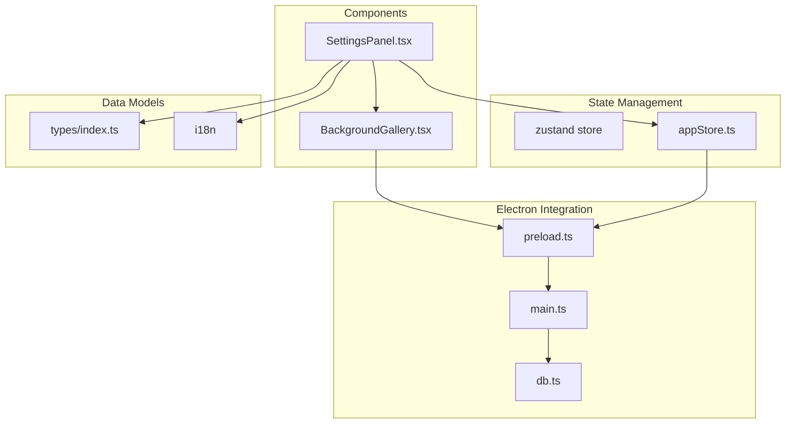
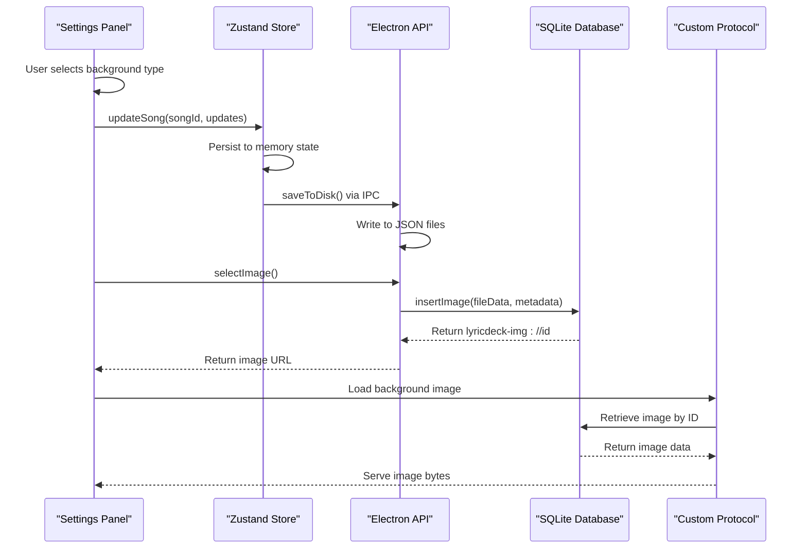
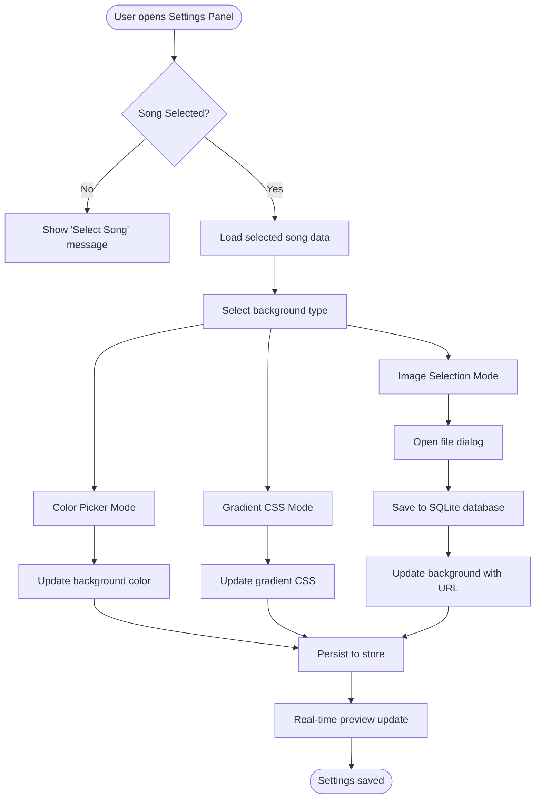
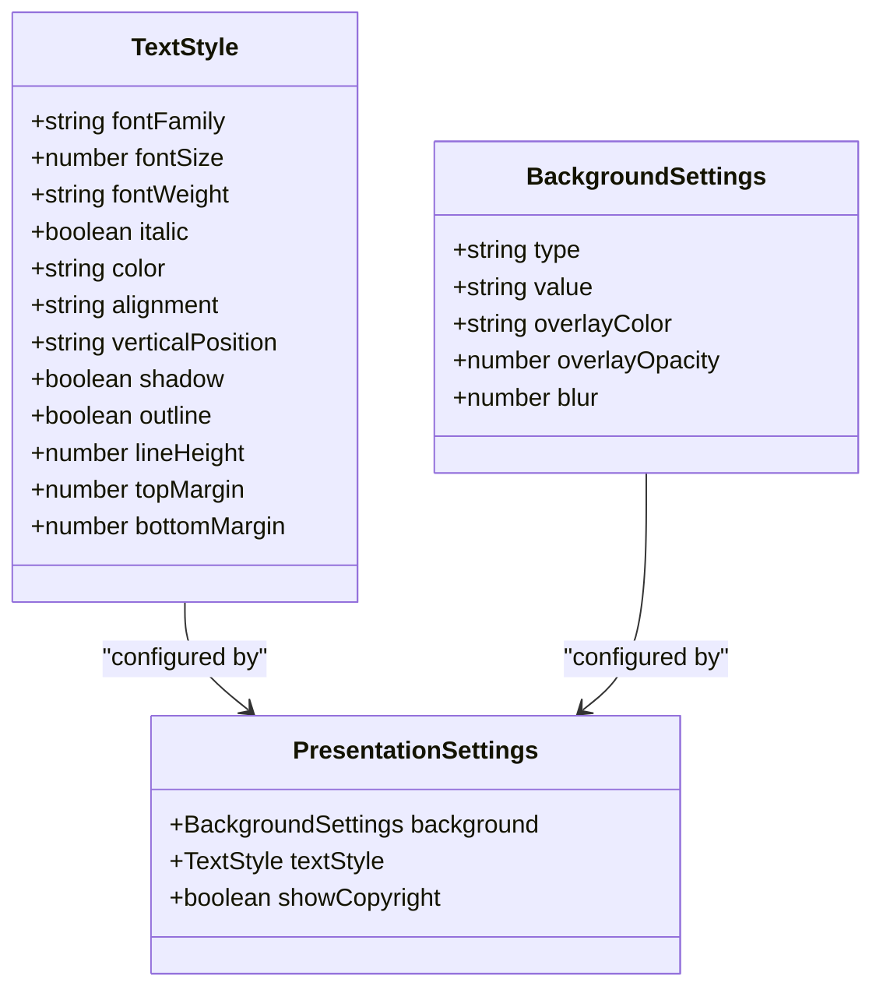
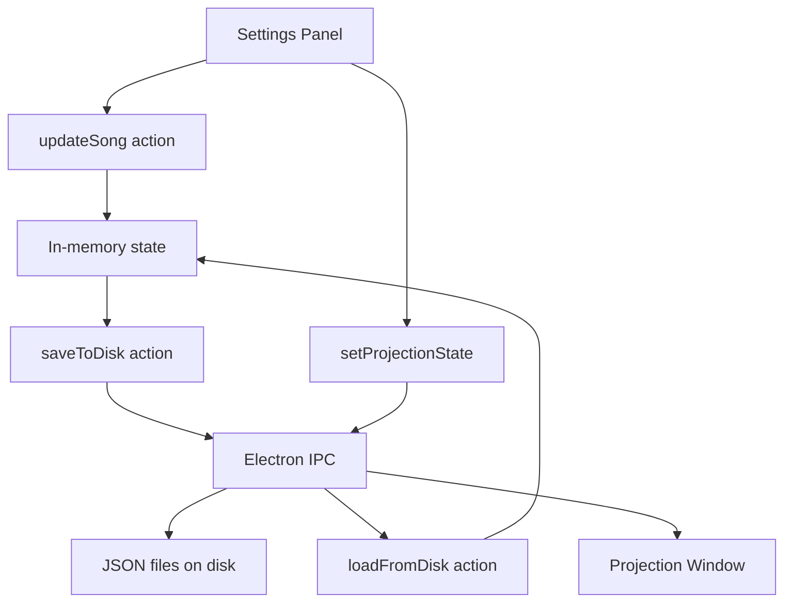
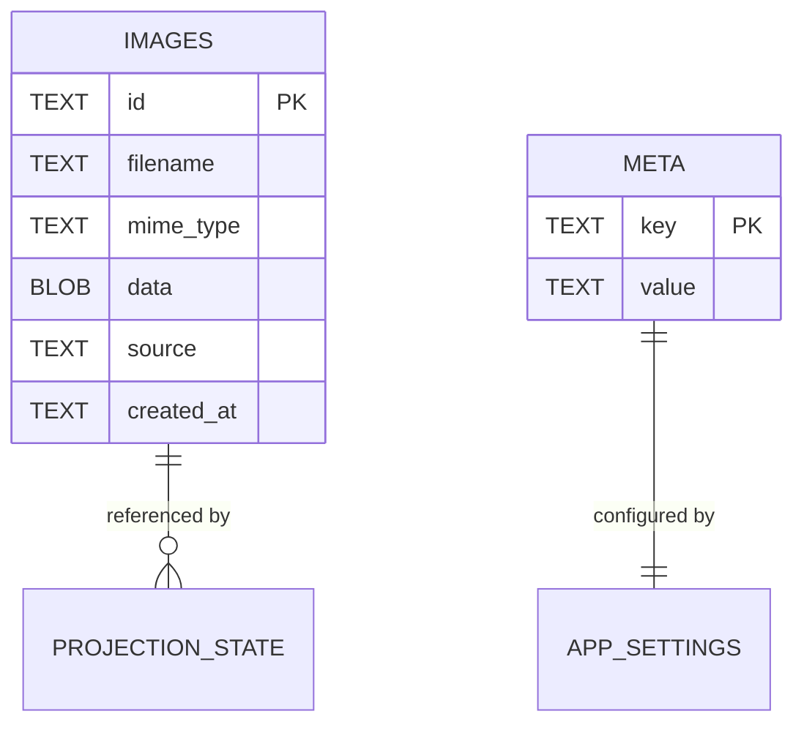
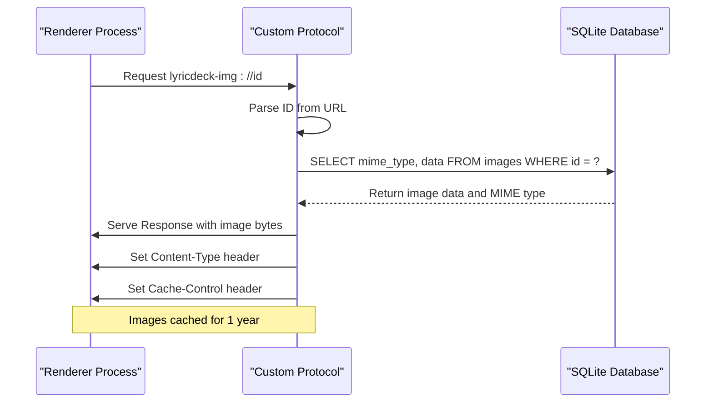
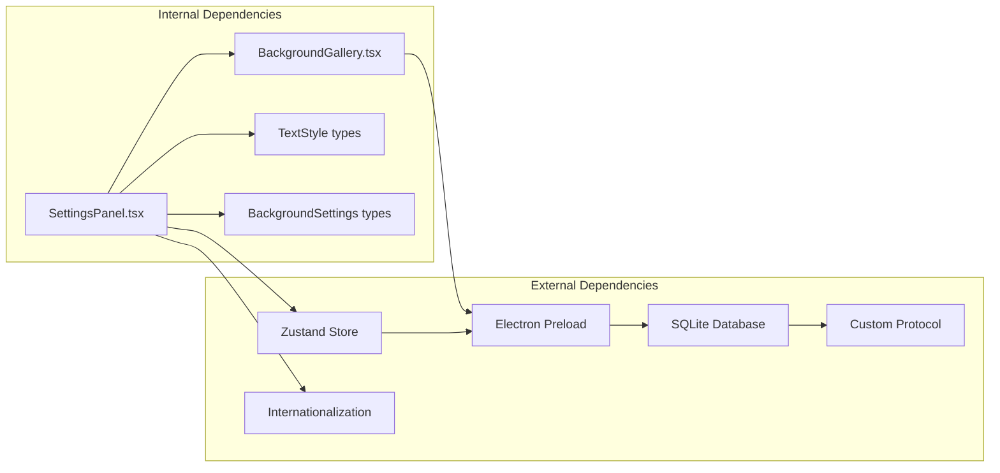

# Settings Panel

<cite>
**Referenced Files in This Document**
- [SettingsPanel.tsx](file://src/components/SettingsPanel.tsx)
- [BackgroundGallery.tsx](file://src/components/BackgroundGallery.tsx)
- [appStore.ts](file://src/store/appStore.ts)
- [db.ts](file://electron/db.ts)
- [main.ts](file://electron/main.ts)
- [preload.ts](file://electron/preload.ts)
- [index.ts](file://src/types/index.ts)
- [en.ts](file://src/i18n/en.ts)
- [index.ts](file://src/i18n/index.ts)
</cite>

## Table of Contents
1. [Introduction](#introduction)
2. [Project Structure](#project-structure)
3. [Core Components](#core-components)
4. [Architecture Overview](#architecture-overview)
5. [Detailed Component Analysis](#detailed-component-analysis)
6. [Dependency Analysis](#dependency-analysis)
7. [Performance Considerations](#performance-considerations)
8. [Troubleshooting Guide](#troubleshooting-guide)
9. [Conclusion](#conclusion)

## Introduction
The Settings Panel component provides comprehensive customization capabilities for presentation backgrounds and text styling. It enables users to configure solid colors, gradient backgrounds, or image backgrounds per song, along with advanced text styling options including fonts, colors, alignment, shadows, and outlines. The component integrates seamlessly with the Zustand store for persistent state management and utilizes a SQLite database for storing background images with a custom protocol for serving them efficiently.

## Project Structure
The Settings Panel is organized within the components directory alongside other presentation-related components. It leverages shared types, internationalization, and state management patterns established across the application.

**Diagram sources**
- [SettingsPanel.tsx:1-523](file://src/components/SettingsPanel.tsx#L1-L523)
- [BackgroundGallery.tsx:1-98](file://src/components/BackgroundGallery.tsx#L1-L98)
- [appStore.ts:1-385](file://src/store/appStore.ts#L1-L385)
- [preload.ts:1-43](file://electron/preload.ts#L1-L43)
- [main.ts:1-390](file://electron/main.ts#L1-L390)
- [db.ts:1-214](file://electron/db.ts#L1-L214)
- [index.ts:1-89](file://src/types/index.ts#L1-L89)

**Section sources**
- [SettingsPanel.tsx:1-523](file://src/components/SettingsPanel.tsx#L1-L523)
- [BackgroundGallery.tsx:1-98](file://src/components/BackgroundGallery.tsx#L1-L98)
- [appStore.ts:1-385](file://src/store/appStore.ts#L1-L385)

## Core Components
The Settings Panel consists of several key subsystems that work together to provide comprehensive customization:

### Background Configuration System
The background system supports three distinct modes:
- **Solid Color**: Direct color picker with hex value input
- **Gradient**: CSS gradient input with preset templates
- **Image**: File selection and gallery integration

### Text Styling Engine
Advanced typography controls including:
- Font family selection from a curated list
- Dynamic font sizing with validation
- Weight variations (normal, bold, lighter)
- Color pickers with hex fallback
- Alignment options (left, center, right)
- Vertical positioning (top, middle, bottom)
- Line height and margin controls
- Visual effects (shadow, outline, italic)

### Internationalization Integration
Full localization support through the i18n system with dynamic language switching.

**Section sources**
- [SettingsPanel.tsx:29-45](file://src/components/SettingsPanel.tsx#L29-L45)
- [SettingsPanel.tsx:70-242](file://src/components/SettingsPanel.tsx#L70-L242)
- [SettingsPanel.tsx:244-396](file://src/components/SettingsPanel.tsx#L244-L396)
- [en.ts:100-139](file://src/i18n/en.ts#L100-L139)

## Architecture Overview
The Settings Panel implements a reactive architecture that combines local state management with persistent storage through multiple layers.

**Diagram sources**
- [SettingsPanel.tsx:47-54](file://src/components/SettingsPanel.tsx#L47-L54)
- [appStore.ts:379-384](file://src/store/appStore.ts#L379-L384)
- [main.ts:221-235](file://electron/main.ts#L221-L235)
- [db.ts:70-87](file://electron/db.ts#L70-L87)
- [main.ts:362-374](file://electron/main.ts#L362-L374)

## Detailed Component Analysis

### SettingsPanel Component
The main Settings Panel component orchestrates all customization features through a unified interface.

#### Background Configuration Flow

**Diagram sources**
- [SettingsPanel.tsx:7-24](file://src/components/SettingsPanel.tsx#L7-L24)
- [SettingsPanel.tsx:29-45](file://src/components/SettingsPanel.tsx#L29-L45)
- [SettingsPanel.tsx:47-54](file://src/components/SettingsPanel.tsx#L47-L54)

#### Text Styling Configuration
The text styling system provides granular control over typography and layout:

**Diagram sources**
- [index.ts:29-48](file://src/types/index.ts#L29-L48)

#### Form Validation and Real-time Preview
The component implements comprehensive validation and immediate feedback mechanisms:

**Section sources**
- [SettingsPanel.tsx:29-45](file://src/components/SettingsPanel.tsx#L29-L45)
- [SettingsPanel.tsx:87-103](file://src/components/SettingsPanel.tsx#L87-L103)
- [SettingsPanel.tsx:105-131](file://src/components/SettingsPanel.tsx#L105-L131)
- [SettingsPanel.tsx:133-187](file://src/components/SettingsPanel.tsx#L133-L187)
- [SettingsPanel.tsx:244-396](file://src/components/SettingsPanel.tsx#L244-L396)

### BackgroundGallery Integration
The Background Gallery component provides centralized image management with CRUD operations.

#### Gallery Operations Flow

```mermaid
sequenceDiagram
participant User as "User"
participant Gallery as "BackgroundGallery"
participant Electron as "Electron API"
participant DB as "SQLite Database"
User->>Gallery : Click "Add Image"
Gallery->>Electron : addBackgroundImage()
Electron->>Electron : Open file dialog
Electron->>DB : insertImage(fileData, 'gallery')
DB-->>Electron : Return lyricdeck-img : //id
Electron-->>Gallery : Return image URLs
Gallery->>Gallery : Update local state
User->>Gallery : Click image to select
Gallery->>Parent : onSelect(imagePath)
User->>Gallery : Click delete button
Gallery->>User : Confirm deletion
User-->>Gallery : Confirm
Gallery->>Electron : deleteBackgroundImage(imagePath)
Electron->>DB : DELETE FROM images WHERE id = ?
DB-->>Electron : Success
Electron-->>Gallery : Confirm deletion
Gallery->>Gallery : Remove from state
```

**Diagram sources**
- [BackgroundGallery.tsx:24-40](file://src/components/BackgroundGallery.tsx#L24-L40)
- [BackgroundGallery.tsx:62-92](file://src/components/BackgroundGallery.tsx#L62-L92)
- [main.ts:237-264](file://electron/main.ts#L237-L264)
- [db.ts:106-131](file://electron/db.ts#L106-L131)

**Section sources**
- [BackgroundGallery.tsx:1-98](file://src/components/BackgroundGallery.tsx#L1-L98)
- [main.ts:237-264](file://electron/main.ts#L237-L264)
- [db.ts:106-131](file://electron/db.ts#L106-L131)

### Zustand Store Integration
The Settings Panel integrates deeply with the Zustand store for state persistence and synchronization.

#### State Management Flow

**Diagram sources**
- [appStore.ts:174-180](file://src/store/appStore.ts#L174-L180)
- [appStore.ts:379-384](file://src/store/appStore.ts#L379-L384)
- [appStore.ts:242-249](file://src/store/appStore.ts#L242-L249)

**Section sources**
- [appStore.ts:1-385](file://src/store/appStore.ts#L1-L385)

### SQLite Database Integration
The application uses SQLite for efficient background image storage with BLOB data handling.

#### Database Schema and Operations

**Diagram sources**
- [db.ts:50-68](file://electron/db.ts#L50-L68)

**Section sources**
- [db.ts:1-214](file://electron/db.ts#L1-L214)
- [main.ts:221-235](file://electron/main.ts#L221-L235)

### Custom Protocol Implementation
The application implements a custom protocol (`lyricdeck-img://`) for efficient image serving.

#### Protocol Flow

**Diagram sources**
- [main.ts:12-16](file://electron/main.ts#L12-L16)
- [main.ts:362-374](file://electron/main.ts#L362-L374)
- [db.ts:89-104](file://electron/db.ts#L89-L104)

**Section sources**
- [main.ts:12-16](file://electron/main.ts#L12-L16)
- [main.ts:362-374](file://electron/main.ts#L362-L374)
- [db.ts:89-104](file://electron/db.ts#L89-L104)

## Dependency Analysis
The Settings Panel component exhibits strong cohesion within its domain while maintaining loose coupling with external systems.

**Diagram sources**
- [SettingsPanel.tsx:1-6](file://src/components/SettingsPanel.tsx#L1-L6)
- [BackgroundGallery.tsx:1-3](file://src/components/BackgroundGallery.tsx#L1-L3)
- [appStore.ts:1-4](file://src/store/appStore.ts#L1-L4)
- [preload.ts:1-43](file://electron/preload.ts#L1-L43)

### Coupling and Cohesion Analysis
- **High internal cohesion**: All background and text styling logic is contained within the Settings Panel
- **Moderate external coupling**: Reliant on Electron APIs and database operations
- **Clean separation of concerns**: UI logic separated from data persistence

**Section sources**
- [SettingsPanel.tsx:1-523](file://src/components/SettingsPanel.tsx#L1-L523)
- [BackgroundGallery.tsx:1-98](file://src/components/BackgroundGallery.tsx#L1-L98)

## Performance Considerations
The Settings Panel implements several performance optimizations:

### Memory Management
- **Lazy loading**: Background gallery images are loaded on demand
- **Efficient state updates**: Partial updates minimize re-renders
- **Image caching**: Custom protocol serves cached images with long cache headers

### Database Optimization
- **BLOB storage**: Efficient binary storage for images
- **UUID indexing**: Fast lookup by unique identifiers
- **Connection pooling**: Single database instance reused

### UI Responsiveness
- **Immediate feedback**: Real-time preview updates without blocking
- **Debounced operations**: Input validation prevents excessive updates
- **Virtualized lists**: Large galleries use scrollable containers

## Troubleshooting Guide

### Common Issues and Solutions

#### Background Image Loading Failures
**Symptoms**: Images don't appear in gallery or preview
**Causes**: 
- Database corruption
- Invalid image format
- Protocol registration failure

**Solutions**:
1. Verify database initialization: [initDatabase:26-41](file://electron/db.ts#L26-L41)
2. Check protocol registration: [registerSchemesAsPrivileged:12-16](file://electron/main.ts#L12-L16)
3. Validate image format support: [getMimeType:201-211](file://electron/db.ts#L201-L211)

#### State Synchronization Problems
**Symptoms**: Settings revert after restart
**Causes**:
- Persistence failures
- IPC communication errors
- File system permissions

**Solutions**:
1. Check save/load operations: [saveToDisk:379-384](file://src/store/appStore.ts#L379-L384), [loadFromDisk:362-377](file://src/store/appStore.ts#L362-L377)
2. Verify IPC handlers: [preload expose:3-42](file://electron/preload.ts#L3-L42)
3. Monitor file permissions in userData directory

#### Gradient Configuration Issues
**Symptoms**: Gradient previews don't match CSS
**Causes**:
- Invalid CSS syntax
- Browser compatibility issues
- State synchronization delays

**Solutions**:
1. Validate gradient syntax: [gradient input:108-114](file://src/components/SettingsPanel.tsx#L108-L114)
2. Test CSS compatibility: [preview rendering:195-223](file://src/components/SettingsPanel.tsx#L195-L223)

**Section sources**
- [db.ts:26-41](file://electron/db.ts#L26-L41)
- [main.ts:12-16](file://electron/main.ts#L12-L16)
- [db.ts:201-211](file://electron/db.ts#L201-L211)
- [appStore.ts:362-384](file://src/store/appStore.ts#L362-L384)
- [preload.ts:3-42](file://electron/preload.ts#L3-L42)

## Conclusion
The Settings Panel component provides a comprehensive and user-friendly interface for configuring presentation backgrounds and text styling. Its architecture demonstrates excellent separation of concerns with clear integration points for state management, data persistence, and media handling. The component successfully balances functionality with performance through careful optimization of database operations, protocol-based image serving, and reactive state updates.

The implementation showcases modern React patterns with TypeScript type safety, Electron IPC integration, and SQLite database utilization. The modular design allows for easy extension and maintenance while providing immediate visual feedback for all user interactions.

Key strengths include:
- **Comprehensive customization**: Full control over background and text styling
- **Persistent state management**: Reliable data persistence through multiple layers
- **Efficient media handling**: Optimized image storage and serving
- **User experience**: Real-time preview and immediate feedback
- **Extensibility**: Clean architecture supports future enhancements

The component serves as a robust foundation for presentation customization in the LyricDeck application, providing both power users and casual users with the tools needed to create professional-looking presentations.