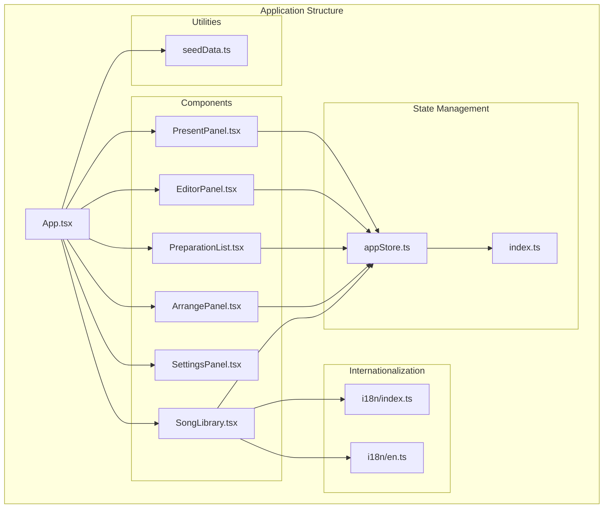
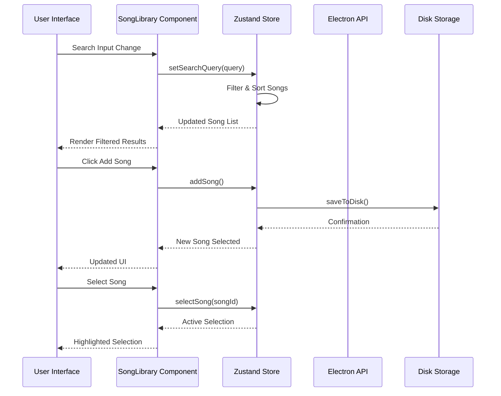
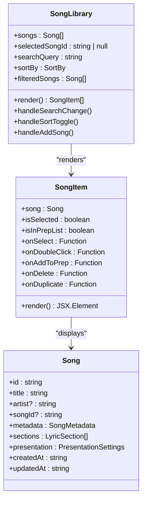
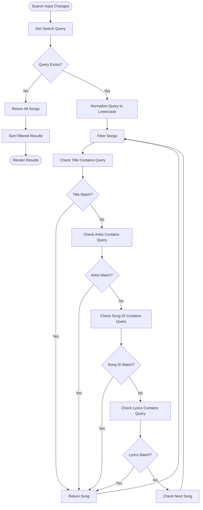
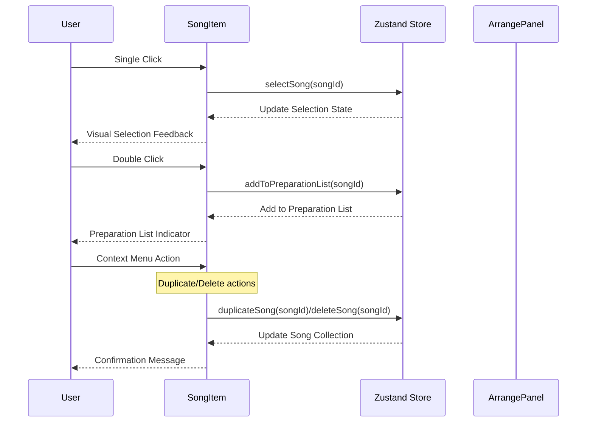
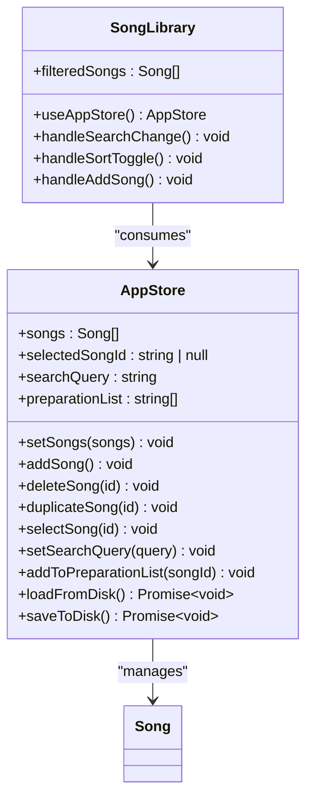
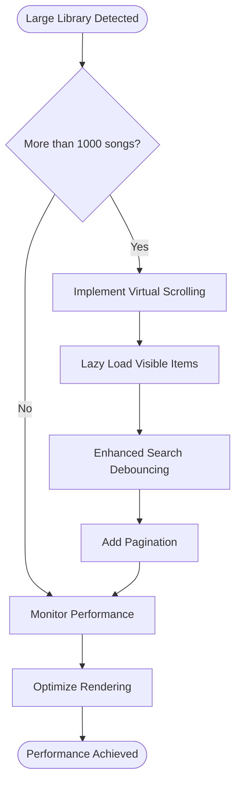

# Song Library Panel

<cite>
**Referenced Files in This Document**
- [SongLibrary.tsx](file://src/components/SongLibrary.tsx)
- [appStore.ts](file://src/store/appStore.ts)
- [index.ts](file://src/types/index.ts)
- [en.ts](file://src/i18n/en.ts)
- [index.ts](file://src/i18n/index.ts)
- [App.tsx](file://src/App.tsx)
- [ArrangePanel.tsx](file://src/components/ArrangePanel.tsx)
- [PreparationList.tsx](file://src/components/PreparationList.tsx)
- [seedData.ts](file://src/utils/seedData.ts)
</cite>

## Table of Contents
1. [Introduction](#introduction)
2. [Project Structure](#project-structure)
3. [Core Components](#core-components)
4. [Architecture Overview](#architecture-overview)
5. [Detailed Component Analysis](#detailed-component-analysis)
6. [Dependency Analysis](#dependency-analysis)
7. [Performance Considerations](#performance-considerations)
8. [Troubleshooting Guide](#troubleshooting-guide)
9. [Conclusion](#conclusion)

## Introduction
The Song Library Panel is the primary interface for managing song collections in LyricDeck. It provides a comprehensive left sidebar browser that allows users to discover, search, organize, and manage their musical content. Built with React and Zustand for state management, this component integrates seamlessly with the application's persistence layer and offers intuitive user interactions for song CRUD operations, preparation list management, and presentation workflow integration.

The panel serves as the central hub for song discovery and management, featuring sophisticated search capabilities, flexible sorting options, and integrated preparation list functionality that connects directly to the presentation workflow.

## Project Structure
The Song Library component is organized within the component architecture alongside related panels and stores:



**Diagram sources**
- [App.tsx:84-87](file://src/App.tsx#L84-L87)
- [SongLibrary.tsx:8-10](file://src/components/SongLibrary.tsx#L8-L10)
- [appStore.ts:31-96](file://src/store/appStore.ts#L31-L96)

**Section sources**
- [App.tsx:84-87](file://src/App.tsx#L84-L87)
- [SongLibrary.tsx:8-10](file://src/components/SongLibrary.tsx#L8-L10)

## Core Components
The Song Library Panel consists of two primary components working in harmony:

### Main SongLibrary Component
The primary component handles the complete song browsing experience, including search, filtering, sorting, and user interactions. It manages the state for search queries, sorting preferences, and maintains the reactive song list display.

### SongItem Sub-component
A specialized list item component that renders individual songs with contextual controls, visual indicators, and interactive elements. It provides hover states, selection highlighting, and action buttons for preparation list management, duplication, and deletion.

**Section sources**
- [SongLibrary.tsx:8-95](file://src/components/SongLibrary.tsx#L8-L95)
- [SongLibrary.tsx:97-192](file://src/components/SongLibrary.tsx#L97-L192)

## Architecture Overview
The Song Library integrates with the application's state management through a centralized Zustand store, providing reactive data binding and persistent storage integration.



**Diagram sources**
- [SongLibrary.tsx:14-35](file://src/components/SongLibrary.tsx#L14-L35)
- [appStore.ts:116-142](file://src/store/appStore.ts#L116-L142)
- [appStore.ts:379-383](file://src/store/appStore.ts#L379-L383)

The architecture follows a unidirectional data flow pattern where user interactions trigger state updates through the store, which automatically re-renders affected components while maintaining data persistence.

**Section sources**
- [SongLibrary.tsx:8-10](file://src/components/SongLibrary.tsx#L8-L10)
- [appStore.ts:98-384](file://src/store/appStore.ts#L98-L384)

## Detailed Component Analysis

### Song Listing Interface
The Song Library presents songs in a clean, scrollable interface with intelligent visual feedback:



**Diagram sources**
- [SongLibrary.tsx:8-95](file://src/components/SongLibrary.tsx#L8-L95)
- [SongLibrary.tsx:97-192](file://src/components/SongLibrary.tsx#L97-L192)
- [index.ts:50-67](file://src/types/index.ts#L50-L67)

The interface provides immediate visual feedback through:
- **Selection Highlighting**: Active song receives primary color border and background
- **Hover States**: Action buttons appear on hover for SongItem components
- **Preparation List Indicators**: Visual markers for songs already in preparation list
- **Empty State Handling**: Contextual messages for no songs vs. no search results

**Section sources**
- [SongLibrary.tsx:118-127](file://src/components/SongLibrary.tsx#L118-L127)
- [SongLibrary.tsx:131-133](file://src/components/SongLibrary.tsx#L131-L133)
- [SongLibrary.tsx:80-84](file://src/components/SongLibrary.tsx#L80-L84)

### Search Functionality
The search implementation provides comprehensive text matching across multiple song attributes:



**Diagram sources**
- [SongLibrary.tsx:14-35](file://src/components/SongLibrary.tsx#L14-L35)

The search algorithm prioritizes performance through:
- **Early Termination**: Returns immediately when query is empty
- **Single Pass Filtering**: Processes all criteria in one iteration
- **Case-Insensitive Matching**: Uses normalized strings for comparison
- **Multi-Criteria Matching**: Searches across title, artist, song ID, and lyrics content

**Section sources**
- [SongLibrary.tsx:14-24](file://src/components/SongLibrary.tsx#L14-L24)

### Sorting Mechanisms
The component supports dual sorting modes with intelligent fallback logic:

| Sort Mode | Primary Criteria | Secondary Criteria | Behavior |
|-----------|------------------|-------------------|----------|
| Song ID | Numeric song identifiers | Title comparison | Natural sorting with fallback to title |
| Name | Title alphabetically | N/A | Standard alphabetical ordering |

The sorting implementation ensures consistent ordering:
- **Numeric Song ID Sorting**: Uses localeCompare with numeric option for proper sequence
- **Fallback Logic**: When song IDs are missing, falls back to title-based comparison
- **Stable Ordering**: Maintains consistent order for equal elements

**Section sources**
- [SongLibrary.tsx:25-35](file://src/components/SongLibrary.tsx#L25-L35)

### Song Selection Mechanisms
The selection system provides multiple interaction patterns:



**Diagram sources**
- [SongLibrary.tsx:73-78](file://src/components/SongLibrary.tsx#L73-L78)
- [appStore.ts:182](file://src/store/appStore.ts#L182)
- [appStore.ts:317-325](file://src/store/appStore.ts#L317-L325)

**Section sources**
- [SongLibrary.tsx:119-126](file://src/components/SongLibrary.tsx#L119-L126)
- [SongLibrary.tsx:145-178](file://src/components/SongLibrary.tsx#L145-L178)

### Zustand Store Integration
The Song Library integrates deeply with the centralized state management system:



**Diagram sources**
- [appStore.ts:31-96](file://src/store/appStore.ts#L31-L96)
- [SongLibrary.tsx:8-10](file://src/components/SongLibrary.tsx#L8-L10)

The store provides:
- **Centralized State**: Single source of truth for all song-related data
- **Persistence Integration**: Automatic saving to disk via Electron API
- **Reactive Updates**: Automatic UI updates when state changes
- **Cross-Component Coordination**: Shared state between library, editor, and presentation panels

**Section sources**
- [appStore.ts:98-384](file://src/store/appStore.ts#L98-L384)
- [SongLibrary.tsx:8-10](file://src/components/SongLibrary.tsx#L8-L10)

### Drag-and-Drop Capabilities
While the Song Library itself doesn't implement drag-and-drop for song ordering, it integrates with the broader application's drag-and-drop ecosystem:

```mermaid
graph LR
subgraph "Song Library"
SL[Song Library]
SI[Song Item]
end
subgraph "Drag-and-Drop Ecosystem"
DnDKit[@dnd-kit/core]
SortableKit[@dnd-kit/sortable]
PrepList[Preparation List]
Arrange[Arrange Panel]
end
subgraph "State Management"
Store[App Store]
end
SL --> DnDKit
SI --> SortableKit
PrepList --> DnDKit
Arrange --> DnDKit
DnDKit --> Store
SortableKit --> Store
```

**Diagram sources**
- [PreparationList.tsx:4-19](file://src/components/PreparationList.tsx#L4-L19)
- [ArrangePanel.tsx:5-19](file://src/components/ArrangePanel.tsx#L5-L19)

The system uses @dnd-kit for robust drag-and-drop functionality:
- **Pointer and Keyboard Sensors**: Full accessibility support
- **Collision Detection**: Smart positioning during drag operations
- **Array Movement Utilities**: Efficient list reordering
- **Visual Feedback**: Smooth animations and transitions

**Section sources**
- [PreparationList.tsx:47-55](file://src/components/PreparationList.tsx#L47-L55)
- [ArrangePanel.tsx:54-63](file://src/components/ArrangePanel.tsx#L54-L63)

### Context Menu Operations
The Song Library provides contextual actions through inline buttons:

| Action | Trigger | Effect | Confirmation |
|--------|---------|---------|--------------|
| Add to Preparation | Hover button | Adds song to preparation list | No |
| Duplicate Song | Hover button | Creates copy with new ID | No |
| Delete Song | Hover button | Removes song permanently | Yes (with confirmation) |

The context menu system emphasizes:
- **Immediate Access**: Actions available on hover
- **Visual Feedback**: Hover states and tooltips
- **Safety Measures**: Confirmation dialogs for destructive actions
- **Accessibility**: Keyboard navigation support

**Section sources**
- [SongLibrary.tsx:145-178](file://src/components/SongLibrary.tsx#L145-L178)
- [en.ts:24-26](file://src/i18n/en.ts#L24-L26)

### Song Filtering and Sorting Algorithms
The filtering and sorting systems work together to provide efficient song discovery:

**Filtering Algorithm Complexity**:
- **Time Complexity**: O(n × m) where n is number of songs and m is average lyrics length
- **Space Complexity**: O(k) where k is number of matching songs
- **Optimization**: Single-pass filtering with early termination

**Sorting Algorithm Complexity**:
- **Time Complexity**: O(k log k) where k is number of filtered songs
- **Space Complexity**: O(k) for sorted array
- **Optimization**: Native localeCompare for performance

**Section sources**
- [SongLibrary.tsx:14-35](file://src/components/SongLibrary.tsx#L14-L35)

## Dependency Analysis

```mermaid
graph TB
subgraph "External Dependencies"
Zustand[zustand]
UUID[uuid]
DnDKit[@dnd-kit/*]
end
subgraph "Internal Dependencies"
Types[index.ts]
I18n[i18n/index.ts]
ElectronAPI[Electron API]
end
SongLibrary --> Zustand
SongLibrary --> UUID
SongLibrary --> Types
SongLibrary --> I18n
Store --> Zustand
Store --> UUID
Store --> ElectronAPI
DnDKit -.-> ArrangePanel
DnDKit -.-> PreparationList
```

**Diagram sources**
- [SongLibrary.tsx:1-4](file://src/components/SongLibrary.tsx#L1-L4)
- [appStore.ts:1-3](file://src/store/appStore.ts#L1-L3)

The component maintains loose coupling through:
- **Type Safety**: Strong typing prevents runtime errors
- **Interface Abstraction**: Clean separation between UI and state logic
- **Dependency Injection**: Store consumption through hooks
- **Event-Driven Architecture**: Unidirectional data flow

**Section sources**
- [SongLibrary.tsx:1-4](file://src/components/SongLibrary.tsx#L1-L4)
- [appStore.ts:1-3](file://src/store/appStore.ts#L1-L3)

## Performance Considerations

### Current Implementation Characteristics
The Song Library is designed for optimal performance with the following characteristics:

**Rendering Performance**:
- **Virtual Scrolling**: Not implemented, but the component structure supports easy addition
- **Efficient Re-rendering**: Minimal re-rendering through selective prop passing
- **Memory Management**: Proper cleanup of event handlers and subscriptions

**Search Performance**:
- **Debounced Input**: Input changes trigger immediate filtering
- **Optimized String Operations**: Single pass through lyrics content
- **Early Termination**: Empty queries bypass filtering logic

**State Management**:
- **Minimal Store Updates**: Only relevant state changes trigger re-renders
- **Batch Operations**: Multiple song operations batched for efficiency
- **Persistent Caching**: Local storage integration reduces reload times

### Optimization Recommendations
For large song libraries (1000+ songs), consider these enhancements:



**Potential Optimizations**:
- **Virtual Scrolling**: Implement react-window or react-virtual for large lists
- **Search Debouncing**: Add 200ms debounce for frequent input changes
- **Pagination**: Implement pagination for better memory usage
- **IndexedDB**: Consider IndexedDB for faster large-scale operations
- **Web Workers**: Offload heavy computations to background threads

**Section sources**
- [SongLibrary.tsx:14-35](file://src/components/SongLibrary.tsx#L14-L35)

## Troubleshooting Guide

### Common Issues and Solutions

**Search Not Working**:
- Verify search query normalization to lowercase
- Check that song title and artist fields are populated
- Ensure lyrics filtering logic executes for all songs

**Selection State Issues**:
- Confirm selectedSongId matches actual song ID
- Verify selectSong action updates state correctly
- Check for duplicate song IDs causing conflicts

**Performance Problems**:
- Monitor filteredSongs array size
- Check for unnecessary re-renders
- Verify store subscription patterns

**Persistence Failures**:
- Verify Electron API availability
- Check saveToDisk implementation
- Monitor async operation completion

**Section sources**
- [SongLibrary.tsx:14-35](file://src/components/SongLibrary.tsx#L14-L35)
- [appStore.ts:379-383](file://src/store/appStore.ts#L379-L383)

### Debugging Strategies
1. **Console Logging**: Add state snapshots during filtering operations
2. **Performance Profiling**: Use React DevTools Profiler for render timing
3. **Network Monitoring**: Track Electron API calls for persistence
4. **State Inspection**: Monitor Zustand store for unexpected mutations

## Conclusion
The Song Library Panel represents a well-architected solution for song management in LyricDeck. Its clean separation of concerns, robust state management through Zustand, and comprehensive user interaction patterns create a powerful yet intuitive interface for music content management.

The component successfully balances functionality with performance, providing immediate search results, efficient filtering, and seamless integration with the application's broader workflow. The modular design ensures maintainability while the strong typing system provides compile-time safety.

Future enhancements could focus on virtual scrolling for large libraries and advanced search capabilities, but the current implementation provides an excellent foundation for song management workflows in worship environments.