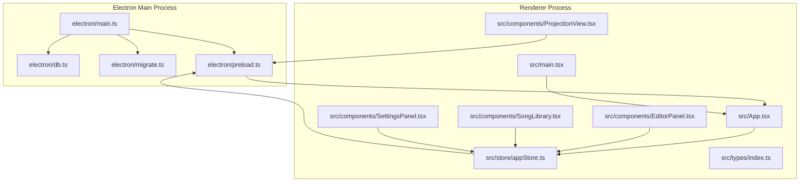
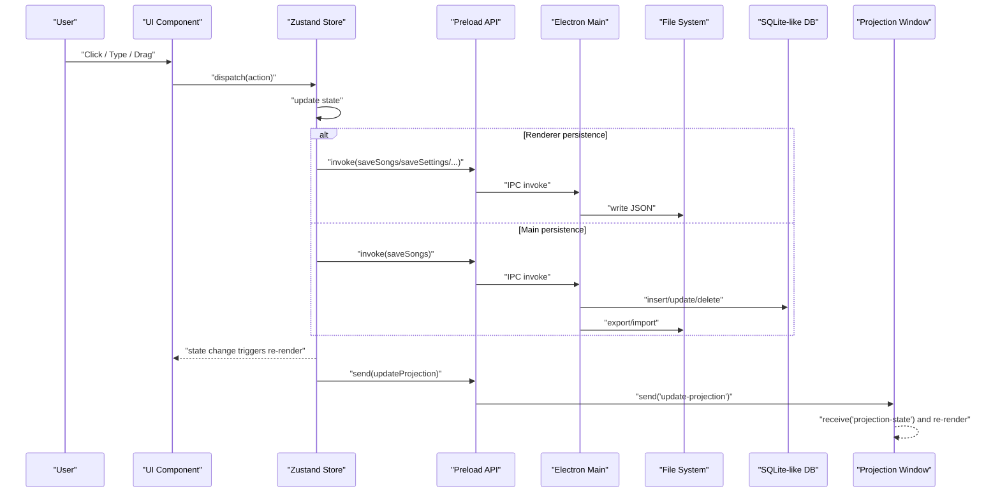
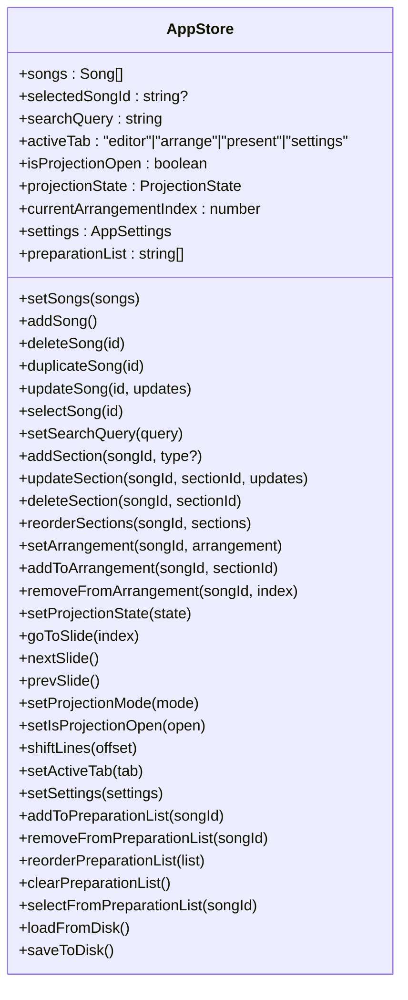
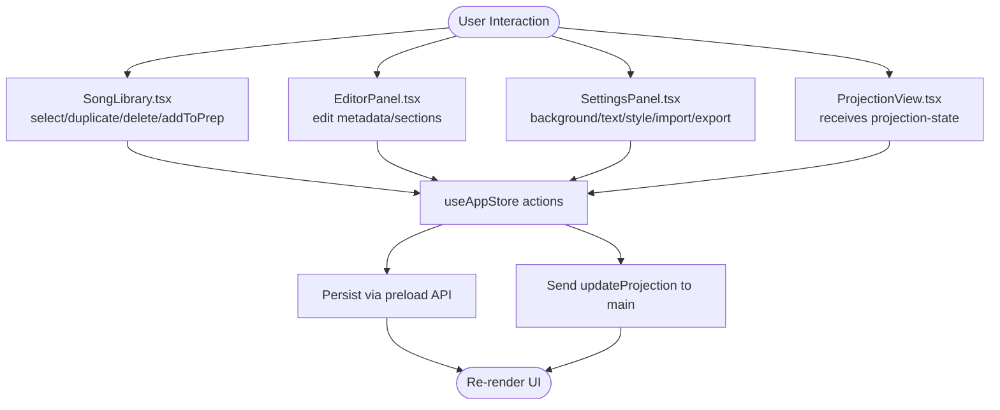
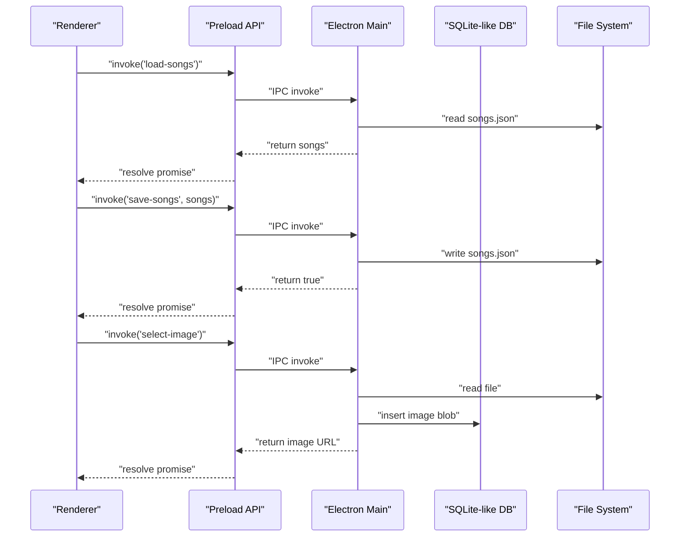
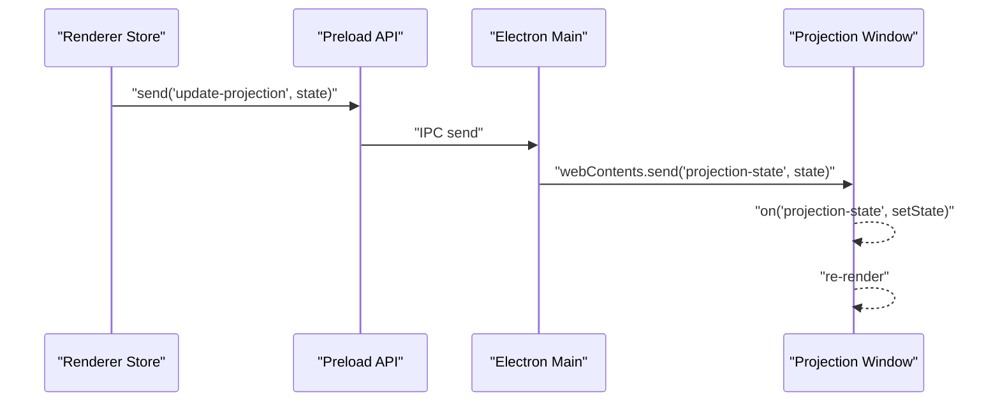
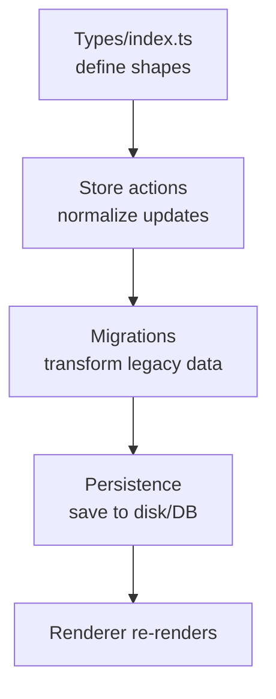
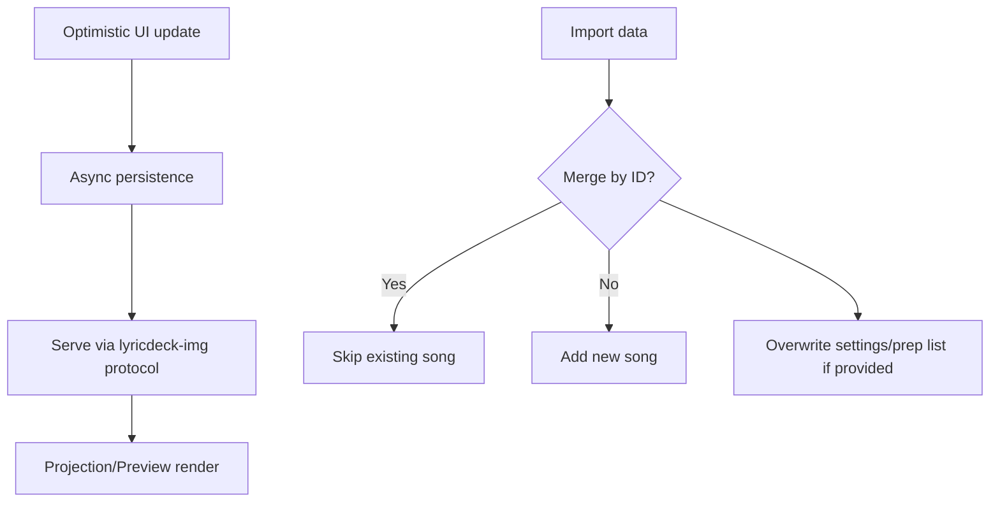
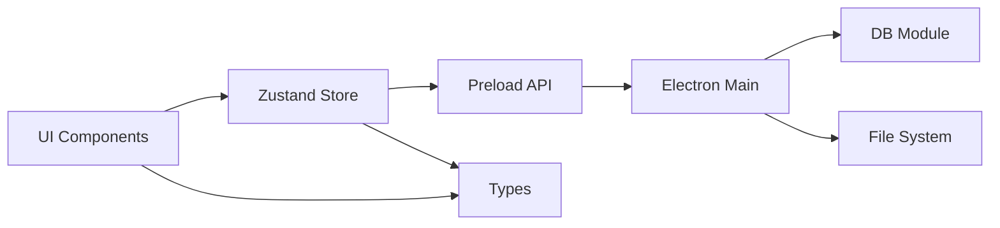

# Data Flow Architecture

<cite>
**Referenced Files in This Document**
- [README.md](file://README.md)
- [electron/main.ts](file://electron/main.ts)
- [electron/preload.ts](file://electron/preload.ts)
- [electron/db.ts](file://electron/db.ts)
- [electron/migrate.ts](file://electron/migrate.ts)
- [src/main.tsx](file://src/main.tsx)
- [src/App.tsx](file://src/App.tsx)
- [src/store/appStore.ts](file://src/store/appStore.ts)
- [src/types/index.ts](file://src/types/index.ts)
- [src/components/EditorPanel.tsx](file://src/components/EditorPanel.tsx)
- [src/components/SongLibrary.tsx](file://src/components/SongLibrary.tsx)
- [src/components/SettingsPanel.tsx](file://src/components/SettingsPanel.tsx)
- [src/components/ProjectionView.tsx](file://src/components/ProjectionView.tsx)
</cite>

## Table of Contents
1. [Introduction](#introduction)
2. [Project Structure](#project-structure)
3. [Core Components](#core-components)
4. [Architecture Overview](#architecture-overview)
5. [Detailed Component Analysis](#detailed-component-analysis)
6. [Dependency Analysis](#dependency-analysis)
7. [Performance Considerations](#performance-considerations)
8. [Troubleshooting Guide](#troubleshooting-guide)
9. [Conclusion](#conclusion)

## Introduction
This document explains LyricDeck’s reactive data flow architecture. It traces how user interactions propagate through UI components, update the central state, persist data to disk and/or a local database, and trigger UI re-renders. It also documents the unidirectional data flow pattern, async operations (file I/O, database queries, IPC), state synchronization between main and renderer processes, validation and normalization, caching strategies, optimistic updates, conflict resolution, and performance considerations such as debouncing and efficient re-rendering.

## Project Structure
LyricDeck is an Electron + React application with a clear separation of concerns:
- Electron main process manages windows, IPC, file system, and a local SQLite-like database.
- Renderer process renders UI with React and manages state with Zustand.
- Preload script exposes a controlled API surface to the renderer via contextBridge.
- Types define shared data models across processes.

**Diagram sources**
- [electron/main.ts:1-390](file://electron/main.ts#L1-L390)
- [electron/db.ts:1-214](file://electron/db.ts#L1-L214)
- [electron/migrate.ts:1-127](file://electron/migrate.ts#L1-L127)
- [electron/preload.ts:1-43](file://electron/preload.ts#L1-L43)
- [src/main.tsx:1-11](file://src/main.tsx#L1-L11)
- [src/App.tsx:1-102](file://src/App.tsx#L1-L102)
- [src/store/appStore.ts:1-385](file://src/store/appStore.ts#L1-L385)
- [src/types/index.ts:1-89](file://src/types/index.ts#L1-L89)
- [src/components/EditorPanel.tsx:1-264](file://src/components/EditorPanel.tsx#L1-L264)
- [src/components/SongLibrary.tsx:1-193](file://src/components/SongLibrary.tsx#L1-L193)
- [src/components/SettingsPanel.tsx:1-523](file://src/components/SettingsPanel.tsx#L1-L523)
- [src/components/ProjectionView.tsx:1-134](file://src/components/ProjectionView.tsx#L1-L134)

**Section sources**
- [README.md:116-146](file://README.md#L116-L146)

## Core Components
- State container: Zustand store encapsulates all application state and actions. It orchestrates persistence and projection updates.
- UI components: React components subscribe to the store and dispatch actions on user interactions.
- Electron main: Provides IPC handlers for file operations, settings, projection control, and image repository management. Manages a local database and migration logic.
- Preload bridge: Exposes a typed API surface to renderer code, enabling safe IPC calls.

Key responsibilities:
- Unidirectional data flow: user interactions -> actions -> state updates -> persistence -> UI re-render.
- Async operations: file reads/writes, database queries, IPC invocations.
- Synchronization: renderer state updates are mirrored to the projection window via IPC.
- Validation and normalization: types define shapes; actions normalize updates; migrations normalize legacy data.

**Section sources**
- [src/store/appStore.ts:31-96](file://src/store/appStore.ts#L31-L96)
- [src/types/index.ts:3-89](file://src/types/index.ts#L3-L89)
- [electron/main.ts:154-354](file://electron/main.ts#L154-L354)
- [electron/preload.ts:3-42](file://electron/preload.ts#L3-L42)

## Architecture Overview
The system follows a unidirectional data flow:
1. User interacts with a UI component.
2. The component invokes a store action.
3. The action updates the state atomically.
4. Side effects persist data (renderer to disk via IPC, or main process to file system/SQLite).
5. Renderer components re-render based on state changes.
6. Projection window receives state updates via IPC and re-renders.

**Diagram sources**
- [src/store/appStore.ts:361-384](file://src/store/appStore.ts#L361-L384)
- [electron/preload.ts:23-42](file://electron/preload.ts#L23-L42)
- [electron/main.ts:192-218](file://electron/main.ts#L192-L218)
- [electron/main.ts:220-354](file://electron/main.ts#L220-L354)
- [src/components/ProjectionView.tsx:22-29](file://src/components/ProjectionView.tsx#L22-L29)

## Detailed Component Analysis

### State Container and Unidirectional Flow
The Zustand store defines the entire state shape and actions. It:
- Normalizes updates (e.g., deep merges for nested settings).
- Persists immediately after mutations (e.g., saving songs after add/duplicate/update/delete).
- Synchronizes projection state to the projection window via IPC.
- Provides derived computations (e.g., arrangement selection for live mode).

**Diagram sources**
- [src/store/appStore.ts:31-96](file://src/store/appStore.ts#L31-L96)

**Section sources**
- [src/store/appStore.ts:98-384](file://src/store/appStore.ts#L98-L384)

### UI Components and Event Handling
- SongLibrary: Filters and sorts songs, handles selection, duplication, deletion, and preparation list operations.
- EditorPanel: Edits song metadata and sections; previews slides; adds new sections.
- SettingsPanel: Manages background/text styles, language, and import/export.
- ProjectionView: Receives projection state via IPC and renders the live projection.

**Diagram sources**
- [src/components/SongLibrary.tsx:8-95](file://src/components/SongLibrary.tsx#L8-L95)
- [src/components/EditorPanel.tsx:17-118](file://src/components/EditorPanel.tsx#L17-L118)
- [src/components/SettingsPanel.tsx:7-523](file://src/components/SettingsPanel.tsx#L7-L523)
- [src/components/ProjectionView.tsx:4-29](file://src/components/ProjectionView.tsx#L4-L29)
- [src/store/appStore.ts:361-384](file://src/store/appStore.ts#L361-L384)

**Section sources**
- [src/components/SongLibrary.tsx:8-193](file://src/components/SongLibrary.tsx#L8-L193)
- [src/components/EditorPanel.tsx:17-264](file://src/components/EditorPanel.tsx#L17-L264)
- [src/components/SettingsPanel.tsx:7-523](file://src/components/SettingsPanel.tsx#L7-L523)
- [src/components/ProjectionView.tsx:4-134](file://src/components/ProjectionView.tsx#L4-L134)

### Electron Main Process: IPC, Persistence, and Database
The main process:
- Registers IPC handlers for loading/saving songs/settings/preparation lists.
- Manages projection windows and synchronizes state via IPC.
- Implements image repository using a local SQLite-like database and a custom protocol to serve images.
- Runs migrations to upgrade legacy data formats.

**Diagram sources**
- [electron/main.ts:192-218](file://electron/main.ts#L192-L218)
- [electron/main.ts:220-264](file://electron/main.ts#L220-L264)
- [electron/db.ts:70-87](file://electron/db.ts#L70-L87)
- [electron/preload.ts:23-42](file://electron/preload.ts#L23-L42)

**Section sources**
- [electron/main.ts:154-354](file://electron/main.ts#L154-L354)
- [electron/db.ts:1-214](file://electron/db.ts#L1-L214)
- [electron/migrate.ts:8-126](file://electron/migrate.ts#L8-L126)

### Projection Synchronization
Projection state flows from the renderer store to the main process and back to the projection window:
- Renderer store sends updates via IPC.
- Main process forwards state to the projection window.
- Projection window listens for state updates and re-renders.

**Diagram sources**
- [src/store/appStore.ts:242-249](file://src/store/appStore.ts#L242-L249)
- [electron/preload.ts:10-21](file://electron/preload.ts#L10-L21)
- [electron/main.ts:186-190](file://electron/main.ts#L186-L190)
- [src/components/ProjectionView.tsx:22-29](file://src/components/ProjectionView.tsx#L22-L29)

**Section sources**
- [src/store/appStore.ts:241-292](file://src/store/appStore.ts#L241-L292)
- [electron/preload.ts:10-21](file://electron/preload.ts#L10-L21)
- [electron/main.ts:186-190](file://electron/main.ts#L186-L190)
- [src/components/ProjectionView.tsx:4-134](file://src/components/ProjectionView.tsx#L4-L134)

### Data Validation, Transformation, and Normalization
- Types define strict shapes for songs, sections, projection state, and settings.
- Store actions normalize updates (e.g., deep merges for nested objects).
- Migration logic transforms legacy file paths to new image URLs and updates references in songs and settings.
- UI components validate inputs (e.g., numeric ranges) and pass normalized values to store actions.

**Diagram sources**
- [src/types/index.ts:3-89](file://src/types/index.ts#L3-L89)
- [src/store/appStore.ts:114-180](file://src/store/appStore.ts#L114-L180)
- [electron/migrate.ts:63-122](file://electron/migrate.ts#L63-L122)

**Section sources**
- [src/types/index.ts:3-89](file://src/types/index.ts#L3-L89)
- [src/store/appStore.ts:114-180](file://src/store/appStore.ts#L114-L180)
- [electron/migrate.ts:8-126](file://electron/migrate.ts#L8-L126)

### Caching Strategies, Optimistic Updates, and Conflict Resolution
- Image caching: Images are stored as blobs in the database and served via a custom protocol with cache headers. This avoids repeated file I/O and enables efficient rendering.
- Optimistic updates: UI reflects immediate changes (e.g., adding a song, updating section text) while persistence happens asynchronously.
- Conflict resolution: During import, songs are merged by ID to avoid duplicates; settings and preparation lists are overwritten if present in the import file.

**Diagram sources**
- [electron/main.ts:361-374](file://electron/main.ts#L361-L374)
- [electron/main.ts:292-354](file://electron/main.ts#L292-L354)
- [src/store/appStore.ts:116-142](file://src/store/appStore.ts#L116-L142)

**Section sources**
- [electron/main.ts:220-264](file://electron/main.ts#L220-L264)
- [electron/main.ts:292-354](file://electron/main.ts#L292-L354)
- [src/store/appStore.ts:116-142](file://src/store/appStore.ts#L116-L142)

## Dependency Analysis
- Renderer depends on Zustand store and preloaded API.
- Preload API bridges renderer and main process.
- Main process depends on file system and database modules.
- UI components depend on store actions and types.

**Diagram sources**
- [src/store/appStore.ts:1-385](file://src/store/appStore.ts#L1-L385)
- [electron/preload.ts:1-43](file://electron/preload.ts#L1-L43)
- [electron/main.ts:1-390](file://electron/main.ts#L1-L390)
- [electron/db.ts:1-214](file://electron/db.ts#L1-L214)
- [src/types/index.ts:1-89](file://src/types/index.ts#L1-L89)

**Section sources**
- [src/store/appStore.ts:1-385](file://src/store/appStore.ts#L1-L385)
- [electron/preload.ts:1-43](file://electron/preload.ts#L1-L43)
- [electron/main.ts:1-390](file://electron/main.ts#L1-L390)
- [electron/db.ts:1-214](file://electron/db.ts#L1-L214)
- [src/types/index.ts:1-89](file://src/types/index.ts#L1-L89)

## Performance Considerations
- Efficient re-rendering: Zustand provides granular updates; components subscribe to specific slices of state to minimize re-renders.
- Debouncing/throttling: Not explicitly implemented in the analyzed code; consider debouncing search queries and frequent updates (e.g., live text editing) to reduce unnecessary writes.
- Asynchronous persistence: Renderer persists immediately upon mutation; consider batching writes for bulk operations to reduce IO overhead.
- Projection updates: Frequent live updates are sent via IPC; ensure minimal payload sizes and avoid redundant state updates.
- Rendering optimizations: ProjectionView computes styles dynamically; memoize computed styles if heavy computations arise.

[No sources needed since this section provides general guidance]

## Troubleshooting Guide
Common issues and resolutions:
- Projection window does not receive updates:
  - Verify IPC registration and listeners in main and renderer.
  - Confirm the projection window is open and not destroyed.
- Import/Export errors:
  - Validate file format and presence of required fields.
  - Check for parse errors and invalid formats during import.
- Image not displaying:
  - Ensure the image URL is valid and the database contains the record.
  - Confirm the custom protocol handler is registered and serving the image.
- Data corruption:
  - Run migrations to convert legacy paths to new URLs.
  - Validate JSON files and retry operations if parsing fails.

**Section sources**
- [electron/main.ts:186-190](file://electron/main.ts#L186-L190)
- [electron/main.ts:292-354](file://electron/main.ts#L292-L354)
- [electron/migrate.ts:8-126](file://electron/migrate.ts#L8-L126)

## Conclusion
LyricDeck implements a clean, unidirectional reactive architecture:
- User interactions flow through UI components to the Zustand store.
- Actions update state, persist data via IPC, and synchronize the projection window.
- The main process manages file system and database operations, with migrations ensuring backward compatibility.
- Types, normalization, and migrations provide robust validation and transformation.
- Performance is achieved through immediate UI feedback, efficient rendering, and a custom protocol for image caching.