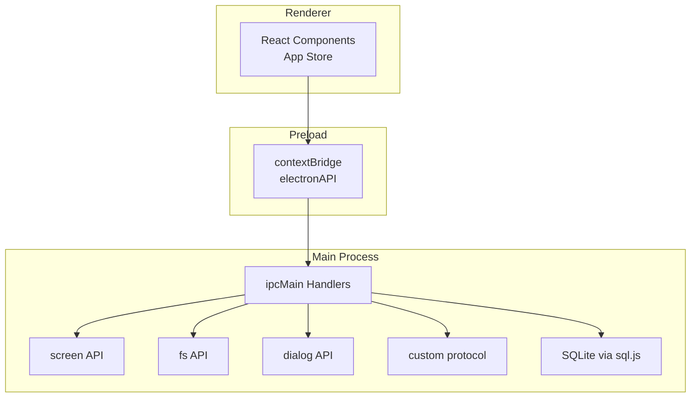
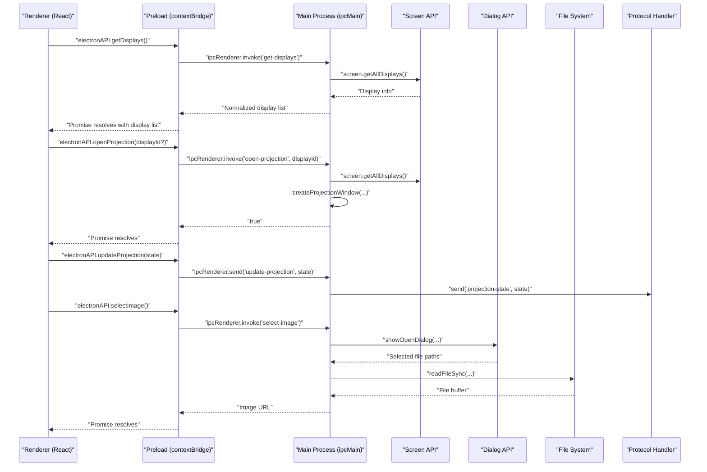
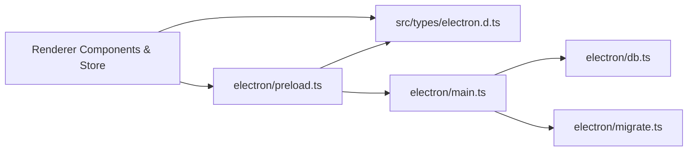

# Context Bridge Security Model

<cite>
**Referenced Files in This Document**
- [electron/preload.ts](file://electron/preload.ts)
- [electron/main.ts](file://electron/main.ts)
- [src/types/electron.d.ts](file://src/types/electron.d.ts)
- [src/store/appStore.ts](file://src/store/appStore.ts)
- [src/components/ProjectionView.tsx](file://src/components/ProjectionView.tsx)
- [src/components/SettingsPanel.tsx](file://src/components/SettingsPanel.tsx)
- [src/App.tsx](file://src/App.tsx)
- [src/components/BackgroundGallery.tsx](file://src/components/BackgroundGallery.tsx)
- [src/components/PresentPanel.tsx](file://src/components/PresentPanel.tsx)
- [electron/db.ts](file://electron/db.ts)
- [electron/migrate.ts](file://electron/migrate.ts)
- [vite.config.ts](file://vite.config.ts)
- [package.json](file://package.json)
</cite>

## Update Summary
**Changes Made**
- Enhanced defensive programming patterns with null checks for window.electronAPI throughout the application
- Added runtime safety checks to prevent errors when running outside Electron environment
- Updated renderer usage patterns to include conditional API access validation
- Improved error handling and graceful degradation for non-Electron contexts

## Table of Contents
1. [Introduction](#introduction)
2. [Project Structure](#project-structure)
3. [Core Components](#core-components)
4. [Architecture Overview](#architecture-overview)
5. [Detailed Component Analysis](#detailed-component-analysis)
6. [Defensive Programming Patterns](#defensive-programming-patterns)
7. [Dependency Analysis](#dependency-analysis)
8. [Performance Considerations](#performance-considerations)
9. [Troubleshooting Guide](#troubleshooting-guide)
10. [Conclusion](#conclusion)

## Introduction
This document explains LyricDeck's Electron contextBridge security model and how the preload script safely exposes a controlled API surface to renderer processes. It covers the exposed API for display management, projection control, data persistence, and file operations, along with the security mechanisms that prevent direct access to Node.js APIs from web content. The guide includes usage patterns, validation considerations, error handling, type safety enforcement, and best practices for extending the API securely.

**Updated** Enhanced with defensive programming patterns that include null checks for window.electronAPI to ensure robust operation outside Electron environments.

## Project Structure
The security model centers on three key areas:
- Preload script that exposes a typed API surface to the renderer
- Main process IPC handlers that implement sensitive operations
- Renderer components and stores that consume the API safely with defensive programming



**Diagram sources**
- [electron/preload.ts:1-43](file://electron/preload.ts#L1-L43)
- [electron/main.ts:154-354](file://electron/main.ts#L154-L354)
- [electron/db.ts:26-48](file://electron/db.ts#L26-L48)

**Section sources**
- [electron/preload.ts:1-43](file://electron/preload.ts#L1-L43)
- [electron/main.ts:81-152](file://electron/main.ts#L81-L152)
- [vite.config.ts:10-42](file://vite.config.ts#L10-L42)

## Core Components
- Preload API surface: A single object exposed via contextBridge that wraps IPC calls for display management, projection control, data persistence, file dialogs, background image repository, and import/export.
- Main process IPC handlers: Strict handlers that implement all sensitive operations, validate inputs, and sanitize outputs.
- Type definitions: Global type declarations that enforce compile-time type safety for the exposed API.
- Defensive programming: Null checks for window.electronAPI to ensure safe operation outside Electron environments.

Key API categories exposed to renderers:
- Display management: enumerate displays, open/close projection windows, detect projection state
- Projection control: send state updates, subscribe to state changes, listen for window closure
- Data persistence: load/save songs, settings, and preparation lists
- File operations: select images, manage background image repository, export/import data

**Section sources**
- [electron/preload.ts:3-42](file://electron/preload.ts#L3-L42)
- [src/types/electron.d.ts:3-32](file://src/types/electron.d.ts#L3-L32)

## Architecture Overview
The security architecture relies on context isolation and explicit IPC boundaries:



**Diagram sources**
- [electron/preload.ts:5-32](file://electron/preload.ts#L5-L32)
- [electron/main.ts:155-189](file://electron/main.ts#L155-L189)
- [electron/main.ts:221-235](file://electron/main.ts#L221-L235)

**Section sources**
- [electron/main.ts:89-93](file://electron/main.ts#L89-L93)
- [electron/main.ts:133-137](file://electron/main.ts#L133-L137)

## Detailed Component Analysis

### Preload Script (Security Boundary)
The preload script creates a single, typed API surface and delegates all sensitive operations to the main process via IPC. It does not expose Node.js APIs directly to renderers.

Security mechanisms:
- Uses contextBridge to expose only the electronAPI object
- Exposes only safe, normalized data types
- Uses ipcRenderer.invoke for request-response patterns and ipcRenderer.send for fire-and-forget events
- Returns cleanup functions for event listeners to prevent memory leaks

Exposed API surface:
- Display management: getDisplays, openProjection, closeProjection, isProjectionOpen
- Projection updates: updateProjection, onProjectionState, onProjectionWindowClosed
- Data persistence: loadSongs, saveSongs, loadSettings, saveSettings, loadPreparationList, savePreparationList
- File dialogs: selectImage
- Background image repository: addBackgroundImage, listBackgroundImages, deleteBackgroundImage
- Import/export: exportData, importData

Type safety:
- The global type declaration ensures compile-time verification of the API shape and parameter types in the renderer.

**Section sources**
- [electron/preload.ts:3-42](file://electron/preload.ts#L3-L42)
- [src/types/electron.d.ts:3-32](file://src/types/electron.d.ts#L3-L32)

### Main Process IPC Handlers (Secure Implementation)
The main process validates inputs, performs privileged operations, and sanitizes outputs. It also registers a custom protocol for serving images stored in SQLite.

Security controls:
- Context isolation enabled in both main and projection windows
- Node integration disabled in both windows
- Strict IPC handlers with minimal data exposure
- Custom protocol lyricdeck-img serves only known image IDs

Key handlers:
- Display enumeration and projection window creation
- Projection state synchronization via events
- Data persistence with file I/O
- File selection and image repository management
- Import/export with validation and merging strategies

**Section sources**
- [electron/main.ts:89-93](file://electron/main.ts#L89-L93)
- [electron/main.ts:133-137](file://electron/main.ts#L133-L137)
- [electron/main.ts:155-189](file://electron/main.ts#L155-L189)
- [electron/main.ts:193-218](file://electron/main.ts#L193-L218)
- [electron/main.ts:221-264](file://electron/main.ts#L221-L264)
- [electron/main.ts:267-354](file://electron/main.ts#L267-L354)

### Database and Migration Layer (Data Integrity)
The database layer stores images as BLOBs and metadata, enabling secure image serving via a custom protocol. Migration logic handles upgrades from legacy file-based storage to the new SQLite-based approach.

Security and correctness:
- Images are stored as BLOBs with MIME type metadata
- Custom protocol lyricdeck-img validates IDs and returns appropriate HTTP responses
- Migration preserves existing data and updates references safely

**Section sources**
- [electron/db.ts:50-68](file://electron/db.ts#L50-L68)
- [electron/db.ts:70-87](file://electron/db.ts#L70-L87)
- [electron/db.ts:106-131](file://electron/db.ts#L106-L131)
- [electron/db.ts:133-156](file://electron/db.ts#L133-L156)
- [electron/migrate.ts:8-126](file://electron/migrate.ts#L8-L126)

### Renderer Usage Patterns (Safe Consumption)
Renderer components and the app store consume the electronAPI safely with defensive programming patterns:
- Always check for window.electronAPI presence before invoking using null checks
- Use async/await for invoke-based calls
- Subscribe/unsubscribe event listeners properly with cleanup functions
- Persist data via save* methods after local updates
- Handle graceful degradation when API is unavailable

Examples of safe usage:
- ProjectionView subscribes to projection state updates with null check and returns cleanup function
- SettingsPanel uses selectImage and import/export APIs with proper error handling
- App store persists settings and preparation lists via electronAPI with conditional execution
- BackgroundGallery and PresentPanel components demonstrate consistent null-check patterns

**Section sources**
- [src/components/ProjectionView.tsx:22-29](file://src/components/ProjectionView.tsx#L22-L29)
- [src/components/SettingsPanel.tsx:47-54](file://src/components/SettingsPanel.tsx#L47-L54)
- [src/components/SettingsPanel.tsx:453-486](file://src/components/SettingsPanel.tsx#L453-L486)
- [src/store/appStore.ts:362-383](file://src/store/appStore.ts#L362-L383)
- [src/App.tsx:25-36](file://src/App.tsx#L25-L36)
- [src/components/BackgroundGallery.tsx:17-36](file://src/components/BackgroundGallery.tsx#L17-L36)
- [src/components/PresentPanel.tsx:27-117](file://src/components/PresentPanel.tsx#L27-L117)

### Security Mechanisms and Best Practices

- Context Isolation
  - Both main and projection windows enable contextIsolation and disable nodeIntegration, preventing direct Node.js access from renderer code.
  - Preload scripts remain the only bridge to privileged APIs.

- Minimal Exposure Principle
  - Only a focused API surface is exposed via contextBridge, avoiding broad Node.js or Electron API leakage.
  - IPC handlers encapsulate all sensitive operations.

- Type Safety Enforcement
  - Global type declarations ensure compile-time verification of API shapes and parameter types.
  - Renderer code benefits from strict typing for electronAPI usage.

- Input Validation and Sanitization
  - Main process handlers validate parameters (e.g., display IDs, file paths) and sanitize outputs.
  - Custom protocol lyricdeck-img validates image IDs and returns appropriate HTTP responses.

- Event Subscription Management
  - Preload returns cleanup functions for event listeners, preventing memory leaks and unintended subscriptions.

- Protocol Security
  - Custom protocol lyricdeck-img is registered as privileged and supports Fetch API.
  - Protocol handler validates IDs and returns 404 for missing resources.

- Error Handling
  - Renderer components wrap API calls in try/catch blocks and handle errors gracefully.
  - Import/export handlers return structured results indicating success or failure.

- **Defensive Programming Patterns**
  - Universal null checks using `if (window.electronAPI)` before API invocation
  - Graceful degradation when API is unavailable (non-Electron environments)
  - Cleanup functions returned by event subscriptions prevent memory leaks
  - Conditional execution prevents runtime errors during development or testing

**Section sources**
- [electron/main.ts:89-93](file://electron/main.ts#L89-L93)
- [electron/main.ts:133-137](file://electron/main.ts#L133-L137)
- [electron/main.ts:362-374](file://electron/main.ts#L362-L374)
- [src/types/electron.d.ts:3-32](file://src/types/electron.d.ts#L3-L32)
- [src/components/SettingsPanel.tsx:453-486](file://src/components/SettingsPanel.tsx#L453-L486)
- [src/store/appStore.ts:245-383](file://src/store/appStore.ts#L245-L383)

### Extension Guidelines (Maintaining Security)
When extending the API surface:
- Add new methods to preload.ts and declare them in the global type definition
- Implement corresponding ipcMain.handle or ipcRenderer.send handlers in main.ts
- Validate all inputs strictly and sanitize outputs
- Prefer invoke for request-response patterns and send for events
- Return cleanup functions for event subscriptions
- Use the custom protocol for serving binary resources
- Test error conditions and edge cases
- Keep context isolation and nodeIntegration disabled
- **Always implement null checks** for window.electronAPI in new components and stores
- **Follow defensive programming patterns** demonstrated in existing codebase

**Section sources**
- [electron/preload.ts:3-42](file://electron/preload.ts#L3-L42)
- [src/types/electron.d.ts:3-32](file://src/types/electron.d.ts#L3-L32)
- [electron/main.ts:155-189](file://electron/main.ts#L155-L189)

## Defensive Programming Patterns

### Null Check Implementation
The application now consistently implements null checks to ensure safe operation outside Electron environments:

```typescript
// Safe usage pattern - always check for API availability
if (window.electronAPI) {
  window.electronAPI.updateProjection(newState);
}

// Event subscription with cleanup
if (window.electronAPI) {
  const cleanup = window.electronAPI.onProjectionState((newState) => {
    setState(newState);
  });
  return cleanup; // Cleanup function prevents memory leaks
}
```

### Graceful Degradation
Components handle scenarios where electronAPI is unavailable:
- Non-Electron environments (development, testing)
- Browser-based previews or demos
- Edge cases where API initialization fails

### Consistent Pattern Across Components
All renderer components follow the same defensive programming approach:
- ProjectionView: Event subscription with null check
- App store: Conditional API calls for persistence
- Settings panel: File operations with null check
- Background gallery: Repository management with null check
- Present panel: Display management with null check

**Section sources**
- [src/store/appStore.ts:245-383](file://src/store/appStore.ts#L245-L383)
- [src/components/ProjectionView.tsx:22-29](file://src/components/ProjectionView.tsx#L22-L29)
- [src/App.tsx:25-36](file://src/App.tsx#L25-L36)
- [src/components/BackgroundGallery.tsx:17-36](file://src/components/BackgroundGallery.tsx#L17-L36)
- [src/components/PresentPanel.tsx:27-117](file://src/components/PresentPanel.tsx#L27-L117)

## Dependency Analysis
The security model depends on clear separation of concerns and explicit IPC boundaries.



**Diagram sources**
- [electron/preload.ts:1-43](file://electron/preload.ts#L1-L43)
- [electron/main.ts:1-6](file://electron/main.ts#L1-L6)
- [src/types/electron.d.ts:1-33](file://src/types/electron.d.ts#L1-L33)

**Section sources**
- [vite.config.ts:10-42](file://vite.config.ts#L10-L42)
- [package.json:5-11](file://package.json#L5-L11)

## Performance Considerations
- IPC overhead: Frequent projection updates should batch state changes to minimize IPC traffic.
- Image handling: Large images are stored as BLOBs; consider compression and lazy loading in the renderer.
- Database I/O: Persist operations write to disk; batch writes when possible to reduce I/O contention.
- Protocol serving: Custom protocol handles image requests efficiently; ensure appropriate caching headers.
- **Null check performance**: Defensive programming adds minimal overhead but prevents costly runtime errors.

## Troubleshooting Guide
Common issues and resolutions:
- electronAPI not available
  - Ensure context isolation is enabled and preload is correctly configured.
  - Verify that the preload script is built and loaded by the window.
  - **Check for null checks**: Ensure components use `if (window.electronAPI)` before calling methods.

- Projection window not opening
  - Check display ID resolution and fallback logic.
  - Confirm that the projection window is not already destroyed.
  - **Verify API availability**: Ensure electronAPI is present before attempting operations.

- Image selection returns null
  - Validate dialog cancellation and file path existence.
  - Ensure MIME type detection works for selected files.
  - **Handle graceful degradation**: Components should work without electronAPI for basic functionality.

- Import/export failures
  - Validate file format and parse errors.
  - Check that required fields exist in the import payload.
  - **Test in different environments**: Verify functionality works both in Electron and browser contexts.

- Memory leaks from event listeners
  - Always use returned cleanup functions to remove listeners.
  - Unsubscribe on component unmount or store teardown.
  - **Implement defensive patterns**: Ensure cleanup functions are called even when API is unavailable.

- **Runtime errors outside Electron**
  - **Root cause**: Missing null checks causing TypeError when window.electronAPI is undefined.
  - **Solution**: All API calls must be wrapped in null checks.
  - **Prevention**: Follow established patterns from ProjectionView and appStore.

**Section sources**
- [electron/main.ts:111-152](file://electron/main.ts#L111-L152)
- [electron/main.ts:221-235](file://electron/main.ts#L221-L235)
- [electron/main.ts:292-354](file://electron/main.ts#L292-L354)
- [src/components/ProjectionView.tsx:22-29](file://src/components/ProjectionView.tsx#L22-L29)
- [src/store/appStore.ts:245-383](file://src/store/appStore.ts#L245-L383)

## Conclusion
LyricDeck's contextBridge security model effectively isolates renderer processes from privileged Node.js and Electron APIs. By exposing a minimal, typed API surface and implementing strict IPC handlers, the application maintains strong security boundaries while providing powerful capabilities for display management, projection control, data persistence, and file operations.

**Updated** The enhanced defensive programming patterns with universal null checks for window.electronAPI ensure robust operation across all deployment environments, from Electron applications to browser-based previews. These patterns prevent runtime errors, enable graceful degradation, and maintain the security model's integrity while improving reliability and maintainability.

Following the documented patterns and extension guidelines ensures continued security and maintainability as the API evolves, with defensive programming becoming a fundamental part of the application's architecture.