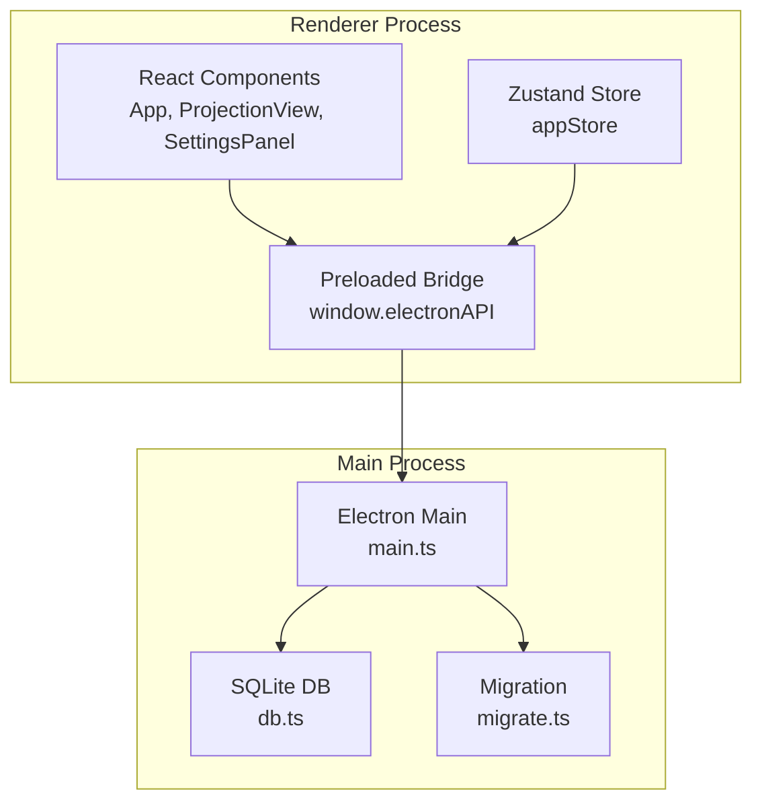
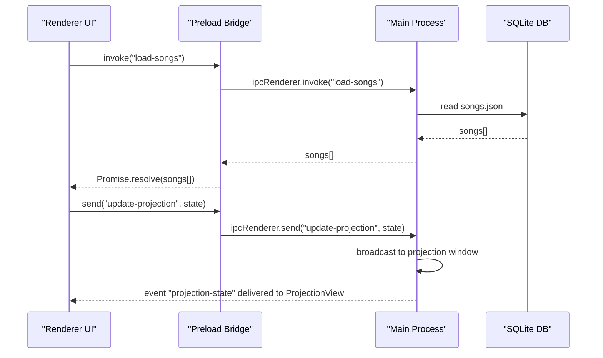
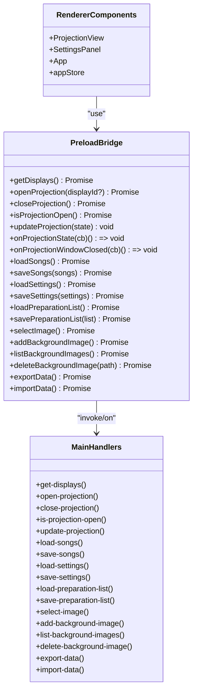
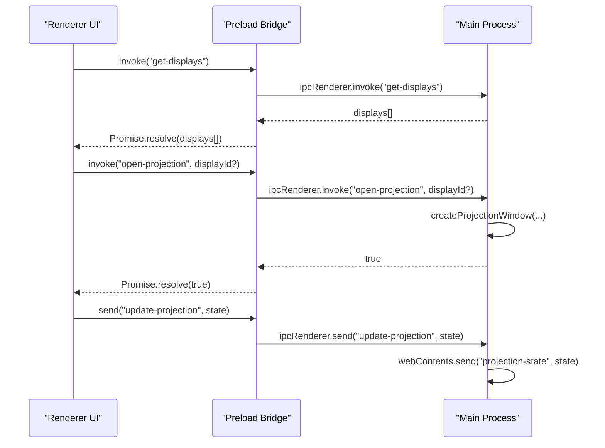
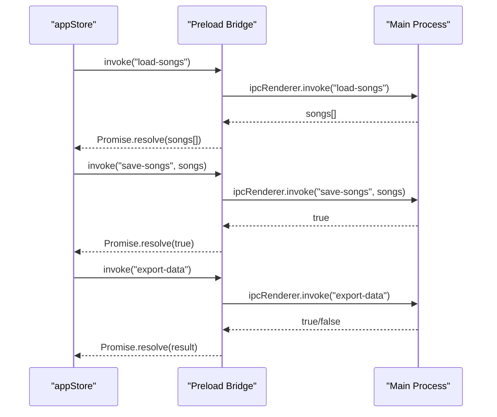
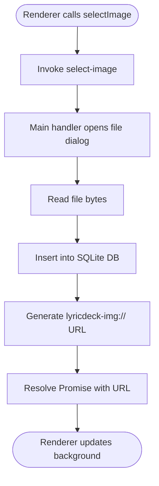
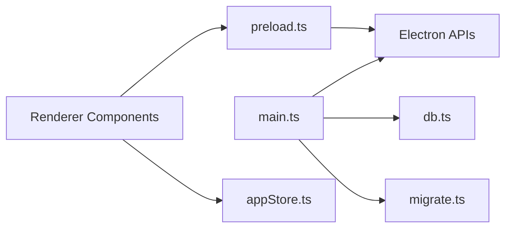

# IPC Communication Architecture

<cite>
**Referenced Files in This Document**
- [electron/preload.ts](file://electron/preload.ts)
- [electron/main.ts](file://electron/main.ts)
- [src/types/electron.d.ts](file://src/types/electron.d.ts)
- [src/store/appStore.ts](file://src/store/appStore.ts)
- [src/components/ProjectionView.tsx](file://src/components/ProjectionView.tsx)
- [src/components/SettingsPanel.tsx](file://src/components/SettingsPanel.tsx)
- [src/App.tsx](file://src/App.tsx)
- [electron/db.ts](file://electron/db.ts)
- [electron/migrate.ts](file://electron/migrate.ts)
- [package.json](file://package.json)
</cite>

## Table of Contents
1. [Introduction](#introduction)
2. [Project Structure](#project-structure)
3. [Core Components](#core-components)
4. [Architecture Overview](#architecture-overview)
5. [Detailed Component Analysis](#detailed-component-analysis)
6. [Dependency Analysis](#dependency-analysis)
7. [Performance Considerations](#performance-considerations)
8. [Troubleshooting Guide](#troubleshooting-guide)
9. [Conclusion](#conclusion)

## Introduction
This document explains LyricDeck’s Electron IPC communication architecture, focusing on how the main process and renderer process exchange data safely and efficiently. It covers the contextBridge implementation in the preload script, the exposed API surface, IPC method signatures, parameter validation, return value handling, and communication patterns for display management, file operations, and UI updates. Security considerations such as context isolation, type safety, and API surface minimization are emphasized, along with examples of bidirectional communication, event broadcasting, and error handling strategies.

## Project Structure
The IPC implementation spans three layers:
- Preload bridge exposing a controlled API to renderer processes
- Main process handlers implementing business logic and system integrations
- Renderer components using the exposed API for persistence, display control, and UI updates

**Diagram sources**
- [electron/preload.ts:1-43](file://electron/preload.ts#L1-L43)
- [electron/main.ts:1-390](file://electron/main.ts#L1-L390)
- [src/store/appStore.ts:1-385](file://src/store/appStore.ts#L1-L385)
- [src/components/ProjectionView.tsx:1-134](file://src/components/ProjectionView.tsx#L1-L134)
- [src/components/SettingsPanel.tsx:1-523](file://src/components/SettingsPanel.tsx#L1-L523)
- [electron/db.ts:1-214](file://electron/db.ts#L1-L214)
- [electron/migrate.ts:1-127](file://electron/migrate.ts#L1-L127)

**Section sources**
- [electron/preload.ts:1-43](file://electron/preload.ts#L1-L43)
- [electron/main.ts:1-390](file://electron/main.ts#L1-L390)
- [src/store/appStore.ts:1-385](file://src/store/appStore.ts#L1-L385)
- [src/components/ProjectionView.tsx:1-134](file://src/components/ProjectionView.tsx#L1-L134)
- [src/components/SettingsPanel.tsx:1-523](file://src/components/SettingsPanel.tsx#L1-L523)
- [electron/db.ts:1-214](file://electron/db.ts#L1-L214)
- [electron/migrate.ts:1-127](file://electron/migrate.ts#L1-L127)

## Core Components
- Preload bridge: Exposes a typed API surface to renderer processes via contextBridge, wrapping ipcRenderer calls.
- Main process handlers: Implement IPC endpoints for display management, projection updates, data persistence, file dialogs, background image repository, and import/export.
- Renderer usage: Components and stores call the exposed API for persistence, projection control, and UI updates.

Key responsibilities:
- Safe exposure of Node/Electron capabilities to renderer without compromising security
- Type-safe contracts between renderer and main process
- Event-driven updates from main to renderer for projection state and window lifecycle
- Asynchronous operations for file I/O, database operations, and dialog interactions

**Section sources**
- [electron/preload.ts:3-42](file://electron/preload.ts#L3-L42)
- [electron/main.ts:154-354](file://electron/main.ts#L154-L354)
- [src/types/electron.d.ts:3-32](file://src/types/electron.d.ts#L3-L32)

## Architecture Overview
The IPC architecture follows a strict separation of concerns:
- Renderer invokes asynchronous methods via invoke for long-running tasks (disk I/O, dialogs, DB ops)
- Renderer subscribes to events via on for real-time updates (projection state, window closed)
- Main process responds to invoke handlers and emits events to connected windows

**Diagram sources**
- [electron/preload.ts:24-29](file://electron/preload.ts#L24-L29)
- [electron/preload.ts:11-21](file://electron/preload.ts#L11-L21)
- [electron/main.ts:186-190](file://electron/main.ts#L186-L190)
- [src/components/ProjectionView.tsx:22-29](file://src/components/ProjectionView.tsx#L22-L29)
- [electron/db.ts:39-51](file://electron/db.ts#L39-L51)

## Detailed Component Analysis

### Preload Bridge API Surface
The preload script defines a minimal, typed API surface exposed to renderer processes. It wraps ipcRenderer for invoke/send and registers listeners for events.

Exposed categories and methods:
- Display management
  - getDisplays(): Promise<Array<DisplayInfo>>
  - openProjection(displayId?: string): Promise<boolean>
  - closeProjection(): Promise<boolean>
  - isProjectionOpen(): Promise<boolean>
- Projection updates
  - updateProjection(state: any): void
  - onProjectionState(callback: (state: any) => void): () => void
  - onProjectionWindowClosed(callback: () => void): () => void
- Data persistence
  - loadSongs(): Promise<any[]>
  - saveSongs(songs: any[]): Promise<boolean>
  - loadSettings(): Promise<any>
  - saveSettings(settings: any): Promise<boolean>
  - loadPreparationList(): Promise<string[]>
  - savePreparationList(list: string[]): Promise<boolean>
- File dialogs
  - selectImage(): Promise<string | null>
- Background image repository
  - addBackgroundImage(): Promise<string[]>
  - listBackgroundImages(): Promise<string[]>
  - deleteBackgroundImage(imagePath: string): Promise<boolean>
- Import/Export
  - exportData(): Promise<boolean>
  - importData(): Promise<{ success: boolean; importedSongs?: number; importedBackgrounds?: number; error?: string }>

Type safety is enforced by a global declaration that mirrors the exposed API shape.

**Section sources**
- [electron/preload.ts:3-42](file://electron/preload.ts#L3-L42)
- [src/types/electron.d.ts:5-30](file://src/types/electron.d.ts#L5-L30)

### Main Process IPC Handlers
The main process registers handlers for each preload API endpoint. Handlers encapsulate:
- File system operations (songs.json, settings.json, preparation-list.json)
- Screen management and projection window creation
- Dialog-based file selection and saving
- SQLite-backed image storage and retrieval
- Import/export logic with version-aware data handling

Key handler groups:
- Display and projection
  - get-displays: returns display list with primary indicator
  - open-projection/close-projection/is-projection-open: manage projection window lifecycle
  - update-projection: forwards state to projection window
- Persistence
  - load/save songs/settings/preparation-list
- Images
  - select-image: opens file dialog and inserts image into DB
  - add-background-image: multi-select and batch insert
  - list-background-images/delete-background-image
- Import/Export
  - export-data: serializes current state to a file
  - import-data: merges songs, replaces settings/preparation-list, imports images

Error handling patterns:
- Dialog cancellations return null/false gracefully
- Import/export validates format and returns structured results
- Database operations are wrapped with persistence and error guards

**Section sources**
- [electron/main.ts:155-184](file://electron/main.ts#L155-L184)
- [electron/main.ts:186-190](file://electron/main.ts#L186-L190)
- [electron/main.ts:193-218](file://electron/main.ts#L193-L218)
- [electron/main.ts:221-264](file://electron/main.ts#L221-L264)
- [electron/main.ts:267-354](file://electron/main.ts#L267-L354)

### Renderer Usage Patterns
Renderer components and the Zustand store consume the preload API for:
- Loading initial data on startup
- Persisting settings and preparation list
- Updating projection state in real time
- Handling projection window lifecycle events
- Managing background images and import/export

Examples:
- ProjectionView subscribes to projection-state events and renders accordingly
- App listens for projection-window-closed to update local state
- SettingsPanel triggers file dialogs and import/export flows
- appStore coordinates persistence and projection updates

**Section sources**
- [src/components/ProjectionView.tsx:22-29](file://src/components/ProjectionView.tsx#L22-L29)
- [src/App.tsx:34-42](file://src/App.tsx#L34-L42)
- [src/components/SettingsPanel.tsx:47-54](file://src/components/SettingsPanel.tsx#L47-L54)
- [src/store/appStore.ts:242-249](file://src/store/appStore.ts#L242-L249)
- [src/store/appStore.ts:362-384](file://src/store/appStore.ts#L362-L384)

### Database and Migration Integration
The SQLite-backed image repository integrates with IPC:
- Images are stored as BLOBs with metadata
- A custom protocol serves images via lyricdeck-img:// URLs
- Migration converts legacy file paths to DB URLs and updates persisted references

This enables efficient image delivery and avoids filesystem coupling in the renderer.

**Section sources**
- [electron/db.ts:70-131](file://electron/db.ts#L70-L131)
- [electron/db.ts:133-176](file://electron/db.ts#L133-L176)
- [electron/main.ts:362-374](file://electron/main.ts#L362-L374)
- [electron/migrate.ts:8-126](file://electron/migrate.ts#L8-L126)

## Architecture Overview

**Diagram sources**
- [electron/preload.ts:3-42](file://electron/preload.ts#L3-L42)
- [electron/main.ts:154-354](file://electron/main.ts#L154-L354)
- [src/components/ProjectionView.tsx:1-134](file://src/components/ProjectionView.tsx#L1-L134)
- [src/components/SettingsPanel.tsx:1-523](file://src/components/SettingsPanel.tsx#L1-L523)
- [src/App.tsx:1-102](file://src/App.tsx#L1-L102)
- [src/store/appStore.ts:1-385](file://src/store/appStore.ts#L1-L385)

## Detailed Component Analysis

### Display Management and Projection Control
Bidirectional communication pattern:
- Renderer requests display info and projection control via invoke
- Main process creates/destroys projection windows and broadcasts state updates
- Renderer subscribes to projection-state events and reacts immediately

**Diagram sources**
- [electron/preload.ts:5-8](file://electron/preload.ts#L5-L8)
- [electron/preload.ts:6-7](file://electron/preload.ts#L6-L7)
- [electron/preload.ts:11](file://electron/preload.ts#L11)
- [electron/main.ts:155-184](file://electron/main.ts#L155-L184)
- [electron/main.ts:186-190](file://electron/main.ts#L186-L190)

**Section sources**
- [electron/preload.ts:4-21](file://electron/preload.ts#L4-L21)
- [electron/main.ts:111-152](file://electron/main.ts#L111-L152)
- [src/components/ProjectionView.tsx:22-29](file://src/components/ProjectionView.tsx#L22-L29)

### Data Persistence and Import/Export
Asynchronous operation handling:
- Renderer calls invoke for load/save operations
- Main process reads/writes JSON files and returns boolean success indicators
- Import/Export returns structured results indicating success and counts

**Diagram sources**
- [src/store/appStore.ts:362-384](file://src/store/appStore.ts#L362-L384)
- [electron/preload.ts:24-29](file://electron/preload.ts#L24-L29)
- [electron/main.ts:193-218](file://electron/main.ts#L193-L218)
- [electron/main.ts:267-290](file://electron/main.ts#L267-L290)

**Section sources**
- [src/store/appStore.ts:362-384](file://src/store/appStore.ts#L362-L384)
- [electron/main.ts:193-218](file://electron/main.ts#L193-L218)
- [electron/main.ts:267-290](file://electron/main.ts#L267-L290)

### Background Image Repository
Event-driven updates and protocol-based serving:
- Renderer adds/listens/deletes images via invoke
- Main process stores images in SQLite and serves via custom protocol
- Renderer receives image URLs and uses them directly in CSS/background-image

**Diagram sources**
- [electron/preload.ts:32-37](file://electron/preload.ts#L32-L37)
- [electron/main.ts:221-235](file://electron/main.ts#L221-L235)
- [electron/db.ts:70-87](file://electron/db.ts#L70-L87)
- [electron/main.ts:362-374](file://electron/main.ts#L362-L374)

**Section sources**
- [electron/preload.ts:32-37](file://electron/preload.ts#L32-L37)
- [electron/main.ts:221-235](file://electron/main.ts#L221-L235)
- [electron/db.ts:70-87](file://electron/db.ts#L70-L87)
- [electron/main.ts:362-374](file://electron/main.ts#L362-L374)

## Dependency Analysis
- Preload depends on Electron’s contextBridge and ipcRenderer
- Main process depends on Electron APIs (ipcMain, screen, dialog, protocol), file system, and SQLite
- Renderer depends on the typed API surface and uses it for persistence, projection, and UI updates
- Database module encapsulates SQLite operations and migration logic

**Diagram sources**
- [electron/preload.ts:1](file://electron/preload.ts#L1)
- [electron/main.ts:1-6](file://electron/main.ts#L1-L6)
- [electron/db.ts:1-5](file://electron/db.ts#L1-L5)
- [electron/migrate.ts:1-4](file://electron/migrate.ts#L1-L4)
- [src/store/appStore.ts:1](file://src/store/appStore.ts#L1)

**Section sources**
- [electron/preload.ts:1](file://electron/preload.ts#L1)
- [electron/main.ts:1-6](file://electron/main.ts#L1-L6)
- [electron/db.ts:1-5](file://electron/db.ts#L1-L5)
- [electron/migrate.ts:1-4](file://electron/migrate.ts#L1-L4)
- [src/store/appStore.ts:1](file://src/store/appStore.ts#L1)

## Performance Considerations
- Prefer invoke for operations that require a response (load/save, dialogs, DB ops) to avoid unnecessary event overhead
- Use send for frequent, fire-and-forget updates (projection state) to minimize latency
- Batch operations where possible (e.g., saving lists) to reduce IPC round-trips
- Leverage SQLite BLOB storage for images to avoid repeated file I/O and enable efficient caching via the custom protocol
- Avoid blocking the main thread during heavy operations; keep handlers responsive

## Troubleshooting Guide
Common issues and remedies:
- API not available in renderer
  - Cause: window.electronAPI missing or preload not loaded
  - Remedy: Ensure preload is configured in BrowserWindow webPreferences and contextIsolation is enabled
- Projection window does not receive updates
  - Cause: No subscription or projection window closed
  - Remedy: Subscribe to projection-state events and handle window-closed notifications
- Import/Export failures
  - Cause: Invalid file format or parse errors
  - Remedy: Validate input and handle structured error responses from import-data
- Image loading issues
  - Cause: Incorrect URL format or missing protocol handler
  - Remedy: Verify lyricdeck-img protocol registration and DB entries

Security and robustness tips:
- Keep API surface minimal; only expose necessary methods
- Validate and sanitize inputs in main handlers
- Use contextIsolation and disable nodeIntegration in BrowserWindow
- Gracefully handle cancellation and error states in renderer components

**Section sources**
- [electron/main.ts:89-94](file://electron/main.ts#L89-L94)
- [src/components/ProjectionView.tsx:22-29](file://src/components/ProjectionView.tsx#L22-L29)
- [electron/main.ts:292-354](file://electron/main.ts#L292-L354)
- [electron/main.ts:362-374](file://electron/main.ts#L362-L374)

## Conclusion
LyricDeck’s IPC architecture cleanly separates renderer and main responsibilities while maintaining a minimal, typed API surface. The preload bridge ensures security via context isolation and controlled exposure, while main process handlers encapsulate persistence, display management, and media operations. Renderer components leverage asynchronous IPC for reliable data access and real-time projection updates, with robust error handling and graceful fallbacks. This design balances usability, performance, and security across the application.