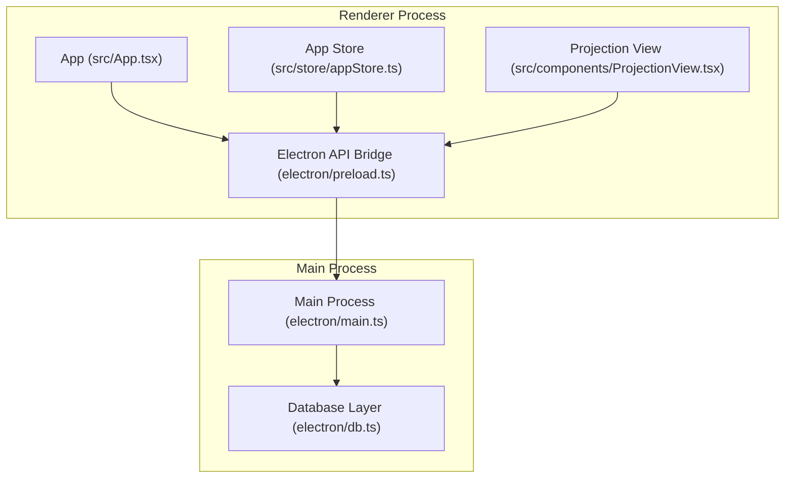
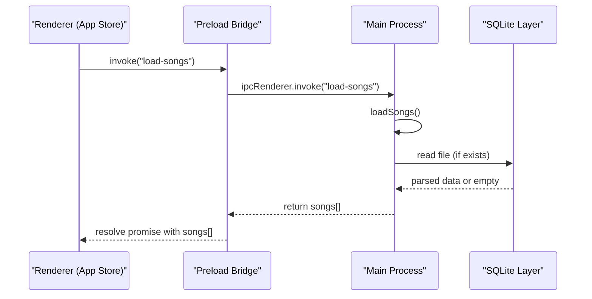
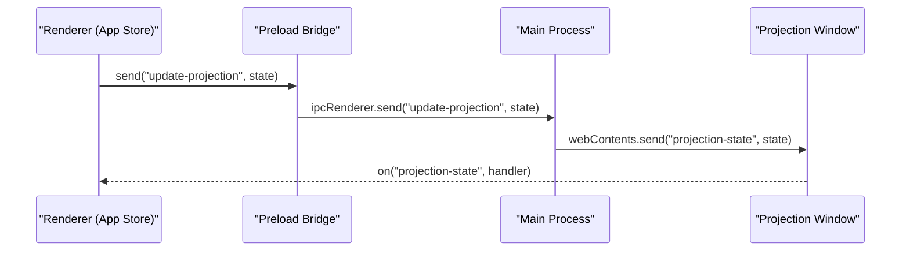
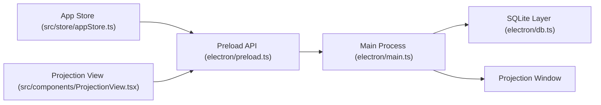

# Main Process IPC Handlers

<cite>
**Referenced Files in This Document**
- [electron/main.ts](file://electron/main.ts)
- [electron/preload.ts](file://electron/preload.ts)
- [electron/db.ts](file://electron/db.ts)
- [src/types/electron.d.ts](file://src/types/electron.d.ts)
- [src/store/appStore.ts](file://src/store/appStore.ts)
- [src/components/ProjectionView.tsx](file://src/components/ProjectionView.tsx)
- [src/App.tsx](file://src/App.tsx)
- [src/types/index.ts](file://src/types/index.ts)
</cite>

## Table of Contents
1. [Introduction](#introduction)
2. [Project Structure](#project-structure)
3. [Core Components](#core-components)
4. [Architecture Overview](#architecture-overview)
5. [Detailed Component Analysis](#detailed-component-analysis)
6. [Dependency Analysis](#dependency-analysis)
7. [Performance Considerations](#performance-considerations)
8. [Troubleshooting Guide](#troubleshooting-guide)
9. [Conclusion](#conclusion)

## Introduction
This document provides comprehensive documentation for LyricDeck’s main process Inter-Process Communication (IPC) handlers. It covers display management, projection state updates, data persistence, and file operations. The focus is on how handlers are registered, how parameters are processed, and how responses are formatted. It also explains synchronous and asynchronous patterns, error handling strategies, and event-driven communication between the renderer and main processes. Performance considerations and resource management in the main process are addressed to help developers optimize and troubleshoot the application.

## Project Structure
The IPC layer is implemented primarily in the Electron main process and exposed to the renderer via a preload bridge. The main process registers handlers for various channels, while the renderer invokes them through a typed API exposed in the preload script.

**Diagram sources**
- [electron/main.ts:154-354](file://electron/main.ts#L154-L354)
- [electron/preload.ts:1-43](file://electron/preload.ts#L1-L43)
- [electron/db.ts:1-214](file://electron/db.ts#L1-L214)
- [src/App.tsx:12-42](file://src/App.tsx#L12-L42)
- [src/store/appStore.ts:241-384](file://src/store/appStore.ts#L241-L384)
- [src/components/ProjectionView.tsx:22-29](file://src/components/ProjectionView.tsx#L22-L29)

**Section sources**
- [electron/main.ts:154-354](file://electron/main.ts#L154-L354)
- [electron/preload.ts:1-43](file://electron/preload.ts#L1-L43)
- [electron/db.ts:1-214](file://electron/db.ts#L1-L214)
- [src/App.tsx:12-42](file://src/App.tsx#L12-L42)
- [src/store/appStore.ts:241-384](file://src/store/appStore.ts#L241-L384)
- [src/components/ProjectionView.tsx:22-29](file://src/components/ProjectionView.tsx#L22-L29)

## Core Components
This section outlines the main categories of IPC handlers and their responsibilities:

- Display Management
  - Channel: get-displays
  - Purpose: Enumerate attached displays and identify the primary display.
  - Registration Pattern: ipcMain.handle
  - Parameter Processing: None
  - Response Formatting: Array of display descriptors with id, label, bounds, and isPrimary flag.

- Projection Control
  - Channels: open-projection, close-projection, is-projection-open
  - Purpose: Open/close a projection window on a specified display or default, and check its state.
  - Registration Pattern: ipcMain.handle
  - Parameter Processing: Optional display identifier for open-projection.
  - Response Formatting: Boolean success indicator.

- Projection State Updates
  - Channels: update-projection (renderer -> main), projection-state (main -> renderer)
  - Purpose: Push live projection state to the projection window and receive state updates.
  - Registration Pattern: ipcMain.on (update-projection), ipcRenderer.send (projection-state)
  - Parameter Processing: Receives a state object; sends it to the projection window.
  - Response Formatting: None (fire-and-forget send); renderer listens for projection-state events.

- Data Persistence
  - Channels: load-songs, save-songs, load-settings, save-settings, load-preparation-list, save-preparation-list
  - Purpose: Persist and restore application data to/from disk.
  - Registration Pattern: ipcMain.handle
  - Parameter Processing: save-* handlers accept payload arrays/objects; load-* handlers return stored data.
  - Response Formatting: Data arrays/objects for loads; boolean success for saves.

- File Operations and Image Repository
  - Channels: select-image, add-background-image, list-background-images, delete-background-image
  - Purpose: Manage image selection, gallery addition, listing, and deletion using SQLite BLOB storage.
  - Registration Pattern: ipcMain.handle
  - Parameter Processing: select-image opens a file dialog; add-background-image supports multi-selection.
  - Response Formatting: Image identifiers for inserts; arrays for listings; booleans for deletions.

- Import/Export
  - Channels: export-data, import-data
  - Purpose: Export application data to a file and import it back with version-aware logic.
  - Registration Pattern: ipcMain.handle
  - Parameter Processing: Uses native dialogs for file paths; parses JSON payloads.
  - Response Formatting: Boolean success for export; structured result for import including counts and errors.

**Section sources**
- [electron/main.ts:154-354](file://electron/main.ts#L154-L354)
- [electron/db.ts:70-131](file://electron/db.ts#L70-L131)
- [src/types/electron.d.ts:5-30](file://src/types/electron.d.ts#L5-L30)

## Architecture Overview
The IPC architecture follows a clear separation of concerns:
- Preload exposes a typed API to the renderer.
- Renderer invokes handlers via invoke/send.
- Main process handles requests, performs IO or state updates, and responds appropriately.
- Projection window receives state updates via events.

**Diagram sources**
- [electron/preload.ts:24-25](file://electron/preload.ts#L24-L25)
- [electron/main.ts:193-195](file://electron/main.ts#L193-L195)
- [electron/main.ts:39-46](file://electron/main.ts#L39-L46)

**Diagram sources**
- [electron/preload.ts:11-16](file://electron/preload.ts#L11-L16)
- [electron/main.ts:186-190](file://electron/main.ts#L186-L190)
- [src/components/ProjectionView.tsx:22-29](file://src/components/ProjectionView.tsx#L22-L29)

## Detailed Component Analysis

### Display Management Handlers
- Channel: get-displays
  - Registration: ipcMain.handle
  - Behavior: Queries Electron’s screen module for all displays and marks the primary display.
  - Output: Array of display descriptors including id, label, bounds, and isPrimary flag.
  - Typical Usage: UI lists displays for selecting a projection target.

- Channel: open-projection
  - Registration: ipcMain.handle
  - Behavior: Creates a new projection window on the specified display or default. Closes any existing projection window before opening a new one.
  - Input: Optional display identifier string.
  - Output: Boolean success.

- Channel: close-projection
  - Registration: ipcMain.handle
  - Behavior: Closes the current projection window and clears the reference.
  - Output: Boolean success.

- Channel: is-projection-open
  - Registration: ipcMain.handle
  - Behavior: Checks whether the projection window exists and is not destroyed.
  - Output: Boolean indicating open state.

Implementation highlights:
- Display enumeration uses Electron’s screen API.
- Projection window creation respects display bounds and sets fullscreen/frameless properties.
- Event-driven closure notification is sent to the main window.

**Section sources**
- [electron/main.ts:154-184](file://electron/main.ts#L154-L184)
- [electron/main.ts:111-152](file://electron/main.ts#L111-L152)

### Projection State Update Handlers
- Channel: update-projection (renderer -> main)
  - Registration: ipcMain.on
  - Behavior: Receives a state object and forwards it to the projection window via webContents.send.
  - Input: Arbitrary state object (ProjectionState).
  - Output: None.

- Channel: projection-state (main -> renderer)
  - Registration: ipcRenderer.on in preload
  - Behavior: Renderer listens for state updates and applies them to the projection view.
  - Input: State object from main process.
  - Output: None.

Renderer integration:
- App Store updates projection state and calls updateProjection.
- Projection View subscribes to onProjectionState to render live updates.

**Section sources**
- [electron/main.ts:186-190](file://electron/main.ts#L186-L190)
- [electron/preload.ts:11-16](file://electron/preload.ts#L11-L16)
- [src/store/appStore.ts:241-249](file://src/store/appStore.ts#L241-L249)
- [src/components/ProjectionView.tsx:22-29](file://src/components/ProjectionView.tsx#L22-L29)

### Data Persistence Handlers
- Channel: load-songs
  - Registration: ipcMain.handle
  - Behavior: Reads songs.json from the user data directory and parses JSON.
  - Output: Array of song objects or empty array.

- Channel: save-songs
  - Registration: ipcMain.handle
  - Behavior: Writes songs array to songs.json with pretty-print formatting.
  - Input: Array of songs.
  - Output: Boolean success.

- Channel: load-settings
  - Registration: ipcMain.handle
  - Behavior: Reads settings.json and returns parsed settings or null.
  - Output: Settings object or null.

- Channel: save-settings
  - Registration: ipcMain.handle
  - Behavior: Writes settings object to settings.json.
  - Input: Settings object.
  - Output: Boolean success.

- Channel: load-preparation-list
  - Registration: ipcMain.handle
  - Behavior: Reads preparation-list.json and returns array of song IDs.
  - Output: String array.

- Channel: save-preparation-list
  - Registration: ipcMain.handle
  - Behavior: Writes preparation list to preparation-list.json.
  - Input: String array of song IDs.
  - Output: Boolean success.

Renderer integration:
- App Store uses these handlers during initialization and on state changes requiring persistence.

**Section sources**
- [electron/main.ts:192-218](file://electron/main.ts#L192-L218)
- [electron/main.ts:39-79](file://electron/main.ts#L39-L79)
- [src/store/appStore.ts:361-384](file://src/store/appStore.ts#L361-L384)

### File Operations and Image Repository Handlers
- Channel: select-image
  - Registration: ipcMain.handle
  - Behavior: Opens a file dialog for a single image, reads bytes, determines MIME type, and stores image in SQLite via insertImage.
  - Input: None.
  - Output: Image URL string or null.

- Channel: add-background-image
  - Registration: ipcMain.handle
  - Behavior: Opens a multi-select file dialog, processes each image, and returns an array of inserted URLs.
  - Input: None.
  - Output: String array of image URLs.

- Channel: list-background-images
  - Registration: ipcMain.handle
  - Behavior: Lists all gallery images by returning their URLs.
  - Output: String array.

- Channel: delete-background-image
  - Registration: ipcMain.handle
  - Behavior: Parses the image ID from the URL, deletes the record from SQLite, and persists the database.
  - Input: Image URL string.
  - Output: Boolean success.

- Channel: export-data
  - Registration: ipcMain.handle
  - Behavior: Prompts for a destination path, collects songs, settings, preparation list, and images, writes a JSON export file, and returns success.
  - Input: None.
  - Output: Boolean success.

- Channel: import-data
  - Registration: ipcMain.handle
  - Behavior: Prompts for an import file, validates format, merges songs by ID, overwrites settings and preparation list if provided, imports images with version-aware logic, and returns structured results.
  - Input: None.
  - Output: Object with success, counts, and optional error field.

Database integration:
- Images are stored as BLOBs with metadata (filename, MIME type, source, created timestamp).
- A custom protocol lyricdeck-img serves images by ID.

**Section sources**
- [electron/main.ts:220-290](file://electron/main.ts#L220-L290)
- [electron/db.ts:70-131](file://electron/db.ts#L70-L131)
- [electron/db.ts:133-176](file://electron/db.ts#L133-L176)
- [electron/db.ts:201-211](file://electron/db.ts#L201-L211)
- [electron/main.ts:361-374](file://electron/main.ts#L361-L374)

### Handler Registration Patterns and Parameter Processing
- Synchronous handlers (ipcMain.handle):
  - Used for operations that require a response immediately (e.g., get-displays, load-songs, save-settings).
  - Parameters are passed directly to the handler; responses are returned to the renderer.
  - Example registrations: get-displays, open-projection, close-projection, is-projection-open, load/save handlers, image handlers, export/import.

- Asynchronous handlers (ipcMain.handle with dialogs):
  - Used for operations involving native dialogs or file IO.
  - Example registrations: select-image, add-background-image, export-data, import-data.

- Event-driven handlers (ipcMain.on):
  - Used for streaming or push-style updates (e.g., update-projection).
  - The main process forwards events to the projection window; the renderer subscribes via preload.

Parameter processing:
- Optional parameters: displayId for open-projection.
- Payload parameters: songs array, settings object, preparation list array, image URLs.
- Validation: Dialog cancellations are handled gracefully; JSON parsing errors are caught and reported.

Response formatting:
- Arrays: get-displays, load-songs, list-background-images.
- Objects: load-settings, export/import results.
- Booleans: save-* handlers, delete-background-image, export-data, is-projection-open.

**Section sources**
- [electron/main.ts:154-354](file://electron/main.ts#L154-L354)
- [electron/preload.ts:1-43](file://electron/preload.ts#L1-L43)

### Error Handling Strategies
- File IO failures:
  - Missing files return defaults (empty arrays or null) for load operations.
  - Write operations return boolean success; callers should handle false outcomes.

- JSON parsing:
  - Import handler wraps parsing in try/catch and returns structured errors.

- Dialog cancellations:
  - select-image and add-background-image return null or empty arrays when canceled.

- Projection window lifecycle:
  - is-projection-open checks window existence and destruction state.
  - Closure emits a renderer event to reset UI state.

- Database operations:
  - insertImage and importImage handle duplicates and persist changes atomically.

**Section sources**
- [electron/main.ts:39-79](file://electron/main.ts#L39-L79)
- [electron/main.ts:292-354](file://electron/main.ts#L292-L354)
- [electron/main.ts:182-184](file://electron/main.ts#L182-L184)
- [electron/db.ts:70-87](file://electron/db.ts#L70-L87)
- [electron/db.ts:158-176](file://electron/db.ts#L158-L176)

### Event-Driven Communication Patterns
- Projection state subscription:
  - Renderer subscribes to onProjectionState via preload.
  - Main process pushes updates via update-projection.
  - Projection View renders live state changes.

- Projection window closed event:
  - Main process emits projection-window-closed when the projection window closes.
  - Renderer unsubscribes listeners and resets UI state.

- Display enumeration:
  - Renderer calls getDisplays to populate UI controls.

**Section sources**
- [electron/preload.ts:11-21](file://electron/preload.ts#L11-L21)
- [electron/main.ts:186-190](file://electron/main.ts#L186-L190)
- [electron/main.ts:148-151](file://electron/main.ts#L148-L151)
- [src/components/ProjectionView.tsx:22-29](file://src/components/ProjectionView.tsx#L22-L29)
- [src/App.tsx:34-42](file://src/App.tsx#L34-L42)

## Dependency Analysis
The main process depends on Electron APIs and the SQLite layer for persistence. The renderer depends on the preload bridge for IPC and on the store for state management.

**Diagram sources**
- [electron/preload.ts:1-43](file://electron/preload.ts#L1-L43)
- [electron/main.ts:154-354](file://electron/main.ts#L154-L354)
- [electron/db.ts:1-214](file://electron/db.ts#L1-L214)
- [src/store/appStore.ts:241-384](file://src/store/appStore.ts#L241-L384)
- [src/components/ProjectionView.tsx:22-29](file://src/components/ProjectionView.tsx#L22-L29)

**Section sources**
- [electron/main.ts:154-354](file://electron/main.ts#L154-L354)
- [electron/db.ts:1-214](file://electron/db.ts#L1-L214)
- [src/store/appStore.ts:241-384](file://src/store/appStore.ts#L241-L384)
- [src/components/ProjectionView.tsx:22-29](file://src/components/ProjectionView.tsx#L22-L29)

## Performance Considerations
- File IO
  - Songs and settings are serialized/deserialized on each load/save. Consider batching writes and debouncing frequent updates to reduce disk churn.

- Image Storage
  - Images are stored as BLOBs. Large images increase database size and memory usage. Consider compression or external storage for very large assets.

- SQLite Persistence
  - Database is persisted to disk after each write operation. This ensures durability but can be costly. Batch operations where possible.

- Projection Updates
  - Frequent state updates can cause heavy rendering. Debounce or throttle updates in the renderer store to minimize unnecessary re-renders.

- Window Lifecycle
  - Projection windows are created per display change. Reuse windows when possible to avoid repeated allocations.

- Protocol Serving
  - The custom protocol serves images directly from SQLite. Ensure efficient MIME type detection and caching headers.

**Section sources**
- [electron/main.ts:39-79](file://electron/main.ts#L39-L79)
- [electron/db.ts:19-41](file://electron/db.ts#L19-L41)
- [electron/db.ts:201-211](file://electron/db.ts#L201-L211)
- [electron/main.ts:361-374](file://electron/main.ts#L361-L374)

## Troubleshooting Guide
Common issues and resolutions:
- Projection window does not open
  - Verify displayId correctness and that a display exists. Check is-projection-open to confirm state.
  - Ensure the projection window is not destroyed before sending updates.

- State not updating in projection window
  - Confirm update-projection is invoked from the renderer store.
  - Ensure onProjectionState is subscribed in the projection view and that the channel name matches.

- Images not appearing
  - Verify image insertion returns a URL and that the custom protocol is registered.
  - Check MIME type detection and that the image exists in the database.

- Import/Export failures
  - Validate file format and presence of required fields.
  - Catch parse errors and handle invalid formats gracefully.

- Persistence errors
  - Check file permissions for the user data directory.
  - Ensure JSON files are valid and readable.

**Section sources**
- [electron/main.ts:182-190](file://electron/main.ts#L182-L190)
- [electron/main.ts:292-354](file://electron/main.ts#L292-L354)
- [electron/db.ts:70-87](file://electron/db.ts#L70-L87)
- [electron/main.ts:361-374](file://electron/main.ts#L361-L374)

## Conclusion
LyricDeck’s main process IPC handlers provide a robust foundation for display management, projection state synchronization, data persistence, and image repository operations. The design cleanly separates concerns between renderer, preload, and main process, enabling scalable and maintainable functionality. By following the documented patterns, developers can extend or modify handlers while preserving performance and reliability.