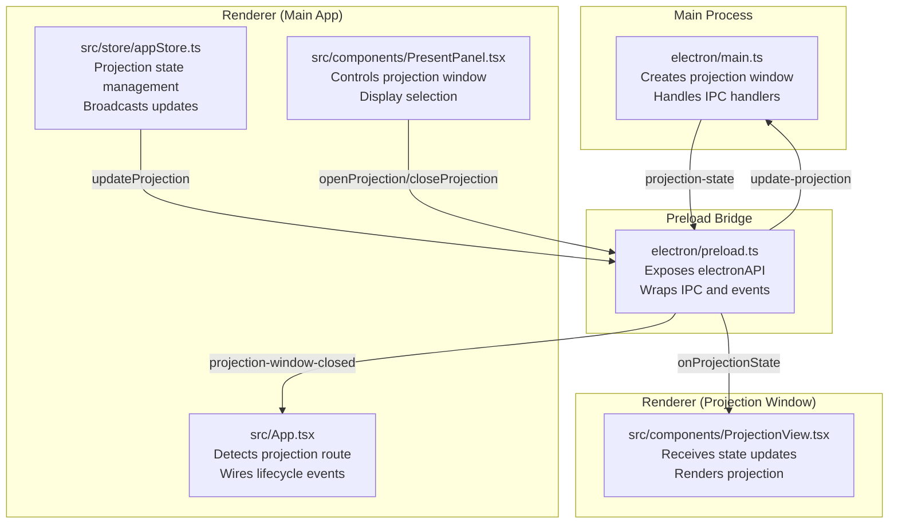
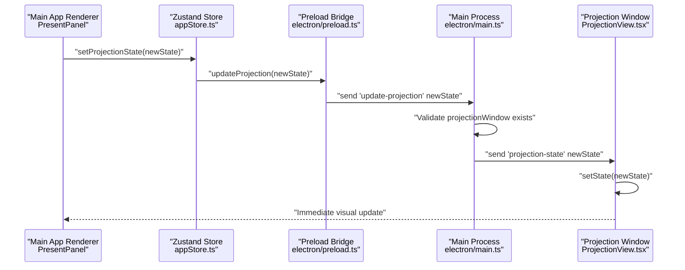
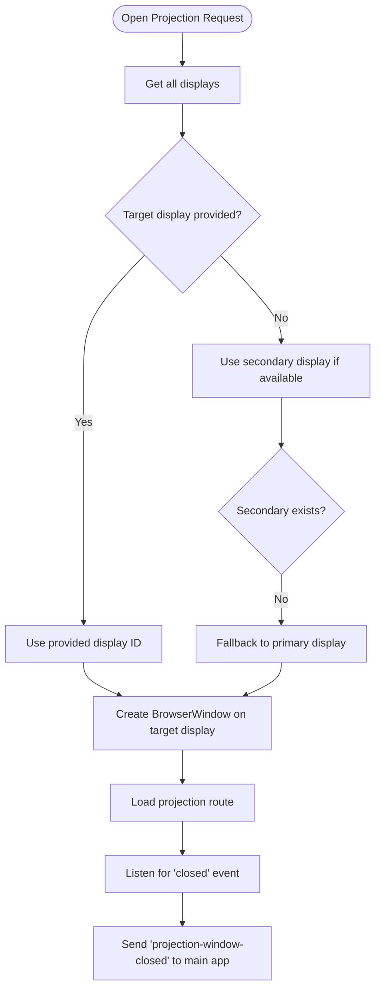
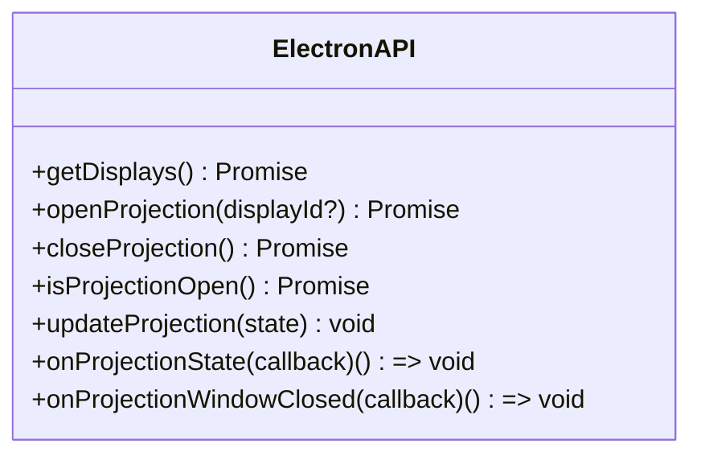
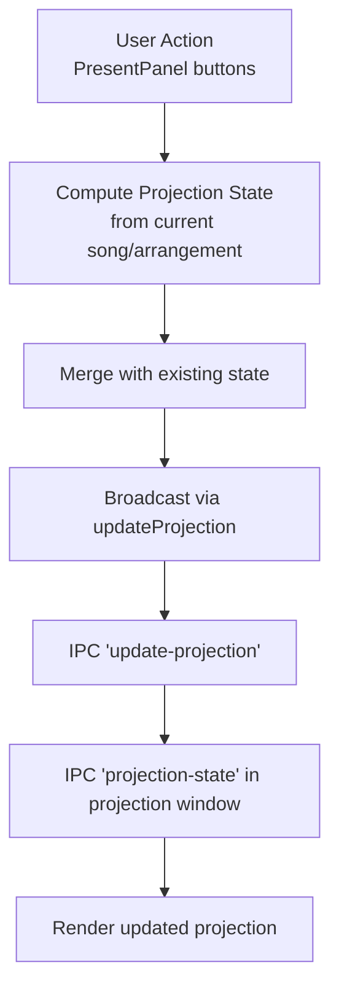
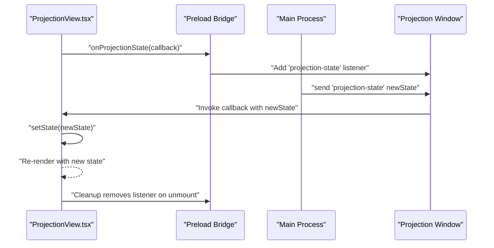
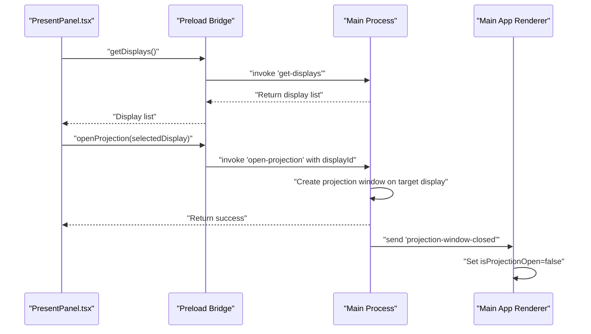
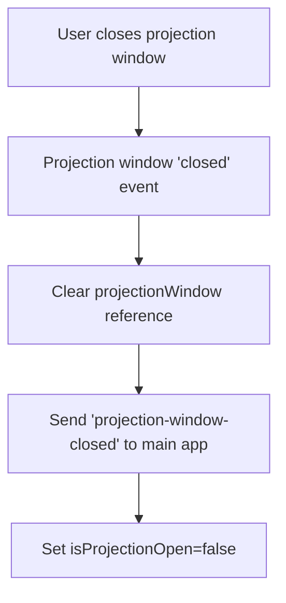
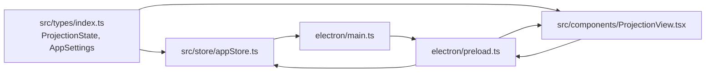

# Projection Window Communication

<cite>
**Referenced Files in This Document**
- [electron/main.ts](file://electron/main.ts)
- [electron/preload.ts](file://electron/preload.ts)
- [src/store/appStore.ts](file://src/store/appStore.ts)
- [src/components/ProjectionView.tsx](file://src/components/ProjectionView.tsx)
- [src/components/PresentPanel.tsx](file://src/components/PresentPanel.tsx)
- [src/App.tsx](file://src/App.tsx)
- [src/types/index.ts](file://src/types/index.ts)
- [src/types/electron.d.ts](file://src/types/electron.d.ts)
</cite>

## Table of Contents
1. [Introduction](#introduction)
2. [Project Structure](#project-structure)
3. [Core Components](#core-components)
4. [Architecture Overview](#architecture-overview)
5. [Detailed Component Analysis](#detailed-component-analysis)
6. [Dependency Analysis](#dependency-analysis)
7. [Performance Considerations](#performance-considerations)
8. [Troubleshooting Guide](#troubleshooting-guide)
9. [Conclusion](#conclusion)

## Introduction
This document explains LyricDeck's projection window inter-process communication (IPC) patterns. It covers bidirectional communication between the main process and the projection window, including state synchronization, display management, lifecycle events, and error recovery. It focuses on two key channels:
- update-projection: Real-time state broadcasts from the main application to the projection window
- projection-state: Real-time updates received by the projection window from the main process

The documentation also details event subscription patterns, callback management, cleanup procedures, multi-window coordination, display detection integration, and graceful shutdown handling.

## Project Structure
The projection window communication spans three layers:
- Main process (Electron): Creates and manages the projection BrowserWindow, exposes IPC handlers, and routes state updates
- Preload bridge: Exposes a typed API to the renderer, wrapping IPC calls and event subscriptions
- Renderer (React): Consumes the API to initialize the projection window, subscribe to state updates, and render projection content

**Diagram sources**
- [electron/main.ts:111-152](file://electron/main.ts#L111-L152)
- [electron/preload.ts:3-42](file://electron/preload.ts#L3-L42)
- [src/store/appStore.ts:241-249](file://src/store/appStore.ts#L241-L249)
- [src/components/ProjectionView.tsx:22-29](file://src/components/ProjectionView.tsx#L22-L29)
- [src/components/PresentPanel.tsx:109-129](file://src/components/PresentPanel.tsx#L109-L129)
- [src/App.tsx:34-42](file://src/App.tsx#L34-L42)

**Section sources**
- [electron/main.ts:111-152](file://electron/main.ts#L111-L152)
- [electron/preload.ts:3-42](file://electron/preload.ts#L3-L42)
- [src/store/appStore.ts:241-249](file://src/store/appStore.ts#L241-L249)
- [src/components/ProjectionView.tsx:22-29](file://src/components/ProjectionView.tsx#L22-L29)
- [src/components/PresentPanel.tsx:109-129](file://src/components/PresentPanel.tsx#L109-L129)
- [src/App.tsx:34-42](file://src/App.tsx#L34-L42)

## Core Components
- Main process projection window lifecycle:
  - Creation with display targeting and fullscreen configuration
  - Closed event emits a notification to the main app
- Preload electronAPI:
  - Provides typed methods for display management, projection control, and event subscriptions
  - Wraps IPC send/invoke and event listeners with cleanup functions
- Store-driven state broadcasting:
  - Projection state updates are merged and sent to the projection window
- Projection window renderer:
  - Subscribes to state updates and renders according to mode and styles

Key IPC channels:
- update-projection: Main app -> Projection window (send)
- projection-state: Projection window -> Main app (send) -> Projection window renderer (receive)
- projection-window-closed: Main app -> Main app renderer (notification)

**Section sources**
- [electron/main.ts:111-152](file://electron/main.ts#L111-L152)
- [electron/preload.ts:3-42](file://electron/preload.ts#L3-L42)
- [src/store/appStore.ts:241-249](file://src/store/appStore.ts#L241-L249)
- [src/components/ProjectionView.tsx:22-29](file://src/components/ProjectionView.tsx#L22-L29)

## Architecture Overview
The projection window architecture follows a publish-subscribe model:
- The main application maintains a single source of truth for projection state
- Changes are broadcast via update-projection to the projection window
- The projection window receives projection-state messages and re-renders immediately
- Lifecycle events (open/close) are coordinated through dedicated IPC channels

**Diagram sources**
- [src/store/appStore.ts:241-249](file://src/store/appStore.ts#L241-L249)
- [electron/preload.ts:11](file://electron/preload.ts#L11)
- [electron/main.ts:186-190](file://electron/main.ts#L186-L190)
- [src/components/ProjectionView.tsx:22-29](file://src/components/ProjectionView.tsx#L22-L29)

## Detailed Component Analysis

### Main Process: Projection Window Management
The main process creates the projection window on a chosen display and handles lifecycle events:
- Display selection: Uses provided display ID or falls back to secondary display or primary
- Fullscreen configuration: Frameless, always-on-top, skip-taskbar, black background
- Closed event: Notifies the main app renderer that the projection window closed

**Diagram sources**
- [electron/main.ts:111-152](file://electron/main.ts#L111-L152)

**Section sources**
- [electron/main.ts:111-152](file://electron/main.ts#L111-L152)

### Preload Bridge: Typed API and Event Subscription
The preload bridge exposes a typed electronAPI with:
- Display management: getDisplays, openProjection, closeProjection, isProjectionOpen
- Projection updates: updateProjection (send), onProjectionState (subscribe), onProjectionWindowClosed (subscribe)
- Cleanup: Each subscription returns a function to remove the listener

**Diagram sources**
- [electron/preload.ts:3-42](file://electron/preload.ts#L3-L42)
- [src/types/electron.d.ts:5-17](file://src/types/electron.d.ts#L5-L17)

**Section sources**
- [electron/preload.ts:3-42](file://electron/preload.ts#L3-L42)
- [src/types/electron.d.ts:5-17](file://src/types/electron.d.ts#L5-L17)

### Store: State Broadcasting and Multi-Window Coordination
The store coordinates projection state and broadcasts updates:
- setProjectionState merges partial state and sends to the projection window
- Navigation actions (goToSlide, nextSlide, prevSlide) compute and broadcast live projection state
- Mode toggles (blank, black, logo, clear) update state and broadcast
- Line shifting adjusts vertical positioning for smooth transitions

**Diagram sources**
- [src/store/appStore.ts:241-274](file://src/store/appStore.ts#L241-L274)
- [electron/main.ts:186-190](file://electron/main.ts#L186-L190)
- [src/components/ProjectionView.tsx:22-29](file://src/components/ProjectionView.tsx#L22-L29)

**Section sources**
- [src/store/appStore.ts:241-274](file://src/store/appStore.ts#L241-L274)
- [src/store/appStore.ts:276-302](file://src/store/appStore.ts#L276-L302)
- [src/store/appStore.ts:293-295](file://src/store/appStore.ts#L293-L295)

### Projection Window Renderer: Subscription and Rendering
The projection window renderer subscribes to state updates and renders content:
- Subscribes to projection-state updates on mount and cleans up on unmount
- Renders different modes (black, logo, live, blank, clear) based on state
- Applies background styles, text styles, and overlays
- Handles copyright display and line offset animations

**Diagram sources**
- [src/components/ProjectionView.tsx:22-29](file://src/components/ProjectionView.tsx#L22-L29)
- [electron/preload.ts:12-16](file://electron/preload.ts#L12-L16)
- [electron/main.ts:186-189](file://electron/main.ts#L186-L189)

**Section sources**
- [src/components/ProjectionView.tsx:22-29](file://src/components/ProjectionView.tsx#L22-L29)
- [src/components/ProjectionView.tsx:77-132](file://src/components/ProjectionView.tsx#L77-L132)

### Display Detection and Multi-Window Coordination
Display detection integrates with the projection workflow:
- PresentPanel loads available displays and selects a default target
- openProjection passes the selected display ID to the main process
- The main process targets the specified display or falls back to secondary/primary
- The main app renderer listens for projection-window-closed to update UI state

**Diagram sources**
- [src/components/PresentPanel.tsx:26-36](file://src/components/PresentPanel.tsx#L26-L36)
- [src/components/PresentPanel.tsx:109-114](file://src/components/PresentPanel.tsx#L109-L114)
- [electron/preload.ts:5-8](file://electron/preload.ts#L5-L8)
- [electron/main.ts:155-164](file://electron/main.ts#L155-L164)
- [electron/main.ts:166-172](file://electron/main.ts#L166-L172)
- [electron/main.ts:148-151](file://electron/main.ts#L148-L151)
- [src/App.tsx:34-42](file://src/App.tsx#L34-L42)

**Section sources**
- [src/components/PresentPanel.tsx:26-36](file://src/components/PresentPanel.tsx#L26-L36)
- [src/components/PresentPanel.tsx:109-114](file://src/components/PresentPanel.tsx#L109-L114)
- [electron/preload.ts:5-8](file://electron/preload.ts#L5-L8)
- [electron/main.ts:155-164](file://electron/main.ts#L155-L164)
- [electron/main.ts:166-172](file://electron/main.ts#L166-L172)
- [electron/main.ts:148-151](file://electron/main.ts#L148-L151)
- [src/App.tsx:34-42](file://src/App.tsx#L34-L42)

### Event Subscription Patterns and Cleanup
Subscription patterns ensure robust event handling:
- onProjectionState returns a cleanup function to remove the listener
- onProjectionWindowClosed similarly returns a cleanup function
- Unmounting the projection view removes listeners automatically
- The main process removes listeners when the projection window closes

Best practices:
- Always capture the cleanup function from onProjectionState and call it on unmount
- Use useEffect cleanup in components that subscribe to projection state
- Avoid memory leaks by removing listeners when components unmount

**Section sources**
- [electron/preload.ts:12-21](file://electron/preload.ts#L12-L21)
- [src/components/ProjectionView.tsx:22-29](file://src/components/ProjectionView.tsx#L22-L29)

### Graceful Shutdown Handling
Graceful shutdown ensures clean state and resource management:
- Closing the projection window triggers a closed event in the main process
- The main process notifies the main app renderer via projection-window-closed
- The main app renderer sets isProjectionOpen to false
- The main process clears the projectionWindow reference

**Diagram sources**
- [electron/main.ts:148-151](file://electron/main.ts#L148-L151)
- [src/App.tsx:34-42](file://src/App.tsx#L34-L42)

**Section sources**
- [electron/main.ts:148-151](file://electron/main.ts#L148-L151)
- [src/App.tsx:34-42](file://src/App.tsx#L34-L42)

## Dependency Analysis
The projection window communication depends on:
- Types define the ProjectionState contract used across layers
- Preload bridge depends on Electron APIs for IPC and event handling
- Store depends on preload bridge for IPC calls
- Projection view depends on preload bridge for event subscriptions

**Diagram sources**
- [src/types/index.ts:71-81](file://src/types/index.ts#L71-L81)
- [src/store/appStore.ts:241-249](file://src/store/appStore.ts#L241-L249)
- [src/components/ProjectionView.tsx:22-29](file://src/components/ProjectionView.tsx#L22-L29)
- [electron/preload.ts:3-42](file://electron/preload.ts#L3-L42)
- [electron/main.ts:186-190](file://electron/main.ts#L186-L190)

**Section sources**
- [src/types/index.ts:71-81](file://src/types/index.ts#L71-L81)
- [src/store/appStore.ts:241-249](file://src/store/appStore.ts#L241-L249)
- [src/components/ProjectionView.tsx:22-29](file://src/components/ProjectionView.tsx#L22-L29)
- [electron/preload.ts:3-42](file://electron/preload.ts#L3-L42)
- [electron/main.ts:186-190](file://electron/main.ts#L186-L190)

## Performance Considerations
- Minimize state churn: Batch small updates to reduce IPC traffic
- Debounce rapid UI interactions: Avoid flooding the projection window with frequent updates
- Efficient rendering: The projection view computes styles inline; keep state minimal and normalized
- Display targeting: Choose the correct display early to avoid re-layout costs
- Memory management: Always clean up event listeners to prevent leaks

## Troubleshooting Guide
Common issues and resolutions:
- Projection window does not open:
  - Verify display ID passed to openProjection is valid
  - Check that the main process creates the window without errors
- State not updating in projection window:
  - Confirm updateProjection is called from the store
  - Ensure onProjectionState is subscribed and not removed prematurely
- Projection window closes unexpectedly:
  - Check for closed event handling in the main process
  - Verify the main app renderer receives projection-window-closed
- Memory leaks:
  - Ensure cleanup functions from onProjectionState/onProjectionWindowClosed are called on unmount

**Section sources**
- [electron/main.ts:166-172](file://electron/main.ts#L166-L172)
- [electron/preload.ts:12-21](file://electron/preload.ts#L12-L21)
- [src/components/ProjectionView.tsx:22-29](file://src/components/ProjectionView.tsx#L22-L29)
- [electron/main.ts:148-151](file://electron/main.ts#L148-L151)
- [src/App.tsx:34-42](file://src/App.tsx#L34-L42)

## Conclusion
LyricDeck's projection window communication is built around a clean, typed IPC layer with robust event subscription and cleanup patterns. The main process manages projection lifecycle and state routing, while the preload bridge provides a safe, typed API to the renderer. The projection window renderer efficiently consumes state updates to deliver responsive, real-time projection displays. Proper cleanup and lifecycle handling ensure reliable operation across multi-window scenarios and various display configurations.