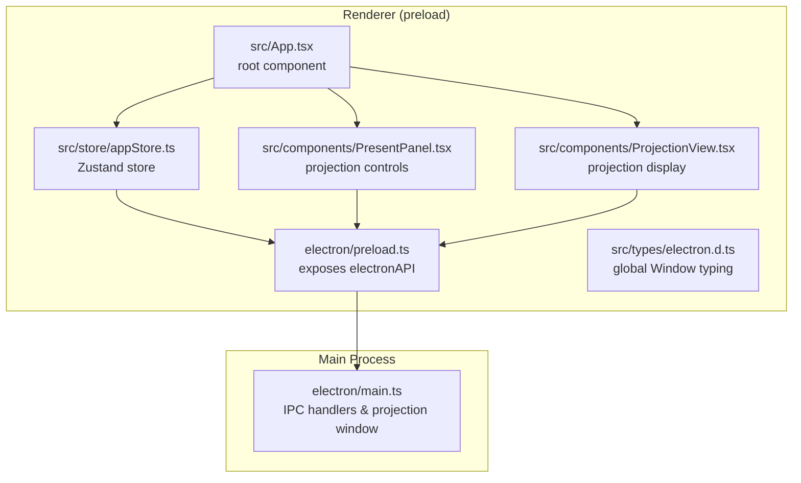
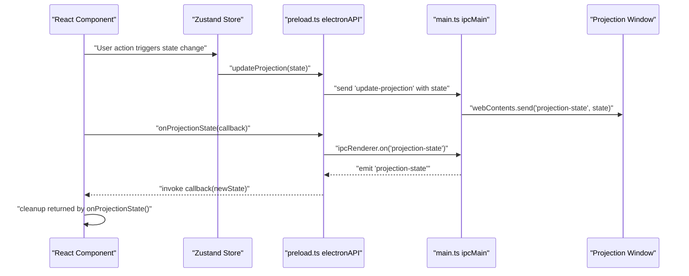
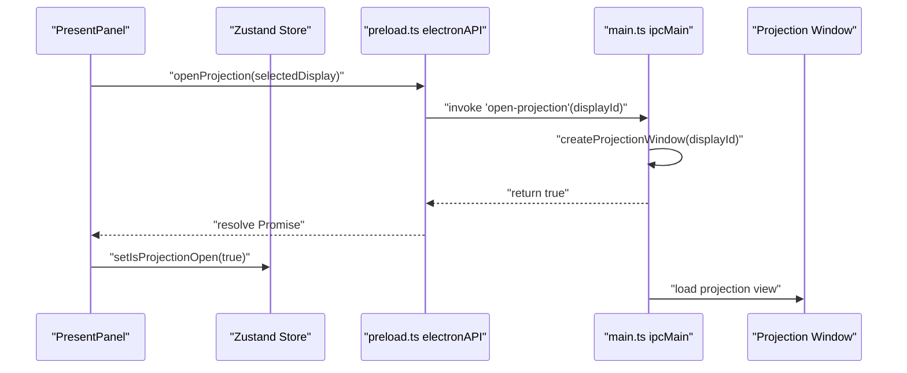
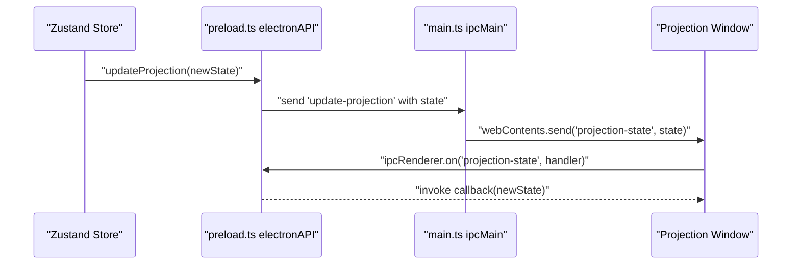
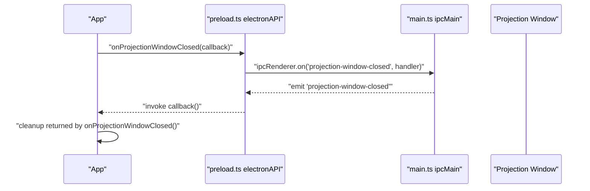
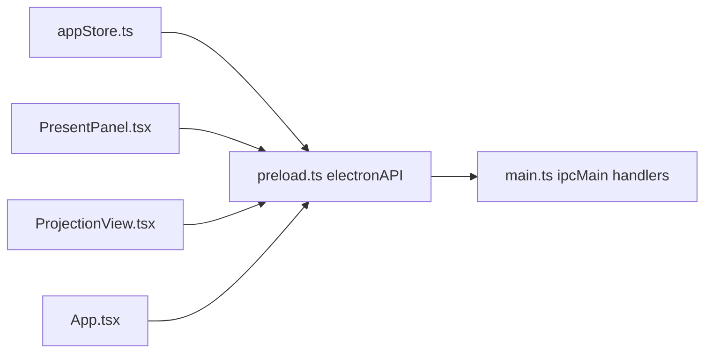

# Renderer Process IPC Client

<cite>
**Referenced Files in This Document**
- [electron/preload.ts](file://electron/preload.ts)
- [electron/main.ts](file://electron/main.ts)
- [src/types/electron.d.ts](file://src/types/electron.d.ts)
- [src/store/appStore.ts](file://src/store/appStore.ts)
- [src/App.tsx](file://src/App.tsx)
- [src/components/ProjectionView.tsx](file://src/components/ProjectionView.tsx)
- [src/components/PresentPanel.tsx](file://src/components/PresentPanel.tsx)
- [src/types/index.ts](file://src/types/index.ts)
</cite>

## Table of Contents
1. [Introduction](#introduction)
2. [Project Structure](#project-structure)
3. [Core Components](#core-components)
4. [Architecture Overview](#architecture-overview)
5. [Detailed Component Analysis](#detailed-component-analysis)
6. [Dependency Analysis](#dependency-analysis)
7. [Performance Considerations](#performance-considerations)
8. [Troubleshooting Guide](#troubleshooting-guide)
9. [Conclusion](#conclusion)

## Introduction
This document explains the renderer process IPC client implementation and usage patterns for the LyricDeck application. It focuses on how the electronAPI object provides typed access to Electron functionality from React components, details method signatures and return value handling, and documents subscription patterns for real-time updates such as projection state callbacks and window closed notifications. It also covers proper async/await usage, error handling, cleanup procedures for event listeners, and best practices for integrating IPC calls with React component lifecycles and Zustand store updates.

## Project Structure
The renderer-side IPC client is implemented in the preload script and exposed to the renderer via contextBridge. The main process defines IPC handlers and routes events to the projection window. React components integrate with the client to manage projection windows, receive live updates, and persist data.

**Diagram sources**
- [electron/preload.ts:1-43](file://electron/preload.ts#L1-L43)
- [electron/main.ts:154-190](file://electron/main.ts#L154-L190)
- [src/types/electron.d.ts:3-32](file://src/types/electron.d.ts#L3-L32)
- [src/store/appStore.ts:242-249](file://src/store/appStore.ts#L242-L249)
- [src/App.tsx:34-42](file://src/App.tsx#L34-L42)
- [src/components/PresentPanel.tsx:109-121](file://src/components/PresentPanel.tsx#L109-L121)
- [src/components/ProjectionView.tsx:22-29](file://src/components/ProjectionView.tsx#L22-L29)

**Section sources**
- [electron/preload.ts:1-43](file://electron/preload.ts#L1-L43)
- [electron/main.ts:154-190](file://electron/main.ts#L154-L190)
- [src/types/electron.d.ts:3-32](file://src/types/electron.d.ts#L3-L32)
- [src/store/appStore.ts:242-249](file://src/store/appStore.ts#L242-L249)
- [src/App.tsx:34-42](file://src/App.tsx#L34-L42)
- [src/components/PresentPanel.tsx:109-121](file://src/components/PresentPanel.tsx#L109-L121)
- [src/components/ProjectionView.tsx:22-29](file://src/components/ProjectionView.tsx#L22-L29)

## Core Components
- electronAPI: Typed client interface exposed to renderer via contextBridge. Provides:
  - Display management: getDisplays, openProjection, closeProjection, isProjectionOpen
  - Projection updates: updateProjection, onProjectionState, onProjectionWindowClosed
  - Data persistence: loadSongs, saveSongs, loadSettings, saveSettings, loadPreparationList, savePreparationList
  - File dialogs: selectImage
  - Background image repository: addBackgroundImage, listBackgroundImages, deleteBackgroundImage
  - Import/Export: exportData, importData
- Main process handlers: Implement all electronAPI methods using ipcMain.handle and ipcMain.on, and route projection updates to the projection window.
- React components: Use electronAPI for IPC calls and subscriptions, and integrate with Zustand store for state synchronization.

**Section sources**
- [electron/preload.ts:3-42](file://electron/preload.ts#L3-L42)
- [electron/main.ts:154-354](file://electron/main.ts#L154-L354)
- [src/types/electron.d.ts:5-30](file://src/types/electron.d.ts#L5-L30)

## Architecture Overview
The renderer exposes a typed electronAPI to React components. Components call electronAPI methods to manage projection windows and persist data. The main process handles these requests and sends updates to the projection window. Components subscribe to real-time updates and clean up listeners on unmount.

**Diagram sources**
- [electron/preload.ts:11-21](file://electron/preload.ts#L11-L21)
- [electron/main.ts:186-189](file://electron/main.ts#L186-L189)
- [src/components/ProjectionView.tsx:22-29](file://src/components/ProjectionView.tsx#L22-L29)

## Detailed Component Analysis

### electronAPI Method Reference
- Display management
  - getDisplays(): Promise<Array<{ id: string; label: string; bounds: { x: number; y: number; width: number; height: number }; isPrimary: boolean }>>
  - openProjection(displayId?: string): Promise<boolean>
  - closeProjection(): Promise<boolean>
  - isProjectionOpen(): Promise<boolean>
- Projection updates
  - updateProjection(state: any): void
  - onProjectionState(callback: (state: any) => void): () => void
  - onProjectionWindowClosed(callback: () => void): () => void
- Data persistence
  - loadSongs(): Promise<any[]>
  - saveSongs(songs: any[]): Promise<boolean>
  - loadSettings(): Promise<any>
  - saveSettings(settings: any): Promise<boolean>
  - loadPreparationList(): Promise<string[]>
  - savePreparationList(list: string[]): Promise<boolean>
- File dialogs
  - selectImage(): Promise<string | null>
- Background image repository
  - addBackgroundImage(): Promise<string[]>
  - listBackgroundImages(): Promise<string[]>
  - deleteBackgroundImage(imagePath: string): Promise<boolean>
- Import/Export
  - exportData(): Promise<boolean>
  - importData(): Promise<{ success: boolean; importedSongs?: number; importedBackgrounds?: number; error?: string }>

Return value handling:
- invoke-based methods return Promises; use async/await or .then().
- send-based methods are fire-and-forget; use for one-way updates.
- Subscription methods return a cleanup function to remove listeners.

Parameter types:
- Methods accept primitives, arrays, and objects as needed by the main process handlers.
- The global Window typing ensures compile-time safety for electronAPI.

**Section sources**
- [electron/preload.ts:5-42](file://electron/preload.ts#L5-L42)
- [src/types/electron.d.ts:6-29](file://src/types/electron.d.ts#L6-L29)

### Real-Time Subscriptions and Cleanup
- onProjectionState(callback):
  - Registers an ipcRenderer.on('projection-state', handler).
  - Returns a cleanup function that removes the listener.
  - Used by ProjectionView to render live projection state.
- onProjectionWindowClosed(callback):
  - Registers an ipcRenderer.on('projection-window-closed', handler).
  - Returns a cleanup function that removes the listener.
  - Used by App to track when the projection window closes.

Cleanup patterns:
- Store the cleanup function returned by subscription methods.
- Call cleanup in useEffect return or component unmount to prevent memory leaks.

**Section sources**
- [electron/preload.ts:12-21](file://electron/preload.ts#L12-L21)
- [src/components/ProjectionView.tsx:22-29](file://src/components/ProjectionView.tsx#L22-L29)
- [src/App.tsx:34-42](file://src/App.tsx#L34-L42)

### Integration with React and Zustand
- Store-driven updates:
  - Store updates call electronAPI.updateProjection(newState) to push changes to the projection window.
  - Store actions call electronAPI.save* methods to persist data.
- Lifecycle integration:
  - App loads initial data via electronAPI.load* methods during mount.
  - PresentPanel opens/closes projection windows via electronAPI.openProjection/closeProjection.
  - Both components register cleanup functions for subscriptions.

Best practices:
- Guard calls behind window.electronAPI checks to avoid errors in non-renderer contexts.
- Use async/await for invoke-based methods; avoid blocking UI.
- Always return cleanup functions from useEffect to remove listeners.

**Section sources**
- [src/store/appStore.ts:242-249](file://src/store/appStore.ts#L242-L249)
- [src/store/appStore.ts:311-313](file://src/store/appStore.ts#L311-L313)
- [src/store/appStore.ts:362-383](file://src/store/appStore.ts#L362-L383)
- [src/App.tsx:19-32](file://src/App.tsx#L19-L32)
- [src/components/PresentPanel.tsx:109-121](file://src/components/PresentPanel.tsx#L109-L121)

### Method Signatures and Return Values
- Display management
  - getDisplays(): Promise<DisplayInfo[]>
  - openProjection(displayId?: string): Promise<boolean>
  - closeProjection(): Promise<boolean>
  - isProjectionOpen(): Promise<boolean>
- Projection updates
  - updateProjection(state: ProjectionState): void
  - onProjectionState(callback: (state: ProjectionState) => void): () => void
  - onProjectionWindowClosed(callback: () => void): () => void
- Data persistence
  - loadSongs(): Promise<Song[]>
  - saveSongs(songs: Song[]): Promise<boolean>
  - loadSettings(): Promise<AppSettings>
  - saveSettings(settings: AppSettings): Promise<boolean>
  - loadPreparationList(): Promise<string[]>
  - savePreparationList(list: string[]): Promise<boolean>
- File dialogs
  - selectImage(): Promise<string | null>
- Background image repository
  - addBackgroundImage(): Promise<string[]>
  - listBackgroundImages(): Promise<string[]>
  - deleteBackgroundImage(imagePath: string): Promise<boolean>
- Import/Export
  - exportData(): Promise<boolean>
  - importData(): Promise<ImportResult>

Notes:
- ProjectionState and related types are defined in src/types/index.ts.
- Return types reflect the main process handlers’ behavior.

**Section sources**
- [electron/preload.ts:5-42](file://electron/preload.ts#L5-L42)
- [src/types/index.ts:71-81](file://src/types/index.ts#L71-L81)

### Sequence: Opening Projection Window

**Diagram sources**
- [src/components/PresentPanel.tsx:109-114](file://src/components/PresentPanel.tsx#L109-L114)
- [electron/preload.ts:6](file://electron/preload.ts#L6)
- [electron/main.ts:166-172](file://electron/main.ts#L166-L172)

### Sequence: Receiving Projection Updates

**Diagram sources**
- [src/store/appStore.ts:242-249](file://src/store/appStore.ts#L242-L249)
- [electron/preload.ts:11](file://electron/preload.ts#L11)
- [electron/main.ts:186-189](file://electron/main.ts#L186-L189)
- [src/components/ProjectionView.tsx:22-29](file://src/components/ProjectionView.tsx#L22-L29)

### Sequence: Listening for Window Closed

**Diagram sources**
- [src/App.tsx:34-42](file://src/App.tsx#L34-L42)
- [electron/preload.ts:17-21](file://electron/preload.ts#L17-L21)
- [electron/main.ts:148-151](file://electron/main.ts#L148-L151)

## Dependency Analysis
- electronAPI depends on ipcRenderer for invoke/send and on ipcMain handlers in main.ts.
- React components depend on electronAPI for IPC and on Zustand store for state.
- ProjectionView depends on onProjectionState subscription to render live updates.
- App depends on onProjectionWindowClosed to keep UI state synchronized with the projection window.

**Diagram sources**
- [electron/preload.ts:3-42](file://electron/preload.ts#L3-L42)
- [electron/main.ts:154-190](file://electron/main.ts#L154-L190)
- [src/store/appStore.ts:242-249](file://src/store/appStore.ts#L242-L249)
- [src/components/PresentPanel.tsx:109-121](file://src/components/PresentPanel.tsx#L109-L121)
- [src/components/ProjectionView.tsx:22-29](file://src/components/ProjectionView.tsx#L22-L29)
- [src/App.tsx:34-42](file://src/App.tsx#L34-L42)

**Section sources**
- [electron/preload.ts:3-42](file://electron/preload.ts#L3-L42)
- [electron/main.ts:154-190](file://electron/main.ts#L154-L190)
- [src/store/appStore.ts:242-249](file://src/store/appStore.ts#L242-L249)
- [src/components/PresentPanel.tsx:109-121](file://src/components/PresentPanel.tsx#L109-L121)
- [src/components/ProjectionView.tsx:22-29](file://src/components/ProjectionView.tsx#L22-L29)
- [src/App.tsx:34-42](file://src/App.tsx#L34-L42)

## Performance Considerations
- Prefer invoke for operations that require a response; use send for frequent updates to avoid blocking the renderer.
- Debounce or throttle frequent updates (e.g., live projection state) to reduce unnecessary re-renders.
- Avoid registering multiple listeners; reuse cleanup functions and ensure one listener per subscription.
- Batch store updates when pushing projection state to minimize re-renders in ProjectionView.

## Troubleshooting Guide
Common issues and resolutions:
- window.electronAPI is undefined
  - Cause: Running in a non-renderer context or preload not loaded.
  - Fix: Guard all electronAPI calls with window.electronAPI checks.
- Memory leaks from event listeners
  - Cause: Not calling cleanup returned by onProjectionState/onProjectionWindowClosed.
  - Fix: Always return cleanup in useEffect and call it on unmount.
- No projection updates in ProjectionView
  - Cause: Store did not call updateProjection or main process did not send to projection window.
  - Fix: Verify store action invokes updateProjection and main process routes to projection window.
- Projection window does not close
  - Cause: closeProjection not invoked or window closed event not emitted.
  - Fix: Ensure closeProjection is called and main process emits projection-window-closed.

**Section sources**
- [src/App.tsx:34-42](file://src/App.tsx#L34-L42)
- [src/components/ProjectionView.tsx:22-29](file://src/components/ProjectionView.tsx#L22-L29)
- [src/store/appStore.ts:242-249](file://src/store/appStore.ts#L242-L249)
- [electron/main.ts:148-151](file://electron/main.ts#L148-L151)

## Conclusion
The renderer process IPC client provides a typed, ergonomic interface for React components to control projection windows, synchronize state, and persist data. By following the documented patterns—using invoke for requests, send for updates, subscribing with cleanup, and integrating with Zustand—the application achieves reliable real-time behavior and maintainable lifecycle management.