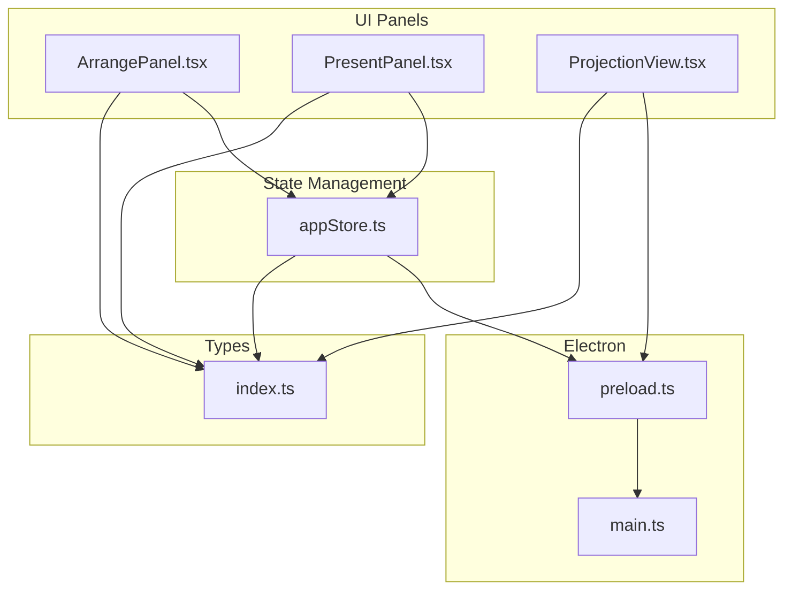
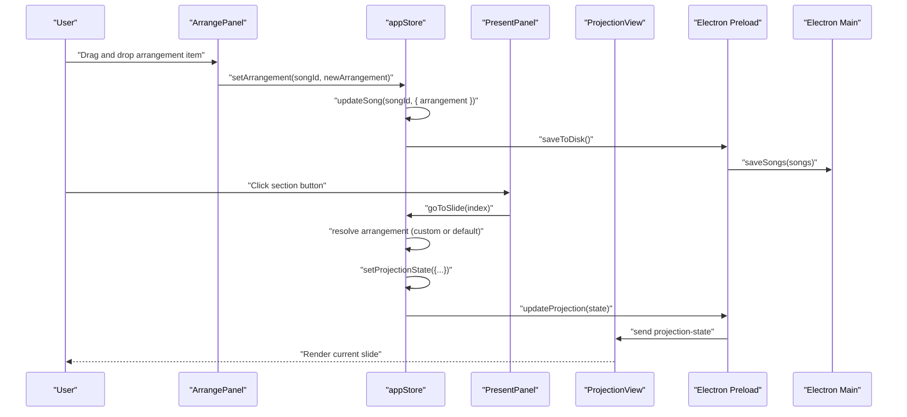
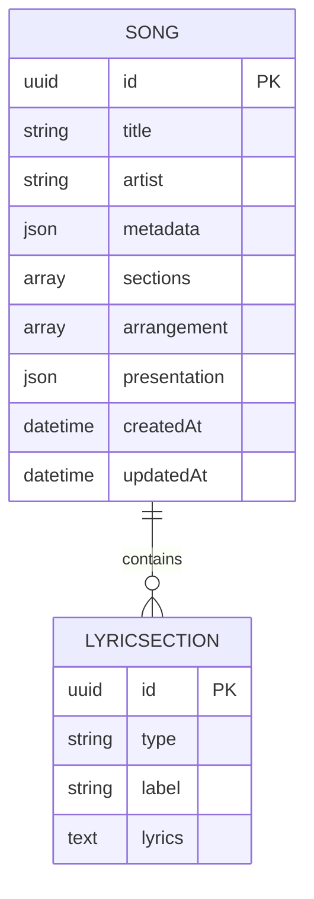
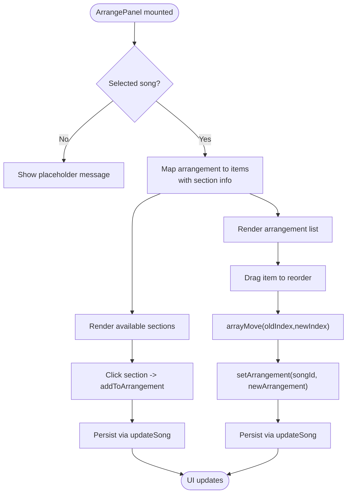
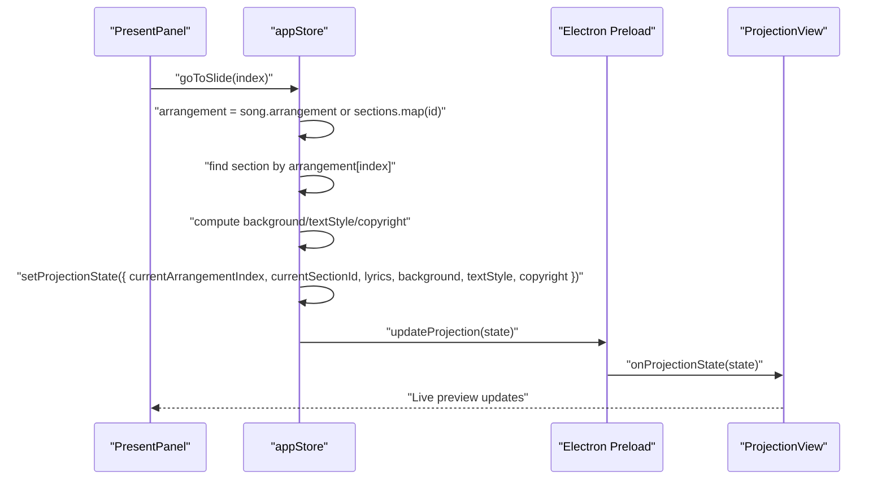
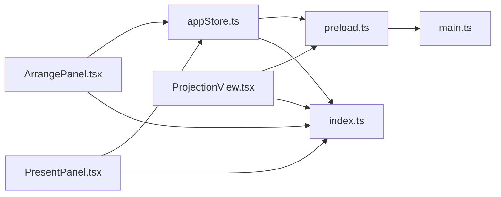

# Arrangement Builder Actions

<cite>
**Referenced Files in This Document**
- [appStore.ts](file://src/store/appStore.ts)
- [ArrangePanel.tsx](file://src/components/ArrangePanel.tsx)
- [PresentPanel.tsx](file://src/components/PresentPanel.tsx)
- [ProjectionView.tsx](file://src/components/ProjectionView.tsx)
- [index.ts](file://src/types/index.ts)
- [main.ts](file://electron/main.ts)
- [preload.ts](file://electron/preload.ts)
- [en.ts](file://src/i18n/en.ts)
</cite>

## Table of Contents
1. [Introduction](#introduction)
2. [Project Structure](#project-structure)
3. [Core Components](#core-components)
4. [Architecture Overview](#architecture-overview)
5. [Detailed Component Analysis](#detailed-component-analysis)
6. [Dependency Analysis](#dependency-analysis)
7. [Performance Considerations](#performance-considerations)
8. [Troubleshooting Guide](#troubleshooting-guide)
9. [Conclusion](#conclusion)

## Introduction
This document explains the arrangement builder functionality that enables users to create and manage custom presentation sequences for songs. It covers how custom arrangements differ from default section ordering, how arrangement state is structured and persisted, and how arrangement changes integrate with the live presentation flow and projection output. It also documents the drag-and-drop interface, UI updates, persistence, and the current state of undo/redo capabilities.

## Project Structure
The arrangement builder spans several layers:
- State management: central store with actions for arrangement operations
- UI panels: arrangement builder and presentation panels
- Types: data models for songs, sections, and projection state
- Electron integration: IPC for projection updates and persistence

**Diagram sources**
- [ArrangePanel.tsx:1-187](file://src/components/ArrangePanel.tsx#L1-L187)
- [PresentPanel.tsx:1-365](file://src/components/PresentPanel.tsx#L1-L365)
- [ProjectionView.tsx:1-134](file://src/components/ProjectionView.tsx#L1-L134)
- [appStore.ts:1-385](file://src/store/appStore.ts#L1-L385)
- [index.ts:1-89](file://src/types/index.ts#L1-L89)
- [main.ts:1-390](file://electron/main.ts#L1-L390)
- [preload.ts:1-43](file://electron/preload.ts#L1-L43)

**Section sources**
- [ArrangePanel.tsx:1-187](file://src/components/ArrangePanel.tsx#L1-L187)
- [PresentPanel.tsx:1-365](file://src/components/PresentPanel.tsx#L1-L365)
- [ProjectionView.tsx:1-134](file://src/components/ProjectionView.tsx#L1-L134)
- [appStore.ts:1-385](file://src/store/appStore.ts#L1-L385)
- [index.ts:1-89](file://src/types/index.ts#L1-L89)
- [main.ts:1-390](file://electron/main.ts#L1-L390)
- [preload.ts:1-43](file://electron/preload.ts#L1-L43)

## Core Components
- Arrangement actions in the store:
  - setArrangement: replaces the entire arrangement with a new ordered list of section IDs
  - addToArrangement: appends a section ID to the end of the arrangement
  - removeFromArrangement: removes a section by index from the arrangement
- UI integration:
  - ArrangePanel renders available sections and the current arrangement, enabling drag-and-drop reordering and removal
  - PresentPanel uses the arrangement to render section navigation and live projection controls
- Projection integration:
  - ProjectionView receives live updates via IPC and renders the current slide based on projection state

**Section sources**
- [appStore.ts:222-239](file://src/store/appStore.ts#L222-L239)
- [ArrangePanel.tsx:22-134](file://src/components/ArrangePanel.tsx#L22-L134)
- [PresentPanel.tsx:6-365](file://src/components/PresentPanel.tsx#L6-L365)
- [ProjectionView.tsx:1-134](file://src/components/ProjectionView.tsx#L1-L134)

## Architecture Overview
The arrangement builder operates on a separation between:
- Song sections: immutable content blocks with type, label, and lyrics
- Arrangement: an ordered list of section IDs that defines the presentation sequence

When a song has an arrangement, PresentPanel and ProjectionView use it to drive navigation and rendering. When no arrangement exists, they fall back to the default order of sections.

**Diagram sources**
- [ArrangePanel.tsx:54-63](file://src/components/ArrangePanel.tsx#L54-L63)
- [appStore.ts:223-225](file://src/store/appStore.ts#L223-L225)
- [appStore.ts:251-274](file://src/store/appStore.ts#L251-L274)
- [PresentPanel.tsx:172-188](file://src/components/PresentPanel.tsx#L172-L188)
- [ProjectionView.tsx:22-29](file://src/components/ProjectionView.tsx#L22-L29)
- [preload.ts:10-16](file://electron/preload.ts#L10-L16)
- [main.ts:186-190](file://electron/main.ts#L186-L190)

## Detailed Component Analysis

### Arrangement State and Data Model
- Song sections array: ordered content blocks; each section has an ID, type, label, and lyrics
- Arrangement array: ordered list of section IDs that may differ from the sections array order
- Presentation fallback: when arrangement is empty, PresentPanel and ProjectionView use sections in default order

**Diagram sources**
- [index.ts:50-67](file://src/types/index.ts#L50-L67)

**Section sources**
- [index.ts:50-67](file://src/types/index.ts#L50-L67)
- [appStore.ts:254-258](file://src/store/appStore.ts#L254-L258)
- [PresentPanel.tsx:97-98](file://src/components/PresentPanel.tsx#L97-L98)

### Arrangement Builder UI (ArrangePanel)
- Available sections: lists all sections from the selected song; clicking adds to the arrangement
- Arrangement list: draggable items representing the current arrangement; remove via button
- Drag-and-drop reordering: uses @dnd-kit to reorder the arrangement array and persist changes

**Diagram sources**
- [ArrangePanel.tsx:22-134](file://src/components/ArrangePanel.tsx#L22-L134)
- [appStore.ts:227-232](file://src/store/appStore.ts#L227-L232)

**Section sources**
- [ArrangePanel.tsx:22-134](file://src/components/ArrangePanel.tsx#L22-L134)
- [en.ts:64-75](file://src/i18n/en.ts#L64-L75)

### Presentation Flow and Projection Integration
- PresentPanel resolves the current arrangement (custom or default) and renders section navigation
- goToSlide computes the current section from the arrangement, sets projection state, and triggers updates to the projection window
- ProjectionView listens for projection-state updates and renders the current slide

**Diagram sources**
- [PresentPanel.tsx:172-188](file://src/components/PresentPanel.tsx#L172-L188)
- [appStore.ts:251-274](file://src/store/appStore.ts#L251-L274)
- [ProjectionView.tsx:22-29](file://src/components/ProjectionView.tsx#L22-L29)
- [preload.ts:10-16](file://electron/preload.ts#L10-L16)

**Section sources**
- [PresentPanel.tsx:6-365](file://src/components/PresentPanel.tsx#L6-L365)
- [appStore.ts:251-274](file://src/store/appStore.ts#L251-L274)
- [ProjectionView.tsx:1-134](file://src/components/ProjectionView.tsx#L1-L134)

### Undo/Redo and History
- Current implementation does not include explicit undo/redo history for arrangement manipulations
- Changes are persisted immediately upon user action (e.g., drag-and-drop reordering) and saved to disk
- No dedicated history stack is maintained in the store for arrangement operations

**Section sources**
- [appStore.ts:223-239](file://src/store/appStore.ts#L223-L239)
- [appStore.ts:379-383](file://src/store/appStore.ts#L379-L383)

### Relationship Between Arrangements and Current Presentation Flow
- Arrangement drives the order of slides during presentation
- When arrangement is empty, the default order of sections is used
- currentArrangementIndex tracks the currently presented position and is updated by goToSlide
- nextSlide and prevSlide navigate within the resolved arrangement

**Section sources**
- [appStore.ts:276-291](file://src/store/appStore.ts#L276-L291)
- [PresentPanel.tsx:97-107](file://src/components/PresentPanel.tsx#L97-L107)

### Integration with Drag-and-Drop Interfaces
- ArrangePanel uses @dnd-kit for drag-and-drop reordering of arrangement items
- The drag end handler computes the new order and calls setArrangement
- The arrangement item keys combine sectionId and index to ensure stable sorting

**Section sources**
- [ArrangePanel.tsx:54-63](file://src/components/ArrangePanel.tsx#L54-L63)
- [ArrangePanel.tsx:111-126](file://src/components/ArrangePanel.tsx#L111-L126)

### How Changes Affect Projection State
- After any arrangement change, the store persists to disk
- goToSlide updates projectionState and sends updateProjection to the projection window
- ProjectionView reacts to projection-state messages and re-renders the slide

**Section sources**
- [appStore.ts:223-225](file://src/store/appStore.ts#L223-L225)
- [appStore.ts:242-249](file://src/store/appStore.ts#L242-L249)
- [appStore.ts:251-274](file://src/store/appStore.ts#L251-L274)
- [preload.ts:10-16](file://electron/preload.ts#L10-L16)
- [ProjectionView.tsx:22-29](file://src/components/ProjectionView.tsx#L22-L29)

## Dependency Analysis
- ArrangePanel depends on appStore for arrangement actions and on @dnd-kit for drag-and-drop
- PresentPanel depends on appStore for navigation and projection state
- ProjectionView depends on Electron preload for receiving projection-state updates
- Electron main handles IPC for saving/loading data and sending projection updates

**Diagram sources**
- [ArrangePanel.tsx:1-20](file://src/components/ArrangePanel.tsx#L1-L20)
- [PresentPanel.tsx:1-19](file://src/components/PresentPanel.tsx#L1-L19)
- [ProjectionView.tsx:1-4](file://src/components/ProjectionView.tsx#L1-L4)
- [appStore.ts:1-3](file://src/store/appStore.ts#L1-L3)
- [main.ts:1-10](file://electron/main.ts#L1-L10)
- [preload.ts:1-42](file://electron/preload.ts#L1-L42)
- [index.ts:1-89](file://src/types/index.ts#L1-L89)

**Section sources**
- [ArrangePanel.tsx:1-20](file://src/components/ArrangePanel.tsx#L1-L20)
- [PresentPanel.tsx:1-19](file://src/components/PresentPanel.tsx#L1-L19)
- [ProjectionView.tsx:1-4](file://src/components/ProjectionView.tsx#L1-L4)
- [appStore.ts:1-3](file://src/store/appStore.ts#L1-L3)
- [main.ts:1-10](file://electron/main.ts#L1-L10)
- [preload.ts:1-42](file://electron/preload.ts#L1-L42)
- [index.ts:1-89](file://src/types/index.ts#L1-L89)

## Performance Considerations
- Arrangement operations are O(n) for array mutations and re-rendering
- Drag-and-drop reordering uses arrayMove to minimize DOM churn
- Projection updates are sent via IPC only when goToSlide is invoked, reducing unnecessary redraws
- Persistence occurs after each user action; consider debouncing for frequent changes if needed

[No sources needed since this section provides general guidance]

## Troubleshooting Guide
- Arrangement not updating:
  - Verify that addToArrangement and removeFromArrangement are called with the correct songId and index
  - Confirm that setArrangement is invoked after drag-and-drop reordering
- Presentation not reflecting changes:
  - Ensure goToSlide is called after changing arrangement so projectionState updates
  - Check that Electron preload is available and updateProjection is being sent
- Projection not receiving updates:
  - Confirm that ProjectionView registers onProjectionState and that Electron main sends projection-state

**Section sources**
- [appStore.ts:227-239](file://src/store/appStore.ts#L227-L239)
- [appStore.ts:251-274](file://src/store/appStore.ts#L251-L274)
- [preload.ts:10-16](file://electron/preload.ts#L10-L16)
- [ProjectionView.tsx:22-29](file://src/components/ProjectionView.tsx#L22-L29)

## Conclusion
The arrangement builder provides a flexible way to define custom presentation sequences independent of default section ordering. Changes to arrangements propagate through the store to the presentation panel and projection output, with immediate persistence. While undo/redo is not currently implemented, the straightforward nature of arrangement operations makes adding history management feasible in future iterations.