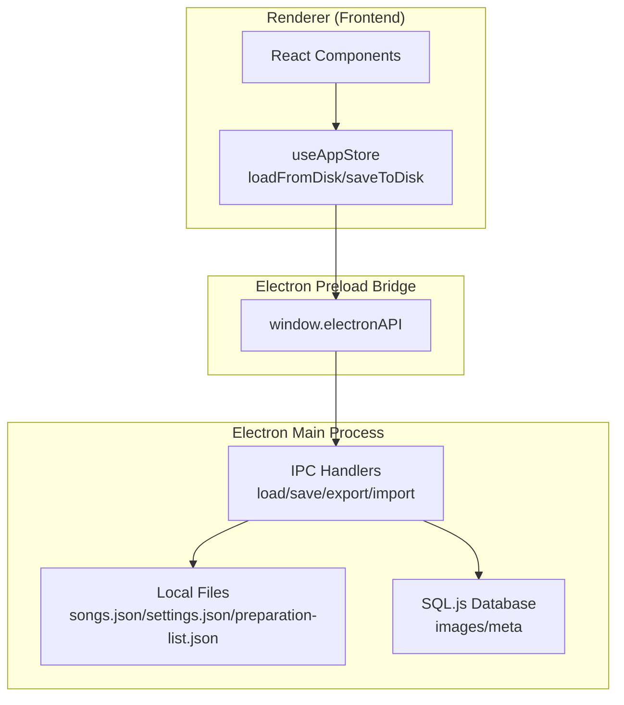
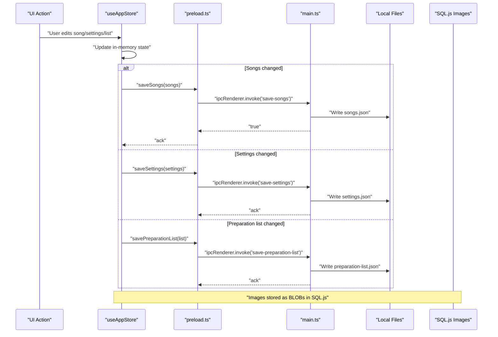
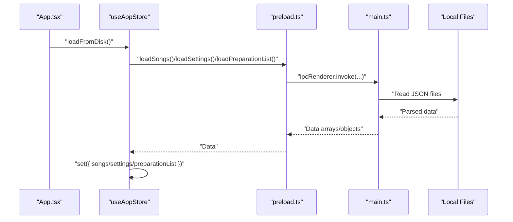
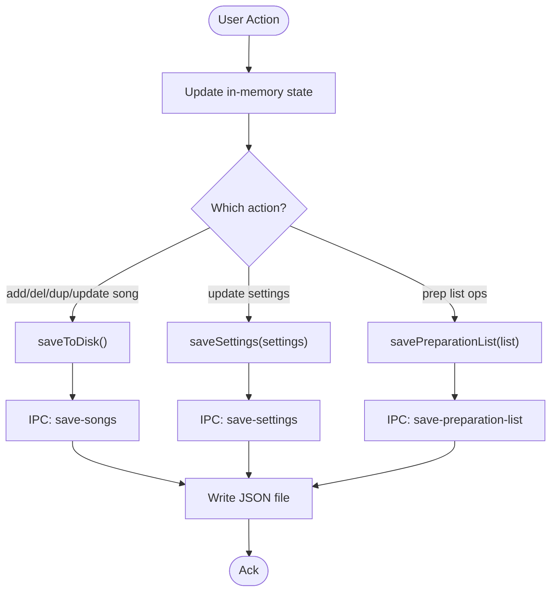
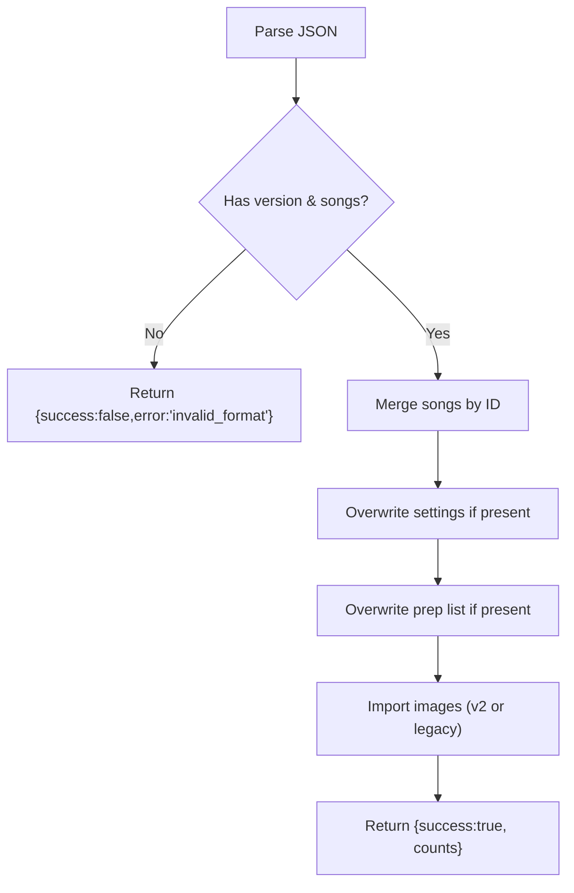
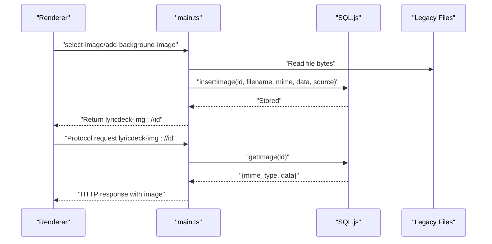
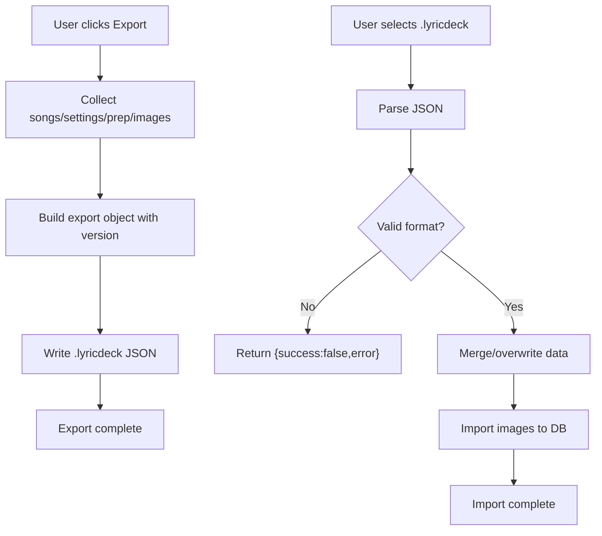
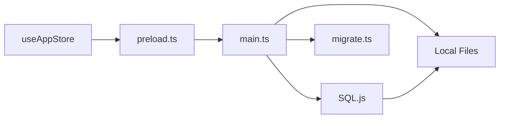

# Persistence Mechanisms

<cite>
**Referenced Files in This Document**
- [db.ts](file://electron/db.ts)
- [main.ts](file://electron/main.ts)
- [preload.ts](file://electron/preload.ts)
- [appStore.ts](file://src/store/appStore.ts)
- [App.tsx](file://src/App.tsx)
- [migrate.ts](file://electron/migrate.ts)
- [index.ts](file://src/types/index.ts)
</cite>

## Table of Contents
1. [Introduction](#introduction)
2. [Project Structure](#project-structure)
3. [Core Components](#core-components)
4. [Architecture Overview](#architecture-overview)
5. [Detailed Component Analysis](#detailed-component-analysis)
6. [Dependency Analysis](#dependency-analysis)
7. [Performance Considerations](#performance-considerations)
8. [Troubleshooting Guide](#troubleshooting-guide)
9. [Conclusion](#conclusion)

## Introduction
This document explains how LyricDeck persists and manages application state across sessions. It covers the loadFromDisk and saveToDisk operations, the integration with Electron IPC for file system access, serialization and deserialization of songs, settings, and preparation lists, automatic persistence triggers, backup and recovery strategies, error handling, and the relationship between local file storage and real-time state updates.

## Project Structure
LyricDeck separates persistence concerns into:
- Frontend store (Zustand) managing in-memory state and coordinating persistence
- Electron main process handling file I/O and IPC
- Electron preload bridge exposing safe APIs to the renderer
- SQL.js-backed image repository for binary assets
- Migration utilities for backward compatibility

**Diagram sources**
- [appStore.ts:361-384](file://src/store/appStore.ts#L361-L384)
- [preload.ts:3-42](file://electron/preload.ts#L3-L42)
- [main.ts:192-218](file://electron/main.ts#L192-L218)
- [db.ts:19-48](file://electron/db.ts#L19-L48)

**Section sources**
- [appStore.ts:1-385](file://src/store/appStore.ts#L1-L385)
- [main.ts:1-390](file://electron/main.ts#L1-L390)
- [preload.ts:1-43](file://electron/preload.ts#L1-L43)
- [db.ts:1-214](file://electron/db.ts#L1-L214)

## Core Components
- Zustand store orchestrates state and persistence:
  - loadFromDisk retrieves songs, settings, and preparation list via IPC
  - saveToDisk persists songs immediately after mutating actions
- Electron main process:
  - Provides IPC handlers for load/save of JSON data
  - Manages image repository using SQL.js and exposes image protocol
  - Implements import/export and migration
- Preload bridge:
  - Exposes typed IPC calls to renderer
- SQL.js database:
  - Stores images as BLOBs and metadata
  - Supports migrations and image import/export

**Section sources**
- [appStore.ts:361-384](file://src/store/appStore.ts#L361-L384)
- [main.ts:192-218](file://electron/main.ts#L192-L218)
- [preload.ts:3-42](file://electron/preload.ts#L3-L42)
- [db.ts:19-48](file://electron/db.ts#L19-L48)

## Architecture Overview
The persistence pipeline integrates frontend state changes with Electron’s file system and SQL.js image storage.

**Diagram sources**
- [appStore.ts:114-384](file://src/store/appStore.ts#L114-L384)
- [preload.ts:23-29](file://electron/preload.ts#L23-L29)
- [main.ts:192-218](file://electron/main.ts#L192-L218)
- [db.ts:70-87](file://electron/db.ts#L70-L87)

## Detailed Component Analysis

### Load Operations: loadFromDisk
- Purpose: Populate initial state from disk on app launch (except projection window)
- Flow:
  - Renderer calls store.loadFromDisk
  - Store invokes preload bridge for load-songs, load-settings, load-preparation-list
  - Main process reads respective JSON files and returns parsed data
  - Store sets state if data exists
- Integration points:
  - preload.ts exposes loadSongs/loadSettings/loadPreparationList
  - main.ts implements IPC handlers and file reads
  - App.tsx triggers loadFromDisk on startup (non-projection window)

**Diagram sources**
- [App.tsx:19-32](file://src/App.tsx#L19-L32)
- [appStore.ts:362-377](file://src/store/appStore.ts#L362-L377)
- [preload.ts:24-29](file://electron/preload.ts#L24-L29)
- [main.ts:193-218](file://electron/main.ts#L193-L218)

**Section sources**
- [App.tsx:19-32](file://src/App.tsx#L19-L32)
- [appStore.ts:362-377](file://src/store/appStore.ts#L362-L377)
- [preload.ts:24-29](file://electron/preload.ts#L24-L29)
- [main.ts:39-79](file://electron/main.ts#L39-L79)

### Save Operations: saveToDisk and Automatic Triggers
- Purpose: Persist state changes immediately after mutations to prevent data loss
- Triggers:
  - addSong, deleteSong, duplicateSong, updateSong, updateSection, rearrange, setSettings, addToPreparationList, removeFromPreparationList, reorderPreparationList, clearPreparationList
- Flow:
  - Each trigger updates in-memory state and calls saveToDisk
  - saveToDisk sends songs to main process via IPC
  - Main process writes songs.json

**Diagram sources**
- [appStore.ts:114-384](file://src/store/appStore.ts#L114-L384)
- [preload.ts:24-29](file://electron/preload.ts#L24-L29)
- [main.ts:197-218](file://electron/main.ts#L197-L218)

**Section sources**
- [appStore.ts:114-384](file://src/store/appStore.ts#L114-L384)
- [preload.ts:24-29](file://electron/preload.ts#L24-L29)
- [main.ts:197-218](file://electron/main.ts#L197-L218)

### Data Serialization and Deserialization
- Songs:
  - Stored as JSON array of Song objects
  - Types define shape and defaults (see types/index.ts)
  - Deserialization occurs in main.ts loadSongs and import-data
- Settings:
  - Stored as JSON object
  - Deserialization occurs in main.ts loadSettings
- Preparation List:
  - Stored as JSON array of song IDs
  - Deserialization occurs in main.ts loadPreparationList
- Validation during load:
  - import-data checks presence of version and songs fields
  - On parse errors, returns structured failure object

**Diagram sources**
- [main.ts:292-354](file://electron/main.ts#L292-L354)

**Section sources**
- [main.ts:39-79](file://electron/main.ts#L39-L79)
- [main.ts:292-354](file://electron/main.ts#L292-L354)
- [index.ts:50-89](file://src/types/index.ts#L50-L89)

### Image Storage and Protocol Integration
- Images are stored as BLOBs in SQL.js with metadata (id, filename, mime_type, source, created_at)
- Custom protocol lyricdeck-img serves images directly from the database
- Migration converts legacy file-based images to SQL.js entries and updates references in songs.json and settings.json

**Diagram sources**
- [main.ts:221-264](file://electron/main.ts#L221-L264)
- [db.ts:70-104](file://electron/db.ts#L70-L104)
- [migrate.ts:8-126](file://electron/migrate.ts#L8-L126)

**Section sources**
- [db.ts:70-176](file://electron/db.ts#L70-L176)
- [main.ts:221-264](file://electron/main.ts#L221-L264)
- [migrate.ts:8-126](file://electron/migrate.ts#L8-L126)

### Import/Export and Backup Strategies
- Export:
  - Collects songs, settings, preparation list, and images (v2 format)
  - Writes a single .lyricdeck JSON file with version stamp
- Import:
  - Validates format, merges songs by ID, optionally overwrites settings/prep list
  - Imports images (v2 with IDs or legacy mapping)
- Recovery:
  - Migration converts old file-based images and updates JSON references
  - Import allows restoring from previous exports

**Diagram sources**
- [main.ts:267-290](file://electron/main.ts#L267-L290)
- [main.ts:292-354](file://electron/main.ts#L292-L354)
- [migrate.ts:8-126](file://electron/migrate.ts#L8-L126)

**Section sources**
- [main.ts:267-290](file://electron/main.ts#L267-L290)
- [main.ts:292-354](file://electron/main.ts#L292-L354)
- [migrate.ts:8-126](file://electron/migrate.ts#L8-L126)

### Error Handling for File Operations
- Import:
  - Catches parse failures and returns structured error object
- Migration:
  - Skips corrupt files and continues
  - Safely parses and rewrites songs.json/settings.json if possible
- General:
  - loadFromDisk returns empty defaults when files are missing
  - save operations are fire-and-forget acknowledgements via IPC

**Section sources**
- [main.ts:300-354](file://electron/main.ts#L300-L354)
- [migrate.ts:36-95](file://electron/migrate.ts#L36-L95)
- [main.ts:39-79](file://electron/main.ts#L39-L79)

### Relationship Between Local Storage and Real-Time Updates
- Local storage is authoritative for persistence; real-time updates occur in memory
- Projection window receives live updates via IPC for immediate visual feedback
- Disk sync ensures durability; projection updates are separate from persistence

**Section sources**
- [appStore.ts:242-302](file://src/store/appStore.ts#L242-L302)
- [main.ts:186-190](file://electron/main.ts#L186-L190)

## Dependency Analysis
- Frontend depends on preload bridge for IPC
- Preload depends on main process IPC handlers
- Main process depends on filesystem for JSON and SQL.js for images
- Migration depends on filesystem and SQL.js

**Diagram sources**
- [appStore.ts:361-384](file://src/store/appStore.ts#L361-L384)
- [preload.ts:3-42](file://electron/preload.ts#L3-L42)
- [main.ts:192-218](file://electron/main.ts#L192-L218)
- [migrate.ts:8-126](file://electron/migrate.ts#L8-L126)

**Section sources**
- [appStore.ts:361-384](file://src/store/appStore.ts#L361-L384)
- [preload.ts:3-42](file://electron/preload.ts#L3-L42)
- [main.ts:192-218](file://electron/main.ts#L192-L218)
- [migrate.ts:8-126](file://electron/migrate.ts#L8-L126)

## Performance Considerations
- Frequent saves: Immediate persistence after each mutation reduces risk but increases disk I/O. Consider batching for bulk operations if needed.
- Image storage: Binary BLOBs increase database size; ensure efficient image selection and periodic cleanup.
- JSON parsing: Large files may incur latency; consider lazy loading or streaming for very large datasets.
- Protocol serving: Serving images from SQL.js avoids filesystem overhead and enables caching headers.

## Troubleshooting Guide
- Songs/settings/preparation list not loading:
  - Verify JSON files exist and are valid UTF-8
  - Check import/export logs for parse errors
- Import fails:
  - Confirm .lyricdeck file has version and songs fields
  - Review returned error code (invalid_format or parse_error)
- Images not displaying:
  - Ensure lyricdeck-img protocol is registered and reachable
  - Check SQL.js database integrity and image records
- Migration issues:
  - Corrupt legacy files are skipped; verify migrated images and updated JSON references

**Section sources**
- [main.ts:300-354](file://electron/main.ts#L300-L354)
- [migrate.ts:36-126](file://electron/migrate.ts#L36-L126)
- [main.ts:356-374](file://electron/main.ts#L356-L374)

## Conclusion
LyricDeck’s persistence model combines immediate in-memory updates with robust disk and SQL.js-backed storage. The loadFromDisk and saveToDisk operations are tightly integrated with Electron IPC, ensuring reliable state synchronization. Import/export and migration routines provide strong backup and recovery capabilities, while the image protocol delivers efficient asset serving. Together, these mechanisms minimize data loss and support smooth user workflows.