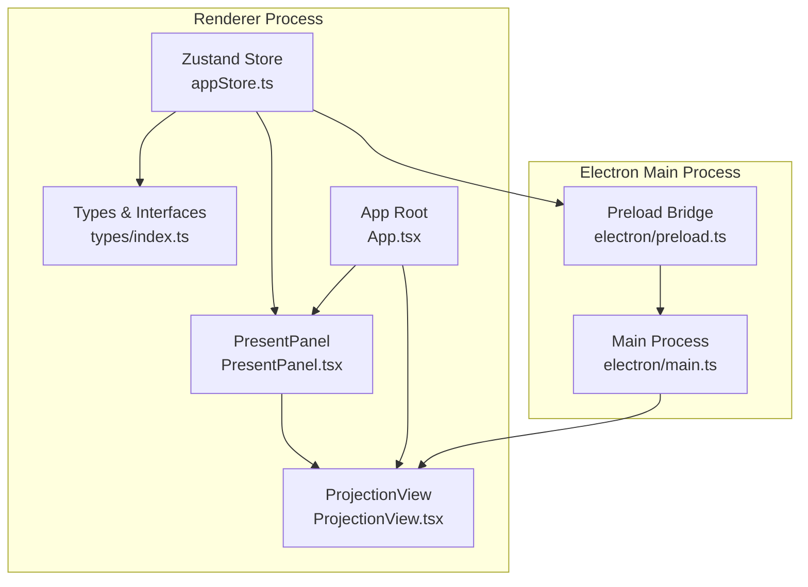
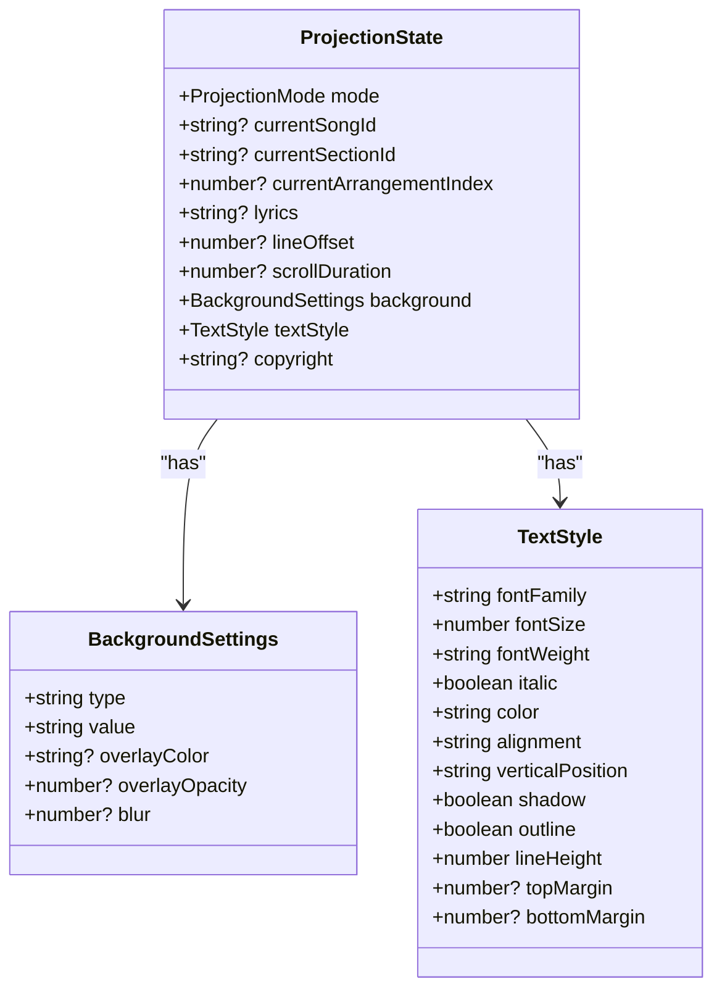
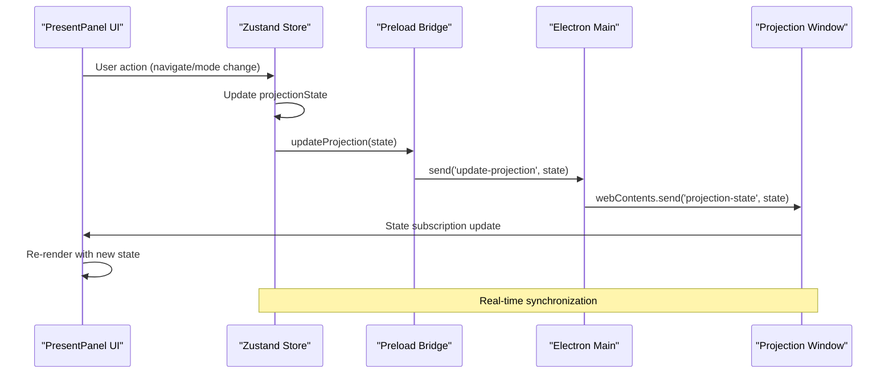
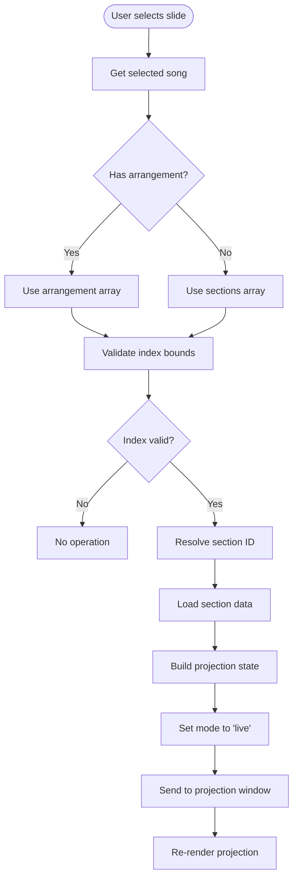
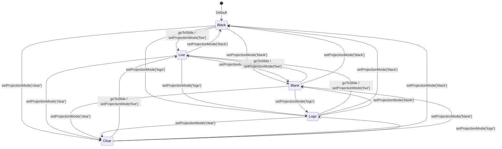
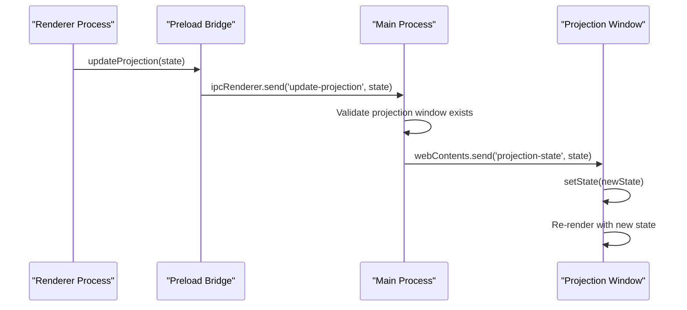
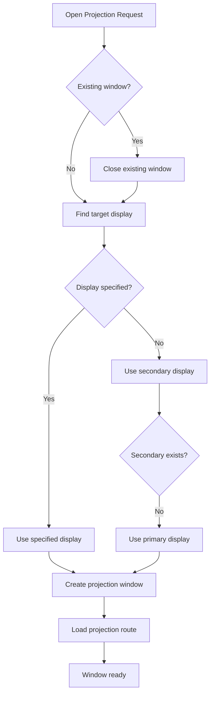
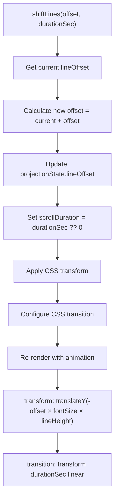
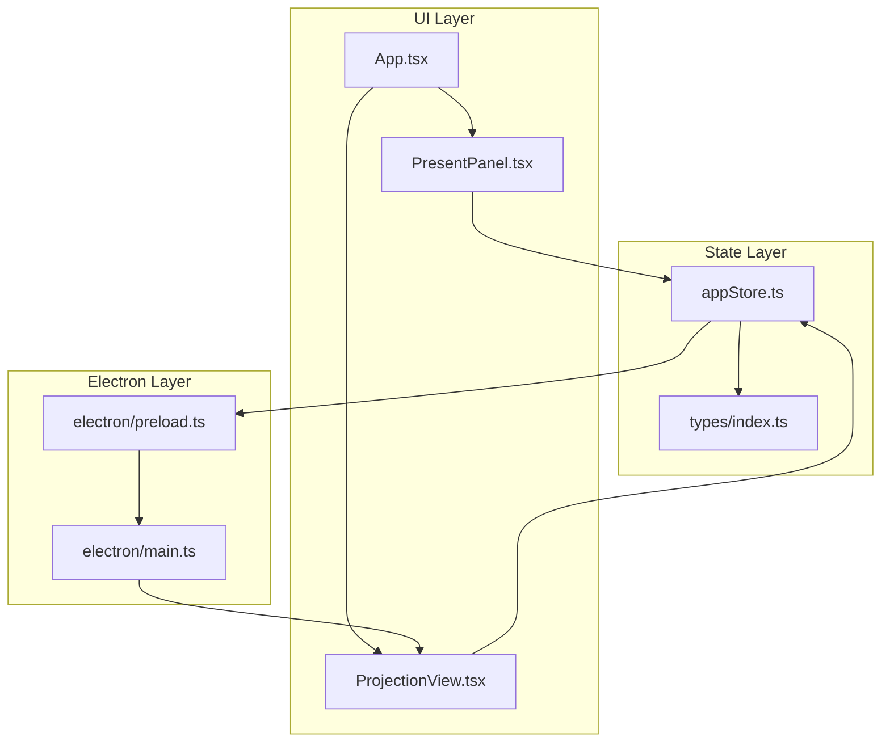

# Projection Control Actions

<cite>
**Referenced Files in This Document**
- [appStore.ts](file://src/store/appStore.ts)
- [ProjectionView.tsx](file://src/components/ProjectionView.tsx)
- [PresentPanel.tsx](file://src/components/PresentPanel.tsx)
- [main.ts](file://electron/main.ts)
- [preload.ts](file://electron/preload.ts)
- [index.ts](file://src/types/index.ts)
- [App.tsx](file://src/App.tsx)
- [en.ts](file://src/i18n/en.ts)
</cite>

## Update Summary
**Changes Made**
- Enhanced shiftLines action documentation with new duration parameter
- Added scrollDuration state property documentation and its role in smooth line transitions
- Updated line shifting functionality section to cover scroll speed control and animation timing
- Added information about scroll speed UI controls and their integration with shiftLines

## Table of Contents
1. [Introduction](#introduction)
2. [Project Structure](#project-structure)
3. [Core Components](#core-components)
4. [Architecture Overview](#architecture-overview)
5. [Detailed Component Analysis](#detailed-component-analysis)
6. [Dependency Analysis](#dependency-analysis)
7. [Performance Considerations](#performance-considerations)
8. [Troubleshooting Guide](#troubleshooting-guide)
9. [Conclusion](#conclusion)

## Introduction
This document provides comprehensive documentation for projection control actions in the LyricDeck application. It covers the projection state structure, slide navigation logic, mode switching between live, blank, black, and logo modes, Electron IPC integration for real-time projection updates, line shifting functionality with enhanced scroll duration support, projection window management, and automatic state synchronization between main and renderer processes.

## Project Structure
The projection system spans three main areas:
- Renderer-side state management and UI components
- Electron main process for window management and IPC
- Preload bridge exposing safe APIs to renderer processes

**Diagram sources**
- [appStore.ts:1-396](file://src/store/appStore.ts#L1-L396)
- [PresentPanel.tsx:1-469](file://src/components/PresentPanel.tsx#L1-L469)
- [ProjectionView.tsx:1-138](file://src/components/ProjectionView.tsx#L1-L138)
- [main.ts:1-390](file://electron/main.ts#L1-L390)
- [preload.ts:1-43](file://electron/preload.ts#L1-L43)

**Section sources**
- [appStore.ts:1-396](file://src/store/appStore.ts#L1-L396)
- [main.ts:1-390](file://electron/main.ts#L1-L390)

## Core Components
This section documents the five core projection control actions and their behaviors.

### Projection State Structure
The projection state defines what is displayed on the projection window and how it renders.

**Diagram sources**
- [index.ts:71-82](file://src/types/index.ts#L71-L82)
- [index.ts:21-42](file://src/types/index.ts#L21-L42)

Key characteristics:
- Mode switching supports live, blank, black, logo, and clear states
- Live mode displays lyrics with configurable text styling and background
- Blank mode shows the configured background without text
- Black mode displays solid black
- Logo mode shows a subtle brand watermark
- Clear mode displays nothing (useful for transitions)
- **Updated** scrollDuration property enables smooth line transition animations

**Section sources**
- [index.ts:71-82](file://src/types/index.ts#L71-L82)

### Projection Control Actions

#### setProjectionState
Updates the projection state and synchronizes with the projection window in real-time.

Behavior:
- Merges provided state with current state
- Sends update to projection window via IPC
- Triggers immediate re-render in projection view

Integration points:
- Renderer: triggers IPC update
- Main: receives and forwards state to projection window
- Projection View: subscribes to state changes

**Section sources**
- [appStore.ts:243-250](file://src/store/appStore.ts#L243-L250)
- [main.ts:186-190](file://electron/main.ts#L186-L190)
- [preload.ts:10-16](file://electron/preload.ts#L10-L16)
- [ProjectionView.tsx:22-29](file://src/components/ProjectionView.tsx#L22-L29)

#### goToSlide
Navigates to a specific slide in the current song's arrangement.

Logic:
- Validates slide index against arrangement length
- Resolves section ID from arrangement at given index
- Loads section data and presentation settings
- Updates projection state to live mode with current slide content

Slide resolution:
- Uses arrangement if defined, otherwise falls back to sections array
- Index validation prevents out-of-bounds navigation

**Section sources**
- [appStore.ts:252-275](file://src/store/appStore.ts#L252-L275)

#### nextSlide
Advances to the next slide in the arrangement.

Behavior:
- Calculates next index from current arrangement index
- Calls goToSlide if next slide exists
- No-op if already at last slide

**Section sources**
- [appStore.ts:277-285](file://src/store/appStore.ts#L277-L285)

#### prevSlide
Moves to the previous slide in the arrangement.

Behavior:
- Decrements current arrangement index
- Calls goToSlide if previous slide exists
- No-op if already at first slide

**Section sources**
- [appStore.ts:287-292](file://src/store/appStore.ts#L287-L292)

#### setProjectionMode
Switches between projection modes without changing slide content.

Behavior:
- Updates only the mode field in projection state
- Immediately reflects change in projection window
- Supports cycling between black and live modes

**Section sources**
- [appStore.ts:294-296](file://src/store/appStore.ts#L294-L296)

#### setIsProjectionOpen
Manages the projection window open/closed state in the renderer store.

Behavior:
- Updates local isProjectionOpen flag
- Used by UI to reflect projection window status
- Synchronized with main process via window events

**Section sources**
- [appStore.ts:298](file://src/store/appStore.ts#L298)

#### shiftLines
**Updated** Fine-tunes text positioning by adjusting line offset with optional smooth scrolling animation.

Enhanced Behavior:
- Adds offset to current lineOffset value
- Uses offset to translate text vertically
- **New** Optional durationSec parameter controls animation duration in seconds
- **New** scrollDuration property stores the animation duration for CSS transitions
- Each offset unit equals one line height multiplied by font size and line height
- Enables precise text placement adjustments with smooth transitions
- **New** Duration of 0 disables animation (immediate positioning)

Animation Integration:
- Uses CSS transition property with scrollDuration value
- Applies linear timing function for consistent animation speed
- Automatically applies transform: translateY() with calculated pixel values
- Integrates with PresentPanel scroll speed controls

**Section sources**
- [appStore.ts:300-306](file://src/store/appStore.ts#L300-L306)
- [ProjectionView.tsx:114-121](file://src/components/ProjectionView.tsx#L114-L121)
- [PresentPanel.tsx:394-404](file://src/components/PresentPanel.tsx#L394-L404)

## Architecture Overview
The projection system uses a unidirectional data flow with real-time synchronization between the main and renderer processes.

**Diagram sources**
- [PresentPanel.tsx:13-19](file://src/components/PresentPanel.tsx#L13-L19)
- [appStore.ts:243-250](file://src/store/appStore.ts#L243-L250)
- [preload.ts:10-16](file://electron/preload.ts#L10-L16)
- [main.ts:186-190](file://electron/main.ts#L186-L190)
- [ProjectionView.tsx:22-29](file://src/components/ProjectionView.tsx#L22-L29)

## Detailed Component Analysis

### Slide Navigation Logic
The slide navigation system maps arrangement indices to presentation flow.

**Diagram sources**
- [appStore.ts:252-275](file://src/store/appStore.ts#L252-L275)

Key behaviors:
- Dynamic arrangement resolution: uses custom arrangement if defined, otherwise falls back to sections
- Bounds checking prevents invalid navigation
- Automatic mode switching to live when navigating to slides
- Comprehensive state building including lyrics, background, and text styling

**Section sources**
- [appStore.ts:252-275](file://src/store/appStore.ts#L252-L275)

### Mode Switching Implementation
The projection system supports five distinct modes with specific rendering behaviors.

**Diagram sources**
- [ProjectionView.tsx:77-87](file://src/components/ProjectionView.tsx#L77-L87)
- [appStore.ts:294-296](file://src/store/appStore.ts#L294-L296)

Rendering differences:
- Black: Solid black background
- Live: Background plus lyrics with text styling and optional copyright
- Blank: Background only (no lyrics)
- Logo: Dark background with subtle brand watermark
- Clear: Transparent/empty state

**Section sources**
- [ProjectionView.tsx:76-138](file://src/components/ProjectionView.tsx#L76-L138)

### Electron IPC Integration
Real-time projection updates flow through a well-defined IPC pipeline.

**Diagram sources**
- [appStore.ts:246-250](file://src/store/appStore.ts#L246-L250)
- [preload.ts:11](file://electron/preload.ts#L11)
- [main.ts:186-190](file://electron/main.ts#L186-L190)
- [ProjectionView.tsx:24-26](file://src/components/ProjectionView.tsx#L24-L26)

Key IPC endpoints:
- `update-projection`: Sends state from renderer to main
- `projection-state`: Receives state in projection window
- `projection-window-closed`: Notifies main process when projection closes

**Section sources**
- [preload.ts:10-16](file://electron/preload.ts#L10-L16)
- [main.ts:186-190](file://electron/main.ts#L186-L190)

### Projection Window Management
The system manages projection windows across multiple displays with automatic fallback behavior.

**Diagram sources**
- [main.ts:111-152](file://electron/main.ts#L111-L152)

Display selection logic:
- Explicit display ID from user selection
- Secondary display as default fallback
- Primary display as ultimate fallback
- Fullscreen, frameless, always-on-top configuration

**Section sources**
- [main.ts:111-152](file://electron/main.ts#L111-L152)

### Enhanced Line Shifting Functionality
**Updated** Fine-tuning text positioning through line offset calculations with smooth scrolling animations.

**Diagram sources**
- [appStore.ts:300-306](file://src/store/appStore.ts#L300-L306)
- [ProjectionView.tsx:114-121](file://src/components/ProjectionView.tsx#L114-L121)

Precision calculation:
- Each offset unit equals one line height
- Multiplied by font size and line height for proportional movement
- Negative offsets move text upward (shift up)
- Positive offsets move text downward (shift down)
- **New** Duration parameter controls animation timing in seconds
- **New** 0 duration creates instant positioning without animation
- **New** Non-zero duration creates smooth linear transitions

Scroll Speed Control Integration:
- **New** PresentPanel includes scroll speed input field
- **New** Scroll speed value passed as duration parameter to shiftLines
- **New** Real-time adjustment of animation speed
- **New** Input validation ensures non-negative values

**Section sources**
- [appStore.ts:300-306](file://src/store/appStore.ts#L300-L306)
- [ProjectionView.tsx:114-121](file://src/components/ProjectionView.tsx#L114-L121)
- [PresentPanel.tsx:394-404](file://src/components/PresentPanel.tsx#L394-L404)

## Dependency Analysis
The projection system exhibits clean separation of concerns with minimal coupling between components.

**Diagram sources**
- [appStore.ts:1-396](file://src/store/appStore.ts#L1-L396)
- [PresentPanel.tsx:1-469](file://src/components/PresentPanel.tsx#L1-L469)
- [ProjectionView.tsx:1-138](file://src/components/ProjectionView.tsx#L1-L138)
- [main.ts:1-390](file://electron/main.ts#L1-L390)
- [preload.ts:1-43](file://electron/preload.ts#L1-L43)

Key dependencies:
- PresentPanel depends on appStore for all projection actions
- ProjectionView depends on electronAPI for state subscription
- Main process depends on preload bridge for IPC communication
- Types define shared interfaces across all layers
- **New** PresentPanel depends on scroll speed state for duration control

**Section sources**
- [appStore.ts:1-396](file://src/store/appStore.ts#L1-L396)
- [PresentPanel.tsx:1-469](file://src/components/PresentPanel.tsx#L1-L469)
- [ProjectionView.tsx:1-138](file://src/components/ProjectionView.tsx#L1-L138)

## Performance Considerations
The projection system is designed for real-time responsiveness with several performance optimizations:

- Minimal state updates: Only changed fields are sent via IPC
- Efficient rendering: CSS transforms for line shifting avoid DOM reflow
- **New** Smooth animations: Linear timing function ensures consistent animation speed
- **New** Animation optimization: scrollDuration of 0 bypasses transition overhead
- Lazy initialization: Projection window created only when needed
- Event cleanup: Proper removal of IPC listeners to prevent memory leaks
- Bounds checking: Prevents unnecessary computations for invalid indices
- **New** Animation throttling: Smooth transitions reduce visual flicker during rapid adjustments

## Troubleshooting Guide

### Common Issues and Solutions

#### Projection Window Not Opening
- Verify display selection and availability
- Check if main process can access screen APIs
- Ensure preload bridge exposes electronAPI correctly

#### State Not Synchronizing
- Confirm IPC channels are established
- Verify state subscription in projection view
- Check for proper event listener cleanup

#### Navigation Errors
- Validate arrangement indices before navigation
- Ensure song has sections before attempting navigation
- Check for empty arrangements causing index out of bounds

#### Line Shifting Not Working
- **Updated** Verify lineOffset is being applied in CSS transform
- Check font size and line height calculations
- Ensure negative/positive offset directions match expectations
- **New** Verify scrollDuration is properly set in projection state
- **New** Check that transition property is applied when duration > 0
- **New** Ensure scroll speed input is properly bound to shiftLines calls

#### Animation Issues
- **New** Verify scrollDuration property is included in projection state
- **New** Check that CSS transition uses correct duration value
- **New** Ensure duration parameter is passed correctly from PresentPanel
- **New** Verify linear timing function is applied consistently

**Section sources**
- [main.ts:166-184](file://electron/main.ts#L166-L184)
- [preload.ts:17-21](file://electron/preload.ts#L17-L21)
- [ProjectionView.tsx:114-121](file://src/components/ProjectionView.tsx#L114-L121)
- [PresentPanel.tsx:394-404](file://src/components/PresentPanel.tsx#L394-L404)

## Conclusion
The LyricDeck projection control system provides a robust, real-time presentation solution with clean separation between state management, UI components, and Electron window management. The five core actions (setProjectionState, goToSlide, nextSlide, prevSlide, setProjectionMode, setIsProjectionOpen, shiftLines) work together to create a seamless projection experience with automatic state synchronization and flexible mode switching. 

**Updated** The enhanced shiftLines action with scrollDuration support adds sophisticated animation capabilities, allowing presenters to create smooth, professional-looking text transitions with adjustable speed control. The integration with PresentPanel's scroll speed controls provides intuitive real-time adjustment of animation timing, while the underlying CSS transition system ensures consistent performance across different display configurations. The system's architecture supports future enhancements while maintaining performance and reliability for live presentations.