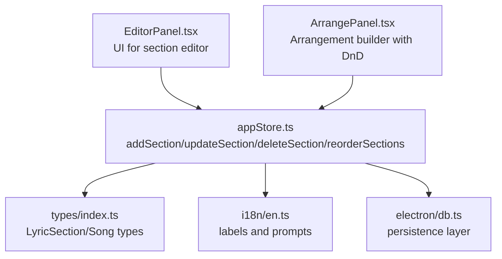
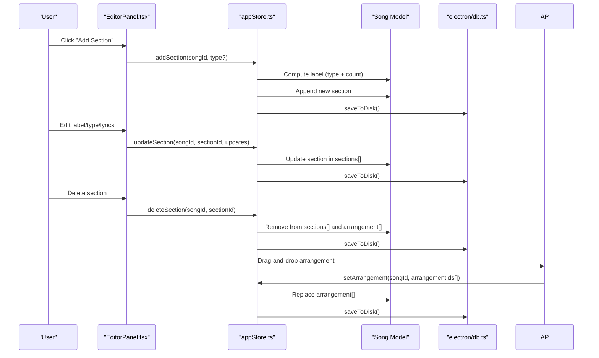
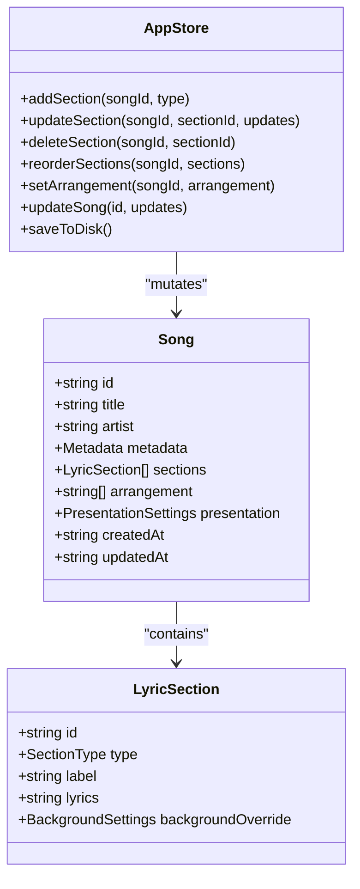
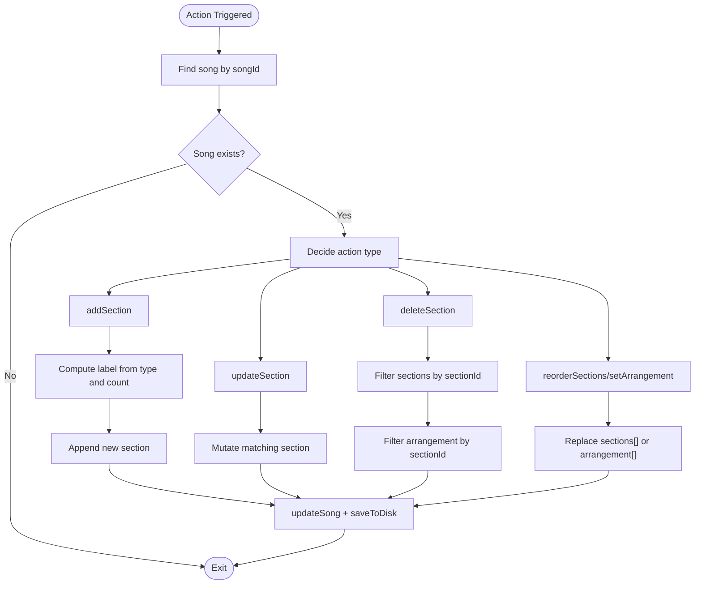
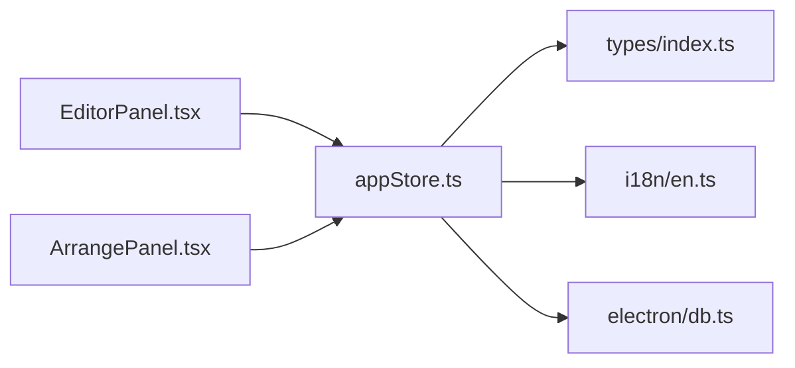

# Section Editor Actions

<cite>
**Referenced Files in This Document**
- [EditorPanel.tsx](file://src/components/EditorPanel.tsx)
- [ArrangePanel.tsx](file://src/components/ArrangePanel.tsx)
- [appStore.ts](file://src/store/appStore.ts)
- [index.ts](file://src/types/index.ts)
- [en.ts](file://src/i18n/en.ts)
- [db.ts](file://electron/db.ts)
</cite>

## Table of Contents
1. [Introduction](#introduction)
2. [Project Structure](#project-structure)
3. [Core Components](#core-components)
4. [Architecture Overview](#architecture-overview)
5. [Detailed Component Analysis](#detailed-component-analysis)
6. [Dependency Analysis](#dependency-analysis)
7. [Performance Considerations](#performance-considerations)
8. [Troubleshooting Guide](#troubleshooting-guide)
9. [Conclusion](#conclusion)

## Introduction
This document explains the lyric section editor actions and their behavior in LyricDeck. It covers adding, updating, deleting, and reordering sections, automatic section labeling, cascading deletions into arrangements, drag-and-drop reordering, validation rules, and the relationship between section operations and song updates including timestamps and persistence.

## Project Structure
The section editor is implemented in the EditorPanel component, backed by the central Zustand store. Arrangements are managed in ArrangePanel and use drag-and-drop reordering. Types define the data model for sections and songs. Internationalization provides labels and prompts. Persistence is handled by the Electron main process and local storage.

**Diagram sources**
- [EditorPanel.tsx:17-118](file://src/components/EditorPanel.tsx#L17-L118)
- [ArrangePanel.tsx:22-134](file://src/components/ArrangePanel.tsx#L22-L134)
- [appStore.ts:60-220](file://src/store/appStore.ts#L60-L220)
- [index.ts:13-67](file://src/types/index.ts#L13-L67)
- [en.ts:35-75](file://src/i18n/en.ts#L35-L75)
- [db.ts:19-41](file://electron/db.ts#L19-L41)

**Section sources**
- [EditorPanel.tsx:17-118](file://src/components/EditorPanel.tsx#L17-L118)
- [ArrangePanel.tsx:22-134](file://src/components/ArrangePanel.tsx#L22-L134)
- [appStore.ts:60-220](file://src/store/appStore.ts#L60-L220)
- [index.ts:13-67](file://src/types/index.ts#L13-L67)
- [en.ts:35-75](file://src/i18n/en.ts#L35-L75)
- [db.ts:19-41](file://electron/db.ts#L19-L41)

## Core Components
- Section types: Intro, Verse, Pre-Chorus, Chorus, Bridge, Instrumental, Outro, Custom.
- Section model: id, type, label, lyrics, optional background override.
- Song model: sections array, arrangement array of section ids, presentation settings, timestamps.

Key behaviors:
- Automatic labeling: When adding a section, LyricDeck assigns a label based on type and occurrence count (e.g., Verse 1, Verse 2).
- Section deletion: Removing a section removes it from both the sections array and any arrangement entries referencing it.
- Reordering: Two mechanisms exist—within the EditorPanel for section order and within ArrangePanel for arrangement order.

**Section sources**
- [index.ts:3-19](file://src/types/index.ts#L3-L19)
- [index.ts:50-67](file://src/types/index.ts#L50-L67)
- [appStore.ts:185-220](file://src/store/appStore.ts#L185-L220)

## Architecture Overview
The section editor integrates UI, state, and persistence:

**Diagram sources**
- [EditorPanel.tsx:18-107](file://src/components/EditorPanel.tsx#L18-L107)
- [appStore.ts:185-220](file://src/store/appStore.ts#L185-L220)
- [ArrangePanel.tsx:23-63](file://src/components/ArrangePanel.tsx#L23-L63)
- [db.ts:379-383](file://electron/db.ts#L379-L383)

## Detailed Component Analysis

### Add Section
Behavior:
- Adds a new section to the selected song.
- Automatically computes a label based on the section type and the number of existing sections of the same type.
- Persists the updated song immediately.

Parameters:
- songId: string
- type?: SectionType (defaults to Verse)

Labeling logic:
- If no sections of the same type exist, label equals the type.
- Otherwise, label is type + space + (count + 1).

State updates:
- Mutates the song’s sections array.
- Triggers a save operation.

Persistence:
- Calls saveToDisk after updating the song.

Validation:
- No explicit validation in the add action; defaults apply.

**Section sources**
- [appStore.ts:185-199](file://src/store/appStore.ts#L185-L199)
- [EditorPanel.tsx:107](file://src/components/EditorPanel.tsx#L107)
- [index.ts:3-11](file://src/types/index.ts#L3-L11)

### Update Section
Behavior:
- Updates one or more fields of a section (type, label, lyrics).
- Persists the updated song immediately.

Parameters:
- songId: string
- sectionId: string
- updates: Partial<LyricSection>

State updates:
- Replaces the matching section in the sections array.
- Triggers a save operation.

Validation:
- No explicit validation in the update action; arbitrary updates are allowed.

**Section sources**
- [appStore.ts:201-208](file://src/store/appStore.ts#L201-L208)
- [EditorPanel.tsx:97](file://src/components/EditorPanel.tsx#L97)

### Delete Section
Behavior:
- Removes the section from the song’s sections array.
- Also removes any references to the deleted section from the arrangement array.
- Confirms deletion via a localized prompt.
- Persists the updated song immediately.

Parameters:
- songId: string
- sectionId: string

Cascade effect:
- Ensures arrangement integrity by removing orphaned references.

State updates:
- Mutates sections[] and arrangement[].
- Triggers a save operation.

**Section sources**
- [appStore.ts:210-216](file://src/store/appStore.ts#L210-L216)
- [EditorPanel.tsx:98-102](file://src/components/EditorPanel.tsx#L98-L102)
- [en.ts:47](file://src/i18n/en.ts#L47)

### Reorder Sections
Two reordering mechanisms exist:

1) Within the EditorPanel (section order inside the song):
- Implemented by the reorderSections action.
- Accepts a new ordered sections array.
- Persists the updated song immediately.

2) Within the ArrangePanel (presentation order):
- Uses @dnd-kit for drag-and-drop.
- Computes a new arrangement array from the dragged item indices.
- Persists the updated arrangement immediately.

Parameters:
- reorderSections(songId, sections: LyricSection[]): Mutates sections ordering.
- setArrangement(songId, arrangement: string[]): Mutates arrangement ordering.

State updates:
- reorderSections replaces the sections array.
- setArrangement replaces the arrangement array.
- Both trigger a save operation.

**Section sources**
- [appStore.ts:218-220](file://src/store/appStore.ts#L218-L220)
- [ArrangePanel.tsx:54-63](file://src/components/ArrangePanel.tsx#L54-L63)

### Section Labeling Logic
Automatic type-based numbering:
- When adding a section, the system counts existing sections of the same type.
- If zero exist, label = type.
- If n exist, label = type + " " + (n + 1).

Examples:
- First Verse: label = "Verse"
- Second Verse: label = "Verse 2"
- First Chorus: label = "Chorus"
- Third Bridge: label = "Bridge 3"

This ensures predictable, human-readable labels without requiring manual input.

**Section sources**
- [appStore.ts:189-190](file://src/store/appStore.ts#L189-L190)

### Validation Rules
Observed behavior:
- Section type must be one of the predefined SectionType values.
- Label and lyrics are free-form strings.
- No explicit uniqueness checks for labels are enforced in the store actions.
- No content requirements (e.g., minimum length) are enforced in the store actions.

Implications:
- Users can freely edit labels and lyrics.
- If duplicate labels are desired, the system allows it.
- Content validation should be added at the UI level if required.

**Section sources**
- [index.ts:3-11](file://src/types/index.ts#L3-L11)
- [appStore.ts:185-208](file://src/store/appStore.ts#L185-L208)

### Relationship Between Section Operations and Song Updates
- All section actions funnel through updateSong to modify the song’s sections or arrangement arrays.
- updateSong sets updatedAt to the current timestamp and persists the song.
- saveToDisk writes the updated data to disk via the Electron main process.

Timestamp management:
- updatedAt is refreshed on any song update, including section edits and reordering.

Persistence triggers:
- addSection, updateSection, deleteSection, reorderSections, setArrangement all call updateSong, which calls saveToDisk.

**Section sources**
- [appStore.ts:174-180](file://src/store/appStore.ts#L174-L180)
- [appStore.ts:185-220](file://src/store/appStore.ts#L185-L220)
- [db.ts:379-383](file://electron/db.ts#L379-L383)

## Architecture Overview

**Diagram sources**
- [index.ts:13-67](file://src/types/index.ts#L13-L67)
- [appStore.ts:60-220](file://src/store/appStore.ts#L60-L220)

## Detailed Component Analysis

### EditorPanel Integration
- Renders the song metadata and lists all sections.
- Provides inline editors for type, label, and lyrics.
- Offers an “Add Section” menu with all supported types.
- Delegates add/update/delete to the store.

Deletion UX:
- Confirmation dialog uses a localized message template.

**Section sources**
- [EditorPanel.tsx:17-118](file://src/components/EditorPanel.tsx#L17-L118)
- [en.ts:47](file://src/i18n/en.ts#L47)

### ArrangePanel Integration
- Displays available sections and the current arrangement.
- Implements drag-and-drop reordering using @dnd-kit.
- On drag end, computes a new arrangement array and saves it.

**Section sources**
- [ArrangePanel.tsx:22-134](file://src/components/ArrangePanel.tsx#L22-L134)

### Store Actions Flow

**Diagram sources**
- [appStore.ts:185-220](file://src/store/appStore.ts#L185-L220)

## Dependency Analysis

**Diagram sources**
- [EditorPanel.tsx:17-118](file://src/components/EditorPanel.tsx#L17-L118)
- [ArrangePanel.tsx:22-134](file://src/components/ArrangePanel.tsx#L22-L134)
- [appStore.ts:60-220](file://src/store/appStore.ts#L60-L220)
- [index.ts:13-67](file://src/types/index.ts#L13-L67)
- [en.ts:35-75](file://src/i18n/en.ts#L35-L75)
- [db.ts:19-41](file://electron/db.ts#L19-L41)

**Section sources**
- [EditorPanel.tsx:17-118](file://src/components/EditorPanel.tsx#L17-L118)
- [ArrangePanel.tsx:22-134](file://src/components/ArrangePanel.tsx#L22-L134)
- [appStore.ts:60-220](file://src/store/appStore.ts#L60-L220)
- [index.ts:13-67](file://src/types/index.ts#L13-L67)
- [en.ts:35-75](file://src/i18n/en.ts#L35-L75)
- [db.ts:19-41](file://electron/db.ts#L19-L41)

## Performance Considerations
- Reordering actions replace entire arrays (sections or arrangement). This is efficient for typical song sizes but consider virtualization for very large arrangements.
- Persisting after every change keeps data safe but may cause frequent writes; batching could reduce I/O if needed.
- Rendering previews and arrangement lists are lightweight; ensure long lyrics are truncated where appropriate.

## Troubleshooting Guide
- Section not appearing after add:
  - Verify the song exists and addSection was called with the correct songId.
  - Confirm saveToDisk completes without errors.
- Label not updating:
  - Ensure updateSection is called with the correct sectionId and label field.
- Deleting a section leaves references:
  - deleteSection automatically prunes arrangement entries; verify the arrangement array is updated.
- Drag-and-drop not working:
  - Ensure @dnd-kit sensors and context are configured correctly in ArrangePanel.
- Persistence failures:
  - Check electron/db.ts initialization and file write permissions.

**Section sources**
- [appStore.ts:185-220](file://src/store/appStore.ts#L185-L220)
- [ArrangePanel.tsx:54-63](file://src/components/ArrangePanel.tsx#L54-L63)
- [db.ts:19-41](file://electron/db.ts#L19-L41)

## Conclusion
LyricDeck’s section editor provides robust operations for managing song sections: add with automatic labeling, update fields, delete with cascade removal from arrangements, and two reordering mechanisms (sections and arrangements). All changes are persisted immediately, and timestamps are updated on each song change. While the store does not enforce strict validation rules, the UI and types constrain acceptable values. For advanced scenarios, consider adding label uniqueness validation and content constraints at the UI layer.