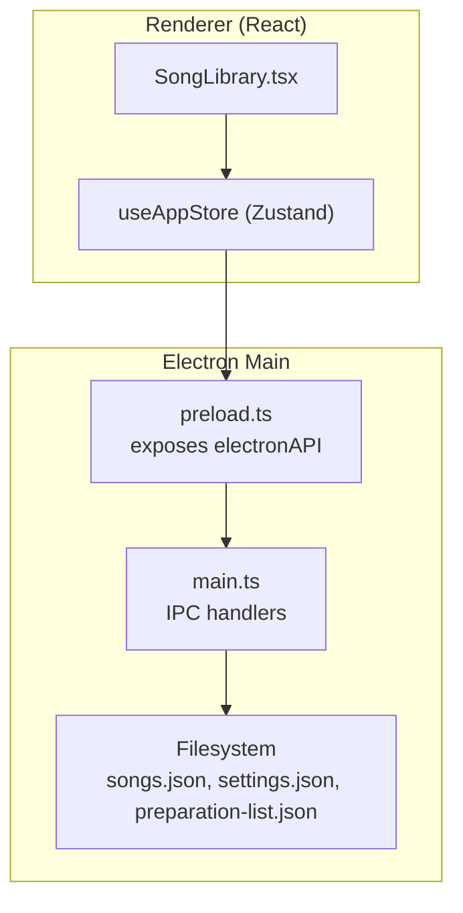
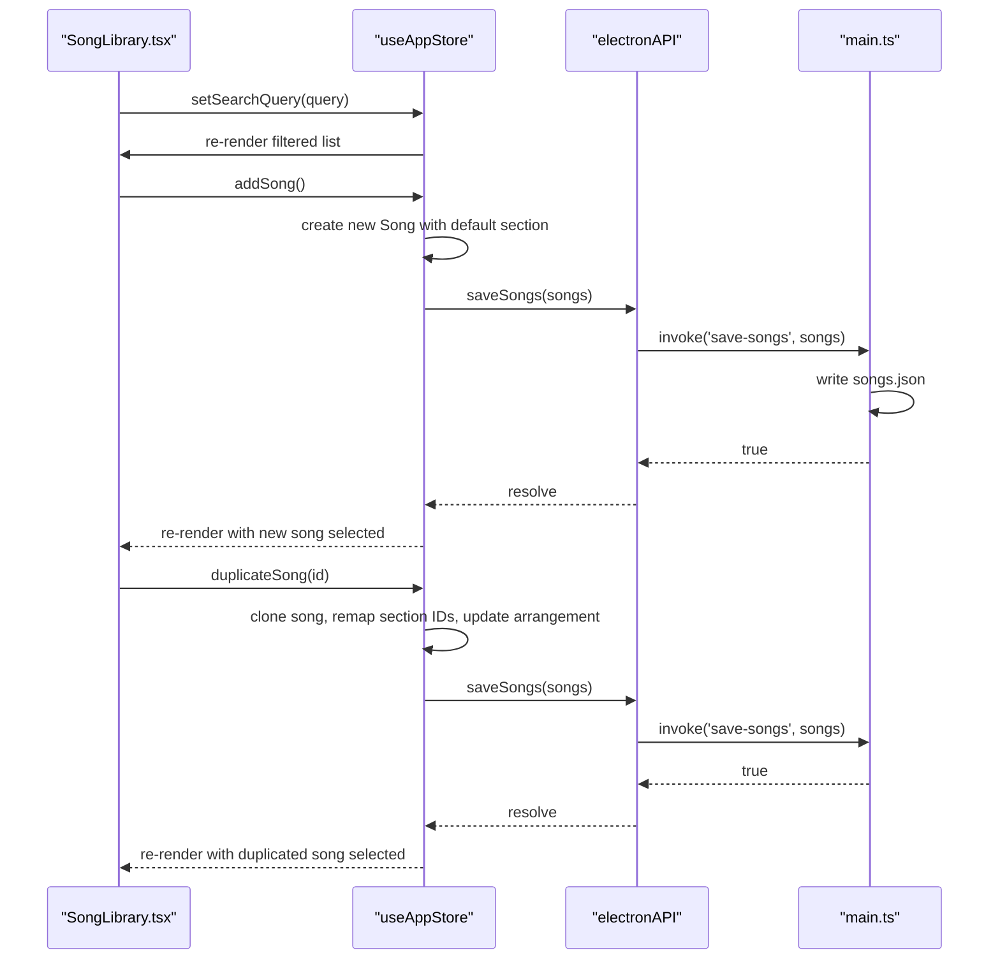
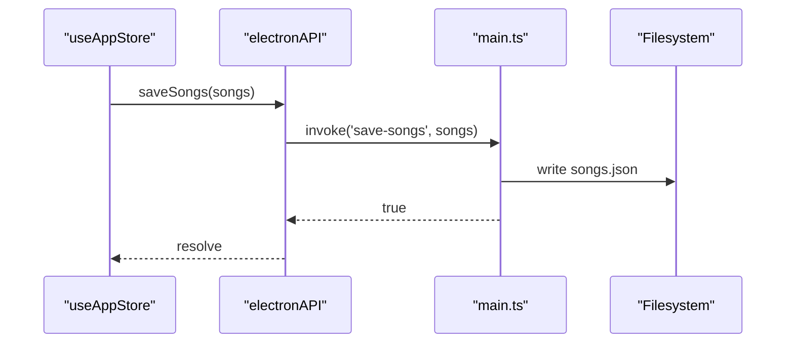
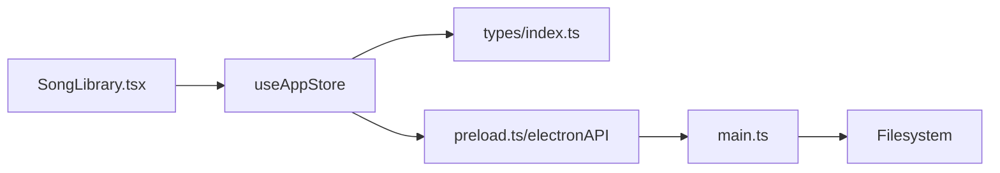

# Song Management Actions

<cite>
**Referenced Files in This Document**
- [appStore.ts](file://src/store/appStore.ts)
- [SongLibrary.tsx](file://src/components/SongLibrary.tsx)
- [index.ts](file://src/types/index.ts)
- [seedData.ts](file://src/utils/seedData.ts)
- [main.ts](file://electron/main.ts)
- [preload.ts](file://electron/preload.ts)
</cite>

## Table of Contents
1. [Introduction](#introduction)
2. [Project Structure](#project-structure)
3. [Core Components](#core-components)
4. [Architecture Overview](#architecture-overview)
5. [Detailed Component Analysis](#detailed-component-analysis)
6. [Dependency Analysis](#dependency-analysis)
7. [Performance Considerations](#performance-considerations)
8. [Troubleshooting Guide](#troubleshooting-guide)
9. [Conclusion](#conclusion)

## Introduction
This document provides comprehensive documentation for song management actions in LyricDeck’s Zustand store. It covers all CRUD operations (addSong, updateSong, deleteSong, duplicateSong), the song creation workflow (including default section generation and UUID assignment), duplication behavior (section ID mapping and arrangement updates), search and filtering via setSearchQuery, error handling patterns, validation rules, state consistency guarantees, and automatic persistence behavior triggered by song operations.

## Project Structure
The song management functionality resides in the central Zustand store and is consumed by UI components. Persistence is handled by Electron IPC bridging to the main process, which writes to local files.

**Diagram sources**
- [SongLibrary.tsx:1-193](file://src/components/SongLibrary.tsx#L1-L193)
- [appStore.ts:98-385](file://src/store/appStore.ts#L98-L385)
- [preload.ts:1-43](file://electron/preload.ts#L1-L43)
- [main.ts:192-218](file://electron/main.ts#L192-L218)

**Section sources**
- [appStore.ts:98-385](file://src/store/appStore.ts#L98-L385)
- [SongLibrary.tsx:1-193](file://src/components/SongLibrary.tsx#L1-L193)
- [preload.ts:1-43](file://electron/preload.ts#L1-L43)
- [main.ts:192-218](file://electron/main.ts#L192-L218)

## Core Components
- Zustand store (appStore.ts): Defines the state shape, actions, and persistence hooks for song management.
- UI component (SongLibrary.tsx): Provides search/filtering UI and binds actions to the store.
- Types (index.ts): Defines Song, LyricSection, and related interfaces used by the store.
- Seed data (seedData.ts): Utility for creating sample songs with deterministic defaults.
- Electron bridge (preload.ts, main.ts): Exposes IPC APIs for loading/saving data and manages persistence.

Key store slices and actions:
- Songs library: setSongs, addSong, deleteSong, duplicateSong, updateSong, selectSong, setSearchQuery
- Sections: addSection, updateSection, deleteSection, reorderSections
- Arrangement: setArrangement, addToArrangement, removeFromArrangement
- Persistence: loadFromDisk, saveToDisk

**Section sources**
- [appStore.ts:31-96](file://src/store/appStore.ts#L31-L96)
- [SongLibrary.tsx:8-95](file://src/components/SongLibrary.tsx#L8-L95)
- [index.ts:50-67](file://src/types/index.ts#L50-L67)

## Architecture Overview
The store encapsulates the application state and exposes action methods. Song operations mutate the in-memory state and trigger persistence via saveToDisk. The UI subscribes to store changes and renders filtered lists based on searchQuery.

**Diagram sources**
- [SongLibrary.tsx:14-35](file://src/components/SongLibrary.tsx#L14-L35)
- [appStore.ts:116-183](file://src/store/appStore.ts#L116-L183)
- [preload.ts:23-29](file://electron/preload.ts#L23-L29)
- [main.ts:197-200](file://electron/main.ts#L197-L200)

## Detailed Component Analysis

### Song Creation Workflow (addSong)
Behavior:
- Generates a new Song with:
  - Unique id via UUID
  - Default title
  - Empty artist field
  - Metadata with empty tags array
  - Single default section (type “Verse”, label “Verse 1”, empty lyrics)
  - Empty arrangement
  - Presentation settings with default background/text style and showCopyright disabled
  - createdAt and updatedAt timestamps
- Appends the new song to the songs array and selects it
- Immediately persists to disk via saveToDisk

Side effects:
- Updates store.songs and store.selectedSongId
- Triggers saveToDisk which serializes to songs.json

Validation and consistency:
- No explicit validation performed in addSong; relies on default values and UUID generation
- Timestamps are set consistently

Persistence:
- saveToDisk invoked after mutation

**Section sources**
- [appStore.ts:116-142](file://src/store/appStore.ts#L116-L142)
- [index.ts:50-67](file://src/types/index.ts#L50-L67)

### Duplicate Song (duplicateSong)
Behavior:
- Locates the original song by id
- Creates a deep clone using JSON serialization and parsing to ensure isolation
- Assigns a new UUID to the duplicate
- Renames the duplicate title to “Original Title (Copy)”
- Recreates all section IDs to be unique
- Remaps arrangement entries to reference the new section IDs
- Preserves createdAt/updatedAt timestamps
- Appends the duplicate to the songs array and selects it
- Persists changes to disk

Side effects:
- Duplicates sections and updates arrangement references
- Maintains section ordering and arrangement continuity

Validation and consistency:
- Validates existence of the original song before proceeding
- Uses a Map to track old-to-new section ID mappings to preserve arrangement semantics

Persistence:
- saveToDisk invoked after mutation

**Section sources**
- [appStore.ts:151-172](file://src/store/appStore.ts#L151-L172)

### Update Song (updateSong)
Behavior:
- Accepts an id and a partial Song object
- Replaces the matching song with merged updates and updates updatedAt
- Persists changes to disk

Validation and consistency:
- No explicit validation; merges provided updates into the existing song
- updatedAt is always refreshed

Persistence:
- saveToDisk invoked after mutation

**Section sources**
- [appStore.ts:174-180](file://src/store/appStore.ts#L174-L180)

### Delete Song (deleteSong)
Behavior:
- Filters out the song with the given id
- Clears selection if the deleted song was selected
- Persists changes to disk

Validation and consistency:
- Safe deletion if id does not exist (no-op)
- Ensures selectedSongId remains consistent

Persistence:
- saveToDisk invoked after mutation

**Section sources**
- [appStore.ts:144-149](file://src/store/appStore.ts#L144-L149)

### Search and Filtering (setSearchQuery)
Behavior:
- setSearchQuery updates the searchQuery state atomically
- The UI component applies a filter over songs:
  - Case-insensitive match against title, artist, songId, and lyrics across all sections
  - Optional sorting by songId (with numeric comparison) or alphabetically by title
- The filtered list drives the SongLibrary rendering

Validation and consistency:
- No validation on the query itself; free-text search
- Sorting handles missing songId gracefully

**Section sources**
- [appStore.ts:183](file://src/store/appStore.ts#L183)
- [SongLibrary.tsx:14-35](file://src/components/SongLibrary.tsx#L14-L35)

### Section Management (related to song operations)
While not part of the core CRUD actions, section operations are closely related:
- addSection: creates a new section with a unique id and auto-incremented label for the given type
- updateSection: updates a specific section within a song
- deleteSection: removes a section and prunes it from the arrangement
- reorderSections: replaces the entire sections array

These actions delegate to updateSong to persist changes.

**Section sources**
- [appStore.ts:185-220](file://src/store/appStore.ts#L185-L220)

### Automatic Persistence Behavior
All song operations (addSong, updateSong, deleteSong, duplicateSong) call saveToDisk. The store’s saveToDisk invokes electronAPI.saveSongs, which sends an IPC request to main.ts. The main process writes songs.json to disk and responds to the renderer.

**Diagram sources**
- [appStore.ts:379-383](file://src/store/appStore.ts#L379-L383)
- [preload.ts:24-25](file://electron/preload.ts#L24-L25)
- [main.ts:197-200](file://electron/main.ts#L197-L200)

## Dependency Analysis
- UI depends on useAppStore for state and actions
- Store depends on types for Song/LyricSection shapes
- Store depends on electronAPI for persistence
- Electron main process depends on filesystem for persistence

**Diagram sources**
- [SongLibrary.tsx:1-193](file://src/components/SongLibrary.tsx#L1-L193)
- [appStore.ts:98-385](file://src/store/appStore.ts#L98-L385)
- [index.ts:1-89](file://src/types/index.ts#L1-L89)
- [preload.ts:1-43](file://electron/preload.ts#L1-L43)
- [main.ts:192-218](file://electron/main.ts#L192-L218)

**Section sources**
- [SongLibrary.tsx:1-193](file://src/components/SongLibrary.tsx#L1-L193)
- [appStore.ts:98-385](file://src/store/appStore.ts#L98-L385)
- [index.ts:1-89](file://src/types/index.ts#L1-L89)
- [preload.ts:1-43](file://electron/preload.ts#L1-L43)
- [main.ts:192-218](file://electron/main.ts#L192-L218)

## Performance Considerations
- addSong and duplicateSong create new arrays and objects; complexity is O(n) for list updates plus O(m) for section cloning where m is the number of sections.
- duplicateSong performs an O(m) mapping of section IDs; acceptable for typical song sizes.
- setSearchQuery filter scans all songs and sections; complexity is O(n·(1+avg sections per song)).
- saveToDisk writes the entire songs collection; consider batching if many operations occur rapidly.

## Troubleshooting Guide
Common issues and resolutions:
- Duplicate song not appearing:
  - Verify duplicateSong executes and saveToDisk completes. Check that the Electron IPC handler for save-songs is reachable and songs.json is writable.
- Deleted song still visible:
  - Confirm deleteSong clears selectedSongId when the deleted song was selected.
- Search yields no results:
  - Ensure setSearchQuery is bound to the input and that the filter checks title, artist, songId, and lyrics across sections.
- Section arrangement broken after duplication:
  - The duplicate action remaps arrangement entries to new section IDs; confirm the mapping logic runs and the updated arrangement is persisted.

Error handling patterns:
- Missing song during duplicate/update/delete:
  - The store checks for song existence and returns early if not found, preventing errors.
- UI confirmation for destructive actions:
  - The UI component uses a confirmation prompt before deleting a song.

Persistence failures:
- If saveToDisk fails, the renderer will not reflect persistent changes. Verify electronAPI availability and main process IPC handlers.

**Section sources**
- [appStore.ts:144-172](file://src/store/appStore.ts#L144-L172)
- [SongLibrary.tsx:171](file://src/components/SongLibrary.tsx#L171)
- [main.ts:197-200](file://electron/main.ts#L197-L200)

## Conclusion
LyricDeck’s song management actions provide a robust, consistent, and automatically persisted workflow. The Zustand store centralizes state and ensures UI reactivity, while Electron IPC guarantees reliable persistence. The duplication logic preserves arrangement semantics by remapping section IDs, and the search/filter pipeline enables efficient discovery. Validation is minimal but sufficient for the intended UX; broader validation can be introduced at the UI layer if needed.