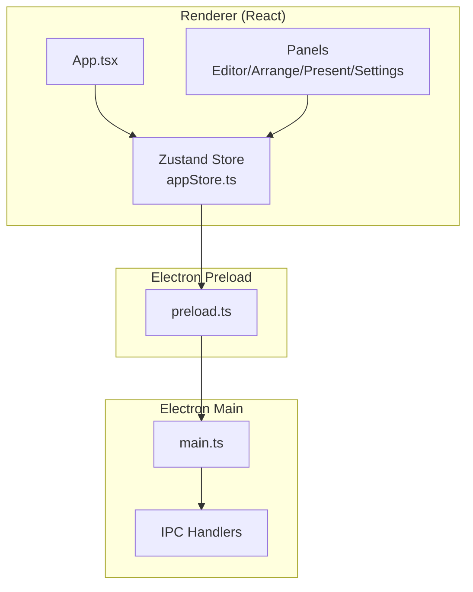
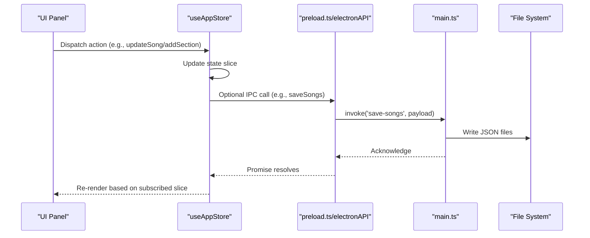
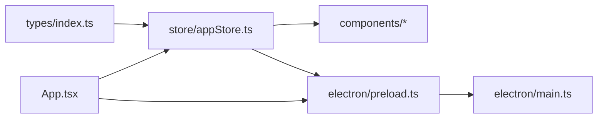

# State Management Architecture

<cite>
**Referenced Files in This Document**
- [appStore.ts](file://src/store/appStore.ts)
- [index.ts](file://src/types/index.ts)
- [App.tsx](file://src/App.tsx)
- [ArrangePanel.tsx](file://src/components/ArrangePanel.tsx)
- [EditorPanel.tsx](file://src/components/EditorPanel.tsx)
- [PresentPanel.tsx](file://src/components/PresentPanel.tsx)
- [SettingsPanel.tsx](file://src/components/SettingsPanel.tsx)
- [PreparationList.tsx](file://src/components/PreparationList.tsx)
- [ProjectionView.tsx](file://src/components/ProjectionView.tsx)
- [main.ts](file://electron/main.ts)
- [preload.ts](file://electron/preload.ts)
- [seedData.ts](file://src/utils/seedData.ts)
- [en.ts](file://src/i18n/en.ts)
- [index.ts](file://src/i18n/index.ts)
</cite>

## Table of Contents
1. [Introduction](#introduction)
2. [Project Structure](#project-structure)
3. [Core Components](#core-components)
4. [Architecture Overview](#architecture-overview)
5. [Detailed Component Analysis](#detailed-component-analysis)
6. [Dependency Analysis](#dependency-analysis)
7. [Performance Considerations](#performance-considerations)
8. [Troubleshooting Guide](#troubleshooting-guide)
9. [Conclusion](#conclusion)

## Introduction
This document explains LyricDeck’s state management architecture built on Zustand. It covers the centralized store structure, state shape, action creators, middleware-like patterns, reactive subscriptions, persistence mechanisms, and the integration with Electron IPC for projection and data storage. It also documents state normalization patterns, async action handling, error boundary management, and performance optimizations such as selective subscriptions and state hydration from disk.

## Project Structure
LyricDeck organizes state management around a single Zustand store with strongly typed models and a clear separation of concerns:
- Centralized store: appStore.ts defines the state shape and actions.
- Types: index.ts defines Song, ProjectionState, BackgroundSettings, TextStyle, and AppSettings.
- UI panels: Each panel subscribes to relevant slices of the store and dispatches actions.
- Electron integration: preload.ts exposes IPC APIs; main.ts implements handlers for persistence and projection.

**Diagram sources**
- [appStore.ts:1-385](file://src/store/appStore.ts#L1-L385)
- [App.tsx:12-102](file://src/App.tsx#L12-L102)
- [main.ts:154-218](file://electron/main.ts#L154-L218)
- [preload.ts:3-42](file://electron/preload.ts#L3-L42)

**Section sources**
- [appStore.ts:1-385](file://src/store/appStore.ts#L1-L385)
- [index.ts:1-89](file://src/types/index.ts#L1-L89)
- [App.tsx:12-102](file://src/App.tsx#L12-L102)

## Core Components
- Centralized store: Provides state slices for songs, UI, projection, settings, and preparation list; exposes synchronous and asynchronous actions.
- Types: Strongly typed models define the shape of state and actions, enabling safer development and better IDE support.
- Panels: Subscribe to store slices and call actions to mutate state.
- Electron IPC: Bridges renderer and main processes for persistence and projection.

Key store responsibilities:
- Song management: CRUD operations, duplication, reordering sections, and arrangement management.
- Projection state: Live projection updates, navigation, modes, and line offset adjustments.
- Settings: Global defaults and per-song presentation settings.
- Preparation list: Persistent queue of songs for quick selection.
- Persistence: Load/save songs, settings, and preparation list via IPC.

**Section sources**
- [appStore.ts:31-96](file://src/store/appStore.ts#L31-L96)
- [index.ts:50-89](file://src/types/index.ts#L50-L89)

## Architecture Overview
The store uses a functional approach with create and exposes actions that either update state directly or delegate to IPC for persistence/projection. Components subscribe to minimal slices of state to optimize re-renders.

**Diagram sources**
- [appStore.ts:174-180](file://src/store/appStore.ts#L174-L180)
- [appStore.ts:379-383](file://src/store/appStore.ts#L379-L383)
- [preload.ts:24-29](file://electron/preload.ts#L24-L29)
- [main.ts:193-200](file://electron/main.ts#L193-L200)

## Detailed Component Analysis

### Store: State Shape and Actions
The store defines:
- Songs: array of Song with sections, arrangement, presentation settings, and timestamps.
- UI: activeTab, isProjectionOpen.
- Projection: ProjectionState with mode, current indices, lyrics, offsets, background, text style, and optional copyright.
- Settings: defaultBackground/defaultTextStyle plus optional projection monitor and logo.
- Preparation list: ordered song IDs.

Actions include:
- Song library: setSongs, addSong, deleteSong, duplicateSong, updateSong, selectSong, setSearchQuery.
- Sections: addSection, updateSection, deleteSection, reorderSections.
- Arrangement: setArrangement, addToArrangement, removeFromArrangement.
- Projection: setProjectionState, goToSlide, nextSlide, prevSlide, setProjectionMode, setIsProjectionOpen, shiftLines.
- UI: setActiveTab.
- Settings: setSettings.
- Preparation list: addToPreparationList, removeFromPreparationList, reorderPreparationList, clearPreparationList, selectFromPreparationList.
- Persistence: loadFromDisk, saveToDisk.

Middleware-like patterns:
- setProjectionState sends updates to the projection window via IPC.
- setSettings and preparation list actions persist to disk via IPC.
- saveToDisk is invoked after mutations that change persisted data.

**Section sources**
- [appStore.ts:31-96](file://src/store/appStore.ts#L31-L96)
- [appStore.ts:98-384](file://src/store/appStore.ts#L98-L384)
- [index.ts:50-89](file://src/types/index.ts#L50-L89)

### Types: Data Models
- SectionType: union of section categories.
- LyricSection: section with id, type, label, lyrics, optional background override.
- BackgroundSettings: color, gradient, image, or video with overlays and blur.
- TextStyle: typography and layout properties.
- PresentationSettings: per-song background/text style and copyright toggle.
- Song: complete song model with metadata, sections, arrangement, presentation, timestamps.
- ProjectionMode: live, blank, black, logo, clear.
- ProjectionState: projection state snapshot sent to projection window.
- AppSettings: global defaults and optional logo.

Normalization patterns:
- Song.arrangement stores section IDs; sections are referenced by ID.
- Presentation settings are normalized per song; defaults are stored globally in settings.

**Section sources**
- [index.ts:3-89](file://src/types/index.ts#L3-L89)

### UI Panels: Subscriptions and Actions
- EditorPanel: subscribes to songs and selectedSongId; updates metadata and sections; previews slides.
- ArrangePanel: subscribes to songs and selectedSongId; manages arrangement via drag-and-drop; integrates with preparation list.
- PresentPanel: subscribes to projectionState, currentArrangementIndex, and isProjectionOpen; handles keyboard shortcuts and projection window lifecycle.
- SettingsPanel: subscribes to songs and selectedSongId; updates per-song presentation settings and triggers import/export.
- PreparationList: subscribes to preparationList and selectedSongId; supports drag-and-drop reordering and selection.

Subscription model:
- Each panel uses useAppStore to subscribe to a minimal subset of state needed for rendering and interactions.
- Actions are dispatched locally; some actions persist via IPC.

**Section sources**
- [EditorPanel.tsx:17-118](file://src/components/EditorPanel.tsx#L17-L118)
- [ArrangePanel.tsx:22-134](file://src/components/ArrangePanel.tsx#L22-L134)
- [PresentPanel.tsx:6-347](file://src/components/PresentPanel.tsx#L6-L347)
- [SettingsPanel.tsx:7-417](file://src/components/SettingsPanel.tsx#L7-L417)
- [PreparationList.tsx:25-123](file://src/components/PreparationList.tsx#L25-L123)

### Electron IPC Integration
- preload.ts exposes electronAPI with methods for:
  - Display management: getDisplays, openProjection, closeProjection, isProjectionOpen.
  - Projection updates: updateProjection (send), onProjectionState/onProjectionWindowClosed (receive).
  - Persistence: loadSongs/saveSongs, loadSettings/saveSettings, loadPreparationList/savePreparationList.
  - Background gallery: selectImage, addBackgroundImage, listBackgroundImages, deleteBackgroundImage.
  - Import/Export: exportData, importData.
- main.ts implements IPC handlers for:
  - Data persistence: load/save songs/settings/preparation list.
  - Projection: open/close projection windows, send projection-state events.
  - Image repository: SQLite-backed image storage with lyricdeck-img protocol.
  - Import/Export: merge/import data and images.

Hydration and seeding:
- App.tsx loads persisted data on startup and seeds default songs if none exist.

**Section sources**
- [preload.ts:3-42](file://electron/preload.ts#L3-L42)
- [main.ts:154-218](file://electron/main.ts#L154-L218)
- [App.tsx:19-32](file://src/App.tsx#L19-L32)
- [seedData.ts:51-164](file://src/utils/seedData.ts#L51-L164)

### Projection Window
- ProjectionView listens for projection-state messages and renders according to ProjectionState.
- Modes: black, logo, live, blank, clear.
- Supports background overlays, text styles, and line offset adjustments.

**Section sources**
- [ProjectionView.tsx:4-134](file://src/components/ProjectionView.tsx#L4-L134)
- [appStore.ts:241-274](file://src/store/appStore.ts#L241-L274)

### Async Action Handling and Persistence
- saveToDisk and loadFromDisk are async; they rely on IPC to read/write JSON files.
- After mutating persisted data (e.g., addSong/deleteSong/updateSong), the store saves automatically.
- Import/Export uses main.ts handlers to merge or replace data and images.

**Section sources**
- [appStore.ts:361-383](file://src/store/appStore.ts#L361-L383)
- [main.ts:193-218](file://electron/main.ts#L193-L218)
- [SettingsPanel.tsx:449-522](file://src/components/SettingsPanel.tsx#L449-L522)

### Error Boundary Management
- The store does not explicitly define error boundaries; however, components handle errors gracefully:
  - Confirmation prompts before destructive actions (e.g., deleting sections).
  - Safe fallbacks when no song is selected in panels.
  - IPC failures are handled by checking window.electronAPI presence before invoking.

**Section sources**
- [EditorPanel.tsx:98-102](file://src/components/EditorPanel.tsx#L98-L102)
- [PresentPanel.tsx:376-384](file://src/App.tsx#L376-L384)

## Dependency Analysis
- Store depends on types for strong typing.
- Panels depend on the store for state and actions.
- Preload depends on main for IPC registration.
- App depends on the store for hydration and projection window lifecycle.

**Diagram sources**
- [index.ts:1-89](file://src/types/index.ts#L1-L89)
- [appStore.ts:1-3](file://src/store/appStore.ts#L1-L3)
- [App.tsx:12-102](file://src/App.tsx#L12-L102)
- [preload.ts:3-42](file://electron/preload.ts#L3-L42)
- [main.ts:154-218](file://electron/main.ts#L154-L218)

**Section sources**
- [index.ts:1-89](file://src/types/index.ts#L1-L89)
- [appStore.ts:1-3](file://src/store/appStore.ts#L1-L3)
- [App.tsx:12-102](file://src/App.tsx#L12-L102)

## Performance Considerations
- Selective subscriptions: Panels subscribe only to the state they need, minimizing re-renders.
- Minimal state updates: Actions update only affected slices (e.g., updateSong updates sections or arrangement).
- Efficient projection updates: setProjectionState merges partial state and sends only necessary updates to the projection window.
- Hydration on startup: loadFromDisk runs once at startup; App.tsx seeds default data if empty.
- Debounced persistence: saveToDisk is invoked after each mutation; consider batching for heavy operations.

[No sources needed since this section provides general guidance]

## Troubleshooting Guide
Common issues and resolutions:
- No songs loaded: Verify loadFromDisk completes and seed data is written.
- Projection window not updating: Ensure setProjectionState is called and electronAPI.updateProjection is available.
- Import/Export failures: Confirm file format and that main.ts handlers parse JSON correctly.
- IPC not available: Check window.electronAPI presence before invoking handlers.

**Section sources**
- [App.tsx:19-32](file://src/App.tsx#L19-L32)
- [appStore.ts:241-249](file://src/store/appStore.ts#L241-L249)
- [main.ts:292-354](file://electron/main.ts#L292-L354)

## Conclusion
LyricDeck’s Zustand-based state management provides a clean, scalable foundation for song editing, arrangement building, projection control, and settings persistence. The store’s typed models, selective subscriptions, and IPC-driven persistence integrate seamlessly with Electron to deliver a responsive and robust user experience. Extending the architecture involves adding new action slices, updating types, and wiring IPC handlers in main.ts as needed.