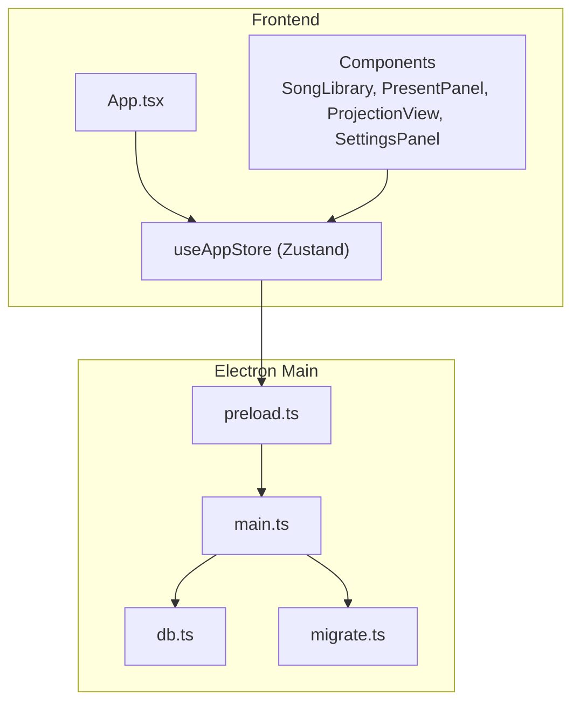
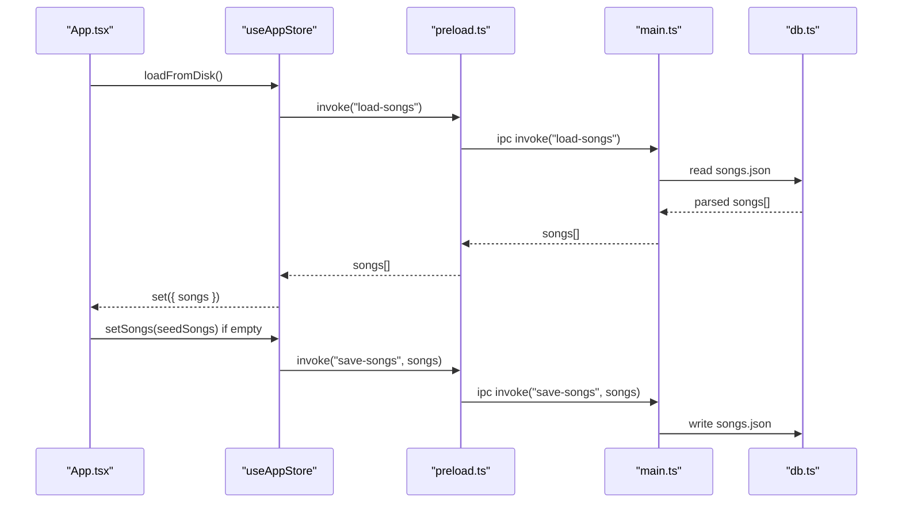
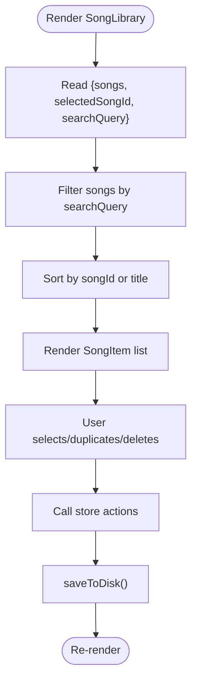
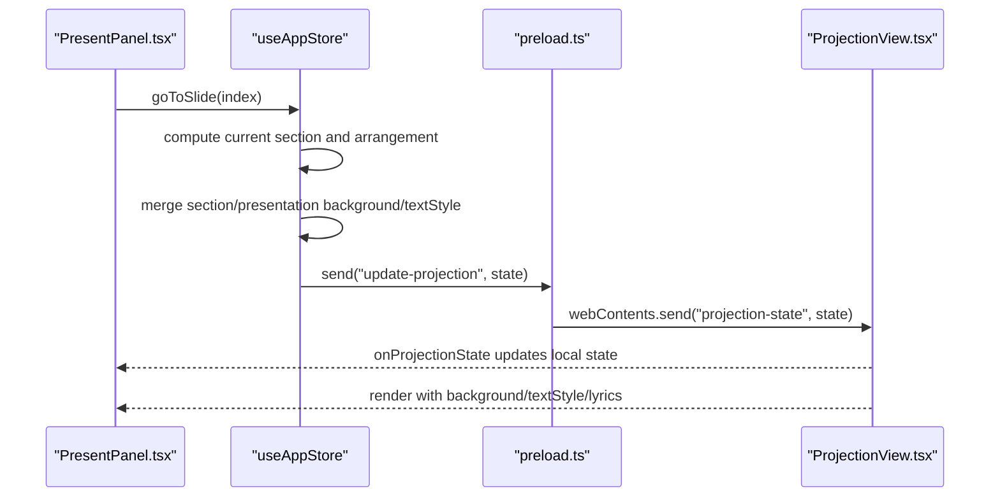
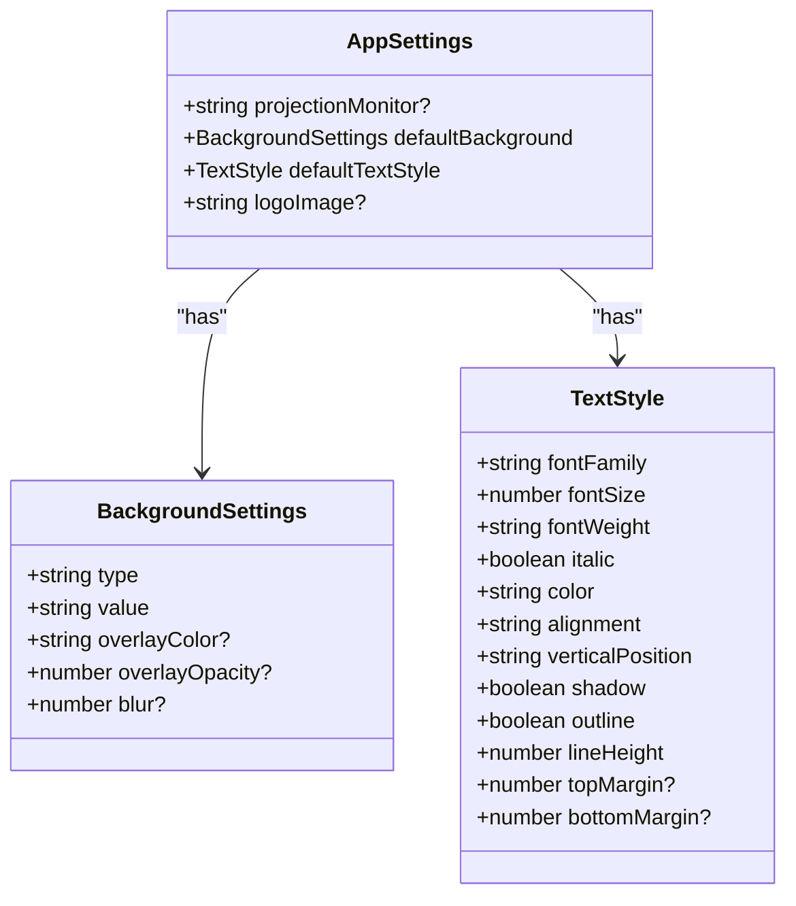
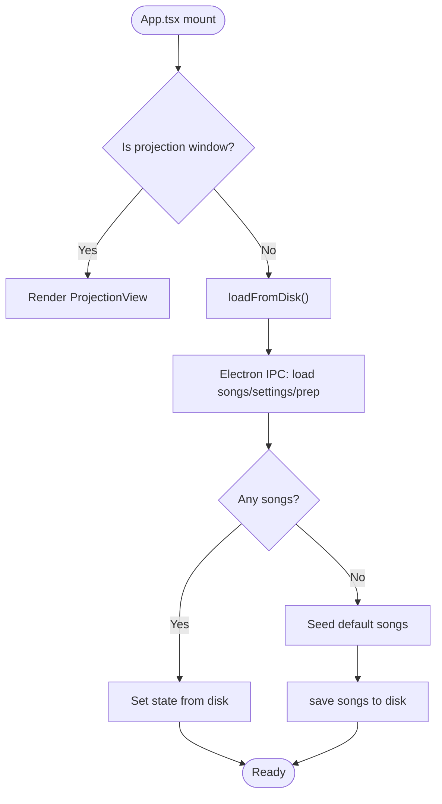
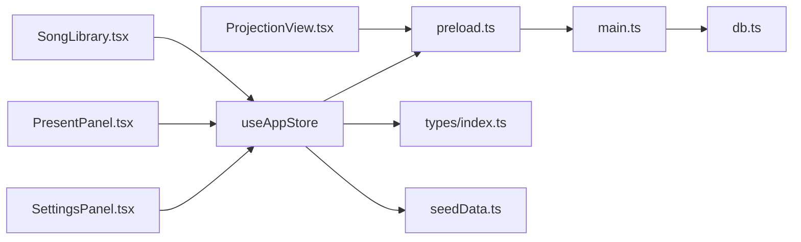

# Store State Structure

<cite>
**Referenced Files in This Document**
- [appStore.ts](file://src/store/appStore.ts)
- [index.ts](file://src/types/index.ts)
- [seedData.ts](file://src/utils/seedData.ts)
- [App.tsx](file://src/App.tsx)
- [SongLibrary.tsx](file://src/components/SongLibrary.tsx)
- [ProjectionView.tsx](file://src/components/ProjectionView.tsx)
- [PresentPanel.tsx](file://src/components/PresentPanel.tsx)
- [SettingsPanel.tsx](file://src/components/SettingsPanel.tsx)
- [main.ts](file://electron/main.ts)
- [preload.ts](file://electron/preload.ts)
- [db.ts](file://electron/db.ts)
- [migrate.ts](file://electron/migrate.ts)
</cite>

## Table of Contents
1. [Introduction](#introduction)
2. [Project Structure](#project-structure)
3. [Core Components](#core-components)
4. [Architecture Overview](#architecture-overview)
5. [Detailed Component Analysis](#detailed-component-analysis)
6. [Dependency Analysis](#dependency-analysis)
7. [Performance Considerations](#performance-considerations)
8. [Troubleshooting Guide](#troubleshooting-guide)
9. [Conclusion](#conclusion)

## Introduction
This document describes LyricDeck’s Zustand store state structure and how it drives the application. It covers the complete state shape, initialization, default values, derived state computation, normalization patterns, and persistence. It also explains how the store hydrates from disk at startup and how UI components react to state changes.

## Project Structure
The store is implemented as a single Zustand store with typed actions and selectors. Data is persisted to disk via Electron IPC and local files. Types are centralized to ensure consistency across the store, components, and persistence layer.

**Diagram sources**
- [App.tsx:12-32](file://src/App.tsx#L12-L32)
- [appStore.ts:98-384](file://src/store/appStore.ts#L98-L384)
- [main.ts:356-383](file://electron/main.ts#L356-L383)
- [preload.ts:3-42](file://electron/preload.ts#L3-L42)
- [db.ts:1-214](file://electron/db.ts#L1-L214)
- [migrate.ts:1-127](file://electron/migrate.ts#L1-L127)

**Section sources**
- [appStore.ts:31-111](file://src/store/appStore.ts#L31-L111)
- [index.ts:13-89](file://src/types/index.ts#L13-L89)

## Core Components
This section documents the complete state shape, default values, and action categories.

- Song Library
  - songs: Song[]
  - selectedSongId: string | null
  - searchQuery: string
  - Actions: setSongs, addSong, deleteSong, duplicateSong, updateSong, selectSong, setSearchQuery
  - Derived behavior: search filtering and selection

- UI State
  - activeTab: 'editor' | 'arrange' | 'present' | 'settings'
  - isProjectionOpen: boolean
  - Actions: setActiveTab, setIsProjectionOpen

- Projection
  - projectionState: ProjectionState
  - currentArrangementIndex: number
  - Actions: setProjectionState, goToSlide, nextSlide, prevSlide, setProjectionMode, shiftLines

- Settings
  - settings: AppSettings
  - Default values: defaultBackground, defaultTextStyle
  - Actions: setSettings

- Preparation List
  - preparationList: string[] (song IDs)
  - Actions: addToPreparationList, removeFromPreparationList, reorderPreparationList, clearPreparationList, selectFromPreparationList

- Persistence
  - Actions: loadFromDisk, saveToDisk

Initialization defaults:
- Projection default mode: black
- Default background: type=color, value=#000000
- Default text style: font=Arial, size=64, bold, center-aligned, middle vertical position, shadow=true, outline=false, lineHeight=1.4, top/bottom margins=80

**Section sources**
- [appStore.ts:31-111](file://src/store/appStore.ts#L31-L111)
- [appStore.ts:5-29](file://src/store/appStore.ts#L5-L29)
- [index.ts:21-89](file://src/types/index.ts#L21-L89)

## Architecture Overview
The store orchestrates data and UI state. Components subscribe to store slices and call actions. Electron handles persistence and projection windows.

**Diagram sources**
- [App.tsx:19-32](file://src/App.tsx#L19-L32)
- [appStore.ts:362-383](file://src/store/appStore.ts#L362-L383)
- [preload.ts:24-25](file://electron/preload.ts#L24-L25)
- [main.ts:39-51](file://electron/main.ts#L39-L51)
- [db.ts:1-214](file://electron/db.ts#L1-L214)

## Detailed Component Analysis

### State Shape and Defaults
- ProjectionState
  - mode: live | blank | black | logo | clear
  - currentSongId/currentSectionId/currentArrangementIndex: optional identifiers
  - lyrics: string
  - lineOffset: number
  - background: BackgroundSettings
  - textStyle: TextStyle
  - copyright: string (optional)
- BackgroundSettings
  - type: color | gradient | image | video
  - value: string
  - overlayColor, overlayOpacity, blur: optional
- TextStyle
  - fontFamily, fontSize, fontWeight, italic, color
  - alignment: left | center | right
  - verticalPosition: top | middle | bottom
  - shadow, outline: booleans
  - lineHeight, topMargin, bottomMargin: optional
- AppSettings
  - projectionMonitor: string (optional)
  - defaultBackground, defaultTextStyle (from defaults)
  - logoImage: string (optional)

Default values:
- Projection default mode: black
- Default background: type=color, value=#000000
- Default text style: font=Arial, size=64, bold, center, middle, shadow=true, outline=false, lineHeight=1.4, top/bottom margins=80

**Section sources**
- [index.ts:21-89](file://src/types/index.ts#L21-L89)
- [appStore.ts:5-29](file://src/store/appStore.ts#L5-L29)

### Song Library Arrays and Selection
- songs: array of Song
- selectedSongId: currently selected song ID or null
- searchQuery: filters songs by title, artist, songId, or lyrics content
- Actions:
  - setSongs, addSong, deleteSong, duplicateSong, updateSong, selectSong, setSearchQuery
- Derived state:
  - Filtered list computed in SongLibrary.tsx using searchQuery
  - Sorting by songId or title

**Diagram sources**
- [SongLibrary.tsx:8-95](file://src/components/SongLibrary.tsx#L8-L95)
- [appStore.ts:114-183](file://src/store/appStore.ts#L114-L183)
- [appStore.ts:379-383](file://src/store/appStore.ts#L379-L383)

**Section sources**
- [SongLibrary.tsx:14-35](file://src/components/SongLibrary.tsx#L14-L35)
- [appStore.ts:114-183](file://src/store/appStore.ts#L114-L183)

### Projection State and Rendering
- projectionState: controls projection window content and appearance
- currentArrangementIndex: current slide index in the arrangement
- Actions:
  - setProjectionState, goToSlide, nextSlide, prevSlide, setProjectionMode, setIsProjectionOpen, shiftLines
- Derived state:
  - goToSlide computes current lyrics, background, and text style from selected song and arrangement
  - shiftLines adjusts vertical positioning of lyrics
- Projection window receives updates via Electron IPC

**Diagram sources**
- [PresentPanel.tsx:6-19](file://src/components/PresentPanel.tsx#L6-L19)
- [appStore.ts:251-274](file://src/store/appStore.ts#L251-L274)
- [preload.ts:10-16](file://electron/preload.ts#L10-L16)
- [ProjectionView.tsx:4-29](file://src/components/ProjectionView.tsx#L4-L29)

**Section sources**
- [appStore.ts:241-302](file://src/store/appStore.ts#L241-L302)
- [PresentPanel.tsx:97-107](file://src/components/PresentPanel.tsx#L97-L107)
- [ProjectionView.tsx:31-74](file://src/components/ProjectionView.tsx#L31-L74)

### Settings Configuration and Defaults
- settings: AppSettings
- Default values:
  - defaultBackground: type=color, value=#000000
  - defaultTextStyle: font=Arial, size=64, bold, center, middle, shadow=true, outline=false, lineHeight=1.4, top/bottom margins=80
- Actions:
  - setSettings merges partial settings into current settings
- UI:
  - SettingsPanel.tsx reads current song’s presentation settings and updates them via updateSong

**Diagram sources**
- [index.ts:83-89](file://src/types/index.ts#L83-L89)
- [index.ts:21-42](file://src/types/index.ts#L21-L42)
- [index.ts:29-42](file://src/types/index.ts#L29-L42)

**Section sources**
- [appStore.ts:107-111](file://src/store/appStore.ts#L107-L111)
- [SettingsPanel.tsx:29-45](file://src/components/SettingsPanel.tsx#L29-L45)

### Preparation List
- preparationList: string[] of song IDs
- Actions:
  - addToPreparationList, removeFromPreparationList, reorderPreparationList, clearPreparationList, selectFromPreparationList
- Behavior:
  - selectFromPreparationList sets selectedSongId and navigates to first slide

**Section sources**
- [appStore.ts:316-359](file://src/store/appStore.ts#L316-L359)
- [PresentPanel.tsx:57-69](file://src/components/PresentPanel.tsx#L57-L69)

### State Hydration from Disk and Startup
- At startup, App.tsx calls loadFromDisk which:
  - Reads songs, settings, and preparation list from disk via Electron IPC
  - If no songs exist, seeds with default songs and persists them
- Persistence:
  - Songs: stored in songs.json
  - Settings: stored in settings.json
  - Preparation list: stored in preparation-list.json
- Migration:
  - Legacy image paths are migrated to lyricdeck-img:// URLs and references updated

**Diagram sources**
- [App.tsx:19-32](file://src/App.tsx#L19-L32)
- [appStore.ts:362-383](file://src/store/appStore.ts#L362-L383)
- [main.ts:39-79](file://electron/main.ts#L39-L79)
- [seedData.ts:51-165](file://src/utils/seedData.ts#L51-L165)
- [migrate.ts:63-122](file://electron/migrate.ts#L63-L122)

**Section sources**
- [App.tsx:19-32](file://src/App.tsx#L19-L32)
- [main.ts:39-79](file://electron/main.ts#L39-L79)
- [preload.ts:24-29](file://electron/preload.ts#L24-L29)
- [seedData.ts:51-165](file://src/utils/seedData.ts#L51-L165)
- [migrate.ts:63-122](file://electron/migrate.ts#L63-L122)

## Dependency Analysis
- Components depend on store slices via hooks
- Store actions call Electron IPC for persistence and projection updates
- Types define the contract between store, components, and persistence

**Diagram sources**
- [SongLibrary.tsx:8-10](file://src/components/SongLibrary.tsx#L8-L10)
- [PresentPanel.tsx:7-19](file://src/components/PresentPanel.tsx#L7-L19)
- [SettingsPanel.tsx:7-10](file://src/components/SettingsPanel.tsx#L7-L10)
- [ProjectionView.tsx:4-29](file://src/components/ProjectionView.tsx#L4-L29)
- [appStore.ts:98-384](file://src/store/appStore.ts#L98-L384)
- [preload.ts:3-42](file://electron/preload.ts#L3-L42)
- [main.ts:356-383](file://electron/main.ts#L356-L383)
- [db.ts:1-214](file://electron/db.ts#L1-L214)
- [index.ts:13-89](file://src/types/index.ts#L13-L89)
- [seedData.ts:51-165](file://src/utils/seedData.ts#L51-L165)

**Section sources**
- [index.ts:13-89](file://src/types/index.ts#L13-L89)
- [appStore.ts:98-384](file://src/store/appStore.ts#L98-L384)

## Performance Considerations
- Minimize re-renders by selecting only needed slices in components
- Batch updates where possible (e.g., updateSong updates sections and arrangement atomically)
- Avoid deep cloning large arrays unless necessary; use immutable updates as implemented
- Debounce searchQuery updates if needed for large libraries
- Persist to disk sparingly; the store saves after mutations that affect persistence

## Troubleshooting Guide
- Projection window does not receive updates:
  - Verify Electron IPC registration and that setProjectionState is called
  - Confirm projection window is listening for “projection-state” events
- Songs not loading on startup:
  - Check songs.json exists and is valid JSON
  - Ensure loadFromDisk resolves and sets state
- Images not displaying:
  - Verify migration updated legacy paths to lyricdeck-img:// URLs
  - Confirm protocol handler is registered and images exist in DB

**Section sources**
- [preload.ts:10-16](file://electron/preload.ts#L10-L16)
- [main.ts:186-190](file://electron/main.ts#L186-L190)
- [migrate.ts:63-122](file://electron/migrate.ts#L63-L122)

## Conclusion
LyricDeck’s store centralizes song data, UI state, projection configuration, and preparation lists. Defaults are explicit and typed, and persistence is handled via Electron IPC to local files. Components subscribe to minimal slices and call typed actions, enabling predictable updates and reliable projection rendering.