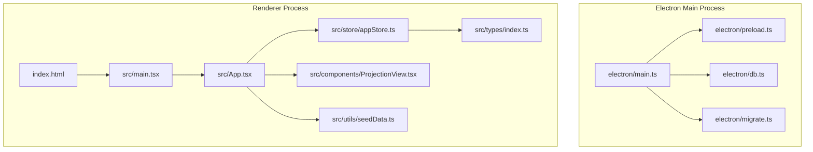
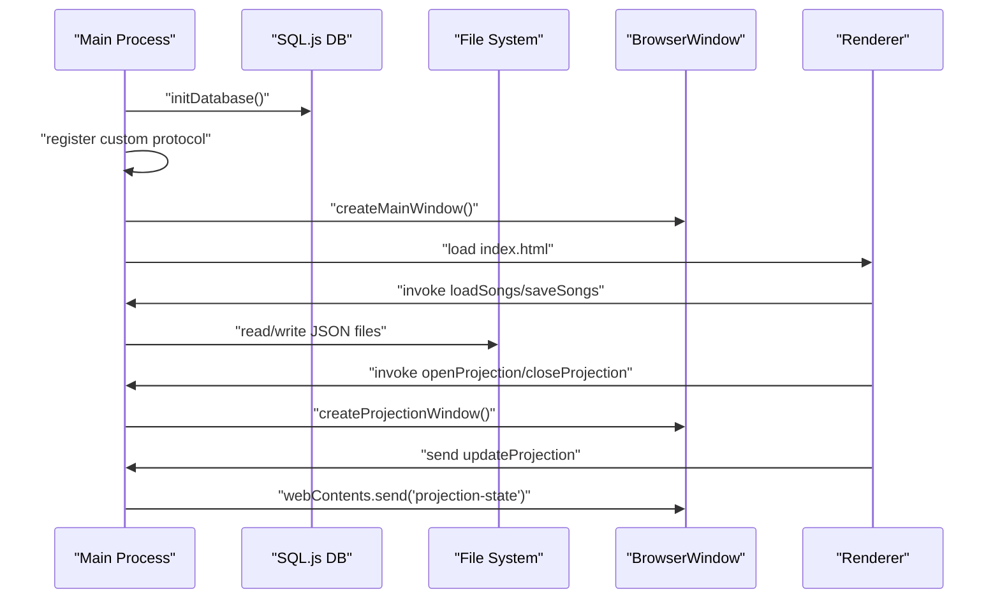
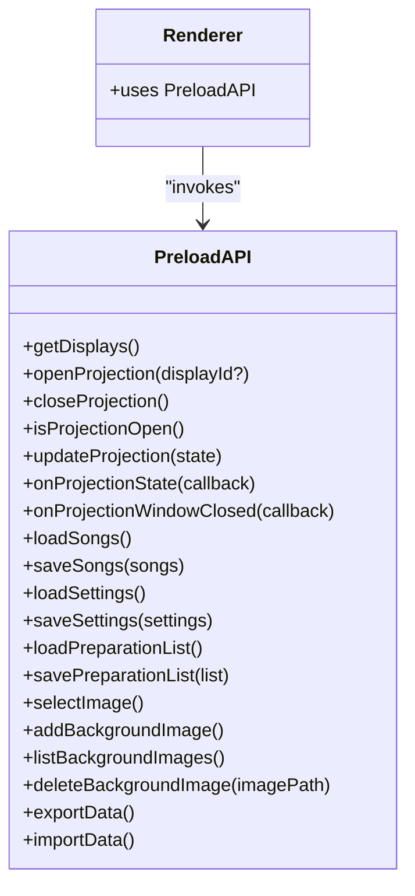
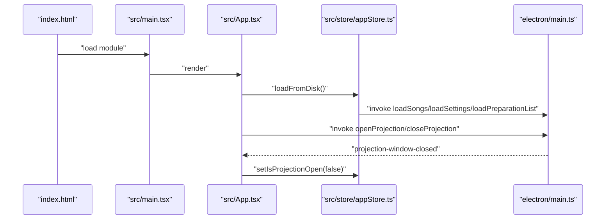
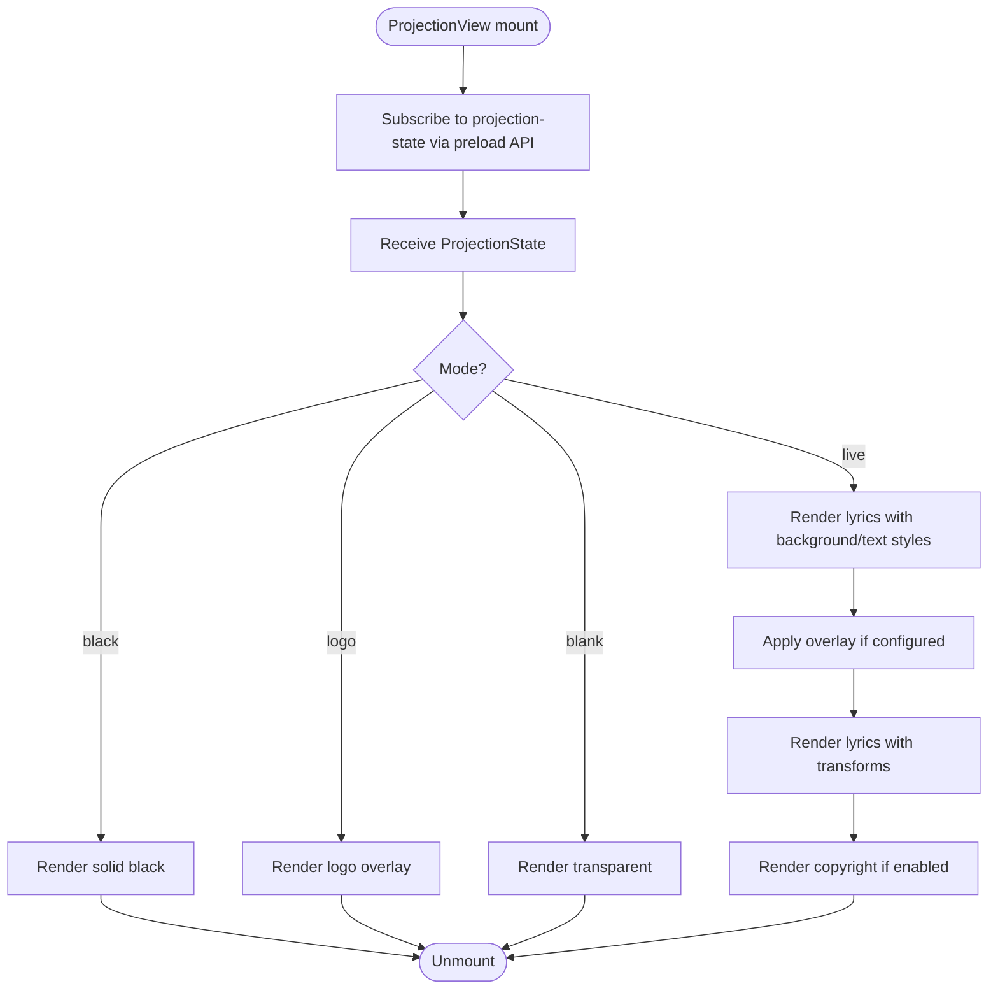
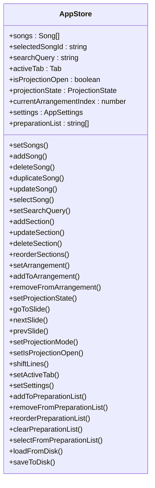
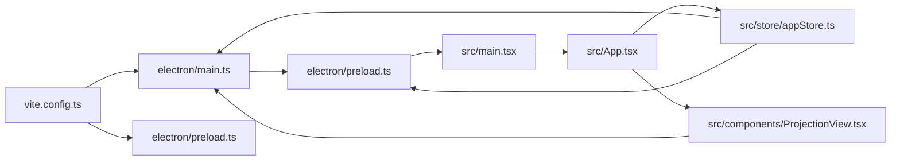

# System Overview

<cite>
**Referenced Files in This Document**
- [package.json](file://package.json)
- [vite.config.ts](file://vite.config.ts)
- [forge.config.js](file://forge.config.js)
- [index.html](file://index.html)
- [electron/main.ts](file://electron/main.ts)
- [electron/preload.ts](file://electron/preload.ts)
- [electron/db.ts](file://electron/db.ts)
- [electron/migrate.ts](file://electron/migrate.ts)
- [src/main.tsx](file://src/main.tsx)
- [src/App.tsx](file://src/App.tsx)
- [src/store/appStore.ts](file://src/store/appStore.ts)
- [src/components/ProjectionView.tsx](file://src/components/ProjectionView.tsx)
- [src/types/index.ts](file://src/types/index.ts)
- [src/utils/seedData.ts](file://src/utils/seedData.ts)
</cite>

## Table of Contents
1. [Introduction](#introduction)
2. [Project Structure](#project-structure)
3. [Core Components](#core-components)
4. [Architecture Overview](#architecture-overview)
5. [Detailed Component Analysis](#detailed-component-analysis)
6. [Dependency Analysis](#dependency-analysis)
7. [Performance Considerations](#performance-considerations)
8. [Troubleshooting Guide](#troubleshooting-guide)
9. [Conclusion](#conclusion)

## Introduction
This document provides a comprehensive system overview of LyricDeck’s hybrid architecture built with Electron 28, React 18, Vite, and TypeScript. It explains how the main process and renderer process are separated, how the React application integrates with Electron’s window management, and how the application lifecycle progresses from startup to projection mode. It also documents the technology stack, system boundaries, separation of concerns, and high-level component interactions.

## Project Structure
LyricDeck follows a layered architecture:
- Electron main process: orchestrates windows, IPC, persistence, and desktop integration.
- Electron preload script: exposes a controlled API surface to the renderer.
- Renderer process: React 18 application bootstrapped via Vite, with TypeScript and Tailwind CSS.
- Shared types: centralized type definitions for state, projections, and settings.
- Build tooling: Vite with Electron plugins and Electron Forge packaging.



**Diagram sources**
- [electron/main.ts:1-390](file://electron/main.ts#L1-L390)
- [electron/preload.ts:1-43](file://electron/preload.ts#L1-L43)
- [electron/db.ts:1-214](file://electron/db.ts#L1-L214)
- [electron/migrate.ts:1-127](file://electron/migrate.ts#L1-L127)
- [index.html:1-14](file://index.html#L1-L14)
- [src/main.tsx:1-11](file://src/main.tsx#L1-L11)
- [src/App.tsx:1-102](file://src/App.tsx#L1-L102)
- [src/store/appStore.ts:1-385](file://src/store/appStore.ts#L1-L385)
- [src/components/ProjectionView.tsx:1-134](file://src/components/ProjectionView.tsx#L1-L134)
- [src/types/index.ts:1-89](file://src/types/index.ts#L1-L89)
- [src/utils/seedData.ts:1-165](file://src/utils/seedData.ts#L1-L165)

**Section sources**
- [package.json:1-110](file://package.json#L1-L110)
- [vite.config.ts:1-51](file://vite.config.ts#L1-L51)
- [forge.config.js:1-45](file://forge.config.js#L1-L45)
- [index.html:1-14](file://index.html#L1-L14)

## Core Components
- Electron main process: creates windows, manages IPC handlers, handles persistence, and serves images via a custom protocol.
- Preload bridge: exposes a typed API surface to renderer code for safe IPC communication.
- React application: bootstrapped in the renderer, renders UI tabs, manages state with Zustand, and coordinates projection.
- Projection view: dedicated renderer component for projection mode with dynamic background/text styles.
- Zustand store: central state for songs, arrangements, projection state, settings, and persistence actions.
- Types: shared TypeScript types for songs, sections, projection state, and settings.
- Seed data: default songs injected on first run.

**Section sources**
- [electron/main.ts:1-390](file://electron/main.ts#L1-L390)
- [electron/preload.ts:1-43](file://electron/preload.ts#L1-L43)
- [src/main.tsx:1-11](file://src/main.tsx#L1-L11)
- [src/App.tsx:1-102](file://src/App.tsx#L1-L102)
- [src/store/appStore.ts:1-385](file://src/store/appStore.ts#L1-L385)
- [src/components/ProjectionView.tsx:1-134](file://src/components/ProjectionView.tsx#L1-L134)
- [src/types/index.ts:1-89](file://src/types/index.ts#L1-L89)
- [src/utils/seedData.ts:1-165](file://src/utils/seedData.ts#L1-L165)

## Architecture Overview
LyricDeck uses a hybrid Electron architecture:
- Main process: responsible for OS-level tasks, window lifecycle, IPC, persistence, and custom protocol for image serving.
- Renderer process: React application with a single-page layout and routing via URL hash (#/projection).
- Preload bridge: strict context isolation boundary exposing only permitted IPC methods.

```mermaid
graph TB
subgraph "Main Process"
MP_MAIN["electron/main.ts"]
MP_DB["electron/db.ts"]
MP_MIG["electron/migrate.ts"]
end
subgraph "Preload Bridge"
PL["electron/preload.ts"]
end
subgraph "Renderer"
R_BOOT["src/main.tsx"]
R_APP["src/App.tsx"]
R_STORE["src/store/appStore.ts"]
R_PROJ["src/components/ProjectionView.tsx"]
end
MP_MAIN --> MP_DB
MP_MAIN --> MP_MIG
MP_MAIN <- --> PL
PL <- --> R_BOOT
R_BOOT --> R_APP
R_APP --> R_STORE
R_APP --> R_PROJ
R_STORE --> MP_MAIN
R_PROJ --> MP_MAIN
```

**Diagram sources**
- [electron/main.ts:1-390](file://electron/main.ts#L1-L390)
- [electron/db.ts:1-214](file://electron/db.ts#L1-L214)
- [electron/migrate.ts:1-127](file://electron/migrate.ts#L1-L127)
- [electron/preload.ts:1-43](file://electron/preload.ts#L1-L43)
- [src/main.tsx:1-11](file://src/main.tsx#L1-L11)
- [src/App.tsx:1-102](file://src/App.tsx#L1-L102)
- [src/store/appStore.ts:1-385](file://src/store/appStore.ts#L1-L385)
- [src/components/ProjectionView.tsx:1-134](file://src/components/ProjectionView.tsx#L1-L134)

## Detailed Component Analysis

### Electron Main Process Responsibilities
- Window creation: main window and projection window with secure web preferences and custom protocol registration.
- IPC handlers: manage displays, projection lifecycle, persistence, image repository, and import/export.
- Persistence: local file system and SQL.js embedded database for structured data and images.
- Protocol: custom scheme to serve images stored in the database.



**Diagram sources**
- [electron/main.ts:1-390](file://electron/main.ts#L1-L390)
- [electron/db.ts:1-214](file://electron/db.ts#L1-L214)
- [electron/preload.ts:1-43](file://electron/preload.ts#L1-L43)

**Section sources**
- [electron/main.ts:1-390](file://electron/main.ts#L1-L390)
- [electron/db.ts:1-214](file://electron/db.ts#L1-L214)
- [electron/migrate.ts:1-127](file://electron/migrate.ts#L1-L127)

### Preload Bridge and IPC Contract
The preload script exposes a typed API to renderer code:
- Display management: get displays, open/close projection, detect open state.
- Projection updates: send state to projection window and listen for updates.
- Persistence: load/save songs/settings/preparation list.
- Image repository: select/add/list/delete background images.
- Import/export: export/import application data.



**Diagram sources**
- [electron/preload.ts:1-43](file://electron/preload.ts#L1-L43)

**Section sources**
- [electron/preload.ts:1-43](file://electron/preload.ts#L1-L43)

### React Application Lifecycle and Routing
- Bootstrapping: React root mounts App into #root.
- Routing: App checks URL hash to decide between main UI and projection view.
- Persistence: On first run, loads from disk and seeds default songs if empty.
- Projection lifecycle: listens for projection window closed event and updates state accordingly.



**Diagram sources**
- [index.html:1-14](file://index.html#L1-L14)
- [src/main.tsx:1-11](file://src/main.tsx#L1-L11)
- [src/App.tsx:1-102](file://src/App.tsx#L1-L102)
- [src/store/appStore.ts:1-385](file://src/store/appStore.ts#L1-L385)
- [electron/main.ts:1-390](file://electron/main.ts#L1-L390)

**Section sources**
- [index.html:1-14](file://index.html#L1-L14)
- [src/main.tsx:1-11](file://src/main.tsx#L1-L11)
- [src/App.tsx:1-102](file://src/App.tsx#L1-L102)
- [src/store/appStore.ts:1-385](file://src/store/appStore.ts#L1-L385)

### Projection View Rendering
- Receives projection state via IPC subscription.
- Renders different modes: black, logo, live, blank.
- Applies background styles (color, gradient, image) and text styles (font, alignment, shadows).
- Supports line offset animation for smooth transitions.



**Diagram sources**
- [src/components/ProjectionView.tsx:1-134](file://src/components/ProjectionView.tsx#L1-L134)
- [electron/preload.ts:1-43](file://electron/preload.ts#L1-L43)

**Section sources**
- [src/components/ProjectionView.tsx:1-134](file://src/components/ProjectionView.tsx#L1-L134)

### State Management with Zustand
- Centralized store for songs, arrangements, projection state, settings, and preparation list.
- Actions handle CRUD operations, arrangement management, projection navigation, and persistence.
- Persists to disk via preload API and synchronizes projection state to the projection window.



**Diagram sources**
- [src/store/appStore.ts:1-385](file://src/store/appStore.ts#L1-L385)

**Section sources**
- [src/store/appStore.ts:1-385](file://src/store/appStore.ts#L1-L385)

### Technology Stack
- Electron 28: cross-platform desktop runtime with main/renderer separation and IPC.
- React 18: declarative UI with concurrent features and StrictMode.
- Vite: fast dev server and build tool with plugins for Electron and renderer.
- TypeScript: strong typing across main, preload, and renderer code.
- Zustand: lightweight state management for global state.
- sql.js: embedded SQL database for structured data and binary image storage.
- Tailwind CSS: utility-first styling framework.

**Section sources**
- [package.json:1-110](file://package.json#L1-L110)
- [vite.config.ts:1-51](file://vite.config.ts#L1-L51)
- [forge.config.js:1-45](file://forge.config.js#L1-L45)

## Dependency Analysis
- Build-time dependencies: Vite plugins connect Electron entry points and renderer code.
- Runtime dependencies: preload API mediates all IPC between renderer and main.
- Data dependencies: Zustand store depends on preload API for persistence and projection updates.
- Desktop integration: main process handles window management, protocol registration, and file dialogs.



**Diagram sources**
- [vite.config.ts:1-51](file://vite.config.ts#L1-L51)
- [electron/main.ts:1-390](file://electron/main.ts#L1-L390)
- [electron/preload.ts:1-43](file://electron/preload.ts#L1-L43)
- [src/main.tsx:1-11](file://src/main.tsx#L1-L11)
- [src/App.tsx:1-102](file://src/App.tsx#L1-L102)
- [src/store/appStore.ts:1-385](file://src/store/appStore.ts#L1-L385)
- [src/components/ProjectionView.tsx:1-134](file://src/components/ProjectionView.tsx#L1-L134)

**Section sources**
- [vite.config.ts:1-51](file://vite.config.ts#L1-L51)
- [electron/main.ts:1-390](file://electron/main.ts#L1-L390)
- [electron/preload.ts:1-43](file://electron/preload.ts#L1-L43)
- [src/store/appStore.ts:1-385](file://src/store/appStore.ts#L1-L385)

## Performance Considerations
- Use of sql.js for embedded storage avoids external dependencies but requires careful persistence scheduling to minimize I/O overhead.
- Projection rendering relies on efficient CSS transforms and minimal reflows; avoid frequent deep state updates.
- Preload API calls should be batched where possible to reduce IPC overhead.
- Tailwind utilities are fine-grained; consider extracting frequently used styles into reusable components to reduce DOM bloat.

## Troubleshooting Guide
- Projection window does not open: verify display detection and window creation logic; ensure the projection window is not destroyed prematurely.
- Images not loading in projection: confirm custom protocol registration and image ID resolution; check MIME type mapping and database entries.
- State not syncing to projection: ensure IPC handlers are registered and Zustand actions call preload API to update projection state.
- First-run seeding: if songs are missing, verify preload API availability and persistence calls during initial load.

**Section sources**
- [electron/main.ts:154-190](file://electron/main.ts#L154-L190)
- [electron/db.ts:201-211](file://electron/db.ts#L201-L211)
- [src/store/appStore.ts:242-249](file://src/store/appStore.ts#L242-L249)
- [src/App.tsx:19-32](file://src/App.tsx#L19-L32)

## Conclusion
LyricDeck’s hybrid architecture cleanly separates concerns between the Electron main process (desktop integration, persistence, and window management) and the React renderer (UI rendering, state management, and projection rendering). The preload bridge ensures a secure IPC contract, while Vite streamlines development and packaging. The system supports a robust application lifecycle from startup to projection mode, with clear boundaries and maintainable component interactions.