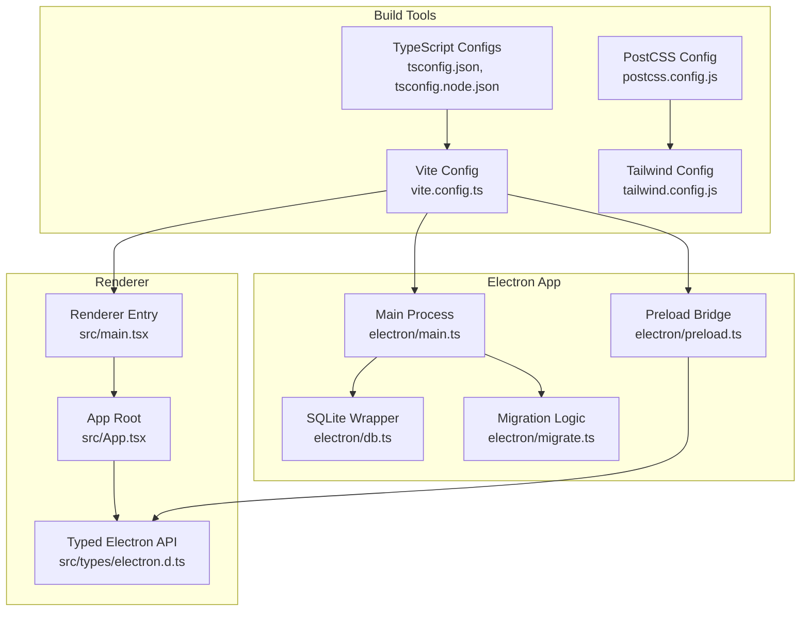
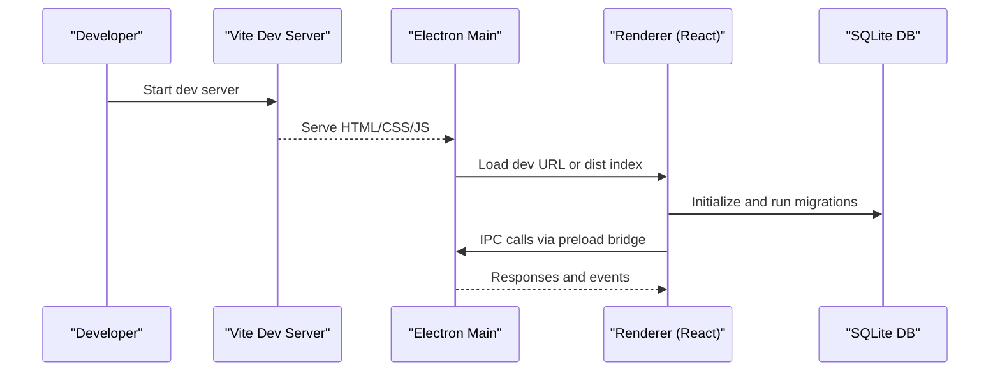
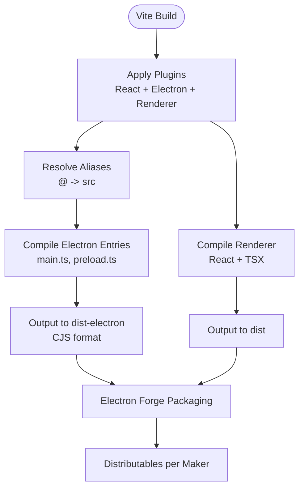
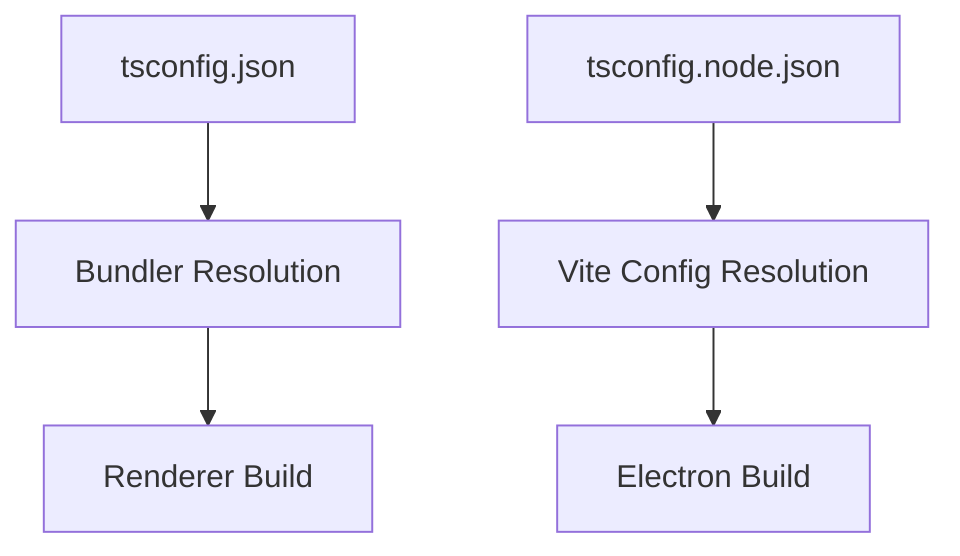
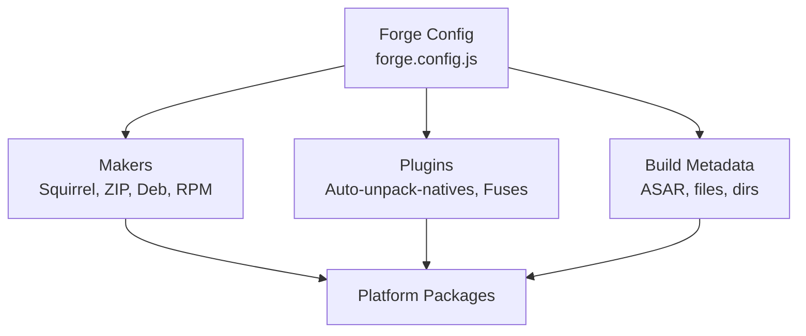
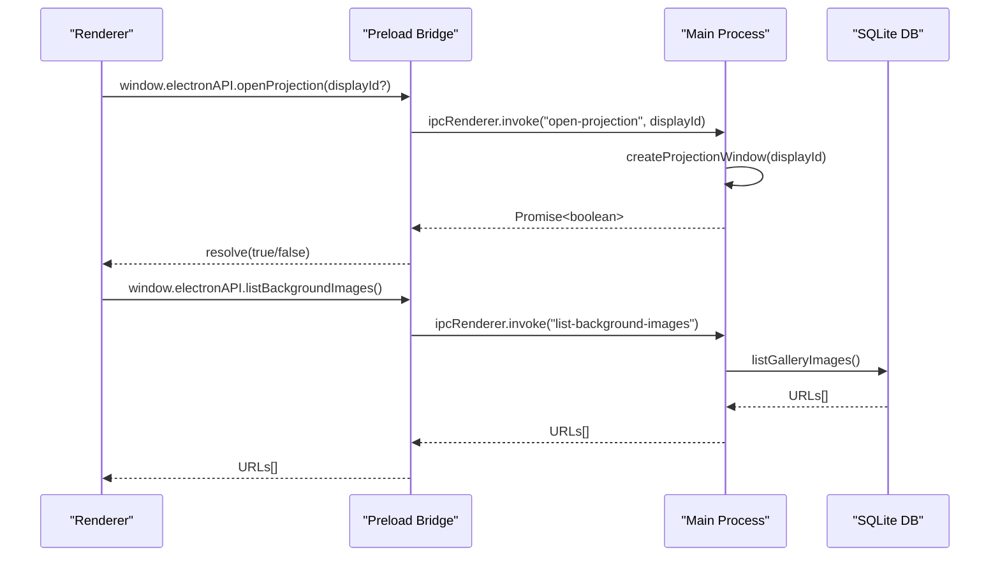
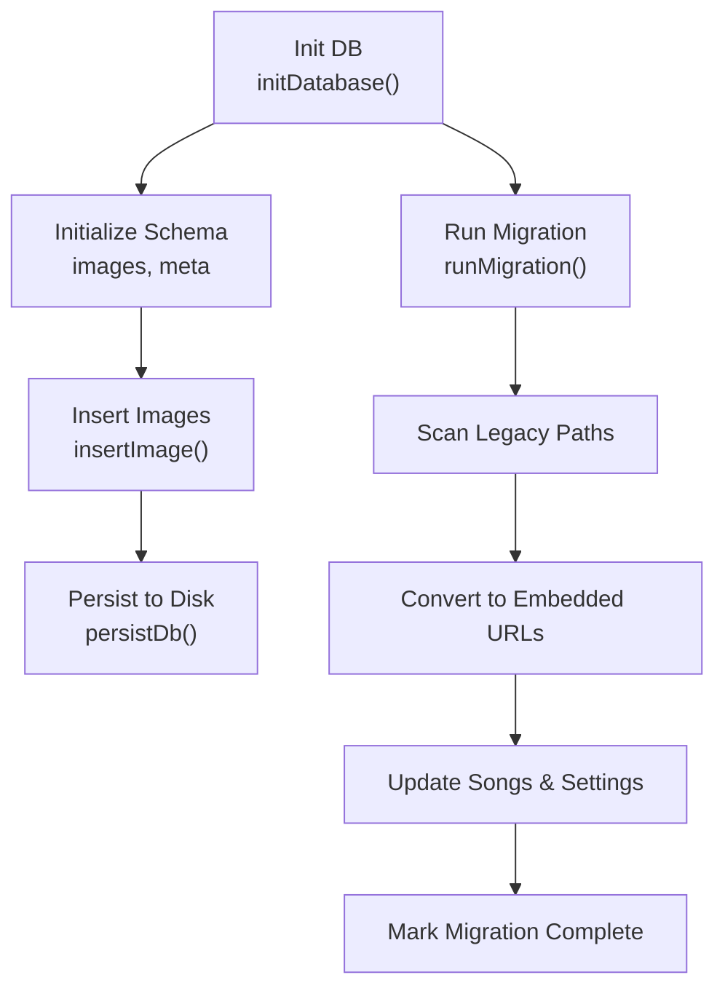
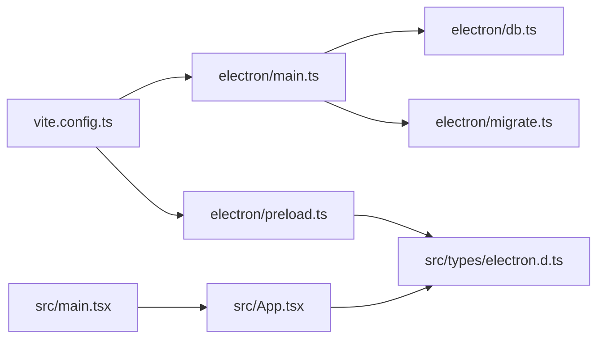

# Build and Deployment

<cite>
**Referenced Files in This Document**
- [package.json](file://package.json)
- [forge.config.js](file://forge.config.js)
- [vite.config.ts](file://vite.config.ts)
- [tsconfig.json](file://tsconfig.json)
- [tsconfig.node.json](file://tsconfig.node.json)
- [postcss.config.js](file://postcss.config.js)
- [tailwind.config.js](file://tailwind.config.js)
- [electron/main.ts](file://electron/main.ts)
- [electron/preload.ts](file://electron/preload.ts)
- [electron/db.ts](file://electron/db.ts)
- [electron/migrate.ts](file://electron/migrate.ts)
- [src/main.tsx](file://src/main.tsx)
- [src/App.tsx](file://src/App.tsx)
- [src/types/electron.d.ts](file://src/types/electron.d.ts)
</cite>

## Table of Contents
1. [Introduction](#introduction)
2. [Project Structure](#project-structure)
3. [Core Components](#core-components)
4. [Architecture Overview](#architecture-overview)
5. [Detailed Component Analysis](#detailed-component-analysis)
6. [Dependency Analysis](#dependency-analysis)
7. [Performance Considerations](#performance-considerations)
8. [Troubleshooting Guide](#troubleshooting-guide)
9. [Conclusion](#conclusion)
10. [Appendices](#appendices)

## Introduction
This document explains LyricDeck’s build and deployment pipeline. It covers Vite configuration for development and production, TypeScript compilation, Electron Forge packaging for cross-platform distribution, build scripts, environment considerations, optimization techniques, and deployment strategies for Windows and macOS. It also documents platform-specific installers, auto-update mechanisms, and troubleshooting guidance.

## Project Structure
The project combines a React + TypeScript frontend with an Electron main process and a preload bridge. Vite builds both the renderer and Electron main/preload bundles, while Electron Forge packages the app for distribution. Tailwind CSS and PostCSS handle styling, and sql.js provides embedded database capabilities.

**Diagram sources**
- [vite.config.ts:1-51](file://vite.config.ts#L1-L51)
- [tsconfig.json:1-26](file://tsconfig.json#L1-L26)
- [tsconfig.node.json:1-11](file://tsconfig.node.json#L1-L11)
- [postcss.config.js:1-7](file://postcss.config.js#L1-L7)
- [tailwind.config.js:1-37](file://tailwind.config.js#L1-L37)
- [electron/main.ts:1-390](file://electron/main.ts#L1-L390)
- [electron/preload.ts:1-43](file://electron/preload.ts#L1-L43)
- [electron/db.ts:1-214](file://electron/db.ts#L1-L214)
- [electron/migrate.ts:1-127](file://electron/migrate.ts#L1-L127)
- [src/main.tsx:1-11](file://src/main.tsx#L1-L11)
- [src/App.tsx:1-102](file://src/App.tsx#L1-L102)
- [src/types/electron.d.ts:1-32](file://src/types/electron.d.ts#L1-L32)

**Section sources**
- [vite.config.ts:1-51](file://vite.config.ts#L1-L51)
- [tsconfig.json:1-26](file://tsconfig.json#L1-L26)
- [tsconfig.node.json:1-11](file://tsconfig.node.json#L1-L11)
- [postcss.config.js:1-7](file://postcss.config.js#L1-L7)
- [tailwind.config.js:1-37](file://tailwind.config.js#L1-L37)
- [electron/main.ts:1-390](file://electron/main.ts#L1-L390)
- [electron/preload.ts:1-43](file://electron/preload.ts#L1-L43)
- [electron/db.ts:1-214](file://electron/db.ts#L1-L214)
- [electron/migrate.ts:1-127](file://electron/migrate.ts#L1-L127)
- [src/main.tsx:1-11](file://src/main.tsx#L1-L11)
- [src/App.tsx:1-102](file://src/App.tsx#L1-L102)
- [src/types/electron.d.ts:1-32](file://src/types/electron.d.ts#L1-L32)

## Core Components
- Vite configuration defines plugins, Electron entry points, and output directories for main and preload bundles.
- TypeScript configurations separate renderer and Node/Electron build contexts.
- Electron Forge configuration enables ASAR packaging, native rehydration, fuses, and multiple makers.
- Tailwind and PostCSS configure styling and CSS processing.
- Electron main process initializes the app, sets up protocol handlers, manages windows, and handles IPC.
- Preload exposes a typed API surface to the renderer via contextBridge.
- Database and migration modules manage embedded SQLite storage and data migrations.

**Section sources**
- [vite.config.ts:1-51](file://vite.config.ts#L1-L51)
- [tsconfig.json:1-26](file://tsconfig.json#L1-L26)
- [tsconfig.node.json:1-11](file://tsconfig.node.json#L1-L11)
- [forge.config.js:1-45](file://forge.config.js#L1-L45)
- [postcss.config.js:1-7](file://postcss.config.js#L1-L7)
- [tailwind.config.js:1-37](file://tailwind.config.js#L1-L37)
- [electron/main.ts:1-390](file://electron/main.ts#L1-L390)
- [electron/preload.ts:1-43](file://electron/preload.ts#L1-L43)
- [electron/db.ts:1-214](file://electron/db.ts#L1-L214)
- [electron/migrate.ts:1-127](file://electron/migrate.ts#L1-L127)

## Architecture Overview
The build pipeline compiles the React renderer and Electron bundles with Vite, then packages and distributes the app with Electron Forge. The main process loads assets from either dev server or built output, registers a custom protocol for embedded images, and coordinates IPC with the renderer via a typed preload bridge.

**Diagram sources**
- [vite.config.ts:1-51](file://vite.config.ts#L1-L51)
- [electron/main.ts:1-390](file://electron/main.ts#L1-L390)
- [electron/preload.ts:1-43](file://electron/preload.ts#L1-L43)
- [electron/db.ts:1-214](file://electron/db.ts#L1-L214)
- [electron/migrate.ts:1-127](file://electron/migrate.ts#L1-L127)

## Detailed Component Analysis

### Vite Configuration
- Plugins:
  - React plugin for JSX/TSX transforms.
  - Electron plugin configured for main and preload entries, with custom output directories and external modules.
  - Electron renderer plugin for seamless renderer-side development.
- Aliasing: Path alias for imports rooted at src.
- Build outputs:
  - Renderer assets emitted to the default dist folder.
  - Electron main and preload compiled to dist-electron with CJS format and externalized Electron APIs.

**Diagram sources**
- [vite.config.ts:1-51](file://vite.config.ts#L1-L51)

**Section sources**
- [vite.config.ts:1-51](file://vite.config.ts#L1-L51)

### TypeScript Compilation
- Renderer and shared configs:
  - Modern target and module resolution optimized for bundlers.
  - Strict mode enabled with practical allowances for DX.
  - Path aliases mapped to src for clean imports.
- Node/Electron config:
  - Separate configuration for Vite’s build-time resolution of Vite config itself.

**Diagram sources**
- [tsconfig.json:1-26](file://tsconfig.json#L1-L26)
- [tsconfig.node.json:1-11](file://tsconfig.node.json#L1-L11)

**Section sources**
- [tsconfig.json:1-26](file://tsconfig.json#L1-L26)
- [tsconfig.node.json:1-11](file://tsconfig.node.json#L1-L11)

### Electron Forge Packaging
- ASAR packaging enabled for main app resources.
- Makers:
  - Squirrel (Windows) and ZIP (macOS) included; additional Linux makers available.
- Plugins:
  - Auto-unpack natives for compatibility.
  - Fuses harden runtime behavior (e.g., disabling Node CLI args, enforcing ASAR usage).
- Build metadata:
  - App ID, product name, output directory, and included files configured for distribution.

**Diagram sources**
- [forge.config.js:1-45](file://forge.config.js#L1-L45)
- [package.json:26-57](file://package.json#L26-L57)

**Section sources**
- [forge.config.js:1-45](file://forge.config.js#L1-L45)
- [package.json:26-57](file://package.json#L26-L57)

### Electron Main Process and Preload Bridge
- Main process:
  - Registers a custom protocol to serve embedded images from SQLite.
  - Manages main and projection windows, IPC handlers, and lifecycle events.
  - Loads dev URL during development; loads built HTML in production.
- Preload bridge:
  - Exposes a typed API surface to renderer code via contextBridge.
  - Provides display management, projection controls, data persistence, and import/export operations.

**Diagram sources**
- [electron/main.ts:1-390](file://electron/main.ts#L1-L390)
- [electron/preload.ts:1-43](file://electron/preload.ts#L1-L43)
- [electron/db.ts:1-214](file://electron/db.ts#L1-L214)

**Section sources**
- [electron/main.ts:1-390](file://electron/main.ts#L1-L390)
- [electron/preload.ts:1-43](file://electron/preload.ts#L1-L43)
- [src/types/electron.d.ts:1-32](file://src/types/electron.d.ts#L1-L32)

### Database and Migration
- Embedded SQLite via sql.js:
  - Initializes database in user data directory.
  - Stores images as BLOBs with metadata.
  - Persists database to disk after writes.
- Migration:
  - Converts legacy file-based image references to embedded URLs.
  - Updates song and settings references accordingly.
  - Marks migration completion to avoid re-running.

**Diagram sources**
- [electron/db.ts:1-214](file://electron/db.ts#L1-L214)
- [electron/migrate.ts:1-127](file://electron/migrate.ts#L1-L127)

**Section sources**
- [electron/db.ts:1-214](file://electron/db.ts#L1-L214)
- [electron/migrate.ts:1-127](file://electron/migrate.ts#L1-L127)

### Build Scripts and Environment
- Scripts:
  - Development: Vite dev server and concurrent Electron startup.
  - Build: TypeScript emit, Vite build, and Windows installer generation.
  - Packaging and preview: Electron Forge commands for local packaging and preview.
- Environment:
  - No explicit environment files present; production loads built assets from dist.
  - Development loads from localhost; production loads from dist/index.html.

**Section sources**
- [package.json:6-16](file://package.json#L6-L16)
- [electron/main.ts:96-100](file://electron/main.ts#L96-L100)
- [electron/main.ts:140-146](file://electron/main.ts#L140-L146)

### Production Optimizations and Asset Bundling
- Code splitting and chunking:
  - Vite’s default strategy splits chunks; review bundle sizes and split points using build analysis tools.
- Externalization:
  - Electron and sql.js are marked external for main/preload builds to reduce bundle size and leverage prebuilt modules.
- CSS processing:
  - Tailwind and Autoprefixer configured via PostCSS; ensure purge/content globs match source paths.
- ASAR packaging:
  - Forge packages app resources into ASAR archives for integrity and performance.

**Section sources**
- [vite.config.ts:14-22](file://vite.config.ts#L14-L22)
- [vite.config.ts:30-39](file://vite.config.ts#L30-L39)
- [postcss.config.js:1-7](file://postcss.config.js#L1-L7)
- [tailwind.config.js:1-37](file://tailwind.config.js#L1-L37)
- [forge.config.js:5-7](file://forge.config.js#L5-L7)

### Platform-Specific Distribution
- Windows:
  - NSIS installer targets x64; portable target also configured.
  - NSIS options include custom installation directory and desktop/start menu shortcuts.
- macOS:
  - ZIP maker supports macOS; additional DMG or PKG makers can be added via Forge.
- Linux:
  - Deb and RPM makers included; adjust architectures and signing as needed.

**Section sources**
- [package.json:38-56](file://package.json#L38-L56)
- [forge.config.js:9-26](file://forge.config.js#L9-L26)

### Auto-Update Mechanisms
- Not configured in the current setup.
- Recommended approach:
  - Integrate an auto-updater provider (e.g., Electron Forge auto-updater or Squirrel-based updater).
  - Publish releases to GitHub or a dedicated endpoint and enable update checks in the main process.

[No sources needed since this section provides general guidance]

### Continuous Integration and Release Management
- Current repository does not include CI configuration files.
- Recommended CI tasks:
  - Lint and type-check on pull requests.
  - Build and test on multiple OS matrix jobs.
  - Package and upload artifacts per OS.
  - Optional: Automated release publishing on tags.

[No sources needed since this section provides general guidance]

## Dependency Analysis
The build pipeline ties together Vite, Electron, and Forge with clear separation of concerns. The main process depends on the preload bridge and database modules, while the renderer consumes a typed API surface.

**Diagram sources**
- [vite.config.ts:1-51](file://vite.config.ts#L1-L51)
- [electron/main.ts:1-390](file://electron/main.ts#L1-L390)
- [electron/preload.ts:1-43](file://electron/preload.ts#L1-L43)
- [electron/db.ts:1-214](file://electron/db.ts#L1-L214)
- [electron/migrate.ts:1-127](file://electron/migrate.ts#L1-L127)
- [src/main.tsx:1-11](file://src/main.tsx#L1-L11)
- [src/App.tsx:1-102](file://src/App.tsx#L1-L102)
- [src/types/electron.d.ts:1-32](file://src/types/electron.d.ts#L1-L32)

**Section sources**
- [vite.config.ts:1-51](file://vite.config.ts#L1-L51)
- [electron/main.ts:1-390](file://electron/main.ts#L1-L390)
- [electron/preload.ts:1-43](file://electron/preload.ts#L1-L43)
- [electron/db.ts:1-214](file://electron/db.ts#L1-L214)
- [electron/migrate.ts:1-127](file://electron/migrate.ts#L1-L127)
- [src/main.tsx:1-11](file://src/main.tsx#L1-L11)
- [src/App.tsx:1-102](file://src/App.tsx#L1-L102)
- [src/types/electron.d.ts:1-32](file://src/types/electron.d.ts#L1-L32)

## Performance Considerations
- Keep external dependencies minimal; rely on Vite’s tree-shaking and code-splitting defaults.
- Monitor bundle sizes and split large vendor chunks if necessary.
- Use Tailwind’s purge mode to remove unused CSS in production builds.
- Prefer lazy-loading heavy components to improve initial load times.
- Ensure sql.js usage avoids synchronous heavy operations on the main thread.

[No sources needed since this section provides general guidance]

## Troubleshooting Guide
- Build fails due to missing dependencies:
  - Verify all devDependencies are installed and compatible with current Node and Electron versions.
- Vite dev server not reloading:
  - Confirm preload plugin reload hook is invoked and dev URL matches main process load path.
- Electron window loads blank in production:
  - Ensure main process loads dist/index.html and that Tailwind content globs include all template paths.
- Installer generation errors:
  - Check Windows NSIS configuration and ensure signing certificates are available if required.
- Auto-update not working:
  - Implement an updater provider and configure release endpoints; verify signed builds and network permissions.
- Database migration issues:
  - Confirm migration runs only once and handles corrupted files gracefully; validate user data directory permissions.

**Section sources**
- [electron/main.ts:96-100](file://electron/main.ts#L96-L100)
- [electron/main.ts:140-146](file://electron/main.ts#L140-L146)
- [package.json:38-56](file://package.json#L38-L56)
- [electron/migrate.ts:1-127](file://electron/migrate.ts#L1-L127)

## Conclusion
LyricDeck’s build and deployment pipeline leverages Vite for modern frontend tooling, Electron for cross-platform desktop apps, and Electron Forge for streamlined distribution. The typed preload bridge ensures safe IPC communication, while embedded SQLite and migration logic provide robust data handling. By following the optimization and troubleshooting guidance herein, teams can maintain reliable builds and smooth deployments across Windows and macOS.

## Appendices
- Additional makers and platforms:
  - Extend Forge makers for DMG on macOS or MSI on Windows as needed.
- Security hardening:
  - Review fuse settings to align with security posture and platform requirements.

[No sources needed since this section provides general guidance]