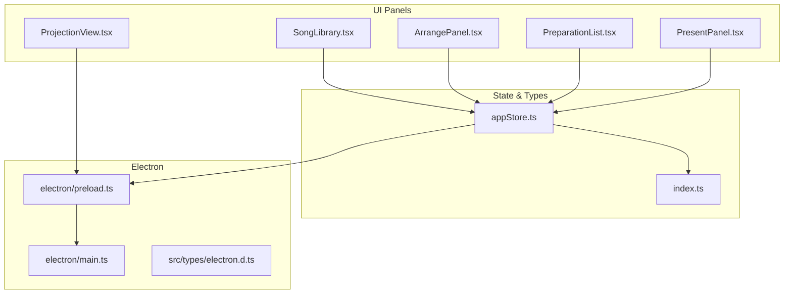
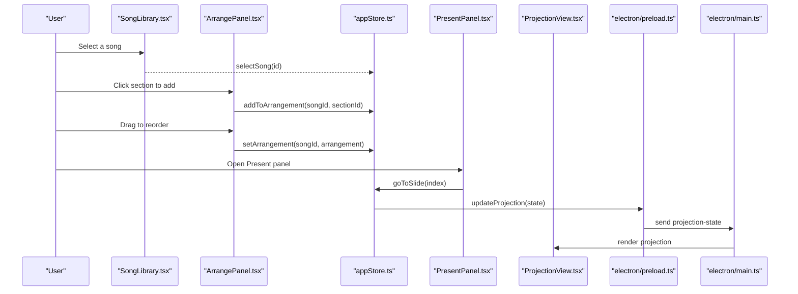
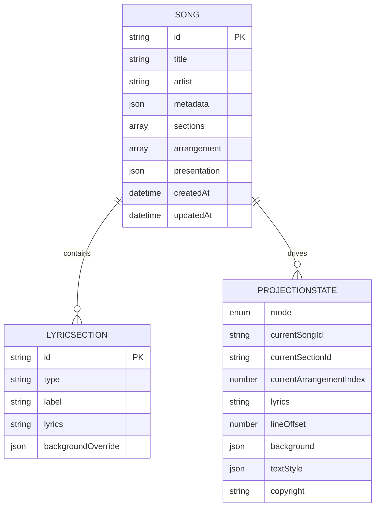
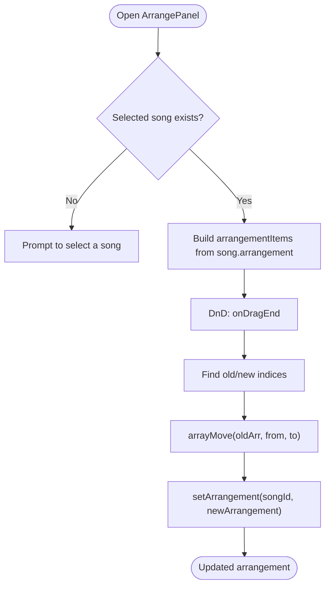
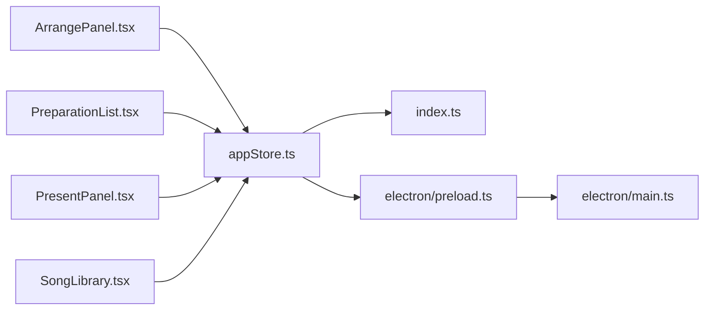

# Arrangement Builder

<cite>
**Referenced Files in This Document**
- [ArrangePanel.tsx](file://src/components/ArrangePanel.tsx)
- [PreparationList.tsx](file://src/components/PreparationList.tsx)
- [PresentPanel.tsx](file://src/components/PresentPanel.tsx)
- [ProjectionView.tsx](file://src/components/ProjectionView.tsx)
- [SongLibrary.tsx](file://src/components/SongLibrary.tsx)
- [appStore.ts](file://src/store/appStore.ts)
- [index.ts](file://src/types/index.ts)
- [App.tsx](file://src/App.tsx)
- [en.ts](file://src/i18n/en.ts)
- [seedData.ts](file://src/utils/seedData.ts)
- [main.ts](file://electron/main.ts)
- [preload.ts](file://electron/preload.ts)
- [electron.d.ts](file://src/types/electron.d.ts)
</cite>

## Table of Contents
1. [Introduction](#introduction)
2. [Project Structure](#project-structure)
3. [Core Components](#core-components)
4. [Architecture Overview](#architecture-overview)
5. [Detailed Component Analysis](#detailed-component-analysis)
6. [Dependency Analysis](#dependency-analysis)
7. [Performance Considerations](#performance-considerations)
8. [Troubleshooting Guide](#troubleshooting-guide)
9. [Conclusion](#conclusion)
10. [Appendices](#appendices)

## Introduction
The Arrangement Builder enables users to create custom presentation sequences by assembling lyric sections from one or more songs. It provides a drag-and-drop interface to compose arrangements, integrates with the song library and section editor, and powers the projection system for live presentations. This document explains the arrangement data model, UI controls, state management, persistence, and how arrangements connect to the projection pipeline.

## Project Structure
The Arrangement Builder spans UI components, a central store, types, and Electron integration for projection windows and persistence.

**Diagram sources**
- [SongLibrary.tsx:1-193](file://src/components/SongLibrary.tsx#L1-L193)
- [ArrangePanel.tsx:1-187](file://src/components/ArrangePanel.tsx#L1-L187)
- [PreparationList.tsx:1-188](file://src/components/PreparationList.tsx#L1-L188)
- [PresentPanel.tsx:1-365](file://src/components/PresentPanel.tsx#L1-L365)
- [ProjectionView.tsx:1-134](file://src/components/ProjectionView.tsx#L1-L134)
- [appStore.ts:1-385](file://src/store/appStore.ts#L1-L385)
- [index.ts:1-89](file://src/types/index.ts#L1-L89)
- [main.ts:111-188](file://electron/main.ts#L111-L188)
- [preload.ts:1-28](file://electron/preload.ts#L1-L28)
- [electron.d.ts:1-32](file://src/types/electron.d.ts#L1-L32)

**Section sources**
- [App.tsx:1-102](file://src/App.tsx#L1-L102)
- [ArrangePanel.tsx:1-187](file://src/components/ArrangePanel.tsx#L1-L187)
- [appStore.ts:1-385](file://src/store/appStore.ts#L1-L385)
- [index.ts:1-89](file://src/types/index.ts#L1-L89)

## Core Components
- ArrangePanel: Drag-and-drop arrangement builder with available sections and arranged slides.
- PreparationList: Reorderable queue of songs for preparation and quick selection.
- PresentPanel: Live presentation controls and projection preview; drives the projection window.
- ProjectionView: Fullscreen projection rendering for the presentation window.
- appStore: Centralized state for songs, arrangements, projection state, and persistence.
- Types: Strongly typed data structures for songs, sections, backgrounds, text styles, and projection state.

**Section sources**
- [ArrangePanel.tsx:22-134](file://src/components/ArrangePanel.tsx#L22-L134)
- [PreparationList.tsx:25-123](file://src/components/PreparationList.tsx#L25-L123)
- [PresentPanel.tsx:6-131](file://src/components/PresentPanel.tsx#L6-L131)
- [ProjectionView.tsx:4-134](file://src/components/ProjectionView.tsx#L4-L134)
- [appStore.ts:31-96](file://src/store/appStore.ts#L31-L96)
- [index.ts:50-89](file://src/types/index.ts#L50-L89)

## Architecture Overview
The arrangement workflow connects the song library, arrangement builder, preparation list, and presentation/projection systems.

**Diagram sources**
- [SongLibrary.tsx:67-79](file://src/components/SongLibrary.tsx#L67-L79)
- [ArrangePanel.tsx:72-63](file://src/components/ArrangePanel.tsx#L72-L63)
- [appStore.ts:227-239](file://src/store/appStore.ts#L227-L239)
- [PresentPanel.tsx:251-274](file://src/components/PresentPanel.tsx#L251-L274)
- [ProjectionView.tsx:22-29](file://src/components/ProjectionView.tsx#L22-L29)
- [preload.ts:10-21](file://electron/preload.ts#L10-L21)
- [main.ts:186-188](file://electron/main.ts#L186-L188)

## Detailed Component Analysis

### Arrangement Data Model
- Song: Contains sections and an arrangement field that holds an ordered list of section IDs.
- LyricSection: Defines label, type, and lyrics; supports optional background overrides.
- ProjectionState: Drives the projection window with current lyrics, background, text style, and mode.

**Diagram sources**
- [index.ts:50-89](file://src/types/index.ts#L50-L89)

**Section sources**
- [index.ts:50-89](file://src/types/index.ts#L50-L89)

### ArrangePanel: Drag-and-Drop Arrangement Builder
- Displays available sections from the selected song.
- Builds an arrangement list by adding section IDs in the desired order.
- Supports reordering via drag-and-drop and removal per slide.
- Uses a temporary item identity combining sectionId and index to support duplicate sections.

**Diagram sources**
- [ArrangePanel.tsx:44-63](file://src/components/ArrangePanel.tsx#L44-L63)
- [appStore.ts:223-225](file://src/store/appStore.ts#L223-L225)

**Section sources**
- [ArrangePanel.tsx:22-134](file://src/components/ArrangePanel.tsx#L22-L134)
- [appStore.ts:222-239](file://src/store/appStore.ts#L222-L239)

### PreparationList: Song Queue and Reordering
- Presents songs queued for preparation.
- Allows drag-to-reorder and removal from the list.
- Integrates with Arrange and Present panels to quickly select songs.

**Section sources**
- [PreparationList.tsx:25-123](file://src/components/PreparationList.tsx#L25-L123)
- [appStore.ts:317-359](file://src/store/appStore.ts#L317-L359)

### PresentPanel: Presentation Controls and Projection Trigger
- Shows current and next slides derived from the arrangement.
- Controls navigation (previous/next), projection mode toggles, and line offset adjustments.
- Opens/closes the projection window and sends state updates to the projection renderer.

**Section sources**
- [PresentPanel.tsx:6-131](file://src/components/PresentPanel.tsx#L6-L131)
- [appStore.ts:241-302](file://src/store/appStore.ts#L241-L302)

### ProjectionView: Projection Renderer
- Receives projection state updates and renders the appropriate mode (live, black, clear, logo).
- Applies background and text styles; supports line offset shifting.

**Section sources**
- [ProjectionView.tsx:4-134](file://src/components/ProjectionView.tsx#L4-L134)
- [preload.ts:10-21](file://electron/preload.ts#L10-L21)
- [main.ts:186-188](file://electron/main.ts#L186-L188)

### State Management and Undo/Redo
- The store exposes setters for arrangement mutations: setArrangement, addToArrangement, removeFromArrangement.
- There is no explicit undo/redo stack in the current implementation; operations are direct state updates.

**Section sources**
- [appStore.ts:222-239](file://src/store/appStore.ts#L222-L239)

### Integration with Song Library and Section Editor
- Users select a song in the library; ArrangePanel reads the selected song’s sections and arrangement.
- Sections can be duplicated across arrangements; removing a section from the song also prunes it from all arrangements.

**Section sources**
- [SongLibrary.tsx:67-79](file://src/components/SongLibrary.tsx#L67-L79)
- [appStore.ts:210-220](file://src/store/appStore.ts#L210-L220)

### Relationship to Presentation System
- PresentPanel derives the arrangement from song.arrangement if present, otherwise falls back to the natural order of sections.
- goToSlide resolves the current section by index, computes background/text style, and updates projection state.

**Section sources**
- [PresentPanel.tsx:97-107](file://src/components/PresentPanel.tsx#L97-L107)
- [appStore.ts:251-274](file://src/store/appStore.ts#L251-L274)

### Practical Examples of Common Arrangements
- Worship set list: Add Intro, Verses, Chorus, Bridge, and Outro in sequence; repeat sections as needed.
- Transition sequences: Insert short sections (e.g., “Bridge” or “Instrumental”) between verses to smooth transitions.
- Live presentation order: Use the arrangement to define the exact order for projection, including repeated verses or alternate endings.

[No sources needed since this section provides general guidance]

## Dependency Analysis
The arrangement builder depends on the store for data and actions, and on Electron APIs for projection and persistence.

**Diagram sources**
- [ArrangePanel.tsx:1-20](file://src/components/ArrangePanel.tsx#L1-L20)
- [PreparationList.tsx:1-19](file://src/components/PreparationList.tsx#L1-L19)
- [PresentPanel.tsx:1-19](file://src/components/PresentPanel.tsx#L1-L19)
- [SongLibrary.tsx:1-11](file://src/components/SongLibrary.tsx#L1-L11)
- [appStore.ts:1-96](file://src/store/appStore.ts#L1-L96)
- [index.ts:1-89](file://src/types/index.ts#L1-L89)
- [preload.ts:1-28](file://electron/preload.ts#L1-L28)
- [main.ts:111-188](file://electron/main.ts#L111-L188)

**Section sources**
- [appStore.ts:362-384](file://src/store/appStore.ts#L362-L384)
- [preload.ts:1-28](file://electron/preload.ts#L1-L28)
- [main.ts:155-188](file://electron/main.ts#L155-L188)

## Performance Considerations
- Large arrangements: Rendering many slides can be heavy; consider virtualizing long lists if needed.
- Duplicate sections: Adding the same section multiple times increases DOM nodes; monitor UI responsiveness.
- Projection updates: Frequent updates are throttled by the store; avoid excessive re-renders in the projection view.
- Persistence: Saving to disk occurs after each mutation; batch operations could reduce I/O frequency.

[No sources needed since this section provides general guidance]

## Troubleshooting Guide
- No arrangement appears: Ensure a song is selected and has sections; the arrangement defaults to the song’s section order if unset.
- Drag-and-drop not working: Verify DnD sensors and sortable contexts are configured correctly in ArrangePanel.
- Projection not updating: Confirm Electron IPC handlers are registered and updateProjection is invoked with a valid ProjectionState.
- Deleting a section removes it from all arrangements: This is expected behavior; duplicates are not automatically re-added.

**Section sources**
- [ArrangePanel.tsx:33-42](file://src/components/ArrangePanel.tsx#L33-L42)
- [appStore.ts:210-220](file://src/store/appStore.ts#L210-L220)
- [preload.ts:10-21](file://electron/preload.ts#L10-L21)
- [main.ts:186-188](file://electron/main.ts#L186-L188)

## Conclusion
The Arrangement Builder offers a straightforward, drag-and-drop method to assemble presentation sequences from existing song sections. Its tight integration with the store, song library, and projection system makes it easy to build, preview, and deliver custom arrangements during live events. While there is no built-in undo/redo, the simple mutation model and persistence layer provide a solid foundation for future enhancements.

[No sources needed since this section summarizes without analyzing specific files]

## Appendices

### Persistence Mechanism
- loadFromDisk: Reads songs, settings, and preparation list from disk.
- saveToDisk: Writes songs to disk after each change.
- Electron IPC: Exposes load/save handlers for songs, settings, and preparation list.

**Section sources**
- [appStore.ts:362-384](file://src/store/appStore.ts#L362-L384)
- [preload.ts:23-29](file://electron/preload.ts#L23-L29)
- [main.ts:155-188](file://electron/main.ts#L155-L188)

### Internationalization Keys for Arrangement UI
- arrange.selectSong, arrange.availableSections, arrange.clickToAdd, arrange.arrangement, arrange.slides, arrange.clearAll, arrange.noArrangement, arrange.noArrangementHint, arrange.empty.

**Section sources**
- [en.ts:64-77](file://src/i18n/en.ts#L64-L77)

### Seed Data for Demo
- The application seeds initial songs with typical worship structure, enabling immediate arrangement practice.

**Section sources**
- [seedData.ts:51-164](file://src/utils/seedData.ts#L51-L164)