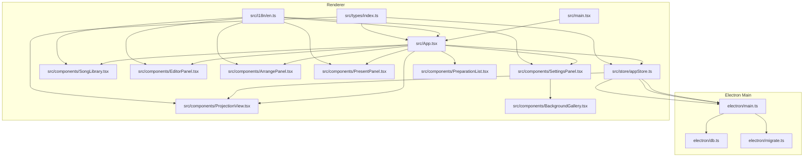
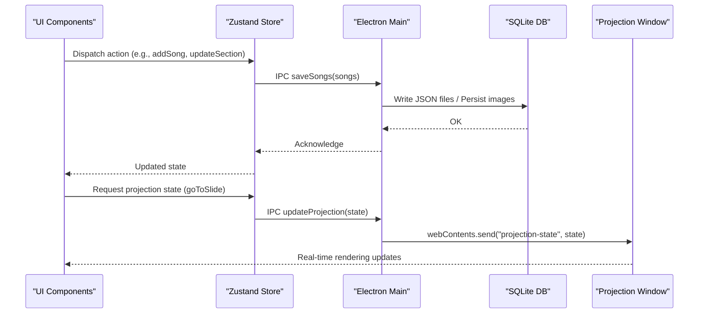
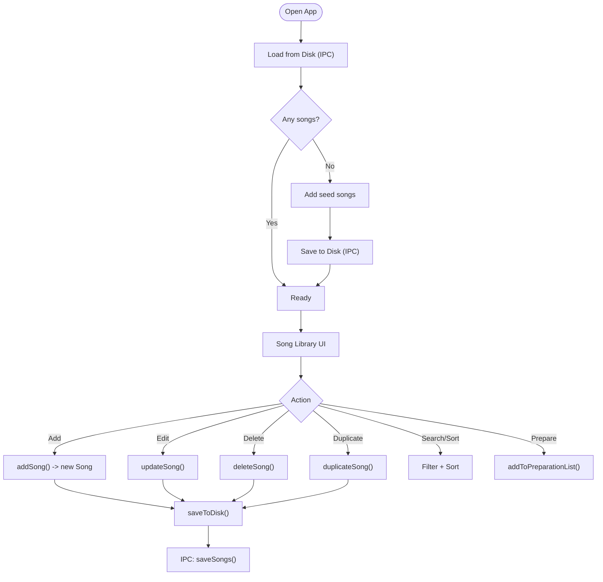
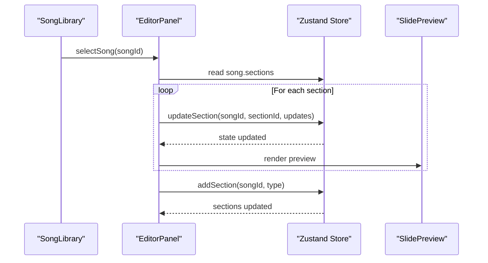
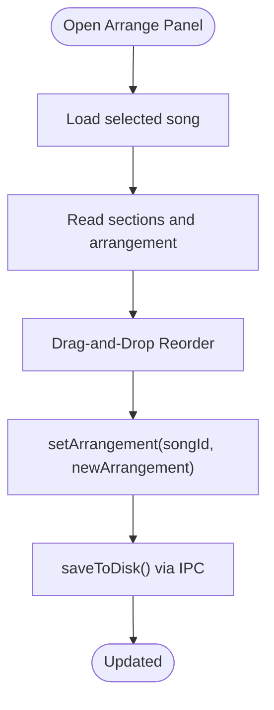
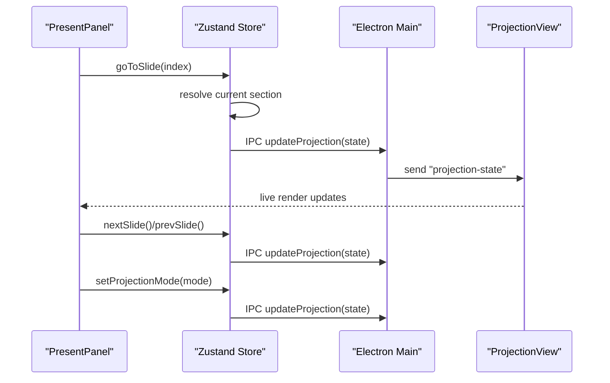
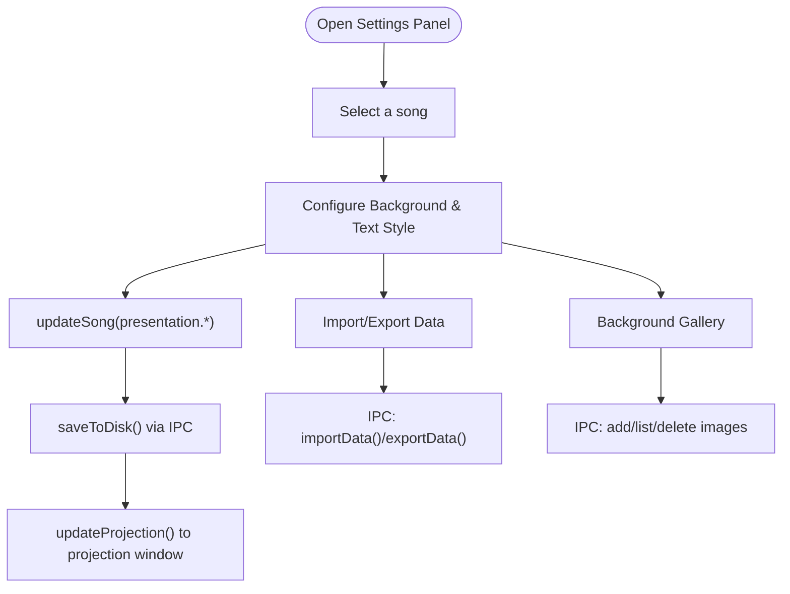
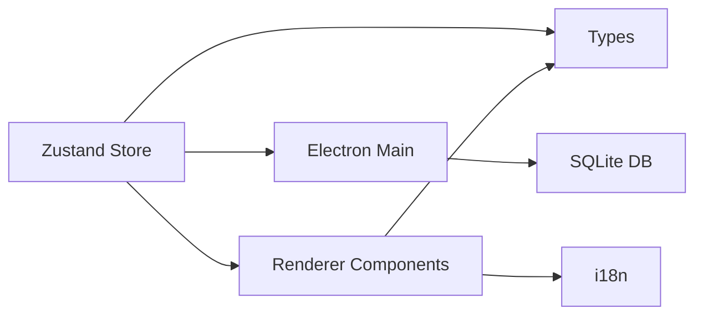

# Core Features

<cite>
**Referenced Files in This Document**
- [README.md](file://README.md)
- [App.tsx](file://src/App.tsx)
- [main.tsx](file://src/main.tsx)
- [appStore.ts](file://src/store/appStore.ts)
- [SongLibrary.tsx](file://src/components/SongLibrary.tsx)
- [EditorPanel.tsx](file://src/components/EditorPanel.tsx)
- [ArrangePanel.tsx](file://src/components/ArrangePanel.tsx)
- [PresentPanel.tsx](file://src/components/PresentPanel.tsx)
- [SettingsPanel.tsx](file://src/components/SettingsPanel.tsx)
- [ProjectionView.tsx](file://src/components/ProjectionView.tsx)
- [PreparationList.tsx](file://src/components/PreparationList.tsx)
- [BackgroundGallery.tsx](file://src/components/BackgroundGallery.tsx)
- [index.ts](file://src/types/index.ts)
- [en.ts](file://src/i18n/en.ts)
- [main.ts](file://electron/main.ts)
- [db.ts](file://electron/db.ts)
- [migrate.ts](file://electron/migrate.ts)
</cite>

## Table of Contents
1. [Introduction](#introduction)
2. [Project Structure](#project-structure)
3. [Core Components](#core-components)
4. [Architecture Overview](#architecture-overview)
5. [Detailed Component Analysis](#detailed-component-analysis)
6. [Dependency Analysis](#dependency-analysis)
7. [Performance Considerations](#performance-considerations)
8. [Troubleshooting Guide](#troubleshooting-guide)
9. [Conclusion](#conclusion)
10. [Appendices](#appendices)

## Introduction
LyricDeck is a cross-platform desktop application designed for managing song lyrics and live lyric projection. It supports creating and editing songs, organizing lyrics into structured sections, building custom presentation arrangements, and delivering a live projection experience to external displays. The application persists data locally and offers robust customization for background visuals and typography.

Key capabilities include:
- Song Library: Create, edit, duplicate, delete, and search songs with metadata.
- Section Editor: Organize lyrics into labeled sections with drag-and-drop reordering.
- Arrangement Builder: Compose custom slide sequences by combining sections.
- Live Presentation Engine: Fullscreen projection output with keyboard shortcuts and quick controls.
- Settings Configuration: Background customization (color, gradient, image), text styling, and import/export.

These features integrate tightly with a central state management system and an Electron main process that handles persistence, multi-monitor projection windows, and media assets.

## Project Structure
The project follows a React + Electron architecture with a clear separation of concerns:
- Frontend (Renderer): React components, state via Zustand, and UI logic.
- Backend (Main): Electron main process, IPC handlers, file system I/O, and SQLite-backed asset storage.
- Shared Types: Strongly typed models for songs, sections, projections, and settings.
- Internationalization: Pluralized and localized UI strings.

**Diagram sources**
- [main.ts:1-390](file://electron/main.ts#L1-L390)
- [db.ts:1-214](file://electron/db.ts#L1-L214)
- [migrate.ts:1-127](file://electron/migrate.ts#L1-L127)
- [main.tsx:1-11](file://src/main.tsx#L1-L11)
- [App.tsx:1-102](file://src/App.tsx#L1-L102)
- [appStore.ts:1-385](file://src/store/appStore.ts#L1-L385)
- [index.ts:1-89](file://src/types/index.ts#L1-L89)
- [en.ts:1-180](file://src/i18n/en.ts#L1-L180)
- [SongLibrary.tsx:1-193](file://src/components/SongLibrary.tsx#L1-L193)
- [EditorPanel.tsx:1-264](file://src/components/EditorPanel.tsx#L1-L264)
- [ArrangePanel.tsx:1-187](file://src/components/ArrangePanel.tsx#L1-L187)
- [PresentPanel.tsx:1-365](file://src/components/PresentPanel.tsx#L1-L365)
- [SettingsPanel.tsx:1-523](file://src/components/SettingsPanel.tsx#L1-L523)
- [ProjectionView.tsx:1-134](file://src/components/ProjectionView.tsx#L1-L134)
- [PreparationList.tsx:1-188](file://src/components/PreparationList.tsx#L1-L188)
- [BackgroundGallery.tsx:1-98](file://src/components/BackgroundGallery.tsx#L1-L98)

**Section sources**
- [README.md:1-111](file://README.md#L1-L111)
- [main.tsx:1-11](file://src/main.tsx#L1-L11)
- [App.tsx:1-102](file://src/App.tsx#L1-L102)

## Core Components
This section documents the five core feature modules and how they integrate with the state and Electron backend.

- Song Library
  - Purpose: Browse, search, sort, and manage songs; add to preparation list; quick actions (duplicate/delete).
  - Key interactions: Select song, add/duplicate/delete, search/filter, sort by song ID or name, add to preparation list.
  - State integration: Uses store selectors/actions for songs, selection, search query, and preparation list.
  - Persistence: Delegated to Electron via IPC for load/save.

- Section Editor
  - Purpose: Edit song metadata and organize lyrics into sections with labels and types.
  - Key interactions: Add/remove sections, reorder via drag-and-drop, edit lyrics, preview slides.
  - State integration: Updates song sections and metadata; triggers persistence on change.

- Arrangement Builder
  - Purpose: Build a presentation sequence by assembling sections from the current song.
  - Key interactions: Drag-and-drop to reorder, add/remove slides, clear arrangement, use preparation list.
  - State integration: Manages arrangement array per song; reads sections and updates presentation order.

- Live Presentation Engine
  - Purpose: Drive projection output to external displays with keyboard shortcuts and live controls.
  - Key interactions: Open/close projection window, navigate slides, toggle modes (live, black, clear, blank, logo), adjust line offset, manage displays.
  - State integration: Maintains projection state and current arrangement index; sends updates to projection window.

- Settings Configuration
  - Purpose: Customize background visuals and text styles per song; import/export data; manage language.
  - Key interactions: Choose background type (color, gradient, image), configure text style, enable copyright display, import/export, manage background gallery.
  - State integration: Persists settings and updates projection window; manages default settings.

**Section sources**
- [SongLibrary.tsx:1-193](file://src/components/SongLibrary.tsx#L1-L193)
- [EditorPanel.tsx:1-264](file://src/components/EditorPanel.tsx#L1-L264)
- [ArrangePanel.tsx:1-187](file://src/components/ArrangePanel.tsx#L1-L187)
- [PresentPanel.tsx:1-365](file://src/components/PresentPanel.tsx#L1-L365)
- [SettingsPanel.tsx:1-523](file://src/components/SettingsPanel.tsx#L1-L523)
- [appStore.ts:1-385](file://src/store/appStore.ts#L1-L385)

## Architecture Overview
LyricDeck’s architecture centers on a single-page renderer application with a dedicated Electron main process. The renderer uses Zustand for state management and communicates with the main process via IPC for persistence, projection control, and media asset handling.

**Diagram sources**
- [appStore.ts:361-384](file://src/store/appStore.ts#L361-L384)
- [main.ts:192-218](file://electron/main.ts#L192-L218)
- [ProjectionView.tsx:22-29](file://src/components/ProjectionView.tsx#L22-L29)

**Section sources**
- [appStore.ts:1-385](file://src/store/appStore.ts#L1-L385)
- [main.ts:1-390](file://electron/main.ts#L1-L390)

## Detailed Component Analysis

### Song Management System
The song management system underpins all other features. It provides CRUD operations, search, sorting, and preparation list integration.

**Diagram sources**
- [App.tsx:19-32](file://src/App.tsx#L19-L32)
- [appStore.ts:113-183](file://src/store/appStore.ts#L113-L183)
- [SongLibrary.tsx:14-35](file://src/components/SongLibrary.tsx#L14-L35)

**Section sources**
- [SongLibrary.tsx:1-193](file://src/components/SongLibrary.tsx#L1-L193)
- [appStore.ts:113-183](file://src/store/appStore.ts#L113-L183)
- [main.ts:192-200](file://electron/main.ts#L192-L200)

### Lyric Section Editor
The editor organizes lyrics into labeled sections with type classification and live preview.

**Diagram sources**
- [EditorPanel.tsx:17-118](file://src/components/EditorPanel.tsx#L17-L118)
- [appStore.ts:185-220](file://src/store/appStore.ts#L185-L220)

**Section sources**
- [EditorPanel.tsx:1-264](file://src/components/EditorPanel.tsx#L1-L264)
- [appStore.ts:185-220](file://src/store/appStore.ts#L185-L220)

### Arrangement Builder
The arrangement builder composes a presentation sequence from available sections with drag-and-drop reordering.

**Diagram sources**
- [ArrangePanel.tsx:22-134](file://src/components/ArrangePanel.tsx#L22-L134)
- [appStore.ts:222-239](file://src/store/appStore.ts#L222-L239)

**Section sources**
- [ArrangePanel.tsx:1-187](file://src/components/ArrangePanel.tsx#L1-L187)
- [appStore.ts:222-239](file://src/store/appStore.ts#L222-L239)

### Live Presentation Engine
The live presentation engine controls projection windows, keyboard shortcuts, and real-time rendering.

**Diagram sources**
- [PresentPanel.tsx:6-129](file://src/components/PresentPanel.tsx#L6-L129)
- [appStore.ts:241-295](file://src/store/appStore.ts#L241-L295)
- [ProjectionView.tsx:22-29](file://src/components/ProjectionView.tsx#L22-L29)
- [main.ts:186-190](file://electron/main.ts#L186-L190)

**Section sources**
- [PresentPanel.tsx:1-365](file://src/components/PresentPanel.tsx#L1-L365)
- [ProjectionView.tsx:1-134](file://src/components/ProjectionView.tsx#L1-L134)
- [appStore.ts:241-295](file://src/store/appStore.ts#L241-L295)
- [main.ts:186-190](file://electron/main.ts#L186-L190)

### Settings Configuration
Settings allow per-song customization and global configuration, including import/export and background galleries.

**Diagram sources**
- [SettingsPanel.tsx:7-417](file://src/components/SettingsPanel.tsx#L7-L417)
- [BackgroundGallery.tsx:9-98](file://src/components/BackgroundGallery.tsx#L9-L98)
- [appStore.ts:307-314](file://src/store/appStore.ts#L307-L314)
- [main.ts:267-290](file://electron/main.ts#L267-L290)
- [main.ts:220-264](file://electron/main.ts#L220-L264)

**Section sources**
- [SettingsPanel.tsx:1-523](file://src/components/SettingsPanel.tsx#L1-L523)
- [BackgroundGallery.tsx:1-98](file://src/components/BackgroundGallery.tsx#L1-L98)
- [appStore.ts:307-314](file://src/store/appStore.ts#L307-L314)
- [main.ts:220-264](file://electron/main.ts#L220-L264)

## Dependency Analysis
The application exhibits clean separation of concerns:
- Renderer depends on Zustand for state, Electron IPC for persistence and projection, and shared types for data contracts.
- Electron main process depends on SQLite for media storage, exposes IPC handlers for renderer, and manages projection windows.
- Components are loosely coupled via store actions and props, enabling independent development and testing.

**Diagram sources**
- [appStore.ts:1-96](file://src/store/appStore.ts#L1-L96)
- [index.ts:1-89](file://src/types/index.ts#L1-L89)
- [main.ts:1-390](file://electron/main.ts#L1-L390)
- [db.ts:1-214](file://electron/db.ts#L1-L214)

**Section sources**
- [appStore.ts:1-385](file://src/store/appStore.ts#L1-L385)
- [index.ts:1-89](file://src/types/index.ts#L1-L89)
- [main.ts:1-390](file://electron/main.ts#L1-L390)
- [db.ts:1-214](file://electron/db.ts#L1-L214)

## Performance Considerations
- State updates are batched and persisted asynchronously to avoid blocking the UI thread.
- Projection updates are sent via IPC only when state changes, minimizing unnecessary renders.
- Drag-and-drop reordering uses efficient array manipulation and avoids deep cloning of large datasets.
- Image assets are stored in SQLite BLOBs and served via a custom protocol to reduce filesystem overhead.
- Keyboard shortcuts prevent repeated event handling by checking input focus and preventing default actions.

[No sources needed since this section provides general guidance]

## Troubleshooting Guide
Common issues and resolutions:
- Projection window does not open
  - Verify multi-monitor detection and display selection in the presentation panel.
  - Ensure the projection window is not already open; close it before reopening.
  - Check Electron IPC handlers for display enumeration and window creation.

- Background images not appearing
  - Confirm images were added to the gallery and are accessible via the background gallery.
  - For migrated images, verify migration completed and references updated.

- Import/Export failures
  - Validate file format and integrity; ensure the exported file contains required keys.
  - On parse errors, the import routine returns a failure status; check logs for details.

- Persistent data not loading
  - Confirm local data directory exists and JSON files are readable.
  - On first launch with no data, seed songs are added automatically.

**Section sources**
- [PresentPanel.tsx:26-36](file://src/components/PresentPanel.tsx#L26-L36)
- [SettingsPanel.tsx:449-522](file://src/components/SettingsPanel.tsx#L449-L522)
- [migrate.ts:8-126](file://electron/migrate.ts#L8-L126)
- [main.ts:356-390](file://electron/main.ts#L356-L390)

## Conclusion
LyricDeck’s modular feature set is unified by a centralized state model and a robust Electron backend. The Song Library, Section Editor, Arrangement Builder, Live Presentation Engine, and Settings Configuration work together to streamline worship and event production workflows. Users benefit from intuitive drag-and-drop, flexible projection control, and persistent customization, while developers enjoy a maintainable architecture with clear boundaries between renderer and main processes.

[No sources needed since this section summarizes without analyzing specific files]

## Appendices

### User Workflows

- Create a new song
  - Open the Song Library and click “+ Add Song”.
  - Edit metadata (title, artist, key, tempo, copyright).
  - Add sections and enter lyrics; use preview to review layout.

- Organize lyrics into sections
  - Use the Section Editor to add, label, and type sections.
  - Collapse/expand editors to focus on content entry.
  - Reorder sections using drag-and-drop in the Arrange panel.

- Build a custom arrangement
  - In the Arrange panel, drag sections from the left list into the arrangement area.
  - Reorder slides by dragging; remove individual slides as needed.
  - Use the preparation list to queue songs for quick access during events.

- Manage live presentations
  - Select a song and open the Present panel.
  - Choose a display and start projection.
  - Navigate slides with mouse or keyboard shortcuts; toggle modes (black, clear, blank, logo).
  - Adjust line offset for fine-tuning vertical alignment.

- Configure settings
  - Open Settings to customize background (color, gradient, image) and text style.
  - Enable copyright display on slides.
  - Import/export data to transfer configurations across devices.

**Section sources**
- [SongLibrary.tsx:88-94](file://src/components/SongLibrary.tsx#L88-L94)
- [EditorPanel.tsx:17-118](file://src/components/EditorPanel.tsx#L17-L118)
- [ArrangePanel.tsx:68-133](file://src/components/ArrangePanel.tsx#L68-L133)
- [PresentPanel.tsx:109-129](file://src/components/PresentPanel.tsx#L109-L129)
- [SettingsPanel.tsx:69-417](file://src/components/SettingsPanel.tsx#L69-L417)

### Advanced Configuration Options
- Multi-monitor support
  - Select target display from the presentation controls; defaults to secondary if available.
- Projection modes
  - Live: show lyrics with background and text style.
  - Blank: empty slide with current background.
  - Black: solid black screen.
  - Logo: branded overlay hint.
  - Clear: transparent background with lyrics.
- Line offset adjustment
  - Shift lines up/down to align lyrics precisely.
- Background customization
  - Solid color, CSS gradient, or image with optional overlay and blur.
- Import/Export
  - Full backup/restore of songs, settings, and background images.
- Migration
  - Automatic conversion of legacy image paths to new SQLite-backed URLs.

**Section sources**
- [PresentPanel.tsx:134-154](file://src/components/PresentPanel.tsx#L134-L154)
- [ProjectionView.tsx:77-87](file://src/components/ProjectionView.tsx#L77-L87)
- [SettingsPanel.tsx:227-241](file://src/components/SettingsPanel.tsx#L227-L241)
- [migrate.ts:8-126](file://electron/migrate.ts#L8-L126)