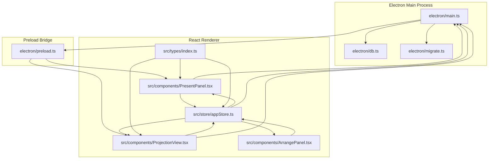
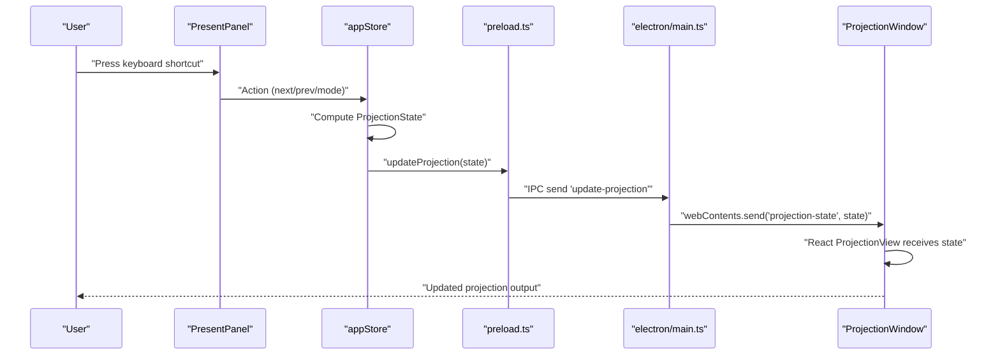
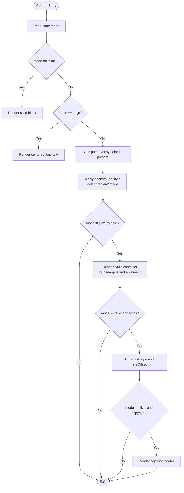
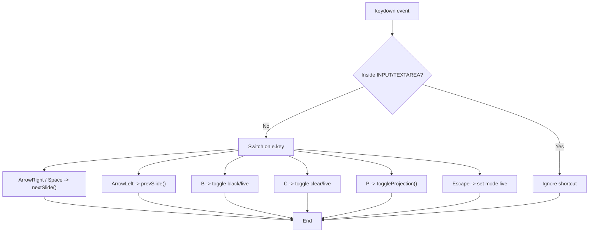
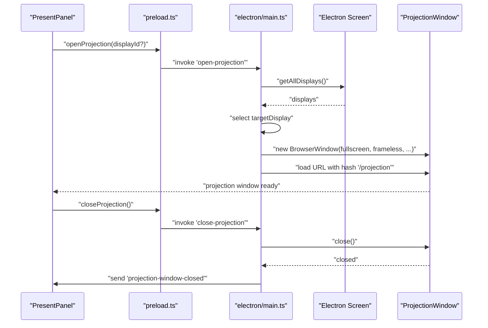
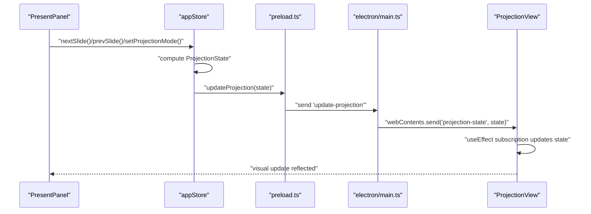
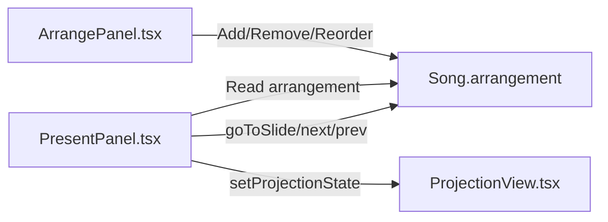
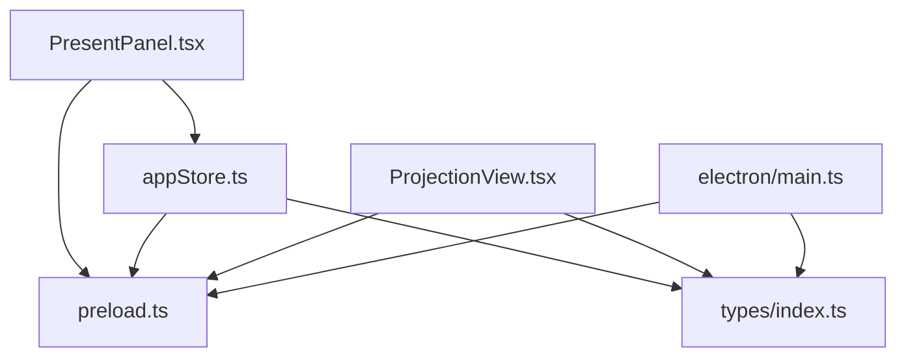

# Live Presentation Engine

<cite>
**Referenced Files in This Document**
- [ProjectionView.tsx](file://src/components/ProjectionView.tsx)
- [PresentPanel.tsx](file://src/components/PresentPanel.tsx)
- [appStore.ts](file://src/store/appStore.ts)
- [main.ts](file://electron/main.ts)
- [preload.ts](file://electron/preload.ts)
- [index.ts](file://src/types/index.ts)
- [ArrangePanel.tsx](file://src/components/ArrangePanel.tsx)
- [README.md](file://README.md)
- [electron.d.ts](file://src/types/electron.d.ts)
</cite>

## Table of Contents
1. [Introduction](#introduction)
2. [Project Structure](#project-structure)
3. [Core Components](#core-components)
4. [Architecture Overview](#architecture-overview)
5. [Detailed Component Analysis](#detailed-component-analysis)
6. [Dependency Analysis](#dependency-analysis)
7. [Performance Considerations](#performance-considerations)
8. [Troubleshooting Guide](#troubleshooting-guide)
9. [Conclusion](#conclusion)
10. [Appendices](#appendices)

## Introduction
This document describes the Live Presentation Engine responsible for managing projection windows, keyboard-driven presentation control, and real-time synchronization between the main application and projection outputs. It covers:
- Multi-monitor window management and display selection
- Keyboard shortcuts for navigation and mode switching
- Projection view rendering with dynamic backgrounds and text styling
- Integration with the arrangement system to drive live content
- Projection modes and their visual effects
- Typical presentation workflows from setup to execution
- Electron main process integration for window lifecycle and display detection
- Real-time state synchronization between renderer and projection windows

## Project Structure
The Live Presentation Engine spans React components, Electron main/preload processes, and a shared state store. The key areas are:
- Frontend presentation and control: PresentPanel, ProjectionView, ArrangePanel
- State management: appStore
- Electron integration: main process, preload bridge
- Shared types: ProjectionState, modes, styles

**Diagram sources**
- [main.ts:1-390](file://electron/main.ts#L1-L390)
- [preload.ts:1-43](file://electron/preload.ts#L1-L43)
- [PresentPanel.tsx:1-365](file://src/components/PresentPanel.tsx#L1-L365)
- [ProjectionView.tsx:1-134](file://src/components/ProjectionView.tsx#L1-L134)
- [ArrangePanel.tsx:1-187](file://src/components/ArrangePanel.tsx#L1-L187)
- [appStore.ts:1-385](file://src/store/appStore.ts#L1-L385)
- [index.ts:1-89](file://src/types/index.ts#L1-L89)

**Section sources**
- [README.md:116-146](file://README.md#L116-L146)
- [main.ts:1-390](file://electron/main.ts#L1-L390)
- [preload.ts:1-43](file://electron/preload.ts#L1-L43)
- [PresentPanel.tsx:1-365](file://src/components/PresentPanel.tsx#L1-L365)
- [ProjectionView.tsx:1-134](file://src/components/ProjectionView.tsx#L1-L134)
- [ArrangePanel.tsx:1-187](file://src/components/ArrangePanel.tsx#L1-L187)
- [appStore.ts:1-385](file://src/store/appStore.ts#L1-L385)
- [index.ts:1-89](file://src/types/index.ts#L1-L89)

## Core Components
- ProjectionView: Renders the projection output based on the current ProjectionState, applying background styles and text styling, and handling mode-specific visuals.
- PresentPanel: Provides live presentation controls, keyboard shortcuts, display selection, and projection window toggling.
- appStore: Centralized state for songs, arrangement, projection state, and actions to navigate slides and update projection.
- Electron main: Creates and manages projection windows, detects displays, and synchronizes state via IPC.
- Preload bridge: Exposes a typed API surface to renderer processes for display management, projection updates, and persistence.

Key responsibilities:
- Window lifecycle: create, position, and destroy projection windows
- Display detection: enumerate and select target displays
- Real-time state sync: push ProjectionState to projection window
- Keyboard-driven control: next/previous, mode switches, and display toggles

**Section sources**
- [ProjectionView.tsx:1-134](file://src/components/ProjectionView.tsx#L1-L134)
- [PresentPanel.tsx:1-365](file://src/components/PresentPanel.tsx#L1-L365)
- [appStore.ts:1-385](file://src/store/appStore.ts#L1-L385)
- [main.ts:111-152](file://electron/main.ts#L111-L152)
- [preload.ts:3-21](file://electron/preload.ts#L3-L21)

## Architecture Overview
The engine uses a unidirectional data flow:
- PresentPanel triggers actions in appStore
- appStore computes ProjectionState and sends it to the projection window via preload IPC
- ProjectionView listens for state updates and renders accordingly

**Diagram sources**
- [PresentPanel.tsx:38-79](file://src/components/PresentPanel.tsx#L38-L79)
- [appStore.ts:241-295](file://src/store/appStore.ts#L241-L295)
- [preload.ts:10-16](file://electron/preload.ts#L10-L16)
- [main.ts:186-190](file://electron/main.ts#L186-L190)
- [ProjectionView.tsx:22-29](file://src/components/ProjectionView.tsx#L22-L29)

## Detailed Component Analysis

### Projection View Component
ProjectionView renders the projection output based on ProjectionState:
- Modes:
  - black: solid black screen
  - logo: centered watermark-like logo text
  - live: lyrics with background and optional copyright
  - blank: empty content area with background
  - clear: hide lyrics while keeping background
- Background rendering:
  - color, gradient, or image with optional blur and overlay
- Text styling:
  - family, size, weight, italic, color, alignment, line height
  - vertical alignment and margins
  - shadows and stroke outlines
- Real-time updates:
  - Subscribes to state changes via preload.onProjectionState
  - Applies transitions for smooth lineOffset animations

**Diagram sources**
- [ProjectionView.tsx:77-132](file://src/components/ProjectionView.tsx#L77-L132)

**Section sources**
- [ProjectionView.tsx:1-134](file://src/components/ProjectionView.tsx#L1-L134)
- [index.ts:69-81](file://src/types/index.ts#L69-L81)

### Keyboard Shortcut System
PresentPanel defines keyboard shortcuts for live control:
- Navigation: Space/ArrowRight (next), ArrowLeft (previous)
- Mode switching: B (toggle black/live), C (toggle clear/live), Escape (return to live)
- Display toggles: P (open/close projection window)
- Input guards: shortcuts are ignored when typing in inputs

**Diagram sources**
- [PresentPanel.tsx:38-79](file://src/components/PresentPanel.tsx#L38-L79)

**Section sources**
- [PresentPanel.tsx:38-79](file://src/components/PresentPanel.tsx#L38-L79)
- [README.md:106-115](file://README.md#L106-L115)

### Projection Window Management
Electron main process manages projection windows:
- Display detection: Enumerates all displays and selects target by ID or fallback to secondary/primary
- Window creation: Fullscreen, frameless, always-on-top, skip-taskbar, black background
- Lifecycle: Open/close projection window, notify main window on close
- State synchronization: Sends ProjectionState to projection window via IPC

**Diagram sources**
- [main.ts:111-152](file://electron/main.ts#L111-L152)
- [main.ts:166-184](file://electron/main.ts#L166-L184)
- [preload.ts:5-8](file://electron/preload.ts#L5-L8)

**Section sources**
- [main.ts:111-152](file://electron/main.ts#L111-L152)
- [main.ts:154-190](file://electron/main.ts#L154-L190)
- [preload.ts:5-21](file://electron/preload.ts#L5-L21)

### Real-Time State Synchronization
appStore coordinates state updates and IPC:
- setProjectionState merges partial state and dispatches to projection window
- goToSlide computes current lyrics, background, and text style from arrangement
- nextSlide/prevSlide navigate the arrangement and update state
- shiftLines adjusts lineOffset for smooth transitions

**Diagram sources**
- [appStore.ts:241-295](file://src/store/appStore.ts#L241-L295)
- [preload.ts:10-16](file://electron/preload.ts#L10-L16)
- [main.ts:186-190](file://electron/main.ts#L186-L190)
- [ProjectionView.tsx:22-29](file://src/components/ProjectionView.tsx#L22-L29)

**Section sources**
- [appStore.ts:241-302](file://src/store/appStore.ts#L241-L302)
- [ProjectionView.tsx:22-29](file://src/components/ProjectionView.tsx#L22-L29)

### Integration with Arrangement System
ArrangePanel builds and reorders the presentation arrangement. PresentPanel reads the arrangement to compute current and next sections, enabling live navigation and projection updates.

**Diagram sources**
- [ArrangePanel.tsx:22-63](file://src/components/ArrangePanel.tsx#L22-L63)
- [PresentPanel.tsx:97-107](file://src/components/PresentPanel.tsx#L97-L107)
- [appStore.ts:251-291](file://src/store/appStore.ts#L251-L291)
- [ProjectionView.tsx:101-123](file://src/components/ProjectionView.tsx#L101-L123)

**Section sources**
- [ArrangePanel.tsx:22-63](file://src/components/ArrangePanel.tsx#L22-L63)
- [PresentPanel.tsx:97-107](file://src/components/PresentPanel.tsx#L97-L107)
- [appStore.ts:251-291](file://src/store/appStore.ts#L251-L291)

## Dependency Analysis
- PresentPanel depends on appStore for state and actions, and on preload for display and projection control
- appStore depends on preload for IPC and on types for ProjectionState
- ProjectionView depends on types for ProjectionState and on preload for state updates
- Electron main depends on preload for IPC handlers and on screen for display enumeration
- Types define ProjectionState, modes, and styles used across components

**Diagram sources**
- [PresentPanel.tsx:1-25](file://src/components/PresentPanel.tsx#L1-L25)
- [appStore.ts:1-40](file://src/store/appStore.ts#L1-L40)
- [ProjectionView.tsx:1-20](file://src/components/ProjectionView.tsx#L1-L20)
- [main.ts:1-10](file://electron/main.ts#L1-L10)
- [index.ts:69-81](file://src/types/index.ts#L69-L81)

**Section sources**
- [PresentPanel.tsx:1-25](file://src/components/PresentPanel.tsx#L1-L25)
- [appStore.ts:1-40](file://src/store/appStore.ts#L1-L40)
- [ProjectionView.tsx:1-20](file://src/components/ProjectionView.tsx#L1-L20)
- [main.ts:1-10](file://electron/main.ts#L1-L10)
- [index.ts:69-81](file://src/types/index.ts#L69-L81)

## Performance Considerations
- Rendering efficiency: ProjectionView uses CSS transforms for lineOffset animation and minimal DOM updates; consider throttling rapid key presses if needed.
- IPC overhead: Frequent state updates are lightweight; batching updates is unnecessary given the simplicity of ProjectionState.
- Background images: Large images can impact rendering; consider preloading and caching strategies.
- Multi-monitor: Window creation is O(n) for display enumeration; selection is O(1) by ID.

[No sources needed since this section provides general guidance]

## Troubleshooting Guide
Common issues and resolutions:
- Projection window does not open:
  - Verify display selection and Electron permissions
  - Check that the projection window is not already open
- No updates on projection:
  - Ensure setProjectionState is invoked and updateProjection is sent
  - Confirm ProjectionView is subscribed to onProjectionState
- Keyboard shortcuts not working:
  - Ensure focus is not inside INPUT/TEXTAREA
  - Confirm PresentPanel is mounted and event listeners attached
- Display selection mismatch:
  - Use getDisplays to verify IDs and labels
  - Select a valid display ID or rely on fallback logic

**Section sources**
- [main.ts:154-190](file://electron/main.ts#L154-L190)
- [preload.ts:10-21](file://electron/preload.ts#L10-L21)
- [PresentPanel.tsx:38-79](file://src/components/PresentPanel.tsx#L38-L79)
- [ProjectionView.tsx:22-29](file://src/components/ProjectionView.tsx#L22-L29)

## Conclusion
The Live Presentation Engine integrates React presentation controls with Electron’s windowing and display APIs to deliver a robust, real-time projection experience. Its clean separation of concerns—state in appStore, rendering in ProjectionView, and lifecycle in Electron main—enables reliable multi-monitor support, flexible keyboard control, and dynamic content updates driven by the arrangement system.

[No sources needed since this section summarizes without analyzing specific files]

## Appendices

### Projection Modes and Visual Effects
- live: renders lyrics with background and optional copyright; supports lineOffset transitions
- blank: empty content area with background
- black: solid black screen
- logo: centered watermark-like text
- clear: hides lyrics while preserving background

**Section sources**
- [ProjectionView.tsx:77-132](file://src/components/ProjectionView.tsx#L77-L132)
- [index.ts:69-71](file://src/types/index.ts#L69-L71)

### Typical Presentation Workflows
- Setup:
  - Prepare arrangement in ArrangePanel
  - Select target display in PresentPanel
- Execution:
  - Open projection window
  - Navigate slides with keyboard or buttons
  - Toggle modes (black, clear, logo) as needed
- Cleanup:
  - Close projection window when finished

**Section sources**
- [ArrangePanel.tsx:22-63](file://src/components/ArrangePanel.tsx#L22-L63)
- [PresentPanel.tsx:97-129](file://src/components/PresentPanel.tsx#L97-L129)
- [README.md:106-115](file://README.md#L106-L115)