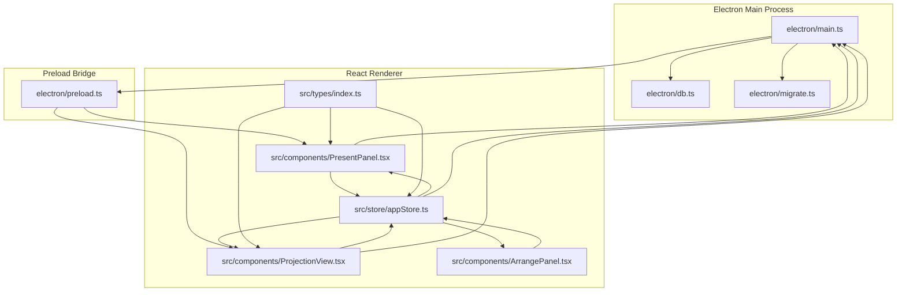
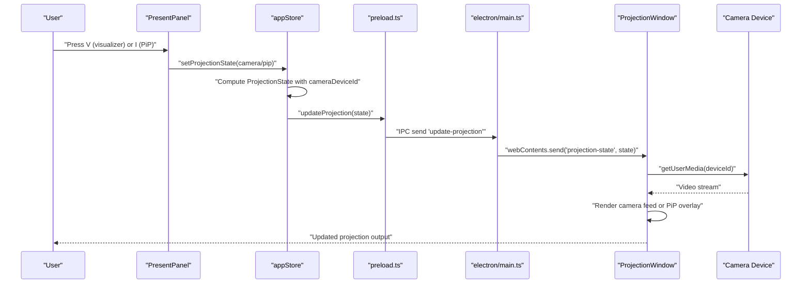
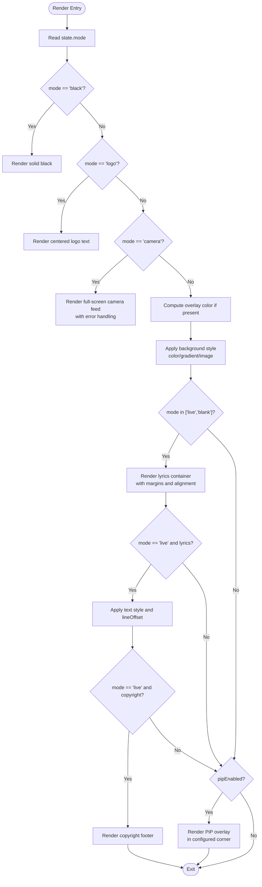
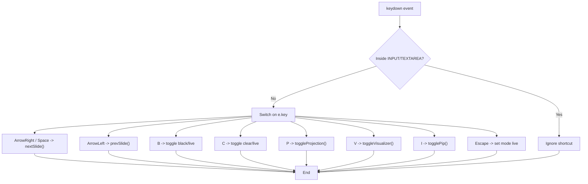
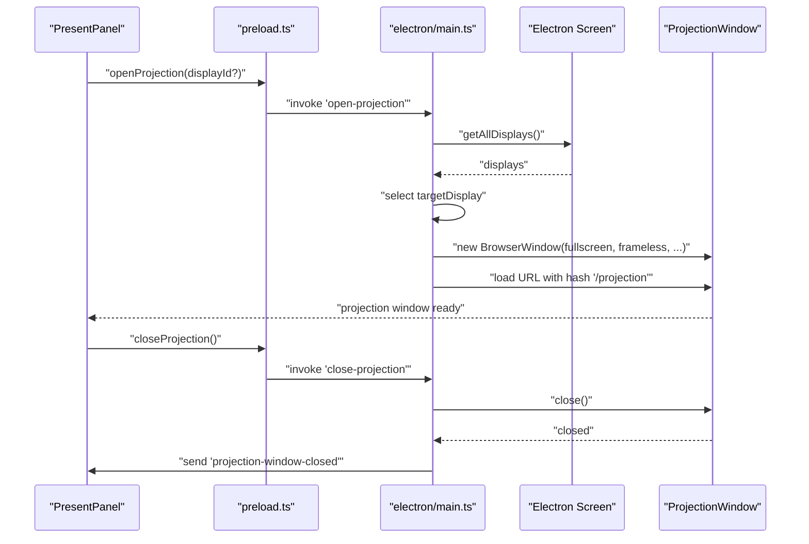
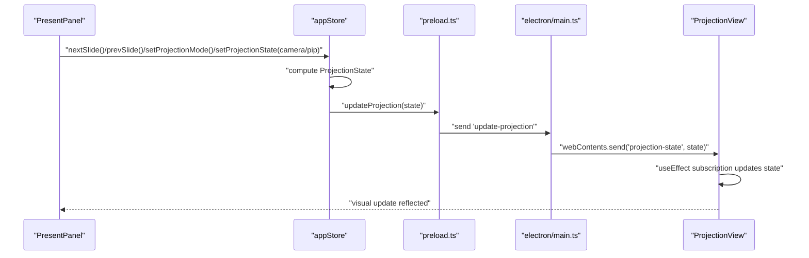
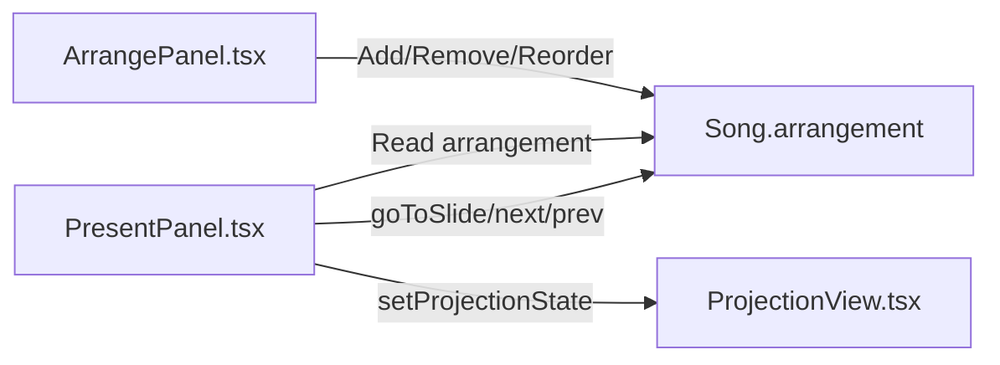
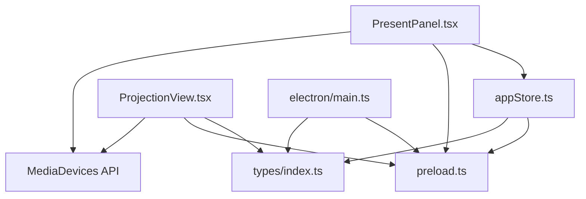

# Live Presentation Engine

<cite>
**Referenced Files in This Document**
- [ProjectionView.tsx](file://src/components/ProjectionView.tsx)
- [PresentPanel.tsx](file://src/components/PresentPanel.tsx)
- [appStore.ts](file://src/store/appStore.ts)
- [main.ts](file://electron/main.ts)
- [preload.ts](file://electron/preload.ts)
- [index.ts](file://src/types/index.ts)
- [ArrangePanel.tsx](file://src/components/ArrangePanel.tsx)
- [README.md](file://README.md)
- [electron.d.ts](file://src/types/electron.d.ts)
- [en.ts](file://src/i18n/en.ts)
</cite>

## Update Summary
**Changes Made**
- Added comprehensive documentation for the new 'camera' mode in ProjectionMode
- Documented the Picture-in-Picture (PiP) positioning system with bottom-left/bottom-right options
- Added camera device management integration including device enumeration and selection
- Updated keyboard shortcuts to include camera and PiP controls (V for visualizer, I for PiP)
- Enhanced projection modes documentation to include camera-specific functionality
- Added camera permission handling in Electron main process

## Table of Contents
1. [Introduction](#introduction)
2. [Project Structure](#project-structure)
3. [Core Components](#core-components)
4. [Architecture Overview](#architecture-overview)
5. [Detailed Component Analysis](#detailed-component-analysis)
6. [Dependency Analysis](#dependency-analysis)
7. [Performance Considerations](#performance-considerations)
8. [Troubleshooting Guide](#troubleshooting-guide)
9. [Conclusion](#conclusion)
10. [Appendices](#appendices)

## Introduction
This document describes the Live Presentation Engine responsible for managing projection windows, keyboard-driven presentation control, and real-time synchronization between the main application and projection outputs. It covers:
- Multi-monitor window management and display selection
- Keyboard shortcuts for navigation and mode switching
- Projection view rendering with dynamic backgrounds and text styling
- Integration with the arrangement system to drive live content
- **New**: Camera mode support for live video feeds and Picture-in-Picture overlay
- Projection modes and their visual effects
- Typical presentation workflows from setup through execution
- Electron main process integration for window lifecycle and display detection
- Real-time state synchronization between renderer and projection windows

## Project Structure
The Live Presentation Engine spans React components, Electron main/preload processes, and a shared state store. The key areas are:
- Frontend presentation and control: PresentPanel, ProjectionView, ArrangePanel
- State management: appStore
- Electron integration: main process, preload bridge
- Shared types: ProjectionState, modes, styles, and camera-related types

**Diagram sources**
- [main.ts:1-489](file://electron/main.ts#L1-L489)
- [preload.ts:1-48](file://electron/preload.ts#L1-L48)
- [PresentPanel.tsx:1-581](file://src/components/PresentPanel.tsx#L1-L581)
- [ProjectionView.tsx:1-229](file://src/components/ProjectionView.tsx#L1-L229)
- [ArrangePanel.tsx:1-187](file://src/components/ArrangePanel.tsx#L1-L187)
- [appStore.ts:1-425](file://src/store/appStore.ts#L1-L425)
- [index.ts:1-95](file://src/types/index.ts#L1-L95)

**Section sources**
- [README.md:116-146](file://README.md#L116-L146)
- [main.ts:1-489](file://electron/main.ts#L1-L489)
- [preload.ts:1-48](file://electron/preload.ts#L1-L48)
- [PresentPanel.tsx:1-581](file://src/components/PresentPanel.tsx#L1-L581)
- [ProjectionView.tsx:1-229](file://src/components/ProjectionView.tsx#L1-L229)
- [ArrangePanel.tsx:1-187](file://src/components/ArrangePanel.tsx#L1-L187)
- [appStore.ts:1-425](file://src/store/appStore.ts#L1-L425)
- [index.ts:1-95](file://src/types/index.ts#L1-L95)

## Core Components
- ProjectionView: Renders the projection output based on the current ProjectionState, applying background styles and text styling, and handling mode-specific visuals including camera feeds and PiP overlays.
- PresentPanel: Provides live presentation controls, keyboard shortcuts, display selection, projection window toggling, and camera device management.
- appStore: Centralized state for songs, arrangement, projection state, and actions to navigate slides and update projection.
- Electron main: Creates and manages projection windows, detects displays, handles camera permissions, and synchronizes state via IPC.
- Preload bridge: Exposes a typed API surface to renderer processes for display management, projection updates, and persistence.

Key responsibilities:
- Window lifecycle: create, position, and destroy projection windows
- Display detection: enumerate and select target displays
- Real-time state sync: push ProjectionState to projection window
- Keyboard-driven control: next/previous, mode switches, and display toggles
- **New**: Camera device enumeration and stream management
- **New**: Picture-in-Picture overlay positioning and control

**Section sources**
- [ProjectionView.tsx:1-229](file://src/components/ProjectionView.tsx#L1-L229)
- [PresentPanel.tsx:1-581](file://src/components/PresentPanel.tsx#L1-L581)
- [appStore.ts:1-425](file://src/store/appStore.ts#L1-L425)
- [main.ts:111-152](file://electron/main.ts#L111-L152)
- [preload.ts:3-21](file://electron/preload.ts#L3-L21)

## Architecture Overview
The engine uses a unidirectional data flow:
- PresentPanel triggers actions in appStore
- appStore computes ProjectionState and sends it to the projection window via preload IPC
- ProjectionView listens for state updates and renders accordingly, including camera feeds and PiP overlays

**Diagram sources**
- [PresentPanel.tsx:103-131](file://src/components/PresentPanel.tsx#L103-L131)
- [appStore.ts:249-256](file://src/store/appStore.ts#L249-L256)
- [preload.ts:10-16](file://electron/preload.ts#L10-L16)
- [main.ts:186-190](file://electron/main.ts#L186-L190)
- [ProjectionView.tsx:139-180](file://src/components/ProjectionView.tsx#L139-L180)

## Detailed Component Analysis

### Projection View Component
ProjectionView renders the projection output based on ProjectionState:
- Modes:
  - black: solid black screen
  - logo: centered watermark-like logo text
  - live: lyrics with background and optional copyright
  - blank: empty content area with background
  - clear: hide lyrics while keeping background
  - **New**: camera: full-screen camera feed with error handling
- Background rendering:
  - color, gradient, or image with optional blur and overlay
- Text styling:
  - family, size, weight, italic, color, alignment, line height
  - vertical alignment and margins
  - shadows and stroke outlines
- **New**: Camera functionality:
  - Full-screen camera feed using MediaStream API
  - Error handling for unavailable cameras
  - Device-specific stream management
- **New**: Picture-in-Picture overlay:
  - Small camera feed positioned in corners (bottom-left/bottom-right)
  - Configurable positioning with responsive sizing
  - Graceful fallback when camera is unavailable
- Real-time updates:
  - Subscribes to state changes via preload.onProjectionState
  - Applies transitions for smooth lineOffset animations

**Diagram sources**
- [ProjectionView.tsx:64-137](file://src/components/ProjectionView.tsx#L64-L137)
- [ProjectionView.tsx:182-228](file://src/components/ProjectionView.tsx#L182-L228)

**Section sources**
- [ProjectionView.tsx:1-229](file://src/components/ProjectionView.tsx#L1-L229)
- [index.ts:69-87](file://src/types/index.ts#L69-L87)

### Camera Mode and Device Management
**New Feature**: The camera mode provides two primary functionalities:

1. **Full-Screen Camera Feed**: When mode is set to 'camera', the projection displays a live camera feed
   - Uses MediaDevices.getUserMedia API for camera access
   - Supports specific device selection via deviceId parameter
   - Includes error handling for unavailable cameras
   - Automatically releases camera resources when device changes

2. **Picture-in-Picture Overlay**: A small camera feed overlaid on top of other content
   - Positioned in configurable corners (bottom-left or bottom-right)
   - Responsive sizing with aspect ratio preservation
   - Styled with border, shadow, and rounded corners
   - Disabled when in camera mode to prevent conflicts

Camera device management includes:
- Device enumeration using navigator.mediaDevices.enumerateDevices
- Permission handling with automatic stream request to unlock device labels
- Device selection UI with fallback labels when names are unavailable
- Automatic cleanup of camera streams when devices change or component unmounts

**Section sources**
- [ProjectionView.tsx:76-79](file://src/components/ProjectionView.tsx#L76-L79)
- [ProjectionView.tsx:139-228](file://src/components/ProjectionView.tsx#L139-L228)
- [PresentPanel.tsx:62-101](file://src/components/PresentPanel.tsx#L62-L101)
- [PresentPanel.tsx:103-131](file://src/components/PresentPanel.tsx#L103-L131)

### Keyboard Shortcut System
PresentPanel defines keyboard shortcuts for live control:
- Navigation: Space/ArrowRight (next), ArrowLeft (previous)
- Mode switching: B (toggle black/live), C (toggle clear/live), Escape (return to live)
- **New**: Camera controls: V (toggle visualizer/camera mode), I (toggle PiP overlay)
- Display toggles: P (open/close projection window)
- Input guards: shortcuts are ignored when typing in inputs

**Diagram sources**
- [PresentPanel.tsx:178-228](file://src/components/PresentPanel.tsx#L178-L228)

**Section sources**
- [PresentPanel.tsx:178-228](file://src/components/PresentPanel.tsx#L178-L228)
- [README.md:106-115](file://README.md#L106-L115)

### Projection Window Management
Electron main process manages projection windows:
- Display detection: Enumerates all displays and selects target by ID or fallback to secondary/primary
- Window creation: Fullscreen, frameless, always-on-top, skip-taskbar, black background
- Lifecycle: Open/close projection window, notify main window on close
- State synchronization: Sends ProjectionState to projection window via IPC
- **New**: Camera permission handling: Grants media permissions for camera access

**Diagram sources**
- [main.ts:111-152](file://electron/main.ts#L111-L152)
- [main.ts:166-184](file://electron/main.ts#L166-L184)
- [preload.ts:5-8](file://electron/preload.ts#L5-L8)

**Section sources**
- [main.ts:111-152](file://electron/main.ts#L111-L152)
- [main.ts:154-190](file://electron/main.ts#L154-L190)
- [main.ts:455-458](file://electron/main.ts#L455-L458)
- [preload.ts:5-21](file://electron/preload.ts#L5-L21)

### Real-Time State Synchronization
appStore coordinates state updates and IPC:
- setProjectionState merges partial state and dispatches to projection window
- goToSlide computes current lyrics, background, and text style from arrangement
- nextSlide/prevSlide navigate the arrangement and update state
- shiftLines adjusts lineOffset for smooth transitions
- **New**: Camera state management includes cameraDeviceId, pipEnabled, and pipPosition

**Diagram sources**
- [appStore.ts:249-319](file://src/store/appStore.ts#L249-L319)
- [preload.ts:10-16](file://electron/preload.ts#L10-L16)
- [main.ts:186-190](file://electron/main.ts#L186-L190)
- [ProjectionView.tsx:24-31](file://src/components/ProjectionView.tsx#L24-L31)

**Section sources**
- [appStore.ts:249-319](file://src/store/appStore.ts#L249-L319)
- [ProjectionView.tsx:24-31](file://src/components/ProjectionView.tsx#L24-L31)

### Integration with Arrangement System
ArrangePanel builds and reorders the presentation arrangement. PresentPanel reads the arrangement to compute current and next sections, enabling live navigation and projection updates.

**Diagram sources**
- [ArrangePanel.tsx:22-63](file://src/components/ArrangePanel.tsx#L22-L63)
- [PresentPanel.tsx:97-107](file://src/components/PresentPanel.tsx#L97-L107)
- [appStore.ts:258-288](file://src/store/appStore.ts#L258-L288)
- [ProjectionView.tsx:101-123](file://src/components/ProjectionView.tsx#L101-L123)

**Section sources**
- [ArrangePanel.tsx:22-63](file://src/components/ArrangePanel.tsx#L22-L63)
- [PresentPanel.tsx:97-107](file://src/components/PresentPanel.tsx#L97-L107)
- [appStore.ts:258-288](file://src/store/appStore.ts#L258-L288)

## Dependency Analysis
- PresentPanel depends on appStore for state and actions, and on preload for display and projection control
- appStore depends on preload for IPC and on types for ProjectionState
- ProjectionView depends on types for ProjectionState and on preload for state updates
- Electron main depends on preload for IPC handlers and on screen for display enumeration
- Types define ProjectionState, modes, and styles used across components
- **New**: Camera functionality depends on browser MediaDevices API for device enumeration and stream access

**Diagram sources**
- [PresentPanel.tsx:1-25](file://src/components/PresentPanel.tsx#L1-L25)
- [appStore.ts:1-40](file://src/store/appStore.ts#L1-L40)
- [ProjectionView.tsx:1-20](file://src/components/ProjectionView.tsx#L1-L20)
- [main.ts:1-10](file://electron/main.ts#L1-L10)
- [index.ts:69-87](file://src/types/index.ts#L69-L87)

**Section sources**
- [PresentPanel.tsx:1-25](file://src/components/PresentPanel.tsx#L1-L25)
- [appStore.ts:1-40](file://src/store/appStore.ts#L1-L40)
- [ProjectionView.tsx:1-20](file://src/components/ProjectionView.tsx#L1-L20)
- [main.ts:1-10](file://electron/main.ts#L1-L10)
- [index.ts:69-87](file://src/types/index.ts#L69-L87)

## Performance Considerations
- Rendering efficiency: ProjectionView uses CSS transforms for lineOffset animation and minimal DOM updates; consider throttling rapid key presses if needed.
- IPC overhead: Frequent state updates are lightweight; batching updates is unnecessary given the simplicity of ProjectionState.
- Background images: Large images can impact rendering; consider preloading and caching strategies.
- Multi-monitor: Window creation is O(n) for display enumeration; selection is O(1) by ID.
- **New**: Camera performance:
  - Camera streams are automatically released when devices change or components unmount
  - PiP overlay uses efficient CSS positioning without additional DOM manipulation
  - Camera permission requests are cached after initial grant

## Troubleshooting Guide
Common issues and resolutions:
- Projection window does not open:
  - Verify display selection and Electron permissions
  - Check that the projection window is not already open
- No updates on projection:
  - Ensure setProjectionState is invoked and updateProjection is sent
  - Confirm ProjectionView is subscribed to onProjectionState
- Keyboard shortcuts not working:
  - Ensure focus is not inside INPUT/TEXTAREA
  - Confirm PresentPanel is mounted and event listeners attached
- Display selection mismatch:
  - Use getDisplays to verify IDs and labels
  - Select a valid display ID or rely on fallback logic
- **New**: Camera issues:
  - Camera not detected: Check browser permissions and ensure camera is available
  - Camera feed shows error: Verify camera device ID is valid and accessible
  - PiP overlay not showing: Ensure pipEnabled is true and not in camera mode
  - Device enumeration fails: Request camera permission first to unlock device labels

**Section sources**
- [main.ts:154-190](file://electron/main.ts#L154-L190)
- [preload.ts:10-21](file://electron/preload.ts#L10-L21)
- [PresentPanel.tsx:178-228](file://src/components/PresentPanel.tsx#L178-L228)
- [ProjectionView.tsx:139-180](file://src/components/ProjectionView.tsx#L139-L180)

## Conclusion
The Live Presentation Engine integrates React presentation controls with Electron's windowing and display APIs to deliver a robust, real-time projection experience. Its clean separation of concerns—state in appStore, rendering in ProjectionView, and lifecycle in Electron main—enables reliable multi-monitor support, flexible keyboard control, and dynamic content updates driven by the arrangement system. The addition of camera mode and PiP functionality extends the engine's capabilities to support live video feeds and presenter overlays, making it suitable for more complex presentation scenarios requiring both lyric projection and visual elements.

## Appendices

### Projection Modes and Visual Effects
- live: renders lyrics with background and optional copyright; supports lineOffset transitions
- blank: empty content area with background
- black: solid black screen
- logo: centered watermark-like text
- clear: hides lyrics while preserving background
- **New**: camera: full-screen camera feed with error handling and device-specific stream management

**Section sources**
- [ProjectionView.tsx:64-79](file://src/components/ProjectionView.tsx#L64-L79)
- [index.ts:69-71](file://src/types/index.ts#L69-L71)

### Picture-in-Picture Positioning System
**New Feature**: The PiP system allows a small camera feed to be overlaid on top of other content:
- Supported positions: bottom-left, bottom-right
- Responsive sizing with aspect ratio preservation
- Configurable via pipPosition state property
- Automatically disabled when in camera mode to prevent conflicts
- Styled with border, shadow, and rounded corners for visual distinction

**Section sources**
- [ProjectionView.tsx:205-228](file://src/components/ProjectionView.tsx#L205-L228)
- [PresentPanel.tsx:119-131](file://src/components/PresentPanel.tsx#L119-L131)
- [index.ts:71-87](file://src/types/index.ts#L71-L87)

### Camera Device Management
**New Feature**: Comprehensive camera device management including:
- Device enumeration using navigator.mediaDevices.enumerateDevices
- Automatic permission handling with stream request to unlock device labels
- Device selection UI with fallback labels when names are unavailable
- Stream lifecycle management with automatic cleanup
- Error handling for unavailable cameras with user-friendly messages

**Section sources**
- [PresentPanel.tsx:62-101](file://src/components/PresentPanel.tsx#L62-L101)
- [ProjectionView.tsx:139-180](file://src/components/ProjectionView.tsx#L139-L180)

### Typical Presentation Workflows
- Setup:
  - Prepare arrangement in ArrangePanel
  - Select target display in PresentPanel
  - Configure camera devices if needed
- Execution:
  - Open projection window
  - Navigate slides with keyboard or buttons
  - Toggle modes (black, clear, logo, camera) as needed
  - Enable PiP overlay for presenter feedback
- Cleanup:
  - Close projection window when finished
  - Release camera resources automatically

**Section sources**
- [ArrangePanel.tsx:22-63](file://src/components/ArrangePanel.tsx#L22-L63)
- [PresentPanel.tsx:258-353](file://src/components/PresentPanel.tsx#L258-L353)
- [README.md:106-115](file://README.md#L106-L115)