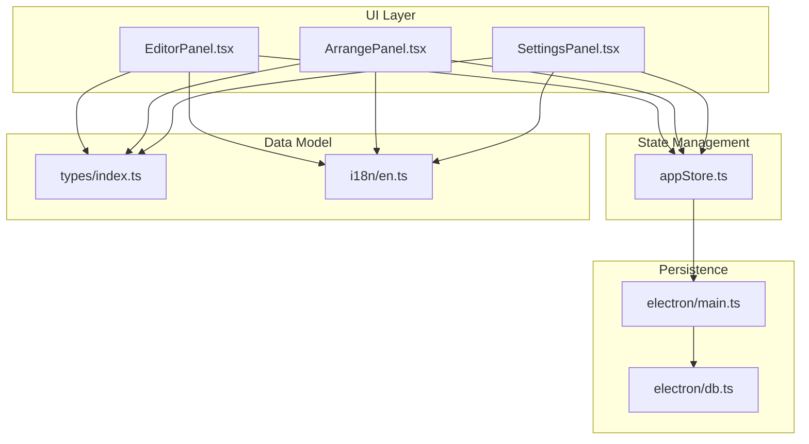
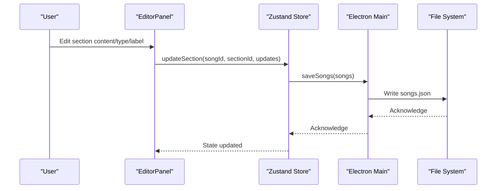
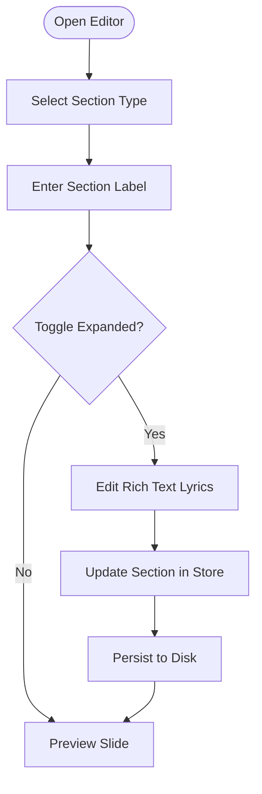
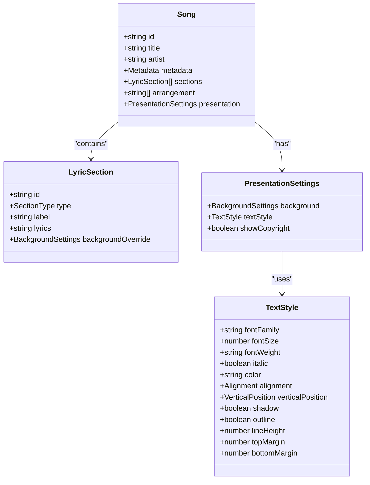
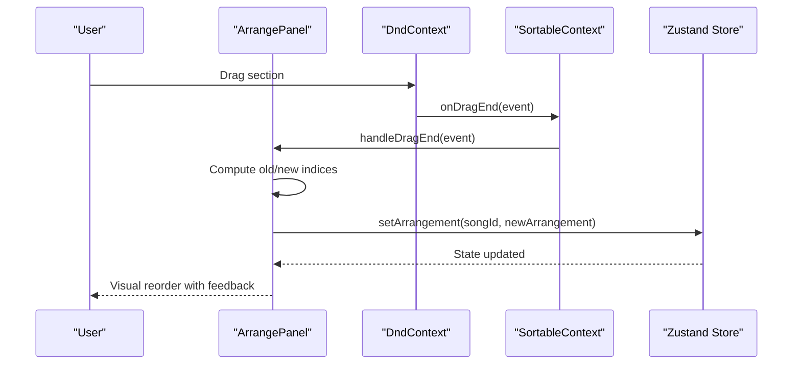
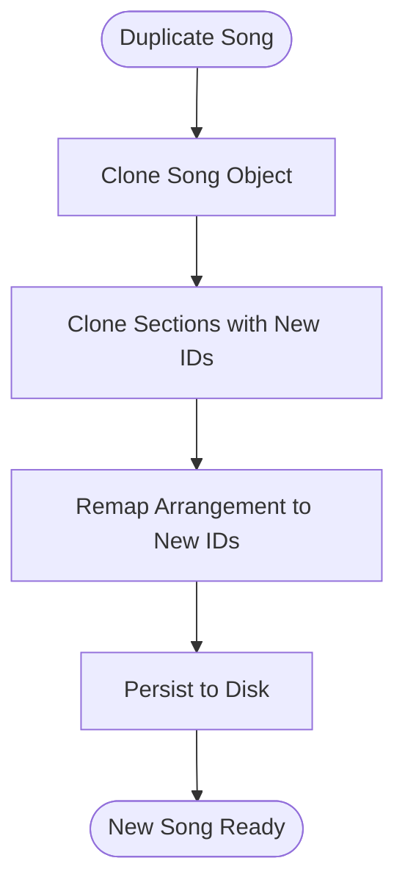
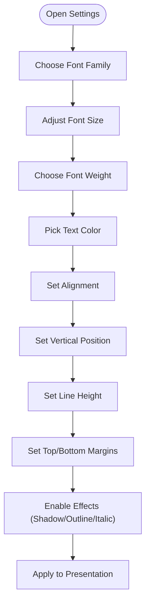
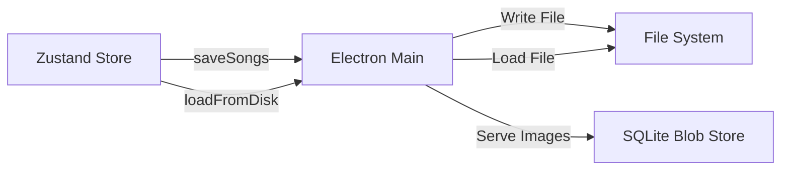
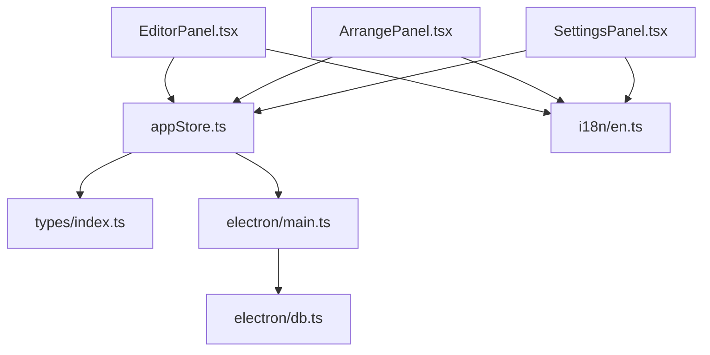

# Lyric Section Editor

<cite>
**Referenced Files in This Document**
- [README.md](file://README.md)
- [EditorPanel.tsx](file://src/components/EditorPanel.tsx)
- [ArrangePanel.tsx](file://src/components/ArrangePanel.tsx)
- [SettingsPanel.tsx](file://src/components/SettingsPanel.tsx)
- [appStore.ts](file://src/store/appStore.ts)
- [index.ts](file://src/types/index.ts)
- [en.ts](file://src/i18n/en.ts)
- [main.ts](file://electron/main.ts)
- [db.ts](file://electron/db.ts)
</cite>

## Table of Contents
1. [Introduction](#introduction)
2. [Project Structure](#project-structure)
3. [Core Components](#core-components)
4. [Architecture Overview](#architecture-overview)
5. [Detailed Component Analysis](#detailed-component-analysis)
6. [Dependency Analysis](#dependency-analysis)
7. [Performance Considerations](#performance-considerations)
8. [Troubleshooting Guide](#troubleshooting-guide)
9. [Conclusion](#conclusion)

## Introduction
The Lyric Section Editor is the core component responsible for creating, editing, and organizing lyric sections within a song. It enables users to define sections such as verses, choruses, bridges, intros, outros, and custom sections, manage their content, and preview how they will appear during live presentation. This document explains the rich text editing capabilities, section types, formatting options, drag-and-drop reordering, duplication functionality, text editing interface, and integration with the broader song management system and database persistence.

## Project Structure
The Lyric Section Editor lives within the React application and interacts with the global state store, internationalization, and Electron-based persistence layer. The editor integrates with the arrangement builder to support dynamic ordering and with the settings panel to apply text styling globally.

**Diagram sources**
- [EditorPanel.tsx:17-118](file://src/components/EditorPanel.tsx#L17-L118)
- [ArrangePanel.tsx:22-134](file://src/components/ArrangePanel.tsx#L22-L134)
- [SettingsPanel.tsx:7-417](file://src/components/SettingsPanel.tsx#L7-L417)
- [appStore.ts:98-385](file://src/store/appStore.ts#L98-L385)
- [index.ts:3-67](file://src/types/index.ts#L3-L67)
- [en.ts:35-62](file://src/i18n/en.ts#L35-L62)
- [main.ts:192-218](file://electron/main.ts#L192-L218)
- [db.ts:19-48](file://electron/db.ts#L19-L48)

**Section sources**
- [README.md:70-100](file://README.md#L70-L100)
- [EditorPanel.tsx:17-118](file://src/components/EditorPanel.tsx#L17-L118)
- [ArrangePanel.tsx:22-134](file://src/components/ArrangePanel.tsx#L22-L134)
- [SettingsPanel.tsx:7-417](file://src/components/SettingsPanel.tsx#L7-L417)
- [appStore.ts:98-385](file://src/store/appStore.ts#L98-L385)
- [index.ts:3-67](file://src/types/index.ts#L3-L67)
- [en.ts:35-62](file://src/i18n/en.ts#L35-L62)
- [main.ts:192-218](file://electron/main.ts#L192-L218)
- [db.ts:19-48](file://electron/db.ts#L19-L48)

## Core Components
- Lyric Section Editor: Provides the editing interface for individual sections, including type selection, label editing, and rich text content area.
- Section Type Definitions: Enumerates supported section types (Intro, Verse, Pre-Chorus, Chorus, Bridge, Instrumental, Outro, Custom).
- Text Styling Controls: Global text style settings for font family, size, weight, color, alignment, vertical position, line height, margins, and effects (shadow, outline, italic).
- Drag-and-Drop Arrangement Builder: Allows reordering of sections within a presentation arrangement with visual feedback and immediate state synchronization.
- Duplicate and Persistence: Supports duplicating songs (including sections) and saving all changes to disk via Electron IPC.

**Section sources**
- [EditorPanel.tsx:6-15](file://src/components/EditorPanel.tsx#L6-L15)
- [index.ts:3-11](file://src/types/index.ts#L3-L11)
- [SettingsPanel.tsx:244-396](file://src/components/SettingsPanel.tsx#L244-L396)
- [ArrangePanel.tsx:54-63](file://src/components/ArrangePanel.tsx#L54-L63)
- [appStore.ts:151-172](file://src/store/appStore.ts#L151-L172)
- [main.ts:192-218](file://electron/main.ts#L192-L218)

## Architecture Overview
The Lyric Section Editor follows a unidirectional data flow:
- UI components dispatch actions to the Zustand store.
- Store updates the in-memory state and persists changes via Electron IPC.
- Electron main process writes data to local files or SQLite database.
- Projection and presentation windows receive updates through IPC channels.

**Diagram sources**
- [EditorPanel.tsx:97-103](file://src/components/EditorPanel.tsx#L97-L103)
- [appStore.ts:201-208](file://src/store/appStore.ts#L201-L208)
- [appStore.ts:379-383](file://src/store/appStore.ts#L379-L383)
- [main.ts:192-200](file://electron/main.ts#L192-L200)
- [db.ts:19-24](file://electron/db.ts#L19-L24)

## Detailed Component Analysis

### Lyric Section Editor Interface
The editor provides:
- Section type selector with localized labels.
- Section label input for human-friendly identification.
- Collapsible rich text area for lyrics input.
- Delete confirmation prompt.
- Real-time preview of how the section appears during projection.

**Diagram sources**
- [EditorPanel.tsx:120-176](file://src/components/EditorPanel.tsx#L120-L176)
- [appStore.ts:201-208](file://src/store/appStore.ts#L201-L208)
- [appStore.ts:379-383](file://src/store/appStore.ts#L379-L383)

**Section sources**
- [EditorPanel.tsx:120-176](file://src/components/EditorPanel.tsx#L120-L176)
- [index.ts:13-19](file://src/types/index.ts#L13-L19)
- [en.ts:53-62](file://src/i18n/en.ts#L53-L62)

### Section Types and Content Management
Supported section types include Intro, Verse, Pre-Chorus, Chorus, Bridge, Instrumental, Outro, and Custom. Each section has:
- A unique identifier.
- A type (enumerated).
- A label for display.
- Rich text lyrics content.
- Optional background override for that section.

**Diagram sources**
- [index.ts:13-67](file://src/types/index.ts#L13-L67)

**Section sources**
- [index.ts:3-11](file://src/types/index.ts#L3-L11)
- [index.ts:13-67](file://src/types/index.ts#L13-L67)

### Drag-and-Drop Reordering System
The arrangement builder allows dragging sections to reorder them. The system:
- Uses @dnd-kit for drag-and-drop.
- Computes indices from the current arrangement.
- Applies array-move to compute the new order.
- Synchronizes state immediately upon drag end.

**Diagram sources**
- [ArrangePanel.tsx:54-63](file://src/components/ArrangePanel.tsx#L54-L63)
- [ArrangePanel.tsx:111-126](file://src/components/ArrangePanel.tsx#L111-L126)

**Section sources**
- [ArrangePanel.tsx:22-134](file://src/components/ArrangePanel.tsx#L22-L134)

### Section Duplication Functionality
The duplication mechanism duplicates an entire song, including all sections and their arrangement references. It:
- Clones the song object.
- Generates new IDs for sections.
- Remaps arrangement entries to the new section IDs.
- Persists the duplicated song.

**Diagram sources**
- [appStore.ts:151-172](file://src/store/appStore.ts#L151-L172)
- [main.ts:192-200](file://electron/main.ts#L192-L200)

**Section sources**
- [appStore.ts:151-172](file://src/store/appStore.ts#L151-L172)

### Text Editing Interface and Formatting Options
The Settings panel exposes comprehensive text styling controls:
- Font family selection.
- Font size numeric input.
- Font weight options (normal, bold, lighter).
- Text color picker and hex input.
- Alignment (left, center, right).
- Vertical position (top, middle, bottom).
- Line height numeric input.
- Top and bottom margin adjustments.
- Effects: text shadow, outline, italic.

These styles are applied to the slide preview and projection output.

**Diagram sources**
- [SettingsPanel.tsx:244-396](file://src/components/SettingsPanel.tsx#L244-L396)
- [index.ts:29-42](file://src/types/index.ts#L29-L42)

**Section sources**
- [SettingsPanel.tsx:244-396](file://src/components/SettingsPanel.tsx#L244-L396)
- [index.ts:29-42](file://src/types/index.ts#L29-L42)

### Integration with Song Management and Database
The editor integrates with the song management system through:
- Zustand store actions for CRUD operations on sections and songs.
- Electron IPC handlers for loading and saving songs, settings, and preparation lists.
- Local file persistence for songs.json and settings.json.
- SQLite-backed image gallery for background images.

**Diagram sources**
- [appStore.ts:379-383](file://src/store/appStore.ts#L379-L383)
- [main.ts:192-218](file://electron/main.ts#L192-L218)
- [db.ts:19-48](file://electron/db.ts#L19-L48)

**Section sources**
- [appStore.ts:362-383](file://src/store/appStore.ts#L362-L383)
- [main.ts:192-218](file://electron/main.ts#L192-L218)
- [db.ts:19-48](file://electron/db.ts#L19-L48)

### Common Editing Workflows
- Adding a new section:
  - Click “Add Section” and choose a type from the dropdown menu.
  - The system auto-generates a label (e.g., “Verse 1”, “Chorus”) and adds the section to the song.
- Modifying existing content:
  - Expand the section panel to edit lyrics.
  - Change the section type or label using the controls.
- Organizing song structure:
  - Use the Arrange panel to add sections to the arrangement.
  - Drag and drop to reorder slides.
  - Remove slides from the arrangement as needed.
- Applying text styling:
  - Open Settings to adjust font family, size, color, alignment, and layout.
  - Changes apply immediately to the preview and projection.

**Section sources**
- [EditorPanel.tsx:178-208](file://src/components/EditorPanel.tsx#L178-L208)
- [ArrangePanel.tsx:68-134](file://src/components/ArrangePanel.tsx#L68-L134)
- [SettingsPanel.tsx:244-396](file://src/components/SettingsPanel.tsx#L244-L396)

## Dependency Analysis
The Lyric Section Editor depends on:
- Zustand store for state management and persistence.
- @dnd-kit for drag-and-drop reordering.
- Electron main process for file I/O and IPC communication.
- Type definitions for consistent data modeling.

**Diagram sources**
- [EditorPanel.tsx:1-5](file://src/components/EditorPanel.tsx#L1-L5)
- [ArrangePanel.tsx:1-21](file://src/components/ArrangePanel.tsx#L1-L21)
- [SettingsPanel.tsx:1-6](file://src/components/SettingsPanel.tsx#L1-L6)
- [appStore.ts:1-4](file://src/store/appStore.ts#L1-L4)
- [index.ts:1-89](file://src/types/index.ts#L1-L89)
- [main.ts:1-6](file://electron/main.ts#L1-L6)
- [db.ts:1-6](file://electron/db.ts#L1-L6)
- [en.ts:1-180](file://src/i18n/en.ts#L1-L180)

**Section sources**
- [EditorPanel.tsx:1-5](file://src/components/EditorPanel.tsx#L1-L5)
- [ArrangePanel.tsx:1-21](file://src/components/ArrangePanel.tsx#L1-L21)
- [SettingsPanel.tsx:1-6](file://src/components/SettingsPanel.tsx#L1-L6)
- [appStore.ts:1-4](file://src/store/appStore.ts#L1-L4)
- [index.ts:1-89](file://src/types/index.ts#L1-L89)
- [main.ts:1-6](file://electron/main.ts#L1-L6)
- [db.ts:1-6](file://electron/db.ts#L1-L6)
- [en.ts:1-180](file://src/i18n/en.ts#L1-L180)

## Performance Considerations
- Minimize re-renders by updating only affected sections in the store.
- Debounce heavy operations like search and large text edits.
- Use virtualized lists for long arrangements to reduce DOM nodes.
- Persist changes efficiently via batch updates to reduce disk I/O.

## Troubleshooting Guide
- Section not appearing in arrangement:
  - Verify the section exists in the song’s sections and is added to the arrangement.
  - Check that the arrangement is not empty and that the section IDs match.
- Drag-and-drop not working:
  - Ensure @dnd-kit sensors and contexts are configured correctly.
  - Confirm that the arrangement items’ IDs are unique and stable.
- Text styling not applying:
  - Validate that the presentation settings are updated and persisted.
  - Confirm that the projection window receives the updated state via IPC.
- Duplicate song missing sections:
  - Confirm that section IDs were remapped in the duplicated arrangement.
  - Verify that the duplication action was executed and persisted.

**Section sources**
- [ArrangePanel.tsx:54-63](file://src/components/ArrangePanel.tsx#L54-L63)
- [appStore.ts:151-172](file://src/store/appStore.ts#L151-L172)
- [main.ts:186-190](file://electron/main.ts#L186-L190)

## Conclusion
The Lyric Section Editor provides a robust, integrated solution for creating and organizing lyric sections, with powerful formatting controls and seamless integration into the arrangement and presentation pipeline. Its drag-and-drop reordering, duplication capabilities, and persistent storage ensure efficient workflow for live events and presentations.