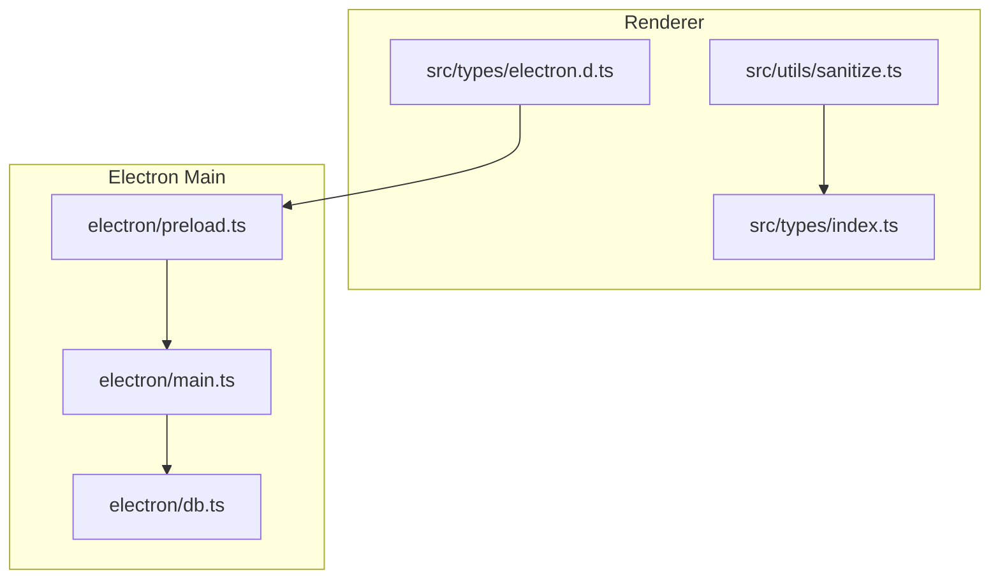
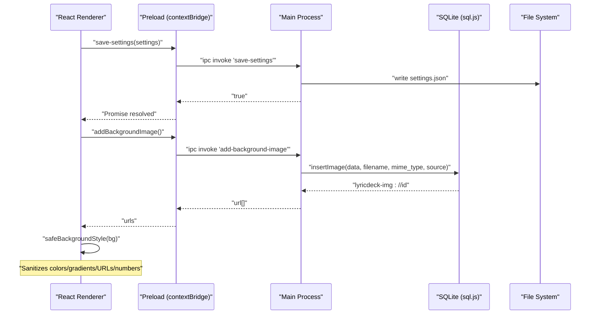
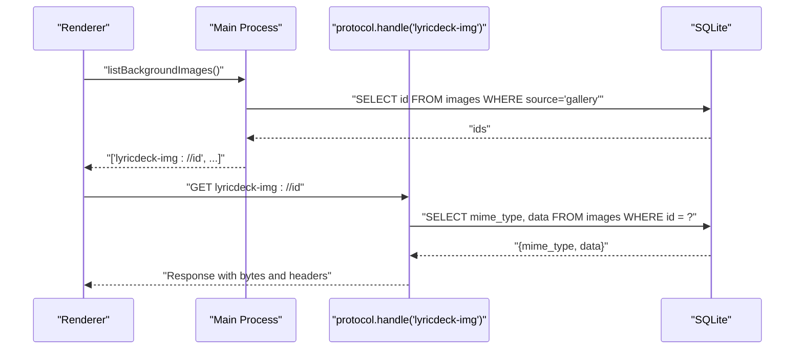
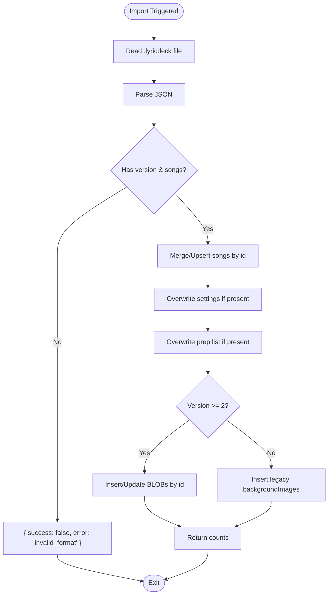
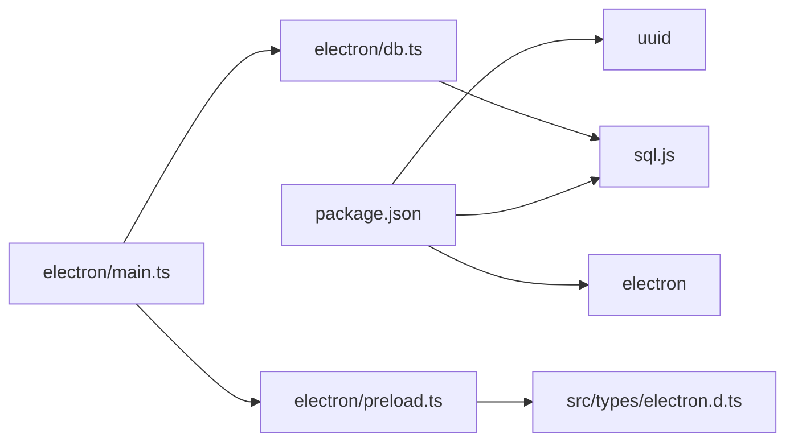

# Security Utilities

<cite>
**Referenced Files in This Document**
- [sanitize.ts](file://src/utils/sanitize.ts)
- [main.ts](file://electron/main.ts)
- [preload.ts](file://electron/preload.ts)
- [db.ts](file://electron/db.ts)
- [index.ts](file://src/types/index.ts)
- [electron.d.ts](file://src/types/electron.d.ts)
- [package.json](file://package.json)
</cite>

## Table of Contents
1. [Introduction](#introduction)
2. [Project Structure](#project-structure)
3. [Core Components](#core-components)
4. [Architecture Overview](#architecture-overview)
5. [Detailed Component Analysis](#detailed-component-analysis)
6. [Dependency Analysis](#dependency-analysis)
7. [Performance Considerations](#performance-considerations)
8. [Troubleshooting Guide](#troubleshooting-guide)
9. [Conclusion](#conclusion)

## Introduction
This document focuses on the security utilities and secure-by-design patterns implemented in LyricDeck. It covers:
- Input validation and sanitization for CSS values used in presentation backgrounds
- Secure Electron configuration (context isolation, no Node integration)
- Custom protocol handling to serve images from a local database safely
- IPC boundary via a minimal preload bridge
- Data import/export safeguards and safe URL handling

The goal is to explain how these components work together to prevent XSS, CSS injection, and unsafe resource loading while keeping the application usable.

## Project Structure
Security-related code spans both the renderer-side utilities and the Electron main process:
- Renderer-side sanitization utilities for CSS and image URLs
- Main process IPC handlers and custom protocol registration
- Preload script exposing a narrow API surface to the renderer
- Database layer storing images as BLOBs with a typed schema
- Type definitions that constrain settings and background models



**Diagram sources**
- [sanitize.ts:1-132](file://src/utils/sanitize.ts#L1-L132)
- [index.ts:21-48](file://src/types/index.ts#L21-L48)
- [electron.d.ts:1-36](file://src/types/electron.d.ts#L1-L36)
- [preload.ts:1-48](file://electron/preload.ts#L1-L48)
- [main.ts:1-484](file://electron/main.ts#L1-L484)
- [db.ts:1-250](file://electron/db.ts#L1-L250)

**Section sources**
- [sanitize.ts:1-132](file://src/utils/sanitize.ts#L1-L132)
- [main.ts:1-484](file://electron/main.ts#L1-L484)
- [preload.ts:1-48](file://electron/preload.ts#L1-L48)
- [db.ts:1-250](file://electron/db.ts#L1-L250)
- [index.ts:21-48](file://src/types/index.ts#L21-L48)
- [electron.d.ts:1-36](file://src/types/electron.d.ts#L1-L36)

## Core Components
- CSS and URL sanitization utilities for safe rendering of user-provided styles and images
- Secure Electron window configuration and IPC boundary
- Custom protocol handler for serving images from SQLite
- Strict data schemas and type constraints for settings and backgrounds

Key responsibilities:
- Validate and sanitize color, gradient, image URL, and numeric inputs before applying them to styles
- Restrict renderer access to Node APIs and expose only necessary methods through preload
- Serve images via a custom scheme backed by a local database, rejecting unknown or unsafe URLs
- Enforce allowed file types and MIME types when importing images

**Section sources**
- [sanitize.ts:1-132](file://src/utils/sanitize.ts#L1-L132)
- [main.ts:82-109](file://electron/main.ts#L82-L109)
- [main.ts:111-152](file://electron/main.ts#L111-L152)
- [main.ts:450-477](file://electron/main.ts#L450-L477)
- [preload.ts:1-48](file://electron/preload.ts#L1-L48)
- [db.ts:70-87](file://electron/db.ts#L70-L87)
- [db.ts:230-240](file://electron/db.ts#L230-L240)
- [index.ts:21-48](file://src/types/index.ts#L21-L48)

## Architecture Overview
The security architecture enforces least privilege and strict input validation at every boundary:
- Renderer cannot access Node directly; it uses a minimal preload API
- All user-supplied style values are validated before being applied
- Images are stored as BLOBs and served via a custom protocol, never via arbitrary URLs
- Import/export operations validate structure and content before writing to disk or DB



**Diagram sources**
- [preload.ts:23-37](file://electron/preload.ts#L23-L37)
- [main.ts:202-218](file://electron/main.ts#L202-L218)
- [main.ts:237-255](file://electron/main.ts#L237-L255)
- [db.ts:70-87](file://electron/db.ts#L70-L87)
- [sanitize.ts:106-132](file://src/utils/sanitize.ts#L106-L132)

## Detailed Component Analysis

### CSS Injection Prevention and Safe Style Application
The sanitizer validates and constrains user-provided values before they are applied to DOM styles:
- Colors: allow hex, rgb/rgba, hsl/hsla, and a curated set of named colors
- Gradients: allow standard gradient functions and reject dangerous patterns like expression(), javascript:, vbscript:, data:text/html, -moz-binding, behavior:, binding:
- Image URLs: allow a custom lyricdeck-img:// protocol and safe data:image/* prefixes
- Numbers: clamp to finite ranges for properties like blur and opacity
- A helper composes a safe style object based on background settings


**Diagram sources**
- [sanitize.ts:21-27](file://src/utils/sanitize.ts#L21-L27)
- [sanitize.ts:34-65](file://src/utils/sanitize.ts#L34-L65)
- [sanitize.ts:71-90](file://src/utils/sanitize.ts#L71-L90)
- [sanitize.ts:96-100](file://src/utils/sanitize.ts#L96-L100)
- [sanitize.ts:106-132](file://src/utils/sanitize.ts#L106-L132)

**Section sources**
- [sanitize.ts:1-132](file://src/utils/sanitize.ts#L1-L132)

### Secure Electron Configuration and IPC Boundary
- Both main and projection windows enable contextIsolation and disable nodeIntegration
- The preload script exposes a minimal, explicit API surface via contextBridge
- Renderer types define the shape of electronAPI to ensure compile-time safety

```mermaid
classDiagram
class BrowserWindow {
+webPreferences.contextIsolation : true
+webPreferences.nodeIntegration : false
}
class Preload {
+exposeInMainWorld("electronAPI", {...})
}
class Renderer {
+uses Window.electronAPI
}
BrowserWindow --> Preload : "loads preload.js"
Preload --> Renderer : "exposes limited API"
```

**Diagram sources**
- [main.ts:82-109](file://electron/main.ts#L82-L109)
- [main.ts:111-152](file://electron/main.ts#L111-L152)
- [preload.ts:1-48](file://electron/preload.ts#L1-L48)
- [electron.d.ts:1-36](file://src/types/electron.d.ts#L1-L36)

**Section sources**
- [main.ts:82-109](file://electron/main.ts#L82-L109)
- [main.ts:111-152](file://electron/main.ts#L111-L152)
- [preload.ts:1-48](file://electron/preload.ts#L1-L48)
- [electron.d.ts:1-36](file://src/types/electron.d.ts#L1-L36)

### Custom Protocol for Safe Image Serving
A custom scheme lyricdeck-img is registered and handled to serve images stored as BLOBs in SQLite:
- Only IDs generated by insertImage are accepted
- Unknown IDs return 404
- Content-Type is set from stored mime_type
- Cache-Control header enables long-term caching



**Diagram sources**
- [main.ts:12-16](file://electron/main.ts#L12-L16)
- [main.ts:450-477](file://electron/main.ts#L450-L477)
- [db.ts:106-118](file://electron/db.ts#L106-L118)
- [db.ts:89-104](file://electron/db.ts#L89-L104)

**Section sources**
- [main.ts:12-16](file://electron/main.ts#L12-L16)
- [main.ts:450-477](file://electron/main.ts#L450-L477)
- [db.ts:89-104](file://electron/db.ts#L89-L104)
- [db.ts:106-118](file://electron/db.ts#L106-L118)

### Data Import/Export Safeguards
- Export bundles songs, settings, preparation list, and images into a single JSON file
- Import validates version and required fields, merges or upserts records, and converts base64 image data to BLOBs
- File dialogs restrict selection to .lyricdeck files
- Errors return structured responses indicating invalid format or parse errors



**Diagram sources**
- [main.ts:292-354](file://electron/main.ts#L292-L354)
- [main.ts:356-425](file://electron/main.ts#L356-L425)
- [db.ts:158-205](file://electron/db.ts#L158-L205)

**Section sources**
- [main.ts:267-290](file://electron/main.ts#L267-L290)
- [main.ts:292-354](file://electron/main.ts#L292-L354)
- [main.ts:356-425](file://electron/main.ts#L356-L425)
- [db.ts:158-205](file://electron/db.ts#L158-L205)

### Type-Safe Settings and Background Models
Strong TypeScript interfaces constrain what can be persisted and rendered:
- BackgroundSettings defines allowed types and numeric ranges
- PresentationSettings groups background and text styling
- AppSettings centralizes defaults and logo references

These types guide the sanitizer and UI to enforce consistent, safe configurations.

**Section sources**
- [index.ts:21-48](file://src/types/index.ts#L21-L48)
- [index.ts:44-48](file://src/types/index.ts#L44-L48)
- [index.ts:84-90](file://src/types/index.ts#L84-L90)

## Dependency Analysis
Security-critical dependencies include:
- sql.js for in-process SQLite storage of images as BLOBs
- uuid for generating unique image IDs
- Electron’s protocol and ipcMain/ipcRenderer for secure inter-process communication



**Diagram sources**
- [package.json:107-117](file://package.json#L107-L117)
- [main.ts:1-6](file://electron/main.ts#L1-L6)
- [db.ts:1-6](file://electron/db.ts#L1-L6)
- [preload.ts:1-48](file://electron/preload.ts#L1-L48)
- [electron.d.ts:1-36](file://src/types/electron.d.ts#L1-L36)

**Section sources**
- [package.json:107-117](file://package.json#L107-L117)
- [main.ts:1-6](file://electron/main.ts#L1-L6)
- [db.ts:1-6](file://electron/db.ts#L1-L6)

## Performance Considerations
- Long-lived cache headers for lyricdeck-img resources reduce repeated DB reads
- Clamping numeric values prevents expensive or invalid CSS filters
- Using prepared statements and batching in DB operations avoids unnecessary overhead
- Avoiding large inline data URLs keeps memory usage predictable

[No sources needed since this section provides general guidance]

## Troubleshooting Guide
Common issues and mitigations:
- Invalid or malicious CSS values fall back to safe defaults rather than breaking the UI
- Unknown or tampered lyricdeck-img URLs return 404 and do not load
- Import failures return structured errors to help diagnose malformed exports
- If projection window closes unexpectedly, the renderer receives a dedicated event to reset state

**Section sources**
- [sanitize.ts:21-27](file://src/utils/sanitize.ts#L21-L27)
- [sanitize.ts:34-65](file://src/utils/sanitize.ts#L34-L65)
- [sanitize.ts:71-90](file://src/utils/sanitize.ts#L71-L90)
- [main.ts:450-477](file://electron/main.ts#L450-L477)
- [main.ts:148-152](file://electron/main.ts#L148-L152)

## Conclusion
LyricDeck implements a layered security approach:
- Strict input validation and sanitization for all user-controlled style inputs
- Minimal IPC surface and disabled Node integration in renderers
- Custom protocol-backed image serving from a local database
- Carefully typed settings and robust import/export validation

Together, these measures protect against CSS injection, XSS vectors, and unsafe resource loading while maintaining a smooth user experience.