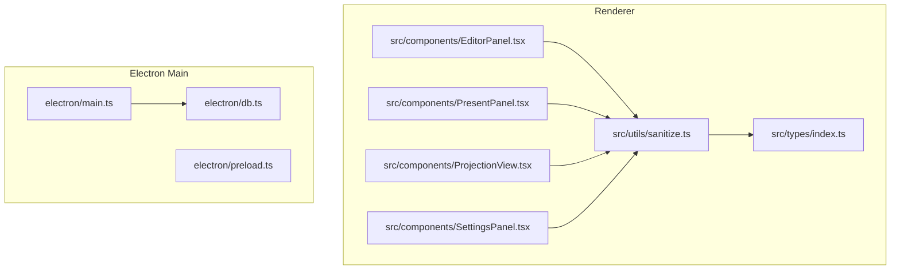
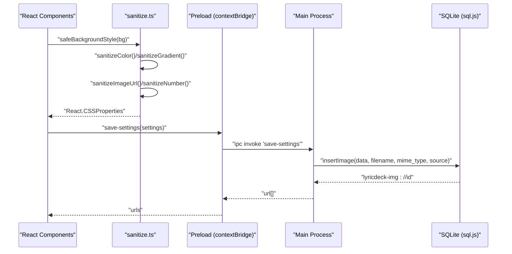
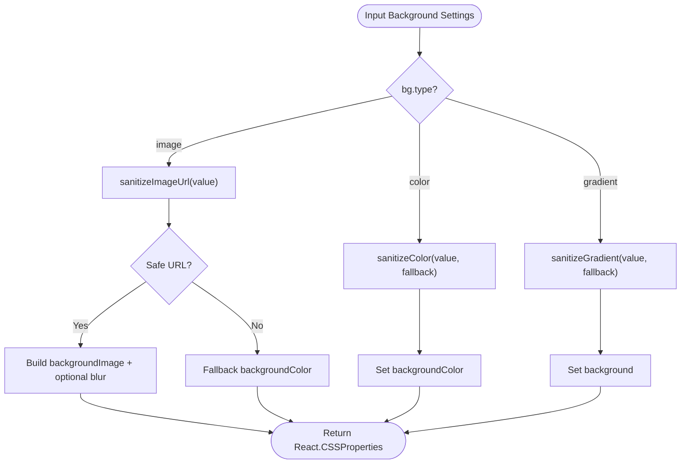
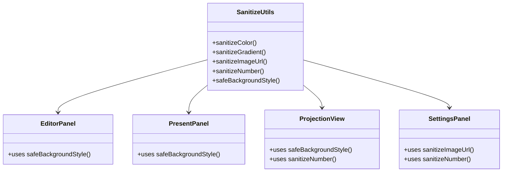
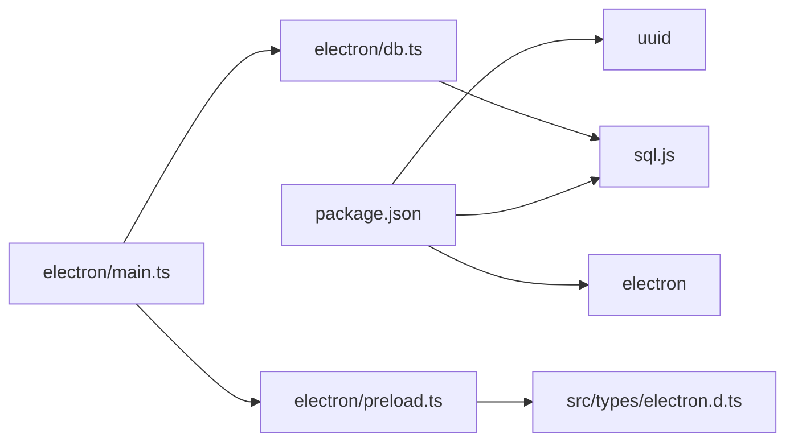

# Security Utilities

<cite>
**Referenced Files in This Document**
- [sanitize.ts](file://src/utils/sanitize.ts)
- [index.ts](file://src/types/index.ts)
- [EditorPanel.tsx](file://src/components/EditorPanel.tsx)
- [PresentPanel.tsx](file://src/components/PresentPanel.tsx)
- [ProjectionView.tsx](file://src/components/ProjectionView.tsx)
- [SettingsPanel.tsx](file://src/components/SettingsPanel.tsx)
- [BackgroundGallery.tsx](file://src/components/BackgroundGallery.tsx)
</cite>

## Update Summary
**Changes Made**
- Enhanced CSS injection prevention with comprehensive sanitization utilities
- Added dedicated functions for color, gradient, image URL, and number sanitization
- Implemented safe background style composition with type safety
- Integrated sanitization across all presentation components
- Updated component usage patterns for secure theme and background customization

## Table of Contents
1. [Introduction](#introduction)
2. [Project Structure](#project-structure)
3. [Core Components](#core-components)
4. [Architecture Overview](#architecture-overview)
5. [Detailed Component Analysis](#detailed-component-analysis)
6. [Dependency Analysis](#dependency-analysis)
7. [Performance Considerations](#performance-considerations)
8. [Troubleshooting Guide](#troubleshooting-guide)
9. [Conclusion](#conclusion)

## Introduction
This document focuses on the comprehensive security utilities and secure-by-design patterns implemented in LyricDeck, with particular emphasis on CSS injection prevention and safe theme/background customization. It covers:
- Advanced input validation and sanitization for CSS values used in presentation backgrounds
- Dedicated sanitization functions for colors, gradients, image URLs, and numeric values
- Safe background style composition with type safety guarantees
- Integration across all UI components for consistent security enforcement
- Secure Electron configuration (context isolation, no Node integration)
- Custom protocol handling to serve images from a local database safely
- IPC boundary via a minimal preload bridge
- Data import/export safeguards and safe URL handling

The goal is to explain how these components work together to prevent XSS, CSS injection, and unsafe resource loading while keeping the application usable and performant.

## Project Structure
Security-related code spans both the renderer-side utilities and the Electron main process:
- Renderer-side sanitization utilities for CSS and image URLs
- Main process IPC handlers and custom protocol registration
- Preload script exposing a narrow API surface to the renderer
- Database layer storing images as BLOBs with a typed schema
- Type definitions that constrain settings and background models
- Multiple UI components integrating sanitization for secure rendering

**Diagram sources**
- [sanitize.ts:1-132](file://src/utils/sanitize.ts#L1-L132)
- [index.ts:21-48](file://src/types/index.ts#L21-L48)
- [EditorPanel.tsx:5](file://src/components/EditorPanel.tsx#L5)
- [PresentPanel.tsx:5](file://src/components/PresentPanel.tsx#L5)
- [ProjectionView.tsx:3](file://src/components/ProjectionView.tsx#L3)
- [SettingsPanel.tsx:6](file://src/components/SettingsPanel.tsx#L6)

**Section sources**
- [sanitize.ts:1-132](file://src/utils/sanitize.ts#L1-L132)
- [index.ts:21-48](file://src/types/index.ts#L21-L48)
- [EditorPanel.tsx:5](file://src/components/EditorPanel.tsx#L5)
- [PresentPanel.tsx:5](file://src/components/PresentPanel.tsx#L5)
- [ProjectionView.tsx:3](file://src/components/ProjectionView.tsx#L3)
- [SettingsPanel.tsx:6](file://src/components/SettingsPanel.tsx#L6)

## Core Components
- **CSS Injection Prevention**: Comprehensive sanitization utilities for preventing malicious CSS injection through user-provided styles
- **Safe Background Rendering**: Type-safe background style composition with fallback mechanisms
- **Component Integration**: Consistent security enforcement across all presentation components
- **Secure Electron Configuration**: Context isolation and minimal IPC surface
- **Custom Protocol Handler**: Safe image serving from local database
- **Data Validation**: Strict schemas and type constraints for settings and backgrounds

Key responsibilities:
- Validate and sanitize color, gradient, image URL, and numeric inputs before applying them to styles
- Provide safe background style composition with automatic fallback handling
- Restrict renderer access to Node APIs and expose only necessary methods through preload
- Serve images via a custom scheme backed by a local database, rejecting unknown or unsafe URLs
- Enforce allowed file types and MIME types when importing images

**Section sources**
- [sanitize.ts:1-132](file://src/utils/sanitize.ts#L1-L132)
- [EditorPanel.tsx:250](file://src/components/EditorPanel.tsx#L250)
- [PresentPanel.tsx:579](file://src/components/PresentPanel.tsx#L579)
- [ProjectionView.tsx:34](file://src/components/ProjectionView.tsx#L34)
- [SettingsPanel.tsx:168](file://src/components/SettingsPanel.tsx#L168)

## Architecture Overview
The security architecture enforces least privilege and strict input validation at every boundary:
- Renderer cannot access Node directly; it uses a minimal preload API
- All user-supplied style values are validated before being applied through dedicated sanitization functions
- Images are stored as BLOBs and served via a custom protocol, never via arbitrary URLs
- Import/export operations validate structure and content before writing to disk or DB
- Background styles are composed using safe functions that guarantee valid CSS output

**Diagram sources**
- [sanitize.ts:106-132](file://src/utils/sanitize.ts#L106-L132)
- [EditorPanel.tsx:250](file://src/components/EditorPanel.tsx#L250)
- [PresentPanel.tsx:579](file://src/components/PresentPanel.tsx#L579)
- [ProjectionView.tsx:34](file://src/components/ProjectionView.tsx#L34)

## Detailed Component Analysis

### CSS Injection Prevention and Safe Style Application
The sanitizer provides comprehensive protection against CSS injection attacks through dedicated functions:

#### Color Sanitization (`sanitizeColor`)
- Validates hex colors (#RGB, #RRGGBB, #RRGGBBAA), rgb/rgba(), and hsl/hsla() formats
- Supports a curated set of named CSS colors including transparent, currentColor, etc.
- Returns fallback color for any invalid or potentially dangerous input

#### Gradient Sanitization (`sanitizeGradient`)
- Only allows standard gradient functions: linear-gradient, radial-gradient, conic-gradient, and their repeating variants
- Rejects dangerous patterns like expression(), javascript:, vbscript:, data:text/html, -moz-binding, behavior:, binding:
- Provides safe default gradient fallback

#### Image URL Sanitization (`sanitizeImageUrl`)
- Allows only the custom `lyricdeck-img://` protocol for database-stored images
- Permits safe data:image/* prefixes for specific image formats (png, jpeg, gif, webp, bmp, svg+xml)
- Returns null for any other URL schemes or potentially dangerous protocols

#### Number Sanitization (`sanitizeNumber`)
- Ensures values are finite numbers within specified min/max ranges
- Clamps values to prevent extreme CSS filter values that could cause performance issues
- Handles type coercion and invalid inputs gracefully

#### Safe Background Composition (`safeBackgroundStyle`)
- Composes complete React.CSSProperties objects from background settings
- Automatically applies appropriate sanitization based on background type
- Provides fallback colors for invalid or missing values
- Handles overlay opacity and blur effects with proper sanitization

**Diagram sources**
- [sanitize.ts:21-27](file://src/utils/sanitize.ts#L21-L27)
- [sanitize.ts:34-65](file://src/utils/sanitize.ts#L34-L65)
- [sanitize.ts:71-90](file://src/utils/sanitize.ts#L71-L90)
- [sanitize.ts:96-100](file://src/utils/sanitize.ts#L96-L100)
- [sanitize.ts:106-132](file://src/utils/sanitize.ts#L106-L132)

**Section sources**
- [sanitize.ts:1-132](file://src/utils/sanitize.ts#L1-L132)

### Component Integration Patterns
All UI components consistently use the sanitization utilities to ensure secure rendering:

#### Editor Panel Integration
- Uses `safeBackgroundStyle` for preview rendering
- Ensures editor previews always display safe, sanitized styles

#### Present Panel Integration  
- Applies `safeBackgroundStyle` for slide previews
- Maintains security consistency between editor and presentation modes

#### Projection View Integration
- Uses `safeBackgroundStyle` for full-screen projection rendering
- Integrates `sanitizeNumber` for overlay opacity control
- Ensures projection displays are immune to CSS injection attacks

#### Settings Panel Integration
- Uses `sanitizeImageUrl` for image preview rendering
- Applies `sanitizeNumber` for overlay opacity controls
- Validates user input before displaying previews

**Diagram sources**
- [sanitize.ts:1-132](file://src/utils/sanitize.ts#L1-L132)
- [EditorPanel.tsx:5](file://src/components/EditorPanel.tsx#L5)
- [PresentPanel.tsx:5](file://src/components/PresentPanel.tsx#L5)
- [ProjectionView.tsx:3](file://src/components/ProjectionView.tsx#L3)
- [SettingsPanel.tsx:6](file://src/components/SettingsPanel.tsx#L6)

**Section sources**
- [EditorPanel.tsx:5](file://src/components/EditorPanel.tsx#L5)
- [EditorPanel.tsx:250](file://src/components/EditorPanel.tsx#L250)
- [PresentPanel.tsx:5](file://src/components/PresentPanel.tsx#L5)
- [PresentPanel.tsx:579](file://src/components/PresentPanel.tsx#L579)
- [ProjectionView.tsx:3](file://src/components/ProjectionView.tsx#L3)
- [ProjectionView.tsx:34](file://src/components/ProjectionView.tsx#L34)
- [ProjectionView.tsx:82](file://src/components/ProjectionView.tsx#L82)
- [SettingsPanel.tsx:6](file://src/components/SettingsPanel.tsx#L6)
- [SettingsPanel.tsx:168](file://src/components/SettingsPanel.tsx#L168)
- [SettingsPanel.tsx:174](file://src/components/SettingsPanel.tsx#L174)

### Type-Safe Background Models
Strong TypeScript interfaces provide compile-time safety for background settings:

#### BackgroundSettings Interface
- Defines allowed background types: 'color' | 'gradient' | 'image' | 'video'
- Specifies required value field and optional overlay properties
- Includes blur and opacity controls with proper typing

#### Integration with Sanitization
- Types guide the sanitizer to enforce consistent, safe configurations
- Compile-time checks prevent invalid background type combinations
- Runtime sanitization provides defense-in-depth against malicious input

**Section sources**
- [index.ts:21-27](file://src/types/index.ts#L21-L27)

### Secure Electron Configuration and IPC Boundary
- Both main and projection windows enable contextIsolation and disable nodeIntegration
- The preload script exposes a minimal, explicit API surface via contextBridge
- Renderer types define the shape of electronAPI to ensure compile-time safety

**Section sources**
- [main.ts:82-109](file://electron/main.ts#L82-L109)
- [main.ts:111-152](file://electron/main.ts#L111-L152)
- [preload.ts:1-48](file://electron/preload.ts#L1-L48)
- [electron.d.ts:1-36](file://src/types/electron.d.ts#L1-L36)

### Custom Protocol for Safe Image Serving
A custom scheme lyricdeck-img is registered and handled to serve images stored as BLOBs in SQLite:
- Only IDs generated by insertImage are accepted
- Unknown IDs return 404
- Content-Type is set from stored mime_type
- Cache-Control header enables long-term caching

**Section sources**
- [main.ts:12-16](file://electron/main.ts#L12-L16)
- [main.ts:450-477](file://electron/main.ts#L450-L477)
- [db.ts:89-104](file://electron/db.ts#L89-L104)
- [db.ts:106-118](file://electron/db.ts#L106-L118)

### Data Import/Export Safeguards
- Export bundles songs, settings, preparation list, and images into a single JSON file
- Import validates version and required fields, merges or upserts records, and converts base64 image data to BLOBs
- File dialogs restrict selection to .lyricdeck files
- Errors return structured responses indicating invalid format or parse errors

**Section sources**
- [main.ts:267-290](file://electron/main.ts#L267-L290)
- [main.ts:292-354](file://electron/main.ts#L292-L354)
- [main.ts:356-425](file://electron/main.ts#L356-L425)
- [db.ts:158-205](file://electron/db.ts#L158-L205)

## Dependency Analysis
Security-critical dependencies include:
- sql.js for in-process SQLite storage of images as BLOBs
- uuid for generating unique image IDs
- Electron's protocol and ipcMain/ipcRenderer for secure inter-process communication

**Diagram sources**
- [package.json:107-117](file://package.json#L107-L117)
- [main.ts:1-6](file://electron/main.ts#L1-L6)
- [db.ts:1-6](file://electron/db.ts#L1-L6)
- [preload.ts:1-48](file://electron/preload.ts#L1-L48)
- [electron.d.ts:1-36](file://src/types/electron.d.ts#L1-L36)

**Section sources**
- [package.json:107-117](file://package.json#L107-L117)
- [main.ts:1-6](file://electron/main.ts#L1-L6)
- [db.ts:1-6](file://electron/db.ts#L1-L6)

## Performance Considerations
- Long-lived cache headers for lyricdeck-img resources reduce repeated DB reads
- Clamping numeric values prevents expensive or invalid CSS filters
- Using prepared statements and batching in DB operations avoids unnecessary overhead
- Avoiding large inline data URLs keeps memory usage predictable
- **New**: Efficient regex-based color validation reduces CPU overhead during sanitization
- **New**: Early return patterns in sanitization functions minimize unnecessary processing
- **New**: Type-safe background composition eliminates runtime type checking overhead

## Troubleshooting Guide
Common issues and mitigations:
- Invalid or malicious CSS values fall back to safe defaults rather than breaking the UI
- Unknown or tampered lyricdeck-img URLs return 404 and do not load
- Import failures return structured errors to help diagnose malformed exports
- If projection window closes unexpectedly, the renderer receives a dedicated event to reset state
- **New**: Invalid gradient syntax falls back to safe default gradient instead of breaking layout
- **New**: Malformed color values are replaced with black (#000000) to maintain visual consistency
- **New**: Numeric overflow in overlay opacity is automatically clamped to prevent rendering issues

**Section sources**
- [sanitize.ts:21-27](file://src/utils/sanitize.ts#L21-L27)
- [sanitize.ts:34-65](file://src/utils/sanitize.ts#L34-L65)
- [sanitize.ts:71-90](file://src/utils/sanitize.ts#L71-L90)
- [sanitize.ts:96-100](file://src/utils/sanitize.ts#L96-L100)
- [main.ts:450-477](file://electron/main.ts#L450-L477)
- [main.ts:148-152](file://electron/main.ts#L148-L152)

## Conclusion
LyricDeck implements a comprehensive layered security approach:
- **Advanced Input Validation**: Dedicated sanitization functions for colors, gradients, image URLs, and numbers provide granular control over CSS injection vectors
- **Safe Style Composition**: The `safeBackgroundStyle` function ensures all user-controlled styles are validated before DOM application
- **Consistent Integration**: All UI components use sanitization utilities uniformly, eliminating security gaps
- **Minimal IPC Surface**: Disabled Node integration and restricted preload API prevent direct system access
- **Custom Protocol Backing**: Image serving through lyricdeck-img protocol ensures only authorized resources load
- **Type Safety**: Strong TypeScript interfaces provide compile-time guarantees for safe background configurations

Together, these measures protect against CSS injection, XSS vectors, and unsafe resource loading while maintaining a smooth, performant user experience. The enhanced sanitization utilities provide defense-in-depth against sophisticated attack vectors while preserving the application's usability and flexibility.