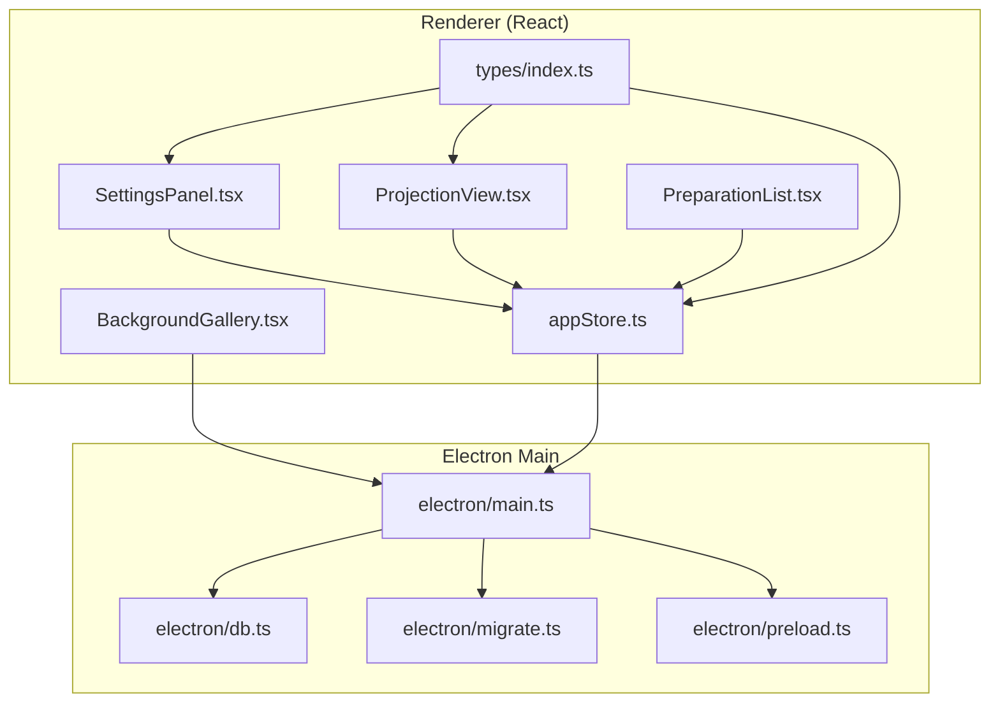
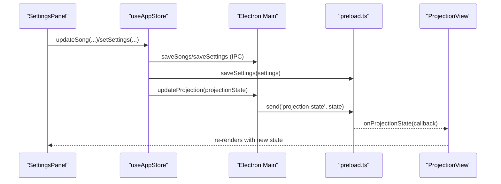
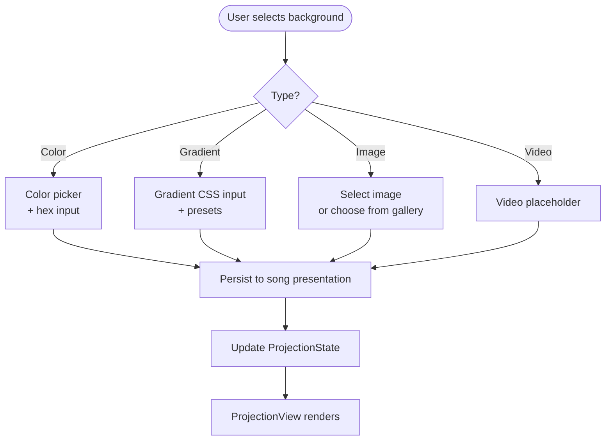
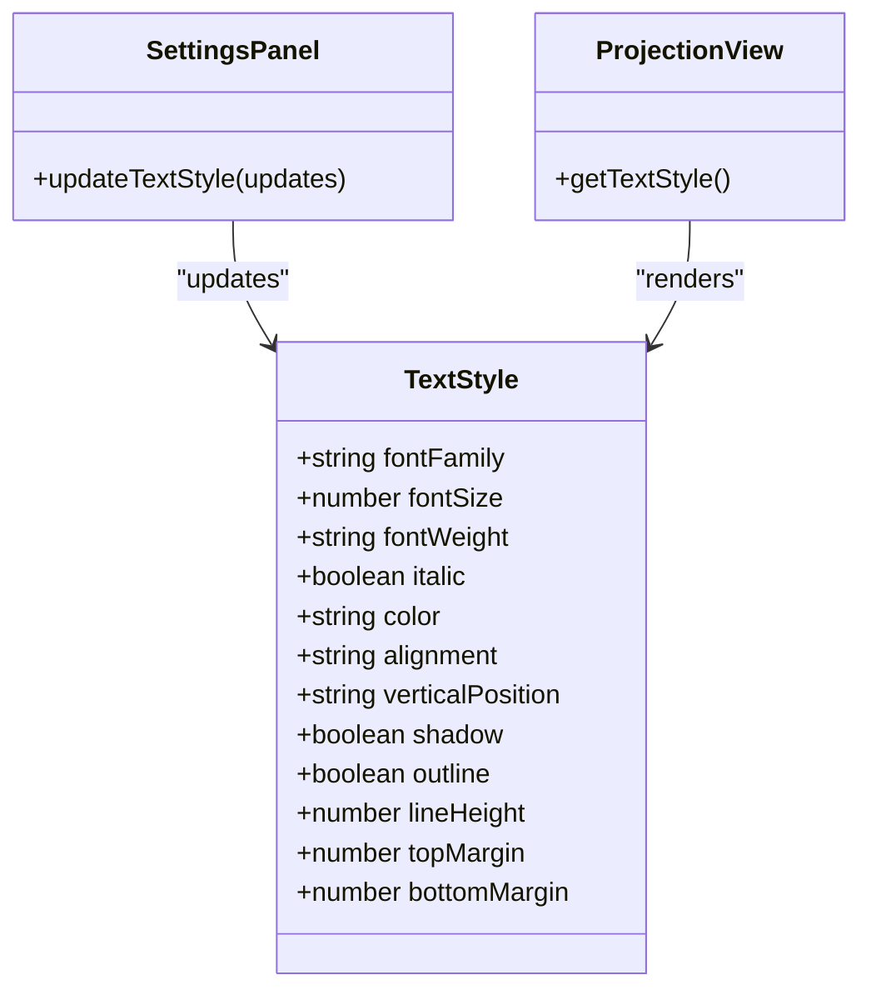
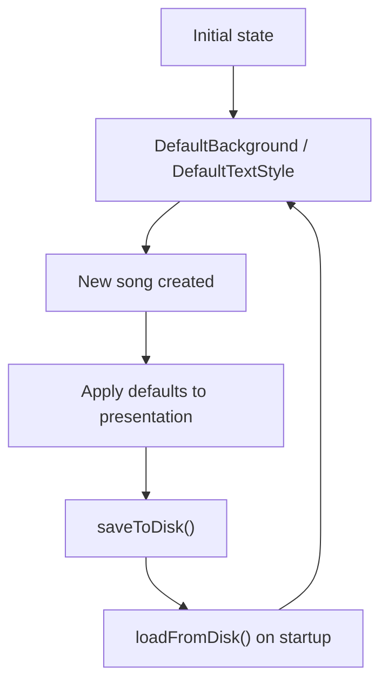
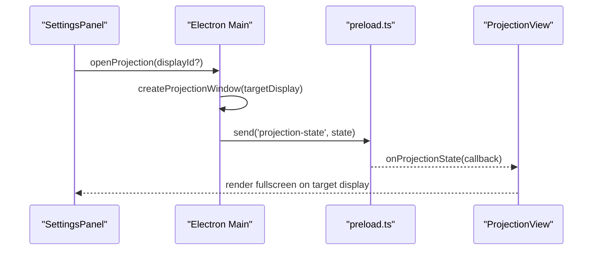
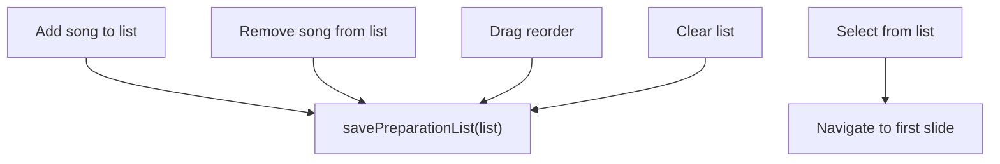
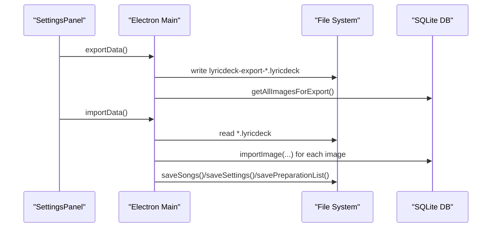
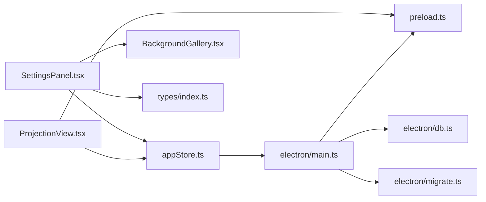

# Settings and Configuration

<cite>
**Referenced Files in This Document**
- [SettingsPanel.tsx](file://src/components/SettingsPanel.tsx)
- [ProjectionView.tsx](file://src/components/ProjectionView.tsx)
- [appStore.ts](file://src/store/appStore.ts)
- [types/index.ts](file://src/types/index.ts)
- [main.ts](file://electron/main.ts)
- [preload.ts](file://electron/preload.ts)
- [db.ts](file://electron/db.ts)
- [migrate.ts](file://electron/migrate.ts)
- [BackgroundGallery.tsx](file://src/components/BackgroundGallery.tsx)
- [PreparationList.tsx](file://src/components/PreparationList.tsx)
- [en.ts](file://src/i18n/en.ts)
- [README.md](file://README.md)
</cite>

## Table of Contents
1. [Introduction](#introduction)
2. [Project Structure](#project-structure)
3. [Core Components](#core-components)
4. [Architecture Overview](#architecture-overview)
5. [Detailed Component Analysis](#detailed-component-analysis)
6. [Dependency Analysis](#dependency-analysis)
7. [Performance Considerations](#performance-considerations)
8. [Troubleshooting Guide](#troubleshooting-guide)
9. [Conclusion](#conclusion)
10. [Appendices](#appendices)

## Introduction
This document explains the Settings and Configuration system for the application. It covers:
- Background customization (solid colors, gradients, images, and video placeholders)
- Text styling (fonts, sizes, colors, alignment, shadows, outlines, vertical position, margins)
- Default preferences and persistence across sessions
- Multi-monitor setup and display detection
- Preparation list management for quick access to frequently used songs
- Common configuration scenarios and how settings affect projection output
- Backup and restore mechanisms

## Project Structure
The Settings system spans React components, a central store, Electron main/preload bridges, and a local database for images.

**Diagram sources**
- [SettingsPanel.tsx:1-523](file://src/components/SettingsPanel.tsx#L1-L523)
- [ProjectionView.tsx:1-134](file://src/components/ProjectionView.tsx#L1-L134)
- [BackgroundGallery.tsx:1-98](file://src/components/BackgroundGallery.tsx#L1-L98)
- [PreparationList.tsx:1-188](file://src/components/PreparationList.tsx#L1-L188)
- [appStore.ts:1-385](file://src/store/appStore.ts#L1-L385)
- [types/index.ts:1-89](file://src/types/index.ts#L1-L89)
- [main.ts:1-390](file://electron/main.ts#L1-L390)
- [preload.ts:1-43](file://electron/preload.ts#L1-L43)
- [db.ts:1-214](file://electron/db.ts#L1-L214)
- [migrate.ts:1-127](file://electron/migrate.ts#L1-L127)

**Section sources**
- [README.md:1-157](file://README.md#L1-L157)

## Core Components
- SettingsPanel: UI for background and text style configuration, language selection, and import/export.
- ProjectionView: Real-time projection rendering based on current ProjectionState.
- appStore: Centralized state with defaults, persistence, and projection updates.
- Types: Strongly typed BackgroundSettings, TextStyle, ProjectionState, and AppSettings.
- Electron main/preload: IPC handlers for persistence, projection windows, and image repository.
- BackgroundGallery: Local image library backed by a SQL database.
- PreparationList: Persistent queue of songs for quick access.

**Section sources**
- [SettingsPanel.tsx:1-523](file://src/components/SettingsPanel.tsx#L1-L523)
- [ProjectionView.tsx:1-134](file://src/components/ProjectionView.tsx#L1-L134)
- [appStore.ts:1-385](file://src/store/appStore.ts#L1-L385)
- [types/index.ts:1-89](file://src/types/index.ts#L1-L89)
- [main.ts:1-390](file://electron/main.ts#L1-L390)
- [preload.ts:1-43](file://electron/preload.ts#L1-L43)
- [db.ts:1-214](file://electron/db.ts#L1-L214)
- [BackgroundGallery.tsx:1-98](file://src/components/BackgroundGallery.tsx#L1-L98)
- [PreparationList.tsx:1-188](file://src/components/PreparationList.tsx#L1-L188)

## Architecture Overview
The Settings system integrates UI updates with persistent state and real-time projection output.

**Diagram sources**
- [SettingsPanel.tsx:29-45](file://src/components/SettingsPanel.tsx#L29-L45)
- [appStore.ts:242-249](file://src/store/appStore.ts#L242-L249)
- [main.ts:186-190](file://electron/main.ts#L186-L190)
- [preload.ts:10-21](file://electron/preload.ts#L10-L21)
- [ProjectionView.tsx:22-29](file://src/components/ProjectionView.tsx#L22-L29)

## Detailed Component Analysis

### Background Customization
- Types define BackgroundSettings with type, value, overlayColor, overlayOpacity, and blur. Video is included as a type option.
- SettingsPanel exposes:
  - Solid color picker and hex input
  - Gradient CSS field with presets
  - Image selection via file dialog and gallery
  - Overlay opacity slider
- ProjectionView renders:
  - Color backgrounds
  - Gradient backgrounds
  - Image backgrounds with cover/position/filter blur
  - Overlay tint based on overlayOpacity
- Image repository:
  - Images are stored as BLOBs in a local SQLite database with a custom protocol to serve them.
  - Migration converts legacy file paths to database URLs.

**Diagram sources**
- [SettingsPanel.tsx:69-242](file://src/components/SettingsPanel.tsx#L69-L242)
- [ProjectionView.tsx:31-48](file://src/components/ProjectionView.tsx#L31-L48)
- [types/index.ts:21-27](file://src/types/index.ts#L21-L27)
- [db.ts:70-87](file://electron/db.ts#L70-L87)
- [migrate.ts:63-122](file://electron/migrate.ts#L63-L122)

**Section sources**
- [SettingsPanel.tsx:69-242](file://src/components/SettingsPanel.tsx#L69-L242)
- [ProjectionView.tsx:31-48](file://src/components/ProjectionView.tsx#L31-L48)
- [types/index.ts:21-27](file://src/types/index.ts#L21-L27)
- [db.ts:70-87](file://electron/db.ts#L70-L87)
- [migrate.ts:63-122](file://electron/migrate.ts#L63-L122)

### Text Styling System
- Types define TextStyle with fontFamily, fontSize, fontWeight, italic, color, alignment, verticalPosition, shadow, outline, lineHeight, topMargin, bottomMargin.
- SettingsPanel exposes:
  - Font family dropdown
  - Font size numeric input
  - Font weight selector
  - Text color picker and hex input
  - Alignment and vertical position selectors
  - Line height and top/bottom margins
  - Toggle switches for shadow, outline, and italic
- ProjectionView applies:
  - fontFamily, fontSize, fontWeight, fontStyle, color
  - textAlign, lineHeight
  - textShadow and WebkitTextStroke for outline
  - top/bottom margins and vertical alignment classes

**Diagram sources**
- [types/index.ts:29-42](file://src/types/index.ts#L29-L42)
- [SettingsPanel.tsx:244-396](file://src/components/SettingsPanel.tsx#L244-L396)
- [ProjectionView.tsx:50-63](file://src/components/ProjectionView.tsx#L50-L63)

**Section sources**
- [types/index.ts:29-42](file://src/types/index.ts#L29-L42)
- [SettingsPanel.tsx:244-396](file://src/components/SettingsPanel.tsx#L244-L396)
- [ProjectionView.tsx:50-63](file://src/components/ProjectionView.tsx#L50-L63)

### Default Preferences Management
- Defaults are defined in the store and applied when creating new songs or initializing settings.
- AppSettings includes projectionMonitor, defaultBackground, defaultTextStyle, and optional logoImage.
- SettingsPanel allows updating global defaults via setSettings, which persists to disk and notifies the projection window.

**Diagram sources**
- [appStore.ts:5-29](file://src/store/appStore.ts#L5-L29)
- [appStore.ts:107-111](file://src/store/appStore.ts#L107-L111)
- [appStore.ts:362-377](file://src/store/appStore.ts#L362-L377)

**Section sources**
- [appStore.ts:5-29](file://src/store/appStore.ts#L5-L29)
- [appStore.ts:107-111](file://src/store/appStore.ts#L107-L111)
- [appStore.ts:362-377](file://src/store/appStore.ts#L362-L377)
- [types/index.ts:83-88](file://src/types/index.ts#L83-L88)

### Multi-Monitor Setup and Display Detection
- Electron main detects all displays and identifies the primary display.
- Users can open a projection window on a specific display by ID.
- ProjectionView listens for projection-state updates and renders accordingly.

**Diagram sources**
- [main.ts:111-152](file://electron/main.ts#L111-L152)
- [main.ts:155-172](file://electron/main.ts#L155-L172)
- [preload.ts:10-21](file://electron/preload.ts#L10-L21)
- [ProjectionView.tsx:22-29](file://src/components/ProjectionView.tsx#L22-L29)

**Section sources**
- [main.ts:111-152](file://electron/main.ts#L111-L152)
- [main.ts:155-172](file://electron/main.ts#L155-L172)
- [preload.ts:10-21](file://electron/preload.ts#L10-L21)
- [ProjectionView.tsx:22-29](file://src/components/ProjectionView.tsx#L22-L29)

### Preparation List Management
- PreparationList maintains a persistent list of song IDs.
- Actions include adding/removing/reordering/clearing, and selecting from the list triggers presentation navigation.
- Persistence is handled via IPC to save/load the list.

**Diagram sources**
- [PreparationList.tsx:317-359](file://src/components/PreparationList.tsx#L317-L359)
- [appStore.ts:317-359](file://src/store/appStore.ts#L317-L359)
- [main.ts:211-218](file://electron/main.ts#L211-L218)

**Section sources**
- [PreparationList.tsx:317-359](file://src/components/PreparationList.tsx#L317-L359)
- [appStore.ts:317-359](file://src/store/appStore.ts#L317-L359)
- [main.ts:211-218](file://electron/main.ts#L211-L218)

### Settings Persistence and Backup/Restore
- Persistence:
  - Songs: JSON files in the app data directory.
  - Settings: JSON file for defaults and UI preferences.
  - Preparation list: JSON file.
  - Images: Stored as BLOBs in a SQLite database with a custom protocol.
- Backup/Restore:
  - Export includes songs, settings, preparation list, and images.
  - Import merges songs, replaces settings and preparation list, and imports images.

**Diagram sources**
- [main.ts:267-354](file://electron/main.ts#L267-L354)
- [db.ts:133-176](file://electron/db.ts#L133-L176)
- [preload.ts:39-42](file://electron/preload.ts#L39-L42)

**Section sources**
- [main.ts:267-354](file://electron/main.ts#L267-L354)
- [db.ts:133-176](file://electron/db.ts#L133-L176)
- [preload.ts:39-42](file://electron/preload.ts#L39-L42)

## Dependency Analysis
- SettingsPanel depends on:
  - useAppStore for updates and persistence
  - BackgroundGallery for image selection
  - i18n for localized labels
- ProjectionView depends on:
  - ProjectionState from the store
  - Electron preload for receiving projection updates
- Electron main depends on:
  - preload bridge for IPC
  - db.ts for image storage
  - migrate.ts for legacy data conversion
- Types define shared contracts between renderer and main.

**Diagram sources**
- [SettingsPanel.tsx:1-10](file://src/components/SettingsPanel.tsx#L1-L10)
- [ProjectionView.tsx:1-4](file://src/components/ProjectionView.tsx#L1-L4)
- [appStore.ts:1-4](file://src/store/appStore.ts#L1-L4)
- [main.ts:1-6](file://electron/main.ts#L1-L6)
- [preload.ts:1-4](file://electron/preload.ts#L1-L4)
- [db.ts:1-6](file://electron/db.ts#L1-L6)
- [migrate.ts:1-6](file://electron/migrate.ts#L1-L6)
- [types/index.ts:1-1](file://src/types/index.ts#L1-L1)

**Section sources**
- [SettingsPanel.tsx:1-10](file://src/components/SettingsPanel.tsx#L1-L10)
- [ProjectionView.tsx:1-4](file://src/components/ProjectionView.tsx#L1-L4)
- [appStore.ts:1-4](file://src/store/appStore.ts#L1-L4)
- [main.ts:1-6](file://electron/main.ts#L1-L6)
- [preload.ts:1-4](file://electron/preload.ts#L1-L4)
- [db.ts:1-6](file://electron/db.ts#L1-L6)
- [migrate.ts:1-6](file://electron/migrate.ts#L1-L6)
- [types/index.ts:1-1](file://src/types/index.ts#L1-L1)

## Performance Considerations
- Image loading:
  - Images are stored as BLOBs and served via a custom protocol to avoid filesystem path exposure.
  - Blur and overlay effects are applied via CSS; consider caching heavy images for repeated use.
- Projection rendering:
  - ProjectionView computes styles dynamically; keep updates minimal to reduce reflows.
  - Use overlayOpacity judiciously to avoid excessive compositing.
- Persistence:
  - SQLite writes are persisted immediately; batch operations are not used. For large datasets, consider throttling frequent saves.

[No sources needed since this section provides general guidance]

## Troubleshooting Guide
- Background images not appearing:
  - Verify the image was added to the gallery and the URL is valid.
  - Check that the custom protocol is registered and the image exists in the database.
- Gradient not applied:
  - Ensure the gradient CSS string is valid and includes units.
- Text style not changing:
  - Confirm the current song’s presentation textStyle is being updated and the projection window is receiving updates.
- Multi-monitor projection not opening:
  - Ensure a display ID is provided or rely on fallback to primary/secondary display.
- Import/Export failures:
  - Validate the exported file format and check for parse errors or missing keys.

**Section sources**
- [db.ts:362-374](file://electron/db.ts#L362-L374)
- [main.ts:267-354](file://electron/main.ts#L267-L354)
- [preload.ts:39-42](file://electron/preload.ts#L39-L42)
- [ProjectionView.tsx:31-63](file://src/components/ProjectionView.tsx#L31-L63)

## Conclusion
The Settings and Configuration system provides a robust, persistent, and flexible way to customize presentation visuals and manage session data. Background customization, text styling, multi-monitor projection, and preparation lists are tightly integrated with Electron’s IPC and local storage. Backup and restore ensure continuity across devices and sessions.

[No sources needed since this section summarizes without analyzing specific files]

## Appendices

### Common Configuration Scenarios
- Projection backgrounds:
  - Use a dark solid color or subtle gradient for contrast against white text.
  - For large venues, apply a low overlay opacity to maintain visibility.
- Venue text styles:
  - Increase font size and line height for readability from distance.
  - Enable text shadow for better legibility on bright backgrounds.
- Environment optimization:
  - Reduce blur and overlays for lower-latency projection.
  - Use centered alignment and middle vertical position for balanced composition.

[No sources needed since this section provides general guidance]

### Relationship Between Settings and Projection Output
- Settings updates trigger setProjectionState, which sends the new ProjectionState to the projection window.
- ProjectionView reads the state and renders the background and text styles accordingly.

**Section sources**
- [appStore.ts:242-249](file://src/store/appStore.ts#L242-L249)
- [ProjectionView.tsx:31-63](file://src/components/ProjectionView.tsx#L31-L63)