# Song Management System

<cite>
**Referenced Files in This Document**
- [SongLibrary.tsx](file://src/components/SongLibrary.tsx)
- [appStore.ts](file://src/store/appStore.ts)
- [types/index.ts](file://src/types/index.ts)
- [en.ts](file://src/i18n/en.ts)
- [EditorPanel.tsx](file://src/components/EditorPanel.tsx)
- [ArrangePanel.tsx](file://src/components/ArrangePanel.tsx)
- [PreparationList.tsx](file://src/components/PreparationList.tsx)
- [App.tsx](file://src/App.tsx)
- [seedData.ts](file://src/utils/seedData.ts)
- [db.ts](file://electron/db.ts)
- [migrate.ts](file://electron/migrate.ts)
</cite>

## Table of Contents
1. [Introduction](#introduction)
2. [Project Structure](#project-structure)
3. [Core Components](#core-components)
4. [Architecture Overview](#architecture-overview)
5. [Detailed Component Analysis](#detailed-component-analysis)
6. [Dependency Analysis](#dependency-analysis)
7. [Performance Considerations](#performance-considerations)
8. [Troubleshooting Guide](#troubleshooting-guide)
9. [Conclusion](#conclusion)

## Introduction
This document describes the Song Management System, focusing on the complete lifecycle of songs: creation, editing, duplication, and deletion. It explains the song data model, search and filtering capabilities, the song library interface, CRUD operations implemented in the Zustand store, and the integration with the database layer and file system persistence. It also covers the relationship between songs and their lyric sections and how songs are referenced in arrangements.

## Project Structure
The system is organized around a React frontend with a Zustand store managing application state, and an Electron backend providing database persistence and migration support. The main areas are:
- UI components for song library, editor, arrangement, presentation, and settings
- Application store with actions for CRUD and orchestration
- Types defining the song and section models
- Internationalization for UI labels
- Electron database layer for persistence and migration

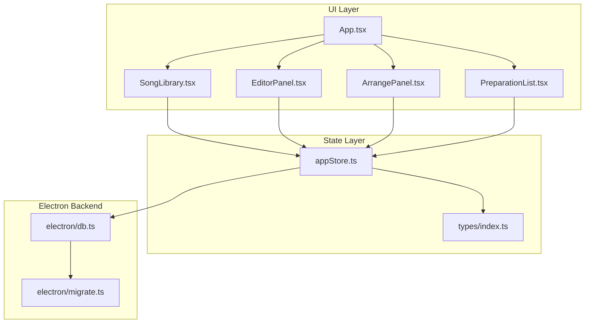

**Diagram sources**
- [App.tsx:56-98](file://src/App.tsx#L56-L98)
- [SongLibrary.tsx:8-95](file://src/components/SongLibrary.tsx#L8-L95)
- [EditorPanel.tsx:17-118](file://src/components/EditorPanel.tsx#L17-L118)
- [ArrangePanel.tsx:22-134](file://src/components/ArrangePanel.tsx#L22-L134)
- [PreparationList.tsx:25-123](file://src/components/PreparationList.tsx#L25-L123)
- [appStore.ts:98-385](file://src/store/appStore.ts#L98-L385)
- [types/index.ts:50-67](file://src/types/index.ts#L50-L67)
- [db.ts:26-41](file://electron/db.ts#L26-L41)
- [migrate.ts:8-127](file://electron/migrate.ts#L8-L127)

**Section sources**
- [App.tsx:12-102](file://src/App.tsx#L12-L102)
- [SongLibrary.tsx:8-95](file://src/components/SongLibrary.tsx#L8-L95)
- [appStore.ts:98-385](file://src/store/appStore.ts#L98-L385)

## Core Components
- SongLibrary: Provides search, sorting, and list interactions for songs.
- EditorPanel: Edits song metadata and lyric sections.
- ArrangePanel: Builds and reorders presentation arrangements from sections.
- PreparationList: Manages a preparation queue with drag-and-drop reordering.
- appStore: Centralized state and actions for CRUD, sections, arrangements, projection, UI, settings, and persistence.
- Types: Defines the Song, LyricSection, PresentationSettings, and ProjectionState models.
- Electron DB: Initializes and persists data using sql.js, with migration support.

**Section sources**
- [SongLibrary.tsx:8-95](file://src/components/SongLibrary.tsx#L8-L95)
- [EditorPanel.tsx:17-118](file://src/components/EditorPanel.tsx#L17-L118)
- [ArrangePanel.tsx:22-134](file://src/components/ArrangePanel.tsx#L22-L134)
- [PreparationList.tsx:25-123](file://src/components/PreparationList.tsx#L25-L123)
- [appStore.ts:31-96](file://src/store/appStore.ts#L31-L96)
- [types/index.ts:50-67](file://src/types/index.ts#L50-L67)
- [db.ts:26-41](file://electron/db.ts#L26-L41)

## Architecture Overview
The system follows a unidirectional data flow:
- UI components dispatch actions via the Zustand store.
- Store mutations update state and persist to disk through Electron APIs.
- Electron backend manages sql.js database initialization, schema, and migrations.

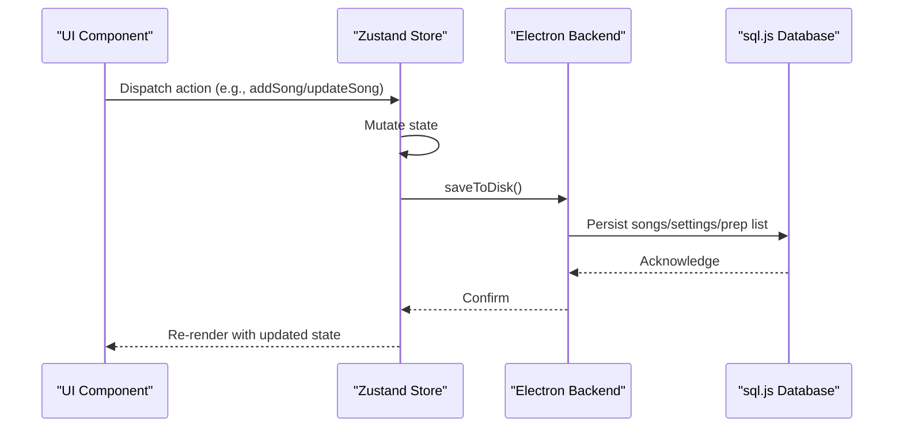

**Diagram sources**
- [appStore.ts:379-383](file://src/store/appStore.ts#L379-L383)
- [db.ts:19-24](file://electron/db.ts#L19-L24)

## Detailed Component Analysis

### Song Data Model
The Song model encapsulates metadata, sections, arrangement references, presentation settings, and timestamps. LyricSection defines the building blocks of lyrics with type, label, and text. PresentationSettings control background and text style, while ProjectionState carries runtime projection context.

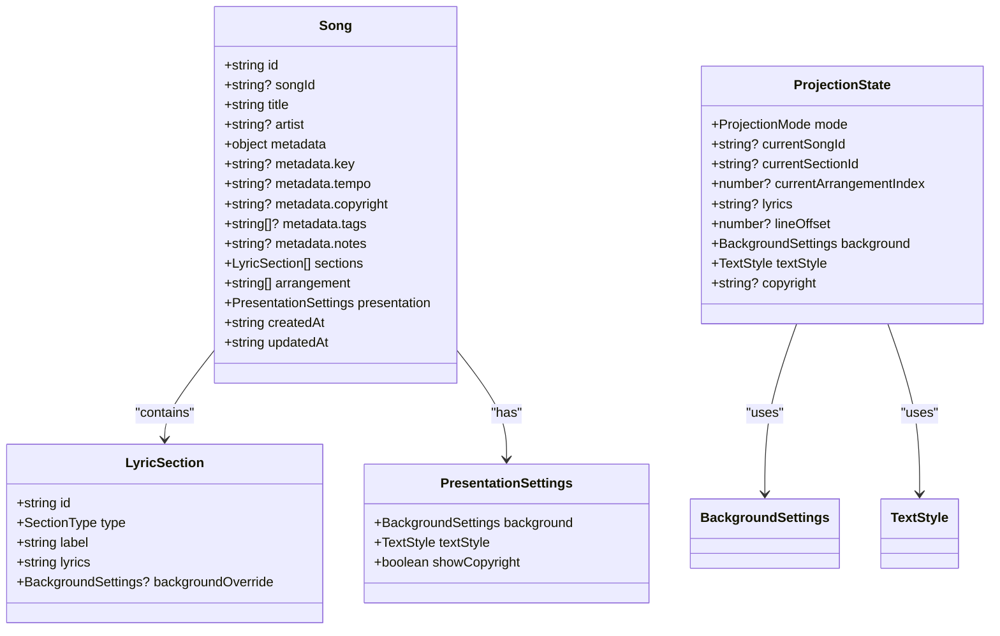

**Diagram sources**
- [types/index.ts:50-81](file://src/types/index.ts#L50-L81)

**Section sources**
- [types/index.ts:3-11](file://src/types/index.ts#L3-L11)
- [types/index.ts:50-81](file://src/types/index.ts#L50-L81)

### Song Library Interface and Workflows
The SongLibrary component provides:
- Keyword search across title, artist, songId, and lyrics content
- Sorting by songId (with numeric collation) or title
- Interactive song list with selection, duplication, deletion, and preparation list integration
- Add song button to create a new song with a default section

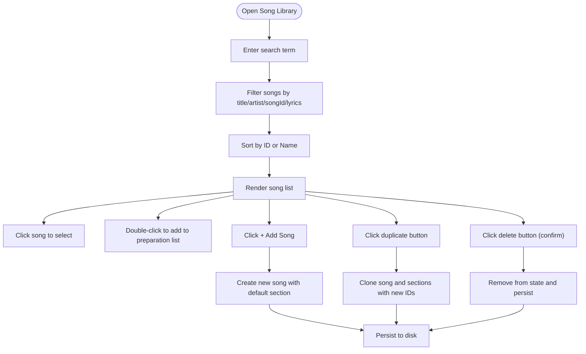

**Diagram sources**
- [SongLibrary.tsx:14-35](file://src/components/SongLibrary.tsx#L14-L35)
- [SongLibrary.tsx:67-95](file://src/components/SongLibrary.tsx#L67-L95)
- [appStore.ts:116-180](file://src/store/appStore.ts#L116-L180)

**Section sources**
- [SongLibrary.tsx:8-95](file://src/components/SongLibrary.tsx#L8-L95)
- [en.ts:17-33](file://src/i18n/en.ts#L17-L33)

### CRUD Operations in the Zustand Store
The store implements:
- Creation: addSong creates a new song with default metadata and a single section
- Update: updateSong applies partial updates and refreshes timestamps
- Deletion: deleteSong removes a song and clears selection if needed
- Duplication: duplicateSong clones a song, assigns new IDs to itself and sections, remaps arrangement references, and selects the duplicate
- Persistence: saveToDisk writes songs to Electron; loadFromDisk reads initial state

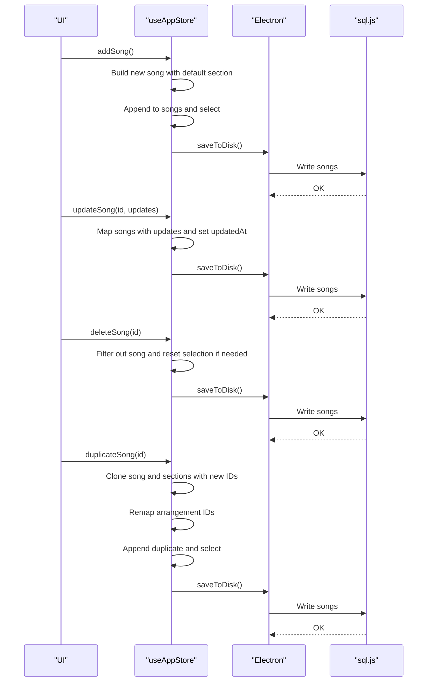

**Diagram sources**
- [appStore.ts:116-180](file://src/store/appStore.ts#L116-L180)
- [appStore.ts:379-383](file://src/store/appStore.ts#L379-L383)
- [db.ts:19-24](file://electron/db.ts#L19-L24)

**Section sources**
- [appStore.ts:116-180](file://src/store/appStore.ts#L116-L180)
- [appStore.ts:361-383](file://src/store/appStore.ts#L361-L383)

### Metadata Editing and Section Management
The EditorPanel allows editing:
- Song title, songId, artist
- Metadata fields: key, tempo, copyright
- Section types, labels, and lyrics
- Adding and removing sections, with confirmation for deletions

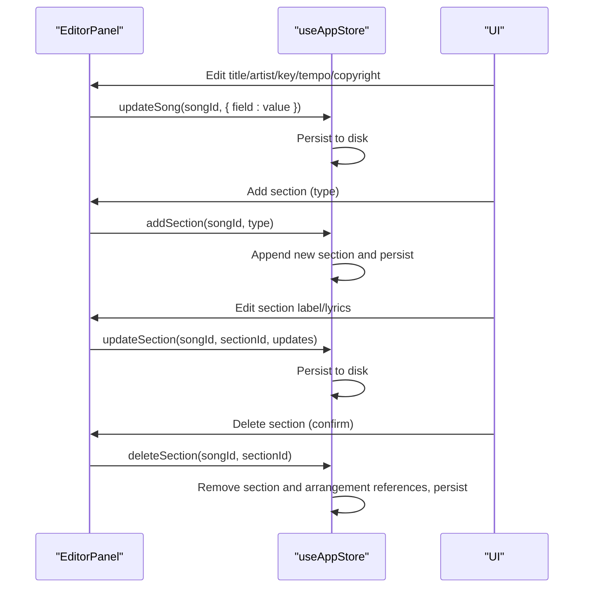

**Diagram sources**
- [EditorPanel.tsx:35-118](file://src/components/EditorPanel.tsx#L35-L118)
- [appStore.ts:185-220](file://src/store/appStore.ts#L185-L220)

**Section sources**
- [EditorPanel.tsx:35-118](file://src/components/EditorPanel.tsx#L35-L118)
- [appStore.ts:185-220](file://src/store/appStore.ts#L185-L220)

### Arrangements and Section References
Arrangements define the order of presentation by referencing section IDs. The ArrangePanel:
- Lists available sections from the selected song
- Allows adding sections to the arrangement
- Supports drag-and-drop reordering of arrangement items
- Supports clearing the arrangement

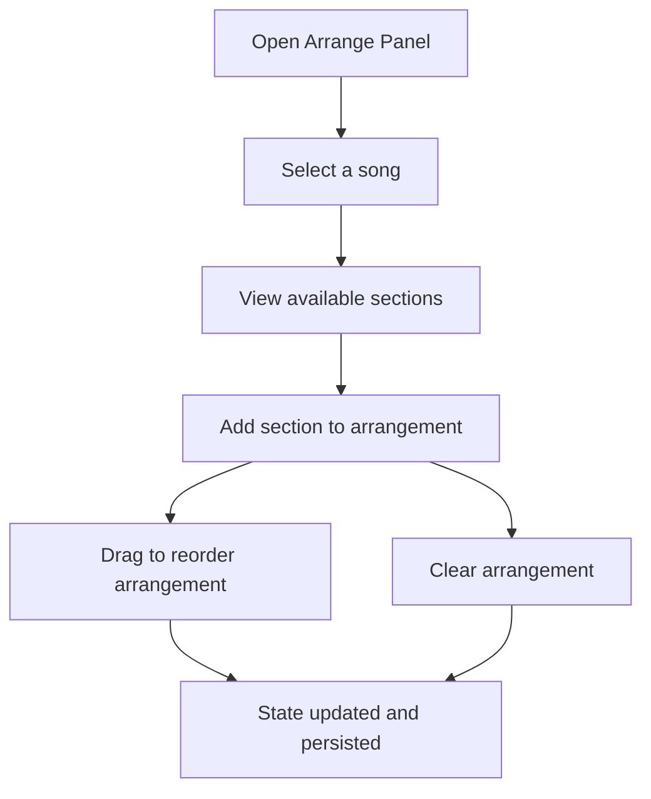

**Diagram sources**
- [ArrangePanel.tsx:22-134](file://src/components/ArrangePanel.tsx#L22-L134)
- [appStore.ts:222-239](file://src/store/appStore.ts#L222-L239)

**Section sources**
- [ArrangePanel.tsx:22-134](file://src/components/ArrangePanel.tsx#L22-L134)
- [appStore.ts:222-239](file://src/store/appStore.ts#L222-L239)

### Preparation List and Bulk Operations
The PreparationList component:
- Displays queued songs
- Supports drag-and-drop reordering
- Allows removal and clearing the list
- Integrates with presentation mode navigation

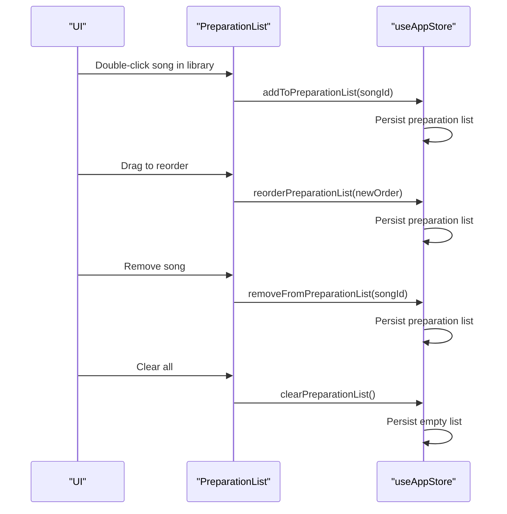

**Diagram sources**
- [PreparationList.tsx:25-123](file://src/components/PreparationList.tsx#L25-L123)
- [appStore.ts:316-359](file://src/store/appStore.ts#L316-L359)

**Section sources**
- [PreparationList.tsx:25-123](file://src/components/PreparationList.tsx#L25-L123)
- [appStore.ts:316-359](file://src/store/appStore.ts#L316-L359)

### Search and Filtering Capabilities
The SongLibrary filter logic:
- Case-insensitive match against title, artist, songId, and lyrics content
- Sorting supports numeric songId comparison and alphabetical fallback
- Empty states provide helpful messages for no results vs no songs

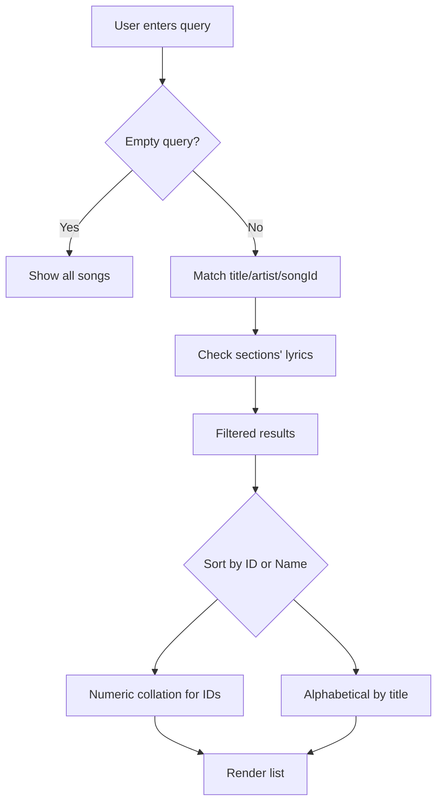

**Diagram sources**
- [SongLibrary.tsx:14-35](file://src/components/SongLibrary.tsx#L14-L35)
- [en.ts:17-33](file://src/i18n/en.ts#L17-L33)

**Section sources**
- [SongLibrary.tsx:14-35](file://src/components/SongLibrary.tsx#L14-L35)
- [en.ts:17-33](file://src/i18n/en.ts#L17-L33)

### Practical Examples

#### Creating a New Song
- Trigger the Add Song button in the library
- The store creates a new song with default metadata and a single section
- The new song becomes selected and state is persisted

**Section sources**
- [SongLibrary.tsx:88-92](file://src/components/SongLibrary.tsx#L88-L92)
- [appStore.ts:116-142](file://src/store/appStore.ts#L116-L142)

#### Editing Metadata
- Use the Editor panel to change title, songId, artist, key, tempo, and copyright
- Updates are applied atomically and persisted immediately

**Section sources**
- [EditorPanel.tsx:35-88](file://src/components/EditorPanel.tsx#L35-L88)
- [appStore.ts:174-180](file://src/store/appStore.ts#L174-L180)

#### Duplicating a Song
- Click the duplicate button in the library
- The store clones the song and all sections with new IDs
- Arrangement references are remapped to new section IDs
- The duplicate is selected and persisted

**Section sources**
- [SongLibrary.tsx:76-78](file://src/components/SongLibrary.tsx#L76-L78)
- [appStore.ts:151-172](file://src/store/appStore.ts#L151-L172)

#### Deleting a Song
- Click the delete button in the library (confirmation dialog)
- The store removes the song and clears selection if necessary
- State is persisted

**Section sources**
- [SongLibrary.tsx:169-177](file://src/components/SongLibrary.tsx#L169-L177)
- [appStore.ts:144-149](file://src/store/appStore.ts#L144-L149)

#### Building an Arrangement
- In Arrange panel, add sections from the available list
- Drag to reorder arrangement items
- Clear arrangement when needed

**Section sources**
- [ArrangePanel.tsx:67-134](file://src/components/ArrangePanel.tsx#L67-L134)
- [appStore.ts:222-239](file://src/store/appStore.ts#L222-L239)

### Integration with Database Layer and File System Persistence
- Electron initializes sql.js database and ensures schema presence
- Data is persisted by exporting the database to a file in the user data directory
- Migration script supports transitioning from legacy file-based storage to the new database format
- The app loads initial data from disk and seeds default songs if none exist

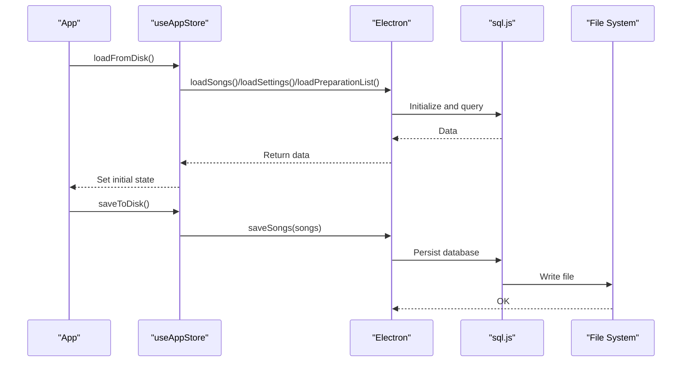

**Diagram sources**
- [App.tsx:19-32](file://src/App.tsx#L19-L32)
- [appStore.ts:361-383](file://src/store/appStore.ts#L361-L383)
- [db.ts:26-41](file://electron/db.ts#L26-L41)
- [db.ts:19-24](file://electron/db.ts#L19-L24)

**Section sources**
- [db.ts:26-41](file://electron/db.ts#L26-L41)
- [migrate.ts:8-127](file://electron/migrate.ts#L8-L127)
- [App.tsx:19-32](file://src/App.tsx#L19-L32)

## Dependency Analysis
- UI components depend on the Zustand store for state and actions
- The store depends on types for shape validation
- The store integrates with Electron APIs for persistence
- Electron DB depends on sql.js and Node fs for persistence
- Migration logic depends on Electron app paths and file system

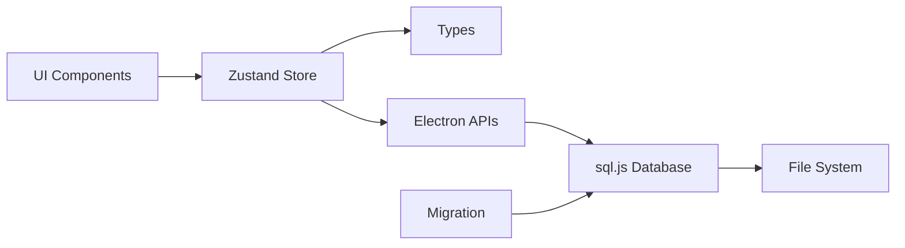

**Diagram sources**
- [SongLibrary.tsx:2-4](file://src/components/SongLibrary.tsx#L2-L4)
- [appStore.ts:1-4](file://src/store/appStore.ts#L1-L4)
- [types/index.ts:1-1](file://src/types/index.ts#L1-L1)
- [db.ts:1-6](file://electron/db.ts#L1-L6)
- [migrate.ts:1-6](file://electron/migrate.ts#L1-L6)

**Section sources**
- [SongLibrary.tsx:2-4](file://src/components/SongLibrary.tsx#L2-L4)
- [appStore.ts:1-4](file://src/store/appStore.ts#L1-L4)
- [types/index.ts:1-1](file://src/types/index.ts#L1-L1)
- [db.ts:1-6](file://electron/db.ts#L1-L6)
- [migrate.ts:1-6](file://electron/migrate.ts#L1-L6)

## Performance Considerations
- Filtering and sorting operate on the client-side array; performance scales with the number of songs. Consider virtualizing the list for very large libraries.
- Persisting after every mutation is straightforward but may cause frequent disk writes. Consider debouncing persistence for rapid edits.
- Cloning songs and sections involves deep copying; ensure minimal unnecessary re-renders by using stable keys and memoization where appropriate.

## Troubleshooting Guide
- Songs not loading on startup: Verify Electron APIs are available and that loadFromDisk completes successfully. Check that the database file exists and is readable.
- Duplicate song references incorrect: Ensure arrangement remapping occurs during duplication by verifying section ID mapping logic.
- Search yields no results: Confirm the query is not empty and that filtering logic checks title, artist, songId, and lyrics content.
- Persistence failures: Confirm the database is initialized and persisted; check that the userData directory is writable.

**Section sources**
- [App.tsx:19-32](file://src/App.tsx#L19-L32)
- [appStore.ts:151-172](file://src/store/appStore.ts#L151-L172)
- [SongLibrary.tsx:14-35](file://src/components/SongLibrary.tsx#L14-L35)
- [db.ts:19-24](file://electron/db.ts#L19-L24)

## Conclusion
The Song Management System provides a cohesive workflow for creating, editing, duplicating, and deleting songs, with robust search and filtering, arrangement building, and preparation list management. The Zustand store centralizes state and actions, while the Electron backend ensures reliable persistence and migration. The modular architecture supports future enhancements such as tag-based filtering, advanced search, and bulk operations.