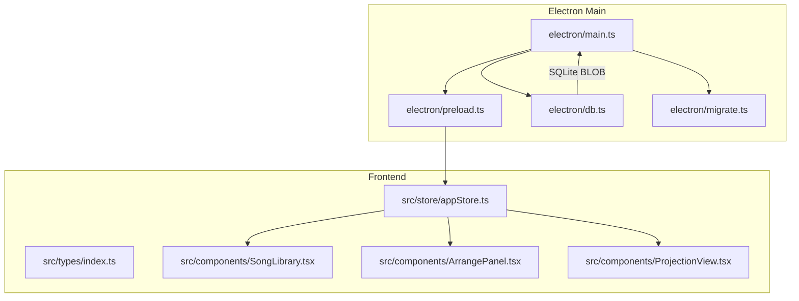
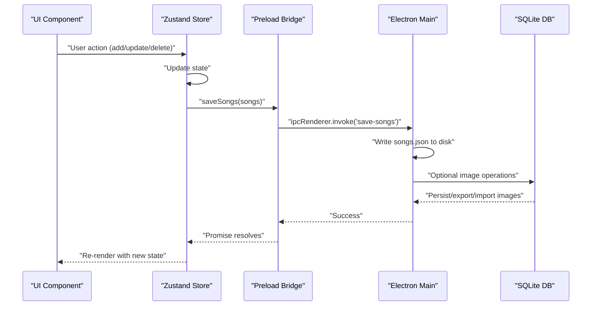
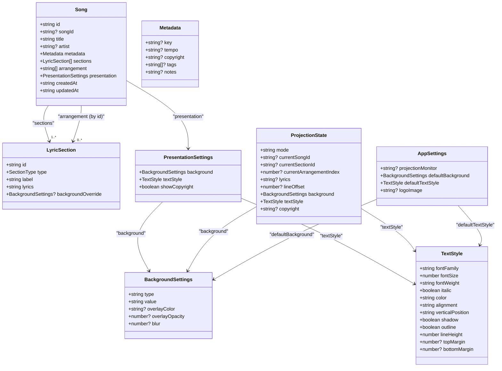
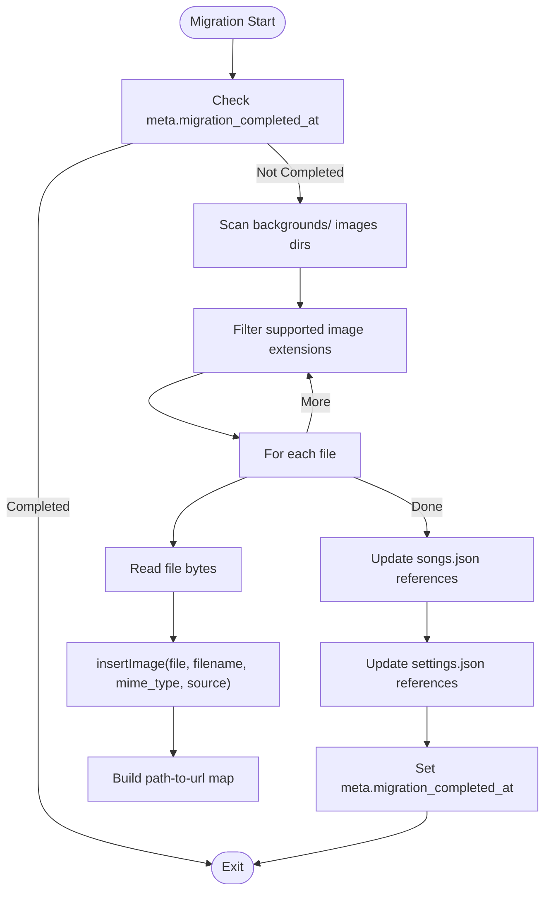
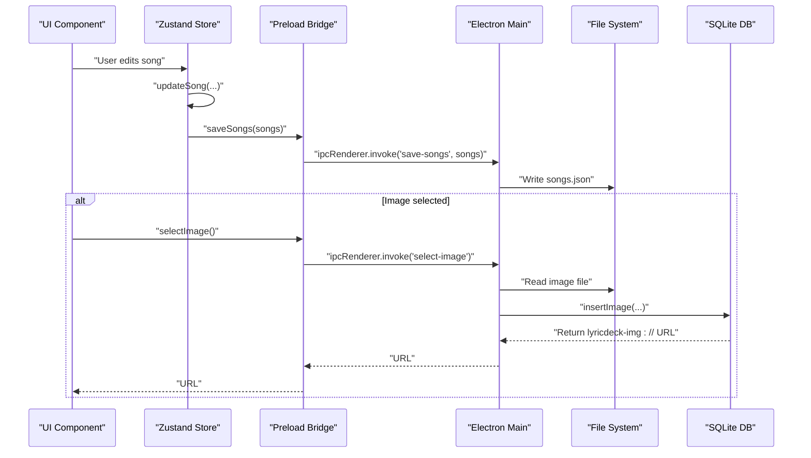
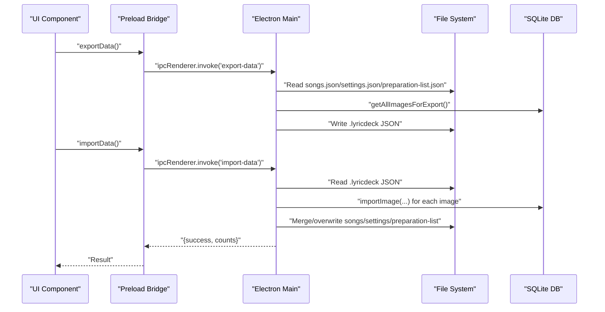
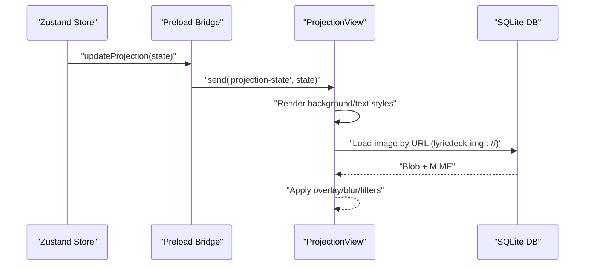
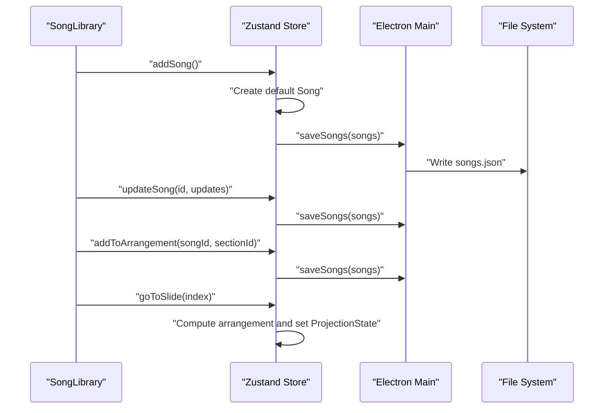
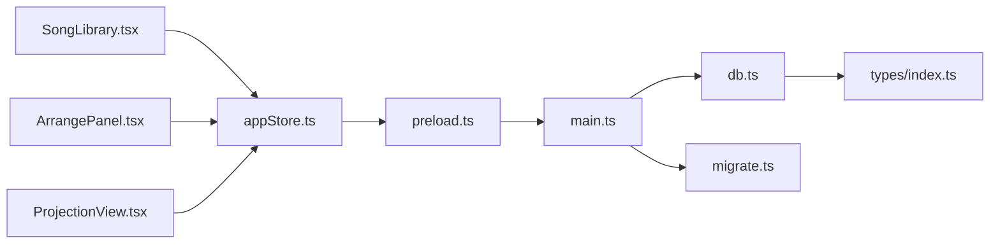

# Data Management

<cite>
**Referenced Files in This Document**
- [README.md](file://README.md)
- [electron/db.ts](file://electron/db.ts)
- [electron/migrate.ts](file://electron/migrate.ts)
- [electron/main.ts](file://electron/main.ts)
- [electron/preload.ts](file://electron/preload.ts)
- [src/store/appStore.ts](file://src/store/appStore.ts)
- [src/types/index.ts](file://src/types/index.ts)
- [src/types/electron.d.ts](file://src/types/electron.d.ts)
- [src/utils/seedData.ts](file://src/utils/seedData.ts)
- [src/components/SongLibrary.tsx](file://src/components/SongLibrary.tsx)
- [src/components/ArrangePanel.tsx](file://src/components/ArrangePanel.tsx)
- [src/components/ProjectionView.tsx](file://src/components/ProjectionView.tsx)
</cite>

## Table of Contents
1. [Introduction](#introduction)
2. [Project Structure](#project-structure)
3. [Core Components](#core-components)
4. [Architecture Overview](#architecture-overview)
5. [Detailed Component Analysis](#detailed-component-analysis)
6. [Dependency Analysis](#dependency-analysis)
7. [Performance Considerations](#performance-considerations)
8. [Troubleshooting Guide](#troubleshooting-guide)
9. [Conclusion](#conclusion)
10. [Appendices](#appendices)

## Introduction
This document describes LyricDeck’s data management system with a focus on the data models for songs, lyric sections, arrangements, and projection settings. It explains the database schema design using SQLite integration, the migration system, persistence mechanisms, and the data lifecycle. It also covers data access patterns, backup/restore functionality, and security considerations, including cross-platform storage locations and local storage strategy.

## Project Structure
LyricDeck separates concerns across:
- Electron main process and preload bridge for IPC and file operations
- Frontend Zustand store for reactive state and persistence triggers
- TypeScript models defining the data structures
- UI components that consume and manipulate the store

**Diagram sources**
- [electron/main.ts:1-390](file://electron/main.ts#L1-L390)
- [electron/preload.ts:1-43](file://electron/preload.ts#L1-L43)
- [electron/db.ts:1-214](file://electron/db.ts#L1-L214)
- [electron/migrate.ts:1-127](file://electron/migrate.ts#L1-L127)
- [src/store/appStore.ts:1-385](file://src/store/appStore.ts#L1-L385)
- [src/types/index.ts:1-89](file://src/types/index.ts#L1-L89)
- [src/components/SongLibrary.tsx:1-193](file://src/components/SongLibrary.tsx#L1-L193)
- [src/components/ArrangePanel.tsx:1-187](file://src/components/ArrangePanel.tsx#L1-L187)
- [src/components/ProjectionView.tsx:1-134](file://src/components/ProjectionView.tsx#L1-L134)

**Section sources**
- [README.md:70-100](file://README.md#L70-L100)
- [electron/main.ts:18-37](file://electron/main.ts#L18-L37)
- [electron/preload.ts:3-42](file://electron/preload.ts#L3-L42)
- [src/store/appStore.ts:98-384](file://src/store/appStore.ts#L98-L384)

## Core Components
This section defines the core data models and their relationships, including fields, types, and constraints.

- Song
  - Fields: id, songId?, title, artist?, metadata (key, tempo, copyright, tags, notes), sections[], arrangement[], presentation (background, textStyle, showCopyright), createdAt, updatedAt
  - Constraints: id is unique; sections reference internal lyric sections; arrangement references section ids present in sections
  - Validation: metadata fields are optional; presentation defaults are enforced in the store

- LyricSection
  - Fields: id, type (enum), label, lyrics, backgroundOverride?
  - Constraints: id is unique; type constrained to predefined values; backgroundOverride is optional

- BackgroundSettings
  - Fields: type ('color' | 'gradient' | 'image' | 'video'), value (string), overlayColor?, overlayOpacity?, blur?
  - Constraints: type determines interpretation of value; overlayOpacity is 0..1; blur is non-negative

- TextStyle
  - Fields: fontFamily, fontSize (number), fontWeight, italic (boolean), color, alignment ('left' | 'center' | 'right'), verticalPosition ('top' | 'middle' | 'bottom'), shadow (boolean), outline (boolean), lineHeight (number), topMargin?, bottomMargin?
  - Constraints: fontSize and lineHeight are positive; margins are optional numbers

- PresentationSettings
  - Fields: background (BackgroundSettings), textStyle (TextStyle), showCopyright (boolean)

- ProjectionState
  - Fields: mode ('live' | 'blank' | 'black' | 'logo' | 'clear'), currentSongId?, currentSectionId?, currentArrangementIndex?, lyrics?, lineOffset?, background (BackgroundSettings), textStyle (TextStyle), copyright?
  - Notes: mode drives rendering; lineOffset enables vertical lyric scrolling

- AppSettings
  - Fields: projectionMonitor?, defaultBackground (BackgroundSettings), defaultTextStyle (TextStyle), logoImage?

Relationships:
- Song contains multiple LyricSection entries; arrangement is an ordered list of section ids
- ProjectionState references current Song and LyricSection for live projection
- BackgroundSettings supports image/video via external URLs; images are persisted in SQLite

**Section sources**
- [src/types/index.ts:3-89](file://src/types/index.ts#L3-L89)
- [src/store/appStore.ts:5-29](file://src/store/appStore.ts#L5-L29)
- [src/store/appStore.ts:116-180](file://src/store/appStore.ts#L116-L180)

## Architecture Overview
The data lifecycle spans UI actions, Zustand store updates, Electron IPC, and file/SQLite persistence.

**Diagram sources**
- [src/store/appStore.ts:379-384](file://src/store/appStore.ts#L379-L384)
- [electron/preload.ts:24-25](file://electron/preload.ts#L24-L25)
- [electron/main.ts:193-200](file://electron/main.ts#L193-L200)
- [electron/db.ts:70-87](file://electron/db.ts#L70-L87)

## Detailed Component Analysis

### Data Models and Relationships

**Diagram sources**
- [src/types/index.ts:3-89](file://src/types/index.ts#L3-L89)
- [src/store/appStore.ts:25-29](file://src/store/appStore.ts#L25-L29)

**Section sources**
- [src/types/index.ts:3-89](file://src/types/index.ts#L3-L89)

### Database Schema and Migration
SQLite schema and migration design:
- Images table stores background assets as BLOBs with metadata and source tagging
- Meta table stores key-value pairs for migrations and settings
- Migration migrates legacy file-based images to SQLite and updates JSON references

Key schema elements:
- images(id, filename, mime_type, data, source, created_at)
- meta(key, value)

Constraints and indexes:
- images.id is the primary key
- No explicit indexes are defined; queries rely on primary key lookups and filtering by source
- Migration updates JSON files to replace filesystem paths with lyricdeck-img:// URLs

**Diagram sources**
- [electron/migrate.ts:8-126](file://electron/migrate.ts#L8-L126)
- [electron/db.ts:70-87](file://electron/db.ts#L70-L87)

**Section sources**
- [electron/db.ts:50-68](file://electron/db.ts#L50-L68)
- [electron/migrate.ts:8-126](file://electron/migrate.ts#L8-L126)

### Data Access Patterns and Persistence
- Songs persistence: JSON files in the app data directory
- Settings and preparation list: separate JSON files
- Images: stored in SQLite as BLOBs; served via a custom protocol lyricdeck-img://
- IPC bridge exposes methods for loading, saving, and image operations

**Diagram sources**
- [src/store/appStore.ts:379-384](file://src/store/appStore.ts#L379-L384)
- [electron/preload.ts:24-25](file://electron/preload.ts#L24-L25)
- [electron/main.ts:193-200](file://electron/main.ts#L193-L200)
- [electron/main.ts:221-235](file://electron/main.ts#L221-L235)
- [electron/db.ts:70-87](file://electron/db.ts#L70-L87)

**Section sources**
- [electron/main.ts:27-79](file://electron/main.ts#L27-L79)
- [electron/preload.ts:24-29](file://electron/preload.ts#L24-L29)
- [electron/db.ts:70-104](file://electron/db.ts#L70-L104)

### Backup and Restore
- Export: Collects songs, settings, preparation list, and images; writes a .lyricdeck archive
- Import: Merges songs by id, overwrites settings and preparation list, imports images into SQLite

**Diagram sources**
- [electron/main.ts:267-354](file://electron/main.ts#L267-L354)
- [electron/db.ts:133-176](file://electron/db.ts#L133-L176)

**Section sources**
- [electron/main.ts:267-354](file://electron/main.ts#L267-L354)
- [electron/db.ts:133-176](file://electron/db.ts#L133-L176)

### Projection Settings and Rendering
- ProjectionState drives rendering in the projection window
- UI renders based on background type (color, gradient, image) and text styles
- Line offset enables vertical lyric scrolling

**Diagram sources**
- [src/store/appStore.ts:242-274](file://src/store/appStore.ts#L242-L274)
- [electron/preload.ts:10-16](file://electron/preload.ts#L10-L16)
- [src/components/ProjectionView.tsx:31-131](file://src/components/ProjectionView.tsx#L31-L131)
- [electron/main.ts:362-374](file://electron/main.ts#L362-L374)
- [electron/db.ts:89-104](file://electron/db.ts#L89-L104)

**Section sources**
- [src/store/appStore.ts:242-274](file://src/store/appStore.ts#L242-L274)
- [src/components/ProjectionView.tsx:31-131](file://src/components/ProjectionView.tsx#L31-L131)
- [electron/db.ts:89-104](file://electron/db.ts#L89-L104)

### Practical Examples of Data Manipulation
- Adding a song: creates a new Song with default sections and saves to disk
- Updating a section: updates the section in the song and persists
- Arranging sections: maintains an ordered arrangement list of section ids
- Projection navigation: computes current arrangement and sets ProjectionState

**Diagram sources**
- [src/components/SongLibrary.tsx:8-95](file://src/components/SongLibrary.tsx#L8-L95)
- [src/store/appStore.ts:116-180](file://src/store/appStore.ts#L116-L180)
- [src/store/appStore.ts:223-274](file://src/store/appStore.ts#L223-L274)
- [electron/main.ts:193-200](file://electron/main.ts#L193-L200)

**Section sources**
- [src/components/SongLibrary.tsx:8-95](file://src/components/SongLibrary.tsx#L8-L95)
- [src/store/appStore.ts:116-180](file://src/store/appStore.ts#L116-L180)
- [src/store/appStore.ts:223-274](file://src/store/appStore.ts#L223-L274)

## Dependency Analysis
- UI components depend on the Zustand store for state and actions
- The store depends on the preload bridge for IPC calls
- Electron main depends on preload bridge and db module
- DB module encapsulates SQLite initialization, schema, and image operations
- Migration depends on DB and filesystem paths

**Diagram sources**
- [src/components/SongLibrary.tsx:1-193](file://src/components/SongLibrary.tsx#L1-L193)
- [src/components/ArrangePanel.tsx:1-187](file://src/components/ArrangePanel.tsx#L1-L187)
- [src/components/ProjectionView.tsx:1-134](file://src/components/ProjectionView.tsx#L1-L134)
- [src/store/appStore.ts:1-385](file://src/store/appStore.ts#L1-L385)
- [electron/preload.ts:1-43](file://electron/preload.ts#L1-L43)
- [electron/main.ts:1-390](file://electron/main.ts#L1-L390)
- [electron/db.ts:1-214](file://electron/db.ts#L1-L214)
- [electron/migrate.ts:1-127](file://electron/migrate.ts#L1-L127)
- [src/types/index.ts:1-89](file://src/types/index.ts#L1-L89)

**Section sources**
- [src/store/appStore.ts:1-385](file://src/store/appStore.ts#L1-L385)
- [electron/main.ts:1-390](file://electron/main.ts#L1-L390)
- [electron/db.ts:1-214](file://electron/db.ts#L1-L214)
- [electron/migrate.ts:1-127](file://electron/migrate.ts#L1-L127)

## Performance Considerations
- SQLite BLOB storage for images avoids filesystem fragmentation and simplifies backups
- No explicit indexes on images table; primary key lookups are efficient for typical usage
- JSON persistence is straightforward but may benefit from batching writes for bulk operations
- Projection rendering relies on client-side CSS; ensure minimal DOM churn during frequent updates

[No sources needed since this section provides general guidance]

## Troubleshooting Guide
Common issues and resolutions:
- Database not initialized: Ensure initDatabase is called before any DB operations
- Missing migration marker: Run migration to convert legacy images and update references
- Corrupt JSON files: Export data, fix or recreate JSON files, then import
- Image not found: Verify lyricdeck-img URL and confirm image exists in DB

**Section sources**
- [electron/db.ts:43-48](file://electron/db.ts#L43-L48)
- [electron/migrate.ts:8-12](file://electron/migrate.ts#L8-L12)
- [electron/main.ts:356-359](file://electron/main.ts#L356-L359)

## Conclusion
LyricDeck’s data management combines a simple JSON-based persistence for core data with an embedded SQLite database for images. The Zustand store orchestrates state transitions and triggers IPC to Electron for file operations. The migration system ensures backward compatibility, and the custom protocol enables seamless image serving. Together, these components provide a robust, cross-platform solution for managing song lyrics, arrangements, and projection settings.

[No sources needed since this section summarizes without analyzing specific files]

## Appendices

### Data Lifecycle Management and Retention
- Creation: Songs and sections are created with timestamps
- Updates: updatedAt is refreshed on edits
- Deletion: Sections removed from both sections and arrangement lists
- Retention: No automatic retention policy; users manage data via export/import

**Section sources**
- [src/store/appStore.ts:136-138](file://src/store/appStore.ts#L136-L138)
- [src/store/appStore.ts:174-179](file://src/store/appStore.ts#L174-L179)
- [src/store/appStore.ts:210-216](file://src/store/appStore.ts#L210-L216)

### Cross-Platform Storage Locations
- Windows: %APPDATA%/lyricdeck/data/
- macOS: ~/Library/Application Support/lyricdeck/data/

**Section sources**
- [README.md:104-107](file://README.md#L104-L107)
- [electron/main.ts:18-25](file://electron/main.ts#L18-L25)

### Security Considerations
- Images are stored as BLOBs in SQLite; no network exposure beyond the custom protocol
- Filesystem permissions are managed by the OS; ensure app data directory is protected
- Custom protocol lyricdeck-img:// restricts access to stored images

**Section sources**
- [electron/db.ts:70-87](file://electron/db.ts#L70-L87)
- [electron/main.ts:12-16](file://electron/main.ts#L12-L16)
- [electron/main.ts:362-374](file://electron/main.ts#L362-L374)