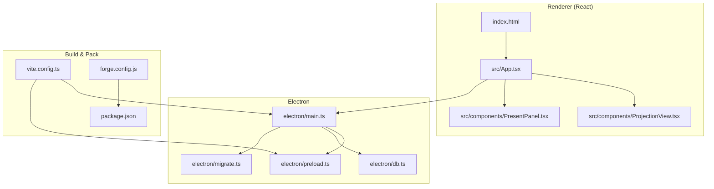
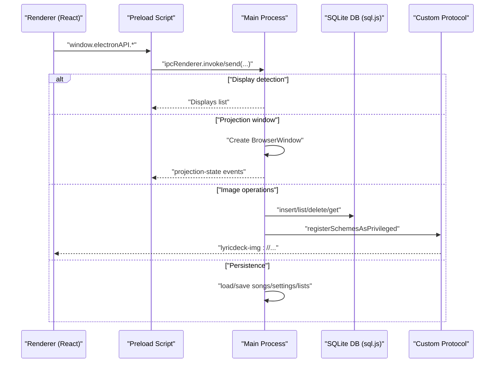
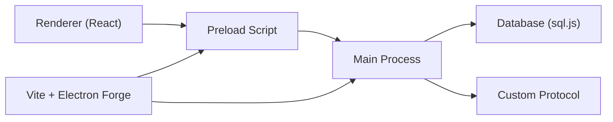

# Electron Integration

<cite>
**Referenced Files in This Document**
- [electron/main.ts](file://electron/main.ts)
- [electron/preload.ts](file://electron/preload.ts)
- [electron/db.ts](file://electron/db.ts)
- [electron/migrate.ts](file://electron/migrate.ts)
- [forge.config.js](file://forge.config.js)
- [package.json](file://package.json)
- [vite.config.ts](file://vite.config.ts)
- [src/types/electron.d.ts](file://src/types/electron.d.ts)
- [src/App.tsx](file://src/App.tsx)
- [src/components/ProjectionView.tsx](file://src/components/ProjectionView.tsx)
- [src/components/PresentPanel.tsx](file://src/components/PresentPanel.tsx)
- [index.html](file://index.html)
</cite>

## Table of Contents
1. [Introduction](#introduction)
2. [Project Structure](#project-structure)
3. [Core Components](#core-components)
4. [Architecture Overview](#architecture-overview)
5. [Detailed Component Analysis](#detailed-component-analysis)
6. [Dependency Analysis](#dependency-analysis)
7. [Performance Considerations](#performance-considerations)
8. [Troubleshooting Guide](#troubleshooting-guide)
9. [Conclusion](#conclusion)
10. [Appendices](#appendices)

## Introduction
This document describes LyricDeck’s Electron integration layer. It covers the main process architecture (window management, file system access, display detection), the preload script security model using contextBridge and a minimal API surface, IPC communication patterns between main and renderer processes, the custom protocol for serving images and media, platform-specific considerations for Windows and macOS, security best practices, sandboxing, API exposure limitations, packaging configuration with Electron Forge, distribution strategies, and troubleshooting guidance.

## Project Structure
The Electron integration is organized into:
- Main process entry and orchestration
- Preload script exposing a controlled API surface to the renderer
- Database and migration utilities for persistent data and images
- Packaging and distribution configuration via Electron Forge and Vite

**Diagram sources**
- [index.html:1-14](file://index.html#L1-L14)
- [src/App.tsx:1-102](file://src/App.tsx#L1-L102)
- [src/components/ProjectionView.tsx:1-46](file://src/components/ProjectionView.tsx#L1-L46)
- [src/components/PresentPanel.tsx:133-168](file://src/components/PresentPanel.tsx#L133-L168)
- [electron/main.ts:1-390](file://electron/main.ts#L1-L390)
- [electron/preload.ts:1-43](file://electron/preload.ts#L1-L43)
- [electron/db.ts:1-214](file://electron/db.ts#L1-L214)
- [electron/migrate.ts:1-127](file://electron/migrate.ts#L1-L127)
- [vite.config.ts:1-51](file://vite.config.ts#L1-L51)
- [forge.config.js:1-45](file://forge.config.js#L1-L45)
- [package.json:1-97](file://package.json#L1-L97)

**Section sources**
- [index.html:1-14](file://index.html#L1-L14)
- [vite.config.ts:1-51](file://vite.config.ts#L1-L51)
- [forge.config.js:1-45](file://forge.config.js#L1-L45)
- [package.json:1-97](file://package.json#L1-L97)

## Core Components
- Main process: Creates windows, registers IPC handlers, sets up a custom protocol, manages display detection, and persists data.
- Preload: Exposes a small, typed API surface via contextBridge to the renderer.
- Database: Uses sql.js to store images and metadata in a local SQLite database.
- Migration: Migrates legacy image files and song references to the new schema.
- Packaging: Electron Forge with fuses and multiple makers for Windows, macOS, and Linux.

**Section sources**
- [electron/main.ts:1-390](file://electron/main.ts#L1-L390)
- [electron/preload.ts:1-43](file://electron/preload.ts#L1-L43)
- [electron/db.ts:1-214](file://electron/db.ts#L1-L214)
- [electron/migrate.ts:1-127](file://electron/migrate.ts#L1-L127)
- [forge.config.js:1-45](file://forge.config.js#L1-L45)
- [package.json:1-97](file://package.json#L1-L97)

## Architecture Overview
The application runs a main process that controls two BrowserWindows: a primary editor window and a projection window. The renderer communicates with the main process exclusively via IPC and a custom protocol for serving images. The preload script defines a strict API surface using contextBridge.

**Diagram sources**
- [electron/preload.ts:1-43](file://electron/preload.ts#L1-L43)
- [electron/main.ts:1-390](file://electron/main.ts#L1-L390)
- [electron/db.ts:1-214](file://electron/db.ts#L1-L214)
- [src/types/electron.d.ts:1-33](file://src/types/electron.d.ts#L1-L33)

## Detailed Component Analysis

### Main Process: Window Management, Display Detection, and File System Access
- Window creation:
  - Primary window with dev vs production loading behavior.
  - Projection window creation targeting a specific display or fallback to primary/secondary.
- Display detection:
  - Lists all displays and marks the primary one.
- File system access:
  - Manages JSON data files for songs, settings, and preparation lists.
  - Uses Node.js fs for read/write and dialog for user-driven file selection.
- Custom protocol:
  - Registers a privileged scheme and serves images from the database via a fetch-compatible handler.

Key behaviors:
- Projection lifecycle: open/close and state synchronization via IPC.
- Data persistence: CRUD for songs, settings, and preparation list.
- Image repository: import/add/list/delete images stored as BLOBs.
- Import/export: structured data export/import with version-aware handling.

Security and isolation:
- Context isolation enabled; Node integration disabled in BrowserWindow webPreferences.
- Preload script exposes only a minimal API surface.

**Section sources**
- [electron/main.ts:81-152](file://electron/main.ts#L81-L152)
- [electron/main.ts:154-190](file://electron/main.ts#L154-L190)
- [electron/main.ts:192-218](file://electron/main.ts#L192-L218)
- [electron/main.ts:220-264](file://electron/main.ts#L220-L264)
- [electron/main.ts:266-354](file://electron/main.ts#L266-L354)
- [electron/main.ts:361-374](file://electron/main.ts#L361-L374)

### Preload Script: Security Model and API Surface
- Uses contextBridge to expose a typed API surface to the renderer.
- API groups:
  - Display management: get displays, open/close projection, check open state.
  - Projection updates: send state and listen for state/closed events.
  - Data persistence: load/save songs/settings/preparation list.
  - File dialogs: select image.
  - Background image repository: add/list/delete images.
  - Import/export: export/import structured data.

Type safety:
- Global window typing defines the shape of electronAPI for TypeScript.

**Section sources**
- [electron/preload.ts:1-43](file://electron/preload.ts#L1-L43)
- [src/types/electron.d.ts:1-33](file://src/types/electron.d.ts#L1-L33)

### IPC Communication Patterns
- Request/response handlers:
  - get-displays, open-projection, close-projection, is-projection-open, load/save data, select/add/list/delete images, export/import.
- Event-based channels:
  - update-projection sends state to projection window.
  - projection-state receives state updates in projection view.
  - projection-window-closed notifies main window when projection closes.

Renderer usage examples:
- Present panel selects display and toggles projection.
- Projection view listens for state updates.
- Main window listens for projection window closed event.

**Section sources**
- [electron/main.ts:154-190](file://electron/main.ts#L154-L190)
- [electron/preload.ts:10-21](file://electron/preload.ts#L10-L21)
- [src/components/PresentPanel.tsx:133-168](file://src/components/PresentPanel.tsx#L133-L168)
- [src/components/ProjectionView.tsx:22-29](file://src/components/ProjectionView.tsx#L22-L29)
- [src/App.tsx:35-42](file://src/App.tsx#L35-L42)

### Custom Protocol for Serving Images and Media
- Scheme registration:
  - Privileged scheme configured with standard, secure, and fetch support.
- Handler:
  - Extracts image ID from URL, retrieves BLOB from database, and returns a Response with appropriate MIME type and caching headers.
- Renderer URLs:
  - Generated as lyricdeck-img://<id> and used in background/image fields.

Benefits:
- Keeps media data inside the app’s data directory.
- Enables efficient caching via headers.
- Avoids exposing filesystem paths.

**Section sources**
- [electron/main.ts:12-16](file://electron/main.ts#L12-L16)
- [electron/main.ts:361-374](file://electron/main.ts#L361-L374)
- [electron/db.ts:70-87](file://electron/db.ts#L70-L87)

### Database and Migration Layer
- Schema:
  - images table stores id, filename, mime_type, data (BLOB), source, created_at.
  - meta table stores key/value pairs for migrations and settings.
- Operations:
  - Insert image, get image, list gallery images, delete image, export all images, import image.
- Migration:
  - Scans legacy directories for images, inserts into DB, updates song and settings references, and records completion.

**Section sources**
- [electron/db.ts:50-68](file://electron/db.ts#L50-L68)
- [electron/db.ts:70-131](file://electron/db.ts#L70-L131)
- [electron/db.ts:133-176](file://electron/db.ts#L133-L176)
- [electron/migrate.ts:8-126](file://electron/migrate.ts#L8-L126)

### Platform-Specific Considerations
- Windows:
  - NSIS installer targets and portable builds are configured.
  - Squirrel maker included for Windows distribution.
- macOS:
  - ZIP maker configured for darwin platform.
  - Electron Forge fuses configured for hardened defaults.
- Linux:
  - DEB and RPM makers configured for distribution.

Notes:
- The main process handles macOS-specific window behavior via app activation and window-all-closed logic.
- The preload and main process do not include OS-specific code paths; platform differences are handled by Electron Forge and build targets.

**Section sources**
- [package.json:26-56](file://package.json#L26-L56)
- [forge.config.js:9-26](file://forge.config.js#L9-L26)
- [electron/main.ts:385-389](file://electron/main.ts#L385-L389)

### Packaging Configuration Using Electron Forge
- Packager:
  - ASAR enabled for main and preload bundles.
- Makers:
  - Squirrel (Windows), ZIP (macOS), DEB/RPM (Linux).
- Plugins:
  - Auto-unpack natives plugin.
  - Fuses plugin with hardened defaults:
    - Run as node disabled.
    - Cookie encryption enabled.
    - Embedded ASAR integrity validation enabled.
    - Only load app from ASAR enforced.
- Build scripts:
  - Dev server and Electron Forge commands for development and packaging.

**Section sources**
- [forge.config.js:4-44](file://forge.config.js#L4-L44)
- [package.json:6-16](file://package.json#L6-L16)

### Distribution Strategies
- Development:
  - Vite dev server with hot reload and Electron bridging via vite-plugin-electron and vite-plugin-electron-renderer.
- Production:
  - Electron Forge packaging and making for multiple platforms.
- Data persistence:
  - User data directory used for app data and database storage.

**Section sources**
- [vite.config.ts:10-43](file://vite.config.ts#L10-L43)
- [electron/main.ts:18-25](file://electron/main.ts#L18-L25)
- [electron/db.ts:10-17](file://electron/db.ts#L10-L17)

## Dependency Analysis
High-level dependencies:
- Main process depends on preload for API exposure and on database/migration for persistence.
- Renderer depends on preload for electronAPI and on main process for IPC and custom protocol.
- Build pipeline depends on Vite and Electron Forge for bundling and packaging.

**Diagram sources**
- [electron/main.ts:1-390](file://electron/main.ts#L1-L390)
- [electron/preload.ts:1-43](file://electron/preload.ts#L1-L43)
- [electron/db.ts:1-214](file://electron/db.ts#L1-L214)
- [vite.config.ts:1-51](file://vite.config.ts#L1-L51)
- [forge.config.js:1-45](file://forge.config.js#L1-L45)

**Section sources**
- [electron/main.ts:1-390](file://electron/main.ts#L1-L390)
- [electron/preload.ts:1-43](file://electron/preload.ts#L1-L43)
- [electron/db.ts:1-214](file://electron/db.ts#L1-L214)
- [vite.config.ts:1-51](file://vite.config.ts#L1-L51)
- [forge.config.js:1-45](file://forge.config.js#L1-L45)

## Performance Considerations
- Image storage:
  - Images are stored as BLOBs; consider compression and limiting image sizes to reduce memory footprint.
- Caching:
  - Custom protocol sets cache headers; ensure renderer caches appropriately.
- Window management:
  - Projection window uses fullscreen and always-on-top; minimize unnecessary redraws in projection view.
- IPC:
  - Prefer batching updates for projection state to reduce IPC overhead.
- Packaging:
  - ASAR enabled; keep preload and main minimal to reduce bundle size.

[No sources needed since this section provides general guidance]

## Troubleshooting Guide
Common issues and resolutions:
- Custom protocol not serving images:
  - Verify scheme registration and that the handler extracts the image ID correctly.
  - Confirm image exists in DB and MIME type matches extension.
- Projection window not opening:
  - Ensure display ID is valid or falls back to primary/secondary.
  - Check that main window remains open and IPC handlers are registered.
- IPC not responding:
  - Confirm preload exposes the correct API and renderer calls invoke/send correctly.
  - Verify main process handlers are registered before app ready.
- Import/export failures:
  - Validate file format and version; handle parse errors gracefully.
- Packaging issues:
  - Ensure fuses are configured as intended and makers match target platforms.
  - Rebuild native modules if needed using auto-unpack plugin.

**Section sources**
- [electron/main.ts:12-16](file://electron/main.ts#L12-L16)
- [electron/main.ts:111-152](file://electron/main.ts#L111-L152)
- [electron/main.ts:154-190](file://electron/main.ts#L154-L190)
- [electron/main.ts:266-354](file://electron/main.ts#L266-L354)
- [forge.config.js:27-43](file://forge.config.js#L27-L43)

## Conclusion
LyricDeck’s Electron integration cleanly separates concerns: the main process manages windows, displays, persistence, and a custom protocol; the preload script exposes a minimal, typed API surface; and the renderer consumes these capabilities via IPC and protocol URLs. The configuration emphasizes security via context isolation and fuses, and distribution via Electron Forge across Windows, macOS, and Linux. Following the best practices and troubleshooting steps outlined here will help maintain a robust, performant, and secure desktop application.

[No sources needed since this section summarizes without analyzing specific files]

## Appendices

### API Surface Reference
- Display management: getDisplays, openProjection, closeProjection, isProjectionOpen
- Projection updates: updateProjection, onProjectionState, onProjectionWindowClosed
- Data persistence: loadSongs, saveSongs, loadSettings, saveSettings, loadPreparationList, savePreparationList
- File dialogs: selectImage
- Background image repository: addBackgroundImage, listBackgroundImages, deleteBackgroundImage
- Import/export: exportData, importData

**Section sources**
- [electron/preload.ts:3-42](file://electron/preload.ts#L3-L42)
- [src/types/electron.d.ts:4-31](file://src/types/electron.d.ts#L4-L31)

### Security Best Practices
- Keep Node integration disabled and context isolation enabled.
- Expose only necessary APIs via contextBridge.
- Validate and sanitize inputs for IPC and file operations.
- Use a custom protocol with strict scheme privileges and fetch support.
- Leverage Electron Forge fuses for hardened defaults.

**Section sources**
- [electron/main.ts:89-93](file://electron/main.ts#L89-L93)
- [forge.config.js:34-42](file://forge.config.js#L34-L42)