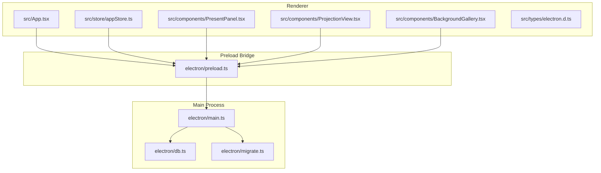
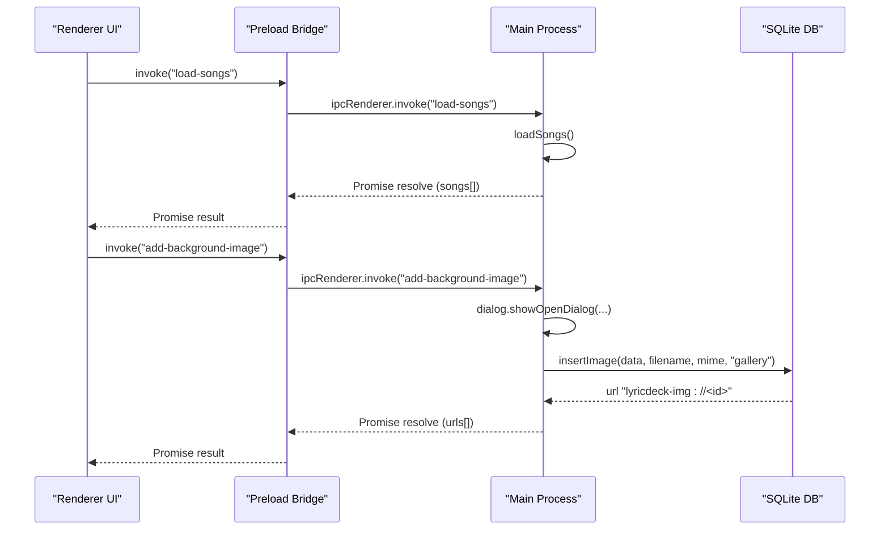
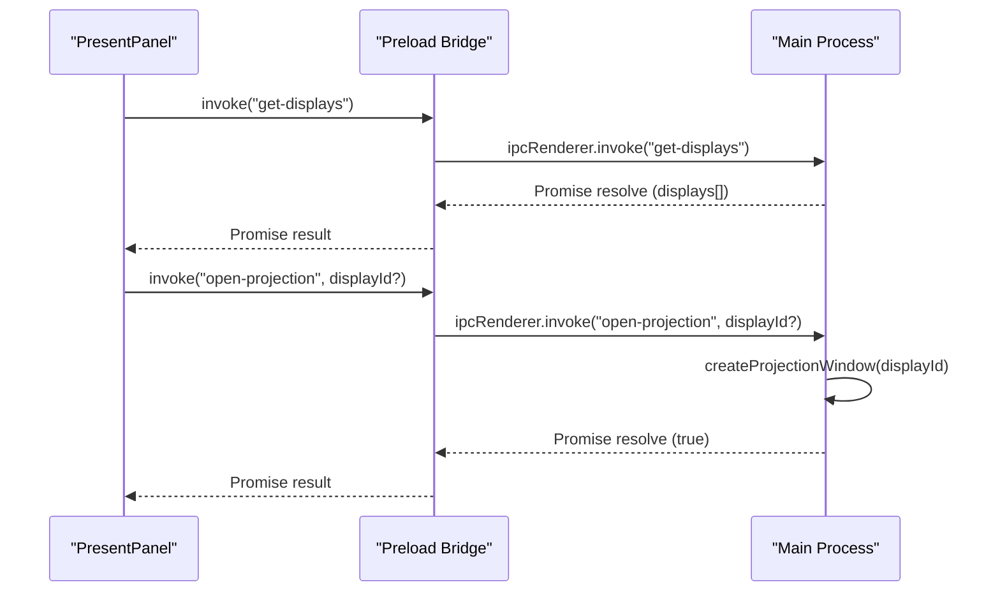
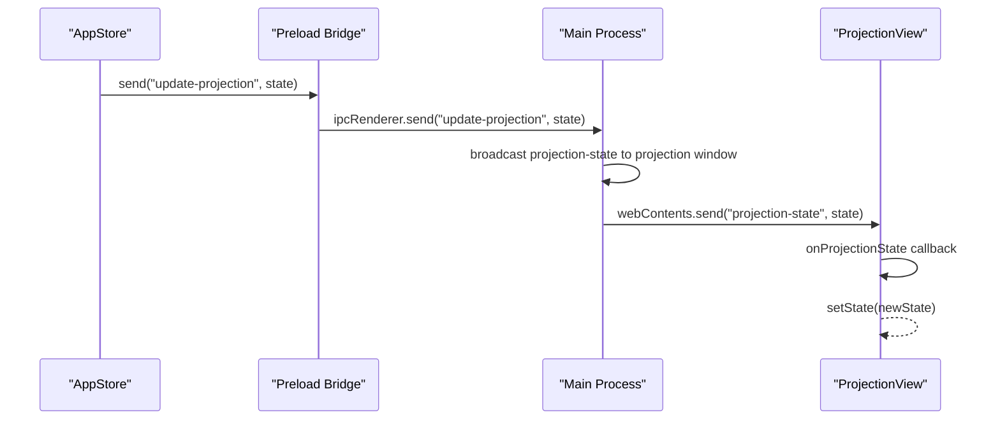
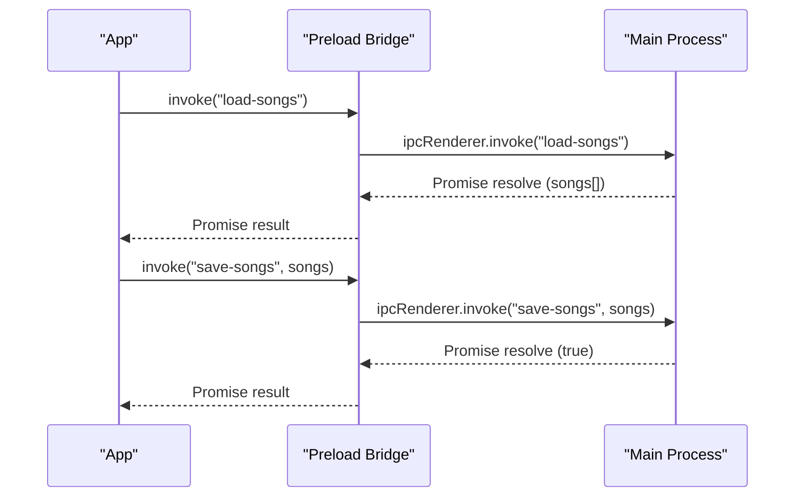
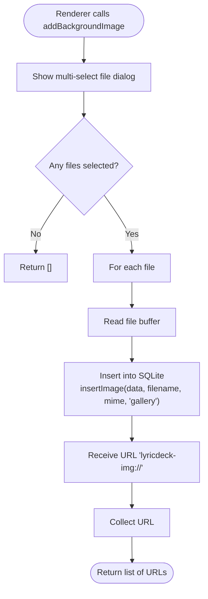
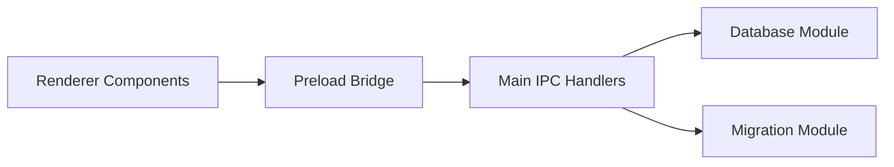

# IPC Communication Patterns

<cite>
**Referenced Files in This Document**
- [electron/main.ts](file://electron/main.ts)
- [electron/preload.ts](file://electron/preload.ts)
- [electron/db.ts](file://electron/db.ts)
- [electron/migrate.ts](file://electron/migrate.ts)
- [src/types/electron.d.ts](file://src/types/electron.d.ts)
- [src/store/appStore.ts](file://src/store/appStore.ts)
- [src/components/PresentPanel.tsx](file://src/components/PresentPanel.tsx)
- [src/components/ProjectionView.tsx](file://src/components/ProjectionView.tsx)
- [src/components/BackgroundGallery.tsx](file://src/components/BackgroundGallery.tsx)
- [src/App.tsx](file://src/App.tsx)
- [src/types/index.ts](file://src/types/index.ts)
</cite>

## Table of Contents
1. [Introduction](#introduction)
2. [Project Structure](#project-structure)
3. [Core Components](#core-components)
4. [Architecture Overview](#architecture-overview)
5. [Detailed Component Analysis](#detailed-component-analysis)
6. [Dependency Analysis](#dependency-analysis)
7. [Performance Considerations](#performance-considerations)
8. [Troubleshooting Guide](#troubleshooting-guide)
9. [Conclusion](#conclusion)
10. [Appendices](#appendices)

## Introduction
This document explains LyricDeck’s Inter-Process Communication (IPC) patterns between the Electron main process and renderer processes. It covers handler registration for display management, projection control, data persistence, and image operations. It also clarifies the differences between ipcMain.handle (asynchronous) and ipcRenderer.invoke, documents message protocols for projection state updates and window management, and outlines error handling, timeouts, and graceful degradation. A custom protocol for serving images from an embedded SQLite database is described, along with performance considerations, debugging techniques, and guidelines for adding new IPC endpoints while maintaining backward compatibility.

## Project Structure
The IPC layer is implemented across three main areas:
- Main process: Defines IPC handlers, manages windows, registers a custom protocol, and orchestrates persistence and migrations.
- Preload bridge: Exposes a typed API to the renderer via contextBridge and routes calls to ipcRenderer.
- Renderer components: Use the exposed API to invoke handlers and listen for events.

**Diagram sources**
- [electron/main.ts:1-390](file://electron/main.ts#L1-L390)
- [electron/preload.ts:1-43](file://electron/preload.ts#L1-L43)
- [electron/db.ts:1-214](file://electron/db.ts#L1-L214)
- [electron/migrate.ts:1-127](file://electron/migrate.ts#L1-L127)
- [src/App.tsx:1-102](file://src/App.tsx#L1-L102)
- [src/store/appStore.ts:1-385](file://src/store/appStore.ts#L1-L385)
- [src/components/PresentPanel.tsx:1-365](file://src/components/PresentPanel.tsx#L1-L365)
- [src/components/ProjectionView.tsx:1-134](file://src/components/ProjectionView.tsx#L1-L134)
- [src/components/BackgroundGallery.tsx:1-98](file://src/components/BackgroundGallery.tsx#L1-L98)
- [src/types/electron.d.ts:1-33](file://src/types/electron.d.ts#L1-L33)

**Section sources**
- [electron/main.ts:1-390](file://electron/main.ts#L1-L390)
- [electron/preload.ts:1-43](file://electron/preload.ts#L1-L43)
- [src/types/electron.d.ts:1-33](file://src/types/electron.d.ts#L1-L33)

## Core Components
- Main process IPC handlers:
  - Display management: get-displays, open-projection, close-projection, is-projection-open.
  - Projection state updates: update-projection (send) and projection-state event received by projection window.
  - Data persistence: load-songs, save-songs, load-settings, save-settings, load-preparation-list, save-preparation-list.
  - Image operations: select-image, add-background-image, list-background-images, delete-background-image, export-data, import-data.
  - Custom protocol: lyricdeck-img serves images stored in SQLite.
- Preload bridge:
  - Exposes typed methods mirroring main handlers and event listeners for projection-state and projection-window-closed.
- Renderer usage:
  - PresentPanel controls projection windows and displays.
  - ProjectionView listens for projection-state updates.
  - BackgroundGallery manages background images via IPC.
  - App listens for projection-window-closed to keep UI state synchronized.
  - Store persists data and triggers projection updates.

**Section sources**
- [electron/main.ts:154-390](file://electron/main.ts#L154-L390)
- [electron/preload.ts:3-42](file://electron/preload.ts#L3-L42)
- [src/components/PresentPanel.tsx:26-129](file://src/components/PresentPanel.tsx#L26-L129)
- [src/components/ProjectionView.tsx:22-29](file://src/components/ProjectionView.tsx#L22-L29)
- [src/components/BackgroundGallery.tsx:17-40](file://src/components/BackgroundGallery.tsx#L17-L40)
- [src/App.tsx:34-42](file://src/App.tsx#L34-L42)
- [src/store/appStore.ts:241-249](file://src/store/appStore.ts#L241-L249)

## Architecture Overview
The renderer invokes asynchronous handlers via ipcRenderer.invoke, while the main process responds with ipcMain.handle. Synchronous events are used for real-time updates (e.g., projection-state). A custom protocol serves images from an embedded SQLite database.

**Diagram sources**
- [electron/preload.ts:23-37](file://electron/preload.ts#L23-L37)
- [electron/main.ts:237-255](file://electron/main.ts#L237-L255)
- [electron/db.ts:70-87](file://electron/db.ts#L70-L87)

**Section sources**
- [electron/main.ts:154-390](file://electron/main.ts#L154-L390)
- [electron/preload.ts:3-42](file://electron/preload.ts#L3-L42)
- [electron/db.ts:1-214](file://electron/db.ts#L1-L214)

## Detailed Component Analysis

### Display Management IPC
- Handler registration:
  - get-displays returns display list with id, label, bounds, and primary flag.
  - open-projection creates a fullscreen projection window on a chosen display.
  - close-projection closes the projection window.
  - is-projection-open checks if the projection window exists and is alive.
- Renderer usage:
  - PresentPanel loads displays and toggles projection windows.
  - App listens for projection-window-closed to reset UI state.

**Diagram sources**
- [electron/main.ts:155-184](file://electron/main.ts#L155-L184)
- [src/components/PresentPanel.tsx:26-129](file://src/components/PresentPanel.tsx#L26-L129)

**Section sources**
- [electron/main.ts:155-184](file://electron/main.ts#L155-L184)
- [src/components/PresentPanel.tsx:26-129](file://src/components/PresentPanel.tsx#L26-L129)
- [src/App.tsx:34-42](file://src/App.tsx#L34-L42)

### Projection State Updates
- Protocol:
  - Renderer store updates projection state and sends update-projection (ipcRenderer.send).
  - Main process forwards projection-state to the projection window via ipcRenderer.send.
  - ProjectionView subscribes to projection-state and updates its UI.
- Event lifecycle:
  - Store.setProjectionState triggers updateProjection.
  - Main process broadcasts projection-state to the projection window.
  - ProjectionView updates state and re-renders.

**Diagram sources**
- [src/store/appStore.ts:241-249](file://src/store/appStore.ts#L241-L249)
- [electron/main.ts:186-190](file://electron/main.ts#L186-L190)
- [src/components/ProjectionView.tsx:22-29](file://src/components/ProjectionView.tsx#L22-L29)

**Section sources**
- [src/store/appStore.ts:241-249](file://src/store/appStore.ts#L241-L249)
- [electron/main.ts:186-190](file://electron/main.ts#L186-L190)
- [src/components/ProjectionView.tsx:22-29](file://src/components/ProjectionView.tsx#L22-L29)

### Data Persistence IPC
- Handlers:
  - load-songs/save-songs, load-settings/save-settings, load-preparation-list/save-preparation-list.
- Renderer usage:
  - App loads initial data and seeds default songs.
  - Store persists songs and settings on change.
  - Settings panel triggers export/import flows.

**Diagram sources**
- [electron/main.ts:193-218](file://electron/main.ts#L193-L218)
- [src/App.tsx:19-32](file://src/App.tsx#L19-L32)
- [src/store/appStore.ts:361-383](file://src/store/appStore.ts#L361-L383)

**Section sources**
- [electron/main.ts:193-218](file://electron/main.ts#L193-L218)
- [src/App.tsx:19-32](file://src/App.tsx#L19-L32)
- [src/store/appStore.ts:361-383](file://src/store/appStore.ts#L361-L383)

### Image Operations and Custom Protocol
- Handlers:
  - select-image: opens file dialog and inserts image into SQLite, returning a lyricdeck-img URL.
  - add-background-image: adds multiple images and returns an array of URLs.
  - list-background-images: lists all gallery image URLs.
  - delete-background-image: removes an image by parsing its ID from the URL.
  - export-data/import-data: serialize/deserialize data including base64-encoded images (v1) or structured image records (v2).
- Custom protocol:
  - lyricdeck-img serves BLOB data from SQLite with appropriate MIME type and caching headers.
  - Migration converts legacy file-based images to SQLite and updates references.

**Diagram sources**
- [electron/main.ts:237-255](file://electron/main.ts#L237-L255)
- [electron/db.ts:70-87](file://electron/db.ts#L70-L87)
- [electron/migrate.ts:21-61](file://electron/migrate.ts#L21-L61)

**Section sources**
- [electron/main.ts:220-290](file://electron/main.ts#L220-L290)
- [electron/db.ts:70-131](file://electron/db.ts#L70-L131)
- [electron/migrate.ts:1-127](file://electron/migrate.ts#L1-L127)
- [src/components/BackgroundGallery.tsx:17-40](file://src/components/BackgroundGallery.tsx#L17-L40)

### Difference Between ipcMain.handle and ipcRenderer.invoke
- ipcMain.handle:
  - Used for asynchronous requests with a response (Promise).
  - Examples: get-displays, open-projection, load-songs, save-settings, add-background-image.
- ipcRenderer.invoke:
  - Used by renderer to call ipcMain.handle handlers.
  - Typed in preload bridge and globally exposed via window.electronAPI.
- Synchronous events:
  - update-projection uses ipcRenderer.send and ipcMain.on for fire-and-forget or immediate delivery.
  - projection-state uses ipcRenderer.on in the projection window to receive updates.

**Section sources**
- [electron/main.ts:154-190](file://electron/main.ts#L154-L190)
- [electron/preload.ts:3-42](file://electron/preload.ts#L3-L42)
- [src/types/electron.d.ts:3-32](file://src/types/electron.d.ts#L3-L32)

### Message Passing Protocols
- Projection state updates:
  - Renderer store sends update-projection with the new state.
  - Main process forwards projection-state to the projection window.
  - Projection window renders based on the received state.
- Window management commands:
  - open-projection and close-projection manage the projection window lifecycle.
  - is-projection-open allows checking the window state.
  - projection-window-closed informs the main window to reset UI state.
- Data synchronization:
  - Renderer invokes load handlers on startup and save handlers on changes.
  - Store coordinates persistence and keeps UI in sync.

**Section sources**
- [electron/main.ts:166-190](file://electron/main.ts#L166-L190)
- [src/store/appStore.ts:241-249](file://src/store/appStore.ts#L241-L249)
- [src/App.tsx:34-42](file://src/App.tsx#L34-L42)

### Error Handling Strategies
- Dialog-based flows:
  - File selection handles canceled dialogs gracefully by returning null or empty arrays.
- Import/export:
  - Validation checks for required fields and version compatibility.
  - Try/catch around parsing and file operations; returns structured errors.
- Database operations:
  - Existence checks before deletion and insertions; returns booleans for success.
- Graceful degradation:
  - If projection window is closed, main process emits projection-window-closed to reset UI state.
  - Migration skips corrupt files and continues with others.

**Section sources**
- [electron/main.ts:221-235](file://electron/main.ts#L221-L235)
- [electron/main.ts:292-354](file://electron/main.ts#L292-L354)
- [electron/db.ts:120-131](file://electron/db.ts#L120-L131)
- [src/App.tsx:34-42](file://src/App.tsx#L34-L42)
- [electron/migrate.ts:36-38](file://electron/migrate.ts#L36-L38)

### Timeout Management and Monitoring
- Timeouts:
  - No explicit timeouts are configured for IPC calls in the current codebase.
  - Consider wrapping long-running operations (e.g., image import/export) with user feedback and cancellation where applicable.
- Monitoring:
  - Track frequent projection-state updates to avoid excessive rendering.
  - Monitor disk I/O during export/import and image operations.
  - Use logging in main process handlers for long operations.

[No sources needed since this section provides general guidance]

### Implementing New IPC Endpoints
- Steps:
  - Define handler in main process using ipcMain.handle or ipcMain.on.
  - Expose typed method in preload bridge and declare it in global types.
  - Use the new API in renderer components.
  - Maintain backward compatibility by preserving existing signatures and adding optional parameters.
- Example pattern:
  - Add a new handler in main.ts.
  - Add a corresponding method in preload.ts.
  - Declare the method signature in electron.d.ts.
  - Consume the API in a renderer component.

**Section sources**
- [electron/main.ts:154-390](file://electron/main.ts#L154-L390)
- [electron/preload.ts:3-42](file://electron/preload.ts#L3-L42)
- [src/types/electron.d.ts:3-32](file://src/types/electron.d.ts#L3-L32)

## Dependency Analysis
The renderer depends on the preload bridge for IPC, which depends on the main process handlers. The main process depends on the database module for image storage and migration logic.

**Diagram sources**
- [electron/preload.ts:3-42](file://electron/preload.ts#L3-L42)
- [electron/main.ts:154-390](file://electron/main.ts#L154-L390)
- [electron/db.ts:1-214](file://electron/db.ts#L1-L214)
- [electron/migrate.ts:1-127](file://electron/migrate.ts#L1-L127)

**Section sources**
- [electron/main.ts:1-390](file://electron/main.ts#L1-L390)
- [electron/preload.ts:1-43](file://electron/preload.ts#L1-L43)
- [electron/db.ts:1-214](file://electron/db.ts#L1-L214)
- [electron/migrate.ts:1-127](file://electron/migrate.ts#L1-L127)

## Performance Considerations
- Minimize IPC frequency:
  - Batch projection-state updates; throttle rapid changes to reduce render churn.
  - Coalesce multiple small writes into fewer save operations.
- Optimize image handling:
  - Prefer streaming or chunked transfer for large images if needed.
  - Use the custom protocol to serve images efficiently from SQLite.
- Reduce synchronous work:
  - Keep main-process handlers fast; offload heavy tasks to background threads if necessary.
- Memory and disk:
  - Avoid loading large datasets into memory; paginate or lazy-load where possible.

[No sources needed since this section provides general guidance]

## Troubleshooting Guide
- No response from invoke:
  - Verify handler registration in main.ts and method exposure in preload.ts.
  - Confirm global type declaration in electron.d.ts.
- Projection window not updating:
  - Ensure update-projection is called and projection-state listener is registered in the projection window.
- Images not displaying:
  - Check lyricdeck-img URL format and that the protocol is registered before app ready.
  - Verify MIME type detection and database insertion.
- Import/Export failures:
  - Validate file format and version; inspect returned error codes.
- Migration issues:
  - Confirm migration runs after database initialization and references are updated.

**Section sources**
- [electron/main.ts:12-16](file://electron/main.ts#L12-L16)
- [electron/main.ts:361-374](file://electron/main.ts#L361-L374)
- [electron/preload.ts:3-42](file://electron/preload.ts#L3-L42)
- [src/types/electron.d.ts:3-32](file://src/types/electron.d.ts#L3-L32)
- [src/components/ProjectionView.tsx:22-29](file://src/components/ProjectionView.tsx#L22-L29)
- [electron/migrate.ts:8-12](file://electron/migrate.ts#L8-L12)

## Conclusion
LyricDeck’s IPC model cleanly separates concerns: asynchronous requests via ipcRenderer.invoke mapped to ipcMain.handle, and real-time updates via synchronous events. The custom lyricdeck-img protocol enables efficient image serving from an embedded SQLite database. By following the patterns documented here—typed APIs, careful error handling, and performance-conscious batching—developers can extend the IPC surface safely and maintain backward compatibility.

## Appendices

### API Reference Summary
- Display management
  - getDisplays: returns display list
  - openProjection(displayId?): opens projection window
  - closeProjection(): closes projection window
  - isProjectionOpen(): checks projection window state
- Projection updates
  - updateProjection(state): sends state to projection window
  - onProjectionState(callback): subscribes to projection-state events
  - onProjectionWindowClosed(callback): listens for projection window closure
- Data persistence
  - loadSongs/saveSongs, loadSettings/saveSettings, loadPreparationList/savePreparationList
- Image operations
  - selectImage, addBackgroundImage, listBackgroundImages, deleteBackgroundImage
- Import/Export
  - exportData, importData

**Section sources**
- [electron/preload.ts:3-42](file://electron/preload.ts#L3-L42)
- [src/types/electron.d.ts:3-32](file://src/types/electron.d.ts#L3-L32)