# Main Process Architecture

<cite>
**Referenced Files in This Document**
- [electron/main.ts](file://electron/main.ts)
- [electron/db.ts](file://electron/db.ts)
- [electron/migrate.ts](file://electron/migrate.ts)
- [electron/preload.ts](file://electron/preload.ts)
- [src/store/appStore.ts](file://src/store/appStore.ts)
- [src/App.tsx](file://src/App.tsx)
- [src/components/ProjectionView.tsx](file://src/components/ProjectionView.tsx)
- [src/types/index.ts](file://src/types/index.ts)
- [src/types/electron.d.ts](file://src/types/electron.d.ts)
- [package.json](file://package.json)
- [forge.config.js](file://forge.config.js)
</cite>

## Table of Contents
1. [Introduction](#introduction)
2. [Project Structure](#project-structure)
3. [Core Components](#core-components)
4. [Architecture Overview](#architecture-overview)
5. [Detailed Component Analysis](#detailed-component-analysis)
6. [Dependency Analysis](#dependency-analysis)
7. [Performance Considerations](#performance-considerations)
8. [Troubleshooting Guide](#troubleshooting-guide)
9. [Conclusion](#conclusion)
10. [Appendices](#appendices)

## Introduction
This document describes LyricDeck’s main process architecture, focusing on application lifecycle management, dual-window design (main window and projection window), file system operations for persistence, display detection and multi-monitor support, custom protocol handling for embedded images, platform-specific packaging considerations, lifecycle events, error handling, and resource cleanup. It also provides troubleshooting guidance and performance optimization tips.

## Project Structure
The main process is implemented in the Electron folder with TypeScript modules for initialization, database management, migrations, and preload bridge. The renderer-side stores and components coordinate persistence and projection rendering.

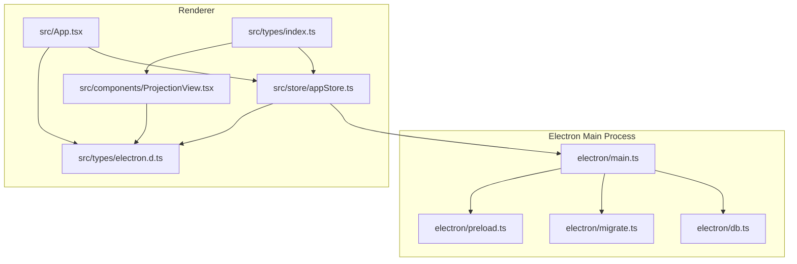

**Diagram sources**
- [electron/main.ts:1-390](file://electron/main.ts#L1-L390)
- [electron/db.ts:1-214](file://electron/db.ts#L1-L214)
- [electron/migrate.ts:1-127](file://electron/migrate.ts#L1-L127)
- [electron/preload.ts:1-43](file://electron/preload.ts#L1-L43)
- [src/store/appStore.ts:1-385](file://src/store/appStore.ts#L1-L385)
- [src/App.tsx:1-102](file://src/App.tsx#L1-L102)
- [src/components/ProjectionView.tsx:1-134](file://src/components/ProjectionView.tsx#L1-L134)
- [src/types/index.ts:1-89](file://src/types/index.ts#L1-L89)
- [src/types/electron.d.ts:1-33](file://src/types/electron.d.ts#L1-L33)

**Section sources**
- [electron/main.ts:1-390](file://electron/main.ts#L1-L390)
- [electron/db.ts:1-214](file://electron/db.ts#L1-L214)
- [electron/migrate.ts:1-127](file://electron/migrate.ts#L1-L127)
- [electron/preload.ts:1-43](file://electron/preload.ts#L1-L43)
- [src/store/appStore.ts:1-385](file://src/store/appStore.ts#L1-L385)
- [src/App.tsx:1-102](file://src/App.tsx#L1-L102)
- [src/components/ProjectionView.tsx:1-134](file://src/components/ProjectionView.tsx#L1-L134)
- [src/types/index.ts:1-89](file://src/types/index.ts#L1-L89)
- [src/types/electron.d.ts:1-33](file://src/types/electron.d.ts#L1-L33)

## Core Components
- Main process bootstrap and lifecycle: initializes database, registers custom protocol, creates windows, handles app activation and quit.
- Dual-window architecture: main window for editing and settings; projection window for live display on external monitors.
- Data persistence: songs.json, settings.json, preparation-list.json stored under user data directory; images persisted in SQLite.
- Display detection and multi-monitor support: enumerates displays, selects target display, opens projection window on chosen monitor.
- Custom protocol: lyricdeck-img scheme serves images from SQLite BLOB storage.
- Renderer integration: preload exposes typed IPC APIs; Zustand store coordinates persistence and projection state.

**Section sources**
- [electron/main.ts:356-390](file://electron/main.ts#L356-L390)
- [electron/main.ts:81-152](file://electron/main.ts#L81-L152)
- [electron/main.ts:154-190](file://electron/main.ts#L154-L190)
- [electron/main.ts:192-218](file://electron/main.ts#L192-L218)
- [electron/main.ts:111-152](file://electron/main.ts#L111-L152)
- [electron/main.ts:361-374](file://electron/main.ts#L361-L374)
- [electron/preload.ts:3-42](file://electron/preload.ts#L3-L42)
- [src/store/appStore.ts:361-384](file://src/store/appStore.ts#L361-L384)

## Architecture Overview
The main process orchestrates initialization, window creation, and inter-process communication. The renderer uses a preload bridge to invoke main process handlers for persistence, display management, and image operations. The projection window receives real-time updates from the main window.

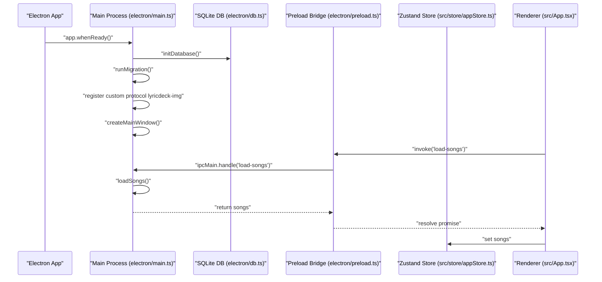

**Diagram sources**
- [electron/main.ts:356-390](file://electron/main.ts#L356-L390)
- [electron/db.ts:26-48](file://electron/db.ts#L26-L48)
- [electron/migrate.ts:8-126](file://electron/migrate.ts#L8-L126)
- [electron/preload.ts:23-29](file://electron/preload.ts#L23-L29)
- [src/store/appStore.ts:361-377](file://src/store/appStore.ts#L361-L377)

## Detailed Component Analysis

### Application Lifecycle Management
- Initialization:
  - Registers privileged custom scheme lyricdeck-img.
  - Initializes SQLite database and runs migration.
  - Registers protocol handler to serve images from SQLite.
  - Creates main window and sets up dev/prod loading.
- Activation and Quit:
  - On macOS activate, reopens main window if none remain.
  - On non-darwin platforms, quits when last window closes.

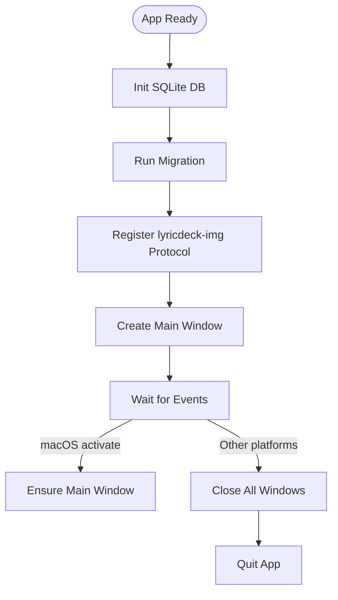

**Diagram sources**
- [electron/main.ts:356-390](file://electron/main.ts#L356-L390)
- [electron/db.ts:26-48](file://electron/db.ts#L26-L48)
- [electron/migrate.ts:8-126](file://electron/migrate.ts#L8-L126)

**Section sources**
- [electron/main.ts:12-16](file://electron/main.ts#L12-L16)
- [electron/main.ts:356-390](file://electron/main.ts#L356-L390)
- [electron/db.ts:26-48](file://electron/db.ts#L26-L48)
- [electron/migrate.ts:8-126](file://electron/migrate.ts#L8-L126)

### Dual-Window Architecture
- Main window:
  - Standard browser window with preload bridge.
  - Loads dev server or built HTML depending on environment.
  - Closes projection window when destroyed.
- Projection window:
  - Fullscreen, frameless, always-on-top, skip-taskbar.
  - Loads renderer route for projection view.
  - Receives projection state updates via IPC.
  - Sends closed event back to main window.

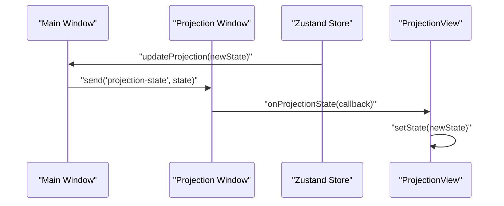

**Diagram sources**
- [electron/main.ts:186-190](file://electron/main.ts#L186-L190)
- [electron/main.ts:140-151](file://electron/main.ts#L140-L151)
- [src/store/appStore.ts:242-249](file://src/store/appStore.ts#L242-L249)
- [src/components/ProjectionView.tsx:22-29](file://src/components/ProjectionView.tsx#L22-L29)

**Section sources**
- [electron/main.ts:81-109](file://electron/main.ts#L81-L109)
- [electron/main.ts:111-152](file://electron/main.ts#L111-L152)
- [src/store/appStore.ts:242-249](file://src/store/appStore.ts#L242-L249)
- [src/components/ProjectionView.tsx:22-29](file://src/components/ProjectionView.tsx#L22-L29)

### File System Operations and Data Persistence
- Data locations:
  - Songs: songs.json under user data/data.
  - Settings: settings.json under user data/data.
  - Preparation list: preparation-list.json under user data/data.
  - Images: stored in SQLite database under user data/data/lyricdeck.db.
- Persistence handlers:
  - Load/save songs, settings, and preparation list via IPC.
  - Select/add/list/delete background images; import/export data with version-aware merging.
- Migration:
  - Converts legacy file-based images to SQLite and updates references in songs.json and settings.json.

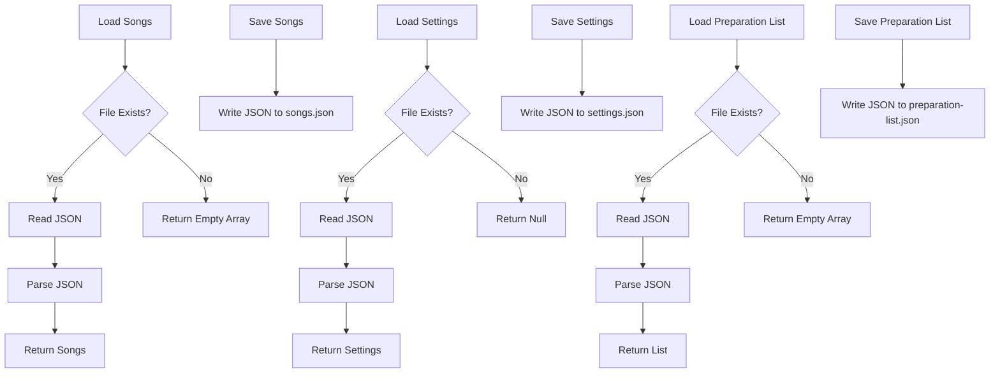

**Diagram sources**
- [electron/main.ts:39-79](file://electron/main.ts#L39-L79)
- [electron/migrate.ts:63-122](file://electron/migrate.ts#L63-L122)

**Section sources**
- [electron/main.ts:18-37](file://electron/main.ts#L18-L37)
- [electron/main.ts:39-79](file://electron/main.ts#L39-L79)
- [electron/migrate.ts:63-122](file://electron/migrate.ts#L63-L122)

### Display Detection and Multi-Monitor Support
- Enumerates displays and identifies primary display.
- Opens projection window on a specified display ID or falls back to secondary or primary.
- Exposes display enumeration and projection controls via IPC.

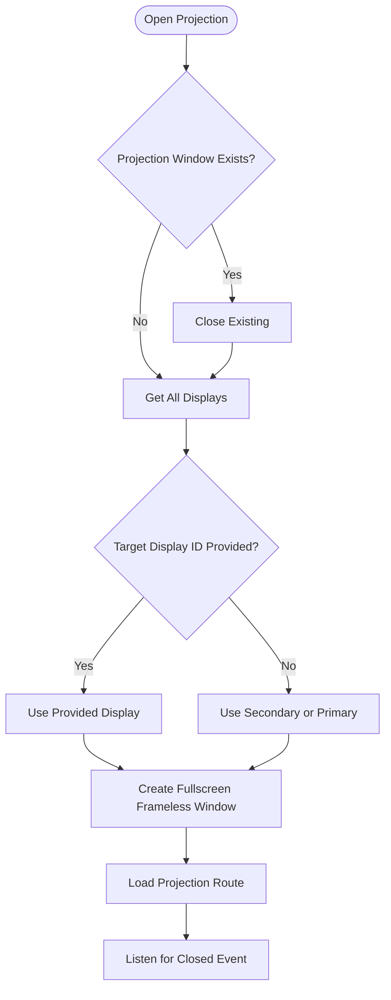

**Diagram sources**
- [electron/main.ts:154-184](file://electron/main.ts#L154-L184)
- [electron/main.ts:111-152](file://electron/main.ts#L111-L152)

**Section sources**
- [electron/main.ts:154-184](file://electron/main.ts#L154-L184)
- [electron/main.ts:111-152](file://electron/main.ts#L111-L152)

### Custom Protocol Registration and Image Serving
- Registers lyricdeck-img scheme as privileged.
- Protocol handler extracts image ID from URL, retrieves BLOB from SQLite, and serves with appropriate MIME type and caching headers.
- Renderer uses URLs like lyricdeck-img://<id> to embed images.

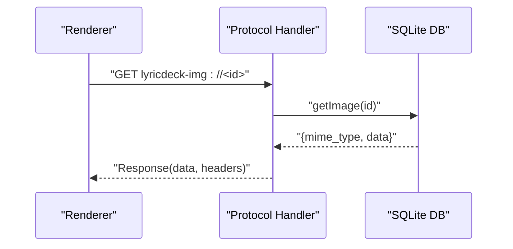

**Diagram sources**
- [electron/main.ts:12-16](file://electron/main.ts#L12-L16)
- [electron/main.ts:361-374](file://electron/main.ts#L361-L374)
- [electron/db.ts:89-104](file://electron/db.ts#L89-L104)

**Section sources**
- [electron/main.ts:12-16](file://electron/main.ts#L12-L16)
- [electron/main.ts:361-374](file://electron/main.ts#L361-L374)
- [electron/db.ts:89-104](file://electron/db.ts#L89-L104)

### Renderer Integration and IPC Bridge
- Preload exposes typed APIs for:
  - Display management: get displays, open/close projection, check open state.
  - Projection updates: send state, listen for state and closed events.
  - Persistence: load/save songs/settings/preparation list.
  - Image repository: select/add/list/delete background images.
  - Import/export: export/import data with version-aware merge.
- Store integrates with preload to persist and synchronize state.

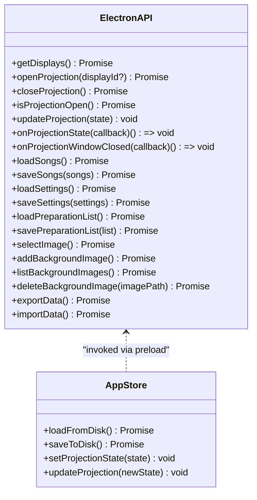

**Diagram sources**
- [electron/preload.ts:3-42](file://electron/preload.ts#L3-L42)
- [src/store/appStore.ts:361-384](file://src/store/appStore.ts#L361-L384)
- [src/types/electron.d.ts:3-32](file://src/types/electron.d.ts#L3-L32)

**Section sources**
- [electron/preload.ts:3-42](file://electron/preload.ts#L3-L42)
- [src/store/appStore.ts:361-384](file://src/store/appStore.ts#L361-L384)
- [src/types/electron.d.ts:3-32](file://src/types/electron.d.ts#L3-L32)

### Projection Rendering and State Model
- ProjectionView renders based on ProjectionState:
  - Modes: black, logo, live, blank.
  - Background types: color, gradient, image, video.
  - Text styles: font family, size, weight, alignment, shadows, outlines.
  - Line offset animation for smooth transitions.
- Store manages projection state and sends updates to projection window.

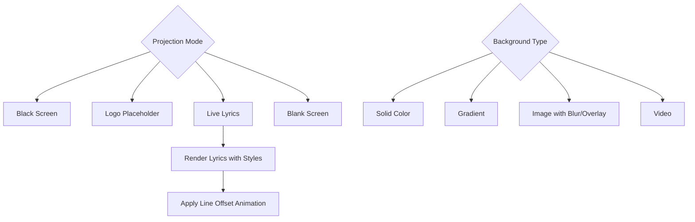

**Diagram sources**
- [src/components/ProjectionView.tsx:31-132](file://src/components/ProjectionView.tsx#L31-L132)
- [src/types/index.ts:69-81](file://src/types/index.ts#L69-L81)

**Section sources**
- [src/components/ProjectionView.tsx:31-132](file://src/components/ProjectionView.tsx#L31-L132)
- [src/types/index.ts:69-81](file://src/types/index.ts#L69-L81)

## Dependency Analysis
- Main process depends on:
  - Electron runtime for app lifecycle, windows, screen, protocol, ipc.
  - sql.js for embedded SQLite database.
  - uuid for generating image identifiers.
- Renderer depends on:
  - Zustand for state management.
  - React components for UI and projection rendering.
  - Types for strong typing across IPC and state.

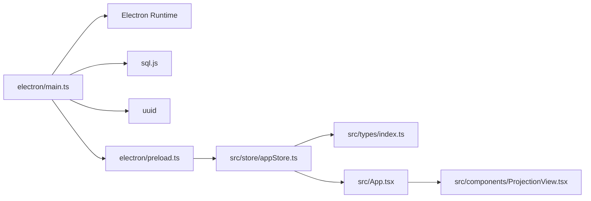

**Diagram sources**
- [electron/main.ts:1-6](file://electron/main.ts#L1-L6)
- [electron/db.ts:1-6](file://electron/db.ts#L1-L6)
- [src/store/appStore.ts:1-4](file://src/store/appStore.ts#L1-L4)
- [src/types/index.ts:1-1](file://src/types/index.ts#L1-L1)

**Section sources**
- [electron/main.ts:1-6](file://electron/main.ts#L1-L6)
- [electron/db.ts:1-6](file://electron/db.ts#L1-L6)
- [src/store/appStore.ts:1-4](file://src/store/appStore.ts#L1-L4)
- [src/types/index.ts:1-1](file://src/types/index.ts#L1-L1)

## Performance Considerations
- Database persistence:
  - Persist SQLite after each write operation to minimize loss risk; consider batching writes for bulk operations.
- Image handling:
  - Serve images via custom protocol to avoid base64 overhead; cache headers reduce repeated fetches.
- Window management:
  - Avoid frequent creation/destruction of projection windows; reuse when possible.
- Renderer updates:
  - Debounce or throttle projection state updates to reduce IPC traffic.
- Multi-monitor:
  - Cache display information; avoid repeated enumeration during projection sessions.

[No sources needed since this section provides general guidance]

## Troubleshooting Guide
- Projection window does not open:
  - Verify display ID selection logic and that a target display is found.
  - Confirm protocol handler is registered before app ready.
- Images not displaying:
  - Ensure lyricdeck-img URLs are generated and protocol handler returns 200 with correct MIME type.
  - Check image deletion and existence queries in SQLite.
- Data import/export failures:
  - Validate JSON structure and version field; handle parse errors gracefully.
  - For legacy formats, confirm migration updated references.
- Lifecycle issues:
  - On macOS, ensure activate handler creates main window if none exists.
  - On non-darwin platforms, verify window-all-closed triggers app.quit.

**Section sources**
- [electron/main.ts:111-152](file://electron/main.ts#L111-L152)
- [electron/main.ts:361-374](file://electron/main.ts#L361-L374)
- [electron/db.ts:89-104](file://electron/db.ts#L89-L104)
- [electron/migrate.ts:300-354](file://electron/migrate.ts#L300-L354)
- [electron/main.ts:378-389](file://electron/main.ts#L378-L389)

## Conclusion
LyricDeck’s main process provides a robust foundation for dual-window presentation, reliable data persistence, and efficient image serving through a custom protocol. The architecture cleanly separates concerns between main process orchestration, renderer state management, and projection rendering, enabling scalable enhancements for future features.

[No sources needed since this section summarizes without analyzing specific files]

## Appendices

### Platform-Specific Considerations
- Windows:
  - Packaging targets NSIS and portable builds; ensure installer options meet deployment requirements.
  - Fuses configuration disables Node integration and enables integrity validation.
- macOS:
  - App lifecycle relies on activate to reopen main window; ensure proper window state restoration.

**Section sources**
- [package.json:26-56](file://package.json#L26-L56)
- [forge.config.js:4-44](file://forge.config.js#L4-L44)

### Data Model Overview
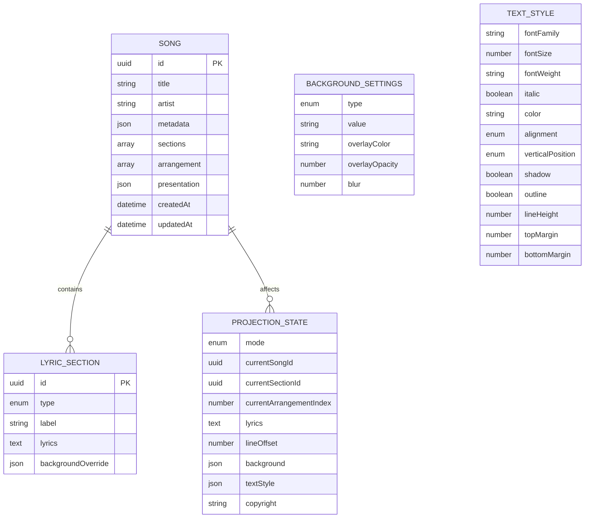

**Diagram sources**
- [src/types/index.ts:50-81](file://src/types/index.ts#L50-L81)