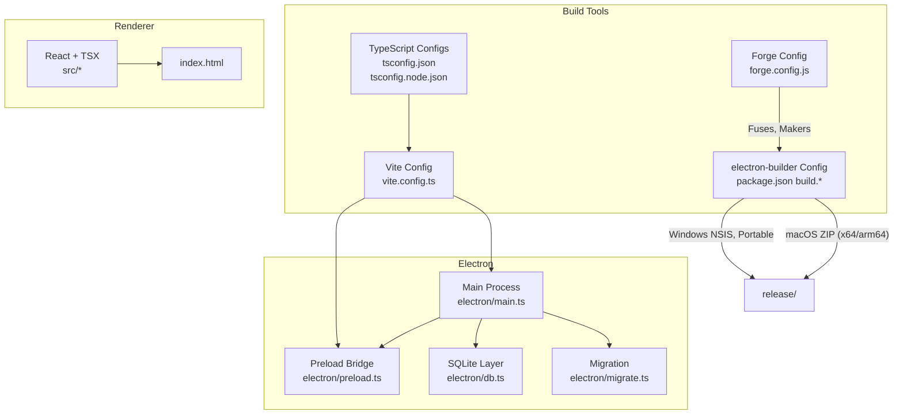
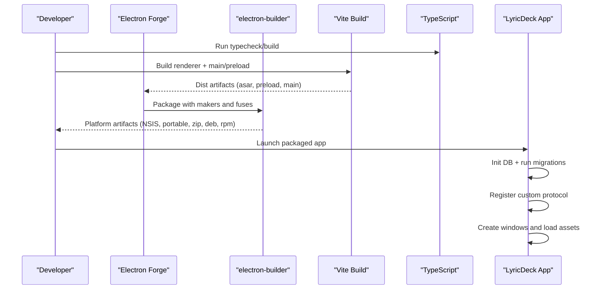
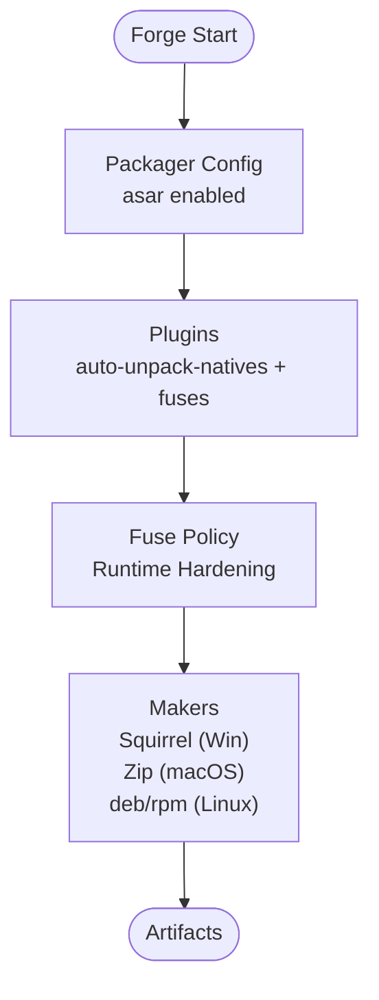
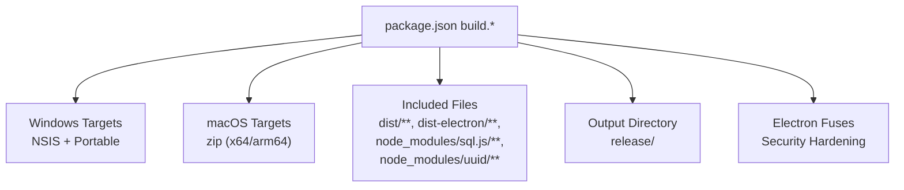
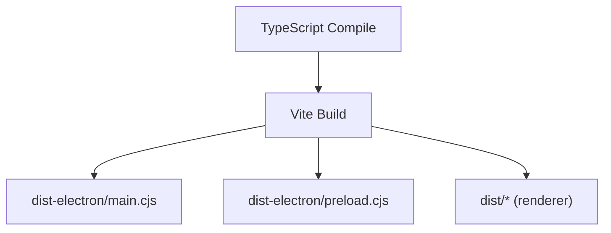
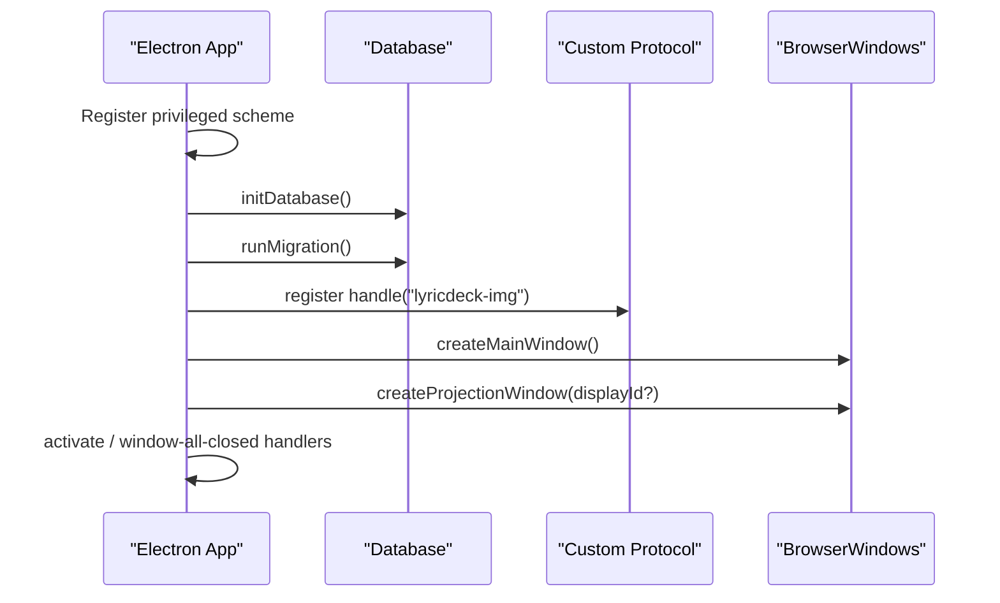
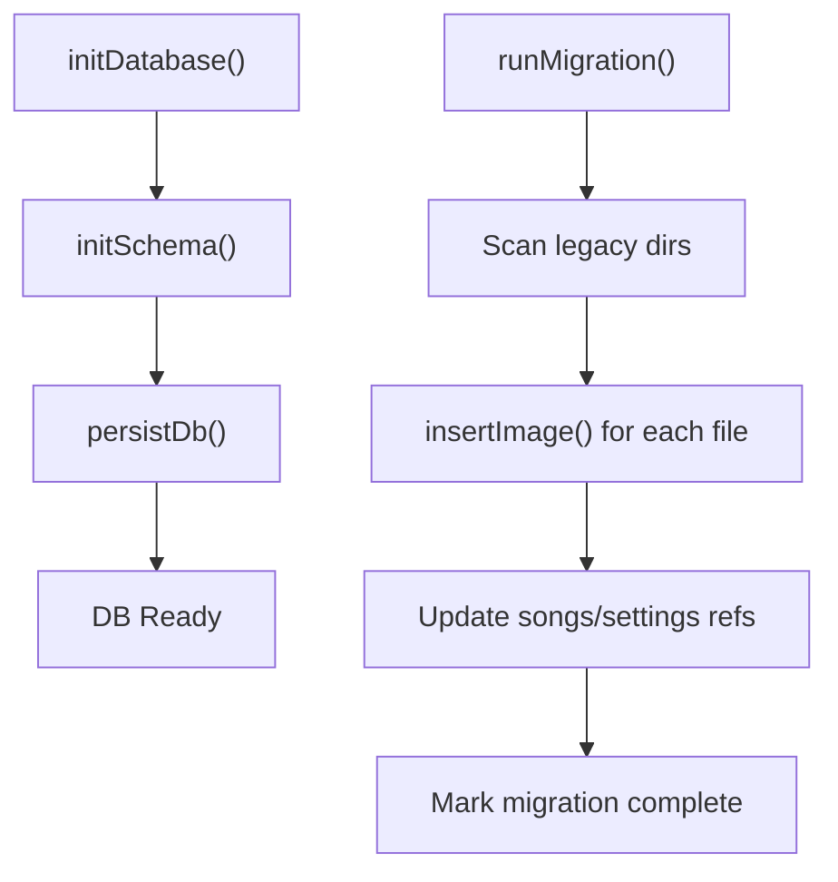
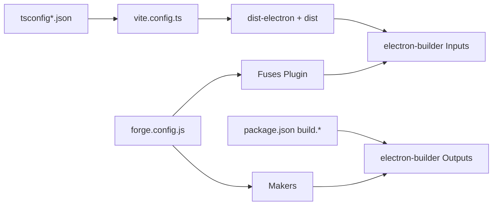

# Packaging and Distribution

<cite>
**Referenced Files in This Document**
- [forge.config.js](file://forge.config.js)
- [package.json](file://package.json)
- [vite.config.ts](file://vite.config.ts)
- [electron/main.ts](file://electron/main.ts)
- [electron/preload.ts](file://electron/preload.ts)
- [electron/db.ts](file://electron/db.ts)
- [electron/migrate.ts](file://electron/migrate.ts)
- [tsconfig.json](file://tsconfig.json)
- [tsconfig.node.json](file://tsconfig.node.json)
- [README.md](file://README.md)
</cite>

## Update Summary
**Changes Made**
- Enhanced Security Configuration section updated to reflect new Electron Fuses implementation
- Added detailed documentation for ASAR packaging integrity validation
- Updated Node.js integration restrictions and cookie encryption details
- Expanded debugging restrictions and application source protection measures
- Enhanced security considerations with specific fuse configurations

## Table of Contents
1. [Introduction](#introduction)
2. [Project Structure](#project-structure)
3. [Core Components](#core-components)
4. [Architecture Overview](#architecture-overview)
5. [Detailed Component Analysis](#detailed-component-analysis)
6. [Dependency Analysis](#dependency-analysis)
7. [Performance Considerations](#performance-considerations)
8. [Troubleshooting Guide](#troubleshooting-guide)
9. [Security Considerations](#security-considerations)
10. [Deployment and CI Recommendations](#deployment-and-ci-recommendations)
11. [Conclusion](#conclusion)

## Introduction
This document explains LyricDeck's Electron Forge packaging and distribution setup. It covers the Forge configuration, platform-specific build targets, maker plugins, fuses, and integration with Vite and TypeScript. It also documents distribution strategies for Windows and macOS, including code signing, notarization, and auto-update mechanisms. Development versus production differences, environment detection, custom protocol registration timing, and application startup sequence are detailed. Finally, it provides troubleshooting guidance, security considerations, and deployment best practices with CI recommendations.

## Project Structure
The project uses Electron Forge for packaging and electron-builder for platform-specific installers. Vite compiles the renderer and main/preload bundles, while TypeScript handles type checking and module resolution. The main process initializes the app lifecycle, registers a custom protocol for embedded image delivery, and manages windows and IPC. The preload script exposes a typed API surface to the renderer via contextBridge.

**Diagram sources**
- [vite.config.ts:1-51](file://vite.config.ts#L1-L51)
- [forge.config.js:1-45](file://forge.config.js#L1-L45)
- [package.json:28-70](file://package.json#L28-L70)
- [electron/main.ts:1-484](file://electron/main.ts#L1-L484)
- [electron/preload.ts:1-48](file://electron/preload.ts#L1-L48)
- [electron/db.ts:1-214](file://electron/db.ts#L1-L214)
- [electron/migrate.ts:1-127](file://electron/migrate.ts#L1-L127)

**Section sources**
- [README.md:116-146](file://README.md#L116-L146)
- [vite.config.ts:1-51](file://vite.config.ts#L1-L51)
- [forge.config.js:1-45](file://forge.config.js#L1-L45)
- [package.json:28-70](file://package.json#L28-L70)

## Core Components
- Electron Forge configuration defines asar packaging, native plugin auto-unpacking, and fuses for hardened runtime behavior. It also declares makers for Squirrel (Windows), zip (macOS), and deb/rpm packages.
- electron-builder configuration in package.json specifies app identifiers, product name, output directory, included files, Windows targets (NSIS installer and portable), macOS targets (zip for x64/arm64), and NSIS installer options. **Enhanced with comprehensive Electron Fuses for security hardening.**
- Vite configuration builds the Electron main and preload scripts into dist-electron with CJS format and externalizes Electron and sql.js. It also sets up aliases and dev reload hooks.
- TypeScript configurations enforce strictness, bundler module resolution, and JSX usage for React.

Key build scripts:
- Development: Vite dev server with Electron hot reload.
- Production builds: TypeScript compile, Vite build, then electron-builder for platform targets.

**Section sources**
- [forge.config.js:4-44](file://forge.config.js#L4-L44)
- [package.json:6-18](file://package.json#L6-L18)
- [package.json:28-70](file://package.json#L28-L70)
- [vite.config.ts:7-44](file://vite.config.ts#L7-L44)
- [tsconfig.json:1-26](file://tsconfig.json#L1-L26)
- [tsconfig.node.json:1-11](file://tsconfig.node.json#L1-L11)

## Architecture Overview
The packaging pipeline integrates Forge and electron-builder. Forge prepares the app with asar, native unpacking, and fuses. electron-builder generates platform-specific artifacts and installers. The main process initializes the database, runs migrations, registers a custom protocol for serving images from an embedded SQLite database, and manages windows and IPC. The preload bridge exposes a typed API to the renderer.

**Diagram sources**
- [forge.config.js:27-43](file://forge.config.js#L27-L43)
- [package.json:28-70](file://package.json#L28-L70)
- [vite.config.ts:10-24](file://vite.config.ts#L10-L24)
- [electron/main.ts:450-477](file://electron/main.ts#L450-L477)

## Detailed Component Analysis

### Forge Configuration and Fuses
- Packaging: asar enabled for integrity and performance.
- Plugins: auto-unpack-natives for native modules; fuses configured at package time to harden runtime behavior.
- Fuses include disabling Node.js as a Node binary, enabling cookie encryption, disabling Node options env var, CLI inspect arguments, embedded Asar integrity validation, and enforcing only loading the app from Asar.

Maker targets:
- Windows: Squirrel installer and zip (used by some CI setups).
- macOS: zip for x64/arm64.
- Linux: deb and rpm.

**Diagram sources**
- [forge.config.js:5-26](file://forge.config.js#L5-L26)
- [forge.config.js:27-43](file://forge.config.js#L27-L43)

**Section sources**
- [forge.config.js:4-44](file://forge.config.js#L4-L44)

### electron-builder Configuration (package.json)
- App identity and product name.
- Output directory set to release/.
- Included files include dist, dist-electron, and selected node_modules for sqlite and uuid.
- Windows targets: NSIS installer and portable executable (x64).
- macOS targets: zip for x64 and arm64.
- NSIS options: interactive install, optional directory change, desktop/start menu shortcuts.
- **Enhanced with comprehensive Electron Fuses configuration for security hardening.**

**Diagram sources**
- [package.json:28-70](file://package.json#L28-L70)

**Section sources**
- [package.json:28-70](file://package.json#L28-L70)

### Vite Integration and TypeScript Compilation
- Vite builds Electron main and preload into dist-electron with CJS format and externalizes Electron and sql.js.
- Renderer build uses React plugin and aliases for @/ paths.
- TypeScript configs enforce strictness and bundler module resolution.

**Diagram sources**
- [vite.config.ts:10-24](file://vite.config.ts#L10-L24)
- [vite.config.ts:25-41](file://vite.config.ts#L25-L41)
- [tsconfig.json:1-26](file://tsconfig.json#L1-L26)
- [tsconfig.node.json:1-11](file://tsconfig.node.json#L1-L11)

**Section sources**
- [vite.config.ts:1-51](file://vite.config.ts#L1-L51)
- [tsconfig.json:1-26](file://tsconfig.json#L1-L26)
- [tsconfig.node.json:1-11](file://tsconfig.node.json#L1-L11)

### Application Startup and Custom Protocol Registration
- Environment detection: isDev flag derived from app.isPackaged.
- Custom protocol registration occurs before app is ready and is re-registered during app.whenReady with a fetch-capable handler.
- Main window loads localhost in dev and dist HTML in production.
- Projection window supports multi-monitor selection and fullscreen output.
- IPC handlers manage displays, projection windows, data persistence, background images, and import/export.

**Diagram sources**
- [electron/main.ts:10-16](file://electron/main.ts#L10-L16)
- [electron/main.ts:450-477](file://electron/main.ts#L450-L477)

**Section sources**
- [electron/main.ts:10-16](file://electron/main.ts#L10-L16)
- [electron/main.ts:450-477](file://electron/main.ts#L450-L477)

### Data Persistence and Migration
- Database initialization and schema creation using sql.js.
- Image storage as BLOBs with metadata; retrieval via custom protocol URLs.
- Migration logic converts legacy file-based image references to embedded URLs and updates song/settings references.

**Diagram sources**
- [electron/db.ts:26-48](file://electron/db.ts#L26-L48)
- [electron/db.ts:50-68](file://electron/db.ts#L50-L68)
- [electron/migrate.ts:8-126](file://electron/migrate.ts#L8-L126)

**Section sources**
- [electron/db.ts:1-214](file://electron/db.ts#L1-L214)
- [electron/migrate.ts:1-127](file://electron/migrate.ts#L1-L127)

## Dependency Analysis
- Forge and electron-builder are coordinated: Forge applies fuses and prepares asar; electron-builder emits platform artifacts.
- Vite builds Electron main/preload with externalized Electron and sql.js to avoid bundling duplicates.
- TypeScript configurations ensure consistent module resolution and strictness across main, preload, and renderer code.

**Diagram sources**
- [forge.config.js:27-43](file://forge.config.js#L27-L43)
- [package.json:28-70](file://package.json#L28-L70)
- [vite.config.ts:10-24](file://vite.config.ts#L10-L24)
- [tsconfig.json:1-26](file://tsconfig.json#L1-L26)

**Section sources**
- [forge.config.js:1-45](file://forge.config.js#L1-L45)
- [package.json:28-70](file://package.json#L28-L70)
- [vite.config.ts:1-51](file://vite.config.ts#L1-L51)
- [tsconfig.json:1-26](file://tsconfig.json#L1-L26)

## Performance Considerations
- asar packaging improves integrity and reduces filesystem overhead.
- Externalizing Electron and sql.js in Vite prevents duplicate bundling and reduces artifact size.
- Using CJS for main/preload simplifies runtime compatibility.
- sqlite.js BLOB storage avoids filesystem fragmentation for images; ensure migrations are idempotent to prevent repeated work.

[No sources needed since this section provides general guidance]

## Troubleshooting Guide
Common packaging and distribution issues:
- Windows build fails on non-Windows hosts: electron-builder requires macOS for any --mac target; use CI runners accordingly.
- macOS unsigned app prompts: first launch may require right-click Open or removing quarantine attributes; code signing and notarization are recommended for distribution.
- Custom protocol not serving images: ensure the protocol is registered before app is ready and that the handler returns appropriate MIME types and caching headers.
- Native module issues: verify auto-unpack-natives plugin is present and that externalizations match runtime needs.
- Installer options: NSIS allows changing installation directory and creates desktop/start menu shortcuts; confirm these align with your distribution policy.
- **Security-related issues**: If the app fails to start due to security restrictions, verify that all required native modules are properly unpacked and that the fuse configurations align with your application's needs.

**Section sources**
- [README.md:94-98](file://README.md#L94-L98)
- [forge.config.js:27-43](file://forge.config.js#L27-L43)
- [electron/main.ts:12-16](file://electron/main.ts#L12-L16)
- [electron/main.ts:456-468](file://electron/main.ts#L456-L468)

## Security Considerations
**Updated** Enhanced security configuration implemented through comprehensive Electron Fuses and ASAR packaging measures.

### Electron Fuses Security Hardening
The application implements robust security measures through Electron Fuses configuration:

- **Node.js Integration Restrictions**: `runAsNode: false` - Prevents the application from running as a Node.js process, reducing attack surface.
- **Cookie Encryption**: `enableCookieEncryption: true` - Automatically encrypts cookies stored by the application for enhanced security.
- **Environment Variable Restrictions**: `enableNodeOptionsEnvironmentVariable: false` - Disables the NODE_OPTIONS environment variable to prevent runtime configuration tampering.
- **Debugging Restrictions**: `enableNodeCliInspectArguments: false` - Blocks Node.js CLI inspect arguments to prevent remote debugging attacks.
- **ASAR Integrity Validation**: `enableEmbeddedAsarIntegrityValidation: true` - Validates the integrity of embedded ASAR archives to prevent tampering.
- **Application Source Protection**: `onlyLoadAppFromAsar: true` - Ensures the application can only be loaded from the ASAR archive, preventing direct file system access to source code.

### ASAR Packaging Benefits
- **Code Obfuscation**: Application source code is packed into a single archive, making reverse engineering more difficult.
- **File System Optimization**: Reduces the number of files accessed, improving startup performance.
- **Integrity Protection**: Combined with ASAR integrity validation, ensures application files cannot be modified without detection.

### Browser Window Security
- **Context Isolation**: Enabled in both main and projection windows to isolate renderer processes from Node.js APIs.
- **Node Integration Disabled**: `nodeIntegration: false` prevents direct access to Node.js APIs from the renderer.
- **Preload Script Security**: All privileged operations are exposed through a carefully controlled API surface via contextBridge.

### Custom Protocol Security
- Privileged scheme registration with secure mode enabled.
- Fetch API support for modern web standards while maintaining security boundaries.
- Proper MIME type handling and cache control headers for embedded images.

### Data Storage Security
- Images stored as BLOBs in embedded SQLite database rather than file system.
- UUID-based identifiers prevent path traversal attacks.
- Input validation for filenames and MIME types to prevent injection attacks.

**Section sources**
- [package.json:65-72](file://package.json#L65-L72)
- [forge.config.js:34-42](file://forge.config.js#L34-L42)
- [electron/main.ts:89-93](file://electron/main.ts#L89-L93)
- [electron/main.ts:133-137](file://electron/main.ts#L133-L137)
- [electron/main.ts:13-16](file://electron/main.ts#L13-16)
- [electron/main.ts:456-468](file://electron/main.ts#L456-L468)

## Deployment and CI Recommendations
Recommended CI setup:
- Use separate jobs for Windows and macOS with dedicated runners.
- On macOS, run electron-builder --mac to produce x64 and arm64 zips.
- On Windows, run electron-builder --win to produce NSIS installer and portable executable.
- Publish artifacts to release/ with versioned names.
- For distribution, sign Windows installers and notarize macOS apps before release.

Auto-update mechanisms:
- The current configuration does not include an auto-updater. To add auto-update, integrate electron-updater with GitHub Releases or another hosting provider and configure update channels and signing verification.

**Security-focused CI considerations**:
- Ensure proper code signing certificates are available in CI environments.
- Validate that ASAR integrity checks pass in production builds.
- Test security fuse configurations thoroughly before deployment.
- Consider implementing automated security scanning in the CI pipeline.

[No sources needed since this section provides general guidance]

## Conclusion
LyricDeck's packaging and distribution pipeline leverages Electron Forge for hardened packaging and electron-builder for platform-specific artifacts. The recent security enhancements through comprehensive Electron Fuses provide robust protection against common attack vectors, including Node.js integration vulnerabilities, cookie theft, and ASAR tampering. Vite and TypeScript streamline the build process, while the main process initializes the database, registers a custom protocol for embedded image delivery, and manages windows and IPC with proper security isolation. The configuration emphasizes security via fuses, ASAR packaging, and careful handling of native modules and protocols. For production distribution, adopt code signing and notarization, implement auto-update mechanisms tailored to your release strategy, and maintain rigorous security testing throughout the development lifecycle.