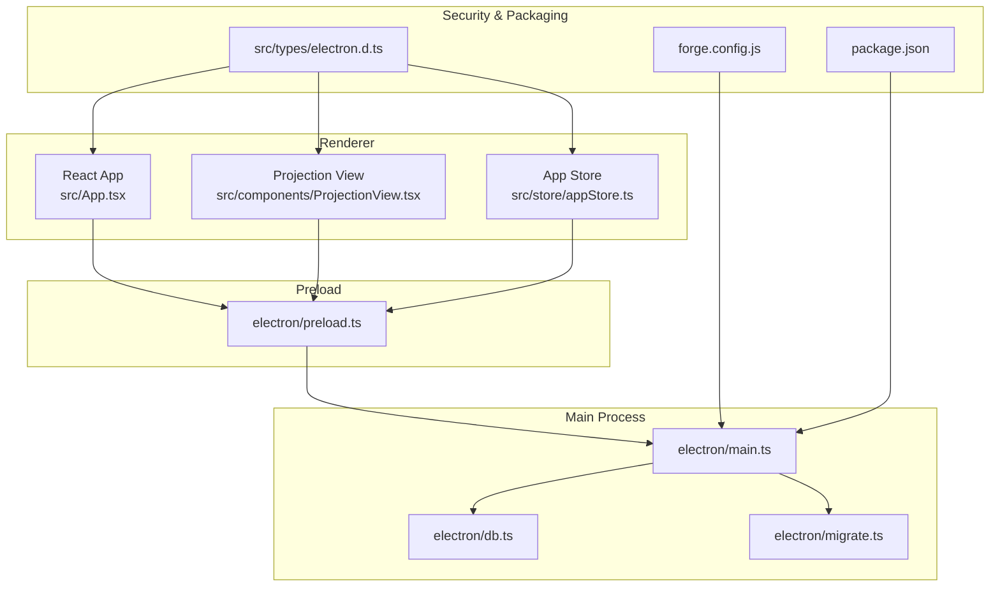
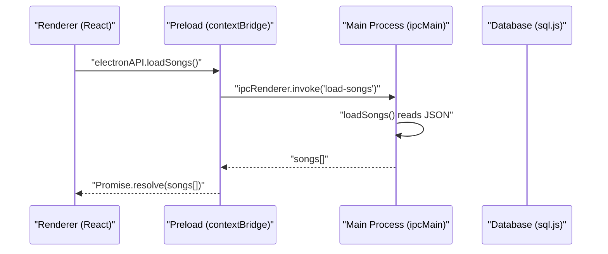
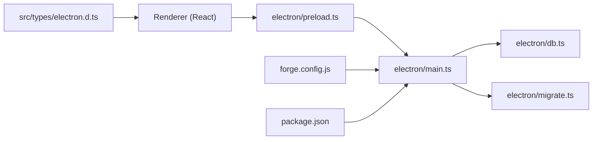

# Preload Script Security

<cite>
**Referenced Files in This Document**
- [electron/preload.ts](file://electron/preload.ts)
- [electron/main.ts](file://electron/main.ts)
- [src/types/electron.d.ts](file://src/types/electron.d.ts)
- [electron/db.ts](file://electron/db.ts)
- [electron/migrate.ts](file://electron/migrate.ts)
- [forge.config.js](file://forge.config.js)
- [package.json](file://package.json)
- [src/App.tsx](file://src/App.tsx)
- [src/components/ProjectionView.tsx](file://src/components/ProjectionView.tsx)
- [src/store/appStore.ts](file://src/store/appStore.ts)
</cite>

## Table of Contents
1. [Introduction](#introduction)
2. [Project Structure](#project-structure)
3. [Core Components](#core-components)
4. [Architecture Overview](#architecture-overview)
5. [Detailed Component Analysis](#detailed-component-analysis)
6. [Dependency Analysis](#dependency-analysis)
7. [Performance Considerations](#performance-considerations)
8. [Troubleshooting Guide](#troubleshooting-guide)
9. [Conclusion](#conclusion)
10. [Appendices](#appendices)

## Introduction
This document explains LyricDeck’s preload script security model and the secure IPC surface exposed to renderer processes. It focuses on how the preload script uses the Electron contextBridge API to expose a minimal, typed, and safe set of methods to the renderer, and how the main process validates and sanitizes all IPC traffic. It also documents the security posture around context isolation, Node.js integration, sandboxing, and the implications of exposing file system and database operations through IPC.

## Project Structure
The preload security model spans a small set of focused files:
- Preload exposes a typed API surface to the renderer.
- Main process registers IPC handlers and implements all privileged operations.
- Type definitions formalize the API contract for TypeScript.
- Database and migration logic underpin persistent data and image storage.
- Forge fuses harden the packaged app.

**Diagram sources**
- [electron/preload.ts:1-43](file://electron/preload.ts#L1-L43)
- [electron/main.ts:1-390](file://electron/main.ts#L1-L390)
- [src/types/electron.d.ts:1-33](file://src/types/electron.d.ts#L1-L33)
- [electron/db.ts:1-214](file://electron/db.ts#L1-L214)
- [electron/migrate.ts:1-127](file://electron/migrate.ts#L1-L127)
- [forge.config.js:1-45](file://forge.config.js#L1-L45)
- [package.json:1-110](file://package.json#L1-L110)
- [src/App.tsx:1-102](file://src/App.tsx#L1-L102)
- [src/components/ProjectionView.tsx:1-46](file://src/components/ProjectionView.tsx#L1-L46)
- [src/store/appStore.ts:239-276](file://src/store/appStore.ts#L239-L276)

**Section sources**
- [electron/preload.ts:1-43](file://electron/preload.ts#L1-L43)
- [electron/main.ts:81-152](file://electron/main.ts#L81-L152)
- [src/types/electron.d.ts:1-33](file://src/types/electron.d.ts#L1-L33)
- [forge.config.js:27-43](file://forge.config.js#L27-L43)

## Core Components
- Preload API surface: Exposed via contextBridge to the renderer with a strict contract.
- Main-process IPC handlers: Implement all privileged operations and enforce validation.
- Typed API definitions: Provide compile-time safety for renderer-side usage.
- Database and image protocol: Persist and serve images securely via a custom protocol.
- Forge fuses: Harden the packaged application against tampering and misuse.

Key security outcomes:
- Renderer cannot access Node.js APIs directly.
- IPC is strictly controlled and typed.
- File system and database operations are executed in the main process with explicit validation.
- Images are served via a custom protocol with controlled URLs.

**Section sources**
- [electron/preload.ts:3-42](file://electron/preload.ts#L3-L42)
- [electron/main.ts:154-354](file://electron/main.ts#L154-L354)
- [src/types/electron.d.ts:3-32](file://src/types/electron.d.ts#L3-L32)
- [electron/db.ts:26-48](file://electron/db.ts#L26-L48)
- [forge.config.js:34-42](file://forge.config.js#L34-L42)

## Architecture Overview
The preload script creates a safe boundary between renderer and main process. The renderer invokes typed methods on window.electronAPI, which route through contextBridge to ipcRenderer. The main process handles these requests and performs all privileged operations.

**Diagram sources**
- [electron/preload.ts:24-24](file://electron/preload.ts#L24-L24)
- [electron/main.ts:193-195](file://electron/main.ts#L193-L195)

Additional flows include:
- Projection state updates via send/on.
- Image selection and deletion via IPC with custom protocol-backed URLs.
- Export/import of data with validation and sanitization.

**Section sources**
- [electron/preload.ts:11-21](file://electron/preload.ts#L11-L21)
- [electron/main.ts:186-190](file://electron/main.ts#L186-L190)
- [electron/main.ts:221-235](file://electron/main.ts#L221-L235)
- [electron/main.ts:267-290](file://electron/main.ts#L267-L290)
- [electron/main.ts:292-354](file://electron/main.ts#L292-L354)

## Detailed Component Analysis

### Preload API Surface Design
The preload script exposes a single object window.electronAPI containing:
- Display management: getDisplays, openProjection, closeProjection, isProjectionOpen
- Projection updates: updateProjection, onProjectionState, onProjectionWindowClosed
- Data persistence: loadSongs, saveSongs, loadSettings, saveSettings, loadPreparationList, savePreparationList
- File dialogs: selectImage
- Background image repository: addBackgroundImage, listBackgroundImages, deleteBackgroundImage
- Import/export: exportData, importData

Method signatures and behavior:
- Asynchronous methods return Promises; synchronous renderer-to-main calls use ipcRenderer.invoke.
- Event subscriptions return cleanup functions to remove listeners.
- Parameters are passed through IPC; the main process validates and sanitizes.

Type safety:
- The global type definition declares the shape of window.electronAPI for TypeScript consumers.

Security implications:
- Only the declared methods are reachable from the renderer.
- No Node.js APIs are exposed; context isolation is enabled in BrowserWindow webPreferences.
- All sensitive operations occur in the main process.

**Section sources**
- [electron/preload.ts:3-42](file://electron/preload.ts#L3-L42)
- [src/types/electron.d.ts:3-32](file://src/types/electron.d.ts#L3-L32)

### Main Process IPC Handlers and Validation
The main process registers handlers for each preload method:
- Display management: returns sanitized display metadata.
- Projection lifecycle: manages a separate BrowserWindow with its own preload.
- Data persistence: reads/writes JSON files in the app’s userData directory.
- Image handling: uses a custom protocol lyricdeck-img to serve images stored in sqlite.
- Import/export: validates format/version and merges data safely.

Validation and sanitization:
- File paths and JSON parsing are guarded; errors are handled gracefully.
- Image selection filters supported formats; MIME types are derived from extensions.
- Import merges songs by ID to avoid duplicates; settings and lists are overwritten conditionally.
- Export writes a structured JSON payload including images as base64.

Custom protocol:
- The scheme lyricdeck-img is registered as privileged and serves BLOBs from the database.
- URLs are validated before deletion; missing IDs return false.

**Section sources**
- [electron/main.ts:154-184](file://electron/main.ts#L154-L184)
- [electron/main.ts:192-218](file://electron/main.ts#L192-L218)
- [electron/main.ts:221-235](file://electron/main.ts#L221-L235)
- [electron/main.ts:237-264](file://electron/main.ts#L237-L264)
- [electron/main.ts:267-290](file://electron/main.ts#L267-L290)
- [electron/main.ts:292-354](file://electron/main.ts#L292-L354)
- [electron/main.ts:12-16](file://electron/main.ts#L12-L16)
- [electron/main.ts:362-374](file://electron/main.ts#L362-L374)

### Database and Image Protocol
The database layer:
- Initializes sql.js in the main process and persists to disk.
- Stores images as BLOBs with metadata and UUID identifiers.
- Provides helpers for insertion, retrieval, listing, deletion, and export.

Image protocol:
- lyricdeck-img://{id} URLs resolve to image data served from memory.
- MIME type is enforced; cache headers are set appropriately.

Migration:
- Converts legacy file-based images to the database and updates references in songs and settings.

**Section sources**
- [electron/db.ts:26-48](file://electron/db.ts#L26-L48)
- [electron/db.ts:70-87](file://electron/db.ts#L70-L87)
- [electron/db.ts:89-104](file://electron/db.ts#L89-L104)
- [electron/db.ts:106-118](file://electron/db.ts#L106-L118)
- [electron/db.ts:120-131](file://electron/db.ts#L120-L131)
- [electron/db.ts:133-156](file://electron/db.ts#L133-L156)
- [electron/db.ts:158-176](file://electron/db.ts#L158-L176)
- [electron/migrate.ts:8-126](file://electron/migrate.ts#L8-L126)
- [electron/main.ts:362-374](file://electron/main.ts#L362-L374)

### Type Safety with TypeScript Definitions
The global type declaration ensures:
- Method names and return types are known at compile time.
- Callback signatures for event subscriptions are strongly typed.
- Renderer code receives precise IntelliSense and compile-time checks.

Best practice:
- Keep electron.d.ts in sync with preload.ts exports.
- Avoid widening types (e.g., use specific interfaces instead of any) to improve safety.

**Section sources**
- [src/types/electron.d.ts:3-32](file://src/types/electron.d.ts#L3-L32)

### Security Considerations: Context Isolation, Node Integration, Sandboxing
- Context isolation: Enabled in BrowserWindow webPreferences for both main and projection windows.
- Node integration: Disabled to prevent direct Node.js access from renderer.
- Sandboxing: Not enabled; however, the preload API and IPC handlers provide a strong security boundary.
- Forge fuses: Disable RunAsNode, enable cookie encryption, embedded asar integrity validation, and restrict app loading to ASAR.

These measures reduce attack surface and protect against common Electron pitfalls.

**Section sources**
- [electron/main.ts:90-93](file://electron/main.ts#L90-L93)
- [electron/main.ts:133-137](file://electron/main.ts#L133-L137)
- [forge.config.js:34-42](file://forge.config.js#L34-L42)

### Security Implications of Exposing File System and Database Operations
- File system operations: All file IO is performed in the main process; renderer only requests operations via IPC.
- Database operations: All SQL and BLOB handling occurs in main; renderer receives only URLs or booleans.
- Image protocol: URLs are opaque identifiers; renderer cannot craft arbitrary file paths.
- Validation: Import/export includes format/version checks and safe merging strategies.

Risk mitigations:
- Strict MIME/type enforcement for images.
- Controlled protocol scheme registration.
- Existence checks before deletion.
- Base64 encoding for export images to avoid filesystem leakage.

**Section sources**
- [electron/main.ts:221-235](file://electron/main.ts#L221-L235)
- [electron/main.ts:237-264](file://electron/main.ts#L237-L264)
- [electron/main.ts:267-290](file://electron/main.ts#L267-L290)
- [electron/main.ts:292-354](file://electron/main.ts#L292-L354)
- [electron/db.ts:201-211](file://electron/db.ts#L201-L211)
- [electron/main.ts:12-16](file://electron/main.ts#L12-L16)

### Best Practices for Preventing Prototype Pollution, XSS, and Unauthorized Access
- Prototype pollution:
  - Avoid passing untrusted objects directly to main; validate and sanitize payloads.
  - Use typed IPC payloads and reject unknown fields.
- XSS:
  - Never render raw user data without sanitization; LyricDeck avoids HTML injection by design.
  - Serve images via a controlled protocol; do not expose raw file paths.
- Unauthorized API access:
  - Keep preload API minimal; only expose necessary methods.
  - Validate all IPC arguments; reject unexpected types or shapes.
  - Use typed definitions to prevent accidental misuse.

**Section sources**
- [src/types/electron.d.ts:3-32](file://src/types/electron.d.ts#L3-L32)
- [electron/main.ts:292-354](file://electron/main.ts#L292-L354)

### Guidelines for Extending the API Surface Safely
- Add a new preload method in preload.ts with a clear signature.
- Define the method in the global type declaration for TypeScript.
- Implement an ipcMain.handle or ipcMain.on in main.ts with robust validation.
- If file system or database operations are involved, ensure they run in main and return only safe data.
- For events, always return a cleanup function to remove listeners.
- Update forge config and tests as needed.

**Section sources**
- [electron/preload.ts:3-42](file://electron/preload.ts#L3-L42)
- [src/types/electron.d.ts:3-32](file://src/types/electron.d.ts#L3-L32)
- [electron/main.ts:154-354](file://electron/main.ts#L154-L354)

## Dependency Analysis
The preload API depends on the main process for all privileged operations. The main process depends on the database module and migration logic. The renderer depends on the typed API definitions.

**Diagram sources**
- [electron/preload.ts:1-43](file://electron/preload.ts#L1-L43)
- [electron/main.ts:1-390](file://electron/main.ts#L1-L390)
- [electron/db.ts:1-214](file://electron/db.ts#L1-L214)
- [electron/migrate.ts:1-127](file://electron/migrate.ts#L1-L127)
- [src/types/electron.d.ts:1-33](file://src/types/electron.d.ts#L1-L33)
- [forge.config.js:1-45](file://forge.config.js#L1-L45)
- [package.json:1-110](file://package.json#L1-L110)

**Section sources**
- [electron/preload.ts:1-43](file://electron/preload.ts#L1-L43)
- [electron/main.ts:1-390](file://electron/main.ts#L1-L390)
- [src/types/electron.d.ts:1-33](file://src/types/electron.d.ts#L1-L33)
- [forge.config.js:1-45](file://forge.config.js#L1-L45)
- [package.json:1-110](file://package.json#L1-L110)

## Performance Considerations
- IPC invoke/send overhead is minimal for typical UI operations.
- Image transfer via protocol avoids large payloads in IPC; only IDs are sent.
- Database operations are serialized; batch operations can be considered if needed.
- Consider debouncing frequent IPC calls from the renderer to reduce main-thread load.

[No sources needed since this section provides general guidance]

## Troubleshooting Guide
Common issues and resolutions:
- Method not found in window.electronAPI:
  - Ensure preload.ts exports the method and electron.d.ts matches.
- IPC handler not invoked:
  - Verify the channel name matches between preload and main.
- Images not loading:
  - Confirm the protocol is registered and the URL format is lyricdeck-img://{id}.
- Import/export failures:
  - Check file format/version and handle returned error codes.
- Projection window not closing:
  - Ensure cleanup functions are called and event handlers removed.

**Section sources**
- [electron/preload.ts:3-42](file://electron/preload.ts#L3-L42)
- [electron/main.ts:12-16](file://electron/main.ts#L12-L16)
- [electron/main.ts:292-354](file://electron/main.ts#L292-L354)
- [src/types/electron.d.ts:3-32](file://src/types/electron.d.ts#L3-L32)

## Conclusion
LyricDeck’s preload script security model relies on a strict, typed IPC boundary, context isolation, and main-process-only privileged operations. The design minimizes attack surface, prevents direct Node.js access, and safeguards file system and database operations behind validated handlers. By adhering to the established patterns—minimal API surface, robust validation, typed definitions, and careful protocol usage—the application maintains a strong security posture suitable for production use.

[No sources needed since this section summarizes without analyzing specific files]

## Appendices

### API Surface Reference
- Display management: getDisplays, openProjection, closeProjection, isProjectionOpen
- Projection updates: updateProjection, onProjectionState, onProjectionWindowClosed
- Data persistence: loadSongs, saveSongs, loadSettings, saveSettings, loadPreparationList, savePreparationList
- File dialogs: selectImage
- Background image repository: addBackgroundImage, listBackgroundImages, deleteBackgroundImage
- Import/export: exportData, importData

**Section sources**
- [electron/preload.ts:3-42](file://electron/preload.ts#L3-L42)
- [src/types/electron.d.ts:3-32](file://src/types/electron.d.ts#L3-L32)