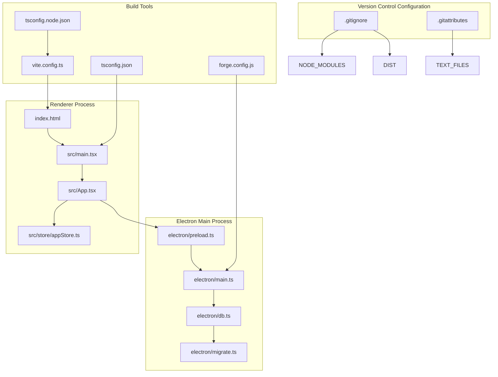

# Getting Started

<cite>
**Referenced Files in This Document**
- [.gitignore](file://.gitignore)
- [.gitattributes](file://.gitattributes)
- [README.md](file://README.md)
- [package.json](file://package.json)
- [vite.config.ts](file://vite.config.ts)
- [forge.config.js](file://forge.config.js)
- [tsconfig.json](file://tsconfig.json)
- [tsconfig.node.json](file://tsconfig.node.json)
- [electron/main.ts](file://electron/main.ts)
- [electron/preload.ts](file://electron/preload.ts)
- [electron/db.ts](file://electron/db.ts)
- [electron/migrate.ts](file://electron/migrate.ts)
- [src/App.tsx](file://src/App.tsx)
- [src/main.tsx](file://src/main.tsx)
- [index.html](file://index.html)
- [tailwind.config.js](file://tailwind.config.js)
</cite>

## Update Summary
**Changes Made**
- Added Git-based development workflow section with proper version control practices
- Updated installation instructions to reflect repository-based setup
- Enhanced development workflow documentation with Git configuration details
- Added troubleshooting guidance for Git-related issues
- Updated project structure overview to include version control files

## Table of Contents
1. [Introduction](#introduction)
2. [System Requirements](#system-requirements)
3. [Prerequisites](#prerequisites)
4. [Git-Based Development Workflow](#git-based-development-workflow)
5. [Installation](#installation)
6. [Development Workflow](#development-workflow)
7. [Production Build](#production-build)
8. [Type Checking](#type-checking)
9. [Project Structure Overview](#project-structure-overview)
10. [Platform-Specific Considerations](#platform-specific-considerations)
11. [Initial Setup Procedures](#initial-setup-procedures)
12. [Troubleshooting Guide](#troubleshooting-guide)
13. [Conclusion](#conclusion)

## Introduction
LyricDeck is a cross-platform desktop application for managing song lyrics and live lyric projection. Built with Electron, React 18, TypeScript, Vite, Tailwind CSS, Zustand, and @dnd-kit, it provides a modern desktop experience for churches, worship teams, and presenters who need reliable, local-first lyric management and presentation capabilities.

## System Requirements
- Operating systems: Windows, macOS, Linux
- Architecture: x64
- Memory: Minimum 4 GB RAM recommended
- Disk space: Approximately 50 MB free space after installation
- Network: Required for initial dependency installation; offline usage after setup

## Prerequisites
Before installing LyricDeck, ensure your development environment meets the following requirements:
- Node.js 18 or later
- npm 9 or later

These requirements are enforced by the project configuration and scripts. Using older versions may lead to build failures or runtime errors.

**Section sources**
- [README.md:29-32](file://README.md#L29-L32)
- [package.json:58-84](file://package.json#L58-L84)

## Git-Based Development Workflow
LyricDeck follows a Git-based development workflow with proper version control configuration. The repository includes essential Git configuration files that establish consistent development practices across team members.

### Repository Structure and Version Control
The project maintains clean separation between tracked and untracked files using `.gitignore` and `.gitattributes`:

- **Tracked files**: Source code, configuration files, documentation, and build artifacts
- **Ignored files**: Generated directories (`node_modules`, `dist`, `dist-electron`, `.vite`, `out`, `release`), log files, and platform-specific temporary files
- **Line ending normalization**: Automatic LF normalization for text files, preserving CRLF for Windows batch files

### Branching Strategy
- **Main branch**: Stable releases and production-ready code
- **Development branches**: Feature development and experimental changes
- **Hotfix branches**: Critical bug fixes for production deployments

### Commit Guidelines
- Use clear, descriptive commit messages following conventional commit format
- Include relevant issue numbers and brief explanations of changes
- Keep commits focused and atomic

**Section sources**
- [.gitignore:1-11](file://.gitignore#L1-L11)
- [.gitattributes:1-62](file://.gitattributes#L1-L62)

## Installation
Follow these steps to install LyricDeck on your local machine:

### Option A: Direct Repository Setup
1. Clone the repository to your local machine:
   ```bash
   git clone https://github.com/yourusername/lyricdeck.git
   cd lyricdeck
   ```

2. Install all project dependencies using npm:
   ```bash
   npm install
   ```

3. Verify the installation by checking that the `node_modules` directory is created and contains the required packages.

### Option B: Download Package
1. Download the latest release from the repository releases page
2. Extract the archive to your desired location
3. Open a terminal or command prompt in the project root directory
4. Install dependencies:
   ```bash
   npm install
   ```

**Section sources**
- [README.md:34-38](file://README.md#L34-L38)
- [package.json:58-96](file://package.json#L58-L96)

## Development Workflow
LyricDeck uses Vite for the development server and Electron for the desktop shell. The development workflow enables hot reloading for rapid iteration with Git-based version control integration.

### Starting the Development Environment
```bash
npm run dev
```
This script launches:
- Vite's development server on port 5173
- Electron with automatic page reload when frontend code changes

### Alternative Development Experience
```bash
npm run electron:dev
```
This command concurrently runs Vite and Electron, automatically opening the app after the development server becomes available.

### Development Server Configuration
The development server runs on port 5173 by default. Electron loads the app from the development server during development and from the built files in production.

**Section sources**
- [README.md:40-46](file://README.md#L40-L46)
- [package.json:6-16](file://package.json#L6-L16)
- [vite.config.ts:1-51](file://vite.config.ts#L1-L51)
- [electron/main.ts:96-100](file://electron/main.ts#L96-L100)

## Production Build
To build LyricDeck for distribution:
```bash
npm run build
```
This script performs the following steps:
1. TypeScript compilation
2. Vite build for the renderer process
3. Electron Builder packaging for Windows (NSIS installer and portable executable)

The build output is placed in the `release` directory as configured in the project settings.

For previewing the production build locally:
```bash
npm run preview
```
This serves the built assets locally for testing.

**Section sources**
- [README.md:48-52](file://README.md#L48-L52)
- [package.json:6-16](file://package.json#L6-L16)
- [forge.config.js:26-57](file://forge.config.js#L26-L57)

## Type Checking
Ensure your TypeScript code adheres to strict type safety:
```bash
npm run typecheck
```
This command runs the TypeScript compiler in no-emit mode, reporting any type errors without generating JavaScript output.

**Section sources**
- [README.md:54-58](file://README.md#L54-L58)
- [package.json:6-16](file://package.json#L6-L16)
- [tsconfig.json:1-26](file://tsconfig.json#L1-L26)

## Project Structure Overview
LyricDeck follows a clear separation between Electron main process, preload context bridge, and React renderer process, with shared TypeScript configuration for both environments. The project includes proper Git configuration for version control.



**Diagram sources**
- [.gitignore:1-11](file://.gitignore#L1-L11)
- [.gitattributes:1-62](file://.gitattributes#L1-L62)
- [electron/main.ts:1-390](file://electron/main.ts#L1-L390)
- [electron/preload.ts:1-43](file://electron/preload.ts#L1-L43)
- [electron/db.ts:1-214](file://electron/db.ts#L1-L214)
- [electron/migrate.ts:1-127](file://electron/migrate.ts#L1-L127)
- [src/App.tsx:1-102](file://src/App.tsx#L1-L102)
- [src/main.tsx:1-11](file://src/main.tsx#L1-L11)
- [src/store/appStore.ts:1-385](file://src/store/appStore.ts#L1-L385)
- [index.html:1-14](file://index.html#L1-L14)
- [vite.config.ts:1-51](file://vite.config.ts#L1-L51)
- [tsconfig.json:1-26](file://tsconfig.json#L1-L26)
- [tsconfig.node.json:1-11](file://tsconfig.node.json#L1-L11)
- [forge.config.js:1-45](file://forge.config.js#L1-L45)

**Section sources**
- [README.md:70-100](file://README.md#L70-L100)
- [vite.config.ts:1-51](file://vite.config.ts#L1-L51)
- [tsconfig.json:1-26](file://tsconfig.json#L1-L26)
- [tsconfig.node.json:1-11](file://tsconfig.node.json#L1-L11)
- [forge.config.js:1-45](file://forge.config.js#L1-L45)

## Platform-Specific Considerations
- Windows
  - Installer targets: NSIS installer and portable executable (x64)
  - Desktop and Start Menu shortcuts are enabled by default
  - Application data stored under `%APPDATA%/lyricdeck/data/`
- macOS
  - Supported via ZIP maker configuration
  - Application data stored under `~/Library/Application Support/lyricdeck/data/`
- Linux
  - Supported via DEB and RPM makers
  - Application data stored under `~/.local/share/lyricdeck/data/`

**Section sources**
- [package.json:26-56](file://package.json#L26-L56)
- [forge.config.js:9-26](file://forge.config.js#L9-L26)
- [README.md:102-107](file://README.md#L102-L107)

## Initial Setup Procedures
After successful installation, LyricDeck initializes with the following behavior:
- On first launch, if no songs exist, a set of seed songs is loaded automatically
- All data persists locally as JSON files in the application data directory
- The projection window opens on a separate display when requested

Key initialization points:
- Renderer process bootstrapping occurs in the HTML root element
- Zustand store manages application state and persistence hooks
- Electron preload exposes a typed API to the renderer process

**Section sources**
- [src/App.tsx:19-32](file://src/App.tsx#L19-L32)
- [src/App.tsx:44-46](file://src/App.tsx#L44-L46)
- [src/main.tsx:1-11](file://src/main.tsx#L1-L11)
- [src/store/appStore.ts:361-384](file://src/store/appStore.ts#L361-L384)
- [electron/preload.ts:1-43](file://electron/preload.ts#L1-L43)

## Troubleshooting Guide
Common setup issues and their solutions:

### Git and Version Control Issues
- **Repository cloning problems**
  - Symptom: Failed to clone repository or connection timeout
  - Solution: Check network connectivity and try `git config --global http.postBuffer 524288000`
  - Alternative: Use SSH keys or GitHub CLI for authentication

- **Line ending conflicts**
  - Symptom: Unexpected line ending changes in committed files
  - Solution: Ensure `.gitattributes` is properly configured for your platform
  - Verification: Check `git config core.autocrlf` setting

- **Large file handling**
  - Symptom: Large files causing performance issues
  - Solution: Use Git LFS for binary files or remove unnecessary large files

### Node.js or npm Version Mismatch
- **Symptom**: Build fails with engine compatibility errors
- **Solution**: Upgrade to Node.js 18+ and npm 9+
- **Verification**: Check versions with `node --version` and `npm --version`

### Port Conflicts During Development
- **Symptom**: Vite fails to start on port 5173
- **Solution**: Stop other processes using the port or configure a different port in Vite configuration
- **Alternative**: Use the Electron-focused development script that waits for the dev server

### Missing Native Dependencies
- **Symptom**: Runtime errors related to native modules
- **Solution**: Reinstall dependencies with `npm ci` or clear `node_modules` and reinstall

### Database Initialization Errors
- **Symptom**: Application fails to load or save data
- **Solution**: Verify the application data directory exists and has write permissions
- **Location**: See platform-specific paths in the data storage section

### Projection Window Issues
- **Symptom**: Projection window does not open or displays incorrectly
- **Solution**: Ensure multiple displays are connected; verify display detection and selection logic

**Section sources**
- [README.md:29-32](file://README.md#L29-L32)
- [package.json:6-16](file://package.json#L6-L16)
- [electron/main.ts:111-152](file://electron/main.ts#L111-L152)
- [electron/db.ts:19-41](file://electron/db.ts#L19-L41)
- [README.md:102-107](file://README.md#L102-L107)

## Conclusion
You are now ready to develop and build LyricDeck using a Git-based development workflow. Use the development workflow for rapid iteration, the production build for distribution, and the type checking process to maintain code quality. For platform-specific packaging and deployment, refer to the build configuration and makers defined in the project settings. The Git configuration ensures consistent development practices across team members and maintains clean repository hygiene.