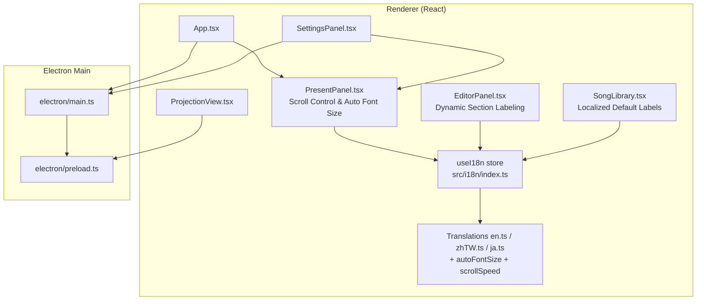
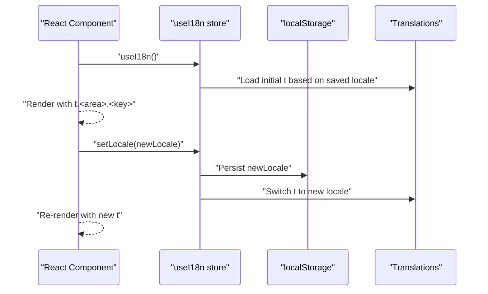
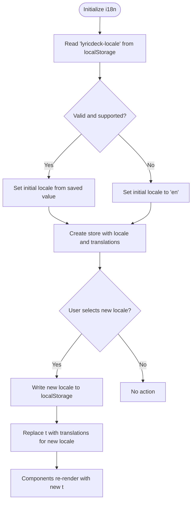
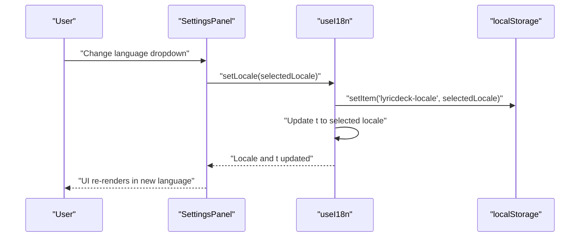
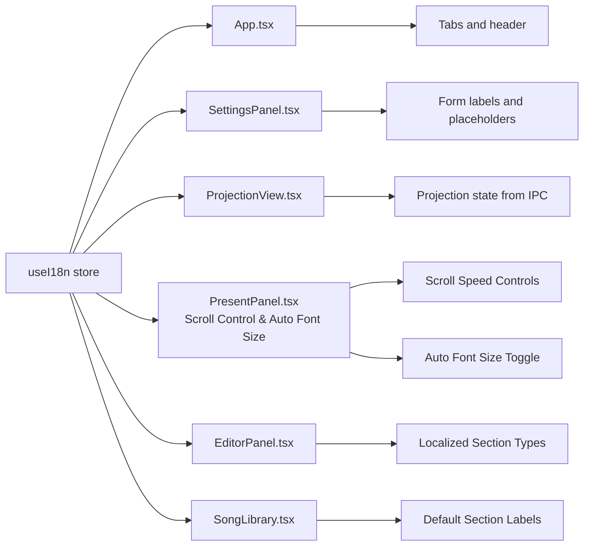
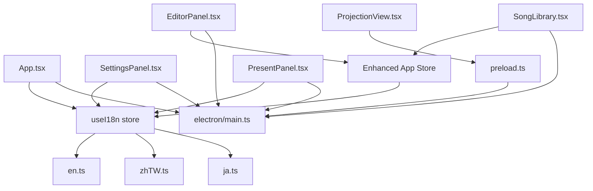

# Internationalization

<cite>
**Referenced Files in This Document**
- [index.ts](file://src/i18n/index.ts)
- [en.ts](file://src/i18n/en.ts)
- [zhTW.ts](file://src/i18n/zhTW.ts)
- [ja.ts](file://src/i18n/ja.ts)
- [App.tsx](file://src/App.tsx)
- [SettingsPanel.tsx](file://src/components/SettingsPanel.tsx)
- [ProjectionView.tsx](file://src/components/ProjectionView.tsx)
- [PresentPanel.tsx](file://src/components/PresentPanel.tsx)
- [appStore.ts](file://src/store/appStore.ts)
- [EditorPanel.tsx](file://src/components/EditorPanel.tsx)
- [SongLibrary.tsx](file://src/components/SongLibrary.tsx)
- [main.tsx](file://src/main.tsx)
- [main.ts](file://electron/main.ts)
- [preload.ts](file://electron/preload.ts)
- [index.ts](file://src/types/index.ts)
</cite>

## Update Summary
**Changes Made**
- Updated Language Support Structure section to document comprehensive Japanese language support
- Added new section documenting Japanese language implementation with complete translation coverage
- Enhanced Translation Key Organization section to include Japanese-specific keys
- Updated Practical Examples section with Japanese language integration examples
- Added Japanese language support to troubleshooting guide
- Updated Adding a New Language section with Japanese implementation patterns

## Table of Contents
1. [Introduction](#introduction)
2. [Project Structure](#project-structure)
3. [Core Components](#core-components)
4. [Architecture Overview](#architecture-overview)
5. [Language Support Structure](#language-support-structure)
6. [Detailed Component Analysis](#detailed-component-analysis)
7. [Japanese Language Implementation](#japanese-language-implementation)
8. [Action Enhancement](#action-enhancement)
9. [Scroll Control Functionality](#scroll-control-functionality)
10. [Auto Font Size Feature](#auto-font-size-feature)
11. [Dependency Analysis](#dependency-analysis)
12. [Performance Considerations](#performance-considerations)
13. [Troubleshooting Guide](#troubleshooting-guide)
14. [Conclusion](#conclusion)
15. [Appendices](#appendices)

## Introduction
This document explains LyricDeck's internationalization (i18n) system. It covers the language support structure (English, Traditional Chinese, and Japanese), translation key organization, dynamic language switching, locale persistence, and integration with the React component architecture. It also provides guidelines for adding new languages, managing translation keys, fallback behavior, pluralization handling, date/time formatting considerations, and best practices for multilingual desktop applications.

**Updated** Enhanced with comprehensive Japanese language support that provides complete translation coverage for all major application features including editor, arrange, present, settings, song library, background gallery, import/export, and preparation list functionality.

## Project Structure
The i18n system is organized under a dedicated folder with a small runtime store and language packs. The store exposes a locale and a translation object, while components consume translations via hooks. Electron handles projection windows and IPC communication, which is relevant for how the interface behaves across windows.



**Diagram sources**
- [App.tsx:12-102](file://src/App.tsx#L12-L102)
- [SettingsPanel.tsx:1-523](file://src/components/SettingsPanel.tsx#L1-L523)
- [ProjectionView.tsx:1-134](file://src/components/ProjectionView.tsx#L1-L134)
- [PresentPanel.tsx:1-401](file://src/components/PresentPanel.tsx#L1-L401)
- [index.ts:1-46](file://src/i18n/index.ts#L1-L46)
- [en.ts:1-182](file://src/i18n/en.ts#L1-L182)
- [zhTW.ts:1-182](file://src/i18n/zhTW.ts#L1-L182)
- [ja.ts:1-182](file://src/i18n/ja.ts#L1-L182)
- [EditorPanel.tsx:106-107](file://src/components/EditorPanel.tsx#L106-L107)
- [SongLibrary.tsx:88-91](file://src/components/SongLibrary.tsx#L88-L91)
- [main.ts:1-390](file://electron/main.ts#L1-L390)
- [preload.ts:1-43](file://electron/preload.ts#L1-L43)

**Section sources**
- [index.ts:1-46](file://src/i18n/index.ts#L1-L46)
- [en.ts:1-182](file://src/i18n/en.ts#L1-L182)
- [zhTW.ts:1-182](file://src/i18n/zhTW.ts#L1-L182)
- [ja.ts:1-182](file://src/i18n/ja.ts#L1-L182)
- [App.tsx:12-102](file://src/App.tsx#L12-L102)
- [SettingsPanel.tsx:1-523](file://src/components/SettingsPanel.tsx#L1-L523)
- [ProjectionView.tsx:1-134](file://src/components/ProjectionView.tsx#L1-L134)
- [PresentPanel.tsx:1-401](file://src/components/PresentPanel.tsx#L1-L401)
- [EditorPanel.tsx:106-107](file://src/components/EditorPanel.tsx#L106-L107)
- [SongLibrary.tsx:88-91](file://src/components/SongLibrary.tsx#L88-L91)
- [main.ts:1-390](file://electron/main.ts#L1-L390)
- [preload.ts:1-43](file://electron/preload.ts#L1-L43)

## Core Components
- Translation store: Provides locale, translation object, and setter for dynamic language switching. It persists the user's language preference in local storage and initializes from persisted state.
- Language packs: Three language packs define all translation keys grouped by functional areas (app, tabs, song library, editor, arrange, present, settings, background gallery, import/export, preparation list).
- React integration: Components consume translations via the store hook and render localized strings. The Settings panel includes a language selector bound to the store.
- Dynamic section labeling: Enhanced store actions support dynamic section type localization and custom default labels.
- Scroll control functionality: New scroll speed control with internationalized labels for presentation mode.
- Auto Font Size feature: Automatic font size adjustment capability with comprehensive internationalization support.

Key behaviors:
- Locale type union defines supported locales (English, Traditional Chinese, Japanese).
- Locale labels map locale identifiers to human-readable names.
- Initial locale is loaded from local storage; defaults to English if missing or invalid.
- Switching locale updates the translation object and persists the selection.
- Enhanced actions support optional parameters for localized section types and custom labels.
- Scroll speed control provides configurable timing for line shifting operations.
- Auto Font Size feature automatically calculates optimal font sizes based on content and display dimensions.

**Section sources**
- [index.ts:5-46](file://src/i18n/index.ts#L5-L46)
- [en.ts:1-182](file://src/i18n/en.ts#L1-L182)
- [zhTW.ts:1-182](file://src/i18n/zhTW.ts#L1-L182)
- [ja.ts:1-182](file://src/i18n/ja.ts#L1-L182)
- [SettingsPanel.tsx:419-447](file://src/components/SettingsPanel.tsx#L419-L447)
- [appStore.ts:53-61](file://src/store/appStore.ts#L53-L61)
- [PresentPanel.tsx:58-91](file://src/components/PresentPanel.tsx#L58-L91)
- [PresentPanel.tsx:384-390](file://src/components/PresentPanel.tsx#L384-L390)

## Architecture Overview
The i18n architecture is a thin, centralized store that exposes a translation object and locale state. Components depend on this store for all UI text. Electron's projection window uses a separate renderer that receives projection state via IPC; it does not render translated UI text, so i18n is not directly involved in projection rendering.



**Diagram sources**
- [index.ts:17-45](file://src/i18n/index.ts#L17-L45)
- [SettingsPanel.tsx:419-447](file://src/components/SettingsPanel.tsx#L419-L447)

## Language Support Structure
LyricDeck currently supports three languages with comprehensive coverage across all application features:

### Supported Languages
- **English**: Primary language with complete translation coverage
- **Traditional Chinese**: Full translation support for all features
- **Japanese**: Comprehensive Japanese language support with complete translation coverage

### Locale Configuration
The system maintains a unified locale type and configuration structure:

```typescript
export type Locale = 'en' | 'zh-TW' | 'ja';

const locales: Record<Locale, Translations> = {
  en,
  'zh-TW': zhTW,
  ja,
};

export const localeLabels: Record<Locale, string> = {
  en: 'English',
  'zh-TW': '繁體中文',
  ja: '日本語',
};
```

### Translation Coverage
Each language pack provides complete coverage for:
- App-level labels and plural forms
- Tab navigation (Editor, Arrange, Present, Settings)
- Song library operations and search functionality
- Editor controls and section management
- Section type localization (Intro, Verse, Pre-Chorus, Chorus, Bridge, Instrumental, Outro, Custom)
- Arrange panel functionality
- Present panel controls and auto font size feature
- Settings categories and presentation customization
- Background gallery operations
- Import/export functionality
- Preparation list management

**Section sources**
- [index.ts:6](file://src/i18n/index.ts#L6)
- [index.ts:8](file://src/i18n/index.ts#L8)
- [index.ts:14](file://src/i18n/index.ts#L14)
- [ja.ts:1-182](file://src/i18n/ja.ts#L1-L182)

## Detailed Component Analysis

### Translation Store and Locale Management
- Locale union and labels: Defines supported locales and their display labels.
- Saved locale resolution: Reads from local storage; falls back to English if absent or invalid.
- Store state: Holds current locale and translation object; exposes a setter to change locale.
- Persistence: Writes the chosen locale to local storage on change.



**Diagram sources**
- [index.ts:17-45](file://src/i18n/index.ts#L17-L45)

**Section sources**
- [index.ts:5-46](file://src/i18n/index.ts#L5-L46)

### Translation Key Organization
Translation keys are grouped by functional areas to keep the dictionary organized and maintainable. Keys include:
- App-level labels and plural forms
- Tab labels
- Song library operations and placeholders
- Editor controls and prompts
- Section types
- Arrange panel labels and counts
- Present panel controls and hints
- Settings categories and labels
- Background gallery operations
- Import/export messages and placeholders
- Preparation list actions and counts

**Updated** Section types now include localized names for all supported section types (Intro, Verse, Pre-Chorus, Chorus, Bridge, Instrumental, Outro, Custom) across all three languages. The present section includes scrollSpeed and autoFontSize keys for internationalized scroll control and auto font size functionality.

This structure enables consistent key naming and simplifies maintenance across languages.

**Section sources**
- [en.ts:1-182](file://src/i18n/en.ts#L1-L182)
- [zhTW.ts:1-182](file://src/i18n/zhTW.ts#L1-L182)
- [ja.ts:1-182](file://src/i18n/ja.ts#L1-L182)

### Dynamic Language Switching Mechanism
- Settings panel provides a language selector bound to the store's locale.
- Selecting a new locale triggers the store's setter, which persists the choice and switches the translation object.
- Components re-render automatically because they subscribe to the store.



**Diagram sources**
- [SettingsPanel.tsx:419-447](file://src/components/SettingsPanel.tsx#L419-L447)
- [index.ts:38-45](file://src/i18n/index.ts#L38-L45)

**Section sources**
- [SettingsPanel.tsx:419-447](file://src/components/SettingsPanel.tsx#L419-L447)
- [index.ts:38-45](file://src/i18n/index.ts#L38-L45)

### Integration with React Component Architecture
- App header and tabs: Use translation keys for labels and counts.
- Settings panel: Uses translation keys for titles, descriptions, placeholders, and form labels.
- Projection view: Receives projection state via IPC; it renders content based on state, not translation keys.
- Editor panel: Passes localized section type names to store actions for dynamic labeling.
- Song library: Uses localized section types for default song creation.
- Present panel: Uses translation keys for scroll control functionality including speed adjustments and auto font size feature.



**Diagram sources**
- [App.tsx:48-80](file://src/App.tsx#L48-L80)
- [SettingsPanel.tsx:56-416](file://src/components/SettingsPanel.tsx#L56-L416)
- [ProjectionView.tsx:22-29](file://src/components/ProjectionView.tsx#L22-L29)
- [PresentPanel.tsx:384-390](file://src/components/PresentPanel.tsx#L384-L390)
- [PresentPanel.tsx:396-401](file://src/components/PresentPanel.tsx#L396-L401)
- [EditorPanel.tsx:106-107](file://src/components/EditorPanel.tsx#L106-L107)
- [SongLibrary.tsx:88-91](file://src/components/SongLibrary.tsx#L88-L91)

**Section sources**
- [App.tsx:48-80](file://src/App.tsx#L48-L80)
- [SettingsPanel.tsx:56-416](file://src/components/SettingsPanel.tsx#L56-L416)
- [ProjectionView.tsx:22-29](file://src/components/ProjectionView.tsx#L22-L29)
- [PresentPanel.tsx:384-390](file://src/components/PresentPanel.tsx#L384-L390)
- [PresentPanel.tsx:396-401](file://src/components/PresentPanel.tsx#L396-L401)
- [EditorPanel.tsx:106-107](file://src/components/EditorPanel.tsx#L106-L107)
- [SongLibrary.tsx:88-91](file://src/components/SongLibrary.tsx#L88-L91)

### Electron Projection Window and i18n
- The projection window is a separate renderer that listens for projection state updates via IPC.
- It does not render translated UI text; it simply displays lyrics and background according to the received state.
- As a result, i18n is not directly involved in projection rendering.

**Section sources**
- [main.ts:111-152](file://electron/main.ts#L111-L152)
- [preload.ts:10-21](file://electron/preload.ts#L10-L21)
- [ProjectionView.tsx:1-134](file://src/components/ProjectionView.tsx#L1-L134)

## Japanese Language Implementation

**New** LyricDeck now provides comprehensive Japanese language support with complete translation coverage across all application features.

### Japanese Translation Coverage
The Japanese translation file (`src/i18n/ja.ts`) provides complete localization for:

#### Core Application Features
- **App Level**: Complete app title and song count localization
- **Tabs**: Japanese translations for Editor, Arrange, Present, and Settings
- **Song Library**: Full search, add, delete, and sorting functionality
- **Editor**: Section management, lyrics input, and preview functionality
- **Section Types**: Proper Japanese localization for all section types (Intro, Verse, Pre-Chorus, Chorus, Bridge, Instrumental, Outro, Custom)

#### Presentation and Settings
- **Arrange Panel**: Complete arrangement building and management
- **Present Panel**: Full presentation controls including auto font size feature
- **Settings**: Comprehensive presentation customization options
- **Background Gallery**: Image management and selection
- **Import/Export**: Data transfer functionality
- **Preparation List**: Set list management

#### Technical Implementation
The Japanese implementation follows the same structure as other language packs:
- Uses the same key organization pattern
- Maintains consistent pluralization handling
- Supports dynamic section labeling
- Includes scroll speed and auto font size functionality
- Provides complete localization for all UI elements

### Japanese Language Integration
The Japanese language is fully integrated into the existing i18n infrastructure:

```typescript
// Locale union includes Japanese
export type Locale = 'en' | 'zh-TW' | 'ja';

// Locale labels include Japanese display name
export const localeLabels: Record<Locale, string> = {
  en: 'English',
  'zh-TW': '繁體中文',
  ja: '日本語',
};

// Locales mapping includes Japanese translations
const locales: Record<Locale, Translations> = {
  en,
  'zh-TW': zhTW,
  ja,
};
```

### Japanese Localization Examples
The Japanese translation provides culturally appropriate localization for Japanese users:

**Example: Settings Interface**
- "Language" → "言語" (Language)
- "Interface Language" → "インターフェース言語" (Interface Language)
- "Presentation Settings" → "プレゼン設定" (Presentation Settings)

**Example: Section Types**
- "Intro" → "イントロ" (Intro)
- "Verse" → "バース" (Verse)
- "Chorus" → "コーラス" (Chorus)
- "Bridge" → "ブリッジ" (Bridge)

**Example: Present Panel**
- "Auto Font Size" → "自動フォントサイズ" (Auto Font Size)
- "Speed" → "速度" (Speed)

**Section sources**
- [ja.ts:1-182](file://src/i18n/ja.ts#L1-L182)
- [index.ts:6](file://src/i18n/index.ts#L6)
- [index.ts:14](file://src/i18n/index.ts#L14)
- [index.ts:8](file://src/i18n/index.ts#L8)

## Action Enhancement

### Enhanced addSong Action
The `addSong` action now accepts an optional `defaultSectionLabel` parameter that allows creating songs with custom default section labels in the user's preferred language.

**Usage Pattern:**
```typescript
// In components, pass localized section type names
addSong(t.sectionTypes.Verse + ' 1')
```

### Enhanced addSection Action  
The `addSection` action now accepts an optional `localizedTypeName` parameter that enables dynamic section type localization. When provided, this parameter takes precedence over the raw section type name.

**Usage Pattern:**
```typescript
// In components, pass localized section type names
addSection(songId, type, t.sectionTypes[type])
```

### Dynamic Section Labeling Logic
When creating sections, the system follows this priority order:
1. Use the provided `localizedTypeName` parameter if available
2. Fall back to the raw `type` parameter if no localized name is provided
3. Generate sequential labels based on the display name (e.g., "Verse 1", "Verse 2")

**Section sources**
- [appStore.ts:53-61](file://src/store/appStore.ts#L53-L61)
- [appStore.ts:116-142](file://src/store/appStore.ts#L116-L142)
- [appStore.ts:186-200](file://src/store/appStore.ts#L186-L200)
- [EditorPanel.tsx:106-107](file://src/components/EditorPanel.tsx#L106-L107)
- [SongLibrary.tsx:88-91](file://src/components/SongLibrary.tsx#L88-L91)

## Scroll Control Functionality

### Scroll Speed Control Implementation
The scroll control system provides users with precise timing control for line shifting operations. The interface includes:

- Speed label: Displays the localized label for scroll speed control
- Numeric input: Allows users to set scroll duration in seconds with 0.1-second increments
- Unit indicator: Shows "s" (seconds) for clarity
- Line shift buttons: Enable moving up/down by 1-4 lines with configured speed
- Real-time updates: Changes to scroll speed immediately affect subsequent operations

### Translation Keys for Scroll Control
All three language packs (English, Traditional Chinese, Japanese) include the scrollSpeed key in the present section:

**English translation:**
```typescript
scrollSpeed: 'Speed'
```

**Traditional Chinese translation:**
```typescript
scrollSpeed: '速度'
```

**Japanese translation:**
```typescript
scrollSpeed: '速度'
```

### Component Integration
The scroll control functionality is integrated into the PresentPanel component through the following implementation:

```typescript
<div className="flex items-center gap-1">
  <span className="text-xs text-surface-400 mr-1">{t.present.scrollSpeed}:</span>
  <input
    type="number"
    min={0}
    step={0.1}
    value={scrollSpeed}
    onChange={(e) => setScrollSpeed(Math.max(0, parseFloat(e.target.value) || 0))}
    className="input w-16 text-xs py-1 px-2"
  />
  <span className="text-xs text-surface-400">s</span>
</div>
```

The scroll speed value is then passed to shiftLines operations for precise timing control.

**Section sources**
- [en.ts:98](file://src/i18n/en.ts#L98)
- [zhTW.ts:100](file://src/i18n/zhTW.ts#L100)
- [ja.ts:100](file://src/i18n/ja.ts#L100)
- [PresentPanel.tsx:396-401](file://src/components/PresentPanel.tsx#L396-L401)

## Auto Font Size Feature

### Auto Font Size Implementation
The Auto Font Size feature provides intelligent font size calculation based on:

- Available display width and height
- Song content length and complexity
- Selected font family and weight
- Maximum font size constraints
- Current display configuration

The feature automatically calculates the optimal font size to ensure text fits within the display area while maintaining readability.

### Translation Keys for Auto Font Size
All three language packs (English, Traditional Chinese, Japanese) include the autoFontSize key in the present section:

**English translation:**
```typescript
autoFontSize: 'Auto Font Size'
```

**Traditional Chinese translation:**
```typescript
autoFontSize: '自動調整字體大小'
```

**Japanese translation:**
```typescript
autoFontSize: '自動フォントサイズ'
```

### Component Integration
The Auto Font Size feature is integrated into the PresentPanel component through the following implementation:

```typescript
<label className="flex items-center gap-1.5 text-xs text-surface-300 cursor-pointer select-none">
  <input
    type="checkbox"
    checked={autoFontSize}
    onChange={(e) => setAutoFontSize(e.target.checked)}
    className="w-3.5 h-3.5 rounded border-surface-500 accent-primary-500"
  />
  {t.present.autoFontSize}
</label>
```

The feature automatically recalculates font sizes when enabled and when song content, display configuration, or font settings change.

### Font Size Calculation Logic
When Auto Font Size is enabled, the system performs the following calculations:

1. **Content Analysis**: Analyzes all lyrics content for optimal sizing
2. **Display Metrics**: Considers available width and height of selected display
3. **Font Properties**: Takes into account selected font family and weight
4. **Optimization**: Calculates the largest font size that fits within constraints
5. **Real-time Updates**: Updates font size dynamically as conditions change

**Section sources**
- [en.ts:99](file://src/i18n/en.ts#L99)
- [zhTW.ts:101](file://src/i18n/zhTW.ts#L101)
- [ja.ts:101](file://src/i18n/ja.ts#L101)
- [PresentPanel.tsx:58-91](file://src/components/PresentPanel.tsx#L58-L91)
- [PresentPanel.tsx:384-390](file://src/components/PresentPanel.tsx#L384-L390)

## Dependency Analysis
- Components depend on the i18n store for translations.
- The store depends on language packs for translation values.
- Electron main process manages projection windows and IPC; it does not depend on i18n.
- The app store coordinates UI state and persistence; it now includes enhanced internationalization actions.
- Components pass localized section types to store actions for dynamic labeling.
- Present panel integrates scroll control functionality and Auto Font Size feature with internationalized labels.



**Diagram sources**
- [index.ts:1-46](file://src/i18n/index.ts#L1-L46)
- [en.ts:1-182](file://src/i18n/en.ts#L1-L182)
- [zhTW.ts:1-182](file://src/i18n/zhTW.ts#L1-L182)
- [ja.ts:1-182](file://src/i18n/ja.ts#L1-L182)
- [App.tsx:12-102](file://src/App.tsx#L12-L102)
- [SettingsPanel.tsx:1-523](file://src/components/SettingsPanel.tsx#L1-L523)
- [ProjectionView.tsx:1-134](file://src/components/ProjectionView.tsx#L1-L134)
- [PresentPanel.tsx:1-401](file://src/components/PresentPanel.tsx#L1-L401)
- [EditorPanel.tsx:106-107](file://src/components/EditorPanel.tsx#L106-L107)
- [SongLibrary.tsx:88-91](file://src/components/SongLibrary.tsx#L88-L91)
- [preload.ts:1-43](file://electron/preload.ts#L1-L43)
- [main.ts:1-390](file://electron/main.ts#L1-L390)
- [appStore.ts:53-61](file://src/store/appStore.ts#L53-L61)

**Section sources**
- [index.ts:1-46](file://src/i18n/index.ts#L1-L46)
- [App.tsx:12-102](file://src/App.tsx#L12-L102)
- [SettingsPanel.tsx:1-523](file://src/components/SettingsPanel.tsx#L1-L523)
- [ProjectionView.tsx:1-134](file://src/components/ProjectionView.tsx#L1-L134)
- [PresentPanel.tsx:1-401](file://src/components/PresentPanel.tsx#L1-L401)
- [EditorPanel.tsx:106-107](file://src/components/EditorPanel.tsx#L106-L107)
- [SongLibrary.tsx:88-91](file://src/components/SongLibrary.tsx#L88-L91)
- [preload.ts:1-43](file://electron/preload.ts#L1-L43)
- [main.ts:1-390](file://electron/main.ts#L1-L390)
- [appStore.ts:53-61](file://src/store/appStore.ts#L53-L61)

## Performance Considerations
- Translation lookups are constant-time object property access; negligible overhead.
- Switching locales updates the translation object and re-renders affected components; this is efficient and acceptable for desktop apps.
- Enhanced store actions add minimal computational overhead for dynamic section labeling.
- Scroll control functionality uses lightweight numeric inputs with minimal performance impact.
- Auto Font Size feature performs calculations only when enabled or when conditions change, minimizing performance impact.
- **New** Japanese language support adds minimal overhead as it follows the same architectural patterns as other language packs.
- Avoid unnecessary re-renders by keeping translation usage scoped to components that need it.

## Troubleshooting Guide
Common issues and resolutions:
- Missing translation keys: Ensure the key exists in all three language packs (English, Traditional Chinese, Japanese) or add it to the English pack and mirror it in others.
- Incorrect pluralization: Use separate keys for singular/plural forms (as seen in the English pack) and ensure the corresponding key exists in each language pack.
- Locale not persisting: Verify local storage writes succeed and the saved value matches supported locales.
- Projection window not reflecting language changes: This is expected; projection renderer does not use i18n.
- Dynamic section labeling not working: Ensure components pass localized section type names to the enhanced store actions.
- Default section labels incorrect: Verify that the localized section types exist in the translation files for the current locale.
- Scroll speed control not appearing: Verify that the scrollSpeed key exists in the present section of all translation files.
- Scroll speed values not updating: Check that the numeric input component properly handles value changes and passes values to shiftLines operations.
- Auto Font Size toggle not working: Verify that the autoFontSize key exists in the present section of all translation files.
- Auto Font Size not calculating properly: Check that font size calculations are triggered when song content or display configuration changes.
- **New** Japanese language not appearing in language selector: Verify that the locale is properly included in the Locale union and localeLabels mapping.
- **New** Japanese translations not loading: Check that the ja.ts file is properly imported and included in the locales mapping.
- **New** Japanese section types not displaying correctly: Verify that all section types are properly localized in the Japanese translation file.

**Section sources**
- [index.ts:17-28](file://src/i18n/index.ts#L17-L28)
- [en.ts:4-7](file://src/i18n/en.ts#L4-L7)
- [zhTW.ts:6-9](file://src/i18n/zhTW.ts#L6-L9)
- [ja.ts:54-64](file://src/i18n/ja.ts#L54-L64)
- [EditorPanel.tsx:106-107](file://src/components/EditorPanel.tsx#L106-L107)
- [SongLibrary.tsx:88-91](file://src/components/SongLibrary.tsx#L88-L91)
- [PresentPanel.tsx:384-390](file://src/components/PresentPanel.tsx#L384-L390)
- [PresentPanel.tsx:396-401](file://src/components/PresentPanel.tsx#L396-L401)

## Conclusion
LyricDeck's i18n system is straightforward and effective: a central store manages locale and translations, language packs organize keys by functional area, and components consume translations via hooks. Dynamic language switching is seamless and persistent. The recent enhancement adds comprehensive Japanese language support with complete translation coverage across all application features, making the system truly multilingual for English, Traditional Chinese, and Japanese users. The enhanced internationalization capabilities now provide seamless dynamic section labeling, sophisticated scroll control functionality, and intelligent Auto Font Size feature that respect user language preferences and maintain proper localization across all features. Electron's projection window operates independently of i18n, focusing on rendering lyrics and backgrounds. Following the established patterns ensures consistency and scalability when adding new languages or keys.

**Updated** The enhanced internationalization system now provides seamless dynamic section labeling, sophisticated scroll control functionality, intelligent Auto Font Size feature, and comprehensive Japanese language support that respect user language preferences and maintain proper localization across all features.

## Appendices

### Adding a New Language
Steps:
1. Create a new translation file under the i18n folder with the same structure as existing language packs.
2. Export the new translation object and import it in the i18n index file.
3. Add the locale to the locale union and locale labels mapping.
4. Ensure all translation keys exist in the new language pack; use placeholders for missing keys during development.
5. Test language switching in the Settings panel and verify persistence.

Guidelines:
- Keep translation keys aligned across languages.
- Use distinct keys for pluralization and counts.
- Avoid embedding dynamic values inside translation strings; pass values externally and compose messages.
- Ensure section types are properly localized for dynamic labeling functionality.
- Include scrollSpeed and autoFontSize keys in the present section for consistent user experience.
- **New** Follow the Japanese implementation pattern for comprehensive feature coverage.
- **New** Test the new language thoroughly across all application components.

**Section sources**
- [index.ts:5-18](file://src/i18n/index.ts#L5-L18)
- [index.ts:20-45](file://src/i18n/index.ts#L20-L45)
- [en.ts:1-182](file://src/i18n/en.ts#L1-L182)
- [zhTW.ts:1-182](file://src/i18n/zhTW.ts#L1-L182)
- [ja.ts:1-182](file://src/i18n/ja.ts#L1-L182)

### Managing Translation Keys
- Group keys by functional areas to improve readability and maintenance.
- Use descriptive key names that reflect context (e.g., "settings.title", "songLibrary.search").
- Separate singular and plural forms when needed (as shown in the English pack).
- For dynamic values, pass parameters externally and format messages in components.
- Include comprehensive section types for all supported section types to enable dynamic labeling.
- Ensure scroll control functionality includes proper internationalization keys for consistent user experience.
- Include autoFontSize key in the present section for Auto Font Size feature internationalization.
- **New** Maintain consistency across all three language packs (English, Traditional Chinese, Japanese).
- **New** Follow established patterns for cultural appropriateness in translations.

**Section sources**
- [en.ts:4-7](file://src/i18n/en.ts#L4-L7)
- [en.ts:169-176](file://src/i18n/en.ts#L169-L176)
- [en.ts:52-62](file://src/i18n/en.ts#L52-L62)
- [en.ts:98-99](file://src/i18n/en.ts#L98-L99)
- [zhTW.ts:54-64](file://src/i18n/zhTW.ts#L54-L64)
- [zhTW.ts:100-101](file://src/i18n/zhTW.ts#L100-L101)
- [ja.ts:54-64](file://src/i18n/ja.ts#L54-L64)
- [ja.ts:100-101](file://src/i18n/ja.ts#L100-L101)

### Fallback Mechanisms
- If a key is missing in a language pack, accessing it yields undefined. Preferably provide fallbacks in components or ensure all keys are present in all packs.
- The store initializes with English if the saved locale is invalid or missing.
- If localized section type names are not provided to enhanced actions, the system falls back to raw section type names.
- Scroll control functionality gracefully handles missing scrollSpeed keys with appropriate fallback behavior.
- Auto Font Size feature gracefully handles missing autoFontSize keys with appropriate fallback behavior.
- **New** Japanese language support provides comprehensive fallback behavior consistent with other language packs.

**Section sources**
- [index.ts:17-28](file://src/i18n/index.ts#L17-L28)
- [appStore.ts:186-191](file://src/store/appStore.ts#L186-L191)

### Pluralization Handling
- Use separate keys for singular and plural forms (e.g., "songs" and "songsPlural") and select the appropriate key based on count.
- Ensure all three language packs include both keys.

**Section sources**
- [en.ts:4-7](file://src/i18n/en.ts#L4-L7)
- [zhTW.ts:6-9](file://src/i18n/zhTW.ts#L6-L9)
- [ja.ts:6-9](file://src/i18n/ja.ts#L6-L9)

### Date/Time Formatting Considerations
- The current i18n system does not include date/time formatting helpers. If needed, integrate a formatting library and expose a formatter via the store or a dedicated utility.
- For now, dates are stored as ISO strings and rendered as-is in UI contexts.

**Section sources**
- [index.ts:1-46](file://src/i18n/index.ts#L1-L46)
- [types/index.ts:50-67](file://src/types/index.ts#L50-L67)

### Practical Examples
- Using translations in components:
  - Tabs and header labels: Access via the translation object and render in the App component.
  - Settings labels and placeholders: Use translation keys for form elements in the Settings panel.
  - Scroll control functionality: Use t.present.scrollSpeed for internationalized scroll speed labels in PresentPanel.
  - Auto Font Size functionality: Use t.present.autoFontSize for internationalized auto font size toggle labels in PresentPanel.
  - Dynamic section labeling: Pass localized section types to store actions for proper internationalization.
  - **New** Japanese language integration: Use Japanese translations for Japanese-speaking users.
- Handling user language preferences:
  - Bind a select element to the store's locale setter.
  - Persist the selection to local storage for continuity across sessions.
- Implementing scroll speed control:
```typescript
// In PresentPanel.tsx
<div className="flex items-center gap-1">
  <span className="text-xs text-surface-400 mr-1">{t.present.scrollSpeed}:</span>
  <input
    type="number"
    min={0}
    step={0.1}
    value={scrollSpeed}
    onChange={(e) => setScrollSpeed(Math.max(0, parseFloat(e.target.value) || 0))}
    className="input w-16 text-xs py-1 px-2"
  />
  <span className="text-xs text-surface-400">s</span>
</div>
```
- Implementing Auto Font Size toggle:
```typescript
// In PresentPanel.tsx
<label className="flex items-center gap-1.5 text-xs text-surface-300 cursor-pointer select-none">
  <input
    type="checkbox"
    checked={autoFontSize}
    onChange={(e) => setAutoFontSize(e.target.checked)}
    className="w-3.5 h-3.5 rounded border-surface-500 accent-primary-500"
  />
  {t.present.autoFontSize}
</label>
```
- Implementing localized section types:
```typescript
// In EditorPanel.tsx
<AddSectionButton onAdd={(type) => addSection(song.id, type, t.sectionTypes[type])} />

// In SongLibrary.tsx  
<button onClick={() => addSong(t.sectionTypes.Verse + ' 1')}>
```
- **New** Implementing Japanese language support:
```typescript
// In SettingsPanel.tsx
<select
  value={locale}
  onChange={(e) => setLocale(e.target.value as Locale)}
  className="input text-sm w-48"
>
  {(Object.entries(localeLabels) as [Locale, string][]).map(([key, label]) => (
    <option key={key} value={key}>
      {label}
    </option>
  ))}
</select>
```

**Section sources**
- [App.tsx:48-80](file://src/App.tsx#L48-L80)
- [SettingsPanel.tsx:419-447](file://src/components/SettingsPanel.tsx#L419-L447)
- [index.ts:38-45](file://src/i18n/index.ts#L38-L45)
- [PresentPanel.tsx:384-390](file://src/components/PresentPanel.tsx#L384-L390)
- [PresentPanel.tsx:396-401](file://src/components/PresentPanel.tsx#L396-L401)
- [EditorPanel.tsx:106-107](file://src/components/EditorPanel.tsx#L106-L107)
- [SongLibrary.tsx:88-91](file://src/components/SongLibrary.tsx#L88-L91)
- [ja.ts:14](file://src/i18n/ja.ts#L14)

### Best Practices for Multilingual Desktop Applications
- Centralize translation management to minimize duplication and inconsistencies.
- Keep translation keys stable and versioned alongside releases.
- Provide clear separation between static strings and dynamic values.
- Test language switching and persistence across different environments.
- Avoid hardcoding strings in components; always use translation keys.
- Consider accessibility: ensure translated text fits UI constraints and is readable in all languages.
- Leverage enhanced store actions for dynamic internationalization that respects user preferences.
- Ensure all supported section types are properly localized for consistent user experience across languages.
- Implement comprehensive scroll control functionality with proper internationalization for advanced user experiences.
- Test scroll speed control across different languages to ensure proper label display and user comprehension.
- Implement Auto Font Size feature with proper internationalization for intelligent presentation optimization.
- Test Auto Font Size functionality across different languages and display configurations to ensure optimal user experience.
- **New** Follow established patterns for Japanese language implementation to ensure comprehensive feature coverage.
- **New** Test all three supported languages (English, Traditional Chinese, Japanese) for consistency and completeness.
- **New** Ensure cultural appropriateness in translations, especially for technical terminology and user interface elements.