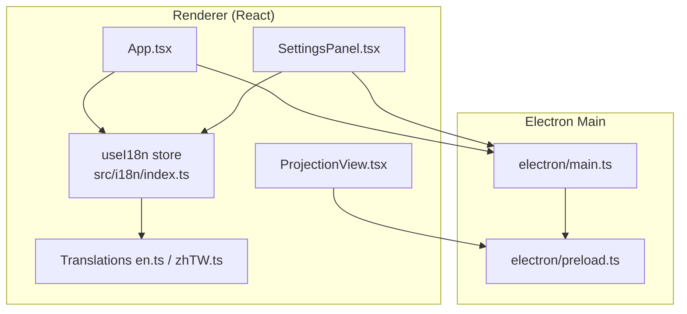
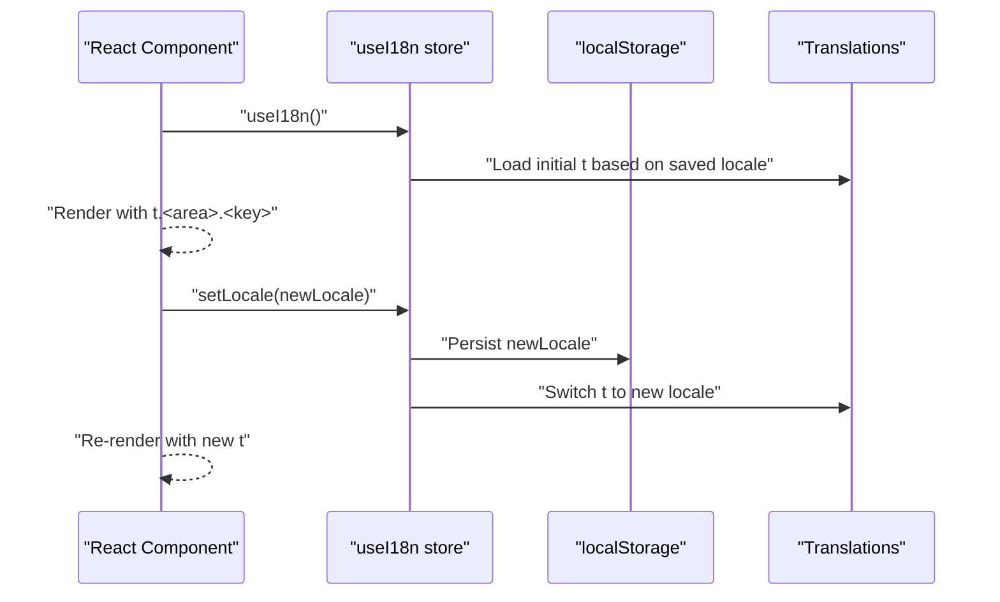
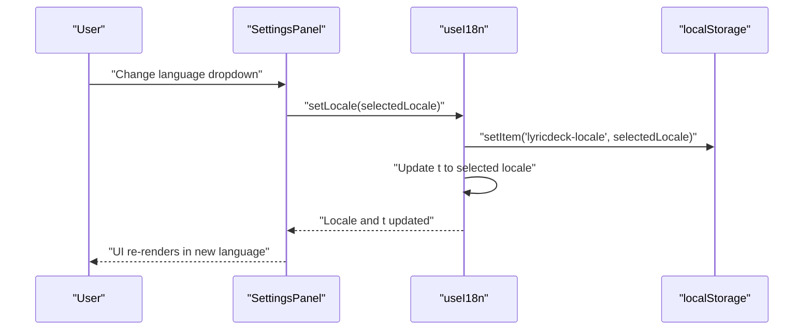
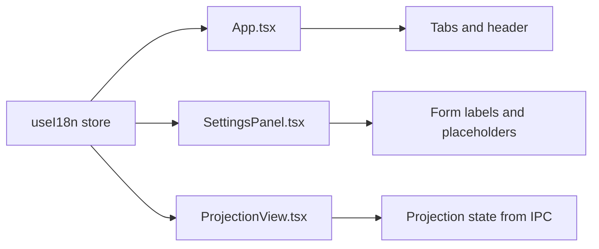
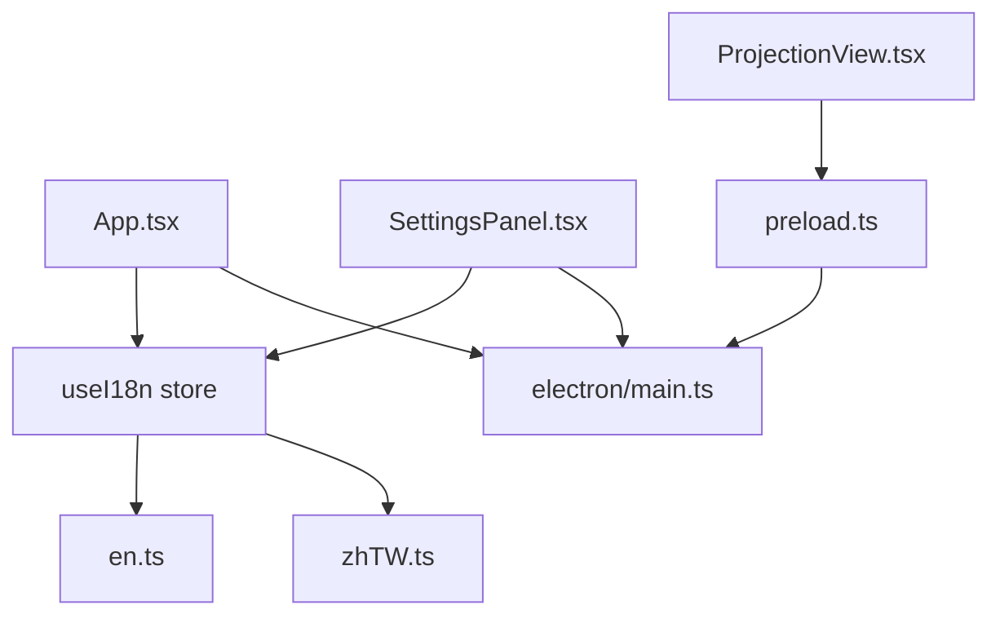

# Internationalization

<cite>
**Referenced Files in This Document**
- [index.ts](file://src/i18n/index.ts)
- [en.ts](file://src/i18n/en.ts)
- [zhTW.ts](file://src/i18n/zhTW.ts)
- [App.tsx](file://src/App.tsx)
- [SettingsPanel.tsx](file://src/components/SettingsPanel.tsx)
- [ProjectionView.tsx](file://src/components/ProjectionView.tsx)
- [appStore.ts](file://src/store/appStore.ts)
- [main.tsx](file://src/main.tsx)
- [main.ts](file://electron/main.ts)
- [preload.ts](file://electron/preload.ts)
- [index.ts](file://src/types/index.ts)
</cite>

## Table of Contents
1. [Introduction](#introduction)
2. [Project Structure](#project-structure)
3. [Core Components](#core-components)
4. [Architecture Overview](#architecture-overview)
5. [Detailed Component Analysis](#detailed-component-analysis)
6. [Dependency Analysis](#dependency-analysis)
7. [Performance Considerations](#performance-considerations)
8. [Troubleshooting Guide](#troubleshooting-guide)
9. [Conclusion](#conclusion)
10. [Appendices](#appendices)

## Introduction
This document explains LyricDeck’s internationalization (i18n) system. It covers the language support structure (English and Traditional Chinese), translation key organization, dynamic language switching, locale persistence, and integration with the React component architecture. It also provides guidelines for adding new languages, managing translation keys, fallback behavior, pluralization handling, date/time formatting considerations, and best practices for multilingual desktop applications.

## Project Structure
The i18n system is organized under a dedicated folder with a small runtime store and language packs. The store exposes a locale and a translation object, while components consume translations via hooks. Electron handles projection windows and IPC communication, which is relevant for how the interface behaves across windows.

**Diagram sources**
- [App.tsx:12-102](file://src/App.tsx#L12-L102)
- [SettingsPanel.tsx:1-523](file://src/components/SettingsPanel.tsx#L1-L523)
- [ProjectionView.tsx:1-134](file://src/components/ProjectionView.tsx#L1-L134)
- [index.ts:1-43](file://src/i18n/index.ts#L1-L43)
- [en.ts:1-180](file://src/i18n/en.ts#L1-L180)
- [zhTW.ts:1-180](file://src/i18n/zhTW.ts#L1-L180)
- [main.ts:1-390](file://electron/main.ts#L1-L390)
- [preload.ts:1-43](file://electron/preload.ts#L1-L43)

**Section sources**
- [index.ts:1-43](file://src/i18n/index.ts#L1-L43)
- [en.ts:1-180](file://src/i18n/en.ts#L1-L180)
- [zhTW.ts:1-180](file://src/i18n/zhTW.ts#L1-L180)
- [App.tsx:12-102](file://src/App.tsx#L12-L102)
- [SettingsPanel.tsx:1-523](file://src/components/SettingsPanel.tsx#L1-L523)
- [ProjectionView.tsx:1-134](file://src/components/ProjectionView.tsx#L1-L134)
- [main.ts:1-390](file://electron/main.ts#L1-L390)
- [preload.ts:1-43](file://electron/preload.ts#L1-L43)

## Core Components
- Translation store: Provides locale, translation object, and setter for dynamic language switching. It persists the user’s language preference in local storage and initializes from persisted state.
- Language packs: Two language packs define all translation keys grouped by functional areas (app, tabs, song library, editor, arrange, present, settings, background gallery, import/export, preparation list).
- React integration: Components consume translations via the store hook and render localized strings. The Settings panel includes a language selector bound to the store.

Key behaviors:
- Locale type union defines supported locales.
- Locale labels map locale identifiers to human-readable names.
- Initial locale is loaded from local storage; defaults to English if missing or invalid.
- Switching locale updates the translation object and persists the selection.

**Section sources**
- [index.ts:5-43](file://src/i18n/index.ts#L5-L43)
- [en.ts:1-180](file://src/i18n/en.ts#L1-L180)
- [zhTW.ts:1-180](file://src/i18n/zhTW.ts#L1-L180)
- [SettingsPanel.tsx:419-447](file://src/components/SettingsPanel.tsx#L419-L447)

## Architecture Overview
The i18n architecture is a thin, centralized store that exposes a translation object and locale state. Components depend on this store for all UI text. Electron’s projection window uses a separate renderer that receives projection state via IPC; it does not render translated UI text, so i18n is not directly involved in projection rendering.

**Diagram sources**
- [index.ts:17-42](file://src/i18n/index.ts#L17-L42)
- [SettingsPanel.tsx:419-447](file://src/components/SettingsPanel.tsx#L419-L447)

## Detailed Component Analysis

### Translation Store and Locale Management
- Locale union and labels: Defines supported locales and their display labels.
- Saved locale resolution: Reads from local storage; falls back to English if absent or invalid.
- Store state: Holds current locale and translation object; exposes a setter to change locale.
- Persistence: Writes the chosen locale to local storage on change.

**Diagram sources**
- [index.ts:17-42](file://src/i18n/index.ts#L17-L42)

**Section sources**
- [index.ts:5-43](file://src/i18n/index.ts#L5-L43)

### Translation Key Organization
Translation keys are grouped by functional areas to keep the dictionary organized and maintainable. Keys include:
- App-level labels and plural forms
- Tab labels
- Song library operations and placeholders
- Editor controls and prompts
- Section types
- Arrange panel labels and counts
- Present panel controls and hints
- Settings categories and labels
- Background gallery operations
- Import/export messages and placeholders
- Preparation list actions and counts

This structure enables consistent key naming and simplifies maintenance across languages.

**Section sources**
- [en.ts:1-180](file://src/i18n/en.ts#L1-L180)
- [zhTW.ts:1-180](file://src/i18n/zhTW.ts#L1-L180)

### Dynamic Language Switching Mechanism
- Settings panel provides a language selector bound to the store’s locale.
- Selecting a new locale triggers the store’s setter, which persists the choice and switches the translation object.
- Components re-render automatically because they subscribe to the store.

**Diagram sources**
- [SettingsPanel.tsx:419-447](file://src/components/SettingsPanel.tsx#L419-L447)
- [index.ts:35-42](file://src/i18n/index.ts#L35-L42)

**Section sources**
- [SettingsPanel.tsx:419-447](file://src/components/SettingsPanel.tsx#L419-L447)
- [index.ts:35-42](file://src/i18n/index.ts#L35-L42)

### Integration with React Component Architecture
- App header and tabs: Use translation keys for labels and counts.
- Settings panel: Uses translation keys for titles, descriptions, placeholders, and form labels.
- Projection view: Receives projection state via IPC; it renders content based on state, not translation keys.

**Diagram sources**
- [App.tsx:48-80](file://src/App.tsx#L48-L80)
- [SettingsPanel.tsx:56-416](file://src/components/SettingsPanel.tsx#L56-L416)
- [ProjectionView.tsx:22-29](file://src/components/ProjectionView.tsx#L22-L29)

**Section sources**
- [App.tsx:48-80](file://src/App.tsx#L48-L80)
- [SettingsPanel.tsx:56-416](file://src/components/SettingsPanel.tsx#L56-L416)
- [ProjectionView.tsx:22-29](file://src/components/ProjectionView.tsx#L22-L29)

### Electron Projection Window and i18n
- The projection window is a separate renderer that listens for projection state updates via IPC.
- It does not render translated UI text; it simply displays lyrics and background according to the received state.
- As a result, i18n is not directly involved in projection rendering.

**Section sources**
- [main.ts:111-152](file://electron/main.ts#L111-L152)
- [preload.ts:10-21](file://electron/preload.ts#L10-L21)
- [ProjectionView.tsx:1-134](file://src/components/ProjectionView.tsx#L1-L134)

## Dependency Analysis
- Components depend on the i18n store for translations.
- The store depends on language packs for translation values.
- Electron main process manages projection windows and IPC; it does not depend on i18n.
- The app store coordinates UI state and persistence; it does not depend on i18n.

**Diagram sources**
- [index.ts:1-43](file://src/i18n/index.ts#L1-L43)
- [en.ts:1-180](file://src/i18n/en.ts#L1-L180)
- [zhTW.ts:1-180](file://src/i18n/zhTW.ts#L1-L180)
- [App.tsx:12-102](file://src/App.tsx#L12-L102)
- [SettingsPanel.tsx:1-523](file://src/components/SettingsPanel.tsx#L1-L523)
- [ProjectionView.tsx:1-134](file://src/components/ProjectionView.tsx#L1-L134)
- [preload.ts:1-43](file://electron/preload.ts#L1-L43)
- [main.ts:1-390](file://electron/main.ts#L1-L390)

**Section sources**
- [index.ts:1-43](file://src/i18n/index.ts#L1-L43)
- [App.tsx:12-102](file://src/App.tsx#L12-L102)
- [SettingsPanel.tsx:1-523](file://src/components/SettingsPanel.tsx#L1-L523)
- [ProjectionView.tsx:1-134](file://src/components/ProjectionView.tsx#L1-L134)
- [preload.ts:1-43](file://electron/preload.ts#L1-L43)
- [main.ts:1-390](file://electron/main.ts#L1-L390)

## Performance Considerations
- Translation lookups are constant-time object property access; negligible overhead.
- Switching locales updates the translation object and re-renders affected components; this is efficient and acceptable for desktop apps.
- Avoid unnecessary re-renders by keeping translation usage scoped to components that need it.

## Troubleshooting Guide
Common issues and resolutions:
- Missing translation keys: Ensure the key exists in both language packs or add it to the English pack and mirror it in others.
- Incorrect pluralization: Use separate keys for singular/plural forms (as seen in the English pack) and ensure the corresponding key exists in each language pack.
- Locale not persisting: Verify local storage writes succeed and the saved value matches supported locales.
- Projection window not reflecting language changes: This is expected; projection renderer does not use i18n.

**Section sources**
- [index.ts:17-25](file://src/i18n/index.ts#L17-L25)
- [en.ts:4-7](file://src/i18n/en.ts#L4-L7)
- [zhTW.ts:6-9](file://src/i18n/zhTW.ts#L6-L9)

## Conclusion
LyricDeck’s i18n system is straightforward and effective: a central store manages locale and translations, language packs organize keys by functional area, and components consume translations via hooks. Dynamic language switching is seamless and persistent. Electron’s projection window operates independently of i18n, focusing on rendering lyrics and backgrounds. Following the established patterns ensures consistency and scalability when adding new languages or keys.

## Appendices

### Adding a New Language
Steps:
1. Create a new translation file under the i18n folder with the same structure as existing language packs.
2. Export the new translation object and import it in the i18n index file.
3. Add the locale to the locale union and locale labels mapping.
4. Ensure all translation keys exist in the new language pack; use placeholders for missing keys during development.
5. Test language switching in the Settings panel and verify persistence.

Guidelines:
- Keep translation keys aligned across languages.
- Use distinct keys for pluralization and counts.
- Avoid embedding dynamic values inside translation strings; pass values externally and compose messages.

**Section sources**
- [index.ts:5-15](file://src/i18n/index.ts#L5-L15)
- [index.ts:27-42](file://src/i18n/index.ts#L27-L42)
- [en.ts:1-180](file://src/i18n/en.ts#L1-L180)
- [zhTW.ts:1-180](file://src/i18n/zhTW.ts#L1-L180)

### Managing Translation Keys
- Group keys by functional areas to improve readability and maintenance.
- Use descriptive key names that reflect context (e.g., “settings.title”, “songLibrary.search”).
- Separate singular and plural forms when needed (as shown in the English pack).
- For dynamic values, pass parameters externally and format messages in components.

**Section sources**
- [en.ts:4-7](file://src/i18n/en.ts#L4-L7)
- [en.ts:169-176](file://src/i18n/en.ts#L169-L176)

### Fallback Mechanisms
- If a key is missing in a language pack, accessing it yields undefined. Preferably provide fallbacks in components or ensure all keys are present in all packs.
- The store initializes with English if the saved locale is invalid or missing.

**Section sources**
- [index.ts:17-25](file://src/i18n/index.ts#L17-L25)

### Pluralization Handling
- Use separate keys for singular and plural forms (e.g., “songs” and “songsPlural”) and select the appropriate key based on count.
- Ensure both language packs include both keys.

**Section sources**
- [en.ts:4-7](file://src/i18n/en.ts#L4-L7)
- [zhTW.ts:6-9](file://src/i18n/zhTW.ts#L6-L9)

### Date/Time Formatting Considerations
- The current i18n system does not include date/time formatting helpers. If needed, integrate a formatting library and expose a formatter via the store or a dedicated utility.
- For now, dates are stored as ISO strings and rendered as-is in UI contexts.

**Section sources**
- [index.ts:1-43](file://src/i18n/index.ts#L1-L43)
- [types/index.ts:50-67](file://src/types/index.ts#L50-L67)

### Practical Examples
- Using translations in components:
  - Tabs and header labels: Access via the translation object and render in the App component.
  - Settings labels and placeholders: Use translation keys for form elements in the Settings panel.
- Handling user language preferences:
  - Bind a select element to the store’s locale setter.
  - Persist the selection to local storage for continuity across sessions.

**Section sources**
- [App.tsx:48-80](file://src/App.tsx#L48-L80)
- [SettingsPanel.tsx:419-447](file://src/components/SettingsPanel.tsx#L419-L447)
- [index.ts:35-42](file://src/i18n/index.ts#L35-L42)

### Best Practices for Multilingual Desktop Applications
- Centralize translation management to minimize duplication and inconsistencies.
- Keep translation keys stable and versioned alongside releases.
- Provide clear separation between static strings and dynamic values.
- Test language switching and persistence across different environments.
- Avoid hardcoding strings in components; always use translation keys.
- Consider accessibility: ensure translated text fits UI constraints and is readable in all languages.

[No sources needed since this section provides general guidance]