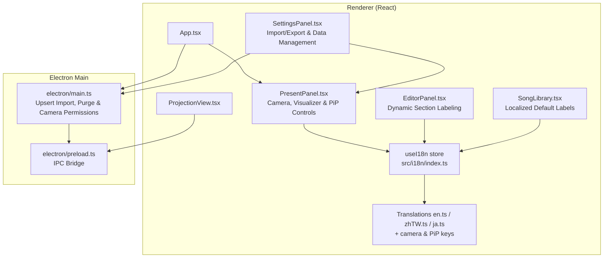
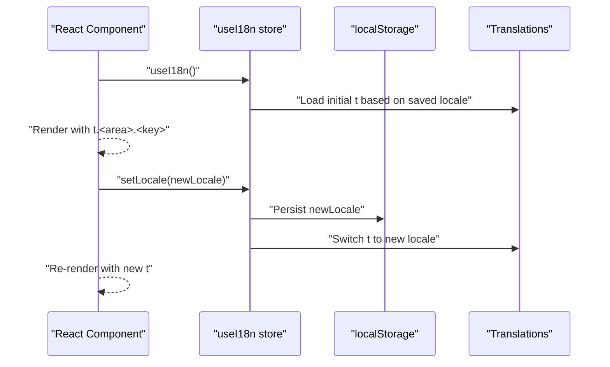
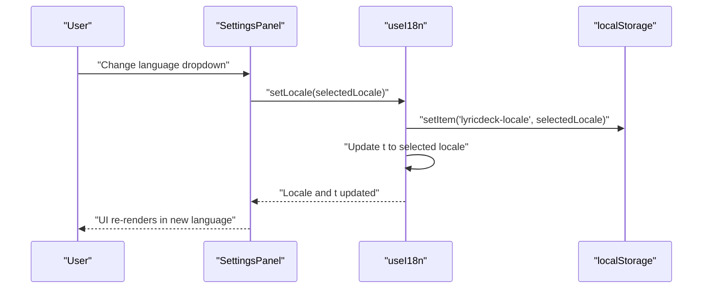
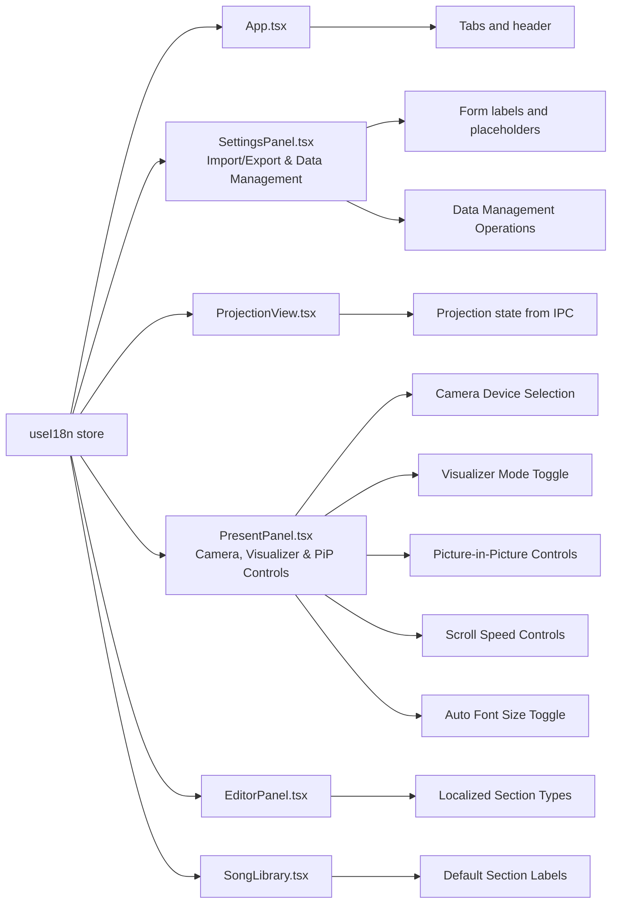
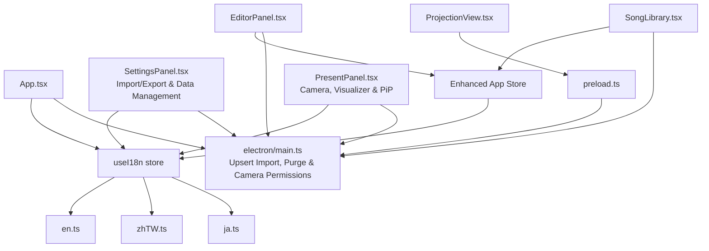

# Internationalization

<cite>
**Referenced Files in This Document**
- [index.ts](file://src/i18n/index.ts)
- [en.ts](file://src/i18n/en.ts)
- [zhTW.ts](file://src/i18n/zhTW.ts)
- [ja.ts](file://src/i18n/ja.ts)
- [SettingsPanel.tsx](file://src/components/SettingsPanel.tsx)
- [PresentPanel.tsx](file://src/components/PresentPanel.tsx)
- [main.ts](file://electron/main.ts)
- [preload.ts](file://electron/preload.ts)
</cite>

## Update Summary
**Changes Made**
- Added comprehensive documentation for camera-related translation keys including 'visualizer', 'camera', 'noCamera', 'cameraUnavailable', 'pip', 'pipPosition', 'pipLeft', and 'pipRight'
- Updated keyboard shortcut help text documentation with visualizer and PiP functionality
- Enhanced Present panel section with camera device management and picture-in-picture capabilities
- Added detailed examples of camera integration and Picture-in-Picture implementation across all supported languages
- Updated component integration examples to show proper usage of new camera-related translation keys

## Table of Contents
1. [Introduction](#introduction)
2. [Project Structure](#project-structure)
3. [Core Components](#core-components)
4. [Architecture Overview](#architecture-overview)
5. [Language Support Structure](#language-support-structure)
6. [Detailed Component Analysis](#detailed-component-analysis)
7. [Japanese Language Implementation](#japanese-language-implementation)
8. [Camera and Visualizer Features](#camera-and-visualizer-features)
9. [Picture-in-Picture Functionality](#picture-in-picture-functionality)
10. [Keyboard Shortcuts and Help Text](#keyboard-shortcuts-and-help-text)
11. [Import/Export Functionality](#importexport-functionality)
12. [Data Management Operations](#data-management-operations)
13. [Status Message System](#status-message-system)
14. [Action Enhancement](#action-enhancement)
15. [Scroll Control Functionality](#scroll-control-functionality)
16. [Auto Font Size Feature](#auto-font-size-feature)
17. [Dependency Analysis](#dependency-analysis)
18. [Performance Considerations](#performance-considerations)
19. [Troubleshooting Guide](#troubleshooting-guide)
20. [Conclusion](#conclusion)
21. [Appendices](#appendices)

## Introduction
This document explains LyricDeck's internationalization (i18n) system. It covers the language support structure (English, Traditional Chinese, and Japanese), translation key organization, dynamic language switching, locale persistence, and integration with the React component architecture. It also provides guidelines for adding new languages, managing translation keys, fallback behavior, pluralization handling, date/time formatting considerations, and best practices for multilingual desktop applications.

The system provides comprehensive internationalization support for advanced data management operations including upsert import functionality, purge data vocabulary, sophisticated status message translations, and advanced camera features including visualizer mode, camera device management, and Picture-in-Picture capabilities across all supported languages. The i18n architecture ensures consistent user experience across English, Traditional Chinese, and Japanese implementations while maintaining proper localization for complex data operations and multimedia features.

## Project Structure
The i18n system is organized under a dedicated folder with a small runtime store and language packs. The store exposes a locale and a translation object, while components consume translations via hooks. Electron handles projection windows and IPC communication, which is relevant for how the interface behaves across windows. Camera permissions are handled through the main process for security compliance.



**Diagram sources**
- [index.ts:1-46](file://src/i18n/index.ts#L1-L46)
- [en.ts:1-207](file://src/i18n/en.ts#L1-L207)
- [zhTW.ts:1-207](file://src/i18n/zhTW.ts#L1-L207)
- [ja.ts:1-207](file://src/i18n/ja.ts#L1-L207)
- [SettingsPanel.tsx:1-664](file://src/components/SettingsPanel.tsx#L1-L664)
- [PresentPanel.tsx:1-581](file://src/components/PresentPanel.tsx#L1-L581)
- [main.ts:1-484](file://electron/main.ts#L1-L484)
- [preload.ts:1-48](file://electron/preload.ts#L1-L48)

**Section sources**
- [index.ts:1-46](file://src/i18n/index.ts#L1-L46)
- [en.ts:1-207](file://src/i18n/en.ts#L1-L207)
- [zhTW.ts:1-207](file://src/i18n/zhTW.ts#L1-L207)
- [ja.ts:1-207](file://src/i18n/ja.ts#L1-L207)
- [SettingsPanel.tsx:1-664](file://src/components/SettingsPanel.tsx#L1-L664)
- [PresentPanel.tsx:1-581](file://src/components/PresentPanel.tsx#L1-L581)
- [main.ts:1-484](file://electron/main.ts#L1-L484)
- [preload.ts:1-48](file://electron/preload.ts#L1-L48)

## Core Components
- Translation store: Provides locale, translation object, and setter for dynamic language switching. It persists the user's language preference in local storage and initializes from persisted state.
- Language packs: Three language packs define all translation keys grouped by functional areas (app, tabs, song library, editor, arrange, present, settings, background gallery, import/export, preparation list, purge data).
- React integration: Components consume translations via the store hook and render localized strings. The Settings panel includes a language selector bound to the store.
- Dynamic section labeling: Enhanced store actions support dynamic section type localization and custom default labels.
- Scroll control functionality: New scroll speed control with internationalized labels for presentation mode.
- Auto Font Size feature: Automatic font size adjustment capability with comprehensive internationalization support.
- Advanced data management: Comprehensive internationalization for upsert import operations and purge data functionality with detailed status messaging.
- Camera and Visualizer features: Complete internationalization for camera device management, visualizer mode, and Picture-in-Picture functionality.

Key behaviors:
- Locale type union defines supported locales (English, Traditional Chinese, Japanese).
- Locale labels map locale identifiers to human-readable names.
- Initial locale is loaded from local storage; defaults to English if missing or invalid.
- Switching locale updates the translation object and persists the selection.
- Enhanced actions support optional parameters for localized section types and custom labels.
- Scroll speed control provides configurable timing for line shifting operations.
- Auto Font Size feature automatically calculates optimal font sizes based on content and display dimensions.
- Data management operations provide comprehensive internationalization for complex import/export and data cleanup workflows.
- Camera features provide full internationalization for device selection, visualizer mode, and Picture-in-Picture positioning.

**Section sources**
- [index.ts:5-46](file://src/i18n/index.ts#L5-L46)
- [en.ts:1-207](file://src/i18n/en.ts#L1-L207)
- [zhTW.ts:1-207](file://src/i18n/zhTW.ts#L1-L207)
- [ja.ts:1-207](file://src/i18n/ja.ts#L1-L207)
- [SettingsPanel.tsx:419-447](file://src/components/SettingsPanel.tsx#L419-L447)

## Architecture Overview
The i18n architecture is a thin, centralized store that exposes a translation object and locale state. Components depend on this store for all UI text. Electron's projection window uses a separate renderer that receives projection state via IPC; it does not render translated UI text, so i18n is not directly involved in projection rendering. Camera permissions are granted through the main process for security compliance.



**Diagram sources**
- [index.ts:17-45](file://src/i18n/index.ts#L17-L45)
- [SettingsPanel.tsx:419-447](file://src/components/SettingsPanel.tsx#L419-L447)

## Language Support Structure
LyricDeck currently supports three languages with comprehensive coverage across all application features:

### Supported Languages
- **English**: Primary language with complete translation coverage
- **Traditional Chinese**: Full translation support for all features
- **Japanese**: Comprehensive Japanese language support with complete translation coverage

### Locale Configuration
The system maintains a unified locale type and configuration structure:

```typescript
export type Locale = 'en' | 'zh-TW' | 'ja';

const locales: Record<Locale, Translations> = {
  en,
  'zh-TW': zhTW,
  ja,
};

export const localeLabels: Record<Locale, string> = {
  en: 'English',
  'zh-TW': '繁體中文',
  ja: '日本語',
};
```

### Translation Coverage
Each language pack provides complete coverage for:
- App-level labels and plural forms
- Tab navigation (Editor, Arrange, Present, Settings)
- Song library operations and search functionality
- Editor controls and section management
- Section type localization (Intro, Verse, Pre-Chorus, Chorus, Bridge, Instrumental, Outro, Custom)
- Arrange panel functionality
- Present panel controls and auto font size feature
- Camera and visualizer features with device management
- Picture-in-Picture functionality with positioning options
- Settings categories and presentation customization
- Background gallery operations
- Import/export functionality with upsert capabilities
- Preparation list management
- Data management operations with comprehensive purge functionality
- Status message system with detailed operation feedback
- Keyboard shortcuts and help text with multimedia controls

**Section sources**
- [index.ts:6](file://src/i18n/index.ts#L6)
- [index.ts:8](file://src/i18n/index.ts#L8)
- [index.ts:14](file://src/i18n/index.ts#L14)
- [ja.ts:1-207](file://src/i18n/ja.ts#L1-L207)

## Detailed Component Analysis

### Translation Store and Locale Management
- Locale union and labels: Defines supported locales and their display labels.
- Saved locale resolution: Reads from local storage; falls back to English if absent or invalid.
- Store state: Holds current locale and translation object; exposes a setter to change locale.
- Persistence: Writes the chosen locale to local storage on change.


**Diagram sources**
- [index.ts:17-45](file://src/i18n/index.ts#L17-L45)

**Section sources**
- [index.ts:5-46](file://src/i18n/index.ts#L5-L46)

### Translation Key Organization
Translation keys are grouped by functional areas to keep the dictionary organized and maintainable. Keys include:
- App-level labels and plural forms
- Tab labels
- Song library operations and placeholders
- Editor controls and prompts
- Section types
- Arrange panel labels and counts
- Present panel controls and hints
- Camera and visualizer features with device management
- Picture-in-Picture functionality with positioning options
- Settings categories and labels
- Background gallery operations
- Import/export messages and placeholders with upsert capabilities
- Preparation list actions and counts
- Data management operations with comprehensive purge functionality
- Status message system with detailed operation feedback
- Keyboard shortcuts and help text with multimedia controls

This structure enables consistent key naming and simplifies maintenance across languages.

**Section sources**
- [en.ts:1-207](file://src/i18n/en.ts#L1-L207)
- [zhTW.ts:1-207](file://src/i18n/zhTW.ts#L1-L207)
- [ja.ts:1-207](file://src/i18n/ja.ts#L1-L207)

### Dynamic Language Switching Mechanism
- Settings panel provides a language selector bound to the store's locale.
- Selecting a new locale triggers the store's setter, which persists the choice and switches the translation object.
- Components re-render automatically because they subscribe to the store.



**Diagram sources**
- [SettingsPanel.tsx:419-447](file://src/components/SettingsPanel.tsx#L419-L447)
- [index.ts:38-45](file://src/i18n/index.ts#L38-L45)

**Section sources**
- [SettingsPanel.tsx:419-447](file://src/components/SettingsPanel.tsx#L419-L447)
- [index.ts:38-45](file://src/i18n/index.ts#L38-L45)

### Integration with React Component Architecture
- App header and tabs: Use translation keys for labels and counts.
- Settings panel: Uses translation keys for titles, descriptions, placeholders, and form labels.
- Projection view: Receives projection state via IPC; it renders content based on state, not translation keys.
- Editor panel: Passes localized section type names to store actions for dynamic labeling.
- Song library: Uses localized section types for default song creation.
- Present panel: Uses translation keys for scroll control functionality, camera features, and Picture-in-Picture controls including speed adjustments and auto font size feature.
- Data management operations: Comprehensive internationalization for import/export and purge functionality with detailed status messaging.



**Diagram sources**
- [App.tsx:48-80](file://src/App.tsx#L48-L80)
- [SettingsPanel.tsx:56-663](file://src/components/SettingsPanel.tsx#L56-L663)
- [ProjectionView.tsx:22-29](file://src/components/ProjectionView.tsx#L22-L29)
- [PresentPanel.tsx:305-344](file://src/components/PresentPanel.tsx#L305-L344)
- [PresentPanel.tsx:384-390](file://src/components/PresentPanel.tsx#L384-L390)
- [PresentPanel.tsx:396-401](file://src/components/PresentPanel.tsx#L396-L401)
- [EditorPanel.tsx:106-107](file://src/components/EditorPanel.tsx#L106-L107)
- [SongLibrary.tsx:88-91](file://src/components/SongLibrary.tsx#L88-L91)

**Section sources**
- [App.tsx:48-80](file://src/App.tsx#L48-L80)
- [SettingsPanel.tsx:56-663](file://src/components/SettingsPanel.tsx#L56-L663)
- [ProjectionView.tsx:22-29](file://src/components/ProjectionView.tsx#L22-L29)
- [PresentPanel.tsx:305-344](file://src/components/PresentPanel.tsx#L305-L344)
- [PresentPanel.tsx:384-390](file://src/components/PresentPanel.tsx#L384-L390)
- [PresentPanel.tsx:396-401](file://src/components/PresentPanel.tsx#L396-L401)
- [EditorPanel.tsx:106-107](file://src/components/EditorPanel.tsx#L106-L107)
- [SongLibrary.tsx:88-91](file://src/components/SongLibrary.tsx#L88-L91)

### Electron Projection Window and i18n
- The projection window is a separate renderer that listens for projection state updates via IPC.
- It does not render translated UI text; it simply displays lyrics and background according to the received state.
- As a result, i18n is not directly involved in projection rendering.
- Camera permissions are granted through the main process for security compliance.

**Section sources**
- [main.ts:111-152](file://electron/main.ts#L111-L152)
- [main.ts:455-460](file://electron/main.ts#L455-L460)
- [preload.ts:10-21](file://electron/preload.ts#L10-L21)
- [ProjectionView.tsx:1-134](file://src/components/ProjectionView.tsx#L1-L134)

## Japanese Language Implementation

LyricDeck provides comprehensive Japanese language support with complete translation coverage across all application features, including advanced data management operations and multimedia features.

### Japanese Translation Coverage
The Japanese translation file (`src/i18n/ja.ts`) provides complete localization for:

#### Core Application Features
- **App Level**: Complete app title and song count localization
- **Tabs**: Japanese translations for Editor, Arrange, Present, and Settings
- **Song Library**: Full search, add, delete, and sorting functionality
- **Editor**: Section management, lyrics input, and preview functionality
- **Section Types**: Proper Japanese localization for all section types (Intro, Verse, Pre-Chorus, Chorus, Bridge, Instrumental, Outro, Custom)

#### Presentation and Settings
- **Arrange Panel**: Complete arrangement building and management
- **Present Panel**: Full presentation controls including auto font size feature
- **Camera Features**: Complete camera device management and visualizer mode localization
- **Picture-in-Picture**: Full PiP functionality with positioning options
- **Settings**: Comprehensive presentation customization options
- **Background Gallery**: Image management and selection
- **Import/Export**: Data transfer functionality with upsert capabilities
- **Preparation List**: Set list management
- **Data Management**: Comprehensive purge functionality with detailed status messaging

#### Technical Implementation
The Japanese implementation follows the same structure as other language packs:
- Uses the same key organization pattern
- Maintains consistent pluralization handling
- Supports dynamic section labeling
- Includes scroll speed and auto font size functionality
- Provides complete localization for all UI elements
- Comprehensive support for upsert import operations and purge data functionality
- Full camera and Picture-in-Picture feature localization

### Japanese Localization Examples
The Japanese translation provides culturally appropriate localization for Japanese users:

**Example: Camera Features**
- "Visualizer" → "ビジュアライザー" (Visualizer)
- "Camera" → "カメラ" (Camera)
- "No camera detected" → "カメラが検出されません" (No camera detected)
- "PiP" → "ピクチャーインピクチャー" (Picture-in-Picture)
- "Bottom Left" → "左下" (Bottom Left)
- "Bottom Right" → "右下" (Bottom Right)

**Example: Settings Interface**
- "Language" → "言語" (Language)
- "Interface Language" → "インターフェース言語" (Interface Language)
- "Presentation Settings" → "プレゼン設定" (Presentation Settings)

**Example: Section Types**
- "Intro" → "イントロ" (Intro)
- "Verse" → "バース" (Verse)
- "Chorus" → "コーラス" (Chorus)
- "Bridge" → "ブリッジ" (Bridge)

**Example: Present Panel**
- "Auto Font Size" → "自動フォントサイズ" (Auto Font Size)
- "Speed" → "速度" (Speed)

**Example: Data Management**
- "Purge All Data" → "すべてのデータを消去" (Purge All Data)
- "Import (Update Existing)" → "インポート（既存を更新）" (Import - Update Existing)
- "Purging..." → "消去中..." (Purging...)

**Section sources**
- [ja.ts:1-207](file://src/i18n/ja.ts#L1-L207)
- [index.ts:6](file://src/i18n/index.ts#L6)
- [index.ts:14](file://src/i18n/index.ts#L14)
- [index.ts:8](file://src/i18n/index.ts#L8)

## Camera and Visualizer Features

### Camera Device Management
The camera system provides comprehensive device management with full internationalization support across all three supported languages.

#### Camera Detection and Selection
- **Device Enumeration**: Automatically detects available camera devices through the MediaDevices API
- **Permission Handling**: Requests camera permissions gracefully with fallback handling
- **Device Selection**: Provides dropdown interface for selecting between multiple cameras
- **Dynamic Updates**: Updates device list when camera availability changes

#### Visualizer Mode
- **Mode Toggle**: Switches between live projection and camera visualizer modes
- **State Management**: Maintains camera device selection across mode changes
- **Integration**: Seamlessly integrates with existing projection workflow

### Translation Keys for Camera Features
All three language packs (English, Traditional Chinese, Japanese) include comprehensive camera-related translation keys:

**English translations:**
```typescript
present: {
  // ... existing keys ...
  visualizer: 'Visualizer',
  camera: 'Camera',
  noCamera: 'No camera detected',
  cameraUnavailable: 'Camera unavailable',
  pip: 'PiP',
  pipPosition: 'PiP Position',
  pipLeft: 'Bottom Left',
  pipRight: 'Bottom Right',
}
```

**Traditional Chinese translations:**
```typescript
present: {
  // ... existing keys ...
  visualizer: '實物投影',
  camera: '攝影機',
  noCamera: '未偵測到攝影機',
  cameraUnavailable: '無法使用攝影機',
  pip: '子母畫面',
  pipPosition: '子母畫面位置',
  pipLeft: '左下角',
  pipRight: '右下角',
}
```

**Japanese translations:**
```typescript
present: {
  // ... existing keys ...
  visualizer: 'ビジュアライザー',
  camera: 'カメラ',
  noCamera: 'カメラが検出されません',
  cameraUnavailable: 'カメラを使用できません',
  pip: 'ピクチャーインピクチャー',
  pipPosition: 'ピクチャーインピクチャー位置',
  pipLeft: '左下',
  pipRight: '右下',
}
```

### Component Integration
The camera functionality is integrated into the PresentPanel component through the following implementation:

```typescript
// Camera device enumeration and state management
const [cameras, setCameras] = useState<MediaDeviceInfo[]>([]);
const [selectedCamera, setSelectedCamera] = useState<string>('');

// Camera permission and device loading
useEffect(() => {
  async function loadCameras() {
    try {
      stream = await navigator.mediaDevices.getUserMedia({ video: true, audio: false });
      const devices = await navigator.mediaDevices.enumerateDevices();
      const cams = devices.filter((d) => d.kind === 'videoinput');
      setCameras(cams);
      if (cams.length > 0) setSelectedCamera(cams[0].deviceId);
      stream.getTracks().forEach((track) => track.stop());
    } catch {
      return; // no camera or permission denied
    }
  }
  loadCameras();
}, []);

// Camera device selection dropdown
<select
  value={selectedCamera}
  onChange={(e) => handleCameraChange(e.target.value)}
  className="input w-44 text-xs py-1.5"
  aria-label={t.present.camera}
>
  {cameras.length === 0 ? (
    <option value="">{t.present.noCamera}</option>
  ) : (
    cameras.map((cam, i) => (
      <option key={cam.deviceId} value={cam.deviceId}>
        {cam.label || `${t.present.camera} ${i + 1}`}
      </option>
    ))
  )}
</select>

// Visualizer mode toggle
<button
  onClick={toggleVisualizer}
  className={`btn text-sm ${projectionState.mode === 'camera' ? 'btn-primary' : 'btn-secondary'}`}
>
  {t.present.visualizer}
</button>
```

**Section sources**
- [en.ts:100-107](file://src/i18n/en.ts#L100-L107)
- [zhTW.ts:102-109](file://src/i18n/zhTW.ts#L102-L109)
- [ja.ts:102-109](file://src/i18n/ja.ts#L102-L109)
- [PresentPanel.tsx:62-101](file://src/components/PresentPanel.tsx#L62-L101)
- [PresentPanel.tsx:103-117](file://src/components/PresentPanel.tsx#L103-L117)
- [PresentPanel.tsx:305-326](file://src/components/PresentPanel.tsx#L305-L326)

## Picture-in-Picture Functionality

### Picture-in-Picture Implementation
The Picture-in-Picture (PiP) feature allows users to display a small camera feed overlay on top of the main presentation content.

#### PiP Controls and Positioning
- **Toggle Control**: Enables/disables PiP mode independently from visualizer mode
- **Position Selection**: Allows users to choose between bottom-left and bottom-right positions
- **State Synchronization**: Maintains PiP state across different projection modes
- **Conditional Display**: Shows PiP controls only when PiP is enabled and not in camera mode

### Translation Keys for Picture-in-Picture
All three language packs include comprehensive Picture-in-Picture translation keys:

**English translations:**
```typescript
present: {
  pip: 'PiP',
  pipPosition: 'PiP Position',
  pipLeft: 'Bottom Left',
  pipRight: 'Bottom Right',
}
```

**Traditional Chinese translations:**
```typescript
present: {
  pip: '子母畫面',
  pipPosition: '子母畫面位置',
  pipLeft: '左下角',
  pipRight: '右下角',
}
```

**Japanese translations:**
```typescript
present: {
  pip: 'ピクチャーインピクチャー',
  pipPosition: 'ピクチャーインピクチャー位置',
  pipLeft: '左下',
  pipRight: '右下',
}
```

### Component Integration
The Picture-in-Picture functionality is integrated into the PresentPanel component:

```typescript
function togglePip() {
  const current = useAppStore.getState().projectionState;
  const next = !(current.pipEnabled ?? false);
  useAppStore.getState().setProjectionState({
    pipEnabled: next,
    pipPosition: current.pipPosition ?? 'bottom-right',
    cameraDeviceId: next ? selectedCamera || undefined : current.cameraDeviceId,
  });
}

// PiP position selector (shown conditionally)
{pipEnabled && projectionState.mode !== 'camera' && (
  <select
    value={pipPosition}
    onChange={(e) => setPipCorner(e.target.value as PipPosition)}
    className="input w-36 text-xs py-1.5"
    aria-label={t.present.pipPosition}
  >
    <option value="bottom-left">{t.present.pipLeft}</option>
    <option value="bottom-right">{t.present.pipRight}</option>
  </select>
)}

// PiP toggle button
<button
  onClick={togglePip}
  disabled={projectionState.mode === 'camera'}
  className={`btn text-sm ${pipEnabled ? 'btn-primary' : 'btn-secondary'} disabled:opacity-40 disabled:cursor-not-allowed`}
>
  {t.present.pip}
</button>
```

**Section sources**
- [en.ts:104-107](file://src/i18n/en.ts#L104-L107)
- [zhTW.ts:106-109](file://src/i18n/zhTW.ts#L106-L109)
- [ja.ts:106-109](file://src/i18n/ja.ts#L106-L109)
- [PresentPanel.tsx:119-131](file://src/components/PresentPanel.tsx#L119-L131)
- [PresentPanel.tsx:327-344](file://src/components/PresentPanel.tsx#L327-L344)

## Keyboard Shortcuts and Help Text

### Keyboard Shortcut System
The application implements comprehensive keyboard shortcuts for presentation control, including new shortcuts for camera and Picture-in-Picture functionality.

#### Shortcut Keys
- **Space/→**: Next slide
- **←**: Previous slide  
- **B**: Toggle black screen
- **C**: Clear screen
- **P**: Toggle projection
- **V**: Toggle visualizer/camera mode
- **I**: Toggle Picture-in-Picture mode
- **Esc**: Reset to live mode

### Translation Keys for Keyboard Shortcuts
All three language packs include comprehensive keyboard shortcut help text:

**English translations:**
```typescript
present: {
  shortcuts: 'Space/→ Next  |  ← Prev  |  B Black  |  C Clear  |  P Projection  |  V Visualizer  |  I PiP  |  Esc Reset',
}
```

**Traditional Chinese translations:**
```typescript
present: {
  shortcuts: 'Space/→ 下一張  |  ← 上一張  |  B 黑幕  |  C 清除  |  P 投影  |  V 實物投影  |  I 子母畫面  |  Esc 還原',
}
```

**Japanese translations:**
```typescript
present: {
  shortcuts: 'Space/→ 次へ  |  ← 前へ  |  B ブラック  |  C クリア  |  P 投影  |  V ビジュアライザー  |  I ピクチャーインピクチャー  |  Esc リセット',
}
```

### Component Integration
The keyboard shortcuts are implemented in the PresentPanel component:

```typescript
const handleKeyDown = useCallback(
  (e: KeyboardEvent) => {
    if (!song) return;
    if ((e.target as HTMLElement).tagName === 'INPUT' || (e.target as HTMLElement).tagName === 'TEXTAREA') return;

    switch (e.key) {
      case ' ':
      case 'ArrowRight':
        e.preventDefault();
        nextSlide();
        break;
      case 'ArrowLeft':
        e.preventDefault();
        prevSlide();
        break;
      case 'b':
      case 'B':
        e.preventDefault();
        setProjectionMode(projectionState.mode === 'black' ? 'live' : 'black');
        break;
      case 'c':
      case 'C':
        e.preventDefault();
        setProjectionMode(projectionState.mode === 'clear' ? 'live' : 'clear');
        break;
      case 'p':
      case 'P':
        e.preventDefault();
        toggleProjection();
        break;
      case 'v':
      case 'V':
        e.preventDefault();
        toggleVisualizer();
        break;
      case 'i':
      case 'I':
        e.preventDefault();
        togglePip();
        break;
      case 'Escape':
        e.preventDefault();
        if (projectionState.mode !== 'live') {
          setProjectionMode('live');
        }
        break;
    }
  },
  [song, projectionState.mode, projectionState.pipEnabled, nextSlide, prevSlide, setProjectionMode, isProjectionOpen, selectedDisplay, selectedCamera]
);

// Display keyboard shortcuts in UI
<div className="text-center">
  <p className="text-xs text-surface-500">{t.present.shortcuts}</p>
</div>
```

**Section sources**
- [en.ts:95](file://src/i18n/en.ts#L95)
- [zhTW.ts:97](file://src/i18n/zhTW.ts#L97)
- [ja.ts:97](file://src/i18n/ja.ts#L97)
- [PresentPanel.tsx:177-228](file://src/components/PresentPanel.tsx#L177-L228)
- [PresentPanel.tsx:564-567](file://src/components/PresentPanel.tsx#L564-L567)

## Import/Export Functionality

### Standard Import/Export Operations
The import/export system provides comprehensive data management capabilities with full internationalization support across all three supported languages.

#### Export Functionality
- **Export Data**: Exports all songs, settings, and background images to a single file
- **Status Messages**: Provides localized success and error messages
- **Progress Indicators**: Shows localized "Exporting..." status during operations

#### Standard Import Functionality
- **Import Data**: Imports songs, settings, and background images from exported files
- **Validation**: Validates file format and provides appropriate error messages
- **Success Feedback**: Displays localized confirmation with item counts

#### Upsert Import Functionality
The upsert import feature provides advanced data management capabilities:

- **Import (Update Existing)**: Updates existing items by ID while adding new ones
- **Smart Deduplication**: Automatically detects and updates existing songs and images
- **Detailed Reporting**: Provides comprehensive success messages with specific counts for added vs. updated items
- **Version Compatibility**: Supports both v1 and v2 export formats with appropriate handling

### Translation Keys for Import/Export
All three language packs (English, Traditional Chinese, Japanese) include comprehensive import/export translation keys:

**English translations:**
```typescript
importExport: {
  title: 'Import / Export',
  export: 'Export Data',
  exportDescription: 'Export all songs, settings, and background images to a file.',
  import: 'Import Data',
  importDescription: 'Import songs, settings, and background images from a file.',
  importUpsert: 'Import (Update Existing)',
  importUpsertDescription: 'Import data and replace existing songs and images with matching IDs. New items will be added.',
  exportSuccess: 'Data exported successfully!',
  importSuccess: 'Imported {songs} songs and {backgrounds} background images.',
  importUpsertSuccess: 'Added {added} songs, updated {updated} songs. Backgrounds: {bgAdded} added, {bgUpdated} updated.',
  importFailed: 'Import failed. The file may be invalid or corrupted.',
  exporting: 'Exporting...',
  importing: 'Importing...',
}
```

**Traditional Chinese translations:**
```typescript
importExport: {
  title: '匯入 / 匯出',
  export: '匯出資料',
  exportDescription: '將所有歌曲、設定和背景圖片匯出為檔案。',
  import: '匯入資料',
  importDescription: '從檔案匯入歌曲、設定和背景圖片。',
  importUpsert: '匯入（更新現有）',
  importUpsertDescription: '匯入資料並取代具有相同 ID 的歌曲和圖片。新項目將被新增。',
  exportSuccess: '資料匯出成功！',
  importSuccess: '已匯入 {songs} 首歌曲和 {backgrounds} 張背景圖片。',
  importUpsertSuccess: '新增 {added} 首歌曲，更新 {updated} 首歌曲。背景圖片：新增 {bgAdded} 張，更新 {bgUpdated} 張。',
  importFailed: '匯入失敗。檔案可能無效或已損壞。',
  exporting: '匯出中...',
  importing: '匯入中...',
}
```

**Japanese translations:**
```typescript
importExport: {
  title: 'インポート / エクスポート',
  export: 'データをエクスポート',
  exportDescription: 'すべての曲、設定、背景画像をファイルにエクスポートします。',
  import: 'データをインポート',
  importDescription: 'ファイルから曲、設定、背景画像をインポートします。',
  importUpsert: 'インポート（既存を更新）',
  importUpsertDescription: 'データをインポートし、同じIDを持つ曲と画像を上書きします。新しい項目は追加されます。',
  exportSuccess: 'データのエクスポートが完了しました！',
  importSuccess: '{songs} 曲と {backgrounds} 枚の背景画像をインポートしました。',
  importUpsertSuccess: '{added} 曲を追加、{updated} 曲を更新。背景画像：{bgAdded} 枚追加、{bgUpdated} 枚更新。',
  importFailed: 'インポートに失敗しました。ファイルが無効または破損している可能性があります。',
  exporting: 'エクスポート中...',
  importing: 'インポート中...',
}
```

### Component Integration
The import/export functionality is integrated into the SettingsPanel component through the following implementation:

```typescript
// Standard Import Handler
async function handleImport() {
  if (!window.electronAPI) return;
  setBusy(true);
  setStatus(null);
  try {
    const result = await window.electronAPI.importData();
    if (result.success) {
      setStatus(
        t.importExport.importSuccess
          .replace('{songs}', String(result.importedSongs || 0))
          .replace('{backgrounds}', String(result.importedBackgrounds || 0))
      );
      onImportSuccess();
    } else if (result.error) {
      setStatus(t.importExport.importFailed);
    }
  } finally {
    setBusy(false);
  }
}

// Upsert Import Handler
async function handleImportUpsert() {
  if (!window.electronAPI) return;
  setBusy(true);
  setStatus(null);
  try {
    const result = await window.electronAPI.importDataUpsert();
    if (result.success) {
      setStatus(
        t.importExport.importUpsertSuccess
          .replace('{added}', String(result.importedSongs || 0))
          .replace('{updated}', String(result.updatedSongs || 0))
          .replace('{bgAdded}', String(result.importedBackgrounds || 0))
          .replace('{bgUpdated}', String(result.updatedBackgrounds || 0))
      );
      onImportSuccess();
    } else if (result.error) {
      setStatus(t.importExport.importFailed);
    }
  } finally {
    setBusy(false);
  }
}
```

**Section sources**
- [en.ts:162-176](file://src/i18n/en.ts#L162-L176)
- [zhTW.ts:164-178](file://src/i18n/zhTW.ts#L164-L178)
- [ja.ts:164-178](file://src/i18n/ja.ts#L164-L178)
- [SettingsPanel.tsx:493-535](file://src/components/SettingsPanel.tsx#L493-L535)
- [main.ts:356-425](file://electron/main.ts#L356-L425)
- [preload.ts:40-42](file://electron/preload.ts#L40-L42)

## Data Management Operations

### Purge Data Functionality
The purge data system provides comprehensive data cleanup capabilities with full internationalization support.

#### Purge All Data Operation
- **Complete Data Removal**: Deletes all songs, settings, preparation lists, and background images
- **Database Cleanup**: Removes all image metadata and binary data from SQLite database
- **File System Cleanup**: Permanently removes all data files from disk
- **Confirmation Required**: Requires explicit user confirmation before proceeding
- **Irreversible Action**: Clearly warns users that this action cannot be undone

#### Purge Songs Only Operation
- **Selective Cleanup**: Removes only songs while preserving settings and background images
- **Targeted Deletion**: Specifically targets song data without affecting other application data
- **Safety Confirmation**: Requires user confirmation to prevent accidental data loss
- **Preservation Strategy**: Maintains application configuration and media assets

### Translation Keys for Data Management
All three language packs (English, Traditional Chinese, Japanese) include comprehensive purge data translation keys:

**English translations:**
```typescript
purgeData: {
  title: 'Purge Data',
  purgeAll: 'Purge All Data',
  purgeAllDescription: 'Delete all songs, settings, and background images. This cannot be undone.',
  purgeSongs: 'Purge Songs Only',
  purgeSongsDescription: 'Delete all songs only. Settings and background images will be preserved.',
  confirmPurgeAll: 'This will permanently delete ALL songs, settings, and background images. This action cannot be undone. Are you sure?',
  confirmPurgeSongs: 'This will permanently delete ALL songs. Settings and background images will be preserved. Are you sure?',
  purgeAllSuccess: 'All data has been purged.',
  purgeSongsSuccess: 'All songs have been purged.',
  purging: 'Purging...',
}
```

**Traditional Chinese translations:**
```typescript
purgeData: {
  title: '清除資料',
  purgeAll: '清除所有資料',
  purgeAllDescription: '刪除所有歌曲、設定和背景圖片。此操作無法復原。',
  purgeSongs: '僅清除歌曲',
  purgeSongsDescription: '僅刪除所有歌曲。設定和背景圖片將被保留。',
  confirmPurgeAll: '這將永久刪除所有歌曲、設定和背景圖片。此操作無法復原。確定要繼續嗎？',
  confirmPurgeSongs: '這將永久刪除所有歌曲。設定和背景圖片將被保留。確定要繼續嗎？',
  purgeAllSuccess: '所有資料已清除。',
  purgeSongsSuccess: '所有歌曲已清除。',
  purging: '清除中...',
}
```

**Japanese translations:**
```typescript
purgeData: {
  title: 'データを消去',
  purgeAll: 'すべてのデータを消去',
  purgeAllDescription: 'すべての曲、設定、背景画像を削除します。この操作は取り消せません。',
  purgeSongs: '曲のみ消去',
  purgeSongsDescription: 'すべての曲のみを削除します。設定と背景画像は保持されます。',
  confirmPurgeAll: 'すべての曲、設定、背景画像を完全に削除します。この操作は取り消せません。よろしいですか？',
  confirmPurgeSongs: 'すべての曲を完全に削除します。設定と背景画像は保持されます。よろしいですか？',
  purgeAllSuccess: 'すべてのデータが消去されました。',
  purgeSongsSuccess: 'すべての曲が消去されました。',
  purging: '消去中...',
}
```

### Component Integration
The purge data functionality is implemented as a dedicated component within the SettingsPanel:

```typescript
function PurgeDataSection({
  t,
  onPurgeAll,
  onPurgeSongs,
}: {
  t: any;
  onPurgeAll: () => void;
  onPurgeSongs: () => void;
}) {
  const [status, setStatus] = useState<string | null>(null);
  const [busy, setBusy] = useState(false);

  async function handlePurgeAll() {
    if (!window.electronAPI) return;
    const confirmed = window.confirm(t.purgeData.confirmPurgeAll);
    if (!confirmed) return;

    setBusy(true);
    setStatus(null);
    try {
      await window.electronAPI.purgeAllData();
      onPurgeAll();
      setStatus(t.purgeData.purgeAllSuccess);
    } finally {
      setBusy(false);
    }
  }

  async function handlePurgeSongs() {
    if (!window.electronAPI) return;
    const confirmed = window.confirm(t.purgeData.confirmPurgeSongs);
    if (!confirmed) return;

    setBusy(true);
    setStatus(null);
    try {
      await window.electronAPI.purgeSongsOnly();
      onPurgeSongs();
      setStatus(t.purgeData.purgeSongsSuccess);
    } finally {
      setBusy(false);
    }
  }

  return (
    <section className="panel p-4 space-y-3">
      <h3 className="text-sm font-medium text-surface-200">{t.purgeData.title}</h3>
      <div className="space-y-3">
        <div className="flex items-start gap-4">
          <div className="flex-1">
            <p className="text-xs text-surface-400">{t.purgeData.purgeAllDescription}</p>
          </div>
          <button
            onClick={handlePurgeAll}
            disabled={busy}
            className="btn btn-secondary text-sm whitespace-nowrap text-red-400 border-red-400 hover:bg-red-400 hover:text-white"
          >
            {busy ? t.purgeData.purging : t.purgeData.purgeAll}
          </button>
        </div>
        <div className="flex items-start gap-4">
          <div className="flex-1">
            <p className="text-xs text-surface-400">{t.purgeData.purgeSongsDescription}</p>
          </div>
          <button
            onClick={handlePurgeSongs}
            disabled={busy}
            className="btn btn-secondary text-sm whitespace-nowrap text-amber-400 border-amber-400 hover:bg-amber-400 hover:text-white"
          >
            {busy ? t.purgeData.purging : t.purgeData.purgeSongs}
          </button>
        </div>
        {status && (
          <p className="text-xs text-primary-400 mt-2">{status}</p>
        )}
      </div>
    </section>
  );
}
```

### Backend Implementation
The backend implements comprehensive data management operations through IPC handlers:

```typescript
// Purge all data handler
ipcMain.handle('purge-all-data', () => {
  // Delete all data files
  const songsPath = getSongsFilePath();
  const settingsPath = getSettingsFilePath();
  const prepListPath = getPreparationListFilePath();

  if (fs.existsSync(songsPath)) fs.unlinkSync(songsPath);
  if (fs.existsSync(settingsPath)) fs.unlinkSync(settingsPath);
  if (fs.existsSync(prepListPath)) fs.unlinkSync(prepListPath);

  // Purge all images and meta from SQLite
  purgeAllImages();

  return true;
});

// Purge songs only handler
ipcMain.handle('purge-songs-only', () => {
  const songsPath = getSongsFilePath();
  if (fs.existsSync(songsPath)) fs.unlinkSync(songsPath);
  return true;
});
```

**Section sources**
- [en.ts:192-203](file://src/i18n/en.ts#L192-L203)
- [zhTW.ts:194-205](file://src/i18n/zhTW.ts#L194-L205)
- [ja.ts:194-205](file://src/i18n/ja.ts#L194-L205)
- [SettingsPanel.tsx:585-663](file://src/components/SettingsPanel.tsx#L585-L663)
- [main.ts:427-448](file://electron/main.ts#L427-L448)
- [preload.ts:44-46](file://electron/preload.ts#L44-L46)

## Status Message System

### Comprehensive Status Messaging
The application implements a sophisticated status message system that provides clear, localized feedback for all data management operations.

#### Status Message Categories
- **Success Messages**: Confirm successful completion of operations with detailed information
- **Error Messages**: Provide clear error descriptions and potential solutions
- **Progress Indicators**: Show ongoing operation status with localized progress text
- **Confirmation Dialogs**: Present clear warnings for destructive operations

#### Dynamic Message Composition
The status message system supports dynamic parameter substitution for personalized feedback:

**Import Success Messages:**
- Standard import: "Imported {songs} songs and {backgrounds} background images."
- Upsert import: "Added {added} songs, updated {updated} songs. Backgrounds: {bgAdded} added, {bgUpdated} updated."

**Purge Success Messages:**
- All data purge: "All data has been purged."
- Songs only purge: "All songs have been purged."

#### Error Handling
The system provides appropriate error messages for various failure scenarios:
- File validation errors: "Import failed. The file may be invalid or corrupted."
- Network or permission errors: Graceful degradation with user-friendly messages
- Database errors: Clear indication of data integrity issues

### Implementation Pattern
The status message system follows a consistent pattern across all operations:

```typescript
// Status management pattern
const [status, setStatus] = useState<string | null>(null);
const [busy, setBusy] = useState(false);

async function handleOperation() {
  if (!window.electronAPI) return;
  setBusy(true);
  setStatus(null);
  try {
    const result = await window.electronAPI.operation();
    if (result.success) {
      setStatus(
        t.operationKey.successMessage
          .replace('{param1}', String(result.param1 || 0))
          .replace('{param2}', String(result.param2 || 0))
      );
    } else if (result.error) {
      setStatus(t.operationKey.errorMessage);
    }
  } finally {
    setBusy(false);
  }
}
```

**Section sources**
- [SettingsPanel.tsx:493-535](file://src/components/SettingsPanel.tsx#L493-L535)
- [SettingsPanel.tsx:597-627](file://src/components/SettingsPanel.tsx#L597-L627)
- [en.ts:162-203](file://src/i18n/en.ts#L162-L203)
- [zhTW.ts:164-205](file://src/i18n/zhTW.ts#L164-L205)
- [ja.ts:164-205](file://src/i18n/ja.ts#L164-L205)

## Action Enhancement

### Enhanced addSong Action
The `addSong` action now accepts an optional `defaultSectionLabel` parameter that allows creating songs with custom default section labels in the user's preferred language.

**Usage Pattern:**
```typescript
// In components, pass localized section type names
addSong(t.sectionTypes.Verse + ' 1')
```

### Enhanced addSection Action  
The `addSection` action now accepts an optional `localizedTypeName` parameter that enables dynamic section type localization. When provided, this parameter takes precedence over the raw section type name.

**Usage Pattern:**
```typescript
// In components, pass localized section type names
addSection(songId, type, t.sectionTypes[type])
```

### Dynamic Section Labeling Logic
When creating sections, the system follows this priority order:
1. Use the provided `localizedTypeName` parameter if available
2. Fall back to the raw `type` parameter if no localized name is provided
3. Generate sequential labels based on the display name (e.g., "Verse 1", "Verse 2")

**Section sources**
- [appStore.ts:53-61](file://src/store/appStore.ts#L53-L61)
- [appStore.ts:116-142](file://src/store/appStore.ts#L116-L142)
- [appStore.ts:186-200](file://src/store/appStore.ts#L186-L200)
- [EditorPanel.tsx:106-107](file://src/components/EditorPanel.tsx#L106-L107)
- [SongLibrary.tsx:88-91](file://src/components/SongLibrary.tsx#L88-L91)

## Scroll Control Functionality

### Scroll Speed Control Implementation
The scroll control system provides users with precise timing control for line shifting operations. The interface includes:

- Speed label: Displays the localized label for scroll speed control
- Numeric input: Allows users to set scroll duration in seconds with 0.1-second increments
- Unit indicator: Shows "s" (seconds) for clarity
- Line shift buttons: Enable moving up/down by 1-4 lines with configured speed
- Real-time updates: Changes to scroll speed immediately affect subsequent operations

### Translation Keys for Scroll Control
All three language packs (English, Traditional Chinese, Japanese) include the scrollSpeed key in the present section:

**English translation:**
```typescript
scrollSpeed: 'Speed'
```

**Traditional Chinese translation:**
```typescript
scrollSpeed: '速度'
```

**Japanese translation:**
```typescript
scrollSpeed: '速度'
```

### Component Integration
The scroll control functionality is integrated into the PresentPanel component through the following implementation:

```typescript
<div className="flex items-center gap-1">
  <span className="text-xs text-surface-400 mr-1">{t.present.scrollSpeed}:</span>
  <input
    type="number"
    min={0}
    step={0.1}
    value={scrollSpeed}
    onChange={(e) => setScrollSpeed(Math.max(0, parseFloat(e.target.value) || 0))}
    className="input w-16 text-xs py-1 px-2"
  />
  <span className="text-xs text-surface-400">s</span>
</div>
```

The scroll speed value is then passed to shiftLines operations for precise timing control.

**Section sources**
- [en.ts:98](file://src/i18n/en.ts#L98)
- [zhTW.ts:100](file://src/i18n/zhTW.ts#L100)
- [ja.ts:100](file://src/i18n/ja.ts#L100)
- [PresentPanel.tsx:518-529](file://src/components/PresentPanel.tsx#L518-L529)

## Auto Font Size Feature

### Auto Font Size Implementation
The Auto Font Size feature provides intelligent font size calculation based on:

- Available display width and height
- Song content length and complexity
- Selected font family and weight
- Maximum font size constraints
- Current display configuration

The feature automatically calculates the optimal font size to ensure text fits within the display area while maintaining readability.

### Translation Keys for Auto Font Size
All three language packs (English, Traditional Chinese, Japanese) include the autoFontSize key in the present section:

**English translation:**
```typescript
autoFontSize: 'Auto Font Size'
```

**Traditional Chinese translation:**
```typescript
autoFontSize: '自動調整字體大小'
```

**Japanese translation:**
```typescript
autoFontSize: '自動フォントサイズ'
```

### Component Integration
The Auto Font Size feature is integrated into the PresentPanel component through the following implementation:

```typescript
<label className="flex items-center gap-1.5 text-xs text-surface-300 cursor-pointer select-none">
  <input
    type="checkbox"
    checked={autoFontSize}
    onChange={(e) => setAutoFontSize(e.target.checked)}
    className="w-3.5 h-3.5 rounded border-surface-500 accent-primary-500"
  />
  {t.present.autoFontSize}
</label>
```

The feature automatically recalculates font sizes when enabled and when song content, display configuration, or font settings change.

### Font Size Calculation Logic
When Auto Font Size is enabled, the system performs the following calculations:

1. **Content Analysis**: Analyzes all lyrics content for optimal sizing
2. **Display Metrics**: Considers available width and height of selected display
3. **Font Properties**: Takes into account selected font family and weight
4. **Optimization**: Calculates the largest font size that fits within constraints
5. **Real-time Updates**: Updates font size dynamically as conditions change

**Section sources**
- [en.ts:99](file://src/i18n/en.ts#L99)
- [zhTW.ts:101](file://src/i18n/zhTW.ts#L101)
- [ja.ts:101](file://src/i18n/ja.ts#L101)
- [PresentPanel.tsx:505-513](file://src/components/PresentPanel.tsx#L505-L513)

## Dependency Analysis
- Components depend on the i18n store for translations.
- The store depends on language packs for translation values.
- Electron main process manages projection windows, IPC, and camera permissions; it does not depend on i18n.
- The app store coordinates UI state and persistence; it includes enhanced internationalization actions.
- Components pass localized section types to store actions for dynamic labeling.
- Present panel integrates scroll control functionality, camera features, Picture-in-Picture controls, and Auto Font Size feature with internationalized labels.
- Data management operations integrate comprehensive internationalization for import/export and purge functionality.
- Status message system provides localized feedback for all data operations.



**Diagram sources**
- [index.ts:1-46](file://src/i18n/index.ts#L1-L46)
- [en.ts:1-207](file://src/i18n/en.ts#L1-L207)
- [zhTW.ts:1-207](file://src/i18n/zhTW.ts#L1-L207)
- [ja.ts:1-207](file://src/i18n/ja.ts#L1-L207)
- [App.tsx:12-102](file://src/App.tsx#L12-L102)
- [SettingsPanel.tsx:1-664](file://src/components/SettingsPanel.tsx#L1-L664)
- [ProjectionView.tsx:1-134](file://src/components/ProjectionView.tsx#L1-L134)
- [PresentPanel.tsx:1-581](file://src/components/PresentPanel.tsx#L1-L581)
- [EditorPanel.tsx:106-107](file://src/components/EditorPanel.tsx#L106-L107)
- [SongLibrary.tsx:88-91](file://src/components/SongLibrary.tsx#L88-L91)
- [preload.ts:1-48](file://electron/preload.ts#L1-L48)
- [main.ts:1-484](file://electron/main.ts#L1-L484)
- [appStore.ts:53-61](file://src/store/appStore.ts#L53-L61)

**Section sources**
- [index.ts:1-46](file://src/i18n/index.ts#L1-L46)
- [App.tsx:12-102](file://src/App.tsx#L12-L102)
- [SettingsPanel.tsx:1-664](file://src/components/SettingsPanel.tsx#L1-L664)
- [ProjectionView.tsx:1-134](file://src/components/ProjectionView.tsx#L1-L134)
- [PresentPanel.tsx:1-581](file://src/components/PresentPanel.tsx#L1-L581)
- [EditorPanel.tsx:106-107](file://src/components/EditorPanel.tsx#L106-L107)
- [SongLibrary.tsx:88-91](file://src/components/SongLibrary.tsx#L88-L91)
- [preload.ts:1-48](file://electron/preload.ts#L1-L48)
- [main.ts:1-484](file://electron/main.ts#L1-L484)
- [appStore.ts:53-61](file://src/store/appStore.ts#L53-L61)

## Performance Considerations
- Translation lookups are constant-time object property access; negligible overhead.
- Switching locales updates the translation object and re-renders affected components; this is efficient and acceptable for desktop apps.
- Enhanced store actions add minimal computational overhead for dynamic section labeling.
- Scroll control functionality uses lightweight numeric inputs with minimal performance impact.
- Auto Font Size feature performs calculations only when enabled or when conditions change, minimizing performance impact.
- Data management operations use efficient batch processing with minimal memory footprint.
- Status message system uses lightweight state management with immediate UI updates.
- Upsert import operations optimize database queries for better performance with large datasets.
- Camera device enumeration is performed once on component mount with proper cleanup.
- Picture-in-Picture state management is lightweight and doesn't impact performance.
- Avoid unnecessary re-renders by keeping translation usage scoped to components that need it.

## Troubleshooting Guide
Common issues and resolutions:
- Missing translation keys: Ensure the key exists in all three language packs (English, Traditional Chinese, Japanese) or add it to the English pack and mirror it in others.
- Incorrect pluralization: Use separate keys for singular/plural forms (as seen in the English pack) and ensure the corresponding key exists in each language pack.
- Locale not persisting: Verify local storage writes succeed and the saved value matches supported locales.
- Projection window not reflecting language changes: This is expected; projection renderer does not use i18n.
- Dynamic section labeling not working: Ensure components pass localized section type names to the enhanced store actions.
- Default section labels incorrect: Verify that the localized section types exist in the translation files for the current locale.
- Scroll speed control not appearing: Verify that the scrollSpeed key exists in the present section of all translation files.
- Scroll speed values not updating: Check that the numeric input component properly handles value changes and passes values to shiftLines operations.
- Auto Font Size toggle not working: Verify that the autoFontSize key exists in the present section of all translation files.
- Auto Font Size not calculating properly: Check that font size calculations are triggered when song content or display configuration changes.
- Import/Export functionality not working: Verify that all import/export translation keys exist in all language packs.
- Upsert import not providing detailed feedback: Check that the importUpsertSuccess key includes all required parameters for detailed reporting.
- Purge data operations not showing status messages: Verify that all purgeData translation keys exist and are properly referenced in the component.
- Status messages not displaying correctly: Check that the status state management is properly implemented and translation keys are accessible.
- Japanese language not appearing in language selector: Verify that the locale is properly included in the Locale union and localeLabels mapping.
- Japanese translations not loading: Check that the ja.ts file is properly imported and included in the locales mapping.
- Japanese section types not displaying correctly: Verify that all section types are properly localized in the Japanese translation file.
- Camera device selection not working: Verify that camera permissions are properly requested and camera detection is functioning.
- Visualizer mode not toggling: Check that the visualizer translation key exists and the toggle function is properly implemented.
- Picture-in-Picture controls not appearing: Verify that pip, pipPosition, pipLeft, and pipRight keys exist in all translation files.
- Camera permission errors: Check browser console for permission denial errors and verify getUserMedia API availability.
- Keyboard shortcuts not responding: Verify that event listeners are properly attached and keyboard shortcut translation keys are present.
- Camera device labels not displaying: Check that camera device labels are properly accessed and fall back to generic labels when unavailable.

**Section sources**
- [index.ts:17-28](file://src/i18n/index.ts#L17-L28)
- [en.ts:4-7](file://src/i18n/en.ts#L4-L7)
- [zhTW.ts:6-9](file://src/i18n/zhTW.ts#L6-L9)
- [ja.ts:54-64](file://src/i18n/ja.ts#L54-L64)
- [EditorPanel.tsx:106-107](file://src/components/EditorPanel.tsx#L106-L107)
- [SongLibrary.tsx:88-91](file://src/components/SongLibrary.tsx#L88-L91)
- [PresentPanel.tsx:305-344](file://src/components/PresentPanel.tsx#L305-L344)
- [PresentPanel.tsx:384-390](file://src/components/PresentPanel.tsx#L384-L390)
- [PresentPanel.tsx:396-401](file://src/components/PresentPanel.tsx#L396-L401)
- [SettingsPanel.tsx:493-535](file://src/components/SettingsPanel.tsx#L493-L535)
- [SettingsPanel.tsx:597-627](file://src/components/SettingsPanel.tsx#L597-L627)

## Conclusion
LyricDeck's i18n system is straightforward and effective: a central store manages locale and translations, language packs organize keys by functional area, and components consume translations via hooks. Dynamic language switching is seamless and persistent. The system provides comprehensive support for advanced data management operations including upsert import functionality, purge data vocabulary, sophisticated status message translations, and advanced multimedia features including camera device management, visualizer mode, and Picture-in-Picture capabilities across all supported languages. The enhanced internationalization capabilities provide seamless dynamic section labeling, sophisticated scroll control functionality, intelligent Auto Font Size feature, comprehensive data management operations, and advanced camera features that respect user language preferences and maintain proper localization across all features. Electron's projection window operates independently of i18n, focusing on rendering lyrics and backgrounds. Following the established patterns ensures consistency and scalability when adding new languages or keys.

## Appendices

### Adding a New Language
Steps:
1. Create a new translation file under the i18n folder with the same structure as existing language packs.
2. Export the new translation object and import it in the i18n index file.
3. Add the locale to the locale union and locale labels mapping.
4. Ensure all translation keys exist in the new language pack; use placeholders for missing keys during development.
5. Test language switching in the Settings panel and verify persistence.

Guidelines:
- Keep translation keys aligned across languages.
- Use distinct keys for pluralization and counts.
- Avoid embedding dynamic values inside translation strings; pass values externally and compose messages.
- Ensure section types are properly localized for dynamic labeling functionality.
- Include scrollSpeed and autoFontSize keys in the present section for consistent user experience.
- Include comprehensive camera-related keys (visualizer, camera, noCamera, cameraUnavailable, pip, pipPosition, pipLeft, pipRight) for multimedia feature support.
- Include keyboard shortcut help text with multimedia controls for consistent user guidance.
- Include comprehensive import/export translation keys for both standard and upsert import operations.
- Include complete purge data translation keys for all data management operations.
- Include status message translation keys for all operational feedback.
- Follow the Japanese implementation pattern for comprehensive feature coverage.
- Test the new language thoroughly across all application components, especially data management operations and multimedia features.

**Section sources**
- [index.ts:5-18](file://src/i18n/index.ts#L5-L18)
- [index.ts:20-45](file://src/i18n/index.ts#L20-L45)
- [en.ts:1-207](file://src/i18n/en.ts#L1-L207)
- [zhTW.ts:1-207](file://src/i18n/zhTW.ts#L1-L207)
- [ja.ts:1-207](file://src/i18n/ja.ts#L1-L207)

### Managing Translation Keys
- Group keys by functional areas to improve readability and maintenance.
- Use descriptive key names that reflect context (e.g., "settings.title", "songLibrary.search").
- Separate singular and plural forms when needed (as shown in the English pack).
- For dynamic values, pass parameters externally and format messages in components.
- Include comprehensive section types for all supported section types to enable dynamic labeling.
- Ensure scroll control functionality includes proper internationalization keys for consistent user experience.
- Include autoFontSize key in the present section for Auto Font Size feature internationalization.
- Include comprehensive camera-related keys for multimedia feature support including visualizer, camera device management, and Picture-in-Picture functionality.
- Include keyboard shortcut help text with multimedia controls for consistent user guidance.
- Include comprehensive import/export keys for both standard and upsert import operations.
- Include complete purge data keys for all data management operations.
- Include status message keys for all operational feedback scenarios.
- Maintain consistency across all three language packs (English, Traditional Chinese, Japanese).
- Follow established patterns for cultural appropriateness in translations.

**Section sources**
- [en.ts:4-7](file://src/i18n/en.ts#L4-L7)
- [en.ts:95-107](file://src/i18n/en.ts#L95-L107)
- [en.ts:162-203](file://src/i18n/en.ts#L162-L203)
- [en.ts:98-99](file://src/i18n/en.ts#L98-L99)
- [zhTW.ts:54-64](file://src/i18n/zhTW.ts#L54-L64)
- [zhTW.ts:97-109](file://src/i18n/zhTW.ts#L97-L109)
- [zhTW.ts:164-205](file://src/i18n/zhTW.ts#L164-L205)
- [zhTW.ts:100-101](file://src/i18n/zhTW.ts#L100-L101)
- [ja.ts:54-64](file://src/i18n/ja.ts#L54-L64)
- [ja.ts:97-109](file://src/i18n/ja.ts#L97-L109)
- [ja.ts:164-205](file://src/i18n/ja.ts#L164-L205)
- [ja.ts:100-101](file://src/i18n/ja.ts#L100-L101)

### Fallback Mechanisms
- If a key is missing in a language pack, accessing it yields undefined. Preferably provide fallbacks in components or ensure all keys are present in all packs.
- The store initializes with English if the saved locale is invalid or missing.
- If localized section type names are not provided to enhanced actions, the system falls back to raw section type names.
- Scroll control functionality gracefully handles missing scrollSpeed keys with appropriate fallback behavior.
- Auto Font Size feature gracefully handles missing autoFontSize keys with appropriate fallback behavior.
- Camera features gracefully handle missing translation keys with appropriate fallback behavior.
- Picture-in-Picture functionality gracefully handles missing pip-related keys with appropriate fallback behavior.
- Import/export operations gracefully handle missing translation keys with appropriate fallback behavior.
- Data management operations provide sensible defaults when translation keys are unavailable.
- Status message system handles missing keys with generic fallback messages.
- Japanese language support provides comprehensive fallback behavior consistent with other language packs.

**Section sources**
- [index.ts:17-28](file://src/i18n/index.ts#L17-L28)
- [appStore.ts:186-191](file://src/store/appStore.ts#L186-L191)

### Pluralization Handling
- Use separate keys for singular and plural forms (e.g., "songs" and "songsPlural") and select the appropriate key based on count.
- Ensure all three language packs include both keys.

**Section sources**
- [en.ts:4-7](file://src/i18n/en.ts#L4-L7)
- [zhTW.ts:6-9](file://src/i18n/zhTW.ts#L6-L9)
- [ja.ts:6-9](file://src/i18n/ja.ts#L6-L9)

### Date/Time Formatting Considerations
- The current i18n system does not include date/time formatting helpers. If needed, integrate a formatting library and expose a formatter via the store or a dedicated utility.
- For now, dates are stored as ISO strings and rendered as-is in UI contexts.

**Section sources**
- [index.ts:1-46](file://src/i18n/index.ts#L1-L46)
- [types/index.ts:50-67](file://src/types/index.ts#L50-L67)

### Practical Examples
- Using translations in components:
  - Tabs and header labels: Access via the translation object and render in the App component.
  - Settings labels and placeholders: Use translation keys for form elements in the Settings panel.
  - Scroll control functionality: Use t.present.scrollSpeed for internationalized scroll speed labels in PresentPanel.
  - Auto Font Size functionality: Use t.present.autoFontSize for internationalized auto font size toggle labels in PresentPanel.
  - Dynamic section labeling: Pass localized section types to store actions for proper internationalization.
  - Camera device management: Use t.present.camera and t.present.noCamera for camera device selection interfaces.
  - Visualizer mode: Use t.present.visualizer for visualizer mode toggle buttons.
  - Picture-in-Picture controls: Use t.present.pip, t.present.pipPosition, t.present.pipLeft, and t.present.pipRight for PiP functionality.
  - Keyboard shortcuts: Use t.present.shortcuts for comprehensive keyboard shortcut help text.
  - Import/Export operations: Use t.importExport keys for comprehensive data management internationalization.
  - Data management operations: Use t.purgeData keys for complete purge functionality internationalization.
  - Status messages: Implement localized status feedback for all data operations.
  - Japanese language integration: Use Japanese translations for Japanese-speaking users.
- Handling user language preferences:
  - Bind a select element to the store's locale setter.
  - Persist the selection to local storage for continuity across sessions.
- Implementing camera device selection:
```typescript
// In PresentPanel.tsx
<select
  value={selectedCamera}
  onChange={(e) => handleCameraChange(e.target.value)}
  className="input w-44 text-xs py-1.5"
  aria-label={t.present.camera}
>
  {cameras.length === 0 ? (
    <option value="">{t.present.noCamera}</option>
  ) : (
    cameras.map((cam, i) => (
      <option key={cam.deviceId} value={cam.deviceId}>
        {cam.label || `${t.present.camera} ${i + 1}`}
      </option>
    ))
  )}
</select>
```
- Implementing visualizer mode toggle:
```typescript
// In PresentPanel.tsx
<button
  onClick={toggleVisualizer}
  className={`btn text-sm ${projectionState.mode === 'camera' ? 'btn-primary' : 'btn-secondary'}`}
>
  {t.present.visualizer}
</button>
```
- Implementing Picture-in-Picture controls:
```typescript
// In PresentPanel.tsx
<button
  onClick={togglePip}
  disabled={projectionState.mode === 'camera'}
  className={`btn text-sm ${pipEnabled ? 'btn-primary' : 'btn-secondary'} disabled:opacity-40 disabled:cursor-not-allowed`}
>
  {t.present.pip}
</button>

{pipEnabled && projectionState.mode !== 'camera' && (
  <select
    value={pipPosition}
    onChange={(e) => setPipCorner(e.target.value as PipPosition)}
    className="input w-36 text-xs py-1.5"
    aria-label={t.present.pipPosition}
  >
    <option value="bottom-left">{t.present.pipLeft}</option>
    <option value="bottom-right">{t.present.pipRight}</option>
  </select>
)}
```
- Implementing keyboard shortcuts display:
```typescript
// In PresentPanel.tsx
<div className="text-center">
  <p className="text-xs text-surface-500">{t.present.shortcuts}</p>
</div>
```
- Implementing scroll speed control:
```typescript
// In PresentPanel.tsx
<div className="flex items-center gap-1">
  <span className="text-xs text-surface-400 mr-1">{t.present.scrollSpeed}:</span>
  <input
    type="number"
    min={0}
    step={0.1}
    value={scrollSpeed}
    onChange={(e) => setScrollSpeed(Math.max(0, parseFloat(e.target.value) || 0))}
    className="input w-16 text-xs py-1 px-2"
  />
  <span className="text-xs text-surface-400">s</span>
</div>
```
- Implementing Auto Font Size toggle:
```typescript
// In PresentPanel.tsx
<label className="flex items-center gap-1.5 text-xs text-surface-300 cursor-pointer select-none">
  <input
    type="checkbox"
    checked={autoFontSize}
    onChange={(e) => setAutoFontSize(e.target.checked)}
    className="w-3.5 h-3.5 rounded border-surface-500 accent-primary-500"
  />
  {t.present.autoFontSize}
</label>
```
- Implementing localized section types:
```typescript
// In EditorPanel.tsx
<AddSectionButton onAdd={(type) => addSection(song.id, type, t.sectionTypes[type])} />

// In SongLibrary.tsx  
<button onClick={() => addSong(t.sectionTypes.Verse + ' 1')}>
```
- Implementing import/export operations:
```typescript
// In SettingsPanel.tsx
async function handleImportUpsert() {
  const result = await window.electronAPI.importDataUpsert();
  if (result.success) {
    setStatus(
      t.importExport.importUpsertSuccess
        .replace('{added}', String(result.importedSongs || 0))
        .replace('{updated}', String(result.updatedSongs || 0))
        .replace('{bgAdded}', String(result.importedBackgrounds || 0))
        .replace('{bgUpdated}', String(result.updatedBackgrounds || 0))
    );
  }
}
```
- Implementing purge data operations:
```typescript
// In SettingsPanel.tsx
async function handlePurgeAll() {
  const confirmed = window.confirm(t.purgeData.confirmPurgeAll);
  if (!confirmed) return;
  
  await window.electronAPI.purgeAllData();
  setStatus(t.purgeData.purgeAllSuccess);
}
```
- Implementing Japanese language support:
```typescript
// In SettingsPanel.tsx
<select
  value={locale}
  onChange={(e) => setLocale(e.target.value as Locale)}
  className="input text-sm w-48"
>
  {(Object.entries(localeLabels) as [Locale, string][]).map(([key, label]) => (
    <option key={key} value={key}>
      {label}
    </option>
  ))}
</select>
```

**Section sources**
- [App.tsx:48-80](file://src/App.tsx#L48-L80)
- [SettingsPanel.tsx:419-447](file://src/components/SettingsPanel.tsx#L419-L447)
- [index.ts:38-45](file://src/i18n/index.ts#L38-L45)
- [PresentPanel.tsx:305-344](file://src/components/PresentPanel.tsx#L305-L344)
- [PresentPanel.tsx:518-529](file://src/components/PresentPanel.tsx#L518-L529)
- [PresentPanel.tsx:505-513](file://src/components/PresentPanel.tsx#L505-L513)
- [PresentPanel.tsx:564-567](file://src/components/PresentPanel.tsx#L564-L567)
- [EditorPanel.tsx:106-107](file://src/components/EditorPanel.tsx#L106-L107)
- [SongLibrary.tsx:88-91](file://src/components/SongLibrary.tsx#L88-L91)
- [SettingsPanel.tsx:514-535](file://src/components/SettingsPanel.tsx#L514-L535)
- [SettingsPanel.tsx:597-627](file://src/components/SettingsPanel.tsx#L597-L627)
- [ja.ts:14](file://src/i18n/ja.ts#L14)

### Best Practices for Multilingual Desktop Applications
- Centralize translation management to minimize duplication and inconsistencies.
- Keep translation keys stable and versioned alongside releases.
- Provide clear separation between static strings and dynamic values.
- Test language switching and persistence across different environments.
- Avoid hardcoding strings in components; always use translation keys.
- Consider accessibility: ensure translated text fits UI constraints and is readable in all languages.
- Leverage enhanced store actions for dynamic internationalization that respects user preferences.
- Ensure all supported section types are properly localized for consistent user experience across languages.
- Implement comprehensive camera and multimedia feature support with proper internationalization for advanced user experiences.
- Test camera device selection, visualizer mode, and Picture-in-Picture functionality across different languages to ensure proper label display and user comprehension.
- Implement keyboard shortcuts with comprehensive help text that includes multimedia controls for intuitive user interaction.
- Test keyboard shortcut help text across different languages to ensure proper display and user understanding.
- Implement comprehensive scroll control functionality with proper internationalization for advanced user experiences.
- Test scroll speed control across different languages to ensure proper label display and user comprehension.
- Implement Auto Font Size feature with proper internationalization for intelligent presentation optimization.
- Test Auto Font Size functionality across different languages and display configurations to ensure optimal user experience.
- Implement comprehensive import/export functionality with proper internationalization for data management operations.
- Test import/export operations across all supported languages to ensure proper user feedback and error handling.
- Implement data management operations with comprehensive internationalization for purge functionality.
- Test data management operations across all languages to ensure proper confirmation dialogs and status messages.
- Follow established patterns for Japanese language implementation to ensure comprehensive feature coverage.
- Test all three supported languages (English, Traditional Chinese, Japanese) for consistency and completeness.
- Ensure cultural appropriateness in translations, especially for technical terminology and user interface elements.
- Implement robust status message system with proper internationalization for all operational feedback.
- Test status messages across different languages to ensure proper parameter substitution and user comprehension.
- Handle camera permissions and device enumeration gracefully with appropriate error messages in all supported languages.
- Ensure Picture-in-Picture positioning options are culturally appropriate and clearly labeled in all languages.
- Test multimedia features comprehensively across different operating systems and browser environments.