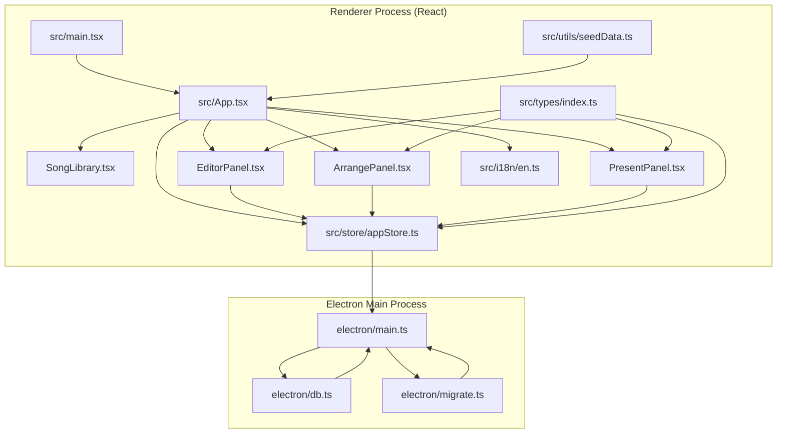
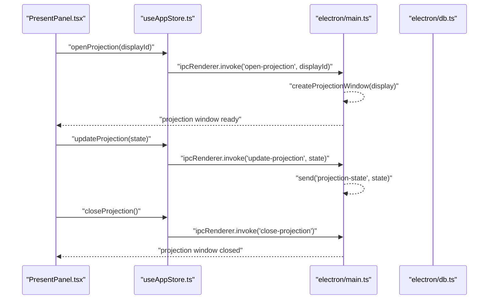
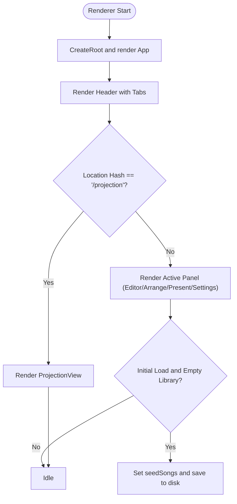
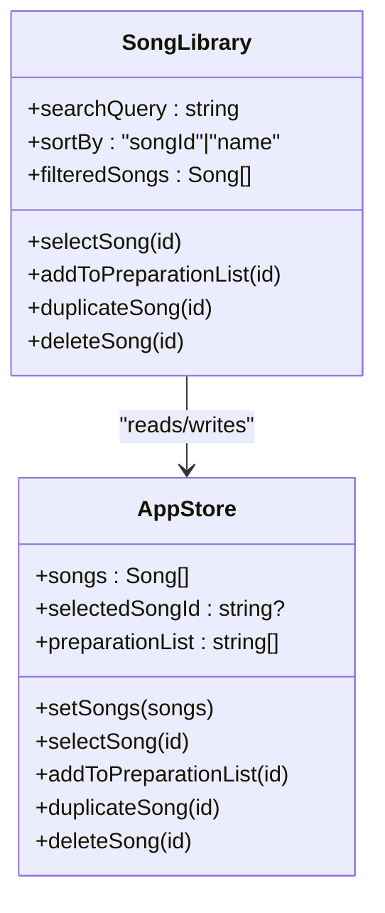
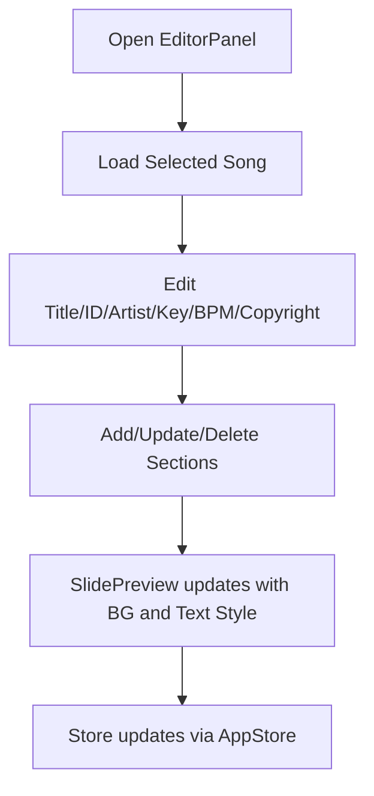
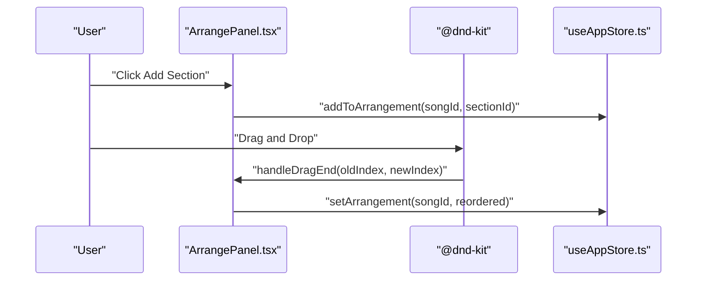
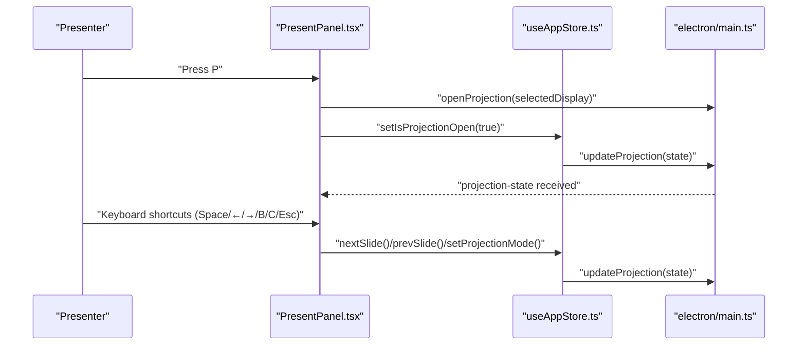
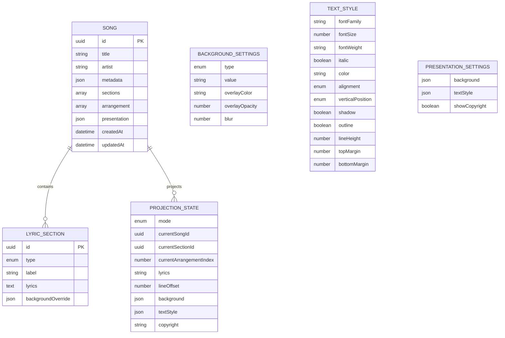
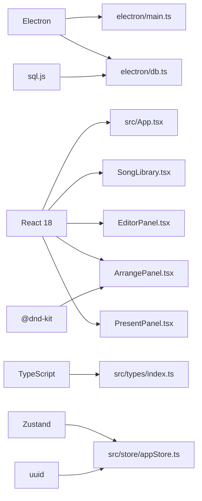

# Project Overview

<cite>
**Referenced Files in This Document**
- [README.md](file://README.md)
- [package.json](file://package.json)
- [src/App.tsx](file://src/App.tsx)
- [src/main.tsx](file://src/main.tsx)
- [electron/main.ts](file://electron/main.ts)
- [electron/db.ts](file://electron/db.ts)
- [electron/migrate.ts](file://electron/migrate.ts)
- [src/components/SongLibrary.tsx](file://src/components/SongLibrary.tsx)
- [src/components/EditorPanel.tsx](file://src/components/EditorPanel.tsx)
- [src/components/ArrangePanel.tsx](file://src/components/ArrangePanel.tsx)
- [src/components/PresentPanel.tsx](file://src/components/PresentPanel.tsx)
- [src/store/appStore.ts](file://src/store/appStore.ts)
- [src/types/index.ts](file://src/types/index.ts)
- [src/i18n/en.ts](file://src/i18n/en.ts)
- [src/utils/seedData.ts](file://src/utils/seedData.ts)
</cite>

## Table of Contents
1. [Introduction](#introduction)
2. [Project Structure](#project-structure)
3. [Core Components](#core-components)
4. [Architecture Overview](#architecture-overview)
5. [Detailed Component Analysis](#detailed-component-analysis)
6. [Dependency Analysis](#dependency-analysis)
7. [Performance Considerations](#performance-considerations)
8. [Troubleshooting Guide](#troubleshooting-guide)
9. [Conclusion](#conclusion)

## Introduction
LyricDeck is a cross-platform desktop application designed to manage song lyrics and deliver live lyric projection. It targets churches, worship teams, concert venues, rehearsal spaces, and presenters who need reliable, flexible tools to prepare, arrange, and display lyrics during live events. The application offers a complete workflow: create and organize songs, structure verses and choruses, build custom presentation arrangements, and project polished lyrics to external monitors with full customization.

Key benefits:
- Centralized song library with metadata and search
- Intuitive section editor with drag-and-drop arrangement builder
- Live presentation controls with keyboard shortcuts and multi-monitor support
- Rich background and text styling, plus a background gallery
- Local-first data persistence with import/export capabilities

## Project Structure
At a high level, LyricDeck combines Electron for the desktop shell, React 18 for the UI, TypeScript for type safety, Vite for development and build, and Tailwind CSS for styling. The renderer process hosts the React application, while the main process manages windows, IPC communication, and local data storage via a SQLite backend.

**Diagram sources**
- [electron/main.ts:1-390](file://electron/main.ts#L1-L390)
- [electron/db.ts:1-214](file://electron/db.ts#L1-L214)
- [electron/migrate.ts:1-127](file://electron/migrate.ts#L1-L127)
- [src/main.tsx:1-11](file://src/main.tsx#L1-L11)
- [src/App.tsx:1-102](file://src/App.tsx#L1-L102)
- [src/components/SongLibrary.tsx:1-193](file://src/components/SongLibrary.tsx#L1-L193)
- [src/components/EditorPanel.tsx:1-264](file://src/components/EditorPanel.tsx#L1-L264)
- [src/components/ArrangePanel.tsx:1-187](file://src/components/ArrangePanel.tsx#L1-L187)
- [src/components/PresentPanel.tsx:1-365](file://src/components/PresentPanel.tsx#L1-L365)
- [src/store/appStore.ts:1-385](file://src/store/appStore.ts#L1-L385)
- [src/types/index.ts:1-89](file://src/types/index.ts#L1-L89)
- [src/i18n/en.ts:1-180](file://src/i18n/en.ts#L1-L180)
- [src/utils/seedData.ts:1-165](file://src/utils/seedData.ts#L1-L165)

**Section sources**
- [README.md:1-111](file://README.md#L1-L111)
- [package.json:1-97](file://package.json#L1-L97)
- [src/main.tsx:1-11](file://src/main.tsx#L1-L11)
- [src/App.tsx:1-102](file://src/App.tsx#L1-L102)

## Core Components
- Song Library: Browse, search, sort, and manage songs; quick-add preparation list entries; add/duplicate/delete songs; supports filtering by title, artist, ID, and lyrics content.
- Section Editor: Create and edit lyric sections (Intro, Verse, Pre-Chorus, Chorus, Bridge, Instrumental, Outro, Custom); rename labels; edit lyrics; preview rendering with background and text styles.
- Arrangement Builder: Construct custom presentation sequences by dragging and dropping sections; reorder slides; clear arrangements; integrates with the preparation list.
- Live Presentation: Launch projection windows on secondary or primary displays; keyboard shortcuts for navigation and modes; preview current and next slides; adjust line offsets; toggle blank/black/logo/clear modes.
- Settings: Configure default background and text styles; choose from solid color, gradient CSS, or image/video backgrounds; customize typography, alignment, shadows, outlines, and margins; toggle copyright display.
- Multi-Monitor Support: Detect available displays, select target monitor, and open a fullscreen projection window that mirrors the live state.
- Data Persistence: Local JSON storage for songs and settings; SQLite-backed image gallery and metadata; import/export of all data and assets; automatic migration from legacy paths.

Practical examples:
- Worship team preparing a service: Create songs with metadata, build arrangements, rehearse with live preview, and project to a secondary monitor during the service.
- Concert presenter: Customize background and text styles per song, use keyboard shortcuts to navigate, and quickly switch to blank/black modes between acts.
- Church projector operator: Manage a shared library, duplicate popular songs, and export/import data across machines.

**Section sources**
- [README.md:5-26](file://README.md#L5-L26)
- [src/components/SongLibrary.tsx:1-193](file://src/components/SongLibrary.tsx#L1-L193)
- [src/components/EditorPanel.tsx:1-264](file://src/components/EditorPanel.tsx#L1-L264)
- [src/components/ArrangePanel.tsx:1-187](file://src/components/ArrangePanel.tsx#L1-L187)
- [src/components/PresentPanel.tsx:1-365](file://src/components/PresentPanel.tsx#L1-L365)
- [src/store/appStore.ts:1-385](file://src/store/appStore.ts#L1-L385)
- [src/types/index.ts:1-89](file://src/types/index.ts#L1-L89)
- [src/i18n/en.ts:1-180](file://src/i18n/en.ts#L1-L180)
- [src/utils/seedData.ts:1-165](file://src/utils/seedData.ts#L1-L165)

## Architecture Overview
LyricDeck follows a classic Electron architecture with a renderer-driven UI and a main process responsible for OS-level tasks and data persistence. The renderer uses React with a global state store for application state and projection state. IPC bridges enable the renderer to request display enumeration, open/close projection windows, and persist data.

**Diagram sources**
- [src/components/PresentPanel.tsx:109-129](file://src/components/PresentPanel.tsx#L109-L129)
- [src/store/appStore.ts:242-249](file://src/store/appStore.ts#L242-L249)
- [electron/main.ts:166-190](file://electron/main.ts#L166-L190)

**Section sources**
- [electron/main.ts:1-390](file://electron/main.ts#L1-L390)
- [src/store/appStore.ts:1-385](file://src/store/appStore.ts#L1-L385)

## Detailed Component Analysis

### Application Shell and Routing
The renderer entry initializes React and mounts the root App component. App renders a header with tabs for Editor, Arrange, Present, and Settings, and conditionally renders the ProjectionView when the route hash indicates projection mode. It also seeds initial data if the library is empty.

**Diagram sources**
- [src/main.tsx:1-11](file://src/main.tsx#L1-L11)
- [src/App.tsx:12-42](file://src/App.tsx#L12-L42)
- [src/utils/seedData.ts:1-165](file://src/utils/seedData.ts#L1-L165)

**Section sources**
- [src/main.tsx:1-11](file://src/main.tsx#L1-L11)
- [src/App.tsx:1-102](file://src/App.tsx#L1-L102)
- [src/utils/seedData.ts:1-165](file://src/utils/seedData.ts#L1-L165)

### Song Library Management
SongLibrary provides search, sorting, and bulk actions. It integrates with the global store to select songs, add to preparation list, duplicate, and delete. It renders a compact list with metadata and contextual actions.

**Diagram sources**
- [src/components/SongLibrary.tsx:1-193](file://src/components/SongLibrary.tsx#L1-L193)
- [src/store/appStore.ts:114-183](file://src/store/appStore.ts#L114-L183)

**Section sources**
- [src/components/SongLibrary.tsx:1-193](file://src/components/SongLibrary.tsx#L1-L193)
- [src/store/appStore.ts:1-385](file://src/store/appStore.ts#L1-L385)

### Section Editor and Preview
EditorPanel allows editing song metadata and sections, with a live preview panel reflecting background and text styling. It supports adding/removing sections and toggling collapse state.

**Diagram sources**
- [src/components/EditorPanel.tsx:17-118](file://src/components/EditorPanel.tsx#L17-L118)
- [src/components/EditorPanel.tsx:210-264](file://src/components/EditorPanel.tsx#L210-L264)
- [src/store/appStore.ts:174-220](file://src/store/appStore.ts#L174-L220)

**Section sources**
- [src/components/EditorPanel.tsx:1-264](file://src/components/EditorPanel.tsx#L1-L264)
- [src/store/appStore.ts:1-385](file://src/store/appStore.ts#L1-L385)

### Arrangement Builder with Drag-and-Drop
ArrangePanel lets users assemble a presentation sequence by dragging sections from the left panel into the arrangement area. It uses @dnd-kit for drag-and-drop reordering and integrates with the preparation list.

**Diagram sources**
- [src/components/ArrangePanel.tsx:22-134](file://src/components/ArrangePanel.tsx#L22-L134)
- [src/store/appStore.ts:222-239](file://src/store/appStore.ts#L222-L239)

**Section sources**
- [src/components/ArrangePanel.tsx:1-187](file://src/components/ArrangePanel.tsx#L1-L187)
- [src/store/appStore.ts:1-385](file://src/store/appStore.ts#L1-L385)

### Live Presentation and Projection
PresentPanel orchestrates live projection: enumerates displays, opens/closes projection windows, handles keyboard shortcuts, and previews current/next slides. It sends projection state updates to the projection window via IPC.

**Diagram sources**
- [src/components/PresentPanel.tsx:6-84](file://src/components/PresentPanel.tsx#L6-L84)
- [src/components/PresentPanel.tsx:109-129](file://src/components/PresentPanel.tsx#L109-L129)
- [src/store/appStore.ts:242-295](file://src/store/appStore.ts#L242-L295)
- [electron/main.ts:166-190](file://electron/main.ts#L166-L190)

**Section sources**
- [src/components/PresentPanel.tsx:1-365](file://src/components/PresentPanel.tsx#L1-L365)
- [src/store/appStore.ts:1-385](file://src/store/appStore.ts#L1-L385)
- [electron/main.ts:1-390](file://electron/main.ts#L1-L390)

### Data Model and State
LyricDeck defines core types for songs, sections, backgrounds, text styles, presentation settings, projection state, and app settings. The global store manages application state, projection state, preparation list, and persistence actions.

**Diagram sources**
- [src/types/index.ts:50-89](file://src/types/index.ts#L50-L89)

**Section sources**
- [src/types/index.ts:1-89](file://src/types/index.ts#L1-L89)
- [src/store/appStore.ts:31-96](file://src/store/appStore.ts#L31-L96)

## Dependency Analysis
Technology stack and roles:
- Electron: Desktop shell, window management, IPC, file system access, protocol registration, and SQLite-backed image storage.
- React 18: Component-based UI with hooks and concurrent features.
- TypeScript: Strong typing across models, stores, and components.
- Vite: Fast dev server and optimized builds.
- Tailwind CSS: Utility-first styling with a dark theme palette.
- Zustand: Lightweight global state management.
- @dnd-kit: Drag-and-drop reordering for arrangements.
- sql.js: Embedded database for images and metadata.
- uuid: Unique identifiers for songs, sections, and images.

**Diagram sources**
- [package.json:58-96](file://package.json#L58-L96)
- [electron/main.ts:1-390](file://electron/main.ts#L1-L390)
- [electron/db.ts:1-214](file://electron/db.ts#L1-L214)
- [src/store/appStore.ts:1-385](file://src/store/appStore.ts#L1-L385)
- [src/types/index.ts:1-89](file://src/types/index.ts#L1-L89)

**Section sources**
- [package.json:1-97](file://package.json#L1-L97)
- [electron/main.ts:1-390](file://electron/main.ts#L1-L390)
- [electron/db.ts:1-214](file://electron/db.ts#L1-L214)

## Performance Considerations
- Rendering: Keep lyric previews concise; avoid excessive DOM nesting in arrangement lists. Use virtualization for very large libraries if needed.
- Drag-and-drop: @dnd-kit is efficient; minimize re-renders by passing stable keys and avoiding unnecessary prop churn.
- Projection updates: Batch projection state updates and throttle frequent keystrokes to reduce IPC overhead.
- Images: Store images in SQLite BLOBs to avoid filesystem fragmentation; lazy-load previews and thumbnails.
- Persistence: Debounce save operations to disk; batch writes for bulk edits.

## Troubleshooting Guide
Common issues and resolutions:
- Projection window does not open:
  - Verify display detection and selection. Ensure a secondary display is available or select the primary.
  - Confirm the projection window is not already open; close it before reopening.
- Keyboard shortcuts not working:
  - Avoid typing in input fields when expecting shortcuts.
  - Check that the presentation panel is focused and the projection window is open.
- Background images not appearing:
  - Confirm images were added to the gallery and URLs are valid.
  - Re-import data if migrated from older versions.
- Data not persisting:
  - Check that the userData directory exists and is writable.
  - Use import/export to back up and restore data if JSON files become corrupted.

**Section sources**
- [src/components/PresentPanel.tsx:38-84](file://src/components/PresentPanel.tsx#L38-L84)
- [electron/main.ts:154-190](file://electron/main.ts#L154-L190)
- [electron/db.ts:70-131](file://electron/db.ts#L70-L131)
- [electron/migrate.ts:8-126](file://electron/migrate.ts#L8-L126)

## Conclusion
LyricDeck delivers a practical, cross-platform solution for managing song lyrics and live projection. Its modular UI, robust state management, and Electron-based architecture make it suitable for diverse environments—from small churches to larger concert venues. By combining intuitive authoring tools with powerful presentation controls and reliable data persistence, LyricDeck streamlines the entire workflow from preparation to live performance.